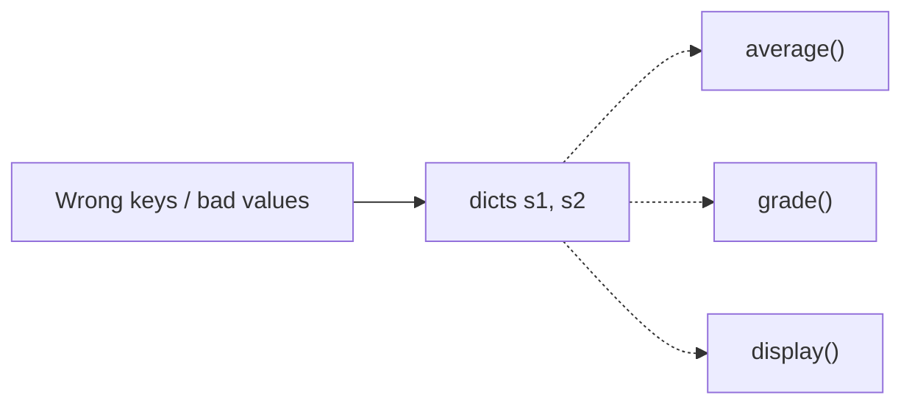
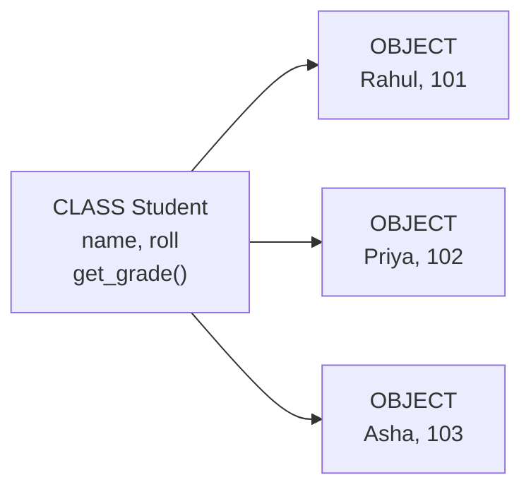
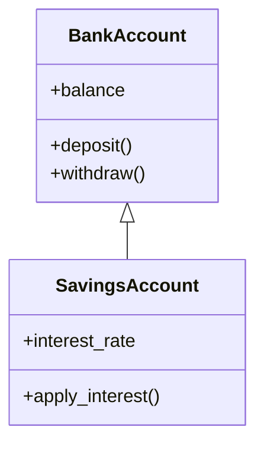

# Module 03 — Object-Oriented Programming (OOP)

**Phase:** Advanced Python

**Previous module:** Modules and Packages  
**Next module:** Exception Handling

---

## Learning Outcomes

By the end of these sessions (**S36–S39**), learners will be able to:

1. Explain why classes beat loose dicts + free functions for real entities (Student, Order, BankAccount).
2. Define classes with `__init__`, `self`, instance methods, and create objects.
3. Differentiate instance, class, and local variables — and avoid the mutable class-attribute trap.
4. Choose instance methods, `@classmethod`, and `@staticmethod` for the right job.
5. Encapsulate state with naming conventions and `@property` (controlled read access).
6. Use HAS-A (composition) and IS-A (inheritance) appropriately; call parent behaviour with `super()`.
7. Apply polymorphism via method overriding and duck typing.
8. Override `__str__` for readable object printing when debugging or logging.

---


## Classroom Ticket

Open the lab kit **before** long notes. Read the ticket → code in `starter/` or fix `broken/`.

- **[BankAccount with protected balance](../15_Lab_Assets/17_bank_account_oop/)** (**S37** focus; finish / push by **S39**)

Finish the ticket in class; compare with the official solution only when your trainer says so.

---


## Motivation — Feel the pain of dicts + free functions

Look at this student tracker. Data lives in a dict; behaviour lives in separate functions:

```python
s1 = {"roll": 101, "name": "Anita", "marks": [72, 68, 81]}
s2 = {"roll": 102, "name": "Vikram", "marks": [40, 35, 48]}

def average(student):
    marks = student["marks"]
    return sum(marks) / len(marks)

def grade(student):
    avg = average(student)
    if avg >= 85:
        return "A"
    if avg >= 70:
        return "B"
    if avg >= 50:
        return "C"
    return "Fail"

def display(student):
    print(f"{student['roll']}: {student['name']} — {grade(student)}")

display(s1)
display(s2)

# Easy mistakes in a busy script:
s1["marks"] = -10          # nonsense value, no guard
del s2["name"]             # KeyError waiting to happen
print(average({"marks": []}))  # ZeroDivisionError — not really a student
```

Problems with this style:

1. Anyone can corrupt the dict (`marks = -10`, delete `name`).
2. Related data and behaviour are **scattered** — easy to pass the wrong shape.
3. Adding `college`, `email`, or `is_pass()` means hunting every function that touches a student.
4. As the program grows, the same broken pattern repeats for Order, Account, Product — harder to test and reuse.

**Visual — data here, logic there (easy to break):**




Bundle **data + behaviour** into one unit — a **class**. Each filled form is an **object**:

```python
class Student:
    def __init__(self, roll, name, marks):
        self.roll = roll
        self.name = name
        self.marks = list(marks)

    def average(self):
        return sum(self.marks) / len(self.marks)

    def grade(self):
        avg = self.average()
        if avg >= 85:
            return "A"
        if avg >= 70:
            return "B"
        if avg >= 50:
            return "C"
        return "Fail"

    def display(self):
        print(f"{self.roll}: {self.name} — {self.grade()}")

s1 = Student(101, "Anita", [72, 68, 81])
s1.display()
```

That shift — from “bags of data + floating functions” to “objects that know how to behave” — is **Object-Oriented Programming (OOP)**.

---


## What is OOP? / Why do we need it?

**Object-Oriented Programming** models software around **things** in the domain — a `Student`, a `BankAccount`, an `Order`.

**Icons:** Bank · UPI · Employee · Laptop · Order

**Where used?**
- Banking (accounts, UPI wallets)
- Ecommerce (orders, products)
- Hospital (patients, appointments)
- Payroll (employees, salary)
- CRM (customers, tickets)

| Idea          | Meaning                                              |
| ------------- | ---------------------------------------------------- |
| **`class`**   | Blueprint (like an Aadhaar form template)            |
| **`object`**  | One filled form — Rahul, roll 101                    |
| **Attribute** | Data on the object (`name`, `balance`)               |
| **`method`**  | Behaviour on the object (`deposit()`, `get_grade()`) |


**Visual — one blueprint, many filled forms:**




Classic pillars (you will practise each below):


| Pillar            | Plain English                          | Python taste                                                                        |
| ----------------- | -------------------------------------- | ----------------------------------------------------------------------------------- |
| **Encapsulation** | Bundle data + methods; control access  | `_balance`, `@property`, validate in methods                                        |
| **Abstraction**   | Show essentials; hide messy internals  | Practised when callers use `deposit()` / `withdraw()` without knowing balance rules |
| **`inheritance`** | Child reuses/extends parent (**IS-A**) | `SavingsAccount(BankAccount)`                                                       |
| **Polymorphism**  | Same call, different behaviour         | `shape.area()` on Circle vs Square                                                  |


**Composition (HAS-A)** is equally important in real code: an `Employee` **has a** `Laptop`; they are not the same kind of thing. Prefer HAS-A when you only need to *use* another object.

---


## Important Concepts


### 1. Class, object, `self`, `__init__`

**What:** A **class** is the blueprint (data + behaviour together). An **object** is one concrete instance of that class. `__init__` runs when you create an object and sets starting data. `self` is the current object (like `this` in Java — but Python makes you write it).  
**Why:** Real systems are easier as objects than as loose dicts passed through many free functions.

```python
class Student:
    def __init__(self, roll, name):   # constructor
        self.roll = roll              # instance attribute
        self.name = name

    def display(self):                # instance method
        print(f"{self.roll}: {self.name}")

s1 = Student(101, "Anita")            # object creation
s1.display()
```

**Expected Output:**

```
101: Anita
```

- `s1` is a **reference** to the `object` in memory — you use it to call methods and read attributes.
- `__init__` runs automatically after object creation — you rarely call it by name.
- If you omit `__init__`, Python still creates the `object` (empty shell); you add attributes later (usually not ideal).

**Remember:** `self` = the **current object** (passed automatically on `s1.display()`).

**Difference between Method and Constructor:**


|                      | Method                    | Constructor (`__init__`)             |
| -------------------- | ------------------------- | ------------------------------------ |
| Name                 | Any valid name            | Always `__init__`                    |
| When it runs         | When you call it          | Automatically on `ClassName(...)`    |
| How often per object | As many times as you call | Once (at creation)                   |
| Typical job          | Business logic            | Declare and initialize instance data |


**Note:**

- Forgetting `self` in methods → `TypeError` on call — the first parameter must be `self`.
- Over-engineering OOP (5 classes for hello world) — use functions until complexity grows.

**Try these (2 programs):**

**Program 1 — Book with info()**

```python
class Book:
    def __init__(self, title, author, price):
        self.title = title
        self.author = author
        self.price = price

    def info(self):
        print(f"{self.title} by {self.author} — ₹{self.price}")

b1 = Book("Atomic Habits", "James Clear", 499)
b2 = Book("Wings of Fire", "A.P.J. Abdul Kalam", 350)
b1.info()
b2.info()
```

**Expected Output:**

```
Atomic Habits by James Clear — ₹499
Wings of Fire by A.P.J. Abdul Kalam — ₹350
```

**Program 2 — Student.is_pass**

```python
class Student:
    def __init__(self, roll, name):
        self.roll = roll
        self.name = name

    def is_pass(self, marks):
        return marks >= 40

s = Student(101, "Anita")
print(s.is_pass(35))  # False
print(s.is_pass(72))  # True
```

**Expected Output:**

```
False
True
```

### 2. Three kinds of variables (instance / class / local)

**What:**  

- **Instance** — unique per object (`self.emp_id`)  
- **Class** (sometimes called “static” in older notes) — one copy shared by all objects (`Employee.company`)  
- **Local** — temporary names inside a method; die when the method ends

**Why:** Company name can be shared; employee id must not. Temporary totals should not leak as attributes.

```python
class Employee:
    company = "KSR Datavizon"   # class attribute — shared

    def __init__(self, emp_id, name):
        self.emp_id = emp_id    # instance attribute — unique per object
        self.name = name

    def label(self):
        title = "Staff"         # local variable — method only
        return f"{title}: {self.name} @ {Employee.company}"
```

**Instance vs class — the shadowing trap:**

```python
e1 = Employee(1, "Ravi")
e2 = Employee(2, "Meera")
e1.company = "Acme"   # creates an *instance* attribute on e1 only

print(e1.company)         # Acme
print(e2.company)         # KSR Datavizon
print(Employee.company)   # KSR Datavizon
```

To change the shared value for everyone, assign via the class: `Employee.company = "..."`.

**Note:**

- Mutable class attribute → shared state across objects — initialize lists/dicts in `__init__`, not at class level.
- Prefer `ClassName.attr` when you mean the shared value (clearer than `self.attr` for class data).

**Common Error:** putting `students = []` at **class** level — every batch shares one list. Always create the list in `__init__`.

**Try these (2 programs):**

**Program 1 — Shared class attribute on Student**

```python
class Student:
    college = "KSR College"

    def __init__(self, roll, name):
        self.roll = roll
        self.name = name

s1 = Student(1, "Anita")
s2 = Student(2, "Vikram")
print(s1.college, s2.college)

Student.college = "KSR Institute of Technology"
print(s1.college, s2.college)  # both reflect the new class value
```

**Program 2 — Mutable class attribute trap (spot the bug)**

```python
class Batch:
    # WRONG if you meant "each batch has its own list":
    # students = []

    def __init__(self, name):
        self.name = name
        self.students = []   # CORRECT — per object

b1 = Batch("Python FS Morning")
b2 = Batch("Python FS Evening")
b1.students.append("Arjun")
print(b2.students)  # [] — each batch has its own list
```


### 3. Three kinds of methods (instance / class / static)

**What:**  

- **Instance method** — first arg `self`; uses object data  
- **Class method** — `@classmethod`, first arg `cls`; works with class-level data or alternate constructors  
- **Static method** — `@staticmethod`; utility namespaced on the class (no `self` / `cls`)

**Why:** Not every helper needs an instance. Object counters and “build from CSV row” fit class methods; pure converters fit static methods.

```python
class Order:
    order_count = 0

    def __init__(self, product, qty):
        self.product = product
        self.qty = qty
        Order.order_count += 1

    def line_total(self, price):          # instance method
        return self.qty * price

    @classmethod
    def get_count(cls):                   # class method
        return cls.order_count

    @classmethod
    def from_pair(cls, product, qty):     # alternate constructor
        return cls(product, qty)

    @staticmethod
    def gst_amount(amount, rate=0.18):    # static utility
        return amount * rate

o = Order.from_pair("Notebook", 3)
print(o.line_total(40))
print(Order.get_count())
print(Order.gst_amount(100))
```

**Expected Output:**

```
120
1
18.0
```

**Interview:** `@classmethod` gets `cls` (class-level / alternate constructors). `@staticmethod` is a plain utility on the class — no `self` / `cls`.

**Note:**

- In day-to-day apps you mostly write **instance** methods. Use `@classmethod` / `@staticmethod` when the intent is clear — not for decoration.
- Interview tip: `@classmethod` gets the class (`cls`); `@staticmethod` is a plain function living on the class.

**Try these (2 programs):**

**Program 1 — Track how many objects were created**

```python
class Ticket:
    count = 0

    def __init__(self, seat):
        self.seat = seat
        Ticket.count += 1

    @classmethod
    def how_many(cls):
        return cls.count

Ticket("A1")
Ticket("A2")
print(Ticket.how_many())  # 2
```

**Program 2 — Static helper on a math namespace**

```python
class FareMath:
    @staticmethod
    def with_gst(amount, rate=0.05):
        return amount * (1 + rate)

print(FareMath.with_gst(1000))  # 1050.0
```


### 4. Encapsulation and `@property`

**Icons:** Bank · UPI

**Where used?** Banking balances, UPI wallets, passwords, inventory stock — anything that must not be set to nonsense values from outside.

**What:** Naming and accessors that signal “please don’t poke internals from outside.”  
**Why:** Protect balances, passwords, and invariants (no negative balance by accident).


| Syntax   | Meaning                | Access                   |
| -------- | ---------------------- | ------------------------ |
| `name`   | public                 | Normal use               |
| `_name`  | protected (convention) | Internal / subclass use  |
| `__name` | name-mangled           | Harder accidental access |


`__balance` is **not** real security — still reachable as `obj._ClassName__balance`. Use encapsulation for **clarity and safety in honest code**, not cryptography.

Prefer validating inside methods. For read-only or computed views, use `@property`:

```python
class BankAccount:
    def __init__(self, holder, balance=0):
        self.holder = holder
        self._balance = float(balance)

    @property
    def balance(self):
        return self._balance

    def deposit(self, amount):
        if amount <= 0:
            print("Invalid deposit amount")
            return
        self._balance += amount
```

Callers write `acct.balance` (looks like an attribute, runs a method).

**Lab vs note style (S37):** the Classroom Ticket uses `__balance` + `get_balance()` — same idea as protecting internals. `@property` is the more idiomatic Python style; both are acceptable in this course.

**Note:**

- Leading with `__` everywhere is noisy. Start with public + validated methods; add `_` / `__` / `@property` when the API needs it.
- Java-style `getX`/`setX` pairs work, but idiomatic Python often prefers `@property` / `@x.setter`.

**Try these (2 programs):**

**Program 1 — UPIWallet with private balance**

```python
class UPIWallet:
    def __init__(self, balance=0):
        self.__balance = balance

    def credit(self, amount):
        if amount <= 0:
            print("Invalid credit amount")
            return
        self.__balance += amount

    def debit(self, amount):
        if amount <= 0:
            print("Invalid debit amount")
            return
        if amount > self.__balance:
            print("Insufficient balance")
            return
        self.__balance -= amount

    def get_balance(self):
        return self.__balance

wallet = UPIWallet(500)
wallet.credit(200)
wallet.debit(100)
wallet.debit(1000)  # rejected
print("Balance:", wallet.get_balance())  # 600
```

**Expected Output:**

```
Insufficient balance
Balance: 600
```

**Program 2 — @property read-only view**

```python
class Temperature:
    def __init__(self, celsius):
        self._celsius = celsius

    @property
    def celsius(self):
        return self._celsius

    @property
    def fahrenheit(self):
        return self._celsius * 9 / 5 + 32

t = Temperature(37)
print(t.celsius, t.fahrenheit)
# t.celsius = 40  # AttributeError if no setter — intentional
```


### 5. HAS-A (composition) then IS-A (inheritance) + `super()`

**Icons:** Employee · Laptop · Bank

**Where used?** Payroll (`Employee` **is a** `Person`, **has a** `Laptop`); banking (`SavingsAccount` **is a** `BankAccount`).

**What:**  

- **HAS-A / composition:** Class A *uses* an instance of B (`Car` has an `Engine`; `Employee` has a `Laptop`).  
- **IS-A / inheritance:** Class C *is a specialised* B (`SavingsAccount` is a `BankAccount`).

**Why:** Share behaviour once. Extend only when the child truly is that kind of thing. If you only need to *use* another object, prefer composition.

**Rule of thumb:**


| Need                          | Choose                |
| ----------------------------- | --------------------- |
| Extend / specialise behaviour | **IS-A** inheritance  |
| Reuse by collaborating        | **HAS-A** composition |


```python
class Laptop:
    def __init__(self, model):
        self.model = model

    def spec(self):
        return f"Laptop: {self.model}"

class Person:
    def __init__(self, name):
        self.name = name

class Employee(Person):                    # IS-A Person
    def __init__(self, name, emp_id, laptop):
        super().__init__(name)             # init parent part
        self.emp_id = emp_id
        self.laptop = laptop               # HAS-A Laptop

    def info(self):
        return f"{self.name} ({self.emp_id}) — {self.laptop.spec()}"

e = Employee("Priya", 501, Laptop("Dell Latitude"))
print(e.info())
```

**Visual — IS-A inheritance (child gets parent features):**



**Quick Revision:**
- Child **is a** parent → use `inheritance`
- Child only **uses** another type → HAS-A (composition)
- Always call `super().__init__(...)` when the parent owns required fields

Always call `super().__init__(...)` in the child when the parent owns required attributes — otherwise parent fields are missing.

**Note:**

- Not calling `super().__init__` → parent attributes missing.
- Deep inheritance trees get brittle — prefer composition when unsure. Richer design patterns live in optional [Professional Python Deep Dive](07_Professional_Python_Deep_Dive.md).

**Try these (2 programs):**

**Program 1 — SavingsAccount with interest**

```python
class BankAccount:
    def __init__(self, holder, balance=0):
        self.holder = holder
        self._balance = balance

    def deposit(self, amount):
        self._balance += amount

    def get_balance(self):
        return self._balance

class SavingsAccount(BankAccount):
    def __init__(self, holder, balance=0, interest_rate=0.04):
        super().__init__(holder, balance)
        self.interest_rate = interest_rate

    def apply_interest(self):
        interest = self._balance * self.interest_rate
        self.deposit(interest)
        print(f"Interest ₹{interest:.2f} added. Balance: ₹{self.get_balance():.2f}")

acct = SavingsAccount("Priya", 10000, 0.05)
acct.apply_interest()
```

**Expected Output:**

```
Interest ₹500.00 added. Balance: ₹10500.00
```

**Program 2 — Composition only (Order HAS-A notifier)**

```python
class SmsNotifier:
    def send(self, message):
        print(f"SMS: {message}")

class OrderService:
    def __init__(self, notifier):
        self.notifier = notifier   # HAS-A

    def place(self, order_id):
        self.notifier.send(f"Order {order_id} placed")

OrderService(SmsNotifier()).place("ORD-101")
```

**Expected Output:**

```
SMS: Order ORD-101 placed
```

**Icons:** Order

### 6. Inheritance shapes (map) + method overriding

**What:** Common tree shapes — and **overriding**: child redefines a parent method when behaviour must differ.  
**Why:** So you recognise diagrams in interviews and know when to call `super()` from the override.


| Shape            | Idea                       | Example                                                       |
| ---------------- | -------------------------- | ------------------------------------------------------------- |
| **Single**       | One parent → one child     | `Employee(Person)`                                            |
| **Multilevel**   | Chain                      | `CC(C)`, `C(P)`                                               |
| **Hierarchical** | One parent → many children | `Car(Vehicle)`, `Bike(Vehicle)`                               |
| **Multiple**     | Many parents → one child   | `class C(A, B)` — supported; prefer composition when possible |


```python
class Vehicle:
    def __init__(self, brand, year):
        self.brand = brand
        self.year = year

    def info(self):
        return f"{self.brand} ({self.year})"

class Car(Vehicle):
    def __init__(self, brand, year, doors):
        super().__init__(brand, year)
        self.doors = doors

    def info(self):   # override
        return f"Car: {super().info()}, doors={self.doors}"

class Bike(Vehicle):
    def info(self):   # override
        return f"Bike: {super().info()}"

for v in [Car("Hyundai", 2022, 4), Bike("Royal Enfield", 2021)]:
    print(v.info())
```

**Multiple inheritance note:** If both parents define the same method, Python uses **MRO** (Method Resolution Order) — roughly “child first, then left-to-right parents.” Inspect with `ClassName.mro()`. You do not need the C3 algorithm for this course; know that order matters: `class C(A, B)` vs `class C(B, A)`.

**Try these (2 programs):**

**Program 1 — Multilevel**

```python
class Person:
    def role(self):
        return "Person"

class Employee(Person):
    def role(self):
        return "Employee"

class Manager(Employee):
    def role(self):
        return "Manager"

print(Manager().role())  # Manager
print(isinstance(Manager(), Person))  # True
```

**Program 2 — Override + super()**

```python
class Person:
    def __init__(self, name):
        self.name = name

    def label(self):
        return self.name

class TeachingAssistant(Person):
    def __init__(self, name, subject):
        super().__init__(name)
        self.subject = subject

    def label(self):
        return f"{super().label()} — {self.subject} lab TA"

print(TeachingAssistant("Anita", "DSA").label())
```


### 7. Polymorphism (override → duck typing → “no overloading”)

**What:** “Many forms” — the same operation name behaves differently depending on the object.  
**Why:** Write one loop/helper without giant `if type == ...` chains.

**Path A — Override polymorphism (shared hierarchy):** same method name on parent/children (see Vehicles above).

**Path B — Duck typing:** no shared parent required — if it has `pay()`, it works:

```python
class UPI:
    def pay(self, amount):
        print(f"Paid ₹{amount} via UPI")

class Card:
    def pay(self, amount):
        print(f"Paid ₹{amount} via Card")

def checkout(method, amount):
    method.pay(amount)

checkout(UPI(), 250)
checkout(Card(), 999)
```

Python: *if it walks like a duck and quacks like a duck…*

**Path C — “Overloading” in Python:** Java-style method/constructor overloading (same name, different signatures) is **not** supported. The last definition wins. Use defaults or `*args` instead:

```python
class Adder:
    def add(self, *nums):
        return sum(nums)

print(Adder().add(1, 2))
print(Adder().add(1, 2, 3, 4))
```

**Stretch — operator overloading:** customise `+` via `__add__` (optional demo, not core):

```python
class BookStack:
    def __init__(self, pages):
        self.pages = pages

    def __add__(self, other):
        return BookStack(self.pages + other.pages)

print((BookStack(100) + BookStack(200)).pages)  # 300
```

**Try these (2 programs):**

**Program 1 — Several pay methods, one checkout loop**

```python
class UPI:
    def pay(self, amount):
        print(f"Paid ₹{amount} via UPI")

class Card:
    def pay(self, amount):
        print(f"Paid ₹{amount} via Card")

class Cash:
    def pay(self, amount):
        print(f"Paid ₹{amount} in Cash")

def checkout(method, amount):
    method.pay(amount)

for method in [UPI(), Card(), Cash()]:
    checkout(method, 100)
```

**Expected Output:**

```
Paid ₹100 via UPI
Paid ₹100 via Card
Paid ₹100 in Cash
```

**Program 2 — Shape areas without isinstance**

```python
import math

class Circle:
    def __init__(self, r):
        self.r = r

    def area(self):
        return math.pi * self.r ** 2

class Square:
    def __init__(self, side):
        self.side = side

    def area(self):
        return self.side ** 2

for shape in [Circle(3), Square(4), Circle(1)]:
    print(f"{shape.__class__.__name__} area: {shape.area():.2f}")
```

**Expected Output:**

```
Circle area: 28.27
Square area: 16.00
Circle area: 3.14
```

### 8. Readable objects with `__str__`

**What:** `__str__` controls what you see when you `print(obj)` or convert it with `str(obj)`.  
**Why:** Default object text (`<__main__.Student object at 0x...>`) is useless when debugging; a clear string saves time.

```python
class Student:
    def __init__(self, roll, name):
        self.roll = roll
        self.name = name

    def __str__(self):
        return f"Student({self.roll}, {self.name})"

print(Student(101, "Anita"))  # Student(101, Anita)
```

**Expected Output:**

```
Student(101, Anita)
```

Without `__str__`, you get the default memory-address style string.

**Note:** `__repr__` is the unambiguous/debug form (`repr(obj)`). Prefer implementing `__str__` first; dig into `__repr__` in [Professional Python Deep Dive](07_Professional_Python_Deep_Dive.md) if needed.

**Try these (2 programs):**

**Program 1 — Readable account**

```python
class BankAccount:
    def __init__(self, holder, balance=0):
        self.holder = holder
        self._balance = balance

    def __str__(self):
        return f"{self.holder}'s account — ₹{self._balance:.2f}"

print(BankAccount("Priya", 1000))
```

**Program 2 — Product label**

```python
class Product:
    def __init__(self, sku, price):
        self.sku = sku
        self.price = price

    def __str__(self):
        return f"{self.sku} @ ₹{self.price}"

print(Product("NB-A4", 40))
```

---


## Step-by-Step Annotated Python 3 Code

Examples below **deepen** lab-shaped and combined patterns. For the mutable class-attr trap and Vehicle override loop, reuse Concept 2 and Concept 6 — no need to re-type them here.

### Example 1 — BankAccount with encapsulation (lab-shaped)

```python
class BankAccount:
    def __init__(self, holder, balance=0):
        self.holder = holder
        self.__balance = balance

    def deposit(self, amount):
        if amount <= 0:
            print("Invalid deposit amount")
            return
        self.__balance += amount
        print(f"Deposited ₹{amount}. New balance: ₹{self.__balance}")

    def withdraw(self, amount):
        if amount <= 0:
            print("Invalid withdraw amount")
            return
        if amount > self.__balance:
            print("Insufficient funds")
            return
        self.__balance -= amount
        print(f"Withdrew ₹{amount}. New balance: ₹{self.__balance}")

    def get_balance(self):
        return self.__balance

acct = BankAccount("Priya", 1000)
acct.deposit(500)
acct.withdraw(200)
print("Balance:", acct.get_balance())
# acct.__balance  # AttributeError — name mangling
```


### Example 2 — Employee / Manager (class attr + override)

```python
class Employee:
    tax_rate = 0.10

    def __init__(self, emp_id, name, basic_salary):
        self.emp_id = emp_id
        self.name = name
        self.basic_salary = basic_salary

    def net_salary(self):
        return self.basic_salary * (1 - Employee.tax_rate)

    def __str__(self):
        return f"{self.name} net ₹{self.net_salary():.2f}"

class Manager(Employee):
    def __init__(self, emp_id, name, basic_salary, bonus=5000):
        super().__init__(emp_id, name, basic_salary)
        self.bonus = bonus

    def net_salary(self):
        return super().net_salary() + self.bonus

print(Employee(1, "Ravi", 30000))
print(Manager(2, "Meera", 30000, bonus=8000))
```


### Example 3 — HAS-A + IS-A together

```python
class Car:
    def __init__(self, name, model):
        self.name = name
        self.model = model

    def getinfo(self):
        return f"{self.name} {self.model}"

class Person:
    def __init__(self, name):
        self.name = name

class Employee(Person):
    def __init__(self, name, emp_id, car):
        super().__init__(name)
        self.emp_id = emp_id
        self.car = car

    def __str__(self):
        return f"{self.name} ({self.emp_id}) drives {self.car.getinfo()}"

print(Employee("Anita", 101, Car("Innova", "Crysta")))
```

---


## Practice Exercises

### Basic

1. Create `Product` with `sku`, `price`, and `__str__`.
   **Model answer:**
   ```python
   class Product:
       def __init__(self, sku, price):
           self.sku = sku
           self.price = price

       def __str__(self):
           return f"{self.sku} @ ₹{self.price}"
   ```

2. Create two `Product` objects and print them.
   **Model answer:**
   ```python
   print(Product("PEN-01", 10))
   print(Product("NB-A4", 40))
   ```

   **Expected Output:**
   ```
   PEN-01 @ ₹10
   NB-A4 @ ₹40
   ```

3. Add `apply_discount(percent)` returning the discounted price (do not mutate unless you choose to).
   **Model answer:**
   ```python
   class Product:
       def __init__(self, sku, price):
           self.sku, self.price = sku, price

       def apply_discount(self, percent):
           return self.price * (1 - percent / 100)

   print(Product("X", 1000).apply_discount(10))  # 900.0
   ```

### Intermediate

1. `Rectangle` with `area()` / `perimeter()`; `Square` inherits from `Rectangle`.
   **Model answer:**
   ```python
   class Rectangle:
       def __init__(self, w, h):
           self.w, self.h = w, h

       def area(self):
           return self.w * self.h

       def perimeter(self):
           return 2 * (self.w + self.h)

   class Square(Rectangle):
       def __init__(self, side):
           super().__init__(side, side)
   ```

2. `Student` with a list of marks; `average()` and `grade()`; keep marks as an **instance** list.
   **Model answer:**
   ```python
   class Student:
       def __init__(self, name, marks):
           self.name = name
           self.marks = list(marks)

       def average(self):
           return sum(self.marks) / len(self.marks)

       def grade(self):
           avg = self.average()
           if avg >= 85:
               return "A"
           if avg >= 70:
               return "B"
           if avg >= 50:
               return "C"
           return "Fail"
   ```

3. Polymorphism with a shared `Shape` base and `Circle` / `Rectangle` subclasses (`area()`).
   **Model answer:**
   ```python
   import math

   class Shape:
       def area(self):
           raise NotImplementedError

   class Circle(Shape):
       def __init__(self, r):
           self.r = r

       def area(self):
           return math.pi * self.r ** 2

   class Rectangle(Shape):
       def __init__(self, w, h):
           self.w, self.h = w, h

       def area(self):
           return self.w * self.h

   for shape in [Circle(2), Rectangle(3, 4)]:
       print(shape.area())
   ```

4. Add `@property` `balance` on a tiny wallet that only allows deposit through a method.
   **Model answer:**
   ```python
   class Wallet:
       def __init__(self, opening=0):
           self._balance = opening

       @property
       def balance(self):
           return self._balance

       def deposit(self, amount):
           if amount > 0:
               self._balance += amount

   w = Wallet(100)
   w.deposit(50)
   print(w.balance)  # 150
   ```

### Interview-style

1. Difference between `@staticmethod` and `@classmethod`?
  **Model answer:**  
   `@staticmethod` is a plain function living on the class (no automatic first argument). `@classmethod` receives the class as `cls` and is used for alternate constructors or class-level helpers.
2. Is Python fully object-oriented? Discuss.
  **Model answer:**  
   Nearly everything is an object, and OOP features are first-class. It is multi-paradigm: procedural and functional styles are fine when classes add no value.
3. Why override `__str__`? What do you see if you skip it?
  **Model answer:**  
   `__str__` returns a human-readable description used by `print` and `str()`. Without it, Python shows a default like `<__main__.Student object at 0x...>`, which is hard to debug.
4. When inheritance vs composition?
  **Model answer:**  
   Inheritance when the child **is a** specialised parent. Composition when an object **has a** collaborator it uses. Prefer composition when unsure.

---


## Mini-Project: BankAccount OOP CLI

**Title:** Encapsulated account demo  
**Lab kit (build here):** [15_Lab_Assets/17_bank_account_oop/](../15_Lab_Assets/17_bank_account_oop/)

### What to build


| Piece         | Detail                                                                       |
| ------------- | ---------------------------------------------------------------------------- |
| `BankAccount` | `__balance` (or `_balance` + property); `deposit`, `withdraw`, `get_balance` |
| Rules         | Reject amount ≤ 0; reject withdraw over balance                              |
| CLI menu      | 1 Deposit · 2 Withdraw · 3 Balance · 4 Exit                                  |
| Nice to have  | `__str__` for a one-line status print                                        |


**Starter idea:**

```python
class BankAccount:
    def __init__(self, owner, opening=0.0):
        self.owner = owner
        self.__balance = float(opening)

    def deposit(self, amount):
        if amount <= 0:
            print("amount must be positive")
            return
        self.__balance += amount

    def withdraw(self, amount):
        if amount <= 0:
            print("amount must be positive")
            return
        if amount > self.__balance:
            print("insufficient funds")
            return
        self.__balance -= amount

    def get_balance(self):
        return self.__balance

    def __str__(self):
        return f"{self.owner}: ₹{self.__balance:.2f}"
```


### Stretch

- Add `SavingsAccount(BankAccount)` with `apply_interest(rate)` **or** a `CurrentAccount` with a different minimum-balance rule.  
- Log each successful deposit/withdraw as a list of tuples `(action, amount, balance)`.  
- **Later (Exceptions week):** switch validation to `raise ValueError` and catch it in the menu loop.


### Done when

- [ ] Lab kit BankAccount ticket passes  
- [ ] Menu options 1–3 work; 4 exits  
- [ ] Balance is not casually overwritten from outside (`account.__balance` fails / mangled)  
- [ ] Repo pushed with a short README of a sample session  

---


## Revision Map — Memorize / Understand / Practise / Build


| Topic          | Memorize                                  | Understand                      | Practise                    | Build                   |
| -------------- | ----------------------------------------- | ------------------------------- | --------------------------- | ----------------------- |
| Class & object | `class`, `self`, `__init__`               | Blueprint vs instance           | 3 simple classes            | Student / Book entities |
| Variables      | Instance / class / local                  | Shared vs per-object; shadowing | Spot class-attr bugs        | Config + instance mix   |
| Methods        | Instance / `classmethod` / `staticmethod` | When each fits                  | Object counter + GST helper | Service class methods   |
| Encapsulation  | `_`, `__`, `@property`                    | Convention ≠ security           | Wallet with property        | Validated attributes    |
| HAS-A vs IS-A  | Composition vs inheritance                | Prefer HAS-A when unsure        | Employee + Laptop           | Order + notifier        |
| Inheritance    | `class Child(Parent)`, `super()`          | Override + init chain           | Vehicle / Employee tree     | SavingsAccount          |
| Polymorphism   | Override + duck typing                    | No Java-style overload          | Payment / shapes            | Checkout helper         |
| `__str__`      | `__str__`                                 | Readable vs default object text | Printable entities          | Status / label methods  |


**Label legend:** **Memorize** = recall in interviews · **Understand** = explain in English · **Practise** = daily labs · **Build** = portfolio artefacts

---


## Interview & Discussion Q&A

Shared with students after concepts and the mini-project. Use for review and interview prep — questions and model answers are included.

1. Why does Python pass `self` explicitly unlike Java's implicit `this`?
2. When should you use inheritance vs composition ("has-a" vs "is-a")?
3. What does `__str__` change when you `print` an object?
4. Is `__balance` truly private in Python?
5. Why might a class variable for `tax_rate` be useful?
6. What is MRO in one sentence?
7. Why doesn't Python support method overloading like Java?

**Q1. What is OOP? Pillars?**  
**A:** Programming around objects. Pillars: encapsulation (bundle + hide), inheritance (reuse via IS-A), polymorphism (same interface, different behaviour), abstraction (show essentials). Composition (HAS-A) is the practical partner to inheritance.

**Q2.** `self` **in Python?**  
**A:** Reference to the current instance. Must be first parameter of instance methods; passed implicitly on call `obj.method()`.

**Q3. Difference class method vs static method?**  
**A:** Class method receives `cls`, can access/modify class state or act as alternate constructor; static method has no implicit first arg — a utility namespaced on the class.

**Q4. Multiple inheritance in Python?**  
**A:** Supported (`class C(A, B)`); MRO decides lookup order. Prefer composition when possible.

**Q5.** `__str__` **vs default object print?**  
**A:** Default print shows class name and memory address. Override `__str__` to return a clear, human-readable summary for logs and debugging.

**Q6.** `@property` **vs public attribute?**  
**A:** `@property` lets you expose a clean attribute-like API while running validation or computing a value — callers write `obj.balance` instead of `obj.get_balance()`.

---

