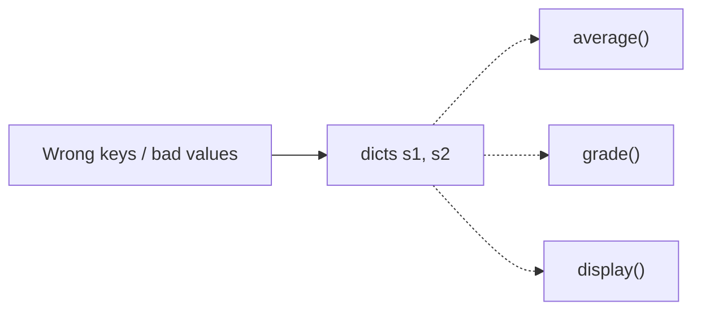
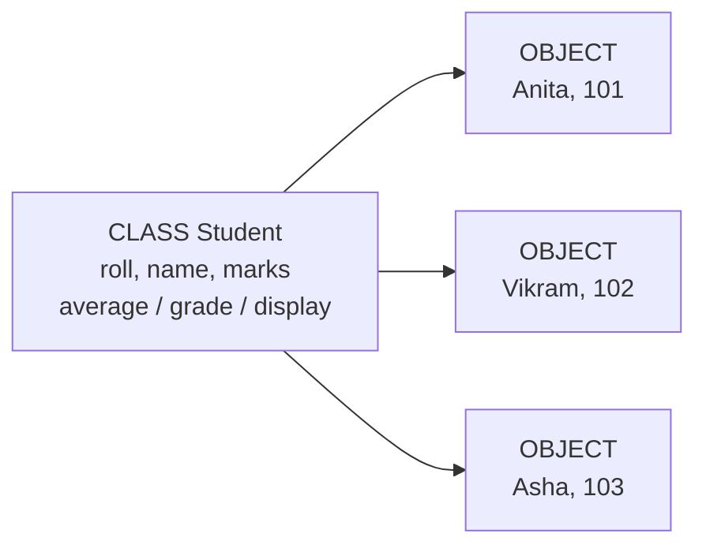
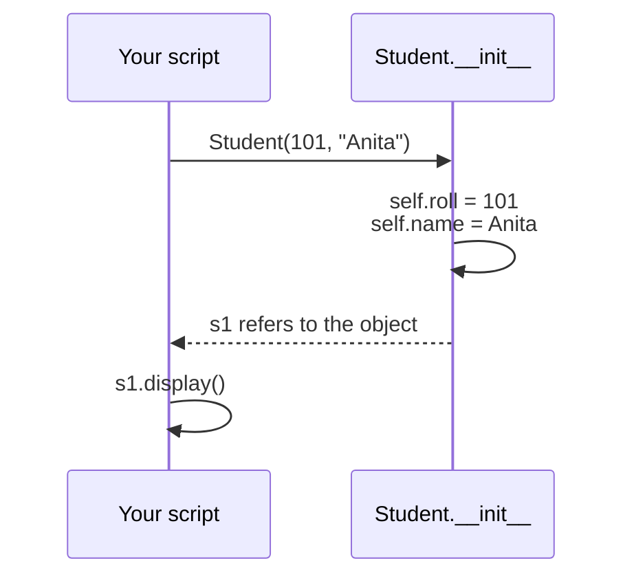
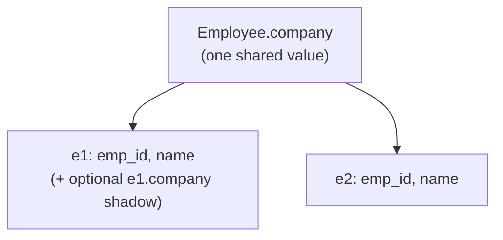
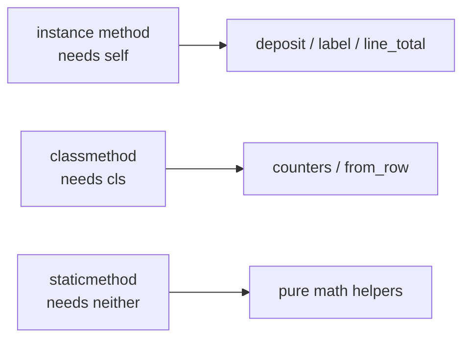
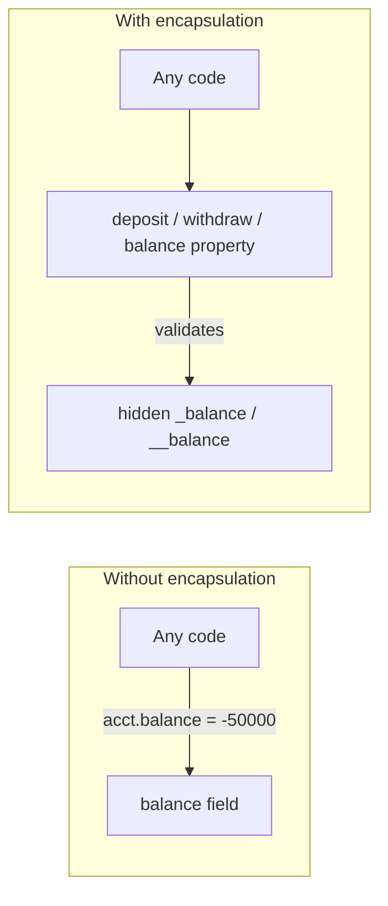
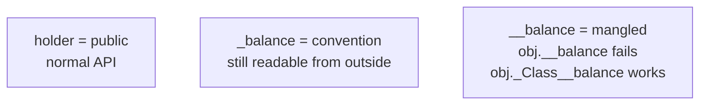
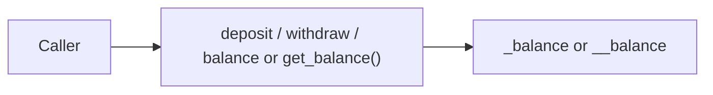

# Module 03a — OOP Part 1: Classes & Encapsulation

**Phase:** Advanced Python  
**Sessions:** **S36–S37**

**Previous module:** [Modules and Packages](02_Modules_and_Packages.md)  
**Next module:** [OOP Part 2 — Inheritance & Composition](03_OOP_Part2_Inheritance.md)

**Series:** [OOP overview](03_OOP.md) · Part 1 (this file) · [Part 2](03_OOP_Part2_Inheritance.md) · [Part 3](03_OOP_Part3_Polymorphism_Project.md)

---

## Learning Outcomes

By the end of **S36–S37**, learners will be able to:

1. Explain why classes beat loose dicts + free functions for real entities (Student, Order, BankAccount).
2. Define classes with `__init__`, `self`, instance methods, and create objects.
3. Differentiate instance, class, and local variables — and avoid the mutable class-attribute trap.
4. Choose instance methods, `@classmethod`, and `@staticmethod` for the right job.
5. Define encapsulation (bundle + controlled access) and explain the problem it solves: unprotected fields let callers bypass rules.
6. Encapsulate state with `_name` / `__name` and `@property` (or getters) so balance cannot be casually corrupted.
7. Build a lab-shaped `BankAccount` with validated deposit / withdraw (Classroom Ticket).

---

## Classroom Ticket

Open the lab kit **before** long notes. Read the ticket → code in `starter/` or fix `broken/`.

- **[BankAccount with protected balance](../15_Lab_Assets/17_bank_account_oop/)** (**S37** focus; finish / push by **S39** in Part 3)

Finish the ticket in class; compare with the official solution only when your trainer says so.

**Teaching note (order of the course):** Exception Handling is **next** (after OOP). In OOP week, validation uses **`print` + `return`** — not `raise` / `try` / `except`. If a demo would crash, we leave that line **commented** or check with `hasattr(...)`.

---

## Motivation — Feel the pain of dicts + free functions

Look at this student tracker. Data lives in a dict; behaviour lives in separate functions:

```python
s1 = {"roll": 101, "name": "Anita", "marks": [72, 68, 81]}
s2 = {"roll": 102, "name": "Vikram", "marks": [40, 35, 48]}

def average(student):
    marks = student["marks"]
    return sum(marks) / len(marks)

def grade(student):
    avg = average(student)
    if avg >= 85:
        return "A"
    if avg >= 70:
        return "B"
    if avg >= 50:
        return "C"
    return "Fail"

def display(student):
    print(f"{student['roll']}: {student['name']} — {grade(student)}")

display(s1)
display(s2)

# Easy mistakes in a busy script:
s1["marks"] = -10          # nonsense value, no guard
del s2["name"]             # KeyError waiting to happen
print(average({"marks": []}))  # ZeroDivisionError — not really a student
```

**Expected Output (happy path only):**

```
101: Anita — B
102: Vikram — Fail
```

Problems with this style:

1. Anyone can corrupt the dict (`marks = -10`, delete `name`).
2. Related data and behaviour are **scattered** — easy to pass the wrong shape.
3. Adding `college`, `email`, or `is_pass()` means hunting every function that touches a student.
4. As the program grows, the same broken pattern repeats for Order, Account, Product — harder to test and reuse.

**Visual — data here, logic there (easy to break):**



**Quick Revision:**
- Dicts hold data; free functions hold behaviour — easy to desync
- Callers can mutate or delete keys freely
- Same pain repeats for Order / Account / Product as the app grows

Bundle **data + behaviour** into one unit — a **class**. Each filled form is an **object**:

```python
class Student:
    def __init__(self, roll, name, marks):
        self.roll = roll
        self.name = name
        self.marks = list(marks)   # own copy — don't share the caller's list

    def average(self):
        if not self.marks:
            return 0.0
        return sum(self.marks) / len(self.marks)

    def grade(self):
        avg = self.average()
        if avg >= 85:
            return "A"
        if avg >= 70:
            return "B"
        if avg >= 50:
            return "C"
        return "Fail"

    def display(self):
        print(f"{self.roll}: {self.name} — {self.grade()}")

s1 = Student(101, "Anita", [72, 68, 81])
s2 = Student(102, "Vikram", [40, 35, 48])
s1.display()
s2.display()
print("Anita average:", round(s1.average(), 1))
```

**Expected Output:**

```
101: Anita — B
102: Vikram — Fail
Anita average: 73.7
```

That shift — from “bags of data + floating functions” to “objects that know how to behave” — is **Object-Oriented Programming (OOP)**.

**Visual — one blueprint, many filled forms:**



**Quick Revision:**
- **Class** = blueprint (form template)
- **Object** = one filled form (Anita, Vikram, …)
- Methods live **with** the data — call `s1.display()`, not `display(s1)` with a loose dict

---

## What is OOP? / Why do we need it?

**Object-Oriented Programming** models software around **things** in the domain — a `Student`, a `BankAccount`, an `Order`.

**Icons:** Bank · UPI · Employee · Laptop · Order

**Where used?**
- Banking (accounts, UPI wallets)
- Ecommerce (orders, products, carts)
- Hospital (patients, appointments)
- Payroll (employees, salary slips)
- CRM (customers, tickets)

| Idea          | Meaning                                              |
| ------------- | ---------------------------------------------------- |
| **`class`**   | Blueprint (like an Aadhaar form template)            |
| **`object`**  | One filled form — Rahul, roll 101                    |
| **Attribute** | Data on the object (`name`, `balance`)               |
| **`method`**  | Behaviour on the object (`deposit()`, `get_grade()`) |

| Without OOP (dicts + functions)     | With OOP (classes)                          |
| ----------------------------------- | ------------------------------------------- |
| Data and rules in different places  | One type owns both                          |
| Easy to pass the wrong shape        | Constructor sets a valid starting state     |
| Hard to reuse across scripts        | Import the class; create many objects       |
| Growing apps become “dict spaghetti”| Clear nouns: Account, Order, Employee       |

Classic pillars (Part 1 focuses on encapsulation; Parts 2–3 cover inheritance and polymorphism):

| Pillar            | Plain English                          | Python taste                                                                        |
| ----------------- | -------------------------------------- | ----------------------------------------------------------------------------------- |
| **Encapsulation** | Bundle data + methods; **hide** state; force changes through a validating API | Exact problem: stop `acct.balance = -50000` bypassing `withdraw` — use `_`/`__` + methods/`@property` |
| **Abstraction**   | Show essentials; hide messy internals  | Callers use `deposit()` / `withdraw()` without knowing balance rules                |
| **`inheritance`** | Child reuses/extends parent (**IS-A**) | → [Part 2](03_OOP_Part2_Inheritance.md)                                             |
| **Polymorphism**  | Same call, different behaviour         | → [Part 3](03_OOP_Part3_Polymorphism_Project.md)                                    |

**Composition (HAS-A)** is previewed here and practised in [Part 2](03_OOP_Part2_Inheritance.md): an `Employee` **has a** `Laptop`.

**Quick Revision:**
- OOP = model the **nouns** of your domain
- Part 1 = class / object / variables / methods / encapsulation
- Inheritance + polymorphism come in Parts 2–3 — do not rush them

---

## Important Concepts

### 1. Class, object, `self`, `__init__`

**Icons:** Employee · Order · Bank

**Where used?** Any entity you create many of: students, products, tickets, employees, accounts.

**What:** A **class** is the blueprint (data + behaviour together). An **object** is one concrete instance of that class. `__init__` runs when you create an object and sets starting data. `self` is the current object (like `this` in Java — but Python makes you write it).  
**Why:** Real systems are easier as objects than as loose dicts passed through many free functions.

```python
class Student:
    def __init__(self, roll, name):   # constructor
        self.roll = roll              # instance attribute
        self.name = name

    def display(self):                # instance method
        print(f"{self.roll}: {self.name}")

s1 = Student(101, "Anita")            # object creation
s2 = Student(102, "Vikram")
s1.display()
s2.display()
print("type(s1):", type(s1).__name__)
print("same class?", type(s1) is type(s2))
```

**Expected Output:**

```
101: Anita
102: Vikram
type(s1): Student
same class? True
```

**What happens on `Student(101, "Anita")`?**

1. Python creates a new empty object.
2. `__init__(self, 101, "Anita")` runs — `self` is that new object.
3. Attributes are attached to `self`.
4. The name `s1` now **refers** to that object in memory.

**Visual — call → `__init__` fills the object → you use the reference:**



**Quick Revision:**
- `ClassName(...)` creates an object and runs `__init__`
- `self` = the **current** object (passed automatically on `s1.display()`)
- Many objects can share one class; each has its own attribute values

**Difference between Method and Constructor:**

|                      | Method                    | Constructor (`__init__`)             |
| -------------------- | ------------------------- | ------------------------------------ |
| Name                 | Any valid name            | Always `__init__`                    |
| When it runs         | When you call it          | Automatically on `ClassName(...)`    |
| How often per object | As many times as you call | Once (at creation)                   |
| Typical job          | Business logic            | Declare and initialize instance data |
| Return               | Optional value            | Should not return a useful value     |

**Remember:** `self` = the **current object**. First parameter of every instance method. On `s1.display()`, Python secretly passes `s1` as `self`.

**Common Error:** forgetting `self` in the method signature → `TypeError: display() takes 0 positional arguments but 1 was given` when you call `s1.display()`.

**Note:**

- `s1` is a **reference** to the object — you use it to call methods and read attributes.
- `__init__` runs automatically after object creation — you rarely call it by name.
- If you omit `__init__`, Python still creates the object (empty shell); you can add attributes later (usually not ideal for real entities).
- Over-engineering OOP (five classes for hello world) — use functions until complexity grows.

**Try these (2 programs):**

**Program 1 — Book with info() and discount helper**

```python
class Book:
    def __init__(self, title, author, price):
        self.title = title
        self.author = author
        self.price = float(price)

    def info(self):
        print(f"{self.title} by {self.author} — ₹{self.price:.0f}")

    def price_after_discount(self, percent):
        return self.price * (1 - percent / 100)

b1 = Book("Atomic Habits", "James Clear", 499)
b2 = Book("Wings of Fire", "A.P.J. Abdul Kalam", 350)
b1.info()
b2.info()
print("10% off Atomic Habits:", round(b1.price_after_discount(10), 1))
```

**Expected Output:**

```
Atomic Habits by James Clear — ₹499
Wings of Fire by A.P.J. Abdul Kalam — ₹350
10% off Atomic Habits: 449.1
```

**Program 2 — Student.is_pass and update_name**

```python
class Student:
    def __init__(self, roll, name):
        self.roll = roll
        self.name = name

    def is_pass(self, marks):
        return marks >= 40

    def update_name(self, new_name):
        if not new_name.strip():
            print("Name cannot be empty")
            return
        self.name = new_name.strip()

s = Student(101, "Anita")
print(s.is_pass(35))   # False
print(s.is_pass(72))   # True
s.update_name("  Anita Sharma  ")
print(s.roll, s.name)
s.update_name("   ")   # rejected
```

**Expected Output:**

```
False
True
101 Anita Sharma
Name cannot be empty
```

---

### 2. Three kinds of variables (instance / class / local)

**Icons:** Employee · Payroll · Order

**Where used?** Shared company / college / tax rate (class); per-person id and name (instance); temporary totals inside a method (local).

**What:**

- **Instance** — unique per object (`self.emp_id`)
- **Class** (sometimes called “static” in older notes) — one copy shared by all objects (`Employee.company`)
- **Local** — temporary names inside a method; die when the method ends

**Why:** Company name can be shared; employee id must not. Temporary totals should not leak as attributes.

```python
class Employee:
    company = "KSR Datavizon"   # class attribute — shared

    def __init__(self, emp_id, name):
        self.emp_id = emp_id    # instance attribute — unique per object
        self.name = name

    def label(self):
        title = "Staff"         # local variable — method only
        return f"{title}: {self.name} @ {Employee.company}"

e1 = Employee(1, "Ravi")
e2 = Employee(2, "Meera")
print(e1.label())
print(e2.label())
print("company via class:", Employee.company)
```

**Expected Output:**

```
Staff: Ravi @ KSR Datavizon
Staff: Meera @ KSR Datavizon
company via class: KSR Datavizon
```

**Instance vs class — the shadowing trap:**

```python
e1 = Employee(1, "Ravi")
e2 = Employee(2, "Meera")
e1.company = "Acme"   # creates an *instance* attribute on e1 only

print(e1.company)         # Acme
print(e2.company)         # KSR Datavizon
print(Employee.company)   # KSR Datavizon
```

**Expected Output:**

```
Acme
KSR Datavizon
KSR Datavizon
```

To change the shared value for **everyone**, assign via the class: `Employee.company = "..."`.

**Visual — one shared class attribute, many instance attributes:**



**Quick Revision:**
- Instance attrs = per object (`self.x`)
- Class attrs = shared (`Class.x`)
- `obj.x = ...` on a class attr name **shadows** for that object only
- Locals live only inside the method

**Common Error:** putting `students = []` at **class** level — every batch shares one list. Always create the list in `__init__`.

**Note:**

- Mutable class attribute → shared state across objects — initialize lists/dicts in `__init__`, not at class level.
- Prefer `ClassName.attr` when you mean the shared value (clearer than `self.attr` for class data).
- Locals are fine for temporary calculations; do not invent `self.tmp` for values you never need later.

**Try these (2 programs):**

**Program 1 — Shared college name + per-student roll**

```python
class Student:
    college = "KSR College"

    def __init__(self, roll, name):
        self.roll = roll
        self.name = name

    def card(self):
        return f"{self.name} ({self.roll}) — {Student.college}"

s1 = Student(1, "Anita")
s2 = Student(2, "Vikram")
print(s1.card())
print(s2.card())

Student.college = "KSR Institute of Technology"
print(s1.card())
print(s2.card())  # both reflect the new class value
```

**Expected Output:**

```
Anita (1) — KSR College
Vikram (2) — KSR College
Anita (1) — KSR Institute of Technology
Vikram (2) — KSR Institute of Technology
```

**Program 2 — Mutable class attribute trap (spot the bug, then the fix)**

```python
class BatchBroken:
    students = []   # WRONG if you meant "each batch has its own list"

    def __init__(self, name):
        self.name = name

    def add(self, student):
        self.students.append(student)

b1 = BatchBroken("Python FS Morning")
b2 = BatchBroken("Python FS Evening")
b1.add("Arjun")
print("Broken b2.students:", b2.students)  # ['Arjun'] — shared!

class Batch:
    def __init__(self, name):
        self.name = name
        self.students = []   # CORRECT — per object

    def add(self, student):
        self.students.append(student)

ok1 = Batch("Python FS Morning")
ok2 = Batch("Python FS Evening")
ok1.add("Arjun")
print("Fixed ok2.students:", ok2.students)  # []
```

**Expected Output:**

```
Broken b2.students: ['Arjun']
Fixed ok2.students: []
```

---

### 3. Three kinds of methods (instance / class / static)

**Icons:** Order · Bank · UPI · Payroll

**Where used?** Line totals and deposits (instance); object counters / “build from CSV row” (class); GST / fare math helpers (static).

**What:**

- **Instance method** — first arg `self`; uses object data
- **Class method** — `@classmethod`, first arg `cls`; works with class-level data or alternate constructors
- **Static method** — `@staticmethod`; utility namespaced on the class (no `self` / `cls`)

**Why:** Not every helper needs an instance. Object counters and “build from dict/CSV” fit class methods; pure converters fit static methods.

```python
class Order:
    order_count = 0

    def __init__(self, product, qty):
        self.product = product
        self.qty = qty
        Order.order_count += 1

    def line_total(self, price):          # instance method
        return self.qty * price

    @classmethod
    def get_count(cls):                   # class method
        return cls.order_count

    @classmethod
    def from_pair(cls, product, qty):     # alternate constructor
        return cls(product, qty)

    @staticmethod
    def gst_amount(amount, rate=0.18):    # static utility
        return amount * rate

o = Order.from_pair("Notebook", 3)
print("line total:", o.line_total(40))
print("order count:", Order.get_count())
print("GST on 100:", Order.gst_amount(100))
print("product:", o.product)
```

**Expected Output:**

```
line total: 120
order count: 1
GST on 100: 18.0
product: Notebook
```

**Visual — which method gets what?**



**Quick Revision:**
- Instance = normal day-to-day methods
- `@classmethod` gets `cls` — class-level work / alternate constructors
- `@staticmethod` is a plain utility living on the class

**Interview:** `@classmethod` gets `cls` (class-level / alternate constructors). `@staticmethod` is a plain utility on the class — no `self` / `cls`.

**Note:**

- In day-to-day apps you mostly write **instance** methods. Use `@classmethod` / `@staticmethod` when the intent is clear — not for decoration.
- Alternate constructors (`from_pair`, `from_dict`) keep `__init__` simple and give callers a clear name for each creation path.
- Calling `Order.gst_amount(100)` or `o.gst_amount(100)` both work for static methods; prefer the class name when it is a pure utility.

**Try these (2 programs):**

**Program 1 — Track how many Ticket objects were created**

```python
class Ticket:
    count = 0

    def __init__(self, seat, price):
        self.seat = seat
        self.price = price
        Ticket.count += 1

    def label(self):
        return f"Seat {self.seat} — ₹{self.price}"

    @classmethod
    def how_many(cls):
        return cls.count

    @classmethod
    def from_csv_row(cls, row):
        # row like "A1,250"
        seat, price = row.split(",")
        return cls(seat.strip(), float(price))

t1 = Ticket("A1", 250)
t2 = Ticket.from_csv_row("A2,300")
print(t1.label())
print(t2.label())
print("sold:", Ticket.how_many())
```

**Expected Output:**

```
Seat A1 — ₹250
Seat A2 — ₹300
sold: 2
```

**Program 2 — Static helper on a fare namespace**

```python
class FareMath:
    @staticmethod
    def with_gst(amount, rate=0.05):
        return amount * (1 + rate)

    @staticmethod
    def split_equal(total, people):
        if people <= 0:
            return 0.0
        return total / people

print(FareMath.with_gst(1000))                 # 1050.0
print(round(FareMath.split_equal(900, 3), 2))  # 300.0
```

**Expected Output:**

```
1050.0
300.0
```

---

### 4. Encapsulation — definition, problem, then `_` / `__` / `@property`

**Icons:** Bank · UPI

**Where used?** Banking balances, UPI wallets, passwords, inventory stock — anything with a rule that must stay true after every change.

---

#### Definition (say this in class)

**Encapsulation** means two things together:

1. **Bundle** related data and the methods that use that data into one class (the object “owns” its state).
2. **Hide and control** that state — outside code should not poke the raw fields; it must go through a **public API** (`deposit`, `withdraw`, `get_balance` / `@property`) that enforces the rules.

Interview one-liner: *“Encapsulation = data + behaviour in one place, with controlled access so invariants cannot be broken from outside.”*

It is **not** “putting underscores on variables.” Underscores and `@property` are *tools*. The *goal* is protecting the object’s rules.

---

#### Exact problem it solves

Without encapsulation, the object’s important data is **naked**. Any line of code anywhere can assign nonsense and break the business rule — and the class never gets a chance to say “no”.

**Business rule we care about (bank example):**  
`balance` must never become negative by a casual assignment; money may change only through validated `deposit` / `withdraw`.

**Broken — no encapsulation (the bug factory):**

```python
class OpenAccount:
    def __init__(self, holder, balance):
        self.holder = holder
        self.balance = balance   # public raw field

    def withdraw(self, amount):
        if amount > self.balance:
            print("Insufficient funds")
            return
        self.balance -= amount


acct = OpenAccount("Priya", 1000)
acct.withdraw(200)          # OK — uses the method
print("after withdraw:", acct.balance)

# Later… a tired teammate (or your own shortcut) skips the method:
acct.balance = -50000       # accepted! rule destroyed
acct.balance = "N/A"        # accepted! type destroyed
print("corrupted balance:", acct.balance)
```

**Expected Output:**

```
after withdraw: 800
corrupted balance: N/A
```

Problems this causes in real projects:

| What goes wrong | Why it hurts |
| --------------- | ------------ |
| Outside code writes `acct.balance = …` | Rules in `withdraw` are **bypassed** |
| Invalid values sneak in (`-50000`, `"N/A"`) | Downstream math / UIs / reports crash or lie |
| Fixing the rule means hunting **every** assignment | Same pain as copy-paste functions — scattered writes |
| You cannot change how balance is stored later | Callers are glued to the raw field name |

**Visual — naked field vs guarded API:**



**Quick Revision:**
- Exact problem: **uncontrolled writes** to important state
- Method rules are useless if callers can skip them and edit the field
- Encapsulation forces “change money only through the door we control”

**Fixed direction (idea first — syntax next):**

- Keep the real value **inside** (`_balance` or `__balance`)
- Expose only safe operations: `deposit`, `withdraw`, and a read via `get_balance()` or `@property`
- Callers who follow the API cannot casually invent `-50000`

That is the problem encapsulation solves. Naming (`_` / `__`) and `@property` are how Python helps you express that design.

Teach the tools in **three layers**:

1. Naming: public vs `_name` vs `__name`
2. Safe access: `get_balance()` **or** `@property`
3. Optional controlled write: `@x.setter`

---

#### 4a. Public vs `_name` vs `__name` (naming)

| Syntax | Name people use | What Python does | What it means for you |
| ------ | --------------- | ---------------- | --------------------- |
| `name` | **public** | Normal attribute | Part of the API — callers may read/write |
| `_name` | **protected** (by convention) | Still a normal attribute | “Internal — please don’t touch from outside.” Python does **not** block access |
| `__name` | **name-mangled** (often called private in notes) | Stored as `_ClassName__name` | Accidental `obj.__name` fails; determined access can still use the mangled name |

**Important:** None of these is encryption or real security. Encapsulation is for **honest, clear code** — teammates follow the public API.

**Side-by-side demo — `_balance` vs `__balance`:**

```python
class AccountUnderscore:
    def __init__(self, balance):
        self._balance = float(balance)   # convention only


class AccountDunder:
    def __init__(self, balance):
        self.__balance = float(balance)  # name-mangled


u = AccountUnderscore(1000)
d = AccountDunder(1000)

print("public-style read of _balance:", u._balance)   # works — convention only
u._balance = -50                                      # also works — dangerous
print("after bad write:", u._balance)

print("has '__balance' on d?", hasattr(d, "__balance"))           # False
# print(d.__balance)   # do not uncomment — crashes (name is mangled)
print("mangled name still exists:", d._AccountDunder__balance)    # works if you insist
```

**Expected Output:**

```
public-style read of _balance: 1000.0
after bad write: -50.0
has '__balance' on d? False
mangled name still exists: 1000.0
```

**Visual — three access styles:**



**Quick Revision:**
- `_balance` = polite “hands off” — Python does **not** stop you
- `__balance` = renamed to `_ClassName__balance` — stops *accidental* access
- Neither is true privacy / security
- Prefer changing money only through `deposit` / `withdraw`

**Which should students use?**

| Style | When | Course note |
| ----- | ---- | ----------- |
| `_balance` + `@property` | Idiomatic modern Python | Preferred in notes / interviews |
| `__balance` + `get_balance()` | Clear “don’t touch” + Java-like getter | **Lab kit / Classroom Ticket** style — both OK |

**Common Error:** saying “`__balance` is private so nobody can read it.” They can: `obj._BankAccount__balance`.

---

#### 4b. `@property` — attribute-like read that runs a method

**Problem with a raw public attribute:**

```python
class BadAccount:
    def __init__(self, balance):
        self.balance = balance

acct = BadAccount(1000)
acct.balance = -999999   # no rule — nonsense accepted
print(acct.balance)
```

**Expected Output:**

```
-999999
```

**Fix idea:** keep real money in `_balance` (or `__balance`), and expose a **safe read**.

Two equivalent public APIs:

| Style | Call site | Internals |
| ----- | --------- | --------- |
| Getter method (lab style) | `acct.get_balance()` | often `__balance` |
| `@property` (idiomatic) | `acct.balance` | often `_balance` |

`@property` turns a method into something you **read like an attribute** (no parentheses):

```python
class BankAccount:
    def __init__(self, holder, balance=0):
        self.holder = holder          # public — OK to read
        self._balance = float(balance)  # internal storage

    @property
    def balance(self):                # looks like attribute, runs method
        return self._balance

    def deposit(self, amount):
        if amount <= 0:
            print("Invalid deposit amount")
            return
        self._balance += amount

    def withdraw(self, amount):
        if amount <= 0:
            print("Invalid withdraw amount")
            return
        if amount > self._balance:
            print("Insufficient funds")
            return
        self._balance -= amount


acct = BankAccount("Priya", 1000)
acct.deposit(500)
acct.withdraw(200)
acct.withdraw(5000)                 # rejected
print("holder:", acct.holder)
print("balance via @property:", acct.balance)   # no ()
# acct.balance = 999999   # do not uncomment — crashes (read-only; no setter yet)
```

**Expected Output:**

```
Insufficient funds
holder: Priya
balance via @property: 1300.0
```

**Same idea with lab-style getter (`__balance`):**

```python
class BankAccountLabStyle:
    def __init__(self, holder, balance=0):
        self.holder = holder
        self.__balance = float(balance)

    def get_balance(self):            # must call with ()
        return self.__balance

    def deposit(self, amount):
        if amount > 0:
            self.__balance += amount


lab = BankAccountLabStyle("Anita", 1000)
lab.deposit(200)
print("balance via getter:", lab.get_balance())
```

**Expected Output:**

```
balance via getter: 1200.0
```

**Visual — outside talks to API; inside holds real state:**



**Quick Revision:**
- `@property` = read with `obj.balance` (no `()`)
- Getter = read with `obj.get_balance()` (needs `()`)
- Real money stays in `_balance` / `__balance`
- Without a setter, `obj.balance = ...` fails — force changes through methods

**Remember:** `@property` does **not** replace encapsulation by itself. You still store the real value in `_…` / `__…` and validate in `deposit` / `withdraw`.

---

#### 4c. Optional — `@balance.setter` (controlled write)

Use a setter only when assignment should be allowed **with rules**. For bank money, prefer `deposit` / `withdraw`. Setter fits things like renaming with validation:

```python
class Student:
    def __init__(self, name):
        self._name = name

    @property
    def name(self):
        return self._name

    @name.setter
    def name(self, value):
        value = value.strip()
        if not value:
            print("Name cannot be empty")
            return
        self._name = value


s = Student("Anita")
print(s.name)
s.name = "  Anita Sharma  "
print(s.name)
s.name = "   "            # rejected
print("still:", s.name)
```

**Expected Output:**

```
Anita
Anita Sharma
Name cannot be empty
still: Anita Sharma
```

**Note:**

- Leading with `__` on every field is noisy. Start with public + validated methods; add `_` / `__` / `@property` when the API needs it.
- Interview line: “`_name` is convention; `__name` is name mangling; `@property` gives a clean read API over internal storage.”
- Course rule of thumb: **lab kit** may use `__balance` + `get_balance()`; **notes / interviews** prefer `_balance` + `@property`.

**Lab vs note style (S37):** Classroom Ticket = `__balance` + `get_balance()`. Notes above = `_balance` + `@property`. Same goal — both acceptable in this course.

**Common Error:** treating `__balance` as encryption / security. It only renames the attribute (`_BankAccount__balance`).

**Try these (2 programs):**

**Program 1 — UPIWallet with `__balance` + getter (lab style)**

```python
class UPIWallet:
    def __init__(self, balance=0):
        self.__balance = float(balance)

    def credit(self, amount):
        if amount <= 0:
            print("Invalid credit amount")
            return
        self.__balance += amount

    def debit(self, amount):
        if amount <= 0:
            print("Invalid debit amount")
            return
        if amount > self.__balance:
            print("Insufficient balance")
            return
        self.__balance -= amount

    def get_balance(self):
        return self.__balance


wallet = UPIWallet(500)
wallet.credit(200)
wallet.debit(100)
wallet.debit(1000)  # rejected
print("Balance:", wallet.get_balance())
print("Direct '__balance' visible?", hasattr(wallet, "__balance"))  # False
# print(wallet.__balance)  # do not uncomment — crashes; use get_balance()
print("Mangled peek (don't do this in apps):", wallet._UPIWallet__balance)
```

**Expected Output:**

```
Insufficient balance
Balance: 600.0
Direct '__balance' visible? False
Mangled peek (don't do this in apps): 600.0
```

**Program 2 — `@property` read-only + computed view (idiomatic)**

```python
class Temperature:
    def __init__(self, celsius):
        self._celsius = float(celsius)   # internal

    @property
    def celsius(self):                   # read-only public view
        return self._celsius

    @property
    def fahrenheit(self):                # computed — no stored F
        return self._celsius * 9 / 5 + 32


t = Temperature(37)
print("C:", t.celsius)
print("F:", round(t.fahrenheit, 1))
# t.celsius = 40   # do not uncomment — crashes (read-only property; no setter)
print("celsius is read-only — change only via a setter or a method (later design)")
```

**Expected Output:**

```
C: 37.0
F: 98.6
celsius is read-only — change only via a setter or a method (later design)
```

---

## Step-by-Step Annotated Python 3 Code

Examples below deepen Part 1 ideas. Type them; predict the output; then run.

### Example 1 — BankAccount with encapsulation (lab-shaped)

This mirrors the Classroom Ticket style (`__balance` + `get_balance`).

```python
class BankAccount:
    def __init__(self, holder, balance=0):
        self.holder = holder
        self.__balance = float(balance)

    def deposit(self, amount):
        if amount <= 0:
            print("Invalid deposit amount")
            return
        self.__balance += amount
        print(f"Deposited ₹{amount}. New balance: ₹{self.__balance}")

    def withdraw(self, amount):
        if amount <= 0:
            print("Invalid withdraw amount")
            return
        if amount > self.__balance:
            print("Insufficient funds")
            return
        self.__balance -= amount
        print(f"Withdrew ₹{amount}. New balance: ₹{self.__balance}")

    def get_balance(self):
        return self.__balance

acct = BankAccount("Priya", 1000)
acct.deposit(500)
acct.withdraw(200)
acct.withdraw(-50)     # rejected
acct.deposit(0)        # rejected
print("Balance:", acct.get_balance())
print("Holder:", acct.holder)
# print(acct.__balance)  # do not uncomment — crashes (name mangling); use get_balance()
```

**Expected Output:**

```
Deposited ₹500. New balance: ₹1500.0
Withdrew ₹200. New balance: ₹1300.0
Invalid withdraw amount
Invalid deposit amount
Balance: 1300.0
Holder: Priya
```

**Remember:** validation lives in methods; callers never set `__balance` directly.

---

### Example 2 — Full Student (marks list as instance data)

```python
class Student:
    college = "KSR College"

    def __init__(self, roll, name, marks):
        self.roll = roll
        self.name = name
        self.marks = list(marks)   # own copy

    def average(self):
        if not self.marks:
            return 0.0
        return sum(self.marks) / len(self.marks)

    def grade(self):
        avg = self.average()
        if avg >= 85:
            return "A"
        if avg >= 70:
            return "B"
        if avg >= 50:
            return "C"
        return "Fail"

    def add_mark(self, mark):
        if mark < 0 or mark > 100:
            print("Mark must be 0–100")
            return
        self.marks.append(mark)

    def report(self):
        print(f"{self.roll} | {self.name} | {Student.college}")
        print(f"  marks={self.marks} avg={self.average():.1f} grade={self.grade()}")

s = Student(101, "Anita", [72, 68, 81])
s.add_mark(90)
s.add_mark(150)   # rejected
s.report()
```

**Expected Output:**

```
Mark must be 0–100
101 | Anita | KSR College
  marks=[72, 68, 81, 90] avg=77.8 grade=B
```

---

### Example 3 — Product catalogue with classmethod + static GST

```python
class Product:
    catalogue_count = 0

    def __init__(self, sku, name, price):
        self.sku = sku
        self.name = name
        self.price = float(price)
        Product.catalogue_count += 1

    def label(self):
        return f"{self.sku}: {self.name} @ ₹{self.price:.0f}"

    def price_with_gst(self):
        return self.price + Product.gst_amount(self.price)

    @classmethod
    def how_many(cls):
        return cls.catalogue_count

    @classmethod
    def from_dict(cls, data):
        return cls(data["sku"], data["name"], data["price"])

    @staticmethod
    def gst_amount(amount, rate=0.18):
        return amount * rate

p1 = Product("PEN-01", "Blue Pen", 10)
p2 = Product.from_dict({"sku": "NB-A4", "name": "Notebook", "price": 40})
print(p1.label())
print(p2.label())
print("GST on pen:", Product.gst_amount(p1.price))
print("Pen with GST:", p1.price_with_gst())
print("products created:", Product.how_many())
```

**Expected Output:**

```
PEN-01: Blue Pen @ ₹10
NB-A4: Notebook @ ₹40
GST on pen: 1.8
Pen with GST: 11.8
products created: 2
```

---

## Practice Exercises

### Basic

1. Create `Laptop` with `brand`, `ram_gb`, and a `specs()` method that prints both.
   **Model answer:**
   ```python
   class Laptop:
       def __init__(self, brand, ram_gb):
           self.brand = brand
           self.ram_gb = ram_gb

       def specs(self):
           print(f"{self.brand} — {self.ram_gb} GB RAM")

   Laptop("Dell", 16).specs()
   ```

   **Expected Output:**
   ```
   Dell — 16 GB RAM
   ```

2. Create two `Laptop` objects and call `specs()` on each.
   **Model answer:**
   ```python
   l1 = Laptop("Dell", 16)
   l2 = Laptop("Lenovo", 8)
   l1.specs()
   l2.specs()
   ```

3. Add `upgrade_ram(extra_gb)` that increases `ram_gb` only when `extra_gb > 0`.
   **Model answer:**
   ```python
   class Laptop:
       def __init__(self, brand, ram_gb):
           self.brand = brand
           self.ram_gb = ram_gb

       def upgrade_ram(self, extra_gb):
           if extra_gb <= 0:
               print("extra_gb must be positive")
               return
           self.ram_gb += extra_gb

       def specs(self):
           print(f"{self.brand} — {self.ram_gb} GB RAM")

   lap = Laptop("Dell", 8)
   lap.upgrade_ram(8)
   lap.upgrade_ram(-2)
   lap.specs()
   ```

   **Expected Output:**
   ```
   extra_gb must be positive
   Dell — 16 GB RAM
   ```

4. Create `Product` with `sku`, `price`, and `display()` (do **not** use `__str__` yet — that is Part 3).
   **Model answer:**
   ```python
   class Product:
       def __init__(self, sku, price):
           self.sku = sku
           self.price = price

       def display(self):
           print(f"{self.sku} @ ₹{self.price}")

   Product("PEN-01", 10).display()
   ```

5. Add `apply_discount(percent)` returning the discounted price (do not mutate unless you choose to).
   **Model answer:**
   ```python
   class Product:
       def __init__(self, sku, price):
           self.sku, self.price = sku, price

       def apply_discount(self, percent):
           return self.price * (1 - percent / 100)

   print(Product("X", 1000).apply_discount(10))  # 900.0
   ```

6. Create `Employee` with a **class** attribute `company = "KSR Datavizon"` and instance attributes `emp_id`, `name`. Print both employees after changing `Employee.company`.
   **Model answer:**
   ```python
   class Employee:
       company = "KSR Datavizon"

       def __init__(self, emp_id, name):
           self.emp_id = emp_id
           self.name = name

       def card(self):
           print(f"{self.emp_id}: {self.name} @ {Employee.company}")

   e1 = Employee(1, "Ravi")
   e2 = Employee(2, "Meera")
   Employee.company = "KSR Labs"
   e1.card()
   e2.card()
   ```

7. Build a tiny `Wallet` with `_balance`, `@property` `balance`, and `deposit` only (no direct write to balance).
   **Model answer:**
   ```python
   class Wallet:
       def __init__(self, opening=0):
           self._balance = float(opening)

       @property
       def balance(self):
           return self._balance

       def deposit(self, amount):
           if amount > 0:
               self._balance += amount

   w = Wallet(100)
   w.deposit(50)
   print(w.balance)  # 150.0
   ```

8. Classroom Ticket warm-up: write `BankAccount` with `__balance`, `deposit`, `withdraw`, `get_balance` — reject amount ≤ 0 and overdraft. Then open the lab kit and finish it properly.

---

## Revision Map — Memorize / Understand / Practise / Build

| Topic | Memorize | Understand | Practise | Build |
|-------|----------|------------|----------|-------|
| Class & object | `class`, `self`, `__init__` | Blueprint vs instance | Book / Laptop / Student | Student report card |
| Variables | Instance / class / local | Shared vs per-object; shadowing | College + Batch list trap | Config + instance mix |
| Methods | Instance / `classmethod` / `staticmethod` | When each fits | Ticket counter + GST | Product.from_dict |
| Encapsulation | `_` vs `__` vs `@property` / setter | Convention ≠ mangling ≠ security | UPIWallet + Temperature | Validated BankAccount |

**Label legend:** **Memorize** = recall in interviews · **Understand** = explain in English · **Practise** = daily labs · **Build** = portfolio artefacts

---

## Next

Continue with **[OOP Part 2 — Inheritance & Composition](03_OOP_Part2_Inheritance.md)** (S38).
