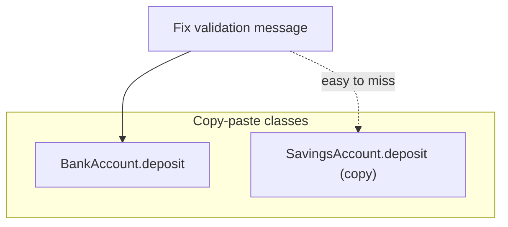
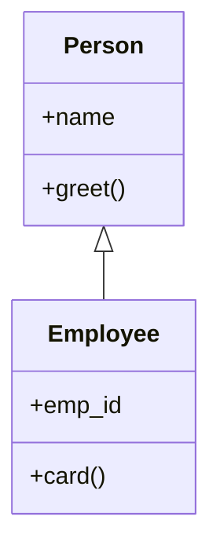
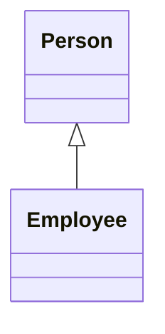
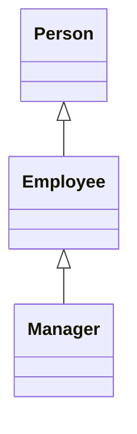
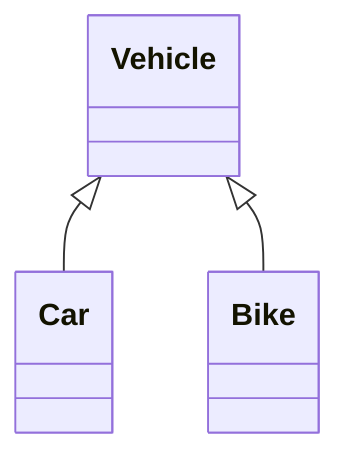
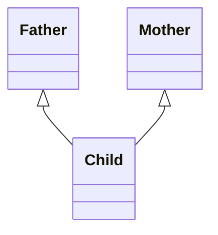
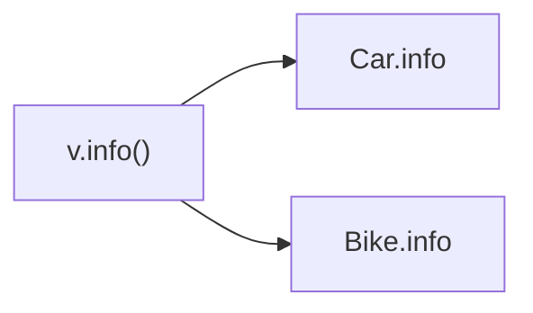
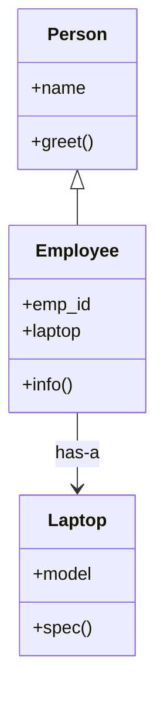

# Module 03b — OOP Part 2: Inheritance & Composition

**Phase:** Advanced Python

**Previous module:** [OOP Part 1 — Classes & Encapsulation](03_OOP_Part1_Classes_Encapsulation.md)  
**Next module:** [OOP Part 3 — Polymorphism & Project](03_OOP_Part3_Polymorphism_Project.md)

**Series:** [OOP overview](03_OOP.md) · [Part 1](03_OOP_Part1_Classes_Encapsulation.md) · Part 2 (this file) · [Part 3](03_OOP_Part3_Polymorphism_Project.md)

**Assignment (take-home):** Still the same portfolio deliverable — **[Mini-Project (Assignment): BankAccount OOP CLI](03_OOP_Part3_Polymorphism_Project.md#mini-project-assignment-bankaccount-oop-cli)** in Part 3. Today’s homework is inheritance drills; stretch = `SavingsAccount` toward that push.

**Lab kit:** [15_Lab_Assets/17_bank_account_oop/](../15_Lab_Assets/17_bank_account_oop/)

---

## Learning Outcomes

By the end of this part, learners will be able to:

1. Explain inheritance as an **IS-A** relationship and use `class Child(Parent)` with `super()`.
2. Recognise and sketch the four common inheritance types: single, multilevel, hierarchical, multiple.
3. Override methods safely (and call `super()` when parent behaviour is still needed).
4. Choose **HAS-A (composition)** when the child only *uses* another object — not when it *is* that object.
5. Use `isinstance` thoughtfully (and avoid giant `if type == ...` trees).
6. Extend `BankAccount` into `SavingsAccount` as a stretch toward the Part 3 push.

---

**Teaching note:** Still **no** `try` / `except` / `raise` — Exception Handling comes after OOP Part 3. Validation stays `print` + `return`.

**Teach order today:** Inheritance basics → **types of inheritance (with diagrams)** → overriding → then HAS-A / composition as the alternative.

---

## Motivation — Feel the pain of copy-paste “almost the same” classes

Without inheritance, specialised accounts often become copy-paste:

```python
class BankAccount:
    def __init__(self, holder, balance=0):
        self.holder = holder
        self._balance = float(balance)

    def deposit(self, amount):
        if amount <= 0:
            print("Invalid amount")
            return
        self._balance += amount

    def get_balance(self):
        return self._balance


class SavingsAccountCopyPaste:
    def __init__(self, holder, balance=0, interest_rate=0.04):
        self.holder = holder
        self._balance = float(balance)
        self.interest_rate = interest_rate

    def deposit(self, amount):          # duplicated
        if amount <= 0:
            print("Invalid amount")
            return
        self._balance += amount

    def get_balance(self):              # duplicated
        return self._balance

    def apply_interest(self):
        self.deposit(self._balance * self.interest_rate)
```

Problems:

1. Deposit / balance rules are written **twice**.
2. Fix a bug in `BankAccount.deposit` → easy to forget the copy in Savings.
3. “Savings **is a** bank account” is a real domain relationship — the code should say so.

**Visual — duplicated behaviour vs one parent:**




**Key takeaways:**

- Same deposit rules in two classes = bug factory
- Inheritance = child **reuses** parent and adds only what is new
- Syntax taste: `class SavingsAccount(BankAccount):`

With inheritance, Savings **reuses** BankAccount and only adds what is new:

```python
class SavingsAccount(BankAccount):
    def __init__(self, holder, balance=0, interest_rate=0.04):
        super().__init__(holder, balance)
        self.interest_rate = interest_rate

    def apply_interest(self):
        interest = self._balance * self.interest_rate
        self.deposit(interest)
        print(f"Interest ₹{interest:.2f} added")
```

---

## Important Concepts

### 1. Inheritance basics — IS-A, parent / child, `super()`

**Icons:** Bank · Employee · Order

**Where used?** `SavingsAccount` is a `BankAccount`; `Manager` is an `Employee`; `Car` is a `Vehicle`.

**Definition:** **Inheritance** lets a **child class** reuse and extend a **parent class**.  
In plain English: the child **IS-A** specialised kind of the parent.

**Purpose:** Write shared behaviour once on the parent; children only add / change what is special.


| Word                            | Meaning                                              |
| ------------------------------- | ---------------------------------------------------- |
| **Parent** (base / super class) | The general class — `BankAccount`, `Person`          |
| **Child** (derived / sub class) | The specialised class — `SavingsAccount`, `Employee` |
| **IS-A**                        | `SavingsAccount` **is a** `BankAccount`              |
| `super()`                       | Call the parent’s method / `__init__` from the child |


```python
class Person:
    def __init__(self, name):
        self.name = name

    def greet(self):
        return f"Hi, I am {self.name}"


class Employee(Person):                 # Employee IS-A Person
    def __init__(self, name, emp_id):
        super().__init__(name)          # init the parent part first
        self.emp_id = emp_id

    def card(self):
        return f"{self.greet()} ({self.emp_id})"


e = Employee("Priya", 501)
print(e.card())
print("name from parent:", e.name)
```

**Expected Output:**

```
Hi, I am Priya (501)
name from parent: Priya
```

**Visual — child gets parent features:**




**Key takeaways:**

- `class Child(Parent):` = inheritance
- Child **IS-A** Parent
- Call `super().__init__(...)` when the parent owns required fields

**Common Error:** forgetting `super().__init__(...)` → later code crashes looking for `self.name` / `self._balance` from the parent (missing attribute).

**Note:**

- Always initialise the parent before adding child-only fields.
- Inheritance is for **specialisation**, not for “I want to reuse one helper method” (a plain function or composition may be enough).

**Try these (2 programs):**

**Program 1 — SavingsAccount inherits BankAccount**

```python
class BankAccount:
    def __init__(self, holder, balance=0):
        self.holder = holder
        self._balance = float(balance)

    def deposit(self, amount):
        if amount <= 0:
            print("Invalid amount")
            return
        self._balance += amount

    def get_balance(self):
        return self._balance


class SavingsAccount(BankAccount):
    def __init__(self, holder, balance=0, interest_rate=0.04):
        super().__init__(holder, balance)
        self.interest_rate = interest_rate

    def apply_interest(self):
        interest = self._balance * self.interest_rate
        self.deposit(interest)
        print(
            f"Interest ₹{interest:.2f} added. "
            f"Balance: ₹{self.get_balance():.2f}"
        )


acct = SavingsAccount("Priya", 10000, 0.05)
print("Before:", acct.get_balance())
acct.apply_interest()
print("Holder still:", acct.holder)
```

**Expected Output:**

```
Before: 10000.0
Interest ₹500.00 added. Balance: ₹10500.00
Holder still: Priya
```

**Program 2 — TeachingAssistant extends Person**

```python
class Person:
    def __init__(self, name):
        self.name = name

    def label(self):
        return self.name


class TeachingAssistant(Person):
    def __init__(self, name, subject):
        super().__init__(name)
        self.subject = subject

    def label(self):
        return f"{super().label()} — {self.subject} lab TA"


print(TeachingAssistant("Anita", "DSA").label())
print(TeachingAssistant("Ravi", "Python").label())
```

**Expected Output:**

```
Anita — DSA lab TA
Ravi — Python lab TA
```

---

### 2. Types of inheritance (with diagrams)

**Icons:** Employee · Bank · Order

**Where used?** Interviews always ask these shapes; real apps use single / hierarchical most often.

**Definition:** How many parents / children you wire — the **shape** of the tree.  
**Purpose:** So you can read diagrams, name the type in interviews, and pick a shallow design.


| Type             | Idea                                | Syntax taste                                                |
| ---------------- | ----------------------------------- | ----------------------------------------------------------- |
| **Single**       | One parent → one child              | `class B(A)`                                                |
| **Multilevel**   | Chain: grandparent → parent → child | `class C(B)` and `class B(A)`                               |
| **Hierarchical** | One parent → many children          | `class Car(Vehicle)`, `class Bike(Vehicle)`                 |
| **Multiple**     | Many parents → one child            | `class C(A, B)` — supported; prefer composition when unsure |


---

#### 2a. Single inheritance

One parent, one child — the everyday default.



**Key takeaways:**
- One arrow up to one parent = **single**
- Everyday default shape

---

#### 2b. Multilevel inheritance

A chain: child inherits from parent, parent inherits from grandparent.



**Key takeaways:**
- A **chain** of IS-A links = **multilevel**
- Keep chains short (2–3 levels)

```python
class Person:
    def role(self):
        return "Person"


class Employee(Person):
    def role(self):
        return "Employee"


class Manager(Employee):         # multilevel: Manager → Employee → Person
    def role(self):
        return "Manager"


m = Manager()
print(m.role())
print("Manager is Person?", isinstance(m, Person))
print("MRO:", [c.__name__ for c in Manager.mro()])
```

**Expected Output:**

```
Manager
Manager is Person? True
MRO: ['Manager', 'Employee', 'Person', 'object']
```

---

#### 2c. Hierarchical inheritance

One parent, **many** specialised children — great prep for polymorphism (Part 3).



**Key takeaways:**
- One parent, many children = **hierarchical**
- Great setup for polymorphism later (Part 3)

```python
class Vehicle:
    def __init__(self, brand):
        self.brand = brand

    def start(self):
        return f"{self.brand} starting…"


class Car(Vehicle):
    def info(self):
        return f"Car: {self.brand}"


class Bike(Vehicle):
    def info(self):
        return f"Bike: {self.brand}"


for v in [Car("Hyundai"), Bike("Royal Enfield")]:
    print(v.info(), "|", v.start())
```

**Expected Output:**

```
Car: Hyundai | Hyundai starting…
Bike: Royal Enfield | Royal Enfield starting…
```

---

#### 2d. Multiple inheritance

One child, **two or more** parents. Python allows it; day-to-day apps often prefer composition instead.



**Key takeaways:**
- Many parents → one child = **multiple**
- Method name clash → MRO decides (left parent first)
- Prefer HAS-A / composition when you only need to *use* two helpers

```python
class Father:
    def skills(self):
        return ["driving"]


class Mother:
    def skills(self):
        return ["cooking"]


class Child(Father, Mother):     # multiple inheritance
    def all_skills(self):
        # MRO: Child → Father → Mother → object (left parent first)
        return Father.skills(self) + Mother.skills(self)


c = Child()
print(c.all_skills())
print("MRO:", [x.__name__ for x in Child.mro()])
print("Which skills() wins alone?", c.skills())  # Father first in MRO
```

**Expected Output:**

```
['driving', 'cooking']
MRO: ['Child', 'Father', 'Mother', 'object']
Which skills() wins alone? ['driving']
```

**Multiple inheritance note:** If both parents define the same method, Python uses **MRO** (Method Resolution Order) — roughly “child first, then left-to-right parents.” Inspect with `ClassName.mro()`. You do not need the C3 algorithm for this course; know that order matters: `class C(A, B)` vs `class C(B, A)`.

**Common Error:** using multiple inheritance just to “mix features” when `self.engine = Engine()` would be clearer.

**Try these (2 programs):**

**Program 1 — Hierarchical accounts under BankAccount**

```python
class BankAccount:
    def __init__(self, holder, balance=0):
        self.holder = holder
        self._balance = float(balance)

    def get_balance(self):
        return self._balance


class SavingsAccount(BankAccount):
    def kind(self):
        return "savings"


class CurrentAccount(BankAccount):
    def kind(self):
        return "current"


for acct in [SavingsAccount("Priya", 1000), CurrentAccount("Ravi", 500)]:
    print(acct.holder, acct.kind(), acct.get_balance())
```

**Expected Output:**

```
Priya savings 1000.0
Ravi current 500.0
```

**Program 2 — Multilevel card text**

```python
class Person:
    def __init__(self, name):
        self.name = name

    def label(self):
        return self.name


class Employee(Person):
    def __init__(self, name, emp_id):
        super().__init__(name)
        self.emp_id = emp_id

    def label(self):
        return f"{super().label()} ({self.emp_id})"


class Manager(Employee):
    def __init__(self, name, emp_id, team_size):
        super().__init__(name, emp_id)
        self.team_size = team_size

    def label(self):
        return f"{super().label()} — team of {self.team_size}"


print(Manager("Meera", 900, 6).label())
```

**Expected Output:**

```
Meera (900) — team of 6
```

---

### 3. Method overriding

**Definition:** The child defines a method with the **same name** as the parent, with a new body.  
**Purpose:** Specialise behaviour while keeping the same call site (`obj.info()`, `obj.net_salary()`).

```python
class Vehicle:
    def __init__(self, brand, year):
        self.brand = brand
        self.year = year

    def info(self):
        return f"{self.brand} ({self.year})"


class Car(Vehicle):
    def __init__(self, brand, year, doors):
        super().__init__(brand, year)
        self.doors = doors

    def info(self):   # override
        return f"Car: {super().info()}, doors={self.doors}"


class Bike(Vehicle):
    def info(self):   # override
        return f"Bike: {super().info()}"


for v in [Car("Hyundai", 2022, 4), Bike("Royal Enfield", 2021)]:
    print(v.info())
```

**Expected Output:**

```
Car: Hyundai (2022), doors=4
Bike: Royal Enfield (2021)
```

**Visual — same method name, different body:**




**Key takeaways:**

- Override = same method name in child, new body
- Call `super().method()` when you still want parent behaviour plus extras
- Hierarchical + override = natural setup for Part 3 polymorphism

**Common Error:** overriding `__init__` or `info` and forgetting `super()` when the parent still owns required setup.

**Try these (2 programs):**

**Program 1 — Override payslip on Manager**

```python
class Employee:
    def __init__(self, name, basic):
        self.name = name
        self.basic = basic

    def net(self):
        return self.basic * 0.9

    def payslip(self):
        return f"{self.name} net ₹{self.net():.0f}"


class Manager(Employee):
    def __init__(self, name, basic, bonus):
        super().__init__(name, basic)
        self.bonus = bonus

    def net(self):
        return super().net() + self.bonus

    def payslip(self):
        return f"{self.name} (Mgr) net ₹{self.net():.0f}"


print(Employee("Ravi", 30000).payslip())
print(Manager("Meera", 30000, 8000).payslip())
```

**Expected Output:**

```
Ravi net ₹27000
Meera (Mgr) net ₹35000
```

**Program 2 — Override start message**

```python
class Vehicle:
    def start(self):
        return "Vehicle starting"


class ElectricCar(Vehicle):
    def start(self):
        return "ElectricCar starting silently"


print(Vehicle().start())
print(ElectricCar().start())
```

**Expected Output:**

```
Vehicle starting
ElectricCar starting silently
```

---

### 4. HAS-A (composition) — when *not* to inherit

**Icons:** Employee · Laptop · Order

**Where used?** `Employee` **has a** `Laptop`; `OrderService` **has a** notifier; `Car` **has an** `Engine`.

Teach this **after** inheritance types: first learn IS-A trees, then learn when a tree is the wrong tool.

**Definition:** **Composition / HAS-A** = class A *stores and uses* an instance of B (`self.laptop = Laptop(...)`).  
**Purpose:** You need collaboration, not specialisation. A car is **not** an engine; an employee is **not** a laptop.

**Rule of thumb (decide after you can sketch inheritance types):**


| Need                                       | Choose                |
| ------------------------------------------ | --------------------- |
| Child **is a** specialised parent          | **IS-A** inheritance  |
| Object only **uses** / owns another object | **HAS-A** composition |


```python
class Laptop:
    def __init__(self, model):
        self.model = model

    def spec(self):
        return f"Laptop: {self.model}"


class Person:
    def __init__(self, name):
        self.name = name

    def greet(self):
        return f"Hi, I am {self.name}"


class Employee(Person):                    # IS-A Person (inheritance)
    def __init__(self, name, emp_id, laptop):
        super().__init__(name)
        self.emp_id = emp_id
        self.laptop = laptop               # HAS-A Laptop (composition)

    def info(self):
        return f"{self.greet()} ({self.emp_id}) — {self.laptop.spec()}"


e = Employee("Priya", 501, Laptop("Dell Latitude"))
print(e.info())
print("isinstance Employee→Person?", isinstance(e, Person))
print("isinstance Employee→Laptop?", isinstance(e, Laptop))
```

**Expected Output:**

```
Hi, I am Priya (501) — Laptop: Dell Latitude
isinstance Employee→Person? True
isinstance Employee→Laptop? False
```

**Visual — own a collaborator, do not inherit it:**




**Key takeaways:**

- Inheritance = IS-A
- Composition = HAS-A (`self.other = Other(...)`)
- `isinstance(e, Laptop)` is False — laptop is owned, not inherited
- Prefer composition when unsure / when mixing unrelated features

**Note:**

- Deep inheritance trees get brittle — prefer composition when unsure.
- Composition keeps parts swappable (`SmsNotifier` vs `EmailNotifier`) without a messy parent list.
- Richer design patterns live in optional [Professional Python Deep Dive](07_Professional_Python_Deep_Dive.md).

**Try these (2 programs):**

**Program 1 — OrderService HAS-A notifier**

```python
class SmsNotifier:
    def send(self, message):
        print(f"SMS: {message}")


class EmailNotifier:
    def send(self, message):
        print(f"EMAIL: {message}")


class OrderService:
    def __init__(self, notifier):
        self.notifier = notifier   # HAS-A

    def place(self, order_id):
        self.notifier.send(f"Order {order_id} placed")


OrderService(SmsNotifier()).place("ORD-101")
OrderService(EmailNotifier()).place("ORD-102")
```

**Expected Output:**

```
SMS: Order ORD-101 placed
EMAIL: Order ORD-102 placed
```

**Program 2 — Do not inherit Engine; own it**

```python
class Engine:
    def __init__(self, cc):
        self.cc = cc

    def roar(self):
        return f"{self.cc}cc engine running"


class Car:
    def __init__(self, brand, engine):
        self.brand = brand
        self.engine = engine       # HAS-A Engine

    def start(self):
        return f"{self.brand}: {self.engine.roar()}"


print(Car("Tata", Engine(1200)).start())
```

**Expected Output:**

```
Tata: 1200cc engine running
```

---

### 5. `isinstance` and when *not* to switch on types

**Definition:** `isinstance(obj, Class)` asks “is this object this type (or a subclass)?”  
**Purpose:** Useful for guards — dangerous as a giant `if/elif` tree that recreates the problem polymorphism solves (Part 3).

```python
class Animal:
    pass


class Dog(Animal):
    def speak(self):
        return "woof"


class Cat(Animal):
    def speak(self):
        return "meow"


def describe(creature):
    if not isinstance(creature, Animal):
        print("Not an Animal")
        return
    print(creature.speak())


describe(Dog())
describe(Cat())
describe("not an animal")
```

**Expected Output:**

```
woof
meow
Not an Animal
```

**Prefer this (Part 3 style) over type switches for behaviour:**

```python
for creature in [Dog(), Cat()]:
    print(creature.speak())   # same call, different behaviour
```

**Note:**

- `type(obj) is Dog` rejects subclasses; `isinstance(obj, Dog)` accepts them — usually what you want for IS-A checks.
- If you find yourself writing `if isinstance(...): ... elif isinstance(...):` for business behaviour, you probably want override / duck typing instead.

**Try these (2 programs):**

**Program 1 — Guard a helper with isinstance**

```python
class BankAccount:
    def __init__(self, balance):
        self._balance = balance

    def get_balance(self):
        return self._balance


def print_balance(account):
    if not isinstance(account, BankAccount):
        print("Need a BankAccount")
        return
    print("Balance:", account.get_balance())


print_balance(BankAccount(500))
print_balance({"balance": 500})
```

**Expected Output:**

```
Balance: 500
Need a BankAccount
```

**Program 2 — type() vs isinstance with a subclass**

```python
class Account:
    pass


class Savings(Account):
    pass


s = Savings()
print("type is Account?", type(s) is Account)          # False
print("isinstance Account?", isinstance(s, Account))   # True
```

**Expected Output:**

```
type is Account? False
isinstance Account? True
```

---

## Step-by-Step Annotated Python 3 Code

Predict output, then run.

### Example 1 — Employee / Manager (single + override)

```python
class Employee:
    tax_rate = 0.10

    def __init__(self, emp_id, name, basic_salary):
        self.emp_id = emp_id
        self.name = name
        self.basic_salary = basic_salary

    def net_salary(self):
        return self.basic_salary * (1 - Employee.tax_rate)

    def payslip(self):
        return f"{self.name} (Emp) net ₹{self.net_salary():.2f}"


class Manager(Employee):
    def __init__(self, emp_id, name, basic_salary, bonus=5000):
        super().__init__(emp_id, name, basic_salary)
        self.bonus = bonus

    def net_salary(self):
        return super().net_salary() + self.bonus

    def payslip(self):
        return (
            f"{self.name} (Mgr) net ₹{self.net_salary():.2f} "
            f"incl. bonus ₹{self.bonus:.2f}"
        )


staff = [
    Employee(1, "Ravi", 30000),
    Manager(2, "Meera", 30000, bonus=8000),
]
for person in staff:
    print(person.payslip())
```

**Expected Output:**

```
Ravi (Emp) net ₹27000.00
Meera (Mgr) net ₹35000.00 incl. bonus ₹8000.00
```

**Remember:** Manager **is an** Employee — shared tax rule stays on the parent; bonus is the specialisation.

---

### Example 2 — Hierarchical: Savings vs Current

```python
class BankAccount:
    def __init__(self, holder, balance=0):
        self.holder = holder
        self._balance = float(balance)

    def deposit(self, amount):
        if amount <= 0:
            print("Invalid amount")
            return False
        self._balance += amount
        return True

    def withdraw(self, amount):
        if amount <= 0:
            print("Invalid amount")
            return False
        if amount > self._balance:
            print("Insufficient funds")
            return False
        self._balance -= amount
        return True

    def get_balance(self):
        return self._balance


class SavingsAccount(BankAccount):
    def apply_interest(self, rate=0.04):
        self.deposit(self._balance * rate)


class CurrentAccount(BankAccount):
    def __init__(self, holder, balance=0, overdraft_limit=5000):
        super().__init__(holder, balance)
        self.overdraft_limit = overdraft_limit

    def withdraw(self, amount):
        if amount <= 0:
            print("Invalid amount")
            return False
        if amount > self._balance + self.overdraft_limit:
            print("Overdraft limit exceeded")
            return False
        self._balance -= amount
        return True


savings = SavingsAccount("Priya", 10000)
savings.apply_interest(0.05)
print("Savings:", savings.get_balance())

current = CurrentAccount("Ravi", 1000, overdraft_limit=2000)
current.withdraw(2500)
print("Current:", current.get_balance())
current.withdraw(1000)
```

**Expected Output:**

```
Savings: 10500.0
Current: -1500.0
Overdraft limit exceeded
```

---

### Example 3 — IS-A + HAS-A together (after you know both)

```python
class Car:
    def __init__(self, name, model):
        self.name = name
        self.model = model

    def getinfo(self):
        return f"{self.name} {self.model}"


class Person:
    def __init__(self, name):
        self.name = name


class Employee(Person):
    def __init__(self, name, emp_id, car):
        super().__init__(name)
        self.emp_id = emp_id
        self.car = car                 # HAS-A Car

    def card(self):
        return f"{self.name} ({self.emp_id}) drives {self.car.getinfo()}"


print(Employee("Anita", 101, Car("Innova", "Crysta")).card())
print(Employee("Vikram", 102, Car("Nexon", "EV")).card())
```

**Expected Output:**

```
Anita (101) drives Innova Crysta
Vikram (102) drives Nexon EV
```

---

## Practice Exercises

### Intermediate

1. `Rectangle` with `area()` / `perimeter()`; `Square` inherits from `Rectangle` and only needs `side` (**single**).
   **Model answer:**

```python
class Rectangle:
    def __init__(self, w, h):
        self.w, self.h = w, h

    def area(self):
        return self.w * self.h

    def perimeter(self):
        return 2 * (self.w + self.h)

class Square(Rectangle):
    def __init__(self, side):
        super().__init__(side, side)

sq = Square(4)
print(sq.area(), sq.perimeter())  # 16 16
```


   **Expected Output:**

```
16 16
```


2. **Multilevel:** `Person` → `Employee` → `Developer` with `language` and a `label()` override that uses `super()`.
   **Model answer:**

```python
class Person:
    def __init__(self, name):
        self.name = name

    def label(self):
        return self.name

class Employee(Person):
    def __init__(self, name, emp_id):
        super().__init__(name)
        self.emp_id = emp_id

    def label(self):
        return f"{super().label()} ({self.emp_id})"

class Developer(Employee):
    def __init__(self, name, emp_id, language):
        super().__init__(name, emp_id)
        self.language = language

    def label(self):
        return f"{super().label()} — {self.language}"

print(Developer("Anita", 11, "Python").label())
```


   **Expected Output:**

```
Anita (11) — Python
```


3. Sketch (on paper or Mermaid) **hierarchical** inheritance for `Shape` → `Circle` / `Rectangle`. Then implement `area()`.
   **Model answer:**

```python
import math

class Shape:
    def area(self):
        return 0.0

class Circle(Shape):
    def __init__(self, r):
        self.r = r

    def area(self):
        return math.pi * self.r ** 2

class Rectangle(Shape):
    def __init__(self, w, h):
        self.w, self.h = w, h

    def area(self):
        return self.w * self.h

for s in [Circle(2), Rectangle(3, 4)]:
    print(round(s.area(), 2))
```


   **Expected Output:**

```
12.57
12
```


4. **Composition:** `Library` HAS-A list of `Book` objects; implement `add(book)` and `count()`.
   **Model answer:**

```python
class Book:
    def __init__(self, title):
        self.title = title

class Library:
    def __init__(self, name):
        self.name = name
        self.books = []

    def add(self, book):
        self.books.append(book)

    def count(self):
        return len(self.books)

lib = Library("KSR Central")
lib.add(Book("Clean Code"))
lib.add(Book("Fluent Python"))
print(lib.name, lib.count())  # KSR Central 2
```


   **Expected Output:**

```
KSR Central 2
```


5. Extend lab kit: add `SavingsAccount(BankAccount)` with `add_interest(rate=0.04)` that deposits `balance * rate`.
   **Model answer:**

```python
class SavingsAccount(BankAccount):
    def add_interest(self, rate=0.04):
        self.deposit(self.get_balance() * rate)
```


6. Explain in 3–4 lines (no code): when would you **not** make `Car` inherit from `Engine`?
   **Model answer:**  
   A car **has an** engine; it is not a kind of engine. Inheritance would expose engine internals as if they were car behaviour and break IS-A thinking. Use composition: `self.engine = Engine(...)`.

## Interview bite (Part 2)

**Q. Name the four inheritance types and one diagram each.**  
**A:** Single (A←B), multilevel (A←B←C), hierarchical (A←B and A←C), multiple (A→C←B).

**Q. Inheritance vs composition?**  
**A:** Inheritance when the child **is a** specialised parent. Composition when an object **has a** collaborator it uses. Prefer composition when unsure.

**Q. Why `super().__init__`?**  
**A:** So the parent can set up the attributes it owns before the child adds its own. Skipping it often causes missing-attribute bugs.

**Q. What is MRO in one sentence?**  
**A:** The order Python searches for attributes/methods in an inheritance graph (`ClassName.mro()`).

---

## Next

**Assignment:** push **[Mini-Project (Assignment): BankAccount OOP CLI](03_OOP_Part3_Polymorphism_Project.md#mini-project-assignment-bankaccount-oop-cli)** in Part 3 — [lab kit](../15_Lab_Assets/17_bank_account_oop/).

Continue with **[OOP Part 3 — Polymorphism & Project](03_OOP_Part3_Polymorphism_Project.md)**.
