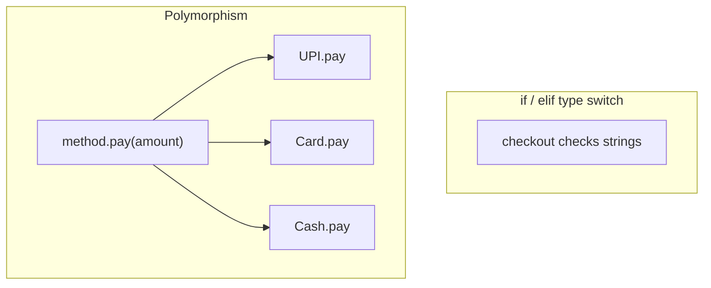
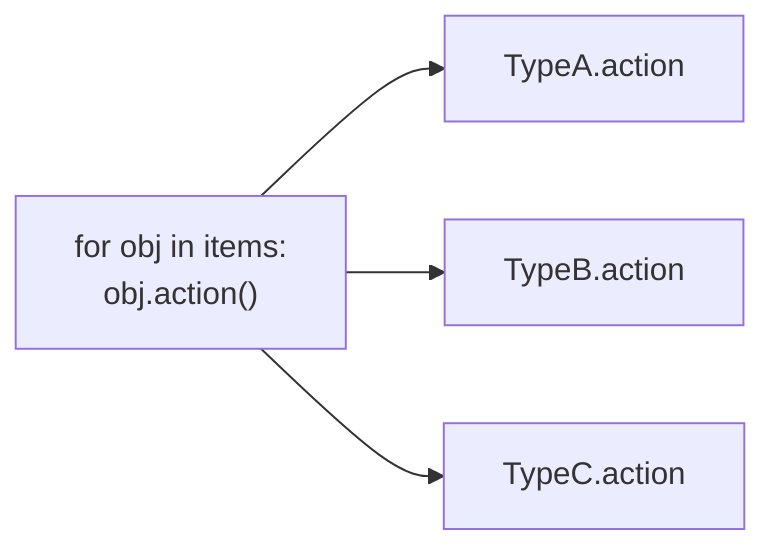
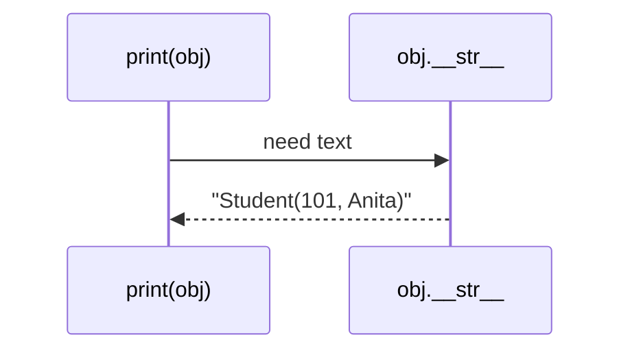

# Module 03c — OOP Part 3: Polymorphism & Project

**Phase:** Advanced Python

**Previous module:** [OOP Part 2 — Inheritance & Composition](03_OOP_Part2_Inheritance.md)  
**Next module:** [Exception Handling](04_Exception_Handling.md)

**Series:** [OOP overview](03_OOP.md) · [Part 1](03_OOP_Part1_Classes_Encapsulation.md) · [Part 2](03_OOP_Part2_Inheritance.md) · Part 3 (this file)

---

## Learning Outcomes

By the end of this part, learners will be able to:

1. Apply polymorphism via method overriding and duck typing.
2. Explain why Python does not use Java-style method overloading (use defaults / `*args`).
3. Override `__str__` for readable object printing when debugging or logging.
4. Ship the BankAccount OOP CLI mini-project (lab kit + menu) and push with a short README.

---

**Teaching note:** Ship with `print` **+** `return` validation. Do **not** require `raise` / `try` / `except` yet — that is the next module ([Exception Handling](04_Exception_Handling.md)).

---


## Motivation — Feel the pain of `if payment_type == ...`

Checkout code without polymorphism often looks like this:

```python
def checkout(payment_type, amount):
    if payment_type == "upi":
        print(f"Paid ₹{amount} via UPI")
    elif payment_type == "card":
        print(f"Paid ₹{amount} via Card")
    elif payment_type == "cash":
        print(f"Paid ₹{amount} in Cash")
    else:
        print("Unknown payment type")


checkout("upi", 250)
checkout("card", 999)
checkout("wallet", 100)  # forgotten branch → "Unknown"
```

Problems:

1. Every new payment mode needs a new `elif`.
2. Easy to miss a branch (silent “Unknown”).
3. Business logic and type switching live in one growing function.

**Visual — type switch vs same call, different objects:**




**Key takeaways:**

- Giant `if type == ...` trees grow brittle
- Same method name on different objects = polymorphism
- Add a new class with `pay()` — old checkout loop still works

With duck typing (same method name, no shared parent required):

```python
class UPI:
    def pay(self, amount):
        print(f"Paid ₹{amount} via UPI")


class Card:
    def pay(self, amount):
        print(f"Paid ₹{amount} via Card")


def checkout(method, amount):
    method.pay(amount)


checkout(UPI(), 250)
checkout(Card(), 999)
```

**Expected Output:**

```
Paid ₹250 via UPI
Paid ₹999 via Card
```

---


## Important Concepts


### 1. Polymorphism (override → duck typing → “no overloading”)

**Icons:** Bank · UPI · Order · Employee

**Where used?** Payment methods, shapes/areas, notification channels, account types printing a statement — one loop, many behaviours.

**Definition:** “Many forms” — the same operation name behaves differently depending on the object.  
**Purpose:** Write one loop/helper without giant `if type == ...` chains.

**Path A — Override polymorphism (shared hierarchy):** same method name on parent/children (see Vehicle / Car / Bike in [Part 2](03_OOP_Part2_Inheritance.md)).

```python
class Vehicle:
    def info(self):
        return "Vehicle"


class Car(Vehicle):
    def info(self):
        return "Car"


class Bike(Vehicle):
    def info(self):
        return "Bike"


for v in [Car(), Bike(), Car()]:
    print(v.info())   # same call site
```

**Expected Output:**

```
Car
Bike
Car
```

**Path B — Duck typing:** no shared parent required — if it has `pay()`, it works:

```python
class UPI:
    def pay(self, amount):
        print(f"Paid ₹{amount} via UPI")


class Card:
    def pay(self, amount):
        print(f"Paid ₹{amount} via Card")


def checkout(method, amount):
    method.pay(amount)


checkout(UPI(), 250)
checkout(Card(), 999)
```

Python: *if it walks like a duck and quacks like a duck…*

**Path C — “Overloading” in Python:** Java-style method/constructor overloading (same name, different signatures) is **not** supported. The last definition wins. Use defaults or `*args` instead:

```python
class Adder:
    def add(self, *nums):
        return sum(nums)


print(Adder().add(1, 2))
print(Adder().add(1, 2, 3, 4))
```

**Expected Output:**

```
3
10
```

What goes wrong with “fake” overloading:

```python
class Broken:
    def add(self, a, b):
        return a + b

    def add(self, a, b, c):   # replaces the previous add
        return a + b + c


# Broken().add(1, 2)  → TypeError: missing c
print(Broken().add(1, 2, 3))
```

**Expected Output:**

```
6
```

**Stretch — operator overloading:** customise `+` via `__add__` (optional demo, not core):

```python
class BookStack:
    def __init__(self, pages):
        self.pages = pages

    def __add__(self, other):
        return BookStack(self.pages + other.pages)

    def __str__(self):
        return f"BookStack({self.pages} pages)"


print(BookStack(100) + BookStack(200))
```

**Expected Output:**

```
BookStack(300 pages)
```

**Visual — one call site, many forms:**




**Key takeaways:**

- Override poly = shared parent + redefined methods
- Duck typing = shared method name is enough
- No Java-style overload — last `def` wins; use defaults / `*args`

**Common Error:** writing three methods named `add` with different arity and expecting Python to pick by argument count — it will not.

**Note:**

- Prefer duck typing + clear method names in Python for many day-to-day cases.
- Shared base classes help when you need shared fields / default behaviour (Part 2 Vehicles).
- Operator overloading (`__add__`, `__len__`, …) is powerful — use sparingly so code stays readable.

**Try these (2 programs):**

**Program 1 — Several pay methods, one checkout loop**

```python
class UPI:
    def pay(self, amount):
        print(f"Paid ₹{amount} via UPI")


class Card:
    def pay(self, amount):
        print(f"Paid ₹{amount} via Card")


class Cash:
    def pay(self, amount):
        print(f"Paid ₹{amount} in Cash")


def checkout(method, amount):
    method.pay(amount)


for method in [UPI(), Card(), Cash()]:
    checkout(method, 100)
```

**Expected Output:**

```
Paid ₹100 via UPI
Paid ₹100 via Card
Paid ₹100 in Cash
```

**Program 2 — Shape areas without isinstance**

```python
import math


class Circle:
    def __init__(self, r):
        self.r = r

    def area(self):
        return math.pi * self.r ** 2


class Square:
    def __init__(self, side):
        self.side = side

    def area(self):
        return self.side ** 2


for shape in [Circle(3), Square(4), Circle(1)]:
    print(f"{shape.__class__.__name__} area: {shape.area():.2f}")
```

**Expected Output:**

```
Circle area: 28.27
Square area: 16.00
Circle area: 3.14
```

---


### 2. Readable objects with `__str__`

**Icons:** Bank · Order · Employee · CRM

**Where used?** Debugging accounts, logging orders, printing employee cards, showing cart lines in a CLI.

**Definition:** `__str__` controls what you see when you `print(obj)` or convert it with `str(obj)`.  
**Purpose:** Default object text (`<__main__.Student object at 0x...>`) is useless when debugging; a clear string saves time.

```python
class Student:
    def __init__(self, roll, name):
        self.roll = roll
        self.name = name

    def __str__(self):
        return f"Student({self.roll}, {self.name})"


print(Student(101, "Anita"))
print("Label:", str(Student(102, "Vikram")))
```

**Expected Output:**

```
Student(101, Anita)
Label: Student(102, Vikram)
```

Without `__str__`:

```python
class Bare:
    def __init__(self, name):
        self.name = name


print(Bare("Anita"))  # <__main__.Bare object at 0x...>
```

**Visual — print asks the object for its string form:**




**Key takeaways:**

- `print(obj)` → `obj.__str__()` if defined
- Default = class name + memory address (hard to debug)
- Keep `__str__` short and human-readable

**Note:** `__repr__` is the unambiguous/debug form (`repr(obj)`). Prefer implementing `__str__` first; dig into `__repr__` in [Professional Python Deep Dive](07_Professional_Python_Deep_Dive.md) if needed.

**Common Error:** putting side effects (network calls, file writes) inside `__str__` — keep it a pure, cheap description.

**Try these (2 programs):**

**Program 1 — Readable account**

```python
class BankAccount:
    def __init__(self, holder, balance=0):
        self.holder = holder
        self._balance = float(balance)

    def __str__(self):
        return f"{self.holder}'s account — ₹{self._balance:.2f}"


print(BankAccount("Priya", 1000))
print(BankAccount("Ravi", 250.5))
```

**Expected Output:**

```
Priya's account — ₹1000.00
Ravi's account — ₹250.50
```

**Program 2 — Product label + list join**

```python
class Product:
    def __init__(self, sku, price):
        self.sku = sku
        self.price = price

    def __str__(self):
        return f"{self.sku} @ ₹{self.price}"


cart = [Product("NB-A4", 40), Product("PEN-01", 10)]
print(" | ".join(str(p) for p in cart))
```

**Expected Output:**

```
NB-A4 @ ₹40 | PEN-01 @ ₹10
```

---


## Step-by-Step Annotated Python 3 Code


### Example 1 — Payment checkout (duck typing + totals)

```python
class UPI:
    def pay(self, amount):
        print(f"UPI paid ₹{amount:.2f}")
        return True


class Card:
    def pay(self, amount):
        if amount > 50000:
            print("Card limit exceeded")
            return False
        print(f"Card paid ₹{amount:.2f}")
        return True


def run_checkout(methods_and_amounts):
    ok = 0
    for method, amount in methods_and_amounts:
        if method.pay(amount):
            ok += 1
    print(f"Successful payments: {ok}/{len(methods_and_amounts)}")


run_checkout([
    (UPI(), 250),
    (Card(), 999),
    (Card(), 60000),  # rejected
])
```

**Expected Output:**

```
UPI paid ₹250.00
Card paid ₹999.00
Card limit exceeded
Successful payments: 2/3
```

---


### Example 2 — Hierarchical accounts printing statements (`__str__` + override)

```python
class BankAccount:
    def __init__(self, holder, balance=0):
        self.holder = holder
        self._balance = float(balance)

    def deposit(self, amount):
        if amount > 0:
            self._balance += amount

    def __str__(self):
        return f"{self.holder}: ₹{self._balance:.2f}"


class SavingsAccount(BankAccount):
    def __init__(self, holder, balance=0, rate=0.04):
        super().__init__(holder, balance)
        self.rate = rate

    def apply_interest(self):
        self.deposit(self._balance * self.rate)

    def __str__(self):
        return f"Savings | {super().__str__()} | rate={self.rate:.0%}"


accounts = [
    BankAccount("Anita", 1000),
    SavingsAccount("Priya", 10000, 0.05),
]
accounts[1].apply_interest()
for acct in accounts:
    print(acct)   # polymorphic print via __str__
```

**Expected Output:**

```
Anita: ₹1000.00
Savings | Priya: ₹10500.00 | rate=5%
```

---


### Example 3 — Mini CLI core (no menu yet) for the lab class

```python
class BankAccount:
    def __init__(self, owner, opening=0.0):
        self.owner = owner
        self.__balance = float(opening)

    def deposit(self, amount):
        if amount <= 0:
            print("amount must be positive")
            return
        self.__balance += amount

    def withdraw(self, amount):
        if amount <= 0:
            print("amount must be positive")
            return
        if amount > self.__balance:
            print("insufficient funds")
            return
        self.__balance -= amount

    def get_balance(self):
        return self.__balance

    def __str__(self):
        return f"{self.owner}: ₹{self.__balance:.2f}"


acct = BankAccount("Anita", 1000)
acct.deposit(200)
acct.withdraw(100)
acct.withdraw(5000)
print(acct)
print("balance:", acct.get_balance())
```

**Expected Output:**

```
insufficient funds
Anita: ₹1100.00
balance: 1100.0
```

---


## Mini-Project (Assignment): BankAccount OOP CLI

**Title:** Encapsulated account demo  
**Lab kit (build here):** [15_Lab_Assets/17_bank_account_oop/](../15_Lab_Assets/17_bank_account_oop/)

### What to build


| Piece         | Detail                                                                       |
| ------------- | ---------------------------------------------------------------------------- |
| `BankAccount` | `__balance` (or `_balance` + property); `deposit`, `withdraw`, `get_balance` |
| Rules         | Reject amount ≤ 0; reject withdraw over balance                              |
| CLI menu      | 1 Deposit · 2 Withdraw · 3 Balance · 4 Exit                                  |
| Nice to have  | `__str__` for a one-line status print                                        |


**Starter idea (class):**

```python
class BankAccount:
    def __init__(self, owner, opening=0.0):
        self.owner = owner
        self.__balance = float(opening)

    def deposit(self, amount):
        if amount <= 0:
            print("amount must be positive")
            return
        self.__balance += amount

    def withdraw(self, amount):
        if amount <= 0:
            print("amount must be positive")
            return
        if amount > self.__balance:
            print("insufficient funds")
            return
        self.__balance -= amount

    def get_balance(self):
        return self.__balance

    def __str__(self):
        return f"{self.owner}: ₹{self.__balance:.2f}"
```

**Starter idea (menu loop):**

Assume the user types numbers for now. Bad `input` that cannot become a float may crash — that is fine in OOP week; [Exception Handling](04_Exception_Handling.md) teaches safe `try` / `except` next.

```python
def run_menu(account):
    while True:
        print("\n1) Deposit  2) Withdraw  3) Balance  4) Exit")
        choice = input("Choose: ").strip()
        if choice == "1":
            amount = float(input("Amount: "))
            account.deposit(amount)
        elif choice == "2":
            amount = float(input("Amount: "))
            account.withdraw(amount)
        elif choice == "3":
            print(account)  # uses __str__
            print("Balance:", account.get_balance())
        elif choice == "4":
            print("Bye")
            break
        else:
            print("Invalid choice")


if __name__ == "__main__":
    holder = input("Account holder name: ").strip() or "Student"
    opening = float(input("Opening balance: ") or "0")
    run_menu(BankAccount(holder, opening))
```

**Sample session (what your README can show):**

```
Account holder name: Anita
Opening balance: 1000

1) Deposit  2) Withdraw  3) Balance  4) Exit
Choose: 1
Amount: 200

1) Deposit  2) Withdraw  3) Balance  4) Exit
Choose: 2
Amount: 100

1) Deposit  2) Withdraw  3) Balance  4) Exit
Choose: 3
Anita: ₹1100.00
Balance: 1100.0

1) Deposit  2) Withdraw  3) Balance  4) Exit
Choose: 4
Bye
```


### Stretch

- Add `SavingsAccount(BankAccount)` with `apply_interest(rate)` **or** a `CurrentAccount` with a different minimum-balance / overdraft rule.
- Log each successful deposit/withdraw as a list of tuples `(action, amount, balance)`.
- **Later (Exceptions week):** switch validation to `raise ValueError` and catch it in the menu loop.


### Done when

- [ ] Lab kit BankAccount ticket passes
- [ ] Menu options 1–3 work; 4 exits
- [ ] Balance is not casually overwritten from outside (`account.__balance` fails / mangled)
- [ ] Repo pushed with a short README of a sample session

---


## Practice Exercises


### Advanced / interview-style coding

1. Write three notifier classes (`Sms`, `Email`, `Push`) each with `send(msg)`. Write `notify_all(notifiers, msg)` that loops once.
  **Model answer:**

```python
class Sms:
    def send(self, msg):
        print("SMS:", msg)

class Email:
    def send(self, msg):
        print("EMAIL:", msg)

class Push:
    def send(self, msg):
        print("PUSH:", msg)

def notify_all(notifiers, msg):
    for n in notifiers:
        n.send(msg)

notify_all([Sms(), Email(), Push()], "Order shipped")
```

**Expected Output:**

```
SMS: Order shipped
EMAIL: Order shipped
PUSH: Order shipped
```

1. Add `__str__` to `Employee(emp_id, name)` and print a list of employees joined by commas.
  **Model answer:**

```python
class Employee:
    def __init__(self, emp_id, name):
        self.emp_id = emp_id
        self.name = name

    def __str__(self):
        return f"{self.name}#{self.emp_id}"

team = [Employee(1, "Ravi"), Employee(2, "Meera")]
print(", ".join(str(e) for e in team))
```

**Expected Output:**

```
Ravi#1, Meera#2
```

1. Show that “overloading” fails: define `show` twice on a class and explain what happens.
  **Model answer:**

```python
class Demo:
    def show(self):
        print("one")

    def show(self, x):   # replaces previous show
        print("two", x)

# Demo().show()  → TypeError (missing x)
Demo().show(5)
```

**Expected Output:**

```
two 5
```

1. Difference between `@staticmethod` and `@classmethod`? (review from Part 1)
  **Model answer:**  
   `@staticmethod` is a plain function living on the class (no automatic first argument). `@classmethod` receives the class as `cls` and is used for alternate constructors or class-level helpers.
2. When inheritance vs composition?
  **Model answer:**  
   Inheritance when the child **is a** specialised parent. Composition when an object **has a** collaborator it uses. Prefer composition when unsure.
3. Why override `__str__`? What do you see if you skip it?
  **Model answer:**  
   `__str__` returns a human-readable description used by `print` and `str()`. Without it, Python shows a default like `<__main__.Student object at 0x...>`, which is hard to debug.

---


## Interview Q&A

Shared with students after concepts and the mini-project. Use for review and interview prep — questions and model answers are included.

**Q1. What is OOP? Pillars?**  
**A:** Programming around objects. Pillars: encapsulation (bundle + hide), inheritance (reuse via IS-A), polymorphism (same interface, different behaviour), abstraction (show essentials). Composition (HAS-A) is the practical partner to inheritance.

**Q2. What is** `self` **in Python?**  
**A:** Reference to the current instance. Must be first parameter of instance methods; passed implicitly on call `obj.method()`.

**Q3. Difference class method vs static method?**  
**A:** Class method receives `cls`, can access/modify class state or act as alternate constructor; static method has no implicit first arg — a utility namespaced on the class.

**Q4. Multiple inheritance in Python?**  
**A:** Supported (`class C(A, B)`); MRO decides lookup order. Prefer composition when possible.

**Q5.** `__str__` **vs default object print?**  
**A:** Default print shows class name and memory address. Override `__str__` to return a clear, human-readable summary for logs and debugging.

**Q6.** `@property` **vs public attribute?**  
**A:** `@property` lets you expose a clean attribute-like API while running validation or computing a value — callers write `obj.balance` instead of `obj.get_balance()`.

**Q7. Why doesn’t Python support method overloading like Java?**  
**A:** A class body is executed top to bottom; a second `def add(...)` simply replaces the first. Use default arguments or `*args` / `**kwargs` for flexible signatures.

**Q8. Is** `__balance` **truly private?**  
**A:** No. Name mangling renames it to `_ClassName__balance`. It prevents *accidental* access, not determined access. Real security is auth, permissions, and server-side checks.

**Q9. Why might a class variable for** `tax_rate` **be useful?**  
**A:** One shared rate for all employees; change `Employee.tax_rate` once and every instance’s net-pay logic can pick it up (unless shadowed).

**Q10. Polymorphism in one sentence?**  
**A:** Same operation name, different behaviour depending on the object — so one loop can handle many types.

---


## Next

Continue with **[Exception Handling](04_Exception_Handling.md)** after the BankAccount push.