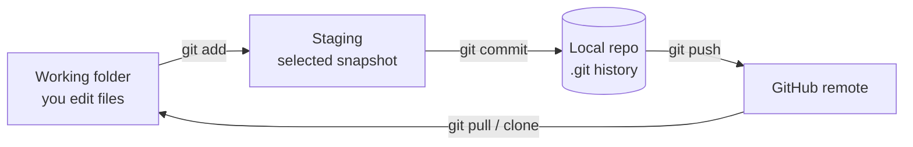
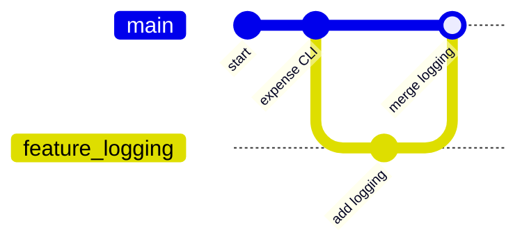

# Module 01 — Git and GitHub

**Phase:** Tools & Portfolio

**Duration:** See [Session Calendar](../00_Course_Guide/11_Session_Calendar_100.md) — live classes are **1h 15m** each (+ homework).

**Previous module:** File Handling and Logging
**Next module:** MySQL for Full Stack Developers

---

## Learning Outcomes

By the end of this session, learners will be able to:

1. Explain version control and why teams use Git.
2. Initialize repos, stage, commit, and view history with core commands.
3. Branch, merge, and resolve simple conflicts.
4. Clone, push, and pull with GitHub remotes.
5. Write a useful `.gitignore` and project `README.md`.
6. Follow GitHub portfolio habits that help entry-level hiring.

---

## Classroom Ticket

Open the lab kit **before** long notes. Read the ticket → code in `starter/` or fix `broken/`.

- **[Fix .gitignore + README for hiring](../15_Lab_Assets/19_git_portfolio_hygiene/)**

Finish the ticket in class; compare with the official solution only when your trainer says so.

## Prerequisites

- Git installed (`git --version`) and a free GitHub account
- Any earlier Python project folder to practice with

---

**Git** is a **time machine for your code**. Every **commit** saves a snapshot with a message — "Added login form", "Fixed CSV bug". You can go back, compare versions, and work with teammates without emailing zip files named `project_final_FINAL2.zip`.

**GitHub** is a **cloud hosting service** for Git repositories — like Google Drive for code, plus tools for collaboration, CI, and portfolios.

**Workflow in one line:**

1. Edit files in your project folder.
2. `git add` — choose what goes into the next snapshot.
3. `git commit` — save snapshot locally with message.
4. `git push` — upload commits to GitHub.

For **entry-level hiring**, recruiters often check: *Does this candidate have GitHub? Are projects documented? Commits regular?* A clean portfolio can compensate for lack of experience when combined with course projects (CampusCart, student CRUD, expense tracker).

---

## Important Concepts

### 1. Three areas of Git

```
Working Directory  →  Staging Area (index)  →  Repository (.git)
     (edit files)         git add                 git commit
```

**Visual — same idea as a packing line:**



**Try these (2 programs):**

**Program 1 — Trace one file through the three areas**

```bash
mkdir -p ~/git_lab_areas && cd ~/git_lab_areas
git init
echo "Campus canteen bill tracker" > NOTES.txt
git status                    # Working Directory: untracked
git add NOTES.txt
git status                    # Staging Area: ready to commit
git commit -m "Add NOTES about canteen tracker"
git status                    # clean — snapshot is in Repository
```

**Program 2 — Label the packing line**

```markdown
# Git packing line (India campus project)

1. Working Directory = files open in VS Code (edit `main.py`)
2. Staging = `git add main.py` (choose what goes in the box)
3. Repository = `git commit -m "..."` (sealed snapshot in `.git`)
4. GitHub = `git push` (cloud copy for portfolio / teammates)
```

### 2. Essential commands

| Command | Purpose |
|---------|---------|
| `git init` | Create new repo in folder |
| `git status` | See changed/untracked files |
| `git add file` / `git add .` | Stage changes |
| `git commit -m "msg"` | Save snapshot |
| `git log --oneline` | View history |
| `git diff` | Unstaged changes |
| `git branch` | List branches |
| `git switch -c feature-x` | Create and switch branch |
| `git merge feature-x` | Merge branch into current |
| `git clone URL` | Copy remote repo locally |
| `git push origin main` | Upload commits |
| `git pull origin main` | Download + merge remote |

**Note / trap:**
- Never pulling before push → rejected push / conflicts — make `git pull --rebase` a habit.
- Committing broken code to `main` → team blocked — use branches for features.
- Force push to shared `main` destroys teammates' work — avoid `--force` unless solo and sure.

**Try these (2 programs):**

**Program 1 — First three commits**

```bash
mkdir -p ~/expense_tracker_git && cd ~/expense_tracker_git
git init
echo "# Expense Tracker" > README.md
git add README.md
git commit -m "Initial commit: README"
echo "venv/" > .gitignore
git add .gitignore
git commit -m "Add Python gitignore"
echo "print('₹ total')" > main.py
git add main.py
git commit -m "Add stub main.py"
git log --oneline
```

**Program 2 — Status and diff before commit**

```bash
cd ~/expense_tracker_git
echo "# Expense Tracker\nTracks chai and lunch spend." > README.md
git status
git diff
git add README.md
git commit -m "Update README with purpose"
git log --oneline -3
```

### 3. Commit message convention (simple)

```
Add student CRUD CLI menu
Fix SQL injection in login query
Update README with setup steps
```

Use imperative mood; first line ≤ 50 chars; optional body after blank line.

**Note / trap:**
- Vague messages ("update", "fix") → useless history — write descriptive imperative messages.

**Try these (2 programs):**

**Program 1 — Rewrite bad messages**

```markdown
# Bad → Good

ok                    → Add login validation for roll number
final                 → Fix FileNotFoundError on missing CSV
update                → Update README with MySQL setup steps
done today            → Add INR formatting helper
```

**Program 2 — Commit with body**

```bash
cd ~/expense_tracker_git
echo "def format_inr(n): return f'₹{n:,.2f}'" >> main.py
git add main.py
git commit -m "$(cat <<'EOF'
Add format_inr helper

Used by canteen bill summary so amounts show as ₹1,250.00.
EOF
)"
git log -1
```

### 4. .gitignore essentials (Python)

```gitignore
# Virtual environment
venv/
.env

# Python cache
__pycache__/
*.pyc
*.pyo

# IDE
.vscode/
.idea/

# OS
.DS_Store
Thumbs.db

# Secrets — NEVER commit
*.pem
credentials.json
config.local.json
```

**Note / trap:**
- Committing `venv/` or `.env` → huge repo / leaked secrets — add `.gitignore` before the first push.

**Try these (2 programs):**

**Program 1 — Write a course .gitignore**

```bash
cd ~/expense_tracker_git
cat > .gitignore <<'EOF'
venv/
.env
__pycache__/
*.pyc
.DS_Store
credentials.json
EOF
git add .gitignore
git commit -m "Harden gitignore for secrets and venv"
```

**Program 2 — Prove secrets stay out**

```bash
cd ~/expense_tracker_git
echo "DB_PASSWORD=secret123" > .env
mkdir -p venv
echo "fake" > venv/pyvenv.cfg
git status
# Expect: .env and venv/ NOT listed (ignored)
```

### 5. README structure for portfolio

```markdown
# Project Name
One-line description.

## Features
- Bullet list

## Tech Stack
Python 3.11, MySQL, Django

## Setup
1. Clone repo
2. Create venv, pip install -r requirements.txt
3. Run commands...

## Screenshots (optional)

## Author
Your Name — LinkedIn — Hyderabad
```

**Note / trap:**
- No README → recruiter skips the repo — add setup steps and screenshots.
- Empty GitHub profile looks inactive — pin 3–6 best repos.

**Try these (2 programs):**

**Program 1 — Portfolio README draft**

```markdown
# Campus Expense Tracker

CLI tool that logs chai/lunch spends in INR and exports CSV.

## Features
- Add expense with category
- Monthly total in ₹
- Export `expenses.csv`

## Tech Stack
Python 3.11

## Setup
1. `git clone <url>`
2. `python -m venv venv && source venv/bin/activate`
3. `python main.py`

## Author
Priya Sharma — Hyderabad — LinkedIn
```

**Program 2 — Profile README bullets**

```markdown
# Hi, I'm Ravi — Python Full Stack learner (Bengaluru)

- Seeking: Junior Python / Django developer roles
- Stack: Python, MySQL, Django, React basics
- Projects: Expense Tracker · Student CRUD · CampusCart (in progress)
- Contact: LinkedIn · GitHub
```

---

## Step-by-Step Annotated Workflow

### Example 1 — First local repository

```bash
# Create project folder
mkdir expense_tracker
cd expense_tracker

# Initialize Git
git init

# Create files
echo "# Expense Tracker" > README.md
echo "venv/" > .gitignore

# Check status — README untracked
git status

# Stage and commit
git add README.md .gitignore
git commit -m "Initial commit: README and gitignore"
git log --oneline
```

### Example 2 — Daily commit cycle

```bash
# After editing main.py
git status
git diff                    # review changes before staging
git add main.py
git commit -m "Add expense CSV append function"
```

### Example 3 — Branching for feature

```bash
git switch -c feature/logging
# edit files, add logging
git add .
git commit -m "Add logging to expense module"

git switch main
git merge feature/logging
git branch -d feature/logging    # delete merged branch
```

**Visual — feature branch then merge back to main:**



Work on `feature/...` without breaking `main`, then merge when ready.

### Example 4 — Connect to GitHub and push

```bash
# On GitHub: create empty repo "expense-tracker" (no README if local exists)

git remote add origin https://github.com/yourusername/expense-tracker.git
git branch -M main
git push -u origin main
```

### Example 5 — Clone and collaborate

```bash
# Teammate or new laptop
git clone https://github.com/yourusername/expense-tracker.git
cd expense-tracker
python -m venv venv
source venv/bin/activate
pip install -r requirements.txt
```

```bash
# Before starting work each day
git pull origin main
```

### Example 6 — Handling merge conflict (simple)

```bash
# Both edited README.md differently on two branches
git merge feature/readme-update
# CONFLICT in README.md

# Open README.md — look for markers:
# <<<<<<< HEAD
# your version
# =======
# their version
# >>>>>>> feature/readme-update

# Edit to final desired text, remove markers
git add README.md
git commit -m "Resolve README merge conflict"
```

### Example 7 — Good vs bad commit history

**Good:** `Add parameterized MySQL queries` → `Fix FileNotFoundError` → `Initial structure`  
**Bad:** `ok` → `done` → `final`

---

## Practice Exercises

### Basic

1. `git init` a folder; make 3 commits with different files.
   **Model answer:**
   ```bash
   mkdir demo && cd demo
   git init
   echo "a" > a.txt && git add a.txt && git commit -m "Add a.txt"
   echo "b" > b.txt && git add b.txt && git commit -m "Add b.txt"
   echo "c" > c.txt && git add c.txt && git commit -m "Add c.txt"
   ```

2. View history with `git log --oneline --graph`.
   **Model answer:**
   ```bash
   git log --oneline --graph
   ```
   Shows a compact one-line-per-commit history; `--graph` draws branch topology when merges exist.

3. Create `.gitignore` ignoring `venv/` and `__pycache__/`.
   **Model answer:**
   ```bash
   printf 'venv/\n__pycache__/\n*.pyc\n' > .gitignore
   git add .gitignore && git commit -m "Add Python gitignore"
   ```

### Intermediate

1. Create branch `feature/csv-export`; merge to `main`.
   **Model answer:**
   ```bash
   git checkout -b feature/csv-export
   # ... edit files, commit ...
   git checkout main
   git merge feature/csv-export
   ```

2. Clone your partner's repo; add file; push via PR if using GitHub classroom.
   **Model answer:**
   ```bash
   git clone <partner-repo-url>
   cd <repo>
   echo "notes" > partner_note.md
   git checkout -b add-partner-note
   git add partner_note.md && git commit -m "Add partner note"
   git push -u origin HEAD
   # Open PR on GitHub (gh pr create or UI)
   ```

3. Write README with setup steps for student CRUD project.
   **Model answer:**
   A solid README includes project title, what it does, prerequisites (Python/MySQL), `venv` + `pip install -r requirements.txt`, env vars, migrate/run commands, and a short demo screenshot. Keep steps copy-pasteable for a classmate.

### Interview-style

1. Difference Git vs GitHub?
   **Model answer:**
   Git is the local version-control tool that tracks commits and branches on your machine. GitHub is a hosting service for Git repositories plus collaboration features (PRs, issues, CI).

2. What is merge conflict and resolution steps?
   **Model answer:**
   A merge conflict happens when two branches change the same lines differently. Open conflicted files, choose/combine the correct text, remove conflict markers, `git add` the files, then complete the merge with `git commit` (or continue rebase).

3. What is `git stash` used for?
   **Model answer:**
   `git stash` temporarily shelves uncommitted changes so you can switch branches or pull cleanly, then `git stash pop` restores them. Useful for quick context switches without committing WIP.

## Mini-Project: Portfolio Repository Setup

**Title:** python-fullstack-portfolio  
**Lab kit (build here):** [15_Lab_Assets/19_git_portfolio_hygiene/](../15_Lab_Assets/19_git_portfolio_hygiene/)

### What to build

1. GitHub repo with course projects in folders OR multiple repos linked from profile README.
2. Profile README (`github.com/username/username`) listing:
   - Name, role sought ("Python Full Stack Developer")
   - Tech stack badges (optional)
   - Links to top 3 projects
   - LinkedIn + email
3. Each project: README, requirements.txt, screenshot, live demo link if deployed.
4. Minimum **20 meaningful commits** across course (not one giant upload).

### Stretch

- Add Topics on GitHub (`python`, `django`, `mysql`, `portfolio`).
- Pin 3 repos on your profile.
- Open one Pull Request on a practice branch (even solo) to show PR habit.

### Done when

- [ ] Lab kit `.gitignore` + README hygiene ticket passes
- [ ] Public GitHub shows at least one project with clear Setup steps
- [ ] Profile README (or project README) states target role and city/region
- [ ] No `venv/` or `.env` committed

---

## Revision Map — Memorize / Understand / Practise / Build

| Topic | Memorize | Understand | Practise | Build |
|-------|----------|------------|----------|-------|
| Basics | init, status, add, commit | Working tree vs staging | Daily commit drill | First GitHub repo |
| History | log, diff, show | Commit as snapshot | Trace bug introduction | Meaningful messages |
| Branching | branch, checkout/switch, merge | Parallel feature work | Branch + merge lab | feature/login branch |
| Remote | clone, push, pull, origin | Local vs remote repo | Pair push exercise | Portfolio remote |
| Hygiene | .gitignore, README | What not to commit | Ignore venv/secrets | Professional README |
| Portfolio | Pin repos, topics | Recruiter scan pattern | Profile cleanup | 3 public projects |

## Interview & Discussion Q&A

### Discuss in class

1. Why should secrets never be committed even to private repos?
2. How does Git help when your code "was working yesterday"?
3. What will a TCS/Infosys interviewer infer from empty GitHub?
4. Fork vs clone — when use each?
5. How often should you commit on a solo learning project?

*No memorized script — push for plain-English answers, then continue to interview Qs below.*

### Interview answers

**Q1. What is Git?**  
**A:** Distributed version control system tracking file changes over time with commits, branches, and merges.

**Q2. git pull vs git fetch?**  
**A:** fetch downloads remote changes without merging; pull = fetch + merge into current branch.

**Q3. What is merge conflict?**  
**A:** When Git cannot auto-merge overlapping edits; human must choose final content and complete merge commit.

**Q4. Why .gitignore?**  
**A:** Exclude generated files, secrets, and local config from version control — keeps repo clean and safe.

**Q5. How GitHub helps placements in India?**  
**A:** Public proof of coding activity, project quality, collaboration; recruiters filter candidates with portfolios; campus drives increasingly ask for GitHub links.

**Q6. git stash?**  
**A:** Temporarily shelves uncommitted changes so you can switch branches cleanly; restore later with stash pop.

---

