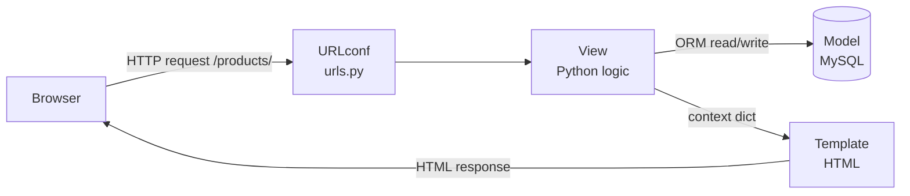

# Module: Django Introduction and Setup

**Duration:** See [Session Calendar](../00_Course_Guide/11_Session_Calendar_100.md) (1h 15m live sessions).

**Theme apps this phase:** Blog · Task Manager · Booking · Student Portal · CampusCart E-commerce

**Previous module:** [JavaScript DOM Forms](../../FRONTEND/03_JavaScript_DOM_Forms.md)  
**Next module:** URLs Views Templates Static

---

## Learning Outcomes

By the end of this module, learners will be able to:

- Explain what Django is, why Indian companies use it, and how MTV differs from MVC
- Create an isolated Python environment with `venv` and install Django 5.x
- Scaffold a project with `django-admin startproject` and an app with `startapp`
- Run the development server with `runserver` and interpret the default welcome page
- Navigate `settings.py`, `urls.py`, and `manage.py` at a high level
- Configure MySQL as the database engine using modern settings patterns
- Verify database connectivity and apply first migrations

---

## Classroom Ticket

**Today (S63–64):** Get `runserver` + MySQL settings working — no URL kit yet.

**Next sessions (S65–67):** Open [Two pages with one base template](../15_Lab_Assets/24_django_url_views_stub/) after the project exists.

Finish tickets in class; compare with the official solution only when your trainer says so.

## Prerequisites

- MySQL 8+ available locally or on the lab server
- Completed MySQL labs + Python ↔ MySQL bridge (or parallel schedule)

---

### What is Django?

**Django** is a free, open-source **web framework** written in Python. A **framework** is a pre-built skeleton that handles common web tasks so you write business logic faster — routing URLs, talking to databases, user login, admin panels, and security defaults.

**Web framework** means: you build **web applications** (sites/apps accessed through a browser or mobile app via HTTP), not desktop `.exe` apps.

**Why Django in India?** Startups (Swiggy-era stacks), IT services (maintenance portals), ed-tech (student portals), and product companies hire **Python Django developers** for rapid MVP delivery, built-in admin, and strong ORM (Object-Relational Mapping — Python classes instead of raw SQL for most CRUD).

### MTV Pattern (Model–Template–View)

Django uses **MTV**, often compared to **MVC** (Model–View–Controller) from Java/Spring:

| MTV (Django) | MVC (typical) | Role |
|--------------|---------------|------|
| **Model** | Model | Data structure + database logic (`models.py`) |
| **Template** | View | HTML presentation (`.html` files) |
| **View** | Controller | Python function/class handling request logic (`views.py`) |
| **URL dispatcher** | Routes config | Maps `/blog/` to the right view (`urls.py`) |

**Request flow (simple):** Browser requests `http://127.0.0.1:8000/` → **URLconf** finds matching path → **View** runs Python code → **Template** renders HTML → Response sent to browser.

**Visual — Django MTV on one CampusCart page visit:**



Think: **URL** picks the door, **View** is the worker, **Model** is the filing cabinet, **Template** is the printed page.

### Virtual Environment (`venv`)

A **virtual environment** is an isolated folder containing its own Python and installed packages. Without it, Project A's Django 4 and Project B's Django 5 would conflict globally.

**Terms:**
- **`venv`** — folder name convention for the environment
- **Activate** — tell your terminal to use that environment's Python/pip
- **`pip`** — package installer for Python (`pip install django`)

**Note / trap:**
- Forgot to activate venv → `ModuleNotFoundError: django`. Run `source venv/bin/activate` (Windows: `venv\Scripts\activate`) before pip/manage.py.
- Do not commit `venv/` — add it to `.gitignore` or the repo balloons.

### Project vs App

- **Project** — entire website configuration (`settings.py`, root `urls.py`, `manage.py`). Example: `campus_portal` (Student Portal theme).
- **App** — reusable feature module inside the project. Example: `blog`, `tasks`, `booking`. One project contains many apps.

### Key Files After Setup

| File | Purpose |
|------|---------|
| `manage.py` | Command-line utility — run server, migrations, shell |
| `settings.py` | Database, installed apps, middleware, static files config |
| `urls.py` (project) | Root URL routing |
| `wsgi.py` / `asgi.py` | Entry points for production servers (intro only today) |

### MySQL Connection (Concept)

Django does not ship MySQL driver inside the box. You install **`mysqlclient`** (preferred on Linux/Mac) or **`PyMySQL`** (common on Windows labs). **`DATABASES`** in `settings.py` tells Django which engine, database name, user, password, and host to use.

---

## Concepts

### 1. Django 5.x Modern Practices (This Course)

- Use **`path()`** in URLs (not legacy `url()` with regex unless needed)
- **`django-admin startproject config .`** — project config package named `config`, dot places `manage.py` at root
- **Environment variables** for secrets (intro today; full module in Security & Deployment)
- **One app per domain feature** — `blog`, `inventory` for CampusCart, not one giant `models.py`

**Note / trap:**
- `startproject` without a trailing `.` nests an extra folder. Prefer `django-admin startproject config .` (or move files if you already nested).

**Try these (2 programs):**

**Program 1 — Version check in venv**

```bash
python3 -m venv venv
source venv/bin/activate   # Windows: venv\Scripts\activate
pip install "django>=5.0,<6"
django-admin --version
```

**Program 2 — Project name note**

```markdown
# Why Django 5.x here?

- Use `path()` in urls (not old url())
- Prefer `STORAGES` for static in later deploy module
- Keep Python 3.11+ in venv for campus lab machines
```

### 2. Development vs Production

| Aspect | Development (`runserver`) | Production |
|--------|---------------------------|------------|
| Server | Django built-in | Gunicorn/uWSGI + Nginx |
| `DEBUG` | `True` | **`False`** always |
| Database | Local MySQL | Managed MySQL (RDS, PlanetScale, etc.) |
| Secret key | Can be default for learning | Must be unique, secret |

**Note / trap:**
- Never share or commit a real `SECRET_KEY` — use environment variables (Security & Deployment module). A leaked key is a production security risk.

**Try these (2 programs):**

**Program 1 — Dev settings reminder**

```python
# settings.py (dev only — never ship like this)
DEBUG = True
ALLOWED_HOSTS = ["127.0.0.1", "localhost"]
# SECRET_KEY stays in .env later — Module 05
print("Dev mode: DEBUG =", DEBUG)
```

**Program 2 — Production checklist stub**

```markdown
# Production (later)

- [ ] DEBUG = False
- [ ] SECRET_KEY from environment
- [ ] ALLOWED_HOSTS = your platform host
- [ ] HTTPS / secure cookies
```

### 3. INSTALLED_APPS

Every Django **app** you create must be listed in `INSTALLED_APPS` (or use auto-discovery patterns in advanced setups). Built-in apps include **`django.contrib.admin`**, **`auth`**, **`sessions`**, **`messages`**, **`staticfiles`**.

**Note / trap:**
- App missing from `INSTALLED_APPS` → models/admin ignored. Add the app string (e.g. `"blog"`) after `startapp`.

**Try these (2 programs):**

**Program 1 — Register a new app**

```python
# config/settings.py — after startapp blog
INSTALLED_APPS = [
    "django.contrib.admin",
    "django.contrib.auth",
    "django.contrib.contenttypes",
    "django.contrib.sessions",
    "django.contrib.messages",
    "django.contrib.staticfiles",
    "blog",  # your app
]
```

**Program 2 — Verify apps load**

```bash
python manage.py check
python manage.py showmigrations
```

### 4. First Migrations

Django ships with tables for **users**, **sessions**, and **admin**. Running **`migrate`** creates these tables in MySQL before you write custom models.

---

**Try these (2 programs):**

**Program 1 — Apply built-in auth tables**

```bash
python manage.py migrate
python manage.py showmigrations auth
```

**Program 2 — Createsuperuser smoke**

```bash
python manage.py createsuperuser
# Then open http://127.0.0.1:8000/admin/ after runserver
```

## Step-by-Step Lab (Annotated)

### Step 1 — Folder and Virtual Environment

```bash
# Create course projects folder (adjust path to your machine)
mkdir -p ~/ksr_python_fullstack/django_labs
cd ~/ksr_python_fullstack/django_labs

# Create virtual environment named venv
python3 -m venv venv

# Activate — macOS/Linux
source venv/bin/activate
# Windows: venv\Scripts\activate

# Prompt shows (venv) — confirms isolation
pip install --upgrade pip
pip install "django>=5.0,<6.0" mysqlclient
# Windows lab fallback if mysqlclient fails:
# pip install pymysql
```

### Step 2 — Create Project and App

```bash
# Project name: config (settings package), dot = manage.py in current folder
django-admin startproject config .

# App for Blog theme (repeat pattern for task_manager later)
python manage.py startapp blog

# Freeze dependencies for team/LMS submission
pip freeze > requirements.txt
```

### Step 3 — Register App in Settings

```python
# config/settings.py (excerpt)
INSTALLED_APPS = [
    "django.contrib.admin",
    "django.contrib.auth",
    "django.contrib.contenttypes",
    "django.contrib.sessions",
    "django.contrib.messages",
    "django.contrib.staticfiles",
    "blog",  # our first app — must match folder name
]
```

### Step 4 — MySQL Database Configuration

Create database in MySQL Workbench or CLI first:

```sql
CREATE DATABASE campus_portal_db CHARACTER SET utf8mb4 COLLATE utf8mb4_unicode_ci;
CREATE USER 'django_user'@'localhost' IDENTIFIED BY 'StrongPass123!';
GRANT ALL PRIVILEGES ON campus_portal_db.* TO 'django_user'@'localhost';
FLUSH PRIVILEGES;
```

```python
# config/settings.py
DATABASES = {
    "default": {
        "ENGINE": "django.db.backends.mysql",
        "NAME": "campus_portal_db",
        "USER": "django_user",
        "PASSWORD": "StrongPass123!",
        "HOST": "127.0.0.1",   # not localhost on some Mac setups — use 127.0.0.1
        "PORT": "3306",
        "OPTIONS": {
            "charset": "utf8mb4",
        },
    }
}
```

**PyMySQL fallback (Windows)** — add to `config/__init__.py`:

```python
import pymysql
pymysql.install_as_MySQLdb()
```

**Note / trap:**
- Wrong MySQL credentials → `Access denied for user`. Match Workbench user/password and `HOST`.
- `localhost` can hit socket issues on Mac — prefer `HOST: "127.0.0.1"`.

### Step 5 — Migrate and Run Server

```bash
python manage.py migrate
# Creates auth, admin, sessions tables in MySQL

python manage.py runserver
# Visit http://127.0.0.1:8000/ — Django rocket welcome page
```

### Step 6 — VS Code Workspace Tips

1. Open folder `django_labs` (not single file)
2. Select interpreter: `./venv/bin/python`
3. Optional: `.vscode/settings.json` → `"python.terminal.activateEnvironment": true`

---

## Practice Exercises

### Basic

1. Print Django version: `python -m django --version`
   **Model answer:**
   ```bash
   python -m django --version
   # example output: 5.x.x
   ```

2. List files created by `startproject` and explain each in one line
   **Model answer:**
   `manage.py` — CLI entry for migrate/runserver; project package `__init__.py`; `settings.py` — config; `urls.py` — root URL map; `asgi.py`/`wsgi.py` — deployment entry points; `wsgi.py` for traditional hosts, `asgi.py` for async.

3. Change runserver port: `python manage.py runserver 8080`
   **Model answer:**
   ```bash
   python manage.py runserver 8080
   ```
   App is then at `http://127.0.0.1:8080/`.

4. Create second app `tasks` for Task Manager theme; register in settings
   **Model answer:**
   ```bash
   python manage.py startapp tasks
   ```
   Add `"tasks"` to `INSTALLED_APPS` in `settings.py`.

### Intermediate

1. Create MySQL database `booking_db` and second Django project `booking_portal` with MySQL config
   **Model answer:**
   ```sql
   CREATE DATABASE booking_db CHARACTER SET utf8mb4;
   ```
   ```bash
   django-admin startproject booking_portal
   ```
   In settings, set `DATABASES` engine to `django.db.backends.mysql` with `NAME=booking_db`, user/password/host, then `pip install mysqlclient` (or `PyMySQL` bridge) and `migrate`.

2. Write `notes/django_folder_map.md` diagram: project vs apps
   **Model answer:**
   Project = config package (`settings`, root `urls`). Apps = feature packages (`accounts`, `blog`) with their own `models`/`views`/`urls`. One project can install many apps; apps should not hard-depend on project settings beyond Django APIs.

3. Run `migrate` and verify tables in MySQL Workbench (`auth_user`, etc.)
   **Model answer:**
   ```bash
   python manage.py migrate
   ```
   In Workbench, refresh the schema and confirm tables like `auth_user`, `django_migrations`, `django_session` exist.

### Interview Prep

1. Explain MTV with Student Portal example (login page flow)
   **Model answer:**
   Browser hits `/login/` (URL → View). The View uses the Model (User) to authenticate and renders a Template (login HTML). MTV separates data, request logic, and presentation — same idea as MVC with Django naming.

2. Why virtual environment for every Django project?
   **Model answer:**
   A venv isolates package versions so Project A’s Django 5 does not break Project B’s Django 4. It keeps `requirements.txt` reproducible and avoids polluting the system Python.

3. Difference between `django-admin` and `manage.py`
   **Model answer:**
   `django-admin` is the global CLI (create projects). `manage.py` is project-local and sets `DJANGO_SETTINGS_MODULE` for that project, so day-to-day commands use `python manage.py …`.

## Mini-Project / Activity

**Activity: "Portal Bootstrap" (45 min)**  
**Lab kit (preview for next sessions):** [15_Lab_Assets/24_django_url_views_stub/](../15_Lab_Assets/24_django_url_views_stub/)

### What to build

Build project **`student_portal`** with apps `core` (home placeholder) and `accounts` (empty for now):

- Working `runserver` welcome page
- MySQL connected; `migrate` success screenshot
- `requirements.txt` with Django + driver
- README with activate/run commands

### Stretch

- Add custom `TIME_ZONE = "Asia/Kolkata"` and explain IST relevance for Indian apps.
- Add `.env.example` listing `DJANGO_SECRET_KEY` and DB vars (values filled later).

### Done when

- [ ] `python manage.py runserver` shows Django welcome page
- [ ] MySQL `DATABASES` configured; `migrate` succeeds
- [ ] `requirements.txt` + README with activate/run steps
- [ ] Apps `core` and `accounts` exist and `core` is in `INSTALLED_APPS`

---

## Revision Map — Memorize / Understand / Practise / Build

| Topic | Memorize | Understand | Practise | Build |
|-------|----------|------------|----------|-------|
| What is Django | Full-stack web framework, batteries included | MTV vs MVC mapping | Read Django job posts | — |
| Virtual environment | `python3 -m venv venv`, `source venv/bin/activate` | Isolation per project | Create venv daily | Project folder layout |
| Install Django | `pip install django`, `django-admin --version` | pip inside venv only | Reinstall in fresh venv | requirements.txt |
| startproject | `django-admin startproject config .` | Project vs app | Create 2 projects | `campus_portal` project |
| startapp | `python manage.py startapp blog` | App = feature module | One app per theme | `blog` app |
| runserver | `python manage.py runserver` | Dev server ≠ production | Start/stop 10 times | Local URL bookmark |
| settings.py | `INSTALLED_APPS`, `DATABASES`, `DEBUG` | Central configuration | Locate each setting | MySQL block |
| MySQL setup | `ENGINE`, `NAME`, `USER`, `PASSWORD`, `HOST` | mysqlclient / PyMySQL driver | Connect + migrate | Student DB name |
| manage.py | `migrate`, `makemigrations`, `createsuperuser` | CLI entry to Django | Run each once | Migration log |

## Interview & Discussion Q&A

### Discuss in class

1. Is Django a programming language? How is it different from Python?
2. Why might a startup choose Django over building everything from scratch in plain Python?
3. Coming from Java: what is the Spring Boot equivalent idea in Django?
4. Should every mini-feature be a separate app, or one big app? Where do you draw the line?
5. Why does Django create admin/auth tables before we write any model?

*No memorized script — push for plain-English answers, then continue to interview Qs below.*

### Interview answers

**Q1. What is Django?**  
**A:** High-level Python web framework with ORM, admin, auth, templating, and security helpers for building database-driven web apps quickly.

**Q2. Explain MTV.**  
**A:** Model handles data; View handles request logic; Template renders HTML. URL dispatcher routes URLs to views.

**Q3. Difference between Flask and Django?**  
**A:** Flask is minimal/micro — you choose components; Django is batteries-included with ORM, admin, auth conventions. Django suits large CRUD portals; Flask suits small APIs/services.

**Q4. Purpose of `manage.py`?**  
**A:** CLI to run development server, migrations, shell, createsuperuser — sets `DJANGO_SETTINGS_MODULE` and delegates to Django management framework.

**Q5. Why migrations?**  
**A:** Version-controlled schema changes; team syncs database structure without manual SQL drift.

**Q6. How connect Django to MySQL?**  
**A:** Install driver (mysqlclient/PyMySQL), set `DATABASES` ENGINE to `django.db.backends.mysql`, configure NAME/USER/PASSWORD/HOST, run migrate.

---

