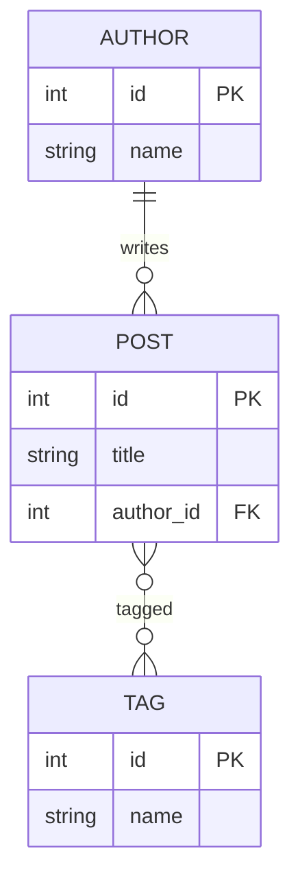

# Module: Models, ORM, and Django Admin

**Theme apps:** Blog · Task Manager · Booking · Student Portal · CampusCart E-commerce

**Previous module:** URLs Views Templates Static
**Next module:** Forms Sessions Auth

---

## Learning Outcomes

By the end of this module, learners will be able to:

- Define **models** by subclassing `models.Model` with common field types
- Run **migrations** with `makemigrations` and `migrate` to sync MySQL schema
- Perform **ORM CRUD**: create, read, update, delete without raw SQL
- Use Django **Admin** to register models and manage data via `/admin/`
- Explain **ForeignKey** and **ManyToManyField** relationships at overview level
- Query with `filter()`, `get()`, `all()`, and `order_by()` in views
- Connect models to templates replacing hardcoded context data

---

## Classroom Ticket

Open the lab kit **before** long notes. Read the ticket → code in `starter/` or fix `broken/`.

- **[Later: tasks model path — preview ownership](../15_Lab_Assets/03_django_auth_tasks/)**

Finish the ticket in class; compare with the official solution only when your trainer says so.

### What is a Model?

A **model** is a Python class describing **database table structure**. Each **attribute** on the class becomes a **column**. Django **ORM** (Object-Relational Mapper) translates Python operations to SQL.

**ORM** — you work with Python objects; Django generates SQL like `SELECT * FROM blog_post WHERE ...`.

**Migration** — a version file describing schema changes (add column, new table). **`makemigrations`** creates the file; **`migrate`** applies it to MySQL.

### Model Example (Blog)

```python
class Post(models.Model):
    title = models.CharField(max_length=200)
    body = models.TextField()
    published = models.BooleanField(default=False)
    created_at = models.DateTimeField(auto_now_add=True)
```

Creates table `blog_post` (app label + model name lowercase).

### Field Terms

| Term | Meaning |
|------|---------|
| **`max_length`** | Required for CharField — DB column size limit |
| **`null=True`** | Database allows NULL |
| **`blank=True`** | Form validation allows empty (admin/forms) |
| **`default`** | Value when not provided |
| **`auto_now_add`** | Set once on create (timestamp) |

**Note:**
- Prefer `blank=True` only for optional text fields — avoid `null=True` on `CharField` unless you truly need SQL NULL (NULL vs empty-string confusion).

### Relationships Overview

**ForeignKey (FK)** — **many-to-one**. Many blog posts → one author.  
Example: `author = models.ForeignKey(Author, on_delete=models.CASCADE)`

**ManyToManyField (M2M)** — **many-to-many**. Post has many tags; tag on many posts. Django creates junction table automatically.

**Visual — blog relationships:**



**`on_delete=models.CASCADE`** — if parent Author deleted, delete their posts too (common default for learning; discuss PROTECT in production).

**Note:**
- `ForeignKey` without `on_delete` → model error. Always set `on_delete` (e.g. `CASCADE`, `PROTECT`).

### Django Admin

Built-in **staff interface** at `/admin/` for non-developers to manage data. Register models in **`admin.py`**. Requires **superuser** account.

**Note:**
- Forgot to register in `admin.py` → model missing from `/admin/`. Add `@admin.register(...)` or `admin.site.register(...)`.

---

## Concepts

### 1. Migration Workflow

```
Change models.py → makemigrations → migrate → MySQL schema updated
```

Never edit applied migration files manually as a beginner — create new migration instead.

**Note:**
- Forgot `makemigrations` after editing `models.py` → no schema change. Run `makemigrations` then `migrate`.
- Editing an applied migration by hand often causes conflicts — regenerate in lab or ask in class.

**Try these (2 programs):**

**Program 1 — Make and apply**

```bash
python manage.py makemigrations blog
python manage.py migrate
python manage.py showmigrations blog
```

**Program 2 — Read the migration file tip**

```markdown
# After makemigrations

Open `blog/migrations/0001_initial.py` and confirm:
- CreateModel for Post
- fields match models.py
Then migrate.
```

### 2. QuerySet

**QuerySet** — lazy collection of objects from database. `.filter(published=True)` returns QuerySet; DB hit may defer until iteration.

**Note:**
- `Post.objects.get()` with 0 or 2+ rows → `DoesNotExist` / `MultipleObjectsReturned`. Prefer `filter().first()` or handle the exception.
- N+1 queries in a template (looping related objects) slow the page — use `select_related('author')` when you know you'll need the FK (interview teaser).

**Try these (2 programs):**

**Program 1 — Shell CRUD read**

```python
# python manage.py shell
from blog.models import Post
Post.objects.create(title="Idli Special", body="₹40 at canteen", published=True)
print(list(Post.objects.filter(published=True).values_list("title", flat=True)))
```

**Program 2 — Order and limit**

```python
from blog.models import Post
latest = Post.objects.order_by("-id")[:5]
for p in latest:
    print(p.id, p.title)
```

### 3. `__str__` Method

Defines human-readable representation in admin and shell:

```python
def __str__(self):
    return self.title
```

**Try these (2 programs):**

**Program 1 — Readable admin labels**

```python
class Post(models.Model):
    title = models.CharField(max_length=200)
    body = models.TextField()

    def __str__(self):
        return self.title
```

**Program 2 — Include city in Product str**

```python
class Product(models.Model):
    name = models.CharField(max_length=120)
    price = models.DecimalField(max_digits=10, decimal_places=2)

    def __str__(self):
        return f"{self.name} — ₹{self.price}"
```

### 4. Admin Customization (Intro)

```python
@admin.register(Post)
class PostAdmin(admin.ModelAdmin):
    list_display = ("title", "published", "created_at")
    list_filter = ("published",)
    search_fields = ("title",)
```

---

**Try these (2 programs):**

**Program 1 — Register with list_display**

```python
# blog/admin.py
from django.contrib import admin
from .models import Post

@admin.register(Post)
class PostAdmin(admin.ModelAdmin):
    list_display = ("title", "published", "id")
    search_fields = ("title",)
```

**Program 2 — Filter published**

```python
@admin.register(Post)
class PostAdmin(admin.ModelAdmin):
    list_display = ("title", "published")
    list_filter = ("published",)
```

## Step-by-Step Lab (Annotated)

### Step 1 — Blog Models

```python
# blog/models.py
from django.db import models

class Author(models.Model):
    name = models.CharField(max_length=100)
    email = models.EmailField(unique=True)

    def __str__(self):
        return self.name

class Post(models.Model):
    title = models.CharField(max_length=200)
    body = models.TextField()
    published = models.BooleanField(default=False)
    created_at = models.DateTimeField(auto_now_add=True)
    author = models.ForeignKey(Author, on_delete=models.CASCADE, related_name="posts")

    def __str__(self):
        return self.title

class Tag(models.Model):
    name = models.CharField(max_length=50, unique=True)
    posts = models.ManyToManyField(Post, related_name="tags", blank=True)

    def __str__(self):
        return self.name
```

### Step 2 — Migrations

```bash
python manage.py makemigrations blog
python manage.py migrate
```

Verify in Workbench: tables `blog_author`, `blog_post`, `blog_tag`, `blog_tag_posts`.

### Step 3 — ORM CRUD in Shell

```bash
python manage.py shell
```

```python
from blog.models import Author, Post, Tag

# CREATE
a = Author.objects.create(name="Priya", email="priya@campus.in")
p = Post.objects.create(title="CampusCart Goes Live", body="Shop books online.", author=a, published=True)

# READ
Post.objects.all()
Post.objects.filter(published=True)
Post.objects.get(pk=1)

# UPDATE
p.title = "CampusCart Launch Event"
p.save()

# DELETE
# Tag.objects.filter(name="news").delete()

# M2M
t, _ = Tag.objects.get_or_create(name="announcement")
p.tags.add(t)
```

### Step 4 — Views Using ORM

```python
# blog/views.py
from django.shortcuts import render
from .models import Post

def post_list(request):
    posts = Post.objects.filter(published=True).order_by("-created_at")
    return render(request, "blog/post_list.html", {"posts": posts})
```

```html
<!-- blog/templates/blog/post_list.html excerpt -->

  <article>
    <h2>{{ post.title }}</h2>
    <p>By {{ post.author.name }} · {{ post.created_at|date:"d M Y" }}</p>
    <p>{{ post.body|truncatewords:30 }}</p>
  </article>

  <p>No published posts.</p>

```

### Step 5 — Task Manager Model

```python
# tasks/models.py
from django.db import models

class Task(models.Model):
    PRIORITY_CHOICES = [
        ("L", "Low"),
        ("M", "Medium"),
        ("H", "High"),
    ]
    title = models.CharField(max_length=150)
    done = models.BooleanField(default=False)
    priority = models.CharField(max_length=1, choices=PRIORITY_CHOICES, default="M")
    due_date = models.DateField(null=True, blank=True)

    def __str__(self):
        return self.title
```

### Step 6 — Admin Registration

```bash
python manage.py createsuperuser
# username: admin, email: admin@example.com, password: (lab standard)
```

```python
# blog/admin.py
from django.contrib import admin
from .models import Author, Post, Tag

@admin.register(Author)
class AuthorAdmin(admin.ModelAdmin):
    search_fields = ("name", "email")

@admin.register(Post)
class PostAdmin(admin.ModelAdmin):
    list_display = ("title", "author", "published", "created_at")
    list_filter = ("published", "author")
    search_fields = ("title", "body")

admin.site.register(Tag)
```

Visit `http://127.0.0.1:8000/admin/` — add authors, posts, tasks.

### Step 7 — CampusCart Product Model (Preview)

```python
# catalog/models.py (CampusCart app — create if capstone track)
class Product(models.Model):
    name = models.CharField(max_length=120)
    price = models.DecimalField(max_digits=10, decimal_places=2)
    stock = models.PositiveIntegerField(default=0)

    def __str__(self):
        return f"{self.name} (₹{self.price})"
```

---

## Practice Exercises

### Basic

1. Add `updated_at = models.DateTimeField(auto_now=True)` to Post; migrate
   **Model answer:**
   ```python
   updated_at = models.DateTimeField(auto_now=True)
   ```
   ```bash
   python manage.py makemigrations && python manage.py migrate
   ```

2. Create 5 posts via admin; list only published in view
   **Model answer:**
   Register `Post` in admin, add five rows with `published=True/False`. In the view: `Post.objects.filter(published=True)`.

3. Task model: filter `done=False` in dashboard view
   **Model answer:**
   ```python
   tasks = Task.objects.filter(done=False).order_by("-created_at")
   return render(request, "tasks/dashboard.html", {"tasks": tasks})
   ```

### Intermediate

1. **Booking:** `Room` model (name, capacity, available) + admin list_filter on available
   **Model answer:**
   ```python
   class Room(models.Model):
       name = models.CharField(max_length=100)
       capacity = models.PositiveIntegerField()
       available = models.BooleanField(default=True)

   @admin.register(Room)
   class RoomAdmin(admin.ModelAdmin):
       list_filter = ("available",)
   ```

2. **Student Portal:** `Student` FK to `Department` model
   **Model answer:**
   ```python
   class Department(models.Model):
       name = models.CharField(max_length=100)

   class Student(models.Model):
       name = models.CharField(max_length=100)
       department = models.ForeignKey(Department, on_delete=models.CASCADE, related_name="students")
   ```

3. Shell: count posts per author using `author.posts.count()`
   **Model answer:**
   ```python
   from django.contrib.auth import get_user_model
   User = get_user_model()
   for u in User.objects.all():
       print(u.username, u.posts.count())
   ```
   (Assumes `Post.author` FK with `related_name="posts"`.)

### Interview Prep

1. Difference between `null=True` and `blank=True`
   **Model answer:**
   `null=True` allows SQL NULL in the database. `blank=True` allows empty values in forms/validation. CharFields usually use `blank=True` with `default=""` rather than NULL.

2. What happens on CASCADE delete?
   **Model answer:**
   Deleting the parent row also deletes related child rows that use `on_delete=models.CASCADE` (e.g. delete Department → its Students go too).

3. ORM vs raw SQL — when use each?
   **Model answer:**
   Prefer ORM for CRUD, safety, and portability. Use raw SQL for complex reports, vendor-specific features, or performance-critical queries the ORM expresses poorly — still parameterize inputs.

## Mini-Project / Activity

**Activity: "Admin-Driven Blog" (60 min)**  
**Lab kit (preview ownership):** [15_Lab_Assets/03_django_auth_tasks/](../15_Lab_Assets/03_django_auth_tasks/)

### What to build

1. Models: Author, Post, Tag (M2M)
2. Admin customized with list_display and search
3. Public `/blog/` reads from DB
4. Add a post live in admin; refresh the page and confirm the new post appears

### Stretch

- Add `published` Boolean and show only published posts on the public list.
- Add `DecimalField` price on a Product model for CampusCart preview (₹).

### Done when

- [ ] Migrations applied; models visible in admin
- [ ] Public `/blog/` shows ORM data (no hardcoded posts)
- [ ] Admin `list_display` + search works
- [ ] New admin post appears after browser refresh

---

## Revision Map — Memorize / Understand / Practise / Build

| Topic | Memorize | Understand | Practise | Build |
|-------|----------|------------|----------|-------|
| `models.Model` | Class = table | Fields = columns | 3 models | Blog Post |
| Field types | CharField, TextField, IntegerField, DateTimeField | max_length, null, blank | Field choice drills | Product price |
| Migrations | makemigrations → migrate | Schema version control | Alter model twice | Migration files |
| ORM create | `Model.objects.create()` | SQL abstracted | 20 inserts | Seed data |
| ORM read | `.all()`, `.filter()`, `.get()` | QuerySet lazy eval | Filter exercises | Published posts |
| ORM update/delete | `.save()`, `.delete()` | Instance vs queryset | Update status | Mark task done |
| Admin | `admin.site.register` | Staff UI for CRUD | Register all models | list_display |
| ForeignKey | `on_delete=models.CASCADE` | Many-to-one | Author → Posts | Student → Dept |
| ManyToMany | `ManyToManyField` | Tags, categories | Optional tags on Post | Course enrollments |

---

## Interview & Discussion Q&A

Shared with students after concepts and the mini-project. Use for review and interview prep — questions and model answers are included.

1. If ORM generates SQL anyway, why not write SQL directly?
2. Who uses Django admin in a real company — developers or operations staff?
3. CASCADE delete: safe for financial records? Alternatives?
4. How would CampusCart link `Order` to `Product` — FK or M2M?
5. compare Django models to JPA entities / Hibernate.

**Q1. What is Django ORM?**  
**A:** API mapping Python classes to SQL tables; CRUD via QuerySets without writing most SQL manually.

**Q2. makemigrations vs migrate?**  
**A:** makemigrations creates migration files from model changes; migrate applies them to database.

**Q3. ForeignKey vs ManyToMany?**  
**A:** FK: many-to-one (many posts, one author). M2M: many-to-many (posts and tags) with junction table.

**Q4. null vs blank?**  
**A:** null is database-level NULL allowed; blank is validation-level empty allowed in forms/admin.

**Q5. Benefits of Django admin?**  
**A:** Rapid internal CRUD UI for staff; less custom code for back-office operations.

**Q6. What is QuerySet?**  
**A:** Lazy database-backed collection of model instances; chainable filters before evaluation.

---

