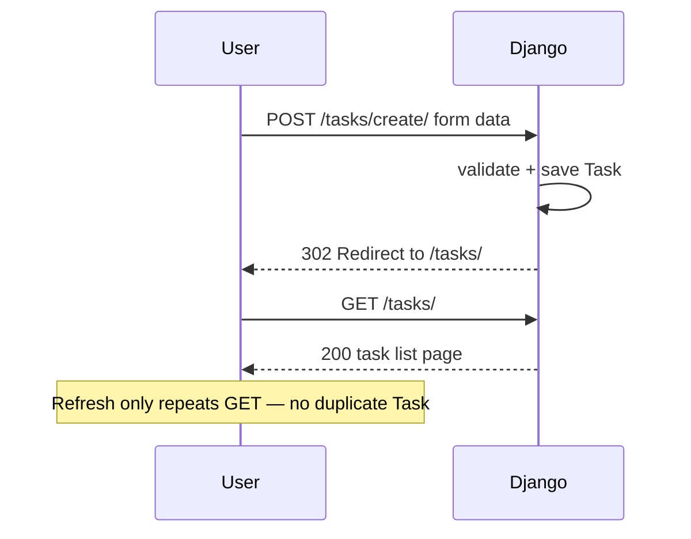

# Module: Forms, Sessions, and Authentication

**Duration:** See [Session Calendar](../00_Course_Guide/11_Session_Calendar_100.md) (1h 15m live sessions).

**Theme apps:** Blog · Task Manager · Booking · Student Portal · CampusCart E-commerce

**Previous module:** Models ORM Admin
**Next module:** Security and Deployment

---

## Learning Outcomes

By the end of this module, learners will be able to:

- Build HTML forms with **`forms.Form`** and **`forms.ModelForm`**
- Validate user input on server side with field and form **`clean()`** methods
- Handle **GET vs POST** in views and redirect after successful POST (**PRG pattern**)
- Use **sessions** to store data across requests (cart preview, flash messages intro)
- Implement **register, login, logout** with **`django.contrib.auth`**
- Protect views with **`@login_required`** and explain **permissions** overview
- Connect authenticated users to Task and Blog ownership models

---

## Classroom Ticket

Open the lab kit **before** long notes. Read the ticket → code in `starter/` or fix `broken/`.

- **[Tasks must be private per user](../15_Lab_Assets/03_django_auth_tasks/)**

Finish the ticket in class; compare with the official solution only when your trainer says so.

### Why Forms in Django?

Browsers submit **HTML forms** with **GET** (read/search) or **POST** (create/update/delete). Django **forms** validate and clean data before saving to database — never trust raw **`request.POST`** alone.

**`forms.Form`** — generic form not tied to one model (contact us, search).  
**`forms.ModelForm`** — auto-generates fields from a **model** (add Task, create Post).

**Note:**
- Use POST for create/update/delete — GET puts data in the URL and is unsafe for mutations.

### Validation

**Field validation** — type, max length, required.  
**Form `clean()`** — cross-field rules (password match, date range).  
Errors display in template with **`{{ form.errors }}`** or per-field **`{{ form.title.errors }}`**.

**Note:**
- Always branch on `form.is_valid()` before save — skipping it can persist invalid data.

### CSRF (Cross-Site Request Forgery) — Intro

**CSRF** attack tricks logged-in user's browser to POST to your site without consent. Django embeds **``** hidden field; middleware validates token. Always include in POST forms.

**Note:**
- Missing `` inside `<form method="post">` → 403 Forbidden CSRF.

### Sessions

**Session** — server stores data keyed by session ID in cookie. Example: shopping cart item count for **CampusCart**, booking draft for **Booking** app. Access via **`request.session`**.

```python
request.session["cart_count"] = 3
count = request.session.get("cart_count", 0)
```

**Note:**
- Session not persisting (e.g. cart resets) — set `request.session.modified = True` when you mutate nested session data.

### Authentication (`django.contrib.auth`)

Django ships **User** model: username, password (hashed), email, flags **`is_staff`**, **`is_superuser`**.  
**`authenticate(username=, password=)`** — checks credentials.  
**`login(request, user)`** — attaches user to session.  
**`logout(request)`** — clears session auth.

**`@login_required`** — decorator redirecting unauthenticated users to **`LOGIN_URL`**.

**Note:**
- Never store passwords in plain text — use `UserCreationForm` / `set_password` so Django hashes them.

### Permissions Overview

**Permissions** control who can do what. Built-in: user, staff, superuser. Model-level permissions like **`add_post`**, **`change_post`**. Check **`request.user.has_perm('blog.add_post')`** or use **`@permission_required`**. Full RBAC in enterprise apps; admin uses **`is_staff`**.

---

## Concepts

### 1. POST-Redirect-GET (PRG)

After successful POST (create task), **`redirect('task_list')`** prevents duplicate submit on refresh.

**Visual — why we redirect after save:**



If you return the success HTML directly on POST, refresh can **create the same task again**.

**Note:**
- No redirect after POST → duplicate submit on refresh. Use redirect (PRG).

**Try these (2 programs):**

**Program 1 — Redirect after successful POST**

```python
from django.shortcuts import redirect, render
from .forms import TaskForm

def task_create(request):
    if request.method == "POST":
        form = TaskForm(request.POST)
        if form.is_valid():
            form.save()
            return redirect("task_list")  # PRG — avoid double submit
    else:
        form = TaskForm()
    return render(request, "tasks/form.html", {"form": form})
```

**Program 2 — Why PRG note**

```markdown
# Without PRG

Refresh after POST → browser resubmits → duplicate tasks.

# With PRG

POST → 302 redirect → GET list page → refresh is safe.
```

### 2. LOGIN_URL Setting

```python
LOGIN_URL = "login"
LOGIN_REDIRECT_URL = "task_dashboard"
LOGOUT_REDIRECT_URL = "home"
```

**Note:**
- `@login_required` without a valid `LOGIN_URL` → 404 on redirect. Set `LOGIN_URL` in settings to a named route that exists.

**Try these (2 programs):**

**Program 1 — Settings redirects**

```python
# settings.py
LOGIN_URL = "login"
LOGIN_REDIRECT_URL = "task_list"
LOGOUT_REDIRECT_URL = "login"
```

**Program 2 — Protect a view**

```python
from django.contrib.auth.decorators import login_required
from django.shortcuts import render

@login_required
def dashboard(request):
    return render(request, "tasks/dashboard.html")
```

### 3. Linking User to Models

```python
class Task(models.Model):
    owner = models.ForeignKey(settings.AUTH_USER_MODEL, on_delete=models.CASCADE)
```

Filter tasks: **`Task.objects.filter(owner=request.user)`**.

**Note:**
- Showing all users' tasks is a privacy bug — always filter by `owner=request.user` (or equivalent).

**Try these (2 programs):**

**Program 1 — Owner FK**

```python
from django.conf import settings
from django.db import models

class Task(models.Model):
    title = models.CharField(max_length=200)
    owner = models.ForeignKey(
        settings.AUTH_USER_MODEL,
        on_delete=models.CASCADE,
        related_name="tasks",
    )

    def __str__(self):
        return self.title
```

**Program 2 — Filter by request.user**

```python
@login_required
def task_list(request):
    tasks = Task.objects.filter(owner=request.user)
    return render(request, "tasks/list.html", {"tasks": tasks})
```

### 4. UserCreationForm

Built-in form for registration with password validation — extend for email field.

---

**Try these (2 programs):**

**Program 1 — Register view**

```python
from django.contrib.auth import login
from django.contrib.auth.forms import UserCreationForm
from django.shortcuts import redirect, render

def register(request):
    if request.method == "POST":
        form = UserCreationForm(request.POST)
        if form.is_valid():
            user = form.save()
            login(request, user)
            return redirect("task_list")
    else:
        form = UserCreationForm()
    return render(request, "registration/register.html", {"form": form})
```

**Program 2 — Register template**

```html
<form method="post">
  
  {{ form.as_p }}
  <button type="submit">Create account</button>
</form>
```

## Step-by-Step Lab (Annotated)

### Step 1 — ModelForm for Task

```python
# tasks/forms.py
from django import forms
from .models import Task

class TaskForm(forms.ModelForm):
    class Meta:
        model = Task
        fields = ["title", "priority", "due_date"]
        widgets = {
            "due_date": forms.DateInput(attrs={"type": "date"}),
            "title": forms.TextInput(attrs={"class": "form-control"}),
        }

    def clean_title(self):
        title = self.cleaned_data["title"].strip()
        if len(title) < 3:
            raise forms.ValidationError("Title must be at least 3 characters.")
        return title
```

### Step 2 — Create Task View (POST + PRG)

```python
# tasks/views.py
from django.contrib.auth.decorators import login_required
from django.shortcuts import render, redirect
from .forms import TaskForm
from .models import Task

@login_required
def task_create(request):
    if request.method == "POST":
        form = TaskForm(request.POST)
        if form.is_valid():
            task = form.save(commit=False)
            task.owner = request.user  # add owner FK on model first
            task.save()
            return redirect("task_dashboard")
    else:
        form = TaskForm()
    return render(request, "tasks/task_form.html", {"form": form})

@login_required
def task_dashboard(request):
    tasks = Task.objects.filter(owner=request.user).order_by("-id")
    return render(request, "tasks/dashboard.html", {"tasks": tasks})
```

### Step 3 — Task Form Template

```html
<!-- tasks/templates/tasks/task_form.html -->


<h1>Add Task</h1>
<form method="post">
  
  {{ form.as_p }}
  <button type="submit">Save Task</button>
</form>

  <p class="error">Please fix errors above.</p>


```

### Step 4 — Contact Form (Plain Form)

```python
# core/forms.py
from django import forms

class ContactForm(forms.Form):
    name = forms.CharField(max_length=100)
    email = forms.EmailField()
    message = forms.CharField(widget=forms.Textarea)

    def clean_message(self):
        msg = self.cleaned_data["message"]
        if len(msg) < 10:
            raise forms.ValidationError("Message too short.")
        return msg
```

### Step 5 — Registration and Login Views

```python
# accounts/views.py
from django.contrib.auth import login, logout, authenticate
from django.contrib.auth.forms import UserCreationForm, AuthenticationForm
from django.contrib.auth.decorators import login_required
from django.shortcuts import render, redirect

def register_view(request):
    if request.method == "POST":
        form = UserCreationForm(request.POST)
        if form.is_valid():
            user = form.save()
            login(request, user)
            return redirect("task_dashboard")
    else:
        form = UserCreationForm()
    return render(request, "accounts/register.html", {"form": form})

def login_view(request):
    if request.method == "POST":
        form = AuthenticationForm(request, data=request.POST)
        if form.is_valid():
            user = form.get_user()
            login(request, user)
            return redirect("task_dashboard")
    else:
        form = AuthenticationForm()
    return render(request, "accounts/login.html", {"form": form})

@login_required
def logout_view(request):
    logout(request)
    return redirect("login")
```

```python
# accounts/urls.py
from django.urls import path
from . import views

urlpatterns = [
    path("register/", views.register_view, name="register"),
    path("login/", views.login_view, name="login"),
    path("logout/", views.logout_view, name="logout"),
]
```

Include in project urls: `path("accounts/", include("accounts.urls"))`.

### Step 6 — Sessions Demo (CampusCart Cart Count)

```python
# catalog/views.py
from django.shortcuts import render, redirect

def add_to_cart_preview(request, product_id):
    if request.method == "POST":
        cart = request.session.get("cart", {})
        cart[str(product_id)] = cart.get(str(product_id), 0) + 1
        request.session["cart"] = cart
        request.session.modified = True
        return redirect("cart_preview")

def cart_preview(request):
    cart = request.session.get("cart", {})
    total_items = sum(cart.values())
    return render(request, "catalog/cart.html", {"cart": cart, "total_items": total_items})
```

**Note:** Production e-commerce uses DB Order model; session demo teaches concept only.

### Step 7 — Settings for Auth Redirects

```python
# config/settings.py
LOGIN_URL = "login"
LOGIN_REDIRECT_URL = "task_dashboard"
LOGOUT_REDIRECT_URL = "login"
```

### Step 8 — Permissions Teaser (Staff Only)

```python
from django.contrib.admin.views.decorators import staff_member_required

@staff_member_required
def staff_report(request):
    return render(request, "reports/staff.html", {})
```

---

## Practice Exercises

### Basic

1. Add email field to registration with custom UserCreationForm subclass
   **Model answer:**
   ```python
   from django.contrib.auth.forms import UserCreationForm
   from django.contrib.auth import get_user_model

   class RegisterForm(UserCreationForm):
       class Meta:
           model = get_user_model()
           fields = ("username", "email", "password1", "password2")
   ```

2. Display logged-in username in `base.html` navbar
   **Model answer:**
   ```html
   
     <span>{{ user.username }}</span>
   
     <a href="">Login</a>
   
   ```

3. Contact form: show success message after valid POST (context flag)
   **Model answer:**
   ```python
   if request.method == "POST":
       form = ContactForm(request.POST)
       if form.is_valid():
           # process...
           return render(request, "contact.html", {"form": ContactForm(), "success": True})
   else:
       form = ContactForm()
   return render(request, "contact.html", {"form": form})
   ```

### Intermediate

1. **Blog:** ModelForm to create Post; only logged-in users; set author automatically
   **Model answer:**
   ```python
   @login_required
   def post_create(request):
       form = PostForm(request.POST or None)
       if request.method == "POST" and form.is_valid():
           post = form.save(commit=False)
           post.author = request.user
           post.save()
           return redirect("post_list")
       return render(request, "blog/post_form.html", {"form": form})
   ```

2. **Booking:** Session holds selected room id until confirm page
   **Model answer:**
   ```python
   request.session["room_id"] = room.id  # on select
   room_id = request.session.get("room_id")  # on confirm
   ```

3. Delete task view with POST-only + ownership check
   **Model answer:**
   ```python
   @login_required
   def task_delete(request, pk):
       task = get_object_or_404(Task, pk=pk, owner=request.user)
       if request.method == "POST":
           task.delete()
           return redirect("dashboard")
       return HttpResponseNotAllowed(["POST"])
   ```

### Interview Prep

1. GET vs POST — when to use each?
   **Model answer:**
   GET retrieves/reads and should be safe/idempotent (bookmarks, search). POST submits changes (create account, delete, place order) and carries body data that should not be in the URL.

2. How Django stores passwords?
   **Model answer:**
   Django stores a hashed password string (algorithm, iterations, salt, hash) — never plaintext. Authentication uses `check_password` against that hash.

3. Session vs cookie — difference?
   **Model answer:**
   A cookie is data stored in the browser. Django’s session stores server-side data keyed by a session id cookie, so sensitive values stay on the server while the browser only holds the opaque key.

## Mini-Project / Activity

**Mini-Project: "Task Manager with Auth" (2 hours)**  
**Lab kit (build here):** [15_Lab_Assets/03_django_auth_tasks/](../15_Lab_Assets/03_django_auth_tasks/)

### What to build

1. Register / login / logout working
2. `@login_required` dashboard showing only user's tasks
3. ModelForm create task with validation
4. Optional: session cart counter on CampusCart preview page

### Stretch

- Flash a success message after creating a task.
- Add toggle `is_done` with a POST button (PRG).

### Done when

- [ ] Lab kit private-tasks ticket completed
- [ ] Register → login → logout works
- [ ] User A cannot see User B's tasks
- [ ] Task create uses ModelForm + CSRF + PRG redirect

---

## Revision Map — Memorize / Understand / Practise / Build

| Topic | Memorize | Understand | Practise | Build |
|-------|----------|------------|----------|-------|
| forms.Form | Declarative fields | Server validation | 3 custom forms | Contact form |
| ModelForm | `class Meta: model=` | Maps model ↔ form | CRUD forms | Task form |
| POST handling | `if request.method == "POST"` | Mutations via POST | 10 POST views | Add task |
| CSRF | `` | Token per session | Never skip token | All forms |
| Sessions | `request.session['key']` | Server-side store | Set/get/delete | Cart count |
| auth User | Built-in User model | Password hashing | Register/login | Student account |
| login/logout | `authenticate`, `login`, `logout` | Session cookie | Full auth flow | Portal login |
| login_required | Decorator on view | Redirect anonymous | Protect 3 views | Task dashboard |
| Permissions | `is_staff`, `has_perm` | RBAC overview | Admin vs user | Staff-only view |

## Interview & Discussion Q&A

### Discuss in class

1. Why validate on server if JavaScript validates in browser?
2. Should logout be GET or POST? Why do some sites use POST logout?
3. Sessions stored where — client, server, or both?
4. How Student Portal might use roles (student vs faculty)?
5. compare Django auth to JWT APIs in React apps.

*No memorized script — push for plain-English answers, then continue to interview Qs below.*

### Interview answers

**Q1. Form vs ModelForm?**  
**A:** Form is generic with manual fields; ModelForm auto-builds from model metadata for create/update views.

**Q2. Why CSRF protection?**  
**A:** Prevents malicious sites from forging requests using victim's authenticated session cookies.

**Q3. How are passwords stored?**  
**A:** Hashed with PBKDF2/bcrypt/argon2 via Django auth hashers — never plain text.

**Q4. Session vs cookie?**  
**A:** Cookie holds session key; sensitive data stored server-side in session backend.

**Q5. Purpose of `@login_required`?**  
**A:** Ensures view runs only for authenticated users; redirects to login otherwise.

**Q6. GET vs POST in forms?**  
**A:** GET for idempotent reads (search); POST for submits that change server state.

---

