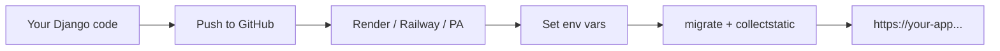

# Module: Security and Deployment

**Theme apps:** Blog · Task Manager · Booking · Student Portal · CampusCart E-commerce

**Previous module:** Forms Sessions Auth
**Next module:** Lab CRUD Auth Consolidation

---

## Learning Outcomes

By the end of this module, learners will be able to:

- Explain **CSRF**, **XSS**, and **SQL injection** risks and Django mitigations
- Configure production-safe settings: **`DEBUG=False`**, **`SECRET_KEY`**, **`ALLOWED_HOSTS`**
- Load secrets from **environment variables** instead of hardcoding in `settings.py`
- Run **`collectstatic`** and understand static vs media files in deployment
- Follow a **deployment checklist** for Django + MySQL on PaaS platforms
- Compare deployment options: **Render**, **Railway**, **PythonAnywhere** (overview)
- Prepare a Student Portal or Blog app for a staging deployment demo

---

## Classroom Ticket

Open the lab kit **before** long notes. Read the ticket → code in `starter/` or fix `broken/`.

- **[Never commit .env](../15_Lab_Assets/19_git_portfolio_hygiene/)**
- **[Injection mindset carries to ORM](../15_Lab_Assets/20_sql_injection_demo/)**

Finish the ticket in class; compare with the official solution only when your trainer says so.

### Security Mindset

**Security** means protecting user data, passwords, and your server from attackers. Django includes many **defaults** (CSRF middleware, template auto-escaping, ORM parameterization) — but misconfiguration (`DEBUG=True` online, weak `SECRET_KEY`, missing HTTPS) causes real breaches.

### CSRF (Cross-Site Request Forgery)

Attacker site triggers browser to POST to **your** site while user is logged in. Django requires CSRF token in forms — validates request came from your pages.

### XSS (Cross-Site Scripting)

Attacker injects **JavaScript** via stored or reflected user input (comment field). Django templates **auto-escape** HTML in `{{ variable }}`. Danger: marking untrusted data **`safe`** or using `|safe` filter without sanitization.

**Note:**
- `|safe` on user HTML enables XSS — escape by default, or sanitize with a library like bleach.

### SQL Injection

Attacker manipulates input to alter SQL queries. Django **ORM** and **parameterized queries** prevent classic injection. **Never** build SQL with f-strings from user input.

**Note:**
- Raw SQL built with an f-string from user input → SQL injection. Prefer ORM `.filter(...)`.

### DEBUG Setting

**`DEBUG=True`** (development): detailed error pages with code snippets — helpful locally.  
**`DEBUG=False`** (production): generic error pages — hides internals from attackers.

**Note:**
- `DEBUG=True` on a public URL exposes full code/tracebacks — set it False via env in production.

### SECRET_KEY

Random string used to sign cookies, sessions, CSRF tokens. **Must be unique per environment** and **never committed to Git**. Compromise allows session forgery.

**Note:**
- `SECRET_KEY` in GitHub enables session hijack — rotate the key and load it from the environment.

### ALLOWED_HOSTS

List of domain names your Django app will serve. Prevents **HTTP Host header attacks**. Example after deploying to Render: `ALLOWED_HOSTS = ["myportal.onrender.com"]`.

**Note:**
- `ALLOWED_HOSTS = ['*']` is a lazy fix that invites Host-header attacks — list exact domains.

### Static vs Media Files

| Type | Examples | Production |
|------|----------|------------|
| **Static** | CSS, JS, admin assets | `collectstatic` → WhiteNoise or CDN |
| **Media** | User uploads (profile pics) | Cloud storage (S3) — not same as static |

**`collectstatic`** — gathers all static files into **`STATIC_ROOT`** folder for production server.

**Note:**
- Skipping `collectstatic` → broken admin/CSS in production. Run it in the build step.

### Environment Variables

**Environment variables** — key-value config outside code (database password, secret key).  
**Course standard:** create a `.env` file and call **`load_dotenv()`** from `python-dotenv` at the top of `settings.py`, then read with **`os.environ.get(...)`**. Without `load_dotenv()`, Django will not see values sitting only in a `.env` file.  
**Alternate:** `django-environ` — do not mix both in one beginner batch.  
File **`.env`** is local only; list it in **`.gitignore`**. Commit **`.env.example`**.

**Note:**
- Never commit `.env` — credential leak; gitignore it and rotate passwords if leaked.
- `.env` on disk without `load_dotenv()` → vars ignored (wrong DB/secret). Call `load_dotenv(BASE_DIR / ".env")` in settings.

---

## Concepts

### 1. Production Settings Pattern

Split settings:

```
config/settings/
    base.py      # shared
    development.py  # DEBUG True
    production.py   # DEBUG False, security flags
```

Or single file with `if os.environ.get("DJANGO_ENV") == "production"`.

**Try these (2 programs):**

**Program 1 — load_dotenv pattern**

```python
from pathlib import Path
import os
from dotenv import load_dotenv

BASE_DIR = Path(__file__).resolve().parent.parent
load_dotenv(BASE_DIR / ".env")

SECRET_KEY = os.environ["DJANGO_SECRET_KEY"]
DEBUG = os.environ.get("DJANGO_DEBUG", "False").lower() == "true"
ALLOWED_HOSTS = os.environ.get("DJANGO_ALLOWED_HOSTS", "127.0.0.1").split(",")
```

**Program 2 — .env.example**

```bash
# .env.example (commit this — never commit real .env)
DJANGO_SECRET_KEY=change-me
DJANGO_DEBUG=False
DJANGO_ALLOWED_HOSTS=127.0.0.1,localhost
```

### 2. HTTPS and Secure Cookies (Production)

```python
SECURE_SSL_REDIRECT = True  # behind HTTPS terminator
SESSION_COOKIE_SECURE = True
CSRF_COOKIE_SECURE = True
```

PaaS platforms often terminate SSL at edge — follow platform docs.

**Try these (2 programs):**

**Program 1 — Secure cookie flags (prod)**

```python
# Only when HTTPS is terminated in front of Django
SESSION_COOKIE_SECURE = True
CSRF_COOKIE_SECURE = True
SECURE_SSL_REDIRECT = True
```

**Program 2 — Local note**

```markdown
# Local laptop

Keep SECURE_* flags off while using http://127.0.0.1:8000
Enable them on Render/Railway/PythonAnywhere with HTTPS.
```

### 3. Deployment Architecture (Simple)

```
User → HTTPS → PaaS (Render/Railway/PythonAnywhere)
                    → Gunicorn (WSGI server)
                    → Django app
                    → Managed MySQL
Static files → WhiteNoise or platform static handler
```

**Gunicorn** — production WSGI HTTP server; **`runserver`** is not for production.

**Note:**
- Using `runserver` in production → crashes and insecure defaults. Use Gunicorn (or similar) behind a platform/proxy.

**Try these (2 programs):**

**Program 1 — Gunicorn smoke**

```bash
pip install gunicorn
gunicorn config.wsgi:application --bind 127.0.0.1:8000
```

**Program 2 — collectstatic**

```bash
python manage.py collectstatic --noinput
```

### 4. Platform Overviews (India-Friendly Free Tiers)

**Visual — from laptop to live URL:**



| Platform | Pros | Notes |
|----------|------|-------|
| **Render** | Git push deploy, free web tier, MySQL add-on or external DB | Set env vars in dashboard |
| **Railway** | Simple UI, good for demos | Usage-based credits |
| **PythonAnywhere** | Django-friendly docs, console access | Free tier limited custom domains |

All need: `DEBUG=False`, `ALLOWED_HOSTS`, static config, production database URL, migrations on deploy.

---

**Try these (2 programs):**

**Program 1 — Deploy checklist file**

```markdown
# DEPLOY_CHECKLIST.md

- [ ] .env on platform, not in Git
- [ ] DEBUG=False
- [ ] ALLOWED_HOSTS includes platform host
- [ ] collectstatic in build
- [ ] MySQL/Postgres URL set
```

**Program 2 — README env table**

```markdown
| Variable | Example | Notes |
|----------|---------|-------|
| DJANGO_SECRET_KEY | (random) | Never commit |
| DJANGO_DEBUG | False | True only locally |
| DATABASE_URL | mysql://... | Platform DB |
```

## Step-by-Step Lab (Annotated)

### Step 1 — Environment-Based Settings (recommended: `python-dotenv`)

**Course standard:** use **`python-dotenv`** + `load_dotenv()` so a local `.env` file is actually loaded.  
`os.environ.get()` alone only reads variables already exported in the shell — a `.env` file on disk is **ignored** until you load it.

```bash
pip install python-dotenv
```

```python
# config/settings.py
import os
from pathlib import Path
from dotenv import load_dotenv

BASE_DIR = Path(__file__).resolve().parent.parent

# Load .env from project root (BASE_DIR / ".env")
load_dotenv(BASE_DIR / ".env")

SECRET_KEY = os.environ.get("DJANGO_SECRET_KEY", "dev-only-key-change-in-production")

DEBUG = os.environ.get("DJANGO_DEBUG", "True") == "True"

ALLOWED_HOSTS = [
    h.strip()
    for h in os.environ.get("ALLOWED_HOSTS", "127.0.0.1,localhost").split(",")
    if h.strip()
]

DATABASES = {
    "default": {
        "ENGINE": "django.db.backends.mysql",
        "NAME": os.environ.get("DB_NAME", "campus_portal_db"),
        "USER": os.environ.get("DB_USER", "django_user"),
        "PASSWORD": os.environ.get("DB_PASSWORD", ""),
        "HOST": os.environ.get("DB_HOST", "127.0.0.1"),
        "PORT": os.environ.get("DB_PORT", "3306"),
    }
}
```

```bash
# .env (local — NEVER commit)
DJANGO_SECRET_KEY=your-long-random-string-here
DJANGO_DEBUG=True
ALLOWED_HOSTS=127.0.0.1,localhost
DB_NAME=campus_portal_db
DB_USER=django_user
DB_PASSWORD=StrongPass123!
DB_HOST=127.0.0.1
DB_PORT=3306
```

```bash
# .env.example (COMMIT this — no real secrets)
DJANGO_SECRET_KEY=change-me
DJANGO_DEBUG=True
ALLOWED_HOSTS=127.0.0.1,localhost
DB_NAME=campus_portal_db
DB_USER=django_user
DB_PASSWORD=
DB_HOST=127.0.0.1
DB_PORT=3306
```

```gitignore
# .gitignore excerpt
venv/
.env
*.pyc
db.sqlite3
staticfiles/
__pycache__/
```

**On PaaS (Render/Railway):** set the same keys in the dashboard. `load_dotenv()` is harmless if `.env` is missing — platform env vars still populate `os.environ`.

**Alternate (advanced batches):** `django-environ` — same idea, different API. Pick **one** approach per batch; this course recommends `python-dotenv`.

### Step 2 — Static Files for Production (Django 5.x `STORAGES`)

```python
STATIC_URL = "static/"
STATICFILES_DIRS = [BASE_DIR / "static"]
STATIC_ROOT = BASE_DIR / "staticfiles"
```

```bash
python manage.py collectstatic --noinput
# Copies admin CSS/JS + your static/ into staticfiles/
```

Install **WhiteNoise** for simple PaaS static serving:

```bash
pip install whitenoise
```

```python
MIDDLEWARE = [
    "django.middleware.security.SecurityMiddleware",
    "whitenoise.middleware.WhiteNoiseMiddleware",  # right after SecurityMiddleware
    # ... session, common, csrf, auth, messages, clickjacking ...
]

# Django 5.x preferred (replaces deprecated STATICFILES_STORAGE-only style)
STORAGES = {
    "default": {
        "BACKEND": "django.core.files.storage.FileSystemStorage",
    },
    "staticfiles": {
        "BACKEND": "whitenoise.storage.CompressedManifestStaticFilesStorage",
    },
}
```

> Avoid teaching only `STATICFILES_STORAGE = "..."` as the primary pattern for Django 5.x. Prefer `STORAGES["staticfiles"]` as documented in current Django settings.

### Step 2b — Required pre-deploy check

```bash
# With production-like env loaded (.env or exported vars):
export DJANGO_DEBUG=False
export ALLOWED_HOSTS=your-app.example.com
python manage.py check --deploy
```

Fix every warning/error before going live. Add this to the learner deploy checklist.

### Step 3 — Production Toggle Exercise (Local Simulation)

```bash
export DJANGO_DEBUG=False
export ALLOWED_HOSTS=127.0.0.1,localhost
python manage.py runserver
# Visit site — generic 404/500 pages; verify no stack trace leak on broken URL
unset DJANGO_DEBUG  # return to dev
```

### Step 4 — Security Audit Checklist (Forms)

Walk through your project checklist:

- [ ] Every POST form has ``
- [ ] No `|safe` on user-generated blog comments
- [ ] Queries use ORM, not raw SQL with f-strings
- [ ] `@login_required` on sensitive views
- [ ] Passwords only via auth forms
- [ ] `.env` not in Git (`git status` clean for secrets)

### Step 5 — requirements.txt for Deploy

```text
django>=5.0,<6.0
mysqlclient
gunicorn
whitenoise
python-dotenv
```

### Step 6 — Gunicorn Local Smoke Test

```bash
gunicorn config.wsgi:application --bind 0.0.0.0:8000
# Ctrl+C to stop — proves WSGI entry works before cloud deploy
```

### Step 7 — Render deployment overview (walkthrough)

Typical steps (document in README — URLs change on platform):

1. Push project to GitHub (no `.env`, no `venv/`)
2. Create **Web Service** on Render → connect repo
3. **Build command:** `pip install -r requirements.txt && python manage.py collectstatic --noinput`
4. **Start command:** `gunicorn config.wsgi:application`
5. **Environment variables:** `DJANGO_SECRET_KEY`, `DJANGO_DEBUG=False`, `ALLOWED_HOSTS=myapp.onrender.com`, DB vars
6. **Release command (optional):** `python manage.py migrate`
7. Use external MySQL (PlanetScale, Aiven, or Render Postgres/MySQL offering) — update `DATABASES`
8. Open deployed URL — login, static admin CSS loads

**Railway:** Similar Git-based deploy; add MySQL plugin; set variables in Railway dashboard.

**PythonAnywhere:** Upload code or Git clone; configure virtualenv; WSGI file points to `config.wsgi`; static files mapping in web tab; MySQL from PythonAnywhere db console.

### Step 8 — Deployment Checklist Document

Learners complete `docs/DEPLOY_CHECKLIST.md`:

1. Generate new SECRET_KEY (never reuse dev key)
2. DEBUG=False
3. ALLOWED_HOSTS set
4. Database credentials via env; `.env` loaded with `load_dotenv` locally
5. `python manage.py check --deploy` passes (or warnings understood/fixed)
6. migrate on server
7. collectstatic executed; `STORAGES["staticfiles"]` configured for WhiteNoise
8. HTTPS enabled (platform)
9. Superuser created on production (secure channel)
10. Backup strategy for MySQL
11. `.env` not in Git; `.env.example` committed

---

## Practice Exercises

### Basic

1. Generate SECRET_KEY using Django shell: `from django.core.management.utils import get_random_secret_key; print(get_random_secret_key())`
   **Model answer:**
   ```bash
   python manage.py shell -c "from django.core.management.utils import get_random_secret_key; print(get_random_secret_key())"
   ```
   Store the printed value in an environment variable — never commit it.

2. List three items from deployment checklist and explain each
   **Model answer:**
   (1) `DEBUG=False` so errors do not leak internals. (2) Set `ALLOWED_HOSTS` to your domain so Host-header attacks fail. (3) Use HTTPS/`SECURE_*` settings and a strong `SECRET_KEY` from the environment.

3. Run collectstatic; count files in `staticfiles/admin/`
   **Model answer:**
   ```bash
   python manage.py collectstatic --noinput
   find staticfiles/admin -type f | wc -l
   ```
   Count varies by Django version; non-zero means admin CSS/JS were gathered.

### Intermediate

1. Split settings into `development.py` / `production.py` (stretch)
   **Model answer:**
   Keep shared defaults in `settings/base.py`, import them in `development.py` (`DEBUG=True`) and `production.py` (`DEBUG=False`, secure cookies, env-based DB). Point `DJANGO_SETTINGS_MODULE` at the right module per environment.

2. Document Render deploy steps with screenshots for Student Portal
   **Model answer:**
   Document: connect GitHub repo → set build (`pip install -r requirements.txt`) and start (`gunicorn project.wsgi`) → add env vars (`SECRET_KEY`, `DATABASE_URL`, `ALLOWED_HOSTS`) → run migrate → verify HTTPS homepage. Attach screenshots of env and deploy logs.

3. Intentionally break ALLOWED_HOSTS — capture error message, then fix
   **Model answer:**
   Set `ALLOWED_HOSTS = ["example.com"]` then visit `127.0.0.1` — Django returns DisallowedHost. Fix by adding `"127.0.0.1"` / your real domain, restart, confirm 200.

### Interview Prep

1. Explain CSRF to non-technical HR interviewer in 30 seconds
   **Model answer:**
   CSRF is when a malicious site tricks your logged-in browser into submitting a form to our app. Django blocks this by requiring a secret token on forms that attackers cannot read.

2. Difference DEBUG True vs False user experience
   **Model answer:**
   `DEBUG=True` shows detailed traceback pages for developers. `DEBUG=False` shows generic error pages to users and hides sensitive config — required in production.

3. Why environment variables for 12-factor apps?
   **Model answer:**
   Config (secrets, DB URLs, debug flags) changes per environment without code edits. Env vars keep secrets out of the repo and match the 12-factor rule: store config in the environment.

## Mini-Project / Activity

**Activity: "Staging Ready Portal" (90 min)**  
**Lab kit:** [19_git_portfolio_hygiene](../15_Lab_Assets/19_git_portfolio_hygiene/) · [20_sql_injection_demo](../15_Lab_Assets/20_sql_injection_demo/)

### What to build

1. Refactor secrets to env vars
2. Add WhiteNoise + STATIC_ROOT; successful collectstatic
3. Complete DEPLOY_CHECKLIST.md
4. Gunicorn smoke test locally
5. Optional: trainer deploys one batch repo to Render for class URL

### Stretch

- Run `python manage.py check --deploy` with `DJANGO_DEBUG=False` and fix warnings.
- Add a short README section: "How a teammate in Bengaluru clones and runs this".

### Done when

- [ ] No secrets in GitHub; `.env.example` present
- [ ] `collectstatic` succeeds; WhiteNoise/`STORAGES` configured
- [ ] DEPLOY_CHECKLIST.md completed
- [ ] Gunicorn smoke test **or** platform deploy started

---

## Revision Map — Memorize / Understand / Practise / Build

| Topic | Memorize | Understand | Practise | Build |
|-------|----------|------------|----------|-------|
| CSRF | ``, middleware | Forged POST prevention | Audit all forms | Form checklist |
| XSS | Escape template vars | Untrusted input danger | Safe `{{ var }}` | No `\|safe` abuse |
| SQL injection | ORM + params | Never raw f-string SQL | Review queries | ORM-only policy |
| DEBUG | `False` in production | Leaks stack traces | Toggle locally once | Staging settings |
| SECRET_KEY | Unique, secret | Signing sessions/CSRF | Env var pattern | .env example |
| ALLOWED_HOSTS | List domain names | Host header attack | Set for deploy URL | Render hostname |
| collectstatic | Management command | Admin CSS in prod | Run before deploy | staticfiles dir |
| Env vars | `load_dotenv` + `os.environ.get` | 12-factor config | `.env` + `.gitignore` + `.env.example` | PaaS dashboard vars |
| Deploy checklist | 10-step list | Dev vs prod table | Mock deploy dry run | README deploy doc |
| PaaS overview | Render/Railway/PythonAnywhere | Managed hosting | Read docs pages | Choose one lab |

---

## Interview & Discussion Q&A

Shared with students after concepts and the mini-project. Use for review and interview prep — questions and model answers are included.

1. If Django auto-escapes templates, can XSS still happen? How?
2. Why is committing `.env` worse than committing a wrong password in chat?
3. Free tier PaaS for India students — cost vs learning trade-offs?
4. Should CampusCart handle payments on first deploy? What goes first?
5. who owns security in a team — developer, DevOps, or both?

**Q1. What is CSRF and how does Django prevent it?**  
**A:** Forged cross-site POST using victim session; Django CSRF middleware validates token in forms/ajax.

**Q2. DEBUG True vs False?**  
**A:** True: verbose errors for development. False: production-safe generic errors, required for public deploy.

**Q3. Why keep SECRET_KEY secret?**  
**A:** Used to sign sessions and tokens; leak enables forging session data.

**Q4. SQL injection prevention in Django?**  
**A:** Use ORM QuerySets and parameterized raw queries; never interpolate user input into SQL strings.

**Q5. collectstatic purpose?**  
**A:** Aggregate static assets from apps and project into STATIC_ROOT for production web server/CDN.

**Q6. Name two Django deployment platforms and one consideration each.**  
**A:** Render — easy Git deploy, set ALLOWED_HOSTS to onrender.com hostname; PythonAnywhere — WSGI config file and static mapping; Railway — env vars and database plugin.

---

