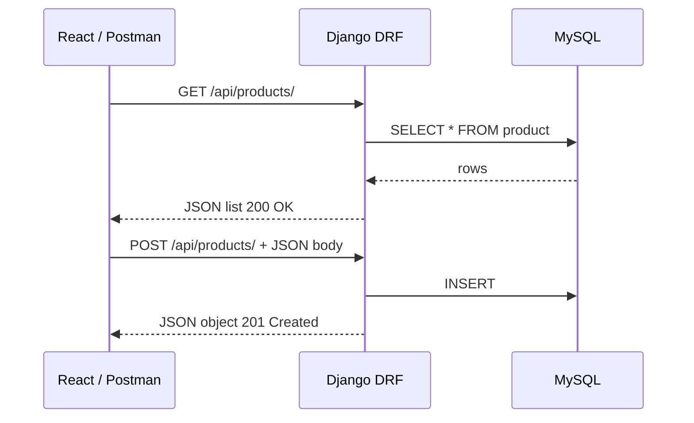

# Module: APIs, JSON, Postman & Django REST Framework

**Phase:** APIs & REST  

**Previous module:** Flask Overview  
**Next module:** [React Fundamentals](../../FRONTEND/REACT/01_React_Fundamentals.md)

---

## Learning Outcomes

By the end of this module, learners will be able to:

- Define API, REST, and resource-oriented URLs in plain English
- Use HTTP methods (GET, POST, PUT, PATCH, DELETE) and common status codes correctly
- Serialize and deserialize JSON in Python with `json` module and Django/DRF
- Test APIs manually with Postman (collections, headers, body)
- Build DRF CRUD for a `Product` model using serializers, viewsets, and routers
- Consume a REST API from Python (`requests`) and JavaScript (`fetch`)
- Explain how React/mobile frontends talk to Django backends via JSON

---

### What is an API?

An **API (Application Programming Interface)** is a agreed way for programs to talk to each other. Your React app does not read the database directly — it calls the Django **API**, which returns **JSON** data.

**Icons:** Order · Laptop · Employee · Bank · Payroll

**Where used?**
- Ecommerce — React / mobile apps call `/api/products/` for CampusCart
- College apps — student portal SPA fetching enrollments as JSON
- Banking / UPI — apps talk to bank APIs, never the DB directly
- Payroll — HR mobile clients consume employee/leave REST endpoints
- Postman / QA — manual API checks before frontend is ready

**Restaurant analogy:** You (client) read the menu (API docs), tell the waiter your order (HTTP request), kitchen prepares food (server logic), waiter brings plate (JSON response). You never enter the kitchen.

**Visual — React asking Django for products:**



**Key takeaways:**
- Client → DRF → MySQL → JSON back (never React → DB direct)
- GET list → **200**; POST create → **201**
- Same contract for Postman, React, or mobile

### What is REST?

**REST (Representational State Transfer)** is a style for designing APIs:

- Resources have URLs: `/api/products/`, `/api/products/5/`
- Use HTTP **methods** for actions
- **Stateless:** each request carries enough info (no server memory of "session" required for API itself — auth tokens are exception)
- Responses often **JSON**

Not every API is pure REST, but Indian job interviews expect REST vocabulary.

### HTTP Methods (CRUD mapping)

| Method | Action | Example URL | Body? |
|--------|--------|-------------|-------|
| GET | Read list or one | `/api/products/` | No |
| POST | Create | `/api/products/` | Yes (JSON) |
| PUT | Replace entire resource | `/api/products/3/` | Yes |
| PATCH | Partial update | `/api/products/3/` | Yes (partial) |
| DELETE | Remove | `/api/products/3/` | Usually no |

**Note:**
- GET conventionally has no body — putting a body on GET confuses proxies and clients.

### Status Codes (memorize these)

| Code | Meaning | When |
|------|---------|------|
| 200 | OK | Successful GET, PUT, PATCH |
| 201 | Created | Successful POST |
| 204 | No Content | Successful DELETE |
| 400 | Bad Request | Invalid JSON or validation fail |
| 401 | Unauthorized | Missing/invalid auth |
| 403 | Forbidden | Authenticated but not allowed |
| 404 | Not Found | Wrong id or URL |
| 500 | Server Error | Bug on server — fix code/logs |

---

## Concepts

### JSON in Python

```python
import json

data = {'name': 'Laptop', 'price': 45000}
text = json.dumps(data)           # dict → JSON string
parsed = json.loads(text)         # JSON string → dict
```

**Try these (2 programs):**

**Program 1 — dumps / loads**

```python
import json

data = {"name": "Laptop", "price": 45000, "city": "Bengaluru"}
text = json.dumps(data)
parsed = json.loads(text)
print(text)
print(parsed["price"])  # 45000
```

**Expected Output:**

```
{"name": "Laptop", "price": 45000, "city": "Bengaluru"}
45000
```

**Program 2 — Pretty print product**

```python
import json

product = {"name": "Masala Dosa", "price_inr": 60, "in_stock": True}
print(json.dumps(product, indent=2))
```

**Expected Output:**

```
{
  "name": "Masala Dosa",
  "price_inr": 60,
  "in_stock": true
}
```

**Remember:** `json.dumps` → Python dict to string; `json.loads` → string to dict. APIs exchange the string form over HTTP.

**Common Error:** Forgetting `Content-Type: application/json` on POST in Postman → empty body / 415. Set the header (or Body → raw → JSON).

**Interview:** REST maps CRUD to HTTP — GET read, POST create, PUT/PATCH update, DELETE remove — plus status codes (200/201/400/401/404/500).

### Postman workflow

1. Create collection "Product API"
2. Set base URL variable `{{base}}` = `http://127.0.0.1:8000`
3. Add requests for each CRUD operation
4. Header: `Content-Type: application/json` for POST/PUT
5. Save examples for regression testing

**Note:**
- POST without a JSON `Content-Type` header → 415 or empty data. Set it in Postman.
- Bad JSON (e.g. Decimal as a bare number in invalid payloads) → parse errors; send valid JSON — DRF often accepts string decimals like `"45.00"`.

**Try these (2 programs):**

**Program 1 — Collection checklist**

```markdown
# Postman — Product API

1. Collection: Product API
2. Variable `{{base}}` = http://127.0.0.1:8000
3. GET {{base}}/api/products/
4. POST {{base}}/api/products/ with JSON body
5. Assert status 200 / 201 in Tests tab
```

**Program 2 — Sample POST body**

```json
{
  "name": "Notebook",
  "price": "45.00",
  "in_stock": true
}
```

### Django REST Framework stack

```
Model → Serializer → ViewSet → Router → URL /api/products/
```

**Serializer:** Converts Django model instances ↔ JSON; validates input.  
**ViewSet:** Groups list/create/retrieve/update/destroy logic.  
**Router:** Auto-generates URL patterns.

---

**Try these (2 programs):**

**Program 1 — Tiny serializer**

```python
from rest_framework import serializers
from .models import Product

class ProductSerializer(serializers.ModelSerializer):
    class Meta:
        model = Product
        fields = ["id", "name", "price", "in_stock"]
```

**Program 2 — Router wiring**

```python
from rest_framework.routers import DefaultRouter
from .views import ProductViewSet

router = DefaultRouter()
router.register("products", ProductViewSet, basename="product")
urlpatterns = router.urls
```

## Step-by-Step Annotated Code

### Step 1 — Install and configure DRF

```bash
pip install djangorestframework
```

`settings.py`:

```python
INSTALLED_APPS = [
    # ...
    'rest_framework',
    'shop',                    # your app
]
```

**Note:**
- Forgot `rest_framework` in `INSTALLED_APPS` → import/config errors. Add it after install.

### Step 2 — Product model

`shop/models.py`:

```python
from django.db import models

class Product(models.Model):
    name = models.CharField(max_length=120)
    price = models.DecimalField(max_digits=10, decimal_places=2)
    in_stock = models.BooleanField(default=True)
    created_at = models.DateTimeField(auto_now_add=True)

    def __str__(self):
        return self.name
```

Run: `python manage.py makemigrations && python manage.py migrate`

### Step 3 — Serializer (`shop/serializers.py`)

```python
from rest_framework import serializers
from .models import Product

class ProductSerializer(serializers.ModelSerializer):
    class Meta:
        model = Product
        fields = ["id", "name", "price", "in_stock", "created_at"]
        read_only_fields = ["id", "created_at"]

    def validate_price(self, value):
        if value < 0:
            raise serializers.ValidationError("Price cannot be negative.")
        return value

    def validate_name(self, value):
        if len(value.strip()) < 2:
            raise serializers.ValidationError("Name must be at least 2 characters.")
        return value.strip()
```

### Step 4 — ViewSet (`shop/views.py`)

```python
from rest_framework import viewsets
from .models import Product
from .serializers import ProductSerializer

class ProductViewSet(viewsets.ModelViewSet):
    """
    Full CRUD for Product:
    list, create, retrieve, update, partial_update, destroy.
    """
    queryset = Product.objects.all().order_by("-created_at")
    serializer_class = ProductSerializer
```

### Step 5 — URLs (app + project)

`shop/urls.py`:

```python
from django.urls import path, include
from rest_framework.routers import DefaultRouter
from .views import ProductViewSet

router = DefaultRouter()
router.register(r"products", ProductViewSet, basename="product")

urlpatterns = [
    path("", include(router.urls)),
]
```

Project `config/urls.py` (or `yourproject/urls.py`):

```python
from django.contrib import admin
from django.urls import path, include

urlpatterns = [
    path("admin/", admin.site.urls),
    path("api/", include("shop.urls")),
]
```

**Routes created automatically**

| Method | URL | Action |
|--------|-----|--------|
| GET | `/api/products/` | list |
| POST | `/api/products/` | create |
| GET | `/api/products/1/` | retrieve |
| PUT | `/api/products/1/` | update (full) |
| PATCH | `/api/products/1/` | partial_update |
| DELETE | `/api/products/1/` | destroy |

**Note:**
- Wrong trailing slash → 404 on Django. Match `APPEND_SLASH` / router URLs (usually with a trailing `/`).

Optional DRF browsable API: open `http://127.0.0.1:8000/api/products/` in the browser while `DEBUG=True`.

### Step 6 — Postman test create

```
POST http://127.0.0.1:8000/api/products/
Content-Type: application/json

{
  "name": "Wireless Mouse",
  "price": "899.00",
  "in_stock": true
}
```

**Expected response — 201 Created**

```json
{
  "id": 1,
  "name": "Wireless Mouse",
  "price": "899.00",
  "in_stock": true,
  "created_at": "2026-07-31T12:00:00.123456Z"
}
```

**Expected list — GET `/api/products/` → 200**

```json
[
  {
    "id": 1,
    "name": "Wireless Mouse",
    "price": "899.00",
    "in_stock": true,
    "created_at": "2026-07-31T12:00:00.123456Z"
  }
]
```

**Expected validation error — POST with `"price": "-10"` → 400**

```json
{
  "price": ["Price cannot be negative."]
}
```

### Step 7 — Consume with Python requests

```python
import requests

BASE = 'http://127.0.0.1:8000/api/products/'

# List
resp = requests.get(BASE)
print(resp.status_code)      # 200
products = resp.json()       # list of dicts
print(products)

# Create
new_product = {'name': 'USB Hub', 'price': '1299.00', 'in_stock': True}
resp = requests.post(BASE, json=new_product)
print(resp.status_code)      # 201
print(resp.json())
```

**Note:**
- `requests` to the wrong port → connection refused (Django usually `8000`, Flask `5000`).
- List endpoints return an **array** — treating it as a dict → `KeyError` on `['id']`.
- Ignore status codes at your peril — check `resp.ok` (or equivalent) so failures are not silent.

### Step 8 — Consume with fetch (browser / React preview)

```javascript
const res = await fetch('http://127.0.0.1:8000/api/products/');
const products = await res.json();
```

**Note:** Browser calls may hit **CORS** errors until Django allows frontend origin — covered in React module; mention `django-cors-headers` preview here.

---

## Practice Exercises

### Basic

1. Add 3 products via Postman; export collection JSON.
   **Model answer:**
   Send three `POST /api/products/` requests with JSON bodies (name, price, stock). In Postman: Collection → Export → Collection v2.1 JSON, save as `products.postman_collection.json`.

2. Write Python script printing only in-stock product names.
   **Model answer:**

```python
import requests

products = requests.get("http://127.0.0.1:8000/api/products/").json()
for p in products:
    if p.get("in_stock") or p.get("stock", 0) > 0:
        print(p["name"])
```


3. Match status codes to scenarios (wrong id, successful create, server crash).
   **Model answer:**
   Wrong id → **404**; successful create → **201**; unhandled server crash → **500**. Client errors are 4xx; server failures are 5xx.

### Intermediate

1. Add `category` CharField to Product; update serializer; test PATCH one field.
   **Model answer:**
   Add `category = models.CharField(max_length=50, blank=True)` + migrate; include `"category"` in serializer fields; `PATCH /api/products/1/` with `{"category": "peripherals"}` and confirm partial update.

2. Filter: `GET /api/products/?search=mouse` using DRF `SearchFilter`.
   **Model answer:**

```python
from rest_framework import filters

class ProductViewSet(viewsets.ModelViewSet):
    queryset = Product.objects.all()
    serializer_class = ProductSerializer
    filter_backends = [filters.SearchFilter]
    search_fields = ["name", "category"]
```


3. Return custom 400 when price is negative (serializer validation).
   **Model answer:**

```python
def validate_price(self, value):
    if value < 0:
        raise serializers.ValidationError("price must be >= 0")
    return value
```


### Interview-style

1. Difference between PUT and PATCH?
   **Model answer:**
   PUT replaces the whole resource (send all fields). PATCH updates only the fields you send. Prefer PATCH for partial edits.

2. What does serializer validation do before save?
   **Model answer:**
   It checks types/required fields and custom validators, builds validated data, and only then allows `save()`/`create()`/`update()`. Invalid input returns 400 with error details.

3. Why REST APIs prefer JSON over HTML for mobile apps?
   **Model answer:**
   Mobile apps need structured data to render their own UI. JSON is compact and language-neutral; HTML is meant for browsers, not for native clients to parse as data.

## Mini-Project (Assignment): Product Catalog API + Client Script

**Lab kit (build here):** [15_Lab_Assets/04_drf_products/](../15_Lab_Assets/04_drf_products/)  
**Deliverables:** follow [`Standard_Project_Deliverables.md`](../Standard_Project_Deliverables.md)

### What to build

- Django app with Product model and full DRF CRUD
- Postman collection with 5+ requests and tests on status code
- `client/list_products.py` using requests
- `README.md` with sample JSON responses (201 create, 200 list, 400 validation)
- `.env.example`, `requirements.txt`, screenshots

### Stretch

- Add `price__gte` filter or search by name.
- Return Indian-friendly example products (Notebook ₹45, Thali ₹90).

### Done when

- [ ] Lab kit Product JSON API ticket completed
- [ ] CRUD works in Postman (including validation 400)
- [ ] Client script prints product list
- [ ] README shows sample JSON for create/list/error


## Interview & Discussion Q&A

Shared with students after concepts and the mini-project. Use for review and interview prep — questions and model answers are included.

1. Why do companies expose APIs instead of giving database passwords to mobile teams?
2. Is `/api/getAllProducts` RESTful? What would be better?
3. how is an API similar to a bank's phone banking menu (press 1 for balance)?
4. When should API return 400 vs 422? (Simplified: DRF often uses 400 for validation.)
5. How does Postman help when you do not yet have a React UI?

**Q1. What is a REST API?**  
**A:** HTTP-based interface exposing resources as URLs, using standard methods and status codes, typically JSON payloads, stateless communication.

**Q2. Difference between API and REST?**  
**A:** API is general contract between software; REST is a specific architectural style for web APIs using HTTP resources.

**Q3. What is Django REST Framework?**  
**A:** Toolkit on Django for building Web APIs — serializers, viewsets, authentication, browsable API.

**Q4. GET vs POST?**  
**A:** GET retrieves data safely/idempotently without body; POST submits data to create or trigger action with body.

**Q5. How do you test API without frontend?**  
**A:** Postman, curl, Python requests, DRF browsable API, automated pytest with APIClient.

---

