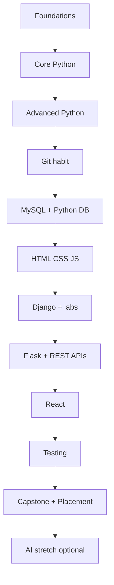

# Python Full Stack Development — Course Guide

**Program:** Python Full Stack Development (KSR Datavizon syllabus 2026–27)  
**Audience:** Learners preparing for entry-level Python / Django / full-stack roles
**Stack:** Python 3 · MySQL 8+ · Django 5.x · HTML/CSS/JS · React · Flask (overview) · Git/GitHub · VS Code · Postman  
**Default schedule:** **DURATION = 20 weeks** · **HOURS_PER_DAY = 1 hour 15 minutes** (Mon–Fri live class)  
**Live contact:** 20 × 5 × 1.25h = **125 hours** (100 sessions)  
**Homework:** ~45–90 min most days → total engagement well above brochure **150+ hours**  

> **Schedule authority:** [Session_Calendar_100.md](../Session_Calendar_100.md) — one session, one focus. Do not put Duration on module headers (calendar owns timing).  
> Live class is **1h 15m only**. Do not use old 4-hour agendas.  
> External deps: [09_External_Dependencies.md](09_External_Dependencies.md) · Toolchain: [Tested_Toolchain.md](../Tested_Toolchain.md) · Labs: [../15_Lab_Assets/](../15_Lab_Assets/) · Biweekly tests: [../16_Assessments/](../16_Assessments/)

---

## 1. Complete Curriculum Map

### Learning journey (flowchart)

```
[Computer foundations]
        ↓
[Core Python: syntax → control → strings → collections]
        ↓
[Functions → Modules → OOP → Exceptions → Files/Logging]
        ↓
[Git + GitHub habit]  ←── continue every week
        ↓
[MySQL: DDL/DML/DQL/TCL/JOINS] → [Python ↔ MySQL]
        ↓
[HTML → CSS → JavaScript/DOM]
        ↓
[Django: project → templates → models/ORM → forms → auth → admin]
        ↓
[Flask lite] → [REST APIs + DRF + Postman + JSON]
        ↓
[React + API integration]
        ↓
[Testing + Clean code]
        ↓
[Capstone deploy + Portfolio + Placement]
        ↓
[AI Integration Lite — OPTIONAL stretch only]
```

**Same journey (interactive view):**



### Module index (detailed notes live under `FULL_STACK_PYTHON/`)

| # | Module folder / file | Phase | Memorize | Understand | Practise | Build |
|---|----------------------|-------|----------|------------|----------|-------|
| 01 | `01_Foundations/01_Computer_and_Programming_Foundations.md` | Foundations | OS, file paths | Client–server | Terminal + VS Code | Career roadmap note |
| 02 | `02_Core_Python/01_Python_Setup_and_First_Programs.md` | Core | `print`, run scripts | Interpreter vs script | Hello apps | Environment checklist |
| 03 | `02_Core_Python/02_Variables_Datatypes_Operators_IO.md` | Core | Types, operators | Casting, input | Calculator drills | CLI calculator |
| 04 | `02_Core_Python/03_Flow_Control.md` | Core | if/for/while | Nested logic | Patterns, menus | ATM menu |
| 05 | `02_Core_Python/04_Strings.md` | Core | Slicing, key methods | Immutability | Parsing text | Text utilities |
| 06 | `02_Core_Python/05_Lists.md` | Core | CRUD on list | Mutability | CRUD lists | Marks list app |
| 07 | `02_Core_Python/06_Tuples_and_Sets.md` | Core | When to use | Uniqueness | Set ops | Dedup tool |
| 08 | `02_Core_Python/07_Dictionaries.md` | Core | Keys/values | Nested dict | Lookups | Contact book |
| 09 | `02_Core_Python/08_Data_Structures_Overview.md` | Core | Stack/queue idea | Complexity lite | Interview DS Qs | Mini DS demos |
| 10 | `03_Advanced_Python/01_Functions_Decorators_Generators.md` | Advanced | `def`, `*args` | Decorator idea | Refactor scripts | Utility library |
| 11 | `03_Advanced_Python/02_Modules_and_Packages.md` | Advanced | `import` | Package layout | Reuse code | Package demo |
| 12 | `03_Advanced_Python/03_OOP.md` (+ Parts 1–3) | Advanced | class/object | Inheritance | Model entities | Employee classes |
| 13 | `03_Advanced_Python/04_Exception_Handling.md` | Advanced | try/except | Custom errors | Robust CLI | Safe file reader |
| 14 | `03_Advanced_Python/05_File_Handling_and_Logging.md` | Advanced | open modes | Logging levels | CSV/JSON files | Expense file logger |
| 15 | `04_Git_GitHub/01_Git_and_GitHub.md` | Tools | Basic commands | Branching | Daily commits | Portfolio repos |
| 16 | `05_Database_MySQL/01_MySQL_for_Full_Stack_Developers.md` + [Required MySQL labs](../05_Database_MySQL/01_MySQL_for_Full_Stack_Developers.md) / [`MYSQL/`](../../MYSQL/) | Data | SQL CRUD, JOIN | Normalization | Workbench labs | Library schema |
| 17 | `03_Advanced_Python/06_Database_Programming_Bridge.md` | Advanced | Connector flow | SQL from Python | CRUD script | Student DB script |
| 18 | [`FRONTEND/01_HTML.md`](../../FRONTEND/01_HTML.md) | FE | Tags, forms | Semantic HTML | Pages | Profile page |
| 19 | [`FRONTEND/02_CSS_and_Responsive.md`](../../FRONTEND/02_CSS_and_Responsive.md) | FE | Box model, Flex | Responsive | Layouts | Landing page |
| 20 | [`FRONTEND/03_JavaScript_DOM_Forms.md`](../../FRONTEND/03_JavaScript_DOM_Forms.md) | FE | DOM events | Async fetch | Validation | Form + API call |
| 21 | `07_Django/01_Django_Introduction_and_Setup.md` | BE | MTV, venv, settings | Project vs app | startproject | Portal scaffold |
| 22 | `07_Django/02_URLs_Views_Templates_Static.md` | BE | `path()`, FBV | MTV request flow | Templates | First pages |
| 23 | `07_Django/03_Models_ORM_Admin.md` | BE | Model fields, migrate | ORM CRUD | Admin | Catalog models |
| 24 | `07_Django/04_Forms_Sessions_Auth.md` | BE | ModelForm, login | Sessions/auth | Protected views | Auth CRUD app |
| 25 | `07_Django/05_Security_and_Deployment.md` | BE | CSRF, env, DEBUG | Deploy checklist | WhiteNoise | Staging deploy |
| 26 | `07_Django/06_Lab_CRUD_Auth_Consolidation.md` | BE lab | — | End-to-end flow | **Guided lab day** | Working CRUD+auth |
| 27 | `07_Django/07_Lab_Deploy_Capstone_Debug.md` | BE lab | `check --deploy` | Debug prod issues | **Guided lab day** | Live URL |
| 28 | `08_Flask/01_Flask_Overview.md` | BE | Routes | Django vs Flask | Micro API | Notes API |
| 29 | `09_APIs_REST/01_APIs_JSON_Postman_DRF.md` | APIs | REST verbs | Status codes | Postman | DRF CRUD |
| 30 | [`FRONTEND/REACT/01_React_Fundamentals.md`](../../FRONTEND/REACT/01_React_Fundamentals.md) | FE | Components, hooks | State | SPA basics | UI components |
| 31 | [`FRONTEND/REACT/02_React_Hooks_Routing_API_Deploy.md`](../../FRONTEND/REACT/02_React_Hooks_Routing_API_Deploy.md) | FE | useEffect, Router | CORS | API integrate | React + Django |
| 32 | `11_Testing_Clean_Code/01_Testing_Debugging_Clean_Code.md` | Quality | assert/pytest | Debug flow | Write tests | Tested utils |
| 33 | `13_Placement/01_Career_Resume_Interview.md` | Jobs | Role keywords | STAR stories | Mocks | Resume + LinkedIn |
| 34 | `12_AI_Integration/01_AI_Integration_Lite.md` | **Stretch only** | API call pattern | ML-via-API idea | Optional demo | Optional widget |

> **Django package = seven files:** teaching modules `01`–`05` plus two **protected lab days** `06`–`07`. Do not invent “modules 08–12.”

**Label legend for learners**

| Label | Meaning |
|-------|---------|
| **Memorize** | Syntax / commands you should recall in interviews without notes |
| **Understand** | Concepts you must explain in simple English |
| **Practise** | Lab drills every day |
| **Build** | Portfolio artefacts |

---

## 2. Week-by-Week Training Plan

**Schedule authority:** [Session_Calendar_100.md](../Session_Calendar_100.md) (Sessions **01–100**).  
**Assumptions:** **20 weeks** × **1h 15m/day** × 5 days = **6.25 live hours/week** (**125 live hours**).

### Daily timebox (every live class — **75 minutes**)

**Authority:** same shape as [Session_Calendar_100.md](../Session_Calendar_100.md).

| Minutes | Block | Purpose |
|--------:|-------|---------|
| 5 | Classroom Ticket | Open lab kit `starter/` / `broken/` |
| 25 | Type-along demo | One concept cluster; learners type along |
| 35 | Lab | Finish ticket from [15_Lab_Assets](../15_Lab_Assets/) |
| 10 | Exit + homework | Calendar “Homework” column |

**Total:** **75 minutes.** Never paste an old 4-hour agenda into one class.

### Week themes (summary — details in Session Calendar)

| Week | Sessions | Theme | Milestone |
|------|----------|-------|-----------|
| 1 | 01–05 | Foundations + Python setup | Hello repo |
| 2 | 06–10 | Variables, operators, I/O | CLI calculator |
| 3 | 11–15 | Flow control | ATM menu |
| 4 | 16–20 | Strings + lists | Marks Manager |
| 5 | 21–25 | Tuples, sets, dicts | Contact book |
| 6 | 26–30 | DS overview + functions start | Utils started |
| 7 | 31–35 | Functions finish + modules/venv | Package on GitHub |
| 8 | 36–40 | OOP + exceptions start | Employee OOP |
| 9 | 41–45 | Files, logging, Git/GitHub | Expense tracker public |
| 10 | 46–50 | MySQL setup → DQL + ER | `training_db` |
| 11 | 51–55 | Joins, TCL, Python CRUD | Library CRUD |
| 12 | 56–60 | HTML/CSS + JS start | Responsive page |
| 13 | 61–65 | JS finish + Django start | First Django site |
| 14 | 66–70 | Templates, models, forms | Admin + forms |
| 15 | 71–75 | Auth, security, Lab 06 start | Login CRUD |
| 16 | 76–80 | Lab 06–07 + capstone shell | Deploy checks + M0/M1 |
| 17 | 81–85 | Flask lite + DRF/Postman | Product API |
| 18 | 86–90 | React + API connect | SPA list UI |
| 19 | 91–95 | Testing + capstone build/deploy | Live/staging URL |
| 20 | 96–100 | Placement + defense | Demo day |

**Protected sessions (do not skip):** S52–S53 (JOINs), S75–S79 (Django labs), S93–S100 (capstone/placement).

### If you change DURATION

| Batch type | Weeks | Sessions | Notes |
|------------|------:|---------:|-------|
| **Default** | **20** | **100** | **Use Session Calendar as-is** |
| Comfortable | 22–24 | 110–120 | Extra buffer on Django/React |
| Compressed | 16 | 80 | Only with Sat labs; drop React depth and AI |

---

## 3. Capstone Project Roadmap

### Project title

**CampusCart** — College E-Commerce & Booking Portal  
*(Alternate titles for batches: TaskFlow Pro, MediBook Clinic, LearnBlog CMS — same architecture.)*

### Problem statement

Students and staff browse products/services, register, place orders or bookings, and admins manage catalog and orders. Built with **Django + MySQL + HTML/CSS/JS** (core), optional **React** storefront and **DRF** APIs.

### Features (MVP → stretch)

**MVP (Must)**

- [ ] User registration / login / logout
- [ ] Product or service catalog (list, detail, search)
- [ ] Cart / booking request
- [ ] Place order; order history
- [ ] Admin: manage products and orders (Django admin + custom staff views)
- [ ] Responsive UI
- [ ] Flash messages and form validation
- [ ] Deployed demo (Railway / Render / PythonAnywhere / AWS lite)

**Stretch (only after MVP is deployed)**

- [ ] DRF API + Postman collection
- [ ] React product listing consuming API
- [ ] Email notification stub / logging dashboard
- [ ] AI “recommend / summarize” endpoint — **optional enrichment; never blocks placement**

### Database schema (simplified)

```
users (Django auth) ──< orders >── products
                         │
                    order_items
categories ──< products
```

**Tables / models**

| Model | Key fields |
|-------|------------|
| Category | id, name, slug |
| Product | id, category_id, name, price, stock, image, is_active |
| Order | id, user_id, status, total, created_at |
| OrderItem | id, order_id, product_id, quantity, price |
| Profile *(optional)* | user_id, phone, address |

### UI pages

| Page | Actor | Notes |
|------|-------|-------|
| Home / catalog | Guest, User | Cards, search |
| Product detail | Guest, User | Add to cart |
| Cart / checkout | User | Login required |
| Orders | User | History |
| Login / Register | Guest | Auth forms |
| Admin / staff dashboard | Staff | Manage catalog |

### API endpoints (DRF stretch)

| Method | Endpoint | Purpose |
|--------|----------|---------|
| GET | `/api/products/` | List products |
| GET | `/api/products/<id>/` | Detail |
| POST | `/api/auth/register/` | Register |
| POST | `/api/auth/login/` | Token/session login |
| GET/POST | `/api/cart/` | Cart ops |
| GET/POST | `/api/orders/` | Orders |

### GitHub milestones

| Milestone | Week | Done when |
|-----------|------|-----------|
| M0 Repo + README + `.gitignore` | 13–14 | Empty Django project pushed |
| M1 Auth + templates shell | 15 | Login works |
| M2 Models + admin CRUD | 14–15 | Products in admin |
| M3 Cart + orders | 16–19 | End-to-end order |
| M4 Deploy + screenshots | 16 / 19 | Live URL in README |
| M5 API + React (optional) | 17–18 | Documented in README |
| M6 Defense | 20 | 10-min demo + Q&A |

### Deployment checklist

- [ ] `DEBUG=False`, secret key from env
- [ ] Allowed hosts set
- [ ] MySQL or managed DB credentials secured
- [ ] `collectstatic` run
- [ ] Migrations applied
- [ ] HTTPS / platform SSL on
- [ ] README: setup, env vars, demo accounts
- [ ] No passwords committed

---

## 4. Project Portfolio Plan

| # | Project | Stack | When | Resume one-liner |
|---|---------|-------|------|------------------|
| 1 | Student Marks Manager | Python CLI | Week 3–5 | “CLI app for CRUD on student scores using lists/dicts.” |
| 2 | Expense Tracker | Python OOP + files + logging | Week 9 | “Tracks expenses with classes, CSV/JSON, and logging.” |
| 3 | Library DB + Python CRUD | MySQL + connector | Week 11 | “Normalized library schema with Python CRUD scripts.” |
| 4 | Responsive Portfolio + Form | HTML/CSS/JS | Week 12 | “Personal site with validated contact form.” |
| 5 | Task Manager / Blog (Django) | Django + MySQL | Week 14–16 | “Auth-based task/blog CRUD with ORM and admin.” |
| 6 | **CampusCart (major)** | Django + MySQL + JS (+ React/DRF) | Weeks 16–20 | “Full-stack e-commerce/booking portal with deploy.” |

**Standard submission bundle (every mini-project & capstone)**  
See [Standard_Project_Deliverables.md](../Standard_Project_Deliverables.md).

Required for grading:

- [ ] Public GitHub repo (no secrets)
- [ ] README (problem, features, setup, screenshots)
- [ ] `requirements.txt` and/or `package.json`
- [ ] `.env.example` (never commit `.env`)
- [ ] Sample / seed test data
- [ ] Screenshots (desktop + mobile where UI exists)
- [ ] Short demo video (2–5 min) or Loom link
- [ ] Meaningful commits; issues/milestones for major project

---

## 5. Placement-Readiness Plan (Weeks 18–20)

### Week 18 (start soft skills while React runs)

- Resume v1 (projects + skills aligned to JD keywords)
- LinkedIn: photo, headline (“Python Full Stack Developer | Django | MySQL”), About, Featured repos
- Aptitude: 30 min/day (quant lite + logical)
- Coding: 2 easy problems/day (arrays/strings)

### Week 19

- Resume v2 after mentor review
- 2 technical mock interviews (Python + SQL)
- 1 HR mock (background / motivation story)
- Postman collection + GitHub pinned repos
- Capstone feature freeze + a11y pass

### Week 20

- Capstone demo day
- Company JD mapping worksheet (Python Developer / Django / Full Stack)
- Final mocks + feedback
- Application tracker spreadsheet
- Negotiation & joining basics (entry-level joining context)

### Target roles (entry-level India)

- Python Developer  
- Django Developer  
- Backend Developer (Python)  
- Full Stack Developer (Python)  
- Web Developer  

### Interview topic weights (suggested)

| Area | Weight |
|------|--------|
| Python core + OOP | 25% |
| SQL + joins | 20% |
| Django MTV/ORM/auth | 25% |
| HTML/CSS/JS + HTTP/JSON | 15% |
| Git + projects storytelling | 10% |
| Aptitude / HR | 5% |

---

## 6. Learner Progress Tracker

Copy one row set per student (or use [05_Learner_Progress_Tracker.md](05_Learner_Progress_Tracker.md)).

| Week | Attendance | Lab % | Assignment | GitHub push | Quiz score | Confidence (1–5) | Notes |
|------|------------|-------|------------|-------------|------------|------------------|-------|
| 1 | | | | | | | |
| 2 | | | | | | | |
| … | | | | | | | |
| 16 | | | | | | | |

**RAG status:** 🟢 On track · 🟡 Needs support · 🔴 At risk (attendance <70% or labs incomplete)

### Trainer checklist (per module) — trainer copy only

- [ ] Outcomes stated in learner language  
- [ ] Prerequisites checked   
- [ ] Terms defined before use  
- [ ] Live demo runs on trainer machine **before** class  
- [ ] Lab sheet printed / shared (basic / intermediate / interview)  
- [ ] Common mistakes reviewed  
- [ ] Exit ticket collected  
- [ ] GitHub push encouraged same day  
- [ ] Inclusive pace: no “you should already know this” language  

---

## 7. Final Assessment Rubric

Score each dimension **0–10**. Passing job-ready bar: **≥ 35/50** and all Must projects submitted.

| Dimension | 8–10 (Strong) | 5–7 (Developing) | 0–4 (Needs work) |
|-----------|---------------|------------------|------------------|
| **Coding** | Clean, working code; edge cases handled | Works for happy path | Frequent syntax/logic failures |
| **Projects** | Capstone MVP + 4+ small repos + full deliverables bundle | Partial capstone; incomplete bundle | Incomplete / not runnable |
| **Communication** | Explains design in simple English | Needs prompting | Cannot explain own code |
| **GitHub usage** | Daily-ish commits, branches, clear README | Occasional pushes | Zip uploads only / no repo |
| **Interview readiness** | Answers core Python/SQL/Django with examples | Partial answers | Blank on fundamentals |

**Per-module skill levels** (use on labs and exit tickets):

| Level | Meaning |
|-------|---------|
| **Not started** | No attempt / blank |
| **Guided** | Completes only with trainer/pair help |
| **Independent** | Completes lab from notes without help |
| **Interview-ready** | Explains trade-offs and answers related interview Qs |

Trainer-only keys: `FULL_STACK_PYTHON/14_Trainer_Only/` (do **not** share with learners).

**Oral defense (10 min):** problem → demo → schema → one tough bug you fixed → what you’d add next.

---

## 8. How Trainers Use This Folder

1. Start every batch with [Session Calendar](../Session_Calendar_100.md) + `COURSE_CONTENTS/Full_Stack_Python_Course_Contents.md`.  
2. Teach module files in numbered order under `FULL_STACK_PYTHON/` — same files students receive.  
3. SQL: follow **Required MySQL labs** in [01_MySQL_for_Full_Stack_Developers.md](../05_Database_MySQL/01_MySQL_for_Full_Stack_Developers.md) — labs live in `MYSQL/` but are **required**, not optional extras.  
4. Convert each module’s headings into PPT; labs → lab manual; graded checks → [`16_Assessments/`](../16_Assessments/) biweekly papers (not per-module MCQs).  
5. Never skip GitHub, forms validation, auth, or Django lab days `06`–`07`.  
6. Grade with [standard deliverables](../Standard_Project_Deliverables.md) + skill-level rubric; keep `*_KEY.md` and answer keys private (student pack excludes them).  
7. AI module is **stretch only** after a deployed Django MVP.  
8. Share students the pack from repo root `./scripts/pack_student_share.sh` (or week’s module/PDF), **plus** sibling `MYSQL/` when needed.

---

## Delivery reminders (course-wide)

- Lead with **business stories** (student portal, expenses, bookings), then syntax — jargon after purpose.  
- Ban shame language. Normalize “I don’t know yet.”  
- Require **typing along** in demos — watching alone does not build muscle memory.  
- Celebrate first GitHub push as a ceremony; it builds professional identity.  
- Map every week to a **resume bullet** so motivation stays job-oriented.
- Teach **one voice for all learners** — never split notes into fresher vs experienced tracks.
