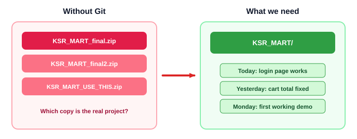
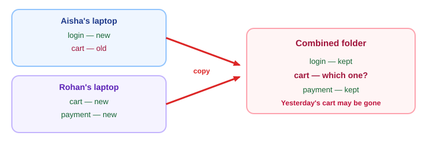
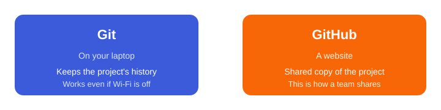

# Session 1 — From the Desktop mess to your first GitHub push

**Shared topic** (Python FS + Java FS) · **~75 minutes**

**Index:** [Git and GitHub](01_Git_and_GitHub.md)  
**Previous (Python FS):** [Logging](../PYTHON/03_Advanced_Python/06_Logging_Module.md)  
**Previous (Java FS):** [File Handling](../JAVA/04_Collections_Exceptions_IO/03_File_Handling.md)  
**Next:** [Session 2 — Daily Git workflow](02_Git_Session2.md)

---

## Session Outcome

By the end of this sitting you will have **KSR_MART** on GitHub.

You will be able to:

- Say why zip copies are not enough
- Tell Git and GitHub apart
- Install Git, set your name and email, and create a GitHub repo
- Save a checkpoint on your laptop and push it to GitHub

This course is **five sessions, about six hours**. We will not cover Git internals, rebase, cherry-pick, or a long command list. Today is one win: the project is online.

---

## 1. Look at the Desktop

You are building **KSR_MART**. Monday the home page works. Tuesday the cart breaks. Wednesday a teammate asks for the working copy.



Which zip is the real project? You cannot say quickly.

That is the problem. Not “I don’t know Git.” The project has **no history** — only extra copies.

Same mess, six ways:

- You keep `final`, `final2`, `USE_THIS`. Two people edit different copies.
- You delete working login code, save, and close the editor. Undo is gone tomorrow.
- The cart worked last night. This morning it does not. You cannot see what changed.
- Aisha, Rohan, and you all edited the project. A bug appears. Who touched the cart file?
- You send a zip on WhatsApp. They send `from_rohan.zip` back. Now there are two “latest” copies.
- Aisha builds **login**. Rohan builds **payment**. One copied folder overwrites the other.

**Need:** one current project, a history you can go back through, and a shared copy when other people are involved.

---

## 2. Two laptops, one broken cart

Aisha finishes login. Rohan finishes payment. Each has a folder named `KSR_MART`. They copy files together by hand.



They did not fail at coding. They failed at **combining work**. There is no shared history, so the old cart cannot be recovered.

---

## 3. Git and GitHub are not the same tool



**Git** runs on your computer. It records history for this project, even if Wi‑Fi is off.

**GitHub** is a website. The team keeps a shared copy there instead of mailing zips.

You can use Git with no GitHub account. You cannot put the team copy online until GitHub (or a similar host) exists. This course uses GitHub because that is what most teams and recruiters open.

---

## 4. Get ready

### GitHub account

Create a free account at [github.com](https://github.com) if you do not have one. Use an email you can open. Remember the username. You will need it in the repo URL.

### Install Git

Install from [git-scm.com](https://git-scm.com). On Windows, the installer includes **Git Bash** — use that for the commands in this course. On Mac, Terminal is enough.

Check:

```bash
git --version
```

You should see a version number. That means Git is on this machine.

### Tell Git who you are

Every checkpoint stores a name and email. Set them once on this computer:

```bash
git config --global user.name "Your Name"
git config --global user.email "you@example.com"
```

Use the same email as GitHub if you can. That is how GitHub links your work to your account.

When GitHub asks you to sign in later (browser or a credential window), sign in. GitHub no longer accepts your account password on `git push`. Do not hunt for extra token setup unless the sign-in window fails.

---

## 5. Create an empty GitHub repository

A **repository** (repo) is the project plus its history.

On GitHub: **New repository**.

- **Name:** `ksr-mart` (lowercase, hyphen — GitHub names cannot be `KSR_MART` with a space)
- **Public**
- **Do not** tick README, `.gitignore`, or License

Those extras create files on GitHub before your laptop has a history. Then `git push` is rejected. We will add a README from the laptop instead.

Copy the HTTPS URL. It looks like:

```text
https://github.com/YOUR_USERNAME/ksr-mart.git
```

---

## 6. Put KSR_MART on GitHub

This is the whole move for today:


On your machine (Git Bash on Windows):

```bash
mkdir -p ~/KSR_MART
cd ~/KSR_MART
git init -b main
```

`git init` starts history in this folder. `-b main` names the first line of history `main` (the usual name on GitHub).

Create a README so the repo is not empty:

```bash
echo "# KSR_MART" > README.md
echo "Canteen ordering project for the Git course." >> README.md
```

Git does not snapshot a file the moment you save it. You choose what belongs in the checkpoint, then you seal it.

```bash
git status
git add README.md
git commit -m "Add README for KSR_MART"
```

`git status` is “what is going on in this folder?”

`git add` is “these files belong in the next checkpoint.”

`git commit` is “save that checkpoint on this laptop,” with a short message you can read later.

Connect this folder to the empty GitHub repo, then send the checkpoint:

```bash
git remote add origin https://github.com/YOUR_USERNAME/ksr-mart.git
git push -u origin main
```

Replace `YOUR_USERNAME` with your GitHub username.

`origin` is just the nickname for that GitHub URL. `push` copies your laptop history to GitHub. `-u` remembers the link so later you can type `git push`.

Refresh the GitHub page. You should see `README.md`.

**You just put a project on GitHub.** That is the session.

---

## 7. What happened?

| Step | What you needed | What you ran |
|------|-----------------|--------------|
| Start history in this folder | A project Git can track | `git init -b main` |
| Choose files for a checkpoint | Not every random file on the Desktop | `git add README.md` |
| Save the checkpoint locally | A version you can come back to | `git commit -m "..."` |
| Name the GitHub copy | An address for the shared repo | `git remote add origin URL` |
| Send the history | Teammates / recruiters can see it | `git push -u origin main` |

The checkpoint is on your laptop **and** on GitHub. If Wi‑Fi dies after `commit` but before `push`, the work is still on this machine. Push is a copy, not the first save.

---

## 8. Try this

In `~/KSR_MART`, add one line to `README.md`, then:

```bash
git status
git add README.md
git commit -m "Update README with one more line"
git push
```

Refresh GitHub. The new line should be there.

---

## Common mistakes

**You created the GitHub repo with a README.** GitHub already has a commit. Your laptop has a different first commit. `git push` is rejected. For this session, delete that GitHub repo and create an **empty** one, or ask the trainer. Next sessions will teach `git pull` for this situation.

**You ran `git add .` from the Desktop.** You may stage hundreds of files. Always `cd` into `KSR_MART` first. `git status` before `git add`.

**You saved in the editor and thought Git had a checkpoint.** Save writes the disk. `commit` writes history.

**You mixed up Git and GitHub.** Git made the checkpoint on the laptop. GitHub received the copy when you pushed.

---

## Key takeaway

**Git** records history on your computer. **GitHub** holds the shared copy.

Today’s loop:

```text
edit → git add → git commit → git push
```

Session 2 explains that loop properly (including `status`, `log`, and how to start from someone else’s GitHub repo). You already survived the first push. The next sitting is about using this every day.
