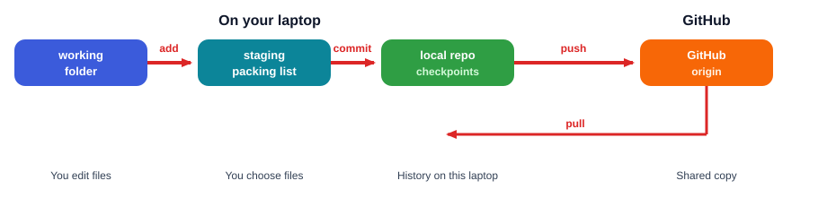
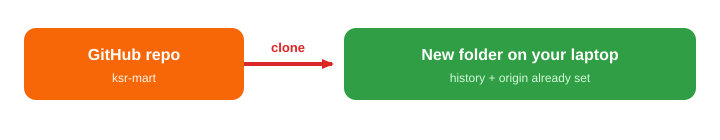

# Session 2 — Daily Git workflow

**Shared topic** (Python FS + Java FS) · **~75 minutes**

**Index:** [Git and GitHub](01_Git_and_GitHub.md)  
**Previous:** [Session 1 — First GitHub push](01_Git_Session1.md)  
**Next:** [Session 3 — Feature branches and Pull Requests](03_Git_Session3.md)

---

## Session Outcome

Session 1 got **KSR_MART** onto GitHub. This sitting is the weekday loop you will type for the rest of the course (and at work).

By the end you will be able to:

- Read `git status` and know where each file sits
- Choose files for a checkpoint, commit with a useful message, and read history
- See what you changed with `git diff` before you pack it
- Pull when GitHub is ahead of your laptop
- Clone an existing GitHub repo instead of starting from `git init`
- Keep secrets and generated folders out of Git with `.gitignore`

You already know `add`, `commit`, and `push`. Today you learn *why* that packing step exists, and how a teammate starts from GitHub.

**Lab after this sitting:** [labs/01_git_portfolio_hygiene](labs/01_git_portfolio_hygiene/)

---

## 1. The problem after Session 1

You changed three files in KSR_MART:

- `README.md` — a typo
- login notes — unfinished
- a screenshot on the Desktop you copied into the folder by mistake

You need a checkpoint for the typo **only**. The unfinished login should stay on your desk. The screenshot should never go to GitHub.

**Need:** a packing list. Git does not have to snapshot every file you touched.

That packing list is the **staging area**. `git add` puts a file on the list. `git commit` seals only what is on the list.

---

## 2. The picture



| Place | What it is | Why it exists |
|-------|------------|----------------|
| Working folder | Files you edit | This is the project on disk |
| Staging area | Files you **chose** for the next checkpoint | So one commit can be “fix README typo,” not “everything on my desk” |
| Local repo | Checkpoints on this laptop | History works with Wi‑Fi off |
| GitHub (`origin`) | Shared copy | Teammates and recruiters see this |

`git push` sends **commits**, not “the file I have open.” If you did not commit, GitHub does not change.

`git pull` is the other direction: GitHub has commits your laptop does not have yet. You will need this as soon as a teammate pushes — or as soon as you clone a second copy.

---

## 3. Daily commands

Stay in `~/KSR_MART` for this section (`cd ~/KSR_MART` first).

### `git status` — what is going on?

You cannot see staging by looking at the folder in Explorer or Finder. Ask Git.

```bash
git status
```

Typical lines:

- `Untracked files` — Git has never checkpointed this file
- `Changes not staged for commit` — you edited a file Git already knows; it is **not** on the packing list yet
- `Changes to be committed` — on the packing list, waiting for `commit`
- `working tree clean` — no leftover edits

Run `status` before `add`, and again after `commit`.

### `git diff` — what did I change?

The cart total looks wrong. You do not remember the edit.

```bash
git diff
```

That is the unstaged edit vs the last checkpoint. Read it **before** you pack.

After `git add`, that diff goes quiet. To re-read what you packed:

```bash
git diff --staged
```

### `git add` — choose files for this checkpoint

```bash
git add README.md
```

One file. That is the usual beginner move.

`git add .` packs **everything** changed in this folder. Use it only after `git status` looks right. If you are in the wrong folder, you can pack the whole Desktop.

### `git commit` — seal the checkpoint

```bash
git commit -m "Fix typo in KSR_MART README"
```

The message is the label on the box. You will read it weeks later in `git log`.

Write it like an order:

```text
Add cart notes
Fix README typo
Update product list
```

Not `ok`, `final`, or `asdf`.

### `git log` — what checkpoints exist?

```bash
git log --oneline
```

Newest is at the **top**. Hashes differ on every machine. Read the messages, not the hashes.

### `git push` — send commits to GitHub

```bash
git push
```

Session 1 already set `-u origin main`. After that, `git push` is enough.

Push is a copy. The checkpoint is already on this laptop from `commit`.

### `git pull` — GitHub has work you do not

A teammate pushed cart notes while you were at lunch. Your laptop is behind GitHub.

```bash
git pull
```

That copies their commits into your local repo and updates your files.

If GitHub is not ahead, pull does little. If both of you edited the **same lines**, Git cannot decide — that is a **merge conflict**, Session 4. For this sitting, pull when you did not touch those files, or pull before you start work.

**Do not skip pull** if someone else uses the same repo. Pushing while you are behind is rejected. Session 4 treats that incident. Today: pull, then work, then push.

---

## 4. Try the loop on KSR_MART

```bash
cd ~/KSR_MART
echo "Tea 20, lunch 80" > NOTES.txt
git status
git diff
git add NOTES.txt
git status
git commit -m "Add canteen spend notes"
git log --oneline
git push
```

After `git add`, `NOTES.txt` should sit under **Changes to be committed**. After `commit`, `status` should be clean. Refresh GitHub. `NOTES.txt` should be there.

Edit `NOTES.txt` once more, run `git diff`, then add, commit (`Update canteen spend notes`), and push.

---

## 5. Keep junk out of Git — `.gitignore`

Git will pack whatever you `add`. A virtual environment, compiled Java, and `.env` secrets do not belong on GitHub.

Create `~/KSR_MART/.gitignore`:

```gitignore
.env
venv/
.venv/
__pycache__/
*.pyc
target/
*.class
.idea/
.vscode/
.DS_Store
```

Then:

```bash
git add .gitignore
git commit -m "Ignore secrets and generated folders"
git push
```

Python regenerates `venv/` and `__pycache__/`. Java regenerates `target/` and `*.class`. Do **not** ignore `*.py` or `*.java` — that is your source.

`.env.example` (dummy names, no real secrets) is fine to commit. A real `.env` is not.

If you already committed a secret, deleting the file later is not enough — it stays in history. Tell the trainer. Session 4 covers leaked files at a beginner level. For today: ignore **before** you add.

---

## 6. Join an existing repo — `git clone`

At work you rarely `git init`. The repo already lives on GitHub. You copy it to a new folder.



```text
GitHub repository
        ↓  git clone
Local folder (history + origin already set)
        ↓  edit
        ↓  add / commit
        ↓  git push
```

**Do not** `git init` inside a clone. The clone already is a Git repo.

Use a **new folder name** so you do not overwrite `~/KSR_MART`:

```bash
cd ~
git clone https://github.com/YOUR_USERNAME/ksr-mart.git KSR_MART_clone
cd KSR_MART_clone
git status
git log --oneline
```

You should see the commits from Session 1 and this sitting. `origin` is already set. No `git remote add`.

Add a line as if you were a teammate joining the project:

```bash
echo "Rohan: payment page next" >> NOTES.txt
git add NOTES.txt
git commit -m "Add teammate note on payment page"
git push
```

Now `~/KSR_MART` is behind GitHub (the clone pushed). Update the original folder:

```bash
cd ~/KSR_MART
git pull
```

`NOTES.txt` should include Rohan’s line. You just did clone → edit → push → pull on a second copy, which is the same shape as two teammates.

For a real teammate’s project, clone **their** URL, not yours. Same commands.

---

## 7. Two ways onto a project

| Situation | What you do |
|-----------|-------------|
| New project on your laptop | `git init`, then `remote add`, then `push` (Session 1) |
| Project already on GitHub | `git clone URL`, then edit / add / commit / push |

If `git status` says `not a git repository`, you are in the wrong folder — or you have not `init`/`clone` yet.

---

## Practice

**Task 1 — Packing list**

In `~/KSR_MART`, change `README.md` and `NOTES.txt`. Stage **only** `README.md`. Commit. Confirm with `git status` that `NOTES.txt` is still unstaged. Then stage and commit `NOTES.txt` separately. Push.

Expected: two commits, two messages, GitHub has both files.

**Task 2 — Lab**

Do [labs/01_git_portfolio_hygiene](labs/01_git_portfolio_hygiene/). Finish `.gitignore` and a README a teammate can run. Do not commit `.env`.

---

## Common mistakes

**`git add .` without `status`.** You pack leftover screenshots, `.env`, or `venv/`. Status first. Ignore file first.

**`git commit` with nothing staged.** Git refuses, or you think the editor save was a commit. `status` until you see **Changes to be committed**.

**`git init` inside a clone.** Now you have a nested repo. Clone already created `.git`. Just `cd` into the clone.

**`git clone` into a folder that already exists and is not empty.** Clone wants a new directory. Use `KSR_MART_clone` or another empty name.

**Push from one folder, then push from the other without pull.** The second push is rejected. `git pull` in that folder, then `git push`. If Git reports a conflict, stop — Session 4.

**Commit message `update`.** Future you cannot search that. `Fix README typo` is enough.

---

## Key takeaway

```text
edit  →  status / diff  →  add  →  commit  →  push
```

When GitHub is ahead: **pull** first.

When the project already exists on GitHub: **clone**, do not init.

Staging exists so a checkpoint can be *one idea*, not every file you touched.

Session 3: the app on `main` is stable, but you need a login feature. You will work on a **branch** and open a Pull Request so unfinished login does not land on `main` by accident.
