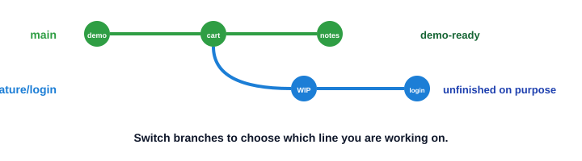
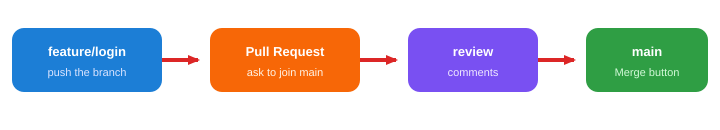

# Session 3 — Feature branches and Pull Requests

**Shared topic** (Python FS + Java FS) · **~75 minutes**

**Index:** [Git and GitHub](01_Git_and_GitHub.md)  
**Previous:** [Session 2 — Daily Git workflow](02_Git_Session2.md)  
**Next:** [Session 4 — Sync, undo, and conflicts](04_Git_Session4.md)

---

## Session Outcome

`main` is the copy you would demo. Login is not finished. You will work on a **separate line**, push it, and ask GitHub to take it into `main` only after a look.

By the end you will be able to:

- Say why unfinished login must not sit on `main`
- Create, switch, and list branches
- Commit on a feature branch and push that branch
- Open a Pull Request, merge it, then update local `main`
- Use a PR even when you are the only developer

This course uses one pattern: **`main` + feature branch + Pull Request**. We will not learn extra branching strategies.

Conflicts stay in Session 4. If Git cannot combine two branches automatically today, stop and wait.

---

## 1. The problem

KSR_MART on `main` works. A teammate (or a trainer) can clone it and run the demo.

You need a **login** page. It will take two days. If you commit half-built login on `main`, the demo is broken until you finish.

**Need:** an isolated line of work. `main` stays demo-ready. Login lives somewhere else until it is ready.

That isolated line is a **branch**.



`main` is just the name of the stable line. A **feature branch** is a line you create for one job — login, payment, a bug fix.

You switch branches to choose which line you are editing. Files on disk follow the branch you are on.

---

## 2. Work on a feature branch

Use `~/KSR_MART` (not the clone from Session 2, unless you prefer one folder and stay in it).

First, stand on the latest `main`:

```bash
cd ~/KSR_MART
git switch main
git pull
```

Create a branch **and** move onto it:

```bash
git switch -c feature/login
```

`-c` means create. `feature/login` is a name, not a special Git type. Teams often use `feature/...` so the job is obvious.

Check where you are:

```bash
git branch
```

The star is the current branch. You want `* feature/login`.

Now the weekday loop from Session 2 — it belongs to this branch, not to `main`:

```bash
echo "# Login" > LOGIN.md
echo "WIP: email and password form." >> LOGIN.md
git add LOGIN.md
git commit -m "Add login notes"
```

Switch back to `main` without merging:

```bash
git switch main
```

`LOGIN.md` should **disappear** from the folder. It is not gone. It lives on `feature/login`. Switch back:

```bash
git switch feature/login
```

The file returns. That is the point of a branch.

List branches again any time you feel lost: `git branch`. Older notes use `git checkout`. This course uses `git switch`.

---

## 3. Push the branch, not only `main`

GitHub does not see `feature/login` until you push **that** branch.

```bash
git switch feature/login
git push -u origin feature/login
```

`-u` remembers the link, same idea as Session 1. After that, `git push` on this branch is enough.

On GitHub, open the repo. You should see a banner that `feature/login` had a recent push, and a **Compare & pull request** button.

Do **not** merge on the laptop for this course. The team habit is: push the branch, then open a Pull Request.

---

## 4. What a Pull Request is

A **Pull Request (PR)** is a GitHub page that says:

> Please take the commits on `feature/login` into `main`.

It is not a Git command. It is a request on the website.

**Need:** someone looks at the change *before* it becomes the demo copy.



On GitHub:

1. **Compare & pull request** (or **Pull requests → New**)
2. Base: `main` ← compare: `feature/login`
3. Title like a commit message: `Add login notes`
4. Short description: what you did, how to check it
5. **Create pull request**

A teammate can comment, ask for a change, or approve.

Then **Merge pull request** → confirm. Tick **Delete branch** if GitHub offers it (that is the GitHub copy of `feature/login`).

`main` on GitHub now has login. Your laptop `main` does not until you pull.

```bash
git switch main
git pull
```

`LOGIN.md` should appear on `main`. The local feature branch can go:

```bash
git branch -d feature/login
```

`-d` refuses if the work never made it into `main`. Do not use `-D` unless you mean to throw the branch away.

---

## 5. Solo vs team

**Team:** Aisha opens a PR. Rohan reviews. After approval, someone merges. Unfinished login never lands on `main` by a quiet `git push` to `main`.

**Solo:** You still open a PR on your own `ksr-mart`. You are the reviewer. You read the diff on GitHub, then merge yourself.

A PR is useful even for one person:

- You see the change in one place before it is “the project”
- A recruiter can see you know the team habit
- You can add a second commit on `feature/login` (`git add`, `commit`, `git push`) and the same PR updates

Do not push straight to `main` on a team repo. On your own portfolio, practise the PR anyway so the buttons are not new in an internship.

---

## 6. Try this — one PR for login

```bash
cd ~/KSR_MART
git switch main
git pull
git switch -c feature/login
echo "# Login" > LOGIN.md
echo "WIP: email and password form." >> LOGIN.md
git add LOGIN.md
git commit -m "Add login notes"
git push -u origin feature/login
```

On GitHub: open the PR → merge → delete the remote branch.

```bash
git switch main
git pull
git branch -d feature/login
git log --oneline -5
```

You should see `Add login notes` on `main`. `git branch` should no longer list `feature/login`.

Optional second pass: `feature/payment` with one line in `PAYMENT.md`, same PR flow. Aisha login / Rohan payment is the two-laptop story from Session 1, done the professional way.

---

## Common mistakes

**Every edit on `main`.** One bad save breaks the demo. New work starts with `git switch -c feature/...` from an up-to-date `main`.

**Forgot to push the branch.** The PR page is empty or GitHub has no `feature/login`. `git push -u origin feature/login`.

**PR from `main` into `main`.** Nothing useful to review. Compare the **feature** branch into `main`.

**Deleted the branch before the PR was merged.** The work may still be on GitHub if you pushed. If you never pushed, the commits may exist only on this laptop. Push first. Merge first. Delete last.

**Laptop `main` looks old after a GitHub merge.** You merged on the website. `git switch main` then `git pull`.

**`git switch` fails: uncommitted changes.** Finish or stash is Session 4. For today: `status`, then `add` / `commit` on the current branch before you switch — or copy the file aside and ask the trainer.

---

## Key takeaway

```text
main (stable)
   ↓
feature/login  →  commit  →  push  →  Pull Request  →  review  →  merge
   ↓
git switch main && git pull
```

A branch is an isolated line. A Pull Request is how that line asks to join `main`.

Session 4: a teammate already pushed `main`, two people edited the same file, or you committed the wrong thing. That sitting is sync, safe undo, and one merge conflict.
