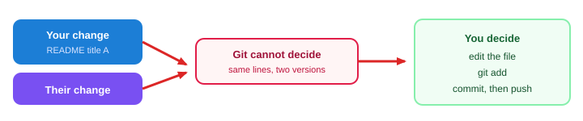

# Session 4 — Sync, undo, and conflicts

**Shared topic** (Python FS + Java FS) · **~75 minutes**

**Index:** [Git and GitHub](01_Git_and_GitHub.md)  
**Previous:** [Session 3 — Feature branches and Pull Requests](03_Git_Session3.md)  
**Next:** [Session 5 — Git in the IDE](05_Git_Session5.md)

---

## Session Outcome

Session 3 put login on a branch and a Pull Request. Real teams still hit three desks problems: GitHub moved without you, two people edited the same lines, or you packed the wrong thing.

By the end you will be able to:

- Pull when a teammate pushed first, and update a feature branch that is behind `main`
- Unstage a file, discard local edits on purpose, amend a commit that was **never** pushed, and revert a commit that **was** pushed
- Resolve one merge conflict (markers out, `add`, commit)
- Pick a safe move from a short list of team scenarios

**Lab after this sitting:** [labs/02_git_desk_incidents](labs/02_git_desk_incidents/)

We will not use rebase, force-push, or `git reset --hard`. Those can rewrite shared history or wipe the folder.

---

## 1. Someone pushed before you

Rohan merged **payment** to `main` on GitHub. You still have yesterday’s `main`. You commit cart notes and `git push`.

GitHub refuses:

```text
! [rejected]  main -> main (non-fast-forward)
```

**Why:** pushing would hide Rohan’s commits. GitHub will not let you overwrite them.

**Need:** copy GitHub’s extra commits onto your laptop, then send yours.


```bash
git switch main
git pull
git push
```

If Git can combine the two histories, pull finishes and push works.

If both of you edited the **same lines**, pull stops with a conflict. That is section 3. Do not add `--force` to “make push work.” Force-push on `main` can delete a teammate’s work from GitHub.

### Feature branch behind `main`

You started `feature/login` on Monday. Tuesday, `main` got payment. Your branch is old.

```bash
git switch main
git pull
git switch feature/login
git merge main
```

That copies the new `main` into your feature line. Fix conflicts if Git asks. Then `git push` and the Pull Request updates.

GitHub’s PR page also offers “Update branch.” Same idea. On this course, practise the commands so you know what the button does.

---

## 2. Safe undo

`git status` first. Ask: is this only on disk, only staged, a local commit, or already on GitHub?

| Problem | Safe move | What it changes |
|---------|-----------|-----------------|
| Staged the wrong file | `git restore --staged FILE` | Off the packing list. **Edits stay on disk.** |
| Unstaged edits are junk | `git restore FILE` | Tracked file goes back to the last commit. **Those edits are gone.** |
| Last commit message (or leftover file) is wrong, **not pushed** | `git commit --amend -m "Add README"` | Replaces the **latest** local commit only |
| A commit is **already on GitHub** | `git revert HEAD` then `git push` | Adds a **new** commit that undoes the last one |

Copy a file aside if you are not sure `restore FILE` is what you want.

**Unstage (keep the typing):**

```bash
git restore --staged NOTES.txt
git status
```

**Discard unstaged edits to a tracked file** (destructive):

```bash
git restore NOTES.txt
```

Untracked files (`todo.txt` you never added) are not restored this way. Delete the file yourself, or add it to `.gitignore`.

**Amend — only if you have not pushed:**

```bash
git commit --amend -m "Add README"
```

You can also `git add` a forgotten file, then `--amend` so it joins the last commit. Same rule: **not on GitHub yet.**

If you already pushed: make a new commit, or `revert`. Do not amend and force-push `main`.

**Revert a shared commit:**

```bash
git revert HEAD
git push
```

`HEAD` means “the latest commit on this branch.” Revert does not delete history. It adds an undo. That is why it is safe after a push.

**Do not** start with `git reset --hard`. It can wipe **all** uncommitted work in the folder. This course does not teach reset.

---

## 3. Merge conflict

Git often combines branches by itself. It stops when the **same lines** changed two ways.



```text
Your changes  +  someone else's changes
        ↓
Git cannot decide
        ↓
You choose the final text
        ↓
git add  →  commit  →  push
```

Markers look like this:

```text
<<<<<<< HEAD
# KSR_MART
=======
# KSR Mart canteen
>>>>>>> feature/readme-title
```

`HEAD` is the branch you are on (often `main` during a pull). The other label is the incoming branch.

1. Open the file. Read both sides.
2. Leave the wording you want. Delete every `<<<<<<<`, `=======`, and `>>>>>>>` line.
3. `git add README.md`
4. `git commit` (Git often fills a merge message — save and close)
5. `git push` if this was a pull or a shared branch

Do not commit the markers. Do not delete the whole file to “end the pain.”

### Cause one conflict on purpose

```bash
cd ~/KSR_MART
git switch main
git pull
git switch -c feature/title-a
echo "# KSR_MART" > README.md
git add README.md
git commit -m "Set README title A"
git switch main
git switch -c feature/title-b
echo "# KSR Mart canteen" > README.md
git add README.md
git commit -m "Set README title B"
git switch main
git merge feature/title-a
git merge feature/title-b
```

The second merge should conflict. Edit `README.md` to one title, remove markers, `git add README.md`, commit. Then:

```bash
git branch -d feature/title-a feature/title-b
git push
```

---

## 4. Hotfix while the folder is dirty

You are on `feature/login` with half-written notes. Demo in ten minutes: fix `HABIT.md` on `main`.

Git may refuse `git switch main` if those uncommitted files would be overwritten.

**If the WIP is not ready to commit** — stash it (a temporary shelf):

```bash
git stash
git switch main
echo "Commit once a day." > HABIT.md
git add HABIT.md
git commit -m "Add daily-commit habit note"
git switch feature/login
git stash pop
```

`stash pop` puts the WIP back. If it conflicts, you resolve it like section 3.

**Often safer for beginners:** commit the WIP on `feature/login` (`Add WIP login notes`), switch to `main`, hotfix, switch back. The feature branch keeps a real checkpoint. You can clean the message later with a new commit (not amend after push).

---

## 5. Team scenarios

For each one: name the problem, then the move. Commands you already have.

**1. Two people, different features**

Aisha on `feature/login`, Rohan on `feature/payment`. They should not both commit on `main`. Two branches, two PRs (Session 3). Pull `main` before each new branch.

**2. Two people, same file**

Both edited `README.md`. Pull or merge stops. That is a conflict (section 3). Human chooses. Then add, commit, push.

**3. Someone pushed before you**

Rejected push (section 1). `git pull`, then `git push`. Never `--force` on shared `main`.

**4. Your feature branch is behind `main`**

`main` pulled, then `git merge main` while you are on the feature branch (section 1). Push. The PR updates.

**5. Wrong change in the last commit**

Not pushed → `--amend` or restore / new commit. Already pushed → new commit or `git revert`. Do not rewrite GitHub `main`.

**6. Review needed**

That is a Pull Request (Session 3). Do not push straight to `main` on a team repo.

**7. Something that should not be committed**

Staged `.env` → `git restore --staged .env`, add `.gitignore`, commit the ignore file. Already committed **locally** only → add ignore, then `git rm --cached .env`, commit `Stop tracking .env`. Already **on GitHub** → tell the trainer. Rotate the secret. Do not casual force-push.

---

## Practice

**Task 1 — Rejected push (two folders)**

If you still have `~/KSR_MART` and `~/KSR_MART_clone` from Session 2: commit and push from the clone, then commit on `~/KSR_MART` and push (expect reject). Pull, then push.

**Task 2 — Conflict**

Run the title-a / title-b merge above, or fix the planted markers in [labs/02_git_desk_incidents](labs/02_git_desk_incidents/).

**Task 3 — Lab**

Do the full kit: ignore/secret, README conflict, hotfix while dirty (stash **or** commit on a feature branch).

---

## Common mistakes

**`--force` to clear a rejected push.** You can erase a teammate’s commits on GitHub.

**`git restore FILE` when you still needed the typing.** That command throws unstaged edits away. Unstage first if you only packed the wrong file.

**`commit --amend` after `git push`.** You rewrote a commit other people may already have. New commit or `revert`.

**Left `<<<<<<<` in the file.** The app still “works”; the file is garbage. Search for `<<<<<<<` before you commit.

**`git reset --hard` because status looks messy.** You can lose everything not committed. Use `status`, then restore / stash / commit.

---

## Key takeaway

```text
GitHub ahead?          →  pull (then push)
Same lines, two edits? →  you decide, add, commit
Wrong pack / local typo? →  restore --staged / restore / amend
Already on GitHub?     →  revert or a new commit — never force main
```

Session 5: the same moves in VS Code and PyCharm. The IDE is another interface. It does not replace this sitting.
