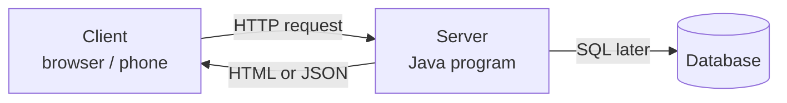

# Module: Computer and Programming Foundations

**Phase:** Foundations

**Next module:** [Java Setup and First Programs](../02_Core_Java/01_Java_Setup_and_First_Programs.md)

---

**Module Outcome:**

- Trace any app as **input → process → output** (roll number in, marks out)
- Tell hardware, OS, and a program apart — and why we write code at all
- Use bits, files, and a terminal well enough to survive JDK setup

### What is a computer?

A **computer** is a machine that takes **input**, processes it using rules, and gives **output**. When you open a student portal on your phone, you type a roll number (input), the server checks the database (processing), and shows your marks (output).

**Icons:** Laptop · Order · Bank · Employee · Payroll

**Where used?**
- College apps — student portal login, marks screens, lab machines
- **TechMart** / CampusCart — checkout flow (browser client → server → DB)
- **SecureBank** / UPI — ATM withdrawal; app request → bank server
- **AcmeHR** — employee tools that run on company laptops
- **MedCare** — appointment desks using folders, terminals, and web portals

Think of it like a kitchen:

```
[You give ingredients] → [Chef follows recipe] → [Dish served]
     INPUT                  PROCESSING              OUTPUT
```

### What is an operating system (OS)?

The **operating system** is the manager of your laptop. Windows, macOS, and Linux are operating systems. The OS:

- Starts your laptop when you press the power button
- Shows the desktop and file explorer
- Runs programs (browser, VS Code, IntelliJ, `javac`)
- Manages files and folders on your hard disk

Without an OS, your laptop is just hardware with no way for you to interact easily.

### What are files and folders?

A **folder** (also called a **directory**) is like a drawer in a cupboard. A **file** is a document inside that drawer.

Example structure for this course:

```
JAVA/
├── 01_Foundations/
├── 02_Core_Java/
└── projects/
    └── HelloJava.java
```

A **file path** is the full address of a file, for example:

- Windows: `C:\Users\Ravi\projects\HelloJava.java`
- macOS/Linux: `/Users/ravi/projects/HelloJava.java`

**File extension** (the part after the dot) tells the OS what kind of file it is:

| Extension | Meaning |
|-----------|---------|
| `.java` | Java source file |
| `.class` | Compiled Java bytecode (do not edit by hand) |
| `.txt` | Plain text |
| `.md` | Markdown notes |
| `.html` | Web page |
| `.json` | Data in JSON format |

### What is programming?

**Programming** is writing instructions in a language that a computer can follow. These instructions are saved in **source code** files.

An **algorithm** is a step-by-step plan to solve a problem — you can write it in plain English or on paper. **Code** is the algorithm written in a programming language like Java.

```
Algorithm (English):                 Code (Java — coming in next module):
1. Ask user name                     // Scanner reads a line
2. Greet the user                    System.out.println("Hello, " + name);
```

You do not need to memorize code on day one. First understand the *problem* and the *steps*.

### Client–server and the browser

Most apps you use daily follow a **client–server** model:

```
[Client]  ---- HTTP Request ---->  [Server]
  (Browser / Mobile App)            (Java app on cloud)
[Client]  <--- HTTP Response ----  [Server]
              (HTML, JSON, data)
```

- **Client:** Your Chrome browser or phone app — it asks for data
- **Server:** A computer in a data centre (AWS, Azure, GCP) — it processes requests and sends replies
- **Request:** "Show me student ID 101's profile"
- **Response:** JSON or HTML page with the profile

When you open `https://example.com/login`, your browser (client) sends a request; the server checks credentials and sends back the dashboard page.

**Visual — request and response:**



**Key takeaways:**
- Client asks; server answers
- The browser does not store the company’s database
- Same idea for Flipkart, UPI apps, and a college portal

**Interview:** "What happens when you type a URL?" → DNS finds the server IP → browser sends HTTP request → server returns HTML/JSON → browser renders.

### Developer roles in India (entry-level view)

| Role | What they build | Typical tools | Example in training |
|------|-----------------|---------------|---------------------|
| **Frontend Developer** | Screens users see and click | HTML, CSS, JavaScript, React | Student portal UI |
| **Backend Developer** | Logic, APIs, database | Java, MySQL | Employee login API |
| **Full Stack Developer** | Both UI and server | Java + React + MySQL | Expense tracker end-to-end |
| **QA / Tester** | Finds bugs before release | Test cases, Postman | Test login form |
| **DevOps Engineer** | Deploys and monitors apps | Git, Docker, AWS | Put app on server |

In a 20-week full-stack program, you touch frontend, backend, database, and deployment — that is why the role is called **full stack**.

### VS Code, IntelliJ, and terminal basics

**VS Code** and **IntelliJ IDEA Community** are free **IDEs** (Integrated Development Environment) — an editor with tools for coding, compiling, and running programs. Use **one** as your daily driver; both are fine for this course.

The **terminal** (also called command line or shell) is a text-based way to talk to your OS. Developers use it to compile Java, create folders, and use Git.

---

## Important Concepts and Definitions

| Term | Definition |
|------|------------|
| **Hardware** | Physical parts: CPU, RAM, keyboard, screen |
| **Software** | Programs and apps that run on hardware |
| **OS (Operating System)** | System software that manages hardware and files |
| **File** | A named collection of data stored on disk |
| **Directory / Folder** | A container that holds files and other folders |
| **Path** | Location of a file or folder in the file system |
| **Algorithm** | Ordered steps to solve a problem |
| **Source code** | Human-readable program text (`.java`) |
| **Compiler** | Translates source to bytecode (`javac`) — details next module |
| **Client** | Device or app that requests services |
| **Server** | Machine that provides services and data |
| **HTTP** | Protocol (rules) for web request/response |
| **IDE** | Editor with coding tools built in |
| **Terminal / CLI** | Command-line interface to the OS |
| **Repository (repo)** | Project folder tracked by Git (introduced later) |

---

## Step-by-Step Notes (With Examples)

### Step 1: Know your machine

Check your laptop specs (Settings → About):

- **CPU:** Brain of the computer (Intel i5, Apple M1, etc.)
- **RAM:** Short-term memory while programs run (8 GB minimum recommended)
- **Storage:** Long-term space for files (SSD preferred)

**Note:**
- Wrong: Skipping OS / hardware basics and jumping straight to `javac`.
- Prefer: One day on CPU, RAM, storage, and files — it saves weeks of confusion later.

Write a short checklist note listing RAM, storage, and OS version you need for this course.

```markdown
# My Laptop Specs — Priya (Hyderabad)

- OS: macOS / Windows / Linux
- CPU: ________________
- RAM: ____ GB (need ≥ 8 GB for IDE + browser)
- Storage free: ____ GB
- Ready for course? YES / NO
```

Create a markdown table classifying common laptop items as hardware or software.

```markdown
| Item              | Hardware or Software? |
|-------------------|------------------------|
| Keyboard          | Hardware               |
| Chrome browser    | Software               |
| SSD drive         | Hardware               |
| VS Code / IntelliJ| Software               |
| JDK 17            | Software               |
```

### Step 2: Create your course folder structure

Open terminal and run (macOS/Linux):

```bash
# Create main project folder
mkdir -p ~/ksr_java_fullstack/projects
cd ~/ksr_java_fullstack
ls
```

Windows (Command Prompt or PowerShell):

```cmd
mkdir C:\Users\YourName\ksr_java_fullstack\projects
cd C:\Users\YourName\ksr_java_fullstack
dir
```

**Note:**
- Wrong: Saving course files randomly on the Desktop; using spaces in folder names (`my project`).
- Prefer: One root folder (`ksr_java_fullstack`) and `snake_case` / `kebab-case` names (`my_project`).

Create the full course folder tree with notes, projects, and labs subfolders, then confirm your location with pwd and ls.

```bash
mkdir -p ~/ksr_java_fullstack/{notes,projects,labs}
cd ~/ksr_java_fullstack
pwd
ls
```

**Expected Output:** (paths vary by user)

```
/Users/you/ksr_java_fullstack
labs
notes
projects
```

Create a nested lab folder for day01_workspace and navigate into it.

```bash
cd ~/ksr_java_fullstack
mkdir -p labs/day01_workspace
cd labs/day01_workspace
pwd
ls
```

### Step 3: Install and open the IDE

1. Download [VS Code](https://code.visualstudio.com) **or** [IntelliJ IDEA Community](https://www.jetbrains.com/idea/download/)
2. VS Code: install **Extension Pack for Java** (Microsoft). IntelliJ: bundled Java support.
3. **File → Open Folder** (VS Code) or **Open** (IntelliJ) → select `ksr_java_fullstack`
4. Create a file: `notes/day01_foundations.txt`

**Note:**
- Wrong: Opening a single file, then wondering why paths and terminals feel broken.
- Prefer: Always open the **project folder** as the root.

Write your Day 01 foundations notes covering what you learned about computers, the OS, and the terminal.

```markdown
# Day 01 Foundations — Ravi

What I learned:
1. Computer = input → process → output
2. OS manages hardware and files
3. Terminal is how developers talk to the OS
```

Start a glossary with definitions for path, extension, and IDE.

```markdown
# Glossary

- **Path:** full address of a file (e.g. `/Users/ravi/projects/HelloJava.java`)
- **Extension:** part after the dot (`.java`, `.md`, `.html`)
- **IDE:** editor with coding tools (VS Code or IntelliJ Community)
```

### Step 4: Essential terminal commands

| Command | macOS/Linux | Windows | Purpose |
|---------|-------------|---------|---------|
| List files | `ls` | `dir` | See what is in current folder |
| Change directory | `cd folder_name` | `cd folder_name` | Move into a folder |
| Go up one level | `cd ..` | `cd ..` | Move to parent folder |
| Print working directory | `pwd` | `cd` (shows path) | Show current location |
| Create folder | `mkdir name` | `mkdir name` | New directory |
| Clear screen | `clear` | `cls` | Clean terminal view |
| Check Java (next module) | `java -version` | `java -version` | Verify JDK install |

**Annotated demo — navigate like a developer:**

```bash
# You are here: /Users/priya
cd ksr_java_fullstack            # enter course folder
mkdir 01_Foundations             # create module folder
cd 01_Foundations                # go inside it
pwd                              # confirm path → .../01_Foundations
ls                               # list contents (may be empty)
```

**Expected Output:**

```
/Users/priya/ksr_java_fullstack/01_Foundations
```

(`ls` may print nothing if the folder is empty.)

**Remember:** `pwd` = “where am I?” — run it after every `cd` until paths feel natural.

**Note:**
- Wrong: Avoiding the terminal because it looks like “hacking” movies.
- Prefer: Run only the commands shown in class — `ls` / `cd` are safe navigation tools.

Practice navigating from home into ksr_java_fullstack/notes and confirm your path at each step.

```bash
cd ~
pwd
cd ksr_java_fullstack
mkdir -p notes
cd notes
pwd
ls
```

Drill moving up one directory level with cd .. and verify where you land.

```bash
cd ~/ksr_java_fullstack/notes
pwd
cd ..
pwd
ls
```

**Common Error:** Typing `cd ksr_java_fullstack` from the wrong folder → `No such file or directory`. Use `cd ~` first, or the full path `~/ksr_java_fullstack`.

### Step 5: Algorithm vs code — student login example

**Scenario:** A college wants a simple login check.

**Algorithm (pseudocode on paper):**

```
START
  DISPLAY "Enter roll number"
  READ roll_number
  DISPLAY "Enter password"
  READ password
  IF roll_number is valid AND password matches
    DISPLAY "Welcome to student portal"
  ELSE
    DISPLAY "Invalid login"
  END IF
END
```

**Flowchart (text form):**

```
        [Start]
           |
    [Ask roll number]
           |
    [Ask password]
           |
    [Valid?]---No--->[Show error]--->[End]
       |
      Yes
       |
 [Show portal home]
       |
      [End]
```

You will write the Java version after Flow Control. Today, focus on *logic*, not syntax.

**Note:**
- Wrong: Mixing up *algorithm* (English steps) with *code* (Java syntax).
- Prefer: Write steps in plain English / pseudocode first; code comes later.

Write pseudocode for a SecureBank ATM withdraw flow that checks PIN and balance before dispensing cash.

```
START
  DISPLAY "Enter PIN"
  READ pin
  IF pin is correct
    DISPLAY "Enter amount (₹)"
    READ amount
    IF amount <= balance
      DISPLAY "Dispense cash"
      SET balance = balance - amount
    ELSE
      DISPLAY "Insufficient balance"
    END IF
  ELSE
    DISPLAY "Wrong PIN"
  END IF
END
```

Write pseudocode that reads marks and displays Pass or Fail based on a 35 cutoff.

```
START
  READ marks
  IF marks >= 35
    DISPLAY "Pass"
  ELSE
    DISPLAY "Fail"
  END IF
END
```

### Step 6: Trace a real client–server flow

Example: Opening an **employee portal** in a browser.

1. Employee types URL → browser sends **GET request** to server
2. Server checks session / shows login page → **HTML or JSON response**
3. Employee submits form → **POST request** with username and password
4. Server validates against **MySQL database** → sends dashboard or error
5. Browser renders the page — employee sees payslip link

```
Browser                    Server (Java)                 Database (MySQL)
   |                            |                            |
   |--- POST /login ----------->|                            |
   |    (emp_id, password)      |--- SELECT employee ------->|
   |                            |<-- row or empty -----------|
   |<-- 200 dashboard ----------|                            |
```

**Note:**
- Wrong: Treating client and server as the same kind of “computer” with no distinction.
- Prefer: Client = *your* browser; server = the company’s remote machine.

Label the client, request, server, database, and response for a campus canteen app.

```markdown
# Campus canteen app (client–server)

- Client: Phone browser showing menu
- Request: GET /menu
- Server: Java program on cloud
- Database: MySQL table `menu_items`
- Response: JSON list of dosa, idli, chai with prices in ₹
```

Describe the expense tracker sync story showing why the server and database are the source of truth.

```markdown
# Expense tracker sync

1. Ravi adds ₹120 chai on phone (client)
2. App sends POST /expenses JSON to server
3. Server INSERTs into MySQL
4. Friend Meera opens app → GET /expenses → sees Ravi's chai
Source of truth = server + database (not the phone alone)
```

### Step 7: Write your career roadmap note

Create `notes/my_roadmap.md` in the IDE:

```markdown
# My Java Full Stack Roadmap

- Goal role: Full Stack Developer (Java + REST + React)
- Timeline: 20 weeks
- Weeks 1–5: Core Java (types, flow, strings, arrays, methods)
- Weeks 6–9: OOP, collections, files, Git
- Weeks 10–12: MySQL + JDBC
- Weeks 12–16: Frontend + Spring Boot labs
- Weeks 17–20: React, testing, capstone, placement
- Portfolio target: CampusCart (college shop / booking)
```

Write a short note describing your target role, city preference, and first portfolio app.

```markdown
# Role I want

Target: Full Stack Developer (Java)
City preference: Hyderabad / Bengaluru / remote
Why: Build both UI and APIs for campus/startup products
First portfolio app: Student marks CLI, then a small REST API later
```

Draft a weekly habit plan with study schedule and Naukri keywords to watch.

```markdown
# Weekly habit (India IST)

- Mon–Fri: 1 live session + 45 min practice
- Sat: finish mini-project
- Sun: GitHub commit + update roadmap
- Naukri keywords to watch: Core Java, SQL, REST, Spring Boot, MySQL
```

---

## Practice Exercises

### Basic

1. Draw and label CPU, RAM, and storage on a blank laptop diagram.

   **Model answer:** Sketch a laptop outline. Label **CPU** (processor — executes instructions), **RAM** (fast temporary working memory — apps currently open), and **storage** (SSD/HDD — permanent files, OS, projects). Mentally: CPU thinks, RAM holds today’s desk papers, storage is the filing cabinet.

2. Create this folder tree using terminal only:

   ```
   ksr_java_fullstack/
   ├── notes/
   ├── projects/
   └── labs/
   ```

   **Model answer:** From your Desktop (or training folder), run:

   ```bash
   mkdir -p ksr_java_fullstack/notes ksr_java_fullstack/projects ksr_java_fullstack/labs
   ls -R ksr_java_fullstack
   ```

   `mkdir -p` creates parent and child folders in one go. Confirm with `ls -R` that all three subfolders exist.

3. Write a 6-step algorithm for **withdrawing cash from an ATM** (no code).

   **Model answer:**
   1. Insert card / select account.
   2. Enter PIN and authenticate.
   3. Choose “Withdraw” and enter amount.
   4. Check balance ≥ amount; if not, show insufficient funds and stop.
   5. Dispense cash and update balance.
   6. Print/show receipt and return card (or end session).

4. List five file extensions you expect to use in this course and what each is for.

   **Model answer:**
   - `.java` — Java source files
   - `.class` — compiled bytecode (`javac` output)
   - `.md` — Markdown notes / README
   - `.html` / `.css` / `.js` — frontend pages (later)
   - `.sql` — MySQL scripts (later)

### Intermediate

1. On paper, draw client–server flow for an **expense tracker mobile app** syncing with a server.

   **Model answer:** Phone app = **client**. Cloud/API + database = **server**. Flow: User adds expense → client sends HTTP request (JSON: amount, category, date) → server validates and stores in DB → server responds success/error → client updates local UI. Sync later: client pulls latest expenses from server on login/open.

2. Open the IDE, create `notes/glossary.md` with 10 terms from this module.

   **Model answer:** Create `notes/glossary.md` with terms such as: CPU, RAM, storage, OS, algorithm, program, client, server, frontend, backend, terminal, IDE, full stack, HTTP, database. One-line plain-English definition each.

3. Compare two job posts on Naukri/LinkedIn for "Java Developer" (entry-level) — note required skills vs this course map.

   **Model answer:** Typical entry posts ask: Core Java, OOP, SQL/MySQL, collections, Git, REST, Spring Boot, HTML/CSS/JS, sometimes React. Map to this course: Foundations → Core Java → OOP → Git → MySQL → JDBC → Frontend → Spring Boot → React → Testing/Placement. Soft skills (communication, problem-solving) appear often — practice explaining projects in plain English.

4. Write pseudocode for **task manager**: add task, list tasks, mark complete, exit.

   **Model answer:**

```
tasks = empty list
LOOP forever
  show menu: 1 Add  2 List  3 Complete  4 Exit
  read choice
  IF choice == 1: read title; append to tasks as incomplete
  IF choice == 2: print each task with status
  IF choice == 3: read task number; mark that task complete
  IF choice == 4: stop
```

### Interview-Oriented

1. Explain client–server model to a non-technical friend in 60 seconds.

   **Model answer:** “Your phone is the **client** — it asks for data. The company’s computer on the internet is the **server** — it stores and replies. Like ordering food: you (client) place the order; the kitchen (server) prepares and sends it back. WhatsApp chat, Flipkart pages, and banking apps all work this way.”

2. What is the difference between an algorithm and a program? Give one example each.

   **Model answer:** An **algorithm** is a human-readable sequence of steps to solve a problem (e.g. steps to calculate monthly salary after PF deduction). A **program** is that algorithm written in a language a computer can run (e.g. `Salary.java` that performs those steps).

3. Name three differences between frontend and backend with a real website example.

   **Model answer:** Using Flipkart/Amazon-style shopping: (1) **Frontend** — product page layout, buttons, CSS you see in the browser; **backend** — stock check, price calculation, order save on the server. (2) Frontend runs mainly in the browser; backend runs on servers. (3) Frontend languages often HTML/CSS/JS/React; backend often Java + MySQL. Users see frontend; they don’t see the database directly.

4. Why do developers use terminal when GUI (file explorer) exists?

   **Model answer:** Many servers have no GUI. Git, `javac`, SSH, and deployment tools are CLI-first. Terminal commands are scriptable and repeatable. Interviewers expect comfort with `cd`, `ls`/`dir`, `javac`, `java`, and `git` — not only clicking folders.

---

## Mini-Project (Assignment): Personal Developer Workspace Setup

**Lab kit (build here):** [15_Lab_Assets/01_terminal_workspace/](../15_Lab_Assets/01_terminal_workspace/)

**Goal:** Leave the session with a repeatable workspace.

### What to build

1. Create `ksr_java_fullstack` with subfolders: `notes`, `projects`, `labs`
2. Add `notes/day01_foundations.md` summarizing today's concepts in your own words
3. Add `notes/my_roadmap.md` with target role and 20-week milestones
4. Screenshot: IDE with folder tree visible + terminal showing `pwd` and `ls`
5. Submit screenshot + both markdown files (Google Drive / LMS)

### Stretch

- Add `labs/day01_workspace/CHECKLIST.md` copied from the lab kit starter.
- Pin your course root folder in the IDE for one-click reopen.
- Write one Naukri/LinkedIn job note: 3 skills from this course that match an entry-level Java post.

### Done when

- [ ] Folder tree `notes/`, `projects/`, `labs/` exists and opens in the IDE
- [ ] `notes/day01_foundations.md` and `notes/my_roadmap.md` are filled in your words
- [ ] Terminal shows correct `pwd` / `ls` for the course root
- [ ] Lab kit ticket steps completed

---

## Interview Q&A

Shared with students after concepts and the mini-project. Use for review and interview prep — questions and model answers are included.

**Q1. Explain what happens when you type a URL and press Enter.**  
**A:** Browser (client) sends HTTP request to server at that URL; server processes and returns HTML/resources; browser renders the page. DNS first resolves domain name to server IP.

**Q2. What is the difference between hardware and software?**  
**A:** Hardware is physical (CPU, RAM); software is programs and data (OS, JDK, VS Code). Software runs on hardware.

**Q3. What does a full stack developer do?**  
**A:** Builds both user-facing part (frontend) and server/database part (backend) of an application, and often deploys it — end-to-end product development.

**Q4. Why learn terminal if we have an IDE GUI?**  
**A:** Servers often have no GUI; Git, `javac`, and deployment tools are CLI-first; terminal is faster for automation and industry standard.

**Q5. Algorithm vs program — example?**  
**A:** Algorithm: steps to calculate employee monthly tax. Program: those steps written in Java and saved as `TaxCalculator.java` that the machine executes.
