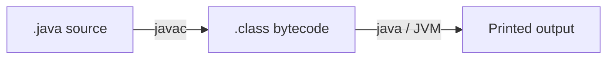

# Module: Java Setup and First Programs

**Phase:** Core Java

**Previous module:** [Computer and Programming Foundations](../01_Foundations/01_Computer_and_Programming_Foundations.md)  
**Next module:** [Variables, Datatypes, Operators, I/O](02_Variables_Datatypes_Operators_IO.md)

---

**Module Outcome:**

- Install JDK 17, compile with `javac`, run with `java` — no mystery IDE button
- Write `Hello` as a class with `main` and explain bytecode + JVM in one line
- Know why the same `.class` runs on Windows, macOS, and the lab PC

### Why Java?

**Java** is a programming language first released in 1995. It is **compiled** to **bytecode**, then run by the **Java Virtual Machine (JVM)** — so the same `.class` files can run on Windows, macOS, and Linux.

**Icons:** Bank · Order · Laptop · Payroll

**Where used?**
- **HDFC Bank** / **PhonePe** — welcome banners, balance printouts in training labs
- College apps — student portal banners, marks entry CLIs (syntax first — no named product required)
- **Swiggy** — order labels and first checkout demos
- **Employee Management Portal** — employee welcome scripts and HR training labs
- **Apollo Hospitals** — appointment “hello” scripts before real CRUD

**Why companies in India hire Java developers:**

- **Backend APIs:** large product and services teams still list Core Java + REST
- **Android history:** many mobiles run on the Java language family (this course is **server/full-stack**, not Android)
- **Enterprise hiring:** banks, product companies, and service firms interview Core Java first
- **Full stack:** Java API + React frontend is a common job stack

This course uses **JDK 17 LTS** (Long-Term Support). **JDK 21** is also LTS — mention it on JDs; class default is 17.

**JDK vs JRE:** the **JDK** (Java Development Kit) includes the compiler `javac`. The **JRE** (runtime) can run programs but cannot compile. Install the **JDK**.

### Installing JDK 17

- macOS: `brew install openjdk@17` (then follow the PATH hint Homebrew prints)
- Windows: Eclipse Temurin 17 MSI — tick **Add to PATH**
- Verify:

```bash
java -version
javac -version
```

**Expected Output:** (wording varies by vendor)

```
openjdk version "17.x.x" ...
javac 17.x.x
```

If `java` works but `javac` is missing, you installed a JRE, not a JDK.

### IDE for Java

1. **VS Code:** Extension Pack for Java  
2. **IntelliJ Community:** File → Project Structure → SDK 17  

Open folder `ksr_java_fullstack`. Create `projects/HelloJava.java`.

### Compile then run

Java is **not** “save and interpret one line” like some languages. You:

1. Write `HelloJava.java`
2. Compile: `javac HelloJava.java` → creates `HelloJava.class`
3. Run: `java HelloJava` (no `.class` in the command)

```
HelloJava.java  --javac-->  HelloJava.class  --java-->  output on screen
     source                  bytecode                    JVM
```

**Visual — compile vs run:**



**Key takeaways:**
- You edit `.java`; the machine runs `.class`
- `javac` must succeed before `java`
- Class name and file name match for `public class`

### Keywords and identifiers

**Keywords** are reserved words Java uses for grammar — you cannot name a variable `class` or `int`.

**Identifiers** are names you choose: classes, variables, methods.

Rules:

- Start with a letter or underscore `_` (not a digit)
- Rest can be letters, digits, underscore
- **Case-sensitive:** `name` and `Name` are different
- No spaces: `studentName` not `student name`
- Convention: **PascalCase** for class names (`HelloJava`); **camelCase** for variables (`studentName`)

---

## Important Concepts and Definitions

| Term | Definition |
|------|------------|
| **JDK 17** | Development kit this course pins (compiler + runtime) |
| **JVM** | Virtual machine that runs bytecode |
| **Bytecode** | `.class` output of `javac` |
| **`javac`** | Compiler command |
| **`java`** | Launcher that starts the JVM |
| **`main`** | Entry point the JVM looks for |
| **Keyword** | Reserved word (`class`, `public`, `static`, `void`) |
| **Identifier** | Name you choose |
| **PascalCase** | `HelloJava`, `StudentMarks` — classes |
| **camelCase** | `rollNumber`, `isPass` — variables / methods |
| **Comment** | Ignored by the compiler (`//` or `/* */`) |
| **PATH / JAVA_HOME** | Where the OS finds `java` and `javac` |
| **jshell** | Optional REPL shipped with the JDK |

---

## Step-by-Step Notes (With Annotated Code)

### Step 1: Environment checklist

Create `projects/EnvCheck.java`:

```java
public class EnvCheck {
    public static void main(String[] args) {
        System.out.println("Java version check from your terminal, not from this print.");
        System.out.println("Setup OK — ready for Core Java!");
        System.out.println("Priya — KSR Java Full Stack");
    }
}
```

Run:

```bash
cd ~/ksr_java_fullstack/projects
javac EnvCheck.java
java EnvCheck
```

**Note:**
- Wrong: Running `java EnvCheck.java` as the only habit and never learning `javac` (interviewers still ask compile vs run).
- Prefer: `javac` then `java ClassName` on the command line at least once a day this week.
- Wrong: `JAVA_HOME` pointing at Java 8 while class requires 17.
- Prefer: `java -version` shows **17**.

Print a ready line that includes Priya's name.

```java
public class ReadyLine {
    public static void main(String[] args) {
        System.out.println("Ready for KSR Java — Priya");
    }
}
```

**Expected Output:**

```
Ready for KSR Java — Priya
```

Print a ready line that includes Priya's name and the city Hyderabad.

```java
public class ReadyCity {
    public static void main(String[] args) {
        System.out.println("Ready for KSR Java — Priya (Hyderabad)");
    }
}
```

**Expected Output:**

```
Ready for KSR Java — Priya (Hyderabad)
```

### Step 2: jshell — try before you save (optional)

```bash
jshell
```

```
jshell> System.out.println("Hello from jshell")
Hello from jshell
jshell> 2 + 3
$1 ==> 5
jshell> /exit
```

jshell is great for one expression. **Assignments are `.java` files.** If `jshell` is missing, skip it — scripts still count.

Print a greeting for Ravi and the sum of two Swiggy canteen prices (₹450 and ₹120).

```java
public class CanteenSum {
    public static void main(String[] args) {
        System.out.println("Hello, Ravi");
        System.out.println(450 + 120);
    }
}
```

**Expected Output:**

```
Hello, Ravi
570
```

Print the learner name, the batch name, and a line that confirms Java 17 is OK.

```java
public class BatchOk {
    public static void main(String[] args) {
        System.out.println("Priya");
        System.out.println("Full Stack Java Batch");
        System.out.println("Java 17 OK");
    }
}
```

### Step 3: First script — hello world

`projects/HelloJava.java`:

```java
// HelloJava.java
// Author: Your Name
// Purpose: First Java program for KSR Full Stack course

public class HelloJava {
    public static void main(String[] args) {
        System.out.println("Hello, World!");
        System.out.println("Welcome to Java Full Stack training.");
    }
}
```

```bash
javac HelloJava.java
java HelloJava
```

**Annotation:**

- `public class HelloJava` — class name **must match** the file name
- `main` — JVM starts here
- `System.out.println(...)` — print a line
- `//` starts a **comment**

**Note:**
- Wrong: `public class hellojava` in file `HelloJava.java` → compiler error.
- Prefer: File `HelloJava.java` and `public class HelloJava`.
- Wrong: `java HelloJava.class` → error. Use `java HelloJava`.

Print Priya's name and one-line career goal.

```java
public class MyGoal {
    public static void main(String[] args) {
        System.out.println("Priya");
        System.out.println("Become a full-stack Java developer");
    }
}
```

**Expected Output:**

```
Priya
Become a full-stack Java developer
```

Print the same name and career goal, and add author and date comments above the code.

```java
// Author: Priya
// Date: 23-08-2026
public class MyGoalCommented {
    public static void main(String[] args) {
        System.out.println("Priya");
        System.out.println("Become a full-stack Java developer");
    }
}
```

### Step 4: Multi-line output — training centre welcome

```java
public class WelcomeStudent {
    public static void main(String[] args) {
        System.out.println("========================================");
        System.out.println("   KSR STUDENT PORTAL");
        System.out.println("========================================");
        System.out.println("Login page loading...");
        System.out.println("Please use registered email.");
        System.out.println("========================================");
    }
}
```

**Expected Output:**

```
========================================
   KSR STUDENT PORTAL
========================================
Login page loading...
Please use registered email.
========================================
```

Print an HDFC Bank ATM welcome banner using repeated `=` lines around the title and welcome text.

```java
public class AtmBanner {
    public static void main(String[] args) {
        System.out.println("========================");
        System.out.println("    SECUREBANK ATM");
        System.out.println("========================");
        System.out.println("  Welcome, customer");
        System.out.println("========================");
    }
}
```

**Expected Output:**

```
========================
    SECUREBANK ATM
========================
  Welcome, customer
========================
```

Print a student marks portal banner: title, a blank line, then a prompt to enter a roll number.

```java
public class MarksBanner {
    public static void main(String[] args) {
        System.out.println("STUDENT MARKS PORTAL");
        System.out.println();
        System.out.println("Enter roll to continue");
    }
}
```

### Step 5: Keywords — what you cannot use as names

```java
public class KeywordDemo {
    public static void main(String[] args) {
        // INVALID if uncommented — keywords:
        // int class = 1;
        // int public = 2;

        int classCount = 1;
        int publicFlag = 2;
        System.out.println(classCount);
        System.out.println(publicFlag);
    }
}
```

**Expected Output:**

```
1
2
```

**Note:**
- Wrong: `int class = 10;` → compile error.
- Prefer: `classCount`, `isPublic`.

Store `if`, `class`, and `for` as legal identifier names (`ifFlag`, `className`, `forCount`) and print each value.

```java
public class ValidNames {
    public static void main(String[] args) {
        int ifFlag = 1;
        String className = "A";
        int forCount = 5;
        System.out.println(ifFlag);
        System.out.println(className);
        System.out.println(forCount);
    }
}
```

Print a few Java keywords as text (not as variable names), then a line that says they are reserved.

```java
public class KeywordList {
    public static void main(String[] args) {
        System.out.println("class public static void int");
        System.out.println("These words are reserved — do not use them as names.");
    }
}
```

### Step 6: Identifier naming — employee portal style

```java
public class NamingStyle {
    public static void main(String[] args) {
        String fullName = "Ananya Sharma";
        String departmentCode = "HR";
        boolean isActive = true;

        System.out.println(fullName);
        System.out.println(departmentCode);
        System.out.println(isActive);
    }
}
```

**Expected Output:**

```
Ananya Sharma
HR
true
```

**Note:**
- Wrong: `String FullName` for a variable — works, but looks like a class.
- Prefer: `fullName` for variables; `FullName` only for types (later, OOP).

**Common Error:** Space in a name (`int employee id = 101`) → compile error. Use `employeeId`.

Store a student name, roll number, and pass flag with clear `camelCase` names, then print each value.

```java
public class StudentIds {
    public static void main(String[] args) {
        String studentName = "Priya";
        String rollNumber = "2026001";
        boolean isPass = true;
        System.out.println(studentName);
        System.out.println(rollNumber);
        System.out.println(isPass);
    }
}
```

**Expected Output:**

```
Priya
2026001
true
```

Store food expense as `foodExpense` and category as `categoryName`, then print `food: ₹250`.

```java
public class ExpenseNames {
    public static void main(String[] args) {
        int foodExpense = 250;
        String categoryName = "food";
        System.out.println(categoryName + ": ₹" + foodExpense);
    }
}
```

**Expected Output:**

```
food: ₹250
```

### Step 7: `main` signature — do not invent it

The JVM looks for **exactly**:

```java
public static void main(String[] args)
```

`String[] args` is a list of command-line words. You can ignore it until arrays week.

**Remember:** Misspell `Main` or drop `static` and the program will not start the way you expect.

Print a one-line Swiggy canteen bill title.

```java
public class CanteenBill {
    public static void main(String[] args) {
        System.out.println("Swiggy Canteen Bill");
    }
}
```

Print the same Swiggy canteen title, then a second line that says to pay at the counter.

```java
public class CanteenBillTwo {
    public static void main(String[] args) {
        System.out.println("Swiggy Canteen Bill");
        System.out.println("Pay at counter");
    }
}
```

### Step 8: Workflow (recommended habit)

```
[Think] → [Type in HelloJava.java] → [javac] → [java] → [Git commit later]
```

**Note:**
- Wrong: Running from the wrong folder → `error: file not found`.
- Prefer: `cd` to the folder that contains the `.java` file.

Compile `HelloJava.java` and list the generated `HelloJava.class` to confirm the class file exists.

```bash
javac HelloJava.java
ls HelloJava.class
```

Run the compiled `HelloJava` class after `javac` succeeds.

```bash
java HelloJava
```

---

## Practice Exercises

### Basic

1. Install JDK 17 and paste terminal output of `java -version` and `javac -version` into `notes/setup_proof.txt`.

   **Model answer:** After install, run:

   ```bash
   java -version
   javac -version
   ```

   Both should show **17**. Paste both blocks into `notes/setup_proof.txt`.

2. Write `HelloJava.java` that prints your name and city on two lines.

   **Model answer:**

```java
public class HelloJava {
    public static void main(String[] args) {
        System.out.println("Priya Sharma");
        System.out.println("Hyderabad");
    }
}
```

   Then `javac HelloJava.java` and `java HelloJava`.

3. In jshell (or a tiny class), print `10 * 5` and `100 / 4`.

   **Model answer:** `10 * 5` is `50`. `100 / 4` is `25` because both sides are `int` (integer division). Float division is next module.

4. List 8 Java keywords from this module.

   **Model answer:** `class`, `public`, `static`, `void`, `int`, `boolean`, `true`, `false` (also `if`, `for` later — do not use them as names).

### Intermediate

1. Write `TrainingBanner.java` that prints a 5-line banner for "Employee Portal Training".

   **Model answer:**

```java
public class TrainingBanner {
    public static void main(String[] args) {
        System.out.println("==============================");
        System.out.println("  Employee Portal Training");
        System.out.println("  KSR Full Stack Java");
        System.out.println("  Welcome, learners!");
        System.out.println("==============================");
    }
}
```

2. Fix this code (find 3 errors):

   ```java
   public class Demo {
       public static void Main(String[] args) {
           System.out.Println("Hello");
           int class = 1;
       }
   }
   ```

   **Model answer:** (1) `Main` must be `main`. (2) `Println` must be `println`. (3) `class` is a keyword — rename to `classCount`.

3. Create identifiers for: student roll number, monthly salary, is_logged_in flag.

   **Model answer:** `rollNumber` (or `studentRollNumber`), `monthlySalary`, `isLoggedIn`. Classes stay PascalCase.

4. Compile from the wrong folder once, then fix with `cd`. Note what error you saw.

   **Model answer:** `javac: file not found: HelloJava.java` (wording varies). `cd` into `projects/` (or pass the full path) and compile again.

### Interview-Oriented

1. Is Java compiled or interpreted? Explain in 2–3 sentences.

   **Model answer:** Java is **compiled** to bytecode (`javac`), then the **JVM interprets/JIT-compiles** that bytecode. Short interview line: “Compiled to bytecode, runs on the JVM.”

2. Why must `public class` name match the file name?

   **Model answer:** The compiler and tooling look up the class by file. A mismatch is a compile error for public types. Convention keeps one public class per file.

3. JDK vs JRE?

   **Model answer:** **JDK** = compiler + tools (`javac`) + runtime. **JRE** = runtime only. Developers install the JDK.

4. What happens if you write `void main()` without `static`?

   **Model answer:** The JVM looks for `public static void main(String[])`. Without `static` it will not use that method as the entry point (error at launch).

---

## Mini-Project (Assignment): Environment and Greeting Pack

**Lab kit:** [15_Lab_Assets/02_hello_javac/](../15_Lab_Assets/02_hello_javac/)

### What to build

1. `projects/EnvCheck.java` — prints a ready message  
2. `projects/HelloJava.java` — hello world  
3. `projects/MyIntro.java` — name, career goal, one reason you chose Java full stack  
4. `notes/setup_proof.txt` — `java -version` and `javac -version`  
5. Screenshot: terminal after `javac` + `java MyIntro`

### Stretch

- Create a GitHub account and push `HelloJava.java` (empty repo is enough this week).  
- Add `WelcomeBatch.java` that prints a 5-line KSR banner.

### Done when

- [ ] `java -version` and `javac -version` show 17  
- [ ] `EnvCheck`, `HelloJava`, and `MyIntro` compile and run  
- [ ] Lab kit ticket completed  
- [ ] No `.class` files needed in Git later — for now, running locally is enough

---

## Interview Q&A

Shared with students after concepts and the mini-project. Use for review and interview prep — questions and model answers are included.

**Q1. What is Java? What is it used for?**  
**A:** A high-level language that compiles to bytecode and runs on the JVM. Used for backend APIs, enterprise systems, Android-family apps, and full-stack servers.

**Q2. Difference between `javac` and `java`?**  
**A:** `javac` compiles `.java` → `.class`. `java` starts the JVM and runs the class.

**Q3. What are Java keywords? Example of invalid use?**  
**A:** Reserved words like `class`, `public`, `static`. `int class = 5;` will not compile.

**Q4. How do you run a Java file from the command line?**  
**A:** `javac HelloJava.java` then `java HelloJava` from the folder that contains the class (or with a correct classpath).

**Q5. Why is Java popular for hiring in India?**  
**A:** Large existing codebases, strong Core Java interviews, banks and product companies, and a clear path into REST backends.
