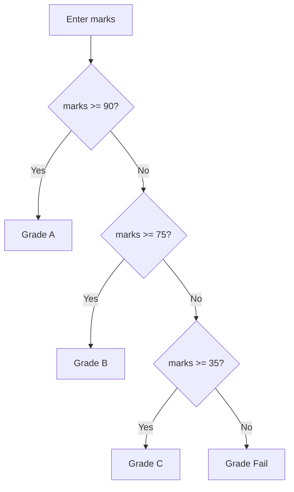

# Module: Flow Control

**Phase:** Core Java

**Previous module:** [Variables, Datatypes, Operators, I/O](02_Variables_Datatypes_Operators_IO.md)  
**Next module:** [Strings](04_Strings.md)

---

**Module Outcome:**

- Decide like an ATM: withdraw only if PIN and balance allow it
- Repeat with `while` / `for` instead of copy-pasting the same lines
- Build a small menu that does not run in a straight line

### Why flow control?

Programs rarely run in one straight line. A **student portal** must check login, an **ATM** repeats until the user exits.

**Icons:** Bank · UPI · Employee · Order · Payroll

**Where used?**
- **HDFC Bank** ATM — PIN retries, withdraw only if balance allows
- College apps — pass/fail grades, marks menus
- **Swiggy** — stock checks, checkout loops
- **Employee Management Portal** — overtime flags, salary slabs
- **Apollo Hospitals** — appointment / ticket priority menus

**Flow control** lets you:

- **Decide** — run code only when a condition is true (`if`)
- **Repeat** — run code many times (`for`, `while`)
- **Jump** — leave early (`break`) or skip one round (`continue`)

### if / else if / else

```java
int marks = 78;
String grade;
if (marks >= 90) {
    grade = "A";
} else if (marks >= 75) {
    grade = "B";
} else if (marks >= 35) {
    grade = "C";
} else {
    grade = "Fail";
}
System.out.println("Grade: " + grade);
```

**Visual — how Java chooses a branch:**



**Key takeaways:**
- Checks run **top → bottom**; first true branch wins
- Later `else if`s are skipped once one branch runs
- `else` is the safety net
- Same idea as ATM: invalid amount → insufficient → then withdraw

### switch

Use `switch` when you match **one value** against several constants (menu choice `1`–`4`).

```java
int choice = 2;
switch (choice) {
    case 1:
        System.out.println("Balance");
        break;
    case 2:
        System.out.println("Deposit");
        break;
    default:
        System.out.println("Unknown");
}
```

**Remember:** Forget `break` in classic `switch` and execution **falls through** to the next `case`.

JDK 17 also allows arrow `switch` (no fall-through):

```java
switch (choice) {
    case 1 -> System.out.println("Balance");
    case 2 -> System.out.println("Deposit");
    default -> System.out.println("Unknown");
}
```

### for and while

```java
for (int i = 1; i <= 5; i++) {
    System.out.println("Task " + i);
}

int n = 3;
while (n > 0) {
    System.out.println(n);
    n--;
}
```

**Enhanced `for` (for-each)** needs an array — that is **Arrays week**. Use index `for` until then.

---

## Important Concepts and Definitions

| Term | Definition |
|------|------------|
| **Condition** | Boolean expression (`marks >= 35`) |
| **Block** | `{ }` holding statements |
| **else if** | Extra test after `if` failed |
| **switch** | Jump table on a single value |
| **Fall-through** | Classic `switch` continues without `break` |
| **for** | Loop with init / test / update |
| **while** | Loop while condition stays true |
| **break** | Exit the loop (or switch) immediately |
| **continue** | Skip the rest of this iteration |
| **Infinite loop** | Condition never becomes false |

---

## Step-by-Step Notes (With Annotated Code)

### Step 1: if / else — pass or fail

```java
import java.util.Scanner;

public class PassFail {
    public static void main(String[] args) {
        Scanner sc = new Scanner(System.in);
        System.out.print("Marks: ");
        double marks = Double.parseDouble(sc.nextLine());
        if (marks >= 35) {
            System.out.println("Pass");
        } else {
            System.out.println("Fail");
        }
        sc.close();
    }
}
```

**Note:**
- Wrong: `if marks >= 35` without parentheses.
- Prefer: `if (marks >= 35)`.

Store `n = 7` and print Even or Odd using remainder `% 2`.

```java
public class EvenOdd {
    public static void main(String[] args) {
        int n = 7;
        if (n % 2 == 0) {
            System.out.println("Even");
        } else {
            System.out.println("Odd");
        }
    }
}
```

**Expected Output:**

```
Odd
```

Store an HDFC Bank ATM amount of `-50` and print whether it is OK to process or ask for a positive amount.

```java
public class AmountValid {
    public static void main(String[] args) {
        double amount = -50;
        if (amount > 0) {
            System.out.println("OK to process");
        } else {
            System.out.println("Enter a positive amount");
        }
    }
}
```

**Expected Output:**

```
Enter a positive amount
```

### Step 2: else if — grade calculator

```java
public class GradeCalc {
    public static void main(String[] args) {
        int marks = 82;
        if (marks >= 90) {
            System.out.println("A");
        } else if (marks >= 75) {
            System.out.println("B");
        } else if (marks >= 35) {
            System.out.println("C");
        } else {
            System.out.println("Fail");
        }
    }
}
```

**Expected Output:**

```
B
```

Check a PhonePe amount of ₹60000 against a ₹100000 demo limit and print Above bank demo limit, Within limit, or Invalid amount.

```java
public class UpiLimit {
    public static void main(String[] args) {
        double amount = 60000;
        if (amount > 100000) {
            System.out.println("Above bank demo limit");
        } else if (amount > 0) {
            System.out.println("Within limit");
        } else {
            System.out.println("Invalid amount");
        }
    }
}
```

For an HDFC Bank withdraw of ₹1200 from balance ₹1000, nest ifs to print Invalid amount, Insufficient balance, or Dispense.

```java
public class WithdrawCheck {
    public static void main(String[] args) {
        double balance = 1000;
        double amount = 1200;
        if (amount <= 0) {
            System.out.println("Invalid amount");
        } else {
            if (amount > balance) {
                System.out.println("Insufficient balance");
            } else {
                System.out.println("Dispense ₹" + amount);
            }
        }
    }
}
```

**Expected Output:**

```
Insufficient balance
```

### Step 3: switch — menu labels

```java
public class SwitchMenu {
    public static void main(String[] args) {
        int choice = 3;
        switch (choice) {
            case 1 -> System.out.println("Balance");
            case 2 -> System.out.println("Deposit");
            case 3 -> System.out.println("Withdraw");
            case 4 -> System.out.println("Quit");
            default -> System.out.println("Unknown choice");
        }
    }
}
```

**Expected Output:**

```
Withdraw
```

Use a classic `switch` with `break` on grade `'B'` to print Excellent, Good, or Keep practising.

```java
public class ClassicSwitch {
    public static void main(String[] args) {
        char grade = 'B';
        switch (grade) {
            case 'A':
                System.out.println("Excellent");
                break;
            case 'B':
                System.out.println("Good");
                break;
            default:
                System.out.println("Keep practising");
        }
    }
}
```

**Expected Output:**

```
Good
```

Read this classic `switch` on `n = 1` with no `break` — do not copy it into real ATM menus — and see both `one` and `two` print.

```java
public class FallThrough {
    public static void main(String[] args) {
        int n = 1;
        switch (n) {
            case 1:
                System.out.println("one");
            case 2:
                System.out.println("two");
        }
    }
}
```

**Expected Output:**

```
one
two
```

**Common Error:** Missing `break` prints extra lines. Prefer arrow `switch` for menus.

### Step 4: for — tables

```java
public class Table7 {
    public static void main(String[] args) {
        for (int i = 1; i <= 10; i++) {
            System.out.println("7 x " + i + " = " + (7 * i));
        }
    }
}
```

Use `for` to print the numbers 1 through 5, one per line.

```java
public class CountFive {
    public static void main(String[] args) {
        for (int i = 1; i <= 5; i++) {
            System.out.println(i);
        }
    }
}
```

Use `for` to add 1 through 4 and print the sum.

```java
public class SumFour {
    public static void main(String[] args) {
        int sum = 0;
        for (int i = 1; i <= 4; i++) {
            sum = sum + i;
        }
        System.out.println(sum);
    }
}
```

**Expected Output:**

```
10
```

### Step 5: while — guess style

```java
import java.util.Scanner;

public class PinWhile {
    public static void main(String[] args) {
        Scanner sc = new Scanner(System.in);
        String pin = "";
        while (!pin.equals("1234")) {
            System.out.print("Enter PIN: ");
            pin = sc.nextLine();
        }
        System.out.println("Access granted");
        sc.close();
    }
}
```

**Note:** `equals` for `String` — `==` is the wrong tool (Strings week explains why). Use `equals` for PIN text from today.

Use `while` to count down from 3 to 1, then print Go.

```java
public class Countdown {
    public static void main(String[] args) {
        int n = 3;
        while (n > 0) {
            System.out.println(n);
            n--;
        }
        System.out.println("Go");
    }
}
```

Loop 1 to 5: skip 2 with `continue`, stop at 4 with `break`, and print the numbers that remain.

```java
public class BreakContinue {
    public static void main(String[] args) {
        for (int n = 1; n <= 5; n++) {
            if (n == 2) {
                continue;
            }
            if (n == 4) {
                break;
            }
            System.out.println(n);
        }
    }
}
```

**Expected Output:**

```
1
3
```

### Step 6: Nested menu — ATM lab shape

```java
import java.util.Scanner;

public class AtmMenu {
    public static void main(String[] args) {
        Scanner sc = new Scanner(System.in);
        double balance = 1000;
        boolean running = true;
        while (running) {
            System.out.println("1 Balance  2 Deposit  3 Withdraw  4 Quit");
            System.out.print("Choice: ");
            int choice = Integer.parseInt(sc.nextLine());
            if (choice == 1) {
                System.out.printf("Balance: ₹%.2f%n", balance);
            } else if (choice == 2) {
                System.out.print("Amount: ");
                double amt = Double.parseDouble(sc.nextLine());
                if (amt > 0) {
                    balance = balance + amt;
                } else {
                    System.out.println("Enter a positive amount");
                }
            } else if (choice == 3) {
                System.out.print("Amount: ");
                double amt = Double.parseDouble(sc.nextLine());
                if (amt <= 0) {
                    System.out.println("Enter a positive amount");
                } else if (amt > balance) {
                    System.out.println("Insufficient balance");
                } else {
                    balance = balance - amt;
                    System.out.println("Please take cash");
                }
            } else if (choice == 4) {
                running = false;
            } else {
                System.out.println("Unknown choice");
            }
        }
        sc.close();
        System.out.println("Thank you");
    }
}
```

Lab kit: [15_Lab_Assets/05_atm_menu](../15_Lab_Assets/05_atm_menu/).

**Interview:** Menus are `while` + `if`/`switch`. Do not freeze the program on a wrong key — print and loop.

---

## Practice Exercises

### Basic

1. Read marks and print Pass if `>= 35`, else Fail.

   **Model answer:** `if (marks >= 35) { ... } else { ... }`

2. Print numbers 1 to 10 with `for`.

   **Model answer:** `for (int i = 1; i <= 10; i++) { System.out.println(i); }`

3. Use `switch` on `1`–`3` for Idli / Dosa / Tea.

   **Model answer:** `case 1 -> System.out.println("Idli");` etc., `default` for unknown.

4. Explain `break` vs `continue` in one sentence each.

   **Model answer:** `break` leaves the loop; `continue` skips to the next iteration.

### Intermediate

1. Grade calculator: A ≥90, B ≥75, C ≥35, else Fail. Read marks from Scanner.

   **Model answer:** Chain `if` / `else if` / `else` as in Step 2.

2. Multiplication table for a number `n` (1 to 10).

   **Model answer:** `for (int i = 1; i <= 10; i++)` print `n + " x " + i + " = " + (n * i)`.

3. Number guessing: secret `7`; `while` until correct; print Too low / Too high.

   **Model answer:** `while (guess != 7)` read int; `if` compare.

4. Nested menu: Mini ATM as in Step 6 (balance starts 1000; block overdraft).

   **Model answer:** See `AtmMenu`. Wrong choice must not exit.

### Interview-Oriented

1. When `for` vs `while`?

   **Model answer:** `for` when you know the count (table 1–10). `while` when you repeat until a condition (menu until Quit).

2. What is fall-through?

   **Model answer:** Classic `switch` without `break` keeps running the next `case`. Arrow `switch` does not fall through.

3. Can `else` attach to the nearest `if`?

   **Model answer:** Yes — dangling-else. Use `{ }` always so humans and the compiler agree.

4. How do you stop an infinite `while (true)` menu?

   **Model answer:** `break` on Quit, or set a `boolean running = false`.

---

## Mini-Project (Assignment): HDFC Bank Mini ATM Menu

**Lab kit:** [15_Lab_Assets/05_atm_menu](../15_Lab_Assets/05_atm_menu/)

### What to build

Console ATM: Balance, Deposit, Withdraw, Quit. Start balance ₹1000. Block overdraft and non-positive amounts. Menu repeats until Quit.

### Stretch

- PIN check before the menu (`equals("1234")`).
- **Later — Methods:** extract `deposit` / `withdraw` as static methods.

### Done when

- [ ] Loop until Quit
- [ ] Withdraw never makes balance negative
- [ ] Unknown choice prints a message and continues
- [ ] Logic stays in `main` (no extra methods yet)

---

## Interview Q&A

Shared with students after concepts and the mini-project. Use for review and interview prep — questions and model answers are included.

**Q1. What is flow control?**  
**A:** Statements that decide *whether* and *how often* other statements run — `if`, `switch`, loops.

**Q2. `if` vs `switch`?**  
**A:** `if` is for ranges and complex conditions (`marks >= 75`). `switch` is for a discrete value (menu `1`–`4`).

**Q3. `break` in a loop vs in `switch`?**  
**A:** Both jump out. In classic `switch`, `break` stops fall-through. In a loop, `break` ends the loop.

**Q4. Why is `while (true)` dangerous?**  
**A:** If you forget an exit path, the program never ends. Always pair it with Quit/`break`.

**Q5. Nested `if` example from an HDFC Bank ATM?**  
**A:** Outer: amount > 0. Inner: amount ≤ balance before subtracting. Same shape as a Swiggy checkout (qty > 0, then stock).
