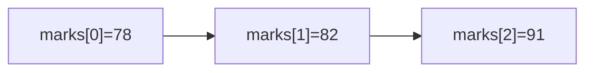

# Module: Arrays

**Phase:** Core Java

**Previous module:** [Strings](04_Strings.md)  
**Next module:** [Methods](06_Methods.md)

---

**Module Outcome:**

- Store a fixed list of marks or prices and loop by index from `0`
- Know length vs last index so `ArrayIndexOutOfBounds` is not a surprise
- Leave `ArrayList` for Collections week — today is the raw array

**Collections** (`ArrayList`) are a later module. Stay on arrays.

---

### What is an array?

An **array** is a numbered row of boxes of the **same type**. Index `0` is the first mark.

**Icons:** Order · Employee · Bank · Payroll · Laptop

**Where used?**
- College apps — marks per subject, attendance flags (syntax — keep generic)
- **TechMart** — prices for a few SKUs in a demo
- **AcmeHR** — three allowances in a row
- **SecureBank** — last few transaction amounts
- **MedCare** — a short queue of token numbers

```
marks:  [ 78 | 82 | 91 | 65 | 88 ]
index:     0    1    2    3    4
```

**Purpose:** Store many values without inventing `m1, m2, m3, …`. Size is **fixed** after you create the array.

```java
int[] marks = new int[5];
int[] given = {78, 82, 91};
```

**Visual — index map:**



**Key takeaways:**
- Same type in every slot
- Index starts at 0; last index is `length - 1`
- `length` is a field, not a method (`marks.length`)

---

## Important Concepts and Definitions

| Term | Definition |
|------|------------|
| **Array** | Fixed-size sequence of one type |
| **Index** | Position starting at 0 |
| **length** | Number of slots (`marks.length`) |
| **Enhanced for** | `for (int m : marks)` — visit each element |
| **2D array** | Array of arrays — rows and columns |
| **Linear search** | Check each slot until you find the value |
| **Off-by-one** | Using `<= length` and falling off the end |

---

## Step-by-Step Notes (With Annotated Code)

### Step 1: Create and read

```java
public class CreateArray {
    public static void main(String[] args) {
        int[] marks = {78, 82, 91};
        System.out.println(marks[0]);
        System.out.println(marks[2]);
        System.out.println(marks.length);
    }
}
```

**Expected Output:**

```
78
91
3
```

**Note:**
- Wrong: `marks[3]` on a length-3 array → `ArrayIndexOutOfBoundsException`.
- Prefer: last index `marks.length - 1`.

**Try these (2 programs):**

**Program 1 — Names**

```java
public class NamesArray {
    public static void main(String[] args) {
        String[] names = {"Priya", "Ravi", "Meera"};
        System.out.println(names[1]);
        System.out.println(names.length);
    }
}
```

**Program 2 — Default zeros**

```java
public class EmptySlots {
    public static void main(String[] args) {
        int[] slots = new int[3];
        System.out.println(slots[0]);
        slots[1] = 90;
        System.out.println(slots[1]);
    }
}
```

**Expected Output:**

```
0
90
```

### Step 2: Classic for vs enhanced for

```java
public class LoopMarks {
    public static void main(String[] args) {
        int[] marks = {78, 82, 91};
        for (int i = 0; i < marks.length; i++) {
            System.out.println("Index " + i + ": " + marks[i]);
        }
        int sum = 0;
        for (int m : marks) {
            sum = sum + m;
        }
        System.out.println("Sum: " + sum);
    }
}
```

**Expected Output:**

```
Index 0: 78
Index 1: 82
Index 2: 91
Sum: 251
```

Enhanced `for` cannot easily **update by index**. Use classic `for` when you need `i`.

**Try these (2 programs):**

**Program 1 — Print all expenses**

```java
public class Expenses {
    public static void main(String[] args) {
        double[] inr = {45.0, 120.0, 80.5};
        for (double x : inr) {
            System.out.println(x);
        }
    }
}
```

**Program 2 — Average**

```java
public class MarksAvg {
    public static void main(String[] args) {
        int[] marks = {80, 70, 90};
        int sum = 0;
        for (int m : marks) {
            sum += m;
        }
        double avg = sum / (double) marks.length;
        System.out.printf("Average: %.2f%n", avg);
    }
}
```

### Step 3: Max and linear search

```java
public class MaxSearch {
    public static void main(String[] args) {
        int[] marks = {78, 91, 65, 88};
        int max = marks[0];
        for (int i = 1; i < marks.length; i++) {
            if (marks[i] > max) {
                max = marks[i];
            }
        }
        System.out.println("Max: " + max);

        int find = 65;
        int foundAt = -1;
        for (int i = 0; i < marks.length; i++) {
            if (marks[i] == find) {
                foundAt = i;
                break;
            }
        }
        System.out.println("Found at: " + foundAt);
    }
}
```

**Expected Output:**

```
Max: 91
Found at: 2
```

**Try these (2 programs):**

**Program 1 — Min**

```java
public class MinMark {
    public static void main(String[] args) {
        int[] marks = {78, 91, 65};
        int min = marks[0];
        for (int m : marks) {
            if (m < min) {
                min = m;
            }
        }
        System.out.println(min);
    }
}
```

**Program 2 — Count toppers (≥ 90)**

```java
public class Toppers {
    public static void main(String[] args) {
        int[] marks = {90, 88, 95, 70};
        int count = 0;
        for (int m : marks) {
            if (m >= 90) {
                count++;
            }
        }
        System.out.println(count);
    }
}
```

**Expected Output:**

```
2
```

### Step 4: 2D array — two students, three subjects

```java
public class MarksTable {
    public static void main(String[] args) {
        int[][] table = {
            {80, 70, 90},
            {60, 75, 85}
        };
        System.out.println(table[0][2]);
        for (int r = 0; r < table.length; r++) {
            int rowSum = 0;
            for (int c = 0; c < table[r].length; c++) {
                rowSum += table[r][c];
            }
            System.out.println("Student " + r + " total: " + rowSum);
        }
    }
}
```

**Expected Output:**

```
90
Student 0 total: 240
Student 1 total: 220
```

**Try these (2 programs):**

**Program 1 — Print row 0**

```java
public class PrintRow {
    public static void main(String[] args) {
        int[][] t = {{1, 2}, {3, 4}};
        for (int c = 0; c < t[0].length; c++) {
            System.out.println(t[0][c]);
        }
    }
}
```

**Program 2 — Seat grid size**

```java
public class SeatGrid {
    public static void main(String[] args) {
        boolean[][] lab = new boolean[2][3];
        System.out.println(lab.length);
        System.out.println(lab[0].length);
    }
}
```

### Step 5: Marks manager idea — array + `count`

Fixed array of 20; `count` is how many marks are actually stored.

```java
int[] marks = new int[20];
int count = 0;
// add: marks[count] = 88; count++;
// list: for (int i = 0; i < count; i++) ...
```

Guard empty average: `if (count == 0) { print message; } else { ... }`.

Lab kit: [15_Lab_Assets/07_marks_manager](../15_Lab_Assets/07_marks_manager/).

---

## Practice Exercises

### Basic

1. Create `int[] a = {10, 20, 30}` and print the last element using `length`.

   **Model answer:** `System.out.println(a[a.length - 1]);`

2. Enhanced-for print of `{"idli", "dosa", "tea"}`.

   **Model answer:** `for (String item : items) { System.out.println(item); }`

3. Sum of `{5, 5, 5}`.

   **Model answer:** Loop add; print `15`.

4. What exception is `a[3]` on length 3?

   **Model answer:** `ArrayIndexOutOfBoundsException`.

### Intermediate

1. Average of five marks; print `%.2f`. Empty array: print a message (length 0).

   **Model answer:** If `marks.length == 0` print skip; else sum / length.

2. Linear search: print index of `88` or `-1`.

   **Model answer:** Loop; `break` when found; start `foundAt = -1`.

3. 2D: print each row total for `{{10,10},{20,30}}`.

   **Model answer:** Nested `for`; row sums 20 and 50.

4. Marks menu: add (if `count < marks.length`), list, average (safe if `count==0`), toppers ≥90, quit.

   **Model answer:** `while` menu; store in array + `count`. No `ArrayList`.

### Interview-Oriented

1. Array vs later `List` in one sentence.

   **Model answer:** Array size is fixed at creation; `List` can grow (Collections week).

2. Is `length` a method on arrays?

   **A:** No. It is a **field**: `arr.length`. Strings use `length()`.

3. Enhanced for vs index for.

   **A:** Enhanced for reads each element. Index for when you need the position or to write `arr[i] = …`.

4. Default values in `new int[3]`?

   **A:** `0`. `boolean` is `false`. Object arrays are `null` (do not use that much yet).

---

## Mini-Project (Assignment): Student Marks Manager (CLI)

**Lab kit:** [15_Lab_Assets/07_marks_manager](../15_Lab_Assets/07_marks_manager/)

### What to build

Menu: add mark (0–100), list, average (safe if empty), toppers (≥90), quit. Store in an `int[]` plus `count`.

### Stretch

- Remove last mark (`count--`).
- **Later — Collections:** switch storage to `ArrayList`.

### Done when

- [ ] Menu loop until quit
- [ ] Empty average does not crash (no divide by zero)
- [ ] Toppers printed by looping `0 .. count-1`
- [ ] No `ArrayList` in the core path

---

## Interview Q&A

Shared with students after concepts and the mini-project. Use for review and interview prep — questions and model answers are included.

**Q1. What is an array?**  
**A:** A fixed-size, indexed collection of the same type.

**Q2. Why does index start at 0?**  
**A:** Language design; first slot is offset zero from the start.

**Q3. How do you avoid `ArrayIndexOutOfBoundsException`?**  
**A:** Only use `0` through `length - 1`. For a partial fill, loop to `count`, not `length`.

**Q4. What is a 2D array?**  
**A:** An array whose elements are arrays — a table of rows and columns.

**Q5. Linear search cost in simple words?**  
**A:** You may look at every element. Fine for class-size lists; interviews mention “O(n)” later.
