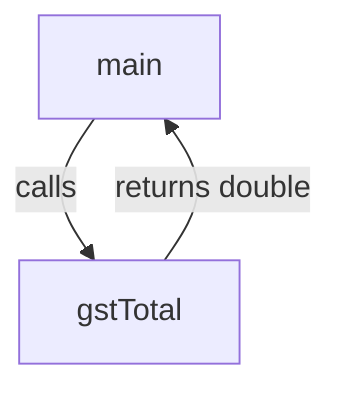

# Module: Methods

**Phase:** Core Java

**Previous module:** [Arrays](05_Arrays.md)  
**Next module:** [OOP Part 1 — Classes and Encapsulation](../03_OOP_Java/03_OOP_Part1_Classes_Encapsulation.md)

---

**Module Outcome:**

- Name a job (`withdraw`) and call it instead of pasting the ATM check twice
- Pass arguments and return a value — `void` vs `int` with intent
- Overload when the same job takes different inputs (amount vs amount+note)

### What is a method?

A **method** is a named block of code that does one job. You **call** it when you need that job.

**Icons:** Bank · UPI · Employee · Order · Payroll

**Where used?**
- **HDFC Bank** — `deposit`, `withdraw` as separate jobs
- College apps — `average`, `isPass`
- **Swiggy** — `lineTotal(price, qty)`
- **Employee Management Portal** — `netPay(basic)`
- **Apollo Hospitals** — `formatPhone`

**Purpose:** Stop copy-paste. Name the idea (`gstTotal`) instead of repeating the formula.

```java
public static double gstTotal(double price, int qty) {
    return price * qty * 1.05;
}
```

**Visual — call stack lite:**



**Key takeaways:**
- Definition = the recipe; call = using the recipe
- `return` sends a value back (or just ends a `void` method)
- `static` here means “belongs to the class” — enough until OOP

---

## Important Concepts and Definitions

| Term | Definition |
|------|------------|
| **Method** | Named reusable block |
| **Parameter** | Input variable in the definition |
| **Argument** | Actual value you pass at the call |
| **return type** | Type after `static` (`int`, `void`, `double`) |
| **void** | Returns nothing |
| **Overload** | Same name, different parameters |
| **Pass-by-value** | The method gets a copy of the primitive |
| **static** | Callable as `ClassName.method` / from `main` without an object |

---

## Step-by-Step Notes (With Annotated Code)

### Step 1: void method — print banner

```java
public class Banner {
    public static void printBanner() {
        System.out.println("==== KSR ATM ====");
    }

    public static void main(String[] args) {
        printBanner();
        printBanner();
    }
}
```

**Expected Output:**

```
==== KSR ATM ====
==== KSR ATM ====
```

Write a `void greet` method that prints Namaste for Priya, then call it from `main`.

```java
public class GreetMethod {
    public static void greet() {
        System.out.println("Namaste, Priya");
    }

    public static void main(String[] args) {
        greet();
    }
}
```

Write `showMenu` and `bye` as two `void` methods, then call both from `main`.

```java
public class TwoJobs {
    public static void showMenu() {
        System.out.println("1 Add  2 List");
    }

    public static void bye() {
        System.out.println("Thank you");
    }

    public static void main(String[] args) {
        showMenu();
        bye();
    }
}
```

### Step 2: Parameters and return

```java
public class LineTotal {
    public static double lineTotal(double price, int qty) {
        return price * qty;
    }

    public static void main(String[] args) {
        double t = lineTotal(40.0, 2);
        System.out.println(t);
    }
}
```

**Expected Output:**

```
80.0
```

**Note:**
- Wrong: `return` then more statements that must run after it in the same path.
- Prefer: compute, then one `return`.

Write `average` that takes two doubles, returns their mean, and print `average(80, 70)`.

```java
public class AvgTwo {
    public static double average(double a, double b) {
        return (a + b) / 2.0;
    }

    public static void main(String[] args) {
        System.out.println(average(80, 70));
    }
}
```

**Expected Output:**

```
75.0
```

Write a Swiggy `withGst` helper that multiplies a subtotal by 1.05, then print `withGst(80)` as rupees with two decimals.

```java
public class GstHelper {
    public static double withGst(double subtotal) {
        return subtotal * 1.05;
    }

    public static void main(String[] args) {
        System.out.printf("₹%.2f%n", withGst(80));
    }
}
```

### Step 3: Overloading

```java
public class OverloadDemo {
    public static int add(int a, int b) {
        return a + b;
    }

    public static double add(double a, double b) {
        return a + b;
    }

    public static void main(String[] args) {
        System.out.println(add(2, 3));
        System.out.println(add(2.5, 3.5));
    }
}
```

**Expected Output:**

```
5
6.0
```

Same name is OK when the **parameter list** differs. Return type alone is **not** enough to overload.

Overload `greet` with a no-arg version that prints Hello and a `String` version that greets Ravi by name; call both.

```java
public class GreetOverload {
    public static void greet() {
        System.out.println("Hello");
    }

    public static void greet(String name) {
        System.out.println("Hello, " + name);
    }

    public static void main(String[] args) {
        greet();
        greet("Ravi");
    }
}
```

Overload `area` for a square of side 4 and a 4-by-5 rectangle, then print both areas.

```java
public class AreaOverload {
    public static int area(int side) {
        return side * side;
    }

    public static int area(int length, int width) {
        return length * width;
    }

    public static void main(String[] args) {
        System.out.println(area(4));
        System.out.println(area(4, 5));
    }
}
```

### Step 4: Pass-by-value (primitives)

```java
public class PassByValue {
    public static void tryChange(int n) {
        n = 99;
        System.out.println("inside: " + n);
    }

    public static void main(String[] args) {
        int balance = 1000;
        tryChange(balance);
        System.out.println("outside: " + balance);
    }
}
```

**Expected Output:**

```
inside: 99
outside: 1000
```

The method received a **copy**. To update balance, **return** the new value:

```java
public static double deposit(double balance, double amount) {
    return balance + amount;
}
```

**Interview:** Java passes primitives by value. (Arrays are a reference copy — the method can change **elements**. Return is still clearer for ATM balance.)

Write an HDFC Bank `deposit` that returns the new balance; start at 1000, deposit 200, and print the result.

```java
public class DepositReturn {
    public static double deposit(double balance, double amount) {
        return balance + amount;
    }

    public static void main(String[] args) {
        double balance = 1000;
        balance = deposit(balance, 200);
        System.out.println(balance);
    }
}
```

**Expected Output:**

```
1200.0
```

Write an HDFC Bank `withdraw` that prints Insufficient balance and returns the old balance on overdraft; call it with 1200 then 200 from 1000.

```java
public class WithdrawReturn {
    public static double withdraw(double balance, double amount) {
        if (amount > balance) {
            System.out.println("Insufficient balance");
            return balance;
        }
        return balance - amount;
    }

    public static void main(String[] args) {
        System.out.println(withdraw(1000, 1200));
        System.out.println(withdraw(1000, 200));
    }
}
```

**Expected Output:**

```
Insufficient balance
1000.0
800.0
```

### Step 5: Refactor calculator into methods

```java
public class CalcMethods {
    public static double subtotal(double price, int qty) {
        return price * qty;
    }

    public static double totalWithGst(double subtotal) {
        return Math.round(subtotal * 1.05 * 100.0) / 100.0;
    }

    public static void main(String[] args) {
        double s = subtotal(40, 2);
        System.out.printf("Total: ₹%.2f%n", totalWithGst(s));
    }
}
```

### Step 6: Refactor ATM — methods in one class

Keep `showMenu`, `deposit`, `withdraw` as `static`. `main` only loops and calls.

Bad amount: **print + return unchanged balance**. No `throw`.

Lab kit: [15_Lab_Assets/08_methods_refactor](../15_Lab_Assets/08_methods_refactor/).

---

## Practice Exercises

### Basic

1. Write `static void printStars()` that prints `***`. Call it twice.

   **Model answer:** Method with one `println`; `main` calls it twice.

2. `static int square(int n)` returning `n * n`. Print `square(6)`.

   **Model answer:** `return n * n;` → `36`

3. Overload `max` for two `int` and two `double`.

   **Model answer:** Two methods named `max` with different parameter types.

4. What does `void` mean?

   **Model answer:** The method does not return a value. Use `return;` only to exit early.

### Intermediate

1. Extract canteen GST into `subtotal` and `totalWithGst`.

   **Model answer:** See Step 5.

2. `isPass(double marks)` returns `true` if `>= 35`. Print the boolean.

   **Model answer:** `return marks >= 35;`

3. ATM `withdraw` returns the (possibly unchanged) balance; prints on overdraft.

   **Model answer:** See Step 4 Program 2.

4. Refactor last week’s ATM: `showMenu`, `deposit`, `withdraw` static; `main` loops.

   **Model answer:** Lab kit 08. Still **one** class. No `new BankAccount()`.

### Interview-Oriented

1. Method vs constructor (preview only).

   **Model answer:** A constructor’s name matches the class and has no `return` type — **OOP next**. Methods have a return type (`void` or other).

2. Can you overload by return type only?

   **A:** No. Parameter list must differ.

3. Pass-by-value for `int`?

   **A:** The callee gets a copy. Changing the copy does not change the caller’s variable.

4. Why `static` in this week’s demos?

   **A:** `main` is `static` and can call other `static` methods without creating an object. Instance methods come with classes/objects next.

---

## Mini-Project (Assignment): Refactor HDFC Bank ATM Into Methods

**Lab kit:** [15_Lab_Assets/08_methods_refactor](../15_Lab_Assets/08_methods_refactor/)

### What to build

Same ATM behaviour as Flow week, but `deposit` / `withdraw` / `showMenu` are static methods. `main` is the loop only.

### Stretch

- `printBalance(double balance)` helper.
- **Later — OOP:** move the same ideas onto a `BankAccount` object.

### Done when

- [ ] No giant `main` with all math inline
- [ ] Overdraft prints and leaves balance unchanged (`print` + `return`, no `throw`)
- [ ] Menu repeats until Quit
- [ ] Still a single class (no `new` account object)

---

## Interview Q&A

Shared with students after concepts and the mini-project. Use for review and interview prep — questions and model answers are included.

**Q1. What is a method?**  
**A:** A named block you can call. It can take parameters and optionally return a value.

**Q2. Parameter vs argument?**  
**A:** Parameter is the variable in the definition (`double amount`). Argument is the value at the call (`200`).

**Q3. What is overloading?**  
**A:** Multiple methods with the same name and different parameter lists. The compiler picks the match.

**Q4. How do you update a primitive from a method?**  
**A:** Return the new value and assign: `balance = deposit(balance, amt);`

**Q5. `main` signature again?**  
**A:** `public static void main(String[] args)` — the JVM entry point that can call your other static methods.
