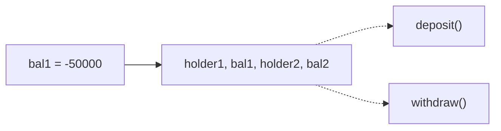
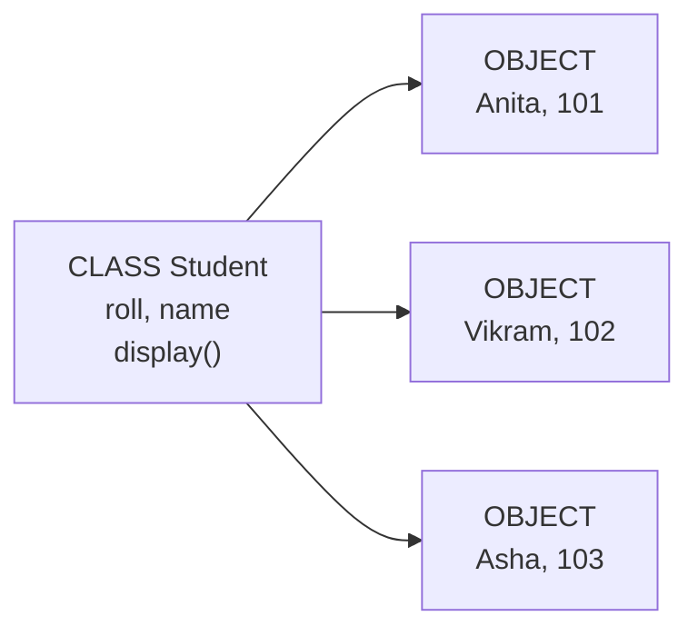
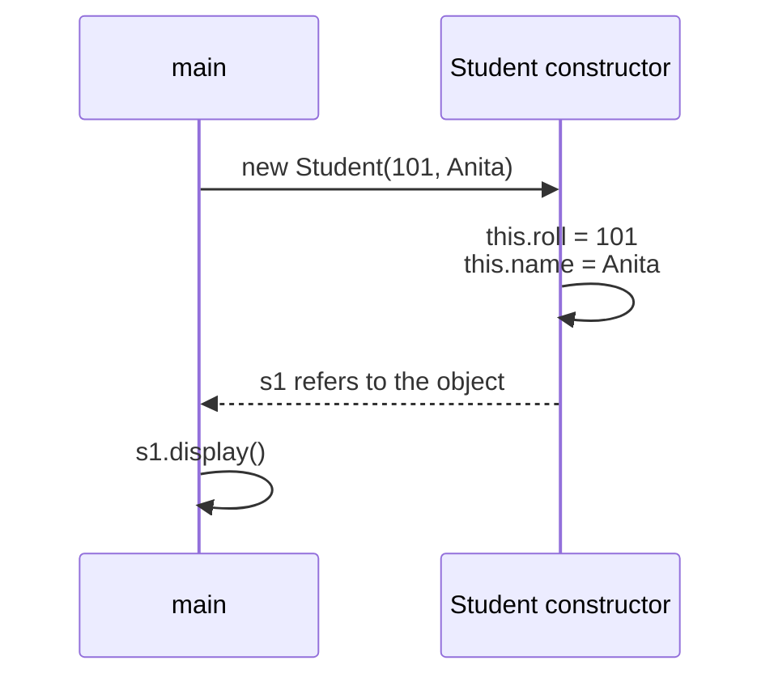
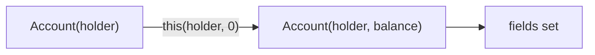
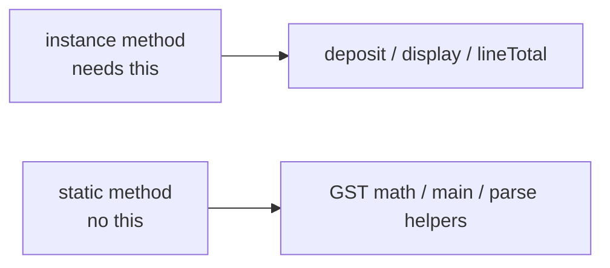
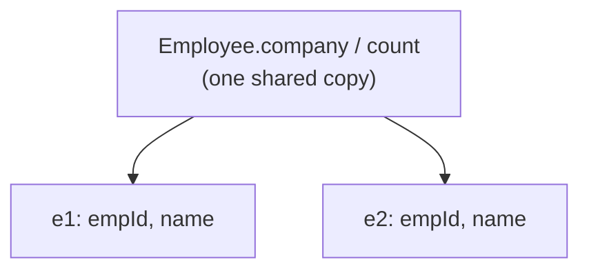
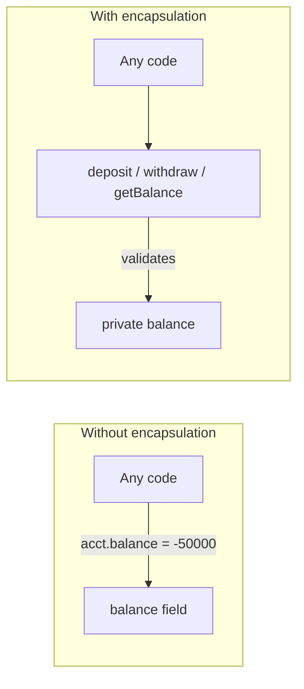
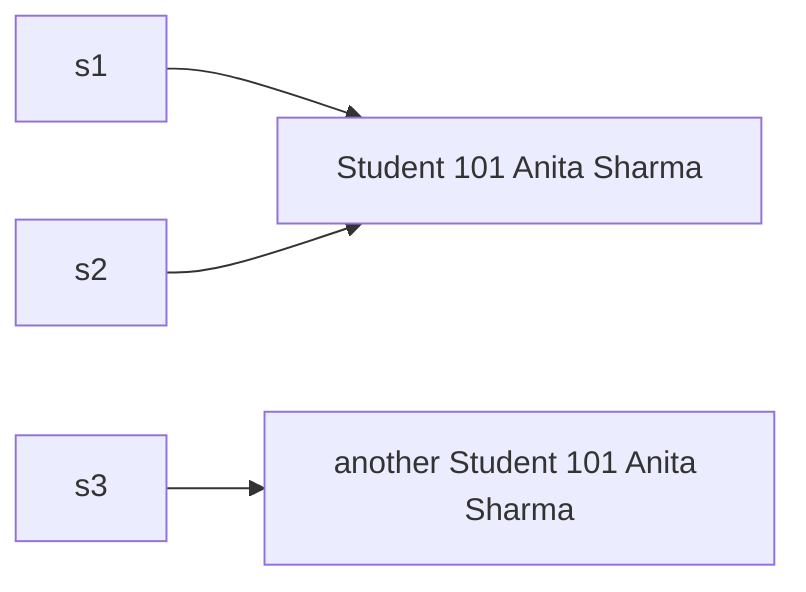

# Module 03a — OOP Part 1: Classes & Encapsulation

**Phase:** OOP Java

**Previous module:** [Methods](../02_Core_Java/06_Methods.md)  
**Next module:** [OOP Part 2 — Inheritance](03_OOP_Part2_Inheritance.md)

**Series:** [OOP overview](03_OOP.md) · Part 1 (this file) · [Part 2](03_OOP_Part2_Inheritance.md) · [Part 3](03_OOP_Part3_Polymorphism_Interfaces.md)

**Lab kit:** [15_Lab_Assets/09_bank_account_oop/](../15_Lab_Assets/09_bank_account_oop/)

---

**Module Outcome:**

- Turn loose fields + static methods into a class with `new`, `this`, and a constructor
- Hide balance so nobody sets HDFC Bank to `-10` from `main`
- Start the BankAccount lab as objects

## Motivation — Feel the pain of loose data + static methods

Last week, ATM logic lived in **static** methods. Balance was a `double` in `main`. That works for one number. It breaks when you have **many accounts**.

```java
public class LooseAccounts {
    public static double deposit(double balance, double amount) {
        if (amount <= 0) {
            System.out.println("Invalid amount");
            return balance;
        }
        return balance + amount;
    }

    public static void main(String[] args) {
        String holder1 = "Priya";
        double bal1 = 1000;
        String holder2 = "Ravi";
        double bal2 = 500;

        bal1 = deposit(bal1, 200);
        System.out.println(holder1 + " ₹" + bal1);
        System.out.println(holder2 + " ₹" + bal2);

        bal1 = -50000;   // anyone can smash the rule
        System.out.println("corrupted: " + holder1 + " ₹" + bal1);
    }
}
```

**Expected Output:**

```
Priya ₹1200.0
Ravi ₹500.0
corrupted: Priya ₹-50000.0
```

Problems with this style:

1. Holder and balance are **separate variables** — easy to mix Priya’s name with Ravi’s money.
2. `deposit` does not own the data. Callers can skip it and write `bal1 = -50000`.
3. Adding PIN, account number, or a second product means hunting every method that touches a `double`.
4. The same broken pattern repeats for `Student`, `Order`, `Product`.

**Visual — data here, logic there (easy to break):**



**Key takeaways:**

- Loose variables hold data; static methods hold behaviour — easy to desync
- Callers can overwrite balance freely
- Same pain repeats as the app grows

Bundle **data + behaviour** into one unit — a **class**. Each filled form is an **object**:

```java
public class StudentDemo {
    public static void main(String[] args) {
        Student s1 = new Student(101, "Anita");
        Student s2 = new Student(102, "Vikram");
        s1.display();
        s2.display();
    }
}

class Student {
    int roll;
    String name;

    Student(int roll, String name) {
        this.roll = roll;
        this.name = name;
    }

    void display() {
        System.out.println(roll + ": " + name);
    }
}
```

**Expected Output:**

```
101: Anita
102: Vikram
```

Save as `StudentDemo.java` (`javac StudentDemo.java` then `java StudentDemo`). Helper classes in the same file stay **package-private** — only one `public` class per file.

**Visual — one blueprint, many filled forms:**



**Key takeaways:**

- **Class** = blueprint (form template)
- **Object** = one filled form (Anita, Vikram, …)
- Methods live **with** the data — call `s1.display()`, not `display(roll, name)` with loose variables

That shift — from “bags of data + floating methods” to “objects that know how to behave” — is **Object-Oriented Programming (OOP)**.

---

## What is OOP? / Why do we need it?

**Object-Oriented Programming** models software around **things** in the domain — a `Student`, a `BankAccount`, an `Order`.

**Icons:** Bank · UPI · Employee · Laptop · Order

**Where used?**

- **HDFC Bank** (accounts), **PhonePe** (UPI wallets)
- **Swiggy** (orders, products, carts)
- **Apollo Hospitals** (patients, appointments)
- **Employee Management Portal** (employees, salary slips)
- CRM (customers, tickets)

| Idea | Meaning |
|------|---------|
| `class` | Blueprint (like an Aadhaar form template) |
| `object` | One filled form — Rahul, roll 101 |
| **Field** (attribute) | Data on the object (`name`, `balance`) |
| `method` | Behaviour on the object (`deposit()`, `display()`) |
| `new` | Create one object from the class |

| Without OOP (loose data + static methods) | With OOP (classes) |
|-------------------------------------------|--------------------|
| Data and rules in different places | One type owns both |
| Easy to pass the wrong pair of variables | Constructor sets a valid starting state |
| Hard to reuse across files | Import / reuse the class; create many objects |
| Growing apps become “variable spaghetti” | Clear nouns: Account, Order, Employee |

Classic pillars (Part 1 focuses on encapsulation; Parts 2–3 cover inheritance and polymorphism):

| Pillar | Plain English | Java taste |
|--------|---------------|------------|
| **Encapsulation** | Bundle data + methods; **hide** state; force changes through a validating API | Exact problem: stop `acct.balance = -50000` bypassing `withdraw` — use `private` + methods |
| **Abstraction** | Show essentials; hide messy internals | Callers use `deposit()` / `withdraw()` without knowing the field name |
| **Inheritance** | Child reuses/extends parent (**IS-A**) | → [Part 2](03_OOP_Part2_Inheritance.md) |
| **Polymorphism** | Same call, different behaviour | → [Part 3](03_OOP_Part3_Polymorphism_Interfaces.md) |

**Composition (HAS-A)** is practised in [Part 2](03_OOP_Part2_Inheritance.md): an `Employee` **has a** `Laptop`.

---

## Important Concepts

### 1. Class, object, `new`

**Icons:** Employee · Order · Bank

**Where used?** Any entity you create many of: students, products, tickets, employees, accounts.

**Definition:** A **class** is the blueprint (data + behaviour together). An **object** is one concrete instance of that class. `new ClassName(...)` allocates the object and runs a **constructor**.  
**Purpose:** Real systems are easier as objects than as loose variables passed through many static methods.

```java
public class NewStudent {
    public static void main(String[] args) {
        Student s1 = new Student(101, "Anita");
        Student s2 = new Student(102, "Vikram");
        s1.display();
        s2.display();
        System.out.println("same class? " + (s1.getClass() == s2.getClass()));
    }
}

class Student {
    int roll;
    String name;

    Student(int roll, String name) {
        this.roll = roll;
        this.name = name;
    }

    void display() {
        System.out.println(roll + ": " + name);
    }
}
```

**Expected Output:**

```
101: Anita
102: Vikram
same class? true
```

**What happens on** `new Student(101, "Anita")`**?**

1. Java allocates a new object on the heap.
2. The constructor runs and fills `roll` / `name`.
3. `new` **returns a reference**. The variable `s1` holds that reference — not a copy of the whole object.

**Visual — `new` → constructor fills the object → you use the reference:**



**Key takeaways:**

- `new ClassName(...)` creates an object and runs the constructor
- The variable stores a **reference** to the object
- Many objects can share one class; each has its own field values

**Remember:** `this` = the **current object**. Inside `s1.display()`, `this` is `s1`.

**Common Error:** writing `Student s1;` and then `s1.display()` without `new` — the reference is `null`. You get `NullPointerException` at run time.

**Note:**

- `s1` is a **reference** — you use it to call methods and read fields.
- The constructor runs automatically on `new` — you rarely call it by name like a method.
- Over-engineering OOP (five classes for hello world) — use static methods until the data has a clear owner.

Write a `Book` with `info()` and `priceAfterDiscount()`. Create two books, print both info lines, then print 10% off on the first.

```java
public class BookInfo {
    public static void main(String[] args) {
        Book b1 = new Book("Atomic Habits", "James Clear", 499);
        Book b2 = new Book("Wings of Fire", "A.P.J. Abdul Kalam", 350);
        b1.info();
        b2.info();
        System.out.println("10% off: ₹" + b1.priceAfterDiscount(10));
    }
}

class Book {
    String title;
    String author;
    double price;

    Book(String title, String author, double price) {
        this.title = title;
        this.author = author;
        this.price = price;
    }

    void info() {
        System.out.println(title + " by " + author + " — ₹" + (int) price);
    }

    double priceAfterDiscount(double percent) {
        return price * (1 - percent / 100);
    }
}
```

**Expected Output:**

```
Atomic Habits by James Clear — ₹499
Wings of Fire by A.P.J. Abdul Kalam — ₹350
10% off: ₹449.1
```

Write a `Student` with `isPass` (pass at 40+) and `updateName` that trims and rejects a blank name. Print pass/fail for 35 and 72, update Anita's name, then try an empty name.

```java
public class StudentUpdate {
    public static void main(String[] args) {
        Student s = new Student(101, "Anita");
        System.out.println(s.isPass(35));
        System.out.println(s.isPass(72));
        s.updateName("  Anita Sharma  ");
        System.out.println(s.roll + " " + s.name);
        s.updateName("   ");
    }
}

class Student {
    int roll;
    String name;

    Student(int roll, String name) {
        this.roll = roll;
        this.name = name;
    }

    boolean isPass(int marks) {
        return marks >= 40;
    }

    void updateName(String newName) {
        if (newName.trim().isEmpty()) {
            System.out.println("Name cannot be empty");
            return;
        }
        this.name = newName.trim();
    }
}
```

**Expected Output:**

```
false
true
101 Anita Sharma
Name cannot be empty
```

---

### 2. Constructors and `this`

**Icons:** Employee · Bank · Order

**Where used?** Every time you create an object with starting data — student roll, opening balance, product price.

**Definition:** A **constructor** is a special method whose **name matches the class** and that has **no return type** (not even `void`). It runs once per object, when `new` happens. `this` is the current object — used to tell field `name` apart from parameter `name`.  
**Purpose:** Put the object into a valid starting state. Do not leave `roll = 0` and `name = null` by accident.

**Difference between method and constructor:**

| | Method | Constructor |
|-|--------|-------------|
| Name | Any valid name | **Same as the class** |
| Return type | Required (`void`, `int`, …) | **None** |
| When it runs | When you call it | Automatically on `new` |
| How often per object | As many times as you call | Once (at creation) |
| Typical job | Business logic | Initialise fields |

```java
public class ThisDemo {
    public static void main(String[] args) {
        Employee e = new Employee(501, "Priya");
        e.card();
    }
}

class Employee {
    int empId;
    String name;

    Employee(int empId, String name) {
        this.empId = empId;   // this.empId = field; empId = parameter
        this.name = name;
    }

    void card() {
        System.out.println(this.empId + ": " + this.name);
    }
}
```

**Expected Output:**

```
501: Priya
```

**Default constructor:** If you write **no** constructor, Java gives a no-arg one that sets numbers to `0`, `boolean` to `false`, references to `null`. If you write **any** constructor, that free default **disappears**.

```java
public class DefaultGone {
    public static void main(String[] args) {
        Product p = new Product("PEN-01", 10);
        p.show();
        // Product q = new Product();  // does not compile — no no-arg constructor
    }
}

class Product {
    String sku;
    double price;

    Product(String sku, double price) {
        this.sku = sku;
        this.price = price;
    }

    void show() {
        System.out.println(sku + " @ ₹" + (int) price);
    }
}
```

**Expected Output:**

```
PEN-01 @ ₹10
```

**Common Error:** writing `void Student(...)` — that is a **method**, not a constructor. `new Student(...)` will not call it as a constructor. Never put a return type on a constructor.

**Note:**

- Use `this.field = parameter` when names match. That is the usual style.
- Initialise **all** required fields in the constructor. Do not rely on “I will set them later” unless you have a second constructor for that path.
- Constructors can call **instance methods**, but keep them simple — the object is still being built.

Write a Swiggy canteen `Item` constructed with name and price. Print line totals for 2 teas and 1 samosa.

```java
public class CanteenItemCtor {
    public static void main(String[] args) {
        Item tea = new Item("Tea", 15);
        Item samosa = new Item("Samosa", 20);
        tea.line(2);
        samosa.line(1);
    }
}

class Item {
    String name;
    double price;

    Item(String name, double price) {
        this.name = name;
        this.price = price;
    }

    void line(int qty) {
        System.out.println(name + " x" + qty + " = ₹" + (price * qty));
    }
}
```

**Expected Output:**

```
Tea x2 = ₹30.0
Samosa x1 = ₹20.0
```

Write an HDFC Bank `Wallet` that takes holder and opening balance in the constructor, then print Priya's wallet.

```java
public class WalletOpen {
    public static void main(String[] args) {
        Wallet w = new Wallet("Priya", 500);
        w.show();
    }
}

class Wallet {
    String holder;
    double balance;

    Wallet(String holder, double balance) {
        this.holder = holder;
        this.balance = balance;
    }

    void show() {
        System.out.println(holder + " ₹" + balance);
    }
}
```

**Expected Output:**

```
Priya ₹500.0
```

---

### 3. Constructor overloading and `this(...)`

**Icons:** Order · Bank · Employee

**Where used?** Optional opening balance (`0` vs a number). Optional email on a student. Product with or without a discount code.

**Definition:** **Constructor overloading** = more than one constructor, each with a **different parameter list** (same idea as method overloading). `this(...)` as the **first statement** calls another constructor of the **same** class.  
**Purpose:** One creation path reuses another. You do not copy field assignments.

```java
public class CtorChain {
    public static void main(String[] args) {
        Account a = new Account("Priya");
        Account b = new Account("Ravi", 1000);
        a.show();
        b.show();
    }
}

class Account {
    String holder;
    double balance;

    Account(String holder) {
        this(holder, 0);   // must be first statement
    }

    Account(String holder, double balance) {
        this.holder = holder;
        this.balance = balance;
    }

    void show() {
        System.out.println(holder + " ₹" + balance);
    }
}
```

**Expected Output:**

```
Priya ₹0.0
Ravi ₹1000.0
```

**Visual — one constructor reuses the other:**



**Key takeaways:**

- Overload constructors like methods — parameter list must differ
- `this(...)` must be the **first** statement in that constructor
- Put the real field assignments in **one** constructor; the others delegate

**Common Error:** `this(...)` after other statements — the compiler rejects it. Also: `this(...)` is **same class**. Parent constructors use `super(...)` in [Part 2](03_OOP_Part2_Inheritance.md).

**Note:**

- A no-arg constructor is useful when you want `new Student()` then setters — still validate in those setters.
- Do not write five constructors that each copy the same five assignments. Chain with `this(...)`.

Write a `Student` with overloaded constructors so email defaults to `not-set`. Print cards for Anita (no email) and Vikram (with email).

```java
public class StudentEmail {
    public static void main(String[] args) {
        Student a = new Student(101, "Anita");
        Student b = new Student(102, "Vikram", "vikram@ksr.edu");
        a.card();
        b.card();
    }
}

class Student {
    int roll;
    String name;
    String email;

    Student(int roll, String name) {
        this(roll, name, "not-set");
    }

    Student(int roll, String name, String email) {
        this.roll = roll;
        this.name = name;
        this.email = email;
    }

    void card() {
        System.out.println(roll + " " + name + " <" + email + ">");
    }
}
```

**Expected Output:**

```
101 Anita <not-set>
102 Vikram <vikram@ksr.edu>
```

Write a Swiggy `Product` that defaults `gstApplies` to true via `this(...)`. Print a pen (default GST) and a book with GST off.

```java
public class ProductGstFlag {
    public static void main(String[] args) {
        Product pen = new Product("PEN-01", 10);
        Product book = new Product("BK-01", 200, false);
        pen.show();
        book.show();
    }
}

class Product {
    String sku;
    double price;
    boolean gstApplies;

    Product(String sku, double price) {
        this(sku, price, true);
    }

    Product(String sku, double price, boolean gstApplies) {
        this.sku = sku;
        this.price = price;
        this.gstApplies = gstApplies;
    }

    void show() {
        System.out.println(sku + " ₹" + (int) price + " gst=" + gstApplies);
    }
}
```

**Expected Output:**

```
PEN-01 ₹10 gst=true
BK-01 ₹200 gst=false
```

---

### 4. Instance methods vs static methods

**Icons:** Order · Bank · UPI · Payroll

**Where used?** Deposits and line totals (instance). GST math that does not need an object (static). `main` stays `static` — it is the JVM entry point.

**Definition:**

- **Instance method** — belongs to an object. Uses `this` and instance fields. Call as `s1.display()`.
- **Static method** — belongs to the **class**. No `this`. Call as `ClassName.gst(amount)` (or from `main` in the same class by name).

**Purpose:** Object work (this student’s marks, this account’s money) lives on the instance. Pure helpers and `main` stay `static`.

You already wrote static methods last week. The new rule: **`main` cannot call an instance method without an object.**

```java
public class StaticVsInstance {
    public static void main(String[] args) {
        // display();          // does not compile — display needs an object
        Order o = new Order("Notebook", 3);
        System.out.println("line: ₹" + o.lineTotal(40));
        System.out.println("GST on 100: ₹" + Order.gstAmount(100));
    }
}

class Order {
    String product;
    int qty;

    Order(String product, int qty) {
        this.product = product;
        this.qty = qty;
    }

    double lineTotal(double price) {     // instance — uses this.qty
        return this.qty * price;
    }

    static double gstAmount(double amount) {   // static — no object data
        return amount * 0.05;
    }
}
```

**Expected Output:**

```
line: ₹120.0
GST on 100: ₹5.0
```

**Visual — which method needs an object?**



**Key takeaways:**

- Instance = day-to-day object work
- Static = class-level helper or `main`
- From `static` context, create an object first, then call instance methods

**Interview:** Can a static method use instance fields? **No** — there is no `this`. It can use **static** fields. An instance method may use both.

**Common Error:** calling `display()` from `main` after you moved `display` to an instance method. Fix: `Student s = new Student(...); s.display();`

**Note:**

- Prefer instance methods for anything that reads or changes **this object**.
- Keep `Math`-style helpers `static` (`gstAmount`, `isValidMark`).
- `static` is not “better.” It is “no object needed.”

Write a Swiggy `Ticket` with instance `label()` and `priceWithGst()`, plus a static `gstAmount`. Print seat A1's label and price with 5% GST.

```java
public class TicketGst {
    public static void main(String[] args) {
        Ticket t = new Ticket("A1", 250);
        System.out.println(t.label());
        System.out.println("with GST: ₹" + t.priceWithGst());
    }
}

class Ticket {
    String seat;
    double price;

    Ticket(String seat, double price) {
        this.seat = seat;
        this.price = price;
    }

    String label() {
        return "Seat " + seat + " — ₹" + (int) price;
    }

    double priceWithGst() {
        return price + gstAmount(price);
    }

    static double gstAmount(double amount) {
        return amount * 0.05;
    }
}
```

**Expected Output:**

```
Seat A1 — ₹250
with GST: ₹262.5
```

Write a `FareMath` class of static helpers: GST at 5% and equal split. Print `withGst(1000)` and `splitEqual(900, 3)`.

```java
public class FareMathDemo {
    public static void main(String[] args) {
        System.out.println(FareMath.withGst(1000));
        System.out.println(FareMath.splitEqual(900, 3));
    }
}

class FareMath {
    static double withGst(double amount) {
        return amount * 1.05;
    }

    static double splitEqual(double total, int people) {
        if (people <= 0) {
            return 0.0;
        }
        return total / people;
    }
}
```

**Expected Output:**

```
1050.0
300.0
```

---

### 5. Instance vs static vs local fields

**Icons:** Employee · Payroll · Order

**Where used?** Shared college / company / tax rate (static). Per-person id and name (instance). Temporary totals inside a method (local).

**Definition:**

- **Instance field** — unique per object (`empId`, `balance`). Declared in the class, not `static`.
- **Static field** — **one copy** shared by all objects (`college`, `count`). Declared with `static`.
- **Local variable** — inside a method; dies when the method ends.

**Purpose:** Company name can be shared; employee id must not. Temporary totals should not leak as fields.

```java
public class FieldKinds {
    public static void main(String[] args) {
        Employee e1 = new Employee(1, "Ravi");
        Employee e2 = new Employee(2, "Meera");
        e1.card();
        e2.card();
        System.out.println("company via class: " + Employee.company);
        System.out.println("created: " + Employee.count);
    }
}

class Employee {
    static String company = "KSR Datavizon";  // shared
    static int count = 0;                     // object counter

    int empId;     // per object
    String name;

    Employee(int empId, String name) {
        this.empId = empId;
        this.name = name;
        count++;
    }

    void card() {
        String title = "Staff";   // local
        System.out.println(title + ": " + name + " @ " + company);
    }
}
```

**Expected Output:**

```
Staff: Ravi @ KSR Datavizon
Staff: Meera @ KSR Datavizon
company via class: KSR Datavizon
created: 2
```

**Visual — one shared static field, many instance fields:**



**Key takeaways:**

- Instance fields = per object
- Static fields = shared (`ClassName.field`)
- Locals live only inside the method
- Object counters: increment a `static int` in the constructor

**Common Error:** putting a per-object list/array as `static` — every “batch” shares one list. Keep per-object data as **instance** fields.

**Note:**

- Change the shared value via the class: `Employee.company = "KSR Labs";` — every object sees it.
- Prefer `ClassName.count` when you mean the shared counter (clearer than `this.count`).
- Locals are fine for temporary calculations; do not invent `this.tmp` for values you never need later.

Write a `Student` with a shared `college` static field and per-student roll and name. Print both cards, change the college, then print again.

```java
public class CollegeShare {
    public static void main(String[] args) {
        Student s1 = new Student(1, "Anita");
        Student s2 = new Student(2, "Vikram");
        s1.card();
        s2.card();
        Student.college = "KSR Institute of Technology";
        s1.card();
        s2.card();
    }
}

class Student {
    static String college = "KSR College";
    int roll;
    String name;

    Student(int roll, String name) {
        this.roll = roll;
        this.name = name;
    }

    void card() {
        System.out.println(name + " (" + roll + ") — " + college);
    }
}
```

**Expected Output:**

```
Anita (1) — KSR College
Vikram (2) — KSR College
Anita (1) — KSR Institute of Technology
Vikram (2) — KSR Institute of Technology
```

Write a `MarksEntry` that counts creations in a static field while keeping marks per object. Print Priya and Ravi, then the entry count.

```java
public class MarksCounter {
    public static void main(String[] args) {
        MarksEntry a = new MarksEntry("Priya", 78);
        MarksEntry b = new MarksEntry("Ravi", 62);
        a.show();
        b.show();
        System.out.println("entries: " + MarksEntry.created);
    }
}

class MarksEntry {
    static int created = 0;
    String student;
    int marks;     // per object — not static

    MarksEntry(String student, int marks) {
        this.student = student;
        this.marks = marks;
        created++;
    }

    void show() {
        System.out.println(student + " " + marks);
    }
}
```

**Expected Output:**

```
Priya 78
Ravi 62
entries: 2
```

---

### 6. Encapsulation — private fields and a public API

**Icons:** Bank · UPI

**Where used?** **HDFC Bank** balances, **PhonePe** wallets, passwords, **Swiggy** menu stock — anything with a rule that must stay true after every change.

#### Definition (say this in class)

**Encapsulation** means two things together:

1. **Bundle** related data and the methods that use that data into one class (the object “owns” its state).
2. **Hide and control** that state — outside code should not poke the raw fields; it must go through a **public API** (`deposit`, `withdraw`, `getBalance`) that enforces the rules.

Interview one-liner: *“Encapsulation = data + behaviour in one place, with controlled access so invariants cannot be broken from outside.”*

It is **not** “adding the word private for decoration.” `private` is a **compiler door**. The *goal* is protecting the object’s rules.

#### Exact problem it solves

Without encapsulation, important data is **naked**. Any line of code can assign nonsense and break the business rule — and the class never gets a chance to say “no”.

**Business rule we care about (bank example):**  
`balance` must never become negative by a casual assignment; money may change only through validated `deposit` / `withdraw`.

**Broken — no encapsulation (the bug factory):**

```java
public class NakedBalance {
    public static void main(String[] args) {
        OpenAccount acct = new OpenAccount("Priya", 1000);
        acct.withdraw(200);
        System.out.println("after withdraw: " + acct.balance);
        acct.balance = -50000;   // accepted — rule destroyed
        System.out.println("corrupted: " + acct.balance);
    }
}

class OpenAccount {
    String holder;
    double balance;   // package-visible — any class in the file can smash it

    OpenAccount(String holder, double balance) {
        this.holder = holder;
        this.balance = balance;
    }

    void withdraw(double amount) {
        if (amount > balance) {
            System.out.println("Insufficient funds");
            return;
        }
        balance -= amount;
    }
}
```

**Expected Output:**

```
after withdraw: 800.0
corrupted: -50000.0
```

| What goes wrong | Why it hurts |
|-----------------|--------------|
| Outside code writes `acct.balance = …` | Rules in `withdraw` are **bypassed** |
| Invalid values sneak in (`-50000`) | Reports and UIs lie |
| Fixing the rule means hunting **every** assignment | Scattered writes |
| You cannot change how balance is stored later | Callers are glued to the field name |

**Visual — naked field vs guarded API:**



**Key takeaways:**

- Exact problem: **uncontrolled writes** to important state
- Method rules are useless if callers can skip them and edit the field
- Encapsulation forces “change money only through the door we control”

**Fixed — `private` + getters + no casual setter:**

```java
public class GuardedBalance {
    public static void main(String[] args) {
        BankAccount acct = new BankAccount("Priya", 1000);
        acct.deposit(500);
        acct.withdraw(200);
        acct.withdraw(-50);
        acct.deposit(0);
        System.out.println("Balance: " + acct.getBalance());
        System.out.println("Holder: " + acct.getHolder());
        // acct.balance = -50000;  // does not compile — private
    }
}

class BankAccount {
    private String holder;
    private double balance;

    BankAccount(String holder, double opening) {
        this.holder = holder;
        this.balance = opening;
    }

    void deposit(double amount) {
        if (amount <= 0) {
            System.out.println("Invalid deposit amount");
            return;
        }
        balance += amount;
    }

    void withdraw(double amount) {
        if (amount <= 0) {
            System.out.println("Invalid withdraw amount");
            return;
        }
        if (amount > balance) {
            System.out.println("Insufficient funds");
            return;
        }
        balance -= amount;
    }

    double getBalance() {
        return balance;
    }

    String getHolder() {
        return holder;
    }
}
```

**Expected Output:**

```
Invalid withdraw amount
Invalid deposit amount
Balance: 1300.0
Holder: Priya
```

**Remember:** validation lives in methods; callers never set `balance` directly. There is **no** `setBalance` — on purpose.

Java **`private` is real** (unlike Python’s `_name` convention). Another class cannot compile `acct.balance` if the field is `private`.

| Access | Same class | Other class (same file / package) |
|--------|------------|-----------------------------------|
| `private` | Yes | **No** (compile error) |
| no modifier (package) | Yes | Yes, if same package |
| `public` | Yes | Yes |

`protected` waits for [Part 2](03_OOP_Part2_Inheritance.md) (child classes).

**Interview:** Why getters instead of public fields? So you can **change storage later** and **keep rules in one place**. For money, prefer `getBalance()` and **no setter**.

**Common Error:** writing `public void setBalance(double b) { this.balance = b; }` — that re-opens the hole. A setter is only OK when the field may change **and** the setter still validates.

**Note:**

- `holder` can stay readable via `getHolder()`. Changing the legal name is a method (`rename`) if you need it.
- Getters are explicit in this course. **Do not require Lombok.** Records are optional Stretch — not in Done when.
- **Later — Exceptions week:** the same checks can `throw` instead of `print` + `return`.

Write an `ExamMark` with private fields and `setMarks` that rejects values outside 0–100. Attempt 150, then set 90 and print Priya's marks.

```java
public class EncapsulatedMarks {
    public static void main(String[] args) {
        ExamMark m = new ExamMark("Priya", 78);
        m.setMarks(150);
        m.setMarks(90);
        System.out.println(m.getName() + " " + m.getMarks());
    }
}

class ExamMark {
    private String name;
    private int marks;

    ExamMark(String name, int marks) {
        this.name = name;
        this.marks = 0;
        setMarks(marks);
    }

    void setMarks(int marks) {
        if (marks < 0 || marks > 100) {
            System.out.println("Mark must be 0–100");
            return;
        }
        this.marks = marks;
    }

    int getMarks() {
        return marks;
    }

    String getName() {
        return name;
    }
}
```

**Expected Output:**

```
Mark must be 0–100
Priya 90
```

Write a PhonePe `Wallet` that hides `balance`, deposits only positive amounts, and exposes `getBalance()`. Deposit 50, reject −10, then print the balance.

```java
public class UpiWallet {
    public static void main(String[] args) {
        Wallet w = new Wallet(100);
        w.deposit(50);
        w.deposit(-10);
        System.out.println(w.getBalance());
    }
}

class Wallet {
    private double balance;

    Wallet(double opening) {
        this.balance = opening;
    }

    void deposit(double amount) {
        if (amount <= 0) {
            System.out.println("amount must be positive");
            return;
        }
        balance += amount;
    }

    double getBalance() {
        return balance;
    }
}
```

**Expected Output:**

```
amount must be positive
150.0
```

---

### 7. Object references — two names, one object

**Icons:** Order · Employee

**Where used?** Passing an account into a method; assigning `s2 = s1`; understanding why `==` on objects compares references (you already saw this on `String`).

**Definition:** A class-type variable holds a **reference** (an arrow), not a copy of the whole object. `s2 = s1` makes two names point at the **same** heap object.  
**Purpose:** Avoid the surprise that changing `s2.name` also changes `s1.name`.

```java
public class AliasDemo {
    public static void main(String[] args) {
        Student s1 = new Student(101, "Anita");
        Student s2 = s1;          // same object
        s2.name = "Anita Sharma";
        System.out.println(s1.name);
        System.out.println("same object? " + (s1 == s2));

        Student s3 = new Student(101, "Anita Sharma");
        System.out.println("s1 == s3? " + (s1 == s3));   // different objects
    }
}

class Student {
    int roll;
    String name;

    Student(int roll, String name) {
        this.roll = roll;
        this.name = name;
    }
}
```

**Expected Output:**

```
Anita Sharma
same object? true
s1 == s3? false
```

**Visual — assignment copies the arrow, not the object:**



**Key takeaways:**

- `=` on objects copies the **reference**
- `==` tests whether two variables point at the **same** object
- `new` always makes a **new** object

**Common Error:** thinking `Student s2 = s1` clones the student. It does not. To copy values, construct a new object: `new Student(s1.roll, s1.name)`.

**Note:**

- Unused objects become eligible for **garbage collection**. You do not call `delete`. Interview one-liner: the JVM reclaims objects with no remaining references.
- Passing an object into a method still passes the **reference value** (a copy of the arrow). The method can change fields on that same object.

Create two `Ticket` objects with the same seat string and alias a third name to the first. Print `==` for the two `new` tickets, then for the alias.

```java
public class TwoTickets {
    public static void main(String[] args) {
        Ticket a = new Ticket("A1");
        Ticket b = new Ticket("A1");
        Ticket c = a;
        System.out.println(a == b);
        System.out.println(a == c);
    }
}

class Ticket {
    String seat;

    Ticket(String seat) {
        this.seat = seat;
    }
}
```

**Expected Output:**

```
false
true
```

Write an HDFC Bank `BankAccount` and a `bonus` method that deposits 100 into the same object passed in. Print Ravi's balance after the bonus.

```java
public class PassObject {
    public static void bonus(BankAccount acct) {
        acct.deposit(100);
    }

    public static void main(String[] args) {
        BankAccount a = new BankAccount("Ravi", 500);
        bonus(a);
        System.out.println(a.getBalance());
    }
}

class BankAccount {
    private String holder;
    private double balance;

    BankAccount(String holder, double balance) {
        this.holder = holder;
        this.balance = balance;
    }

    void deposit(double amount) {
        if (amount > 0) {
            balance += amount;
        }
    }

    double getBalance() {
        return balance;
    }

    String getHolder() {
        return holder;
    }
}
```

**Expected Output:**

```
600.0
```

---

## Step-by-Step Annotated Java Code

Examples below deepen Part 1 ideas. Type them; predict the output; then run. File name = the `public` class name.

### Example 1 — BankAccount with encapsulation (lab-shaped)

This mirrors the lab kit (`private` balance + `getBalance`). Validation is `print` + `return`.

```java
public class BankAccountLab {
    public static void main(String[] args) {
        BankAccount acct = new BankAccount("Priya", 1000);
        acct.deposit(500);
        acct.withdraw(200);
        acct.withdraw(-50);
        acct.deposit(0);
        acct.withdraw(5000);
        System.out.println("Balance: " + acct.getBalance());
        System.out.println("Holder: " + acct.getHolder());
    }
}

class BankAccount {
    private String holder;
    private double balance;

    BankAccount(String holder, double opening) {
        this.holder = holder;
        this.balance = opening;
    }

    void deposit(double amount) {
        if (amount <= 0) {
            System.out.println("Invalid deposit amount");
            return;
        }
        balance += amount;
        System.out.println("Deposited ₹" + amount + ". New balance: ₹" + balance);
    }

    void withdraw(double amount) {
        if (amount <= 0) {
            System.out.println("Invalid withdraw amount");
            return;
        }
        if (amount > balance) {
            System.out.println("Insufficient funds");
            return;
        }
        balance -= amount;
        System.out.println("Withdrew ₹" + amount + ". New balance: ₹" + balance);
    }

    double getBalance() {
        return balance;
    }

    String getHolder() {
        return holder;
    }
}
```

**Expected Output:**

```
Deposited ₹500.0. New balance: ₹1500.0
Withdrew ₹200.0. New balance: ₹1300.0
Invalid withdraw amount
Invalid deposit amount
Insufficient funds
Balance: 1300.0
Holder: Priya
```

**Remember:** validation lives in methods; callers never set `balance` directly.

---

### Example 2 — Full Student (marks array as instance data)

Arrays are already taught. Each student owns **their** marks array — not a `static` array shared by everyone.

```java
public class StudentReport {
    public static void main(String[] args) {
        int[] start = {72, 68, 81};
        Student s = new Student(101, "Anita", start);
        s.addMark(90);
        s.addMark(150);
        s.report();
    }
}

class Student {
    static String college = "KSR College";
    private int roll;
    private String name;
    private int[] marks;
    private int count;

    Student(int roll, String name, int[] initial) {
        this.roll = roll;
        this.name = name;
        this.marks = new int[10];
        this.count = 0;
        for (int i = 0; i < initial.length; i++) {
            addMark(initial[i]);
        }
    }

    void addMark(int mark) {
        if (mark < 0 || mark > 100) {
            System.out.println("Mark must be 0–100");
            return;
        }
        if (count >= marks.length) {
            System.out.println("No more slots");
            return;
        }
        marks[count] = mark;
        count++;
    }

    double average() {
        if (count == 0) {
            return 0.0;
        }
        int sum = 0;
        for (int i = 0; i < count; i++) {
            sum += marks[i];
        }
        return sum / (double) count;
    }

    void report() {
        System.out.println(roll + " | " + name + " | " + college);
        System.out.print("  marks=");
        for (int i = 0; i < count; i++) {
            System.out.print(marks[i]);
            if (i < count - 1) {
                System.out.print(" ");
            }
        }
        System.out.println(" avg=" + average());
    }
}
```

**Expected Output:**

```
Mark must be 0–100
101 | Anita | KSR College
  marks=72 68 81 90 avg=77.75
```

---

### Example 3 — Product catalogue with static GST + object counter

```java
public class ProductCatalogue {
    public static void main(String[] args) {
        Product p1 = new Product("PEN-01", "Blue Pen", 10);
        Product p2 = new Product("NB-A4", "Notebook", 40);
        System.out.println(p1.label());
        System.out.println(p2.label());
        System.out.println("GST on pen: " + Product.gstAmount(p1.getPrice()));
        System.out.println("Pen with GST: " + p1.priceWithGst());
        System.out.println("products created: " + Product.howMany());
    }
}

class Product {
    private static int catalogueCount = 0;
    private String sku;
    private String name;
    private double price;

    Product(String sku, String name, double price) {
        this.sku = sku;
        this.name = name;
        this.price = price;
        catalogueCount++;
    }

    String label() {
        return sku + ": " + name + " @ ₹" + (int) price;
    }

    double priceWithGst() {
        return price + gstAmount(price);
    }

    double getPrice() {
        return price;
    }

    static int howMany() {
        return catalogueCount;
    }

    static double gstAmount(double amount) {
        return amount * 0.18;
    }
}
```

**Expected Output:**

```
PEN-01: Blue Pen @ ₹10
NB-A4: Notebook @ ₹40
GST on pen: 1.8
Pen with GST: 11.8
products created: 2
```

---

## Practice Exercises

*(Each Practice item includes a filled **Model answer** and **Expected Output** where the demo prints.)*

### Basic

1. Create `Laptop` with `brand`, `ramGb`, and a `specs()` method that prints both.

   **Model answer:**

```java
public class LaptopSpecs {
    public static void main(String[] args) {
        Laptop lap = new Laptop("Dell", 16);
        lap.specs();
    }
}

class Laptop {
    String brand;
    int ramGb;

    Laptop(String brand, int ramGb) {
        this.brand = brand;
        this.ramGb = ramGb;
    }

    void specs() {
        System.out.println(brand + " — " + ramGb + " GB RAM");
    }
}
```

   **Expected Output:**

```
Dell — 16 GB RAM
```

2. Create two `Laptop` objects and call `specs()` on each.

   **Model answer:**

```java
public class TwoLaptops {
    public static void main(String[] args) {
        Laptop l1 = new Laptop("Dell", 16);
        Laptop l2 = new Laptop("Lenovo", 8);
        l1.specs();
        l2.specs();
    }
}

class Laptop {
    String brand;
    int ramGb;

    Laptop(String brand, int ramGb) {
        this.brand = brand;
        this.ramGb = ramGb;
    }

    void specs() {
        System.out.println(brand + " — " + ramGb + " GB RAM");
    }
}
```

   **Expected Output:**

```
Dell — 16 GB RAM
Lenovo — 8 GB RAM
```

3. Add `upgradeRam(extraGb)` that increases RAM only when `extraGb > 0`.

   **Model answer:**

```java
public class UpgradeRam {
    public static void main(String[] args) {
        Laptop lap = new Laptop("Dell", 8);
        lap.upgradeRam(8);
        lap.upgradeRam(-2);
        lap.specs();
    }
}

class Laptop {
    String brand;
    int ramGb;

    Laptop(String brand, int ramGb) {
        this.brand = brand;
        this.ramGb = ramGb;
    }

    void upgradeRam(int extraGb) {
        if (extraGb <= 0) {
            System.out.println("extraGb must be positive");
            return;
        }
        ramGb += extraGb;
    }

    void specs() {
        System.out.println(brand + " — " + ramGb + " GB RAM");
    }
}
```

   **Expected Output:**

```
extraGb must be positive
Dell — 16 GB RAM
```

4. Create `Product` with `sku`, `price`, and `display()`.

   **Model answer:**

```java
public class ProductDisplay {
    public static void main(String[] args) {
        Product p = new Product("PEN-01", 10);
        p.display();
    }
}

class Product {
    String sku;
    double price;

    Product(String sku, double price) {
        this.sku = sku;
        this.price = price;
    }

    void display() {
        System.out.println(sku + " @ ₹" + (int) price);
    }
}
```

   **Expected Output:**

```
PEN-01 @ ₹10
```

5. Add `applyDiscount(percent)` returning the discounted price (do not mutate unless you choose to).

   **Model answer:**

```java
public class DiscountPrice {
    public static void main(String[] args) {
        Product p = new Product("X", 1000);
        System.out.println(p.applyDiscount(10));
    }
}

class Product {
    String sku;
    double price;

    Product(String sku, double price) {
        this.sku = sku;
        this.price = price;
    }

    double applyDiscount(double percent) {
        return price * (1 - percent / 100);
    }
}
```

   **Expected Output:**

```
900.0
```

### Intermediate

1. Create `Employee` with a **static** field `company = "KSR Datavizon"` and instance fields `empId`, `name`. Print both employees after changing `Employee.company`.

   **Model answer:**

```java
public class CompanyChange {
    public static void main(String[] args) {
        Employee e1 = new Employee(1, "Ravi");
        Employee e2 = new Employee(2, "Meera");
        Employee.company = "KSR Labs";
        e1.card();
        e2.card();
    }
}

class Employee {
    static String company = "KSR Datavizon";
    int empId;
    String name;

    Employee(int empId, String name) {
        this.empId = empId;
        this.name = name;
    }

    void card() {
        System.out.println(empId + ": " + name + " @ " + company);
    }
}
```

   **Expected Output:**

```
1: Ravi @ KSR Labs
2: Meera @ KSR Labs
```

2. Overload constructors: `Book(title, price)` and `Book(title)` chaining with `this(title, 0)`.

   **Model answer:**

```java
public class BookCtors {
    public static void main(String[] args) {
        Book a = new Book("Notes");
        Book b = new Book("Clean Code", 499);
        a.show();
        b.show();
    }
}

class Book {
    String title;
    double price;

    Book(String title) {
        this(title, 0);
    }

    Book(String title, double price) {
        this.title = title;
        this.price = price;
    }

    void show() {
        System.out.println(title + " ₹" + (int) price);
    }
}
```

   **Expected Output:**

```
Notes ₹0
Clean Code ₹499
```

3. Explain why `s2 = s1` then `s2.name = "X"` also changes `s1.name`. Then write a tiny demo.

   **Model answer:** Assignment copies the reference. Both variables point at one object.

```java
public class AliasName {
    public static void main(String[] args) {
        Student s1 = new Student("Anita");
        Student s2 = s1;
        s2.name = "X";
        System.out.println(s1.name);
    }
}

class Student {
    String name;

    Student(String name) {
        this.name = name;
    }
}
```

   **Expected Output:**

```
X
```

4. Lab warm-up: write `BankAccount` with `private` balance, `deposit`, `withdraw`, `getBalance` — reject amount ≤ 0 and overdraft. Then open the lab kit and finish it properly.

   **Model answer:**

```java
public class BankWarmup {
    public static void main(String[] args) {
        BankAccount acct = new BankAccount("Priya", 1000);
        acct.deposit(500);
        acct.withdraw(200);
        acct.withdraw(5000);
        System.out.println("Balance: " + acct.getBalance());
    }
}

class BankAccount {
    private String holder;
    private double balance;

    BankAccount(String holder, double opening) {
        this.holder = holder;
        this.balance = opening;
    }

    void deposit(double amount) {
        if (amount <= 0) {
            System.out.println("Invalid deposit amount");
            return;
        }
        balance += amount;
    }

    void withdraw(double amount) {
        if (amount <= 0) {
            System.out.println("Invalid withdraw amount");
            return;
        }
        if (amount > balance) {
            System.out.println("Insufficient funds");
            return;
        }
        balance -= amount;
    }

    double getBalance() {
        return balance;
    }

    String getHolder() {
        return holder;
    }
}
```

   **Expected Output:**

```
Insufficient funds
Balance: 1300.0
```

### Interview-Oriented

1. Method vs constructor?

   **Model answer:** A constructor’s name matches the class and has **no return type**. It runs on `new`. A method has a return type (`void` or other) and runs when you call it.

2. Why did Java stop providing a default constructor after you wrote `Student(int, String)`?

   **Model answer:** The compiler adds a no-arg constructor only if you write **none**. Any explicit constructor turns that gift off. Add `Student() { }` (or chain with `this(...)`) if you still need `new Student()`.

3. Can a static method use instance fields?

   **Model answer:** No. Static context has no `this`. Use a static field, or create/receive an object and then use its instance API.

4. Why `private` balance instead of a public field plus a `withdraw` method?

   **Model answer:** Callers can skip `withdraw` and write `acct.balance = -1`. `private` forces all changes through methods that keep the rule.

5. `this` vs `this(...)`?

   **Model answer:** `this.field` is the current object’s field. `this(...)` as the first constructor statement calls another constructor of the **same** class.

---

## Mini-Project (Assignment): HDFC Bank BankAccount Class

**Lab kit:** [15_Lab_Assets/09_bank_account_oop/](../15_Lab_Assets/09_bank_account_oop/)

Portfolio CLI push (menu + extra account types) continues in [Part 3](03_OOP_Part3_Polymorphism_Interfaces.md). This assignment is the **encapsulated class** the later parts extend.

### What to build

| Piece | Detail |
|-------|--------|
| Class | `BankAccount` with `holder` and **private** `balance` |
| Constructor | `BankAccount(String holder, double opening)` |
| `deposit` | Reject `amount <= 0` with a message; otherwise add |
| `withdraw` | Reject `amount <= 0` and overdraft with a message; otherwise subtract |
| Read | `getBalance()` and `getHolder()` — **no** `setBalance` |
| Driver | `main` creates one account, deposits, withdraws, prints the balance |
| Validation | `print` + `return` only — **no** `throw` / `try` / `catch` |

### Stretch

- Tiny menu (Balance / Deposit / Withdraw / Quit) around **one** `BankAccount` object.
- Static `int` of how many accounts were constructed.
- **Later — Part 2:** `SavingsAccount extends BankAccount` with `addInterest`.

### Done when

- [ ] Balance cannot be assigned from `main` (`private`)
- [ ] Bad amount and overdraft print a message and leave balance unchanged
- [ ] `getBalance()` matches the successful deposits minus successful withdraws
- [ ] No `throw` / `try` / `catch`
- [ ] No `extends` yet (that is Part 2)
- [ ] No Lombok

---

## Interview Q&A

Shared with students after concepts and the mini-project. Use for review and interview prep — questions and model answers are included.

**Q1. What is a class? What is an object?**  
**A:** A class is the blueprint (fields + methods). An object is one instance created with `new`.

**Q2. What does `new` do?**  
**A:** It allocates an object, runs the matching constructor, and returns a **reference** to that object.

**Q3. What is `this`?**  
**A:** The current object. Used to disambiguate fields from parameters (`this.name = name`) and to chain constructors (`this(...)`).

**Q4. Constructor vs method?**  
**A:** Constructor: same name as the class, no return type, runs on `new`. Method: has a return type, runs when called.

**Q5. What is encapsulation?**  
**A:** Bundle data with the methods that use it, and hide fields (`private`) so callers must use a validating API.

**Q6. Why not `public double balance` plus a careful `withdraw`?**  
**A:** In **HDFC Bank**, anyone could skip `withdraw` and assign a nonsense balance. `private` makes the compiler enforce the door.

**Q7. Instance field vs static field?**  
**A:** Instance = per object (`balance` on one HDFC Bank account). Static = one shared copy (`college`, `count`).

**Q8. Can `main` call an instance method directly?**  
**A:** No. `main` is `static`. Create an object first: `BankAccount a = new BankAccount(...); a.deposit(100);` — same as a Swiggy `Product` before `lineTotal()`.

**Q9. What happens if you write any constructor?**  
**A:** Java no longer provides the default no-arg constructor.

**Q10. `s2 = s1` — how many objects?**  
**A:** One object, two references. Changes through `s2` are visible through `s1`.

---

## Next

Keep building the [BankAccount lab kit](../15_Lab_Assets/09_bank_account_oop/). Continue with **[OOP Part 2 — Inheritance](03_OOP_Part2_Inheritance.md)**.
