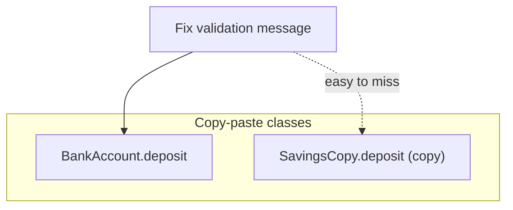
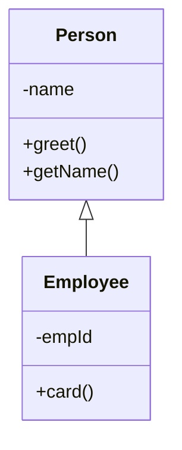
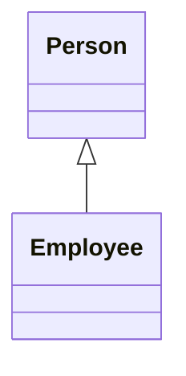
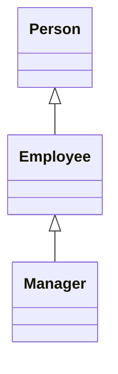
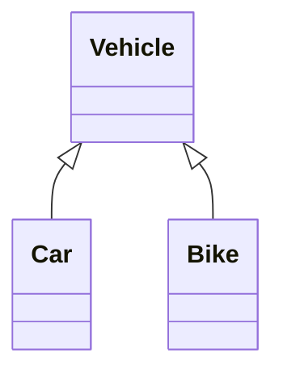
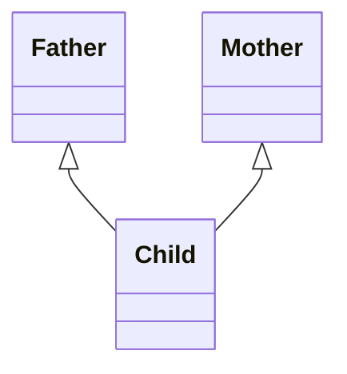
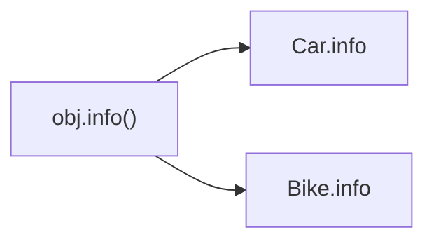
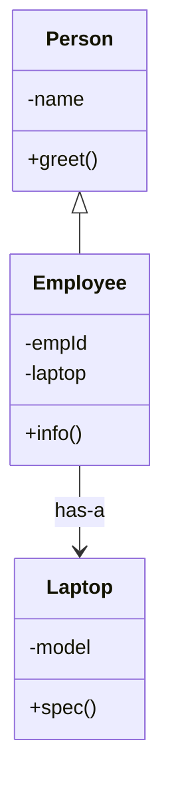

# Module 03b — OOP Part 2: Inheritance

**Phase:** OOP Java

**Previous module:** [OOP Part 1 — Classes & Encapsulation](03_OOP_Part1_Classes_Encapsulation.md)  
**Next module:** [OOP Part 3 — Polymorphism & Interfaces](03_OOP_Part3_Polymorphism_Interfaces.md)

**Series:** [OOP overview](03_OOP.md) · [Part 1](03_OOP_Part1_Classes_Encapsulation.md) · Part 2 (this file) · [Part 3](03_OOP_Part3_Polymorphism_Interfaces.md)

**Lab kit:** [15_Lab_Assets/10_employee_inheritance/](../15_Lab_Assets/10_employee_inheritance/)

---

**Module Outcome:**

- Say **IS-A**: SavingsAccount extends Account — reuse, then specialise
- Call `super()` and override without copying the parent
- Reach for HAS-A when a class is not really a kind of another class

**Teach order today:** Inheritance basics → **types of inheritance (with diagrams)** → overriding → `protected` → then HAS-A / composition as the alternative.

---

## Motivation — Feel the pain of copy-paste “almost the same” classes

Without inheritance, specialised accounts become copy-paste:

```java
public class CopyPastePain {
    public static void main(String[] args) {
        BankAccount a = new BankAccount("Priya", 1000);
        SavingsCopy b = new SavingsCopy("Ravi", 1000, 0.04);
        a.deposit(100);
        b.deposit(100);
        System.out.println(a.getBalance() + " " + b.getBalance());
    }
}

class BankAccount {
    private String holder;
    private double balance;

    BankAccount(String holder, double opening) {
        this.holder = holder;
        this.balance = opening;
    }

    void deposit(double amount) {
        if (amount <= 0) {
            System.out.println("Invalid amount");
            return;
        }
        balance += amount;
    }

    double getBalance() {
        return balance;
    }

    String getHolder() {
        return holder;
    }
}

class SavingsCopy {
    private String holder;
    private double balance;     // duplicated
    private double interestRate;

    SavingsCopy(String holder, double opening, double interestRate) {
        this.holder = holder;
        this.balance = opening;
        this.interestRate = interestRate;
    }

    void deposit(double amount) {   // duplicated rules
        if (amount <= 0) {
            System.out.println("Invalid amount");
            return;
        }
        balance += amount;
    }

    double getBalance() {
        return balance;
    }

    void applyInterest() {
        deposit(balance * interestRate);
    }
}
```

**Expected Output:**

```
1100.0 1100.0
```

Problems:

1. Deposit / balance rules are written **twice**.
2. Fix a bug in `BankAccount.deposit` → easy to forget the copy in Savings.
3. “Savings **is a** bank account” is a real domain relationship — the code should say so.

**Visual — duplicated behaviour vs one parent:**



**Key takeaways:**

- Same deposit rules in two classes = bug factory
- Inheritance = child **reuses** parent and adds only what is new
- Syntax: `class SavingsAccount extends BankAccount`

With inheritance, Savings **reuses** BankAccount and only adds what is new:

```java
class SavingsAccount extends BankAccount {
    private double interestRate;

    SavingsAccount(String holder, double opening, double interestRate) {
        super(holder, opening);     // parent constructor first
        this.interestRate = interestRate;
    }

    void applyInterest() {
        deposit(getBalance() * interestRate);
        System.out.println("Interest added. Rate=" + interestRate);
    }
}
```

`balance` stays `private` on the parent. The child uses `deposit` / `getBalance` — it does not poke the field.

---

## Important Concepts

### 1. Inheritance basics — IS-A, `extends`, `super()`

**Icons:** Bank · Employee · Order

**Where used?** **SecureBank** `SavingsAccount` is a `BankAccount`; **AcmeHR** `Manager` is an `Employee`; `Car` is a `Vehicle`.

**Definition:** **Inheritance** lets a **child class** reuse and extend a **parent class**.  
In plain English: the child **IS-A** specialised kind of the parent.

**Purpose:** Write shared behaviour once on the parent; children only add / change what is special.

| Word | Meaning |
|------|---------|
| **Parent** (base / super class) | The general class — `BankAccount`, `Person` |
| **Child** (derived / sub class) | The specialised class — `SavingsAccount`, `Employee` |
| **IS-A** | `SavingsAccount` **is a** `BankAccount` |
| `extends` | Java keyword that wires child → parent |
| `super()` | Call the parent’s constructor (must be first statement) |
| `super.method()` | Call the parent’s version of a method |

```java
public class ExtendsDemo {
    public static void main(String[] args) {
        Employee e = new Employee("Priya", 501);
        System.out.println(e.card());
        System.out.println("name from parent: " + e.getName());
    }
}

class Person {
    private String name;

    Person(String name) {
        this.name = name;
    }

    String greet() {
        return "Hi, I am " + name;
    }

    String getName() {
        return name;
    }
}

class Employee extends Person {          // Employee IS-A Person
    private int empId;

    Employee(String name, int empId) {
        super(name);                     // init the parent part first
        this.empId = empId;
    }

    String card() {
        return greet() + " (" + empId + ")";
    }
}
```

**Expected Output:**

```
Hi, I am Priya (501)
name from parent: Priya
```

**Visual — child gets parent features:**



**Key takeaways:**

- `class Child extends Parent` = inheritance
- Child **IS-A** Parent
- Call `super(...)` when the parent owns required fields — and it must be the **first** statement in the child constructor

Java rule: a class may extend **only one** class. There is no `extends A, B`.

**Common Error:** forgetting `super(...)` when the parent has no no-arg constructor. The compiler demands an explicit `super(name)` (or whatever the parent needs).

**Note:**

- Always initialise the parent before adding child-only fields.
- Inheritance is for **specialisation**, not for “I want to reuse one helper method” (a plain static method or composition may be enough).
- Private parent fields stay hidden. The child uses getters / methods, or `protected` (next topics).

Write a SecureBank `SavingsAccount` that extends `BankAccount`, deposits, and applies interest via `getBalance()`. Print Priya's holder and balance after interest.

```java
public class SavingsInherit {
    public static void main(String[] args) {
        SavingsAccount s = new SavingsAccount("Priya", 1000, 0.04);
        s.deposit(200);
        s.applyInterest();
        System.out.println(s.getHolder() + " ₹" + s.getBalance());
    }
}

class BankAccount {
    private String holder;
    private double balance;

    BankAccount(String holder, double opening) {
        this.holder = holder;
        this.balance = opening;
    }

    void deposit(double amount) {
        if (amount <= 0) {
            System.out.println("Invalid amount");
            return;
        }
        balance += amount;
    }

    double getBalance() {
        return balance;
    }

    String getHolder() {
        return holder;
    }
}

class SavingsAccount extends BankAccount {
    private double interestRate;

    SavingsAccount(String holder, double opening, double interestRate) {
        super(holder, opening);
        this.interestRate = interestRate;
    }

    void applyInterest() {
        double interest = getBalance() * interestRate;
        deposit(interest);
        System.out.println("Interest ₹" + interest + " added");
    }
}
```

**Expected Output:**

```
Interest ₹48.0 added
Priya ₹1248.0
```

Write a campus `Ta` that extends `Person`. Print two TAs with their lab names.

```java
public class CampusTa {
    public static void main(String[] args) {
        Ta a = new Ta("Anita", "DSA");
        Ta b = new Ta("Ravi", "Java");
        a.show();
        b.show();
    }
}

class Person {
    private String name;

    Person(String name) {
        this.name = name;
    }

    String getName() {
        return name;
    }
}

class Ta extends Person {
    private String lab;

    Ta(String name, String lab) {
        super(name);
        this.lab = lab;
    }

    void show() {
        System.out.println(getName() + " — " + lab + " lab TA");
    }
}
```

**Expected Output:**

```
Anita — DSA lab TA
Ravi — Java lab TA
```

---

### 2. Types of inheritance (with diagrams)

**Icons:** Employee · Bank · Order

**Where used?** Interviews always ask these shapes; real Java apps use **single** and **hierarchical** most often.

**Definition:** How many parents / children you wire — the **shape** of the tree.  
**Purpose:** So you can read diagrams, name the type in interviews, and pick a shallow design.

| Type | Idea | Java |
|------|------|------|
| **Single** | One parent → one child | `class B extends A` |
| **Multilevel** | Chain: grandparent → parent → child | `class C extends B` and `class B extends A` |
| **Hierarchical** | One parent → many children | `class Car extends Vehicle`, `class Bike extends Vehicle` |
| **Multiple (classes)** | Many parents → one child | **Not allowed** in Java (`extends A, B` is illegal) |

**Later — Part 3:** a class may `implements` **many interfaces**. That is how Java mixes contracts without two class parents.

---

#### 2a. Single inheritance

One parent, one child — the everyday default.



**Key takeaways:**

- One arrow up to one parent = **single**
- Everyday default shape in Java

---

#### 2b. Multilevel inheritance

A chain: child inherits from parent, parent inherits from grandparent.



**Key takeaways:**

- A **chain** of IS-A links = **multilevel**
- Keep chains short (2–3 levels)

```java
public class MultilevelRole {
    public static void main(String[] args) {
        Manager m = new Manager();
        System.out.println(m.role());
        System.out.println("Manager is Person? " + (m instanceof Person));
        System.out.println("Manager is Employee? " + (m instanceof Employee));
    }
}

class Person {
    String role() {
        return "Person";
    }
}

class Employee extends Person {
    String role() {
        return "Employee";
    }
}

class Manager extends Employee {    // multilevel: Manager → Employee → Person
    String role() {
        return "Manager";
    }
}
```

**Expected Output:**

```
Manager
Manager is Person? true
Manager is Employee? true
```

Every class also IS-A `Object` (Java’s root). `m instanceof Object` is true too.

---

#### 2c. Hierarchical inheritance

One parent, **many** specialised children — great prep for polymorphism (Part 3).



**Key takeaways:**

- One parent, many children = **hierarchical**
- Great setup for polymorphism later (Part 3)

```java
public class HierarchicalVehicles {
    public static void main(String[] args) {
        Car car = new Car("Hyundai");
        Bike bike = new Bike("Royal Enfield");
        System.out.println(car.info() + " | " + car.start());
        System.out.println(bike.info() + " | " + bike.start());
    }
}

class Vehicle {
    String brand;

    Vehicle(String brand) {
        this.brand = brand;
    }

    String start() {
        return brand + " starting…";
    }
}

class Car extends Vehicle {
    Car(String brand) {
        super(brand);
    }

    String info() {
        return "Car: " + brand;
    }
}

class Bike extends Vehicle {
    Bike(String brand) {
        super(brand);
    }

    String info() {
        return "Bike: " + brand;
    }
}
```

**Expected Output:**

```
Car: Hyundai | Hyundai starting…
Bike: Royal Enfield | Royal Enfield starting…
```

`brand` is package-visible here so children can read it. Prefer `private` + getter, or `protected` (next).

---

#### 2d. Multiple class inheritance — Java says no

One child, **two class parents** — Python allows it; **Java does not**.



That diagram is **illegal** as two `extends` in Java.

**Key takeaways:**

- `class Child extends Father, Mother` **does not compile**
- Interviews: “Java has no multiple inheritance of **classes**.” Then mention interfaces in Part 3
- Prefer HAS-A / composition when you only need to *use* two helpers

```java
// Illegal — do not uncomment:
// class Child extends Father, Mother { }
```

**Common Error:** using inheritance just to “mix features” when `this.engine = new Engine()` would be clearer.

Write SecureBank `SavingsAccount` and `CurrentAccount` as siblings under `BankAccount`. Print each holder's kind and balance.

```java
public class AccountKinds {
    public static void main(String[] args) {
        SavingsAccount s = new SavingsAccount("Priya", 1000);
        CurrentAccount c = new CurrentAccount("Ravi", 500);
        System.out.println(s.getHolder() + " " + s.kind() + " " + s.getBalance());
        System.out.println(c.getHolder() + " " + c.kind() + " " + c.getBalance());
    }
}

class BankAccount {
    private String holder;
    private double balance;

    BankAccount(String holder, double opening) {
        this.holder = holder;
        this.balance = opening;
    }

    double getBalance() {
        return balance;
    }

    String getHolder() {
        return holder;
    }
}

class SavingsAccount extends BankAccount {
    SavingsAccount(String holder, double opening) {
        super(holder, opening);
    }

    String kind() {
        return "savings";
    }
}

class CurrentAccount extends BankAccount {
    CurrentAccount(String holder, double opening) {
        super(holder, opening);
    }

    String kind() {
        return "current";
    }
}
```

**Expected Output:**

```
Priya savings 1000.0
Ravi current 500.0
```

Write a multilevel chain `Person` → `Employee` → `Manager` where each `label()` adds a piece. Print Meera's manager card.

```java
public class MultilevelCard {
    public static void main(String[] args) {
        Manager m = new Manager("Meera", 900, 6);
        System.out.println(m.label());
    }
}

class Person {
    private String name;

    Person(String name) {
        this.name = name;
    }

    String label() {
        return name;
    }
}

class Employee extends Person {
    private int empId;

    Employee(String name, int empId) {
        super(name);
        this.empId = empId;
    }

    String label() {
        return super.label() + " (" + empId + ")";
    }
}

class Manager extends Employee {
    private int teamSize;

    Manager(String name, int empId, int teamSize) {
        super(name, empId);
        this.teamSize = teamSize;
    }

    String label() {
        return super.label() + " — team of " + teamSize;
    }
}
```

**Expected Output:**

```
Meera (900) — team of 6
```

---

### 3. Method overriding

**Icons:** Employee · Bank · Order

**Where used?** **AcmeHR** `Manager` prints a richer payslip; `Car` starts differently from `Bike`; `toString` on each campus role.

**Definition:** The child defines a method with the **same name, same parameter list, and compatible return type** as the parent, with a new body.  
**Purpose:** Specialise behaviour while keeping the same call site (`obj.info()`, `obj.netSalary()`).

Mark overrides with `@Override`. If you mistype the name, the compiler **fails** instead of silently adding a new method.

```java
public class OverrideInfo {
    public static void main(String[] args) {
        Car car = new Car("Hyundai", 2022, 4);
        Bike bike = new Bike("Royal Enfield", 2021);
        System.out.println(car.info());
        System.out.println(bike.info());
    }
}

class Vehicle {
    String brand;
    int year;

    Vehicle(String brand, int year) {
        this.brand = brand;
        this.year = year;
    }

    String info() {
        return brand + " (" + year + ")";
    }
}

class Car extends Vehicle {
    int doors;

    Car(String brand, int year, int doors) {
        super(brand, year);
        this.doors = doors;
    }

    @Override
    String info() {
        return "Car: " + super.info() + ", doors=" + doors;
    }
}

class Bike extends Vehicle {
    Bike(String brand, int year) {
        super(brand, year);
    }

    @Override
    String info() {
        return "Bike: " + super.info();
    }
}
```

**Expected Output:**

```
Car: Hyundai (2022), doors=4
Bike: Royal Enfield (2021)
```

**Visual — same method name, different body:**



**Key takeaways:**

- Override = same signature in child, new body
- Call `super.method()` when you still want parent behaviour plus extras
- Put `@Override` on every override you mean
- Hierarchical + override = natural setup for Part 3 polymorphism

**Overriding vs overloading (do not mix these in interviews):**

| | Overloading (Methods week) | Overriding (this part) |
|-|----------------------------|------------------------|
| Where | Same class (usually) | Child vs parent |
| Parameters | **Must differ** | **Must match** |
| When chosen | Compile time | The object’s **runtime** class |
| Keyword | none | `@Override` (recommended) |

**Common Error:** overriding a constructor — constructors are **not** inherited and are **not** overridden. Children call `super(...)`. Another trap: changing only the parameter list and thinking it is an override — that is a **new overload**, and `@Override` will refuse to compile.

**Note:**

- Access cannot get tighter when overriding (`public` parent method cannot become package-private in the child).
- `final` methods cannot be overridden. `final` classes cannot be extended. Useful interview bite; you do not need it in the lab core path.
- `toString` is an override of `Object.toString` — see topic 6.

Write an AcmeHR `Manager` that overrides `net()` and `payslip()`. Print Ravi's employee slip and Meera's manager slip.

```java
public class PayslipOverride {
    public static void main(String[] args) {
        Employee e = new Employee("Ravi", 30000);
        Manager m = new Manager("Meera", 30000, 8000);
        System.out.println(e.payslip());
        System.out.println(m.payslip());
    }
}

class Employee {
    String name;
    double basic;

    Employee(String name, double basic) {
        this.name = name;
        this.basic = basic;
    }

    double net() {
        return basic * 0.9;
    }

    String payslip() {
        return name + " net ₹" + (int) net();
    }
}

class Manager extends Employee {
    double bonus;

    Manager(String name, double basic, double bonus) {
        super(name, basic);
        this.bonus = bonus;
    }

    @Override
    double net() {
        return super.net() + bonus;
    }

    @Override
    String payslip() {
        return name + " (Mgr) net ₹" + (int) net();
    }
}
```

**Expected Output:**

```
Ravi net ₹27000
Meera (Mgr) net ₹35000
```

Write an `ElectricCar` that overrides `Vehicle.start()`. Print both start messages.

```java
public class SilentStart {
    public static void main(String[] args) {
        Vehicle v = new Vehicle();
        ElectricCar e = new ElectricCar();
        System.out.println(v.start());
        System.out.println(e.start());
    }
}

class Vehicle {
    String start() {
        return "Vehicle starting";
    }
}

class ElectricCar extends Vehicle {
    @Override
    String start() {
        return "ElectricCar starting silently";
    }
}
```

**Expected Output:**

```
Vehicle starting
ElectricCar starting silently
```

---

### 4. `protected` — the child can see it; strangers cannot

**Icons:** Bank · Employee

**Where used?** A child needs the parent’s field (or a helper method) without making it `public` to the whole package / world.

**Definition:** `protected` members are visible in the **same package** and in **subclasses** (even in another package — you will feel that when packages arrive in Part 3).  
**Purpose:** Share with children without opening a public field.

| Modifier | Same class | Child class | Unrelated class, same package |
|----------|------------|-------------|-------------------------------|
| `private` | Yes | **No** | No |
| default (no word) | Yes | Yes if same package | Yes |
| `protected` | Yes | **Yes** | Yes |
| `public` | Yes | Yes | Yes |

```java
public class ProtectedBalance {
    public static void main(String[] args) {
        CampusWallet w = new CampusWallet("Priya", 1000);
        w.bonus(50);
        System.out.println(w.getBalance());
    }
}

class BankAccount {
    private String holder;
    protected double balance;   // children may touch; still not a public API

    BankAccount(String holder, double opening) {
        this.holder = holder;
        this.balance = opening;
    }

    String getHolder() {
        return holder;
    }

    double getBalance() {
        return balance;
    }
}

class CampusWallet extends BankAccount {
    CampusWallet(String holder, double opening) {
        super(holder, opening);
    }

    void bonus(double amount) {
        if (amount <= 0) {
            System.out.println("Invalid bonus");
            return;
        }
        balance += amount;   // legal — protected
    }
}
```

**Expected Output:**

```
1050.0
```

**Remember:** `protected` is for **family** (children / same package). Outsiders should still use methods. Prefer `private` + methods unless the child truly needs the field.

**Common Error:** making `balance` `protected` and then writing `acct.balance = -1` from an unrelated class in the **same package**. Same-package code can still see `protected`. Keep money `private` when you can.

**Note:**

- Lab kit core path can keep `balance` **private** and use `deposit` / `getBalance` from the child. That is the safer habit.
- `protected` is the interview word. Use it when a child helper would otherwise need a clumsy public setter.

Write a `GstItem` child that reads the parent's `protected` GST rate and prints the total for a ₹20 samosa.

```java
public class ProtectedRate {
    public static void main(String[] args) {
        GstItem item = new GstItem("Samosa", 20);
        System.out.println(item.total());
    }
}

class Priced {
    protected double rate = 0.05;
    private double price;

    Priced(double price) {
        this.price = price;
    }

    double getPrice() {
        return price;
    }
}

class GstItem extends Priced {
    private String name;

    GstItem(String name, double price) {
        super(price);
        this.name = name;
    }

    double total() {
        return getPrice() * (1 + rate);
    }
}
```

**Expected Output:**

```
21.0
```

Show that a child cannot read a parent's `private` field and must use `getSecret()`. Print the secret through the getter.

```java
public class PrivateBlocksChild {
    public static void main(String[] args) {
        Child c = new Child();
        c.show();
        // System.out.println(c.secret); // does not compile from here either
    }
}

class Parent {
    private int secret = 42;

    int getSecret() {
        return secret;
    }
}

class Child extends Parent {
    void show() {
        // System.out.println(secret); // does not compile — private
        System.out.println(getSecret());
    }
}
```

**Expected Output:**

```
42
```

---

### 5. HAS-A (composition) — when *not* to inherit

**Icons:** Employee · Laptop · Order

**Where used?** **AcmeHR** `Employee` **has a** `Laptop`; **TechMart** `OrderService` **has a** notifier; `Car` **has an** `Engine`.

Teach this **after** inheritance types: first learn IS-A trees, then learn when a tree is the wrong tool.

**Definition:** **Composition / HAS-A** = class A *stores and uses* an instance of B (`this.laptop = new Laptop(...)`).  
**Purpose:** You need collaboration, not specialisation. A car is **not** an engine; an employee is **not** a laptop.

**Rule of thumb (decide after you can sketch inheritance types):**

| Need | Choose |
|------|--------|
| Child **is a** specialised parent | **IS-A** inheritance |
| Object only **uses** / owns another object | **HAS-A** composition |

```java
public class HasADemo {
    public static void main(String[] args) {
        Employee e = new Employee("Priya", 501, new Laptop("Dell Latitude"));
        System.out.println(e.info());
        System.out.println("Employee is Person? " + (e instanceof Person));
        Object obj = e;
        System.out.println("Employee is Laptop? " + (obj instanceof Laptop));
        // e instanceof Laptop  // does not compile — unrelated types
    }
}

class Laptop {
    private String model;

    Laptop(String model) {
        this.model = model;
    }

    String spec() {
        return "Laptop: " + model;
    }
}

class Person {
    private String name;

    Person(String name) {
        this.name = name;
    }

    String greet() {
        return "Hi, I am " + name;
    }
}

class Employee extends Person {                 // IS-A Person
    private int empId;
    private Laptop laptop;                      // HAS-A Laptop

    Employee(String name, int empId, Laptop laptop) {
        super(name);
        this.empId = empId;
        this.laptop = laptop;
    }

    String info() {
        return greet() + " (" + empId + ") — " + laptop.spec();
    }
}
```

**Expected Output:**

```
Hi, I am Priya (501) — Laptop: Dell Latitude
Employee is Person? true
Employee is Laptop? false
```

**Common Error:** writing `e instanceof Laptop` when `e` is typed `Employee`. The compiler rejects it — those types are unrelated. Cast the variable to `Object` only to *demonstrate* the false result; real code should not need that check.

**Visual — own a collaborator, do not inherit it:**



**Key takeaways:**

- Inheritance = IS-A
- Composition = HAS-A (`this.other = new Other(...)`)
- `obj instanceof Laptop` is false — laptop is owned, not inherited (`e instanceof Laptop` does not even compile)
- Prefer composition when unsure / when mixing unrelated features

**Note:**

- Deep inheritance trees get brittle — prefer composition when unsure.
- Composition keeps parts swappable (`SmsNotifier` vs `EmailNotifier`) without a messy parent list.
- Do not make `Car extends Engine`. A car **has** an engine.

Write a TechMart `OrderService` that HAS-A SMS or email notifier. Place ORD-101 by SMS and ORD-102 by email.

```java
public class OrderNotify {
    public static void main(String[] args) {
        OrderService sms = new OrderService(new SmsNotifier());
        OrderService mail = new OrderService(new EmailNotifier());
        sms.place("ORD-101");
        mail.place("ORD-102");
    }
}

class SmsNotifier {
    void send(String message) {
        System.out.println("SMS: " + message);
    }
}

class EmailNotifier {
    void send(String message) {
        System.out.println("EMAIL: " + message);
    }
}

class OrderService {
    private SmsNotifier sms;
    private EmailNotifier email;
    private boolean useSms;

    OrderService(SmsNotifier sms) {
        this.sms = sms;
        this.useSms = true;
    }

    OrderService(EmailNotifier email) {
        this.email = email;
        this.useSms = false;
    }

    void place(String orderId) {
        String msg = "Order " + orderId + " placed";
        if (useSms) {
            sms.send(msg);
        } else {
            email.send(msg);
        }
    }
}
```

**Expected Output:**

```
SMS: Order ORD-101 placed
EMAIL: Order ORD-102 placed
```

*(The two constructors are a Part 1 trick. **Later — Part 3** you will pass one `Notifier` interface instead of `if useSms`.)*

Write a `Library` that HAS-A `Book` array plus a count. Add two books and print the library name and count.

```java
public class LibraryHasA {
    public static void main(String[] args) {
        Library lib = new Library("KSR Central");
        lib.add(new Book("Clean Code"));
        lib.add(new Book("Effective Java"));
        System.out.println(lib.getName() + " " + lib.count());
    }
}

class Book {
    private String title;

    Book(String title) {
        this.title = title;
    }

    String getTitle() {
        return title;
    }
}

class Library {
    private String name;
    private Book[] books = new Book[20];
    private int count;

    Library(String name) {
        this.name = name;
    }

    void add(Book book) {
        if (count >= books.length) {
            System.out.println("Shelf full");
            return;
        }
        books[count] = book;
        count++;
    }

    int count() {
        return count;
    }

    String getName() {
        return name;
    }
}
```

**Expected Output:**

```
KSR Central 2
```

No `ArrayList` yet — Collections week is next. An array + `count` is enough.

---

### 6. `instanceof` and `toString` lite

**Icons:** Employee · Order

**Where used?** Check “is this object a Manager?” before calling a Manager-only method. Print an object without writing `getName() + getId()` every time.

**Definition:** `obj instanceof Type` is `true` when `obj` is that type or a **child** of that type. `toString()` is the method `System.out.println(obj)` calls. Every class inherits a weak version from `Object`; override it for a readable line.  
**Purpose:** Safer type checks than comparing class names as strings; readable logs and debug prints.

```java
public class InstanceAndToString {
    public static void main(String[] args) {
        Employee e = new Employee("Ravi", 11);
        Manager m = new Manager("Meera", 12, 6);
        System.out.println(e);
        System.out.println(m);
        System.out.println("m is Employee? " + (m instanceof Employee));
        System.out.println("e is Manager? " + (e instanceof Manager));
    }
}

class Employee {
    String name;
    int empId;

    Employee(String name, int empId) {
        this.name = name;
        this.empId = empId;
    }

    @Override
    public String toString() {
        return name + " (" + empId + ")";
    }
}

class Manager extends Employee {
    int teamSize;

    Manager(String name, int empId, int teamSize) {
        super(name, empId);
        this.teamSize = teamSize;
    }

    @Override
    public String toString() {
        return super.toString() + " — team of " + teamSize;
    }
}
```

**Expected Output:**

```
Ravi (11)
Meera (12) — team of 6
m is Employee? true
e is Manager? false
```

**Interview:** `toString` must be `public` because `Object.toString()` is `public`. You cannot tighten it.

**Common Error:** giant `if (obj instanceof A) ... else if (obj instanceof B)` trees for every new child. That is a smell — Part 3 polymorphism (`display()` on each type) is the cleaner call site. Use `instanceof` for genuine “only Managers have teamSize” checks, not as a substitute for override.

**Note:**

- `null instanceof Type` is **false** (it does not crash).
- Prefer `display()` / `toString()` overrides over switching on types.
- You do not need `getClass().getName()` in the core path.

Write AcmeHR `Faculty` extending `Staff`. Print `instanceof` against `Staff`, `Faculty`, and `Object`.

```java
public class RoleCheck {
    public static void main(String[] args) {
        Faculty f = new Faculty("Anita", "CSE");
        System.out.println(f instanceof Staff);
        System.out.println(f instanceof Faculty);
        System.out.println(f instanceof Object);
    }
}

class Staff {
    String name;

    Staff(String name) {
        this.name = name;
    }
}

class Faculty extends Staff {
    String dept;

    Faculty(String name, String dept) {
        super(name);
        this.dept = dept;
    }
}
```

**Expected Output:**

```
true
true
true
```

Write a TechMart `Product` that overrides `toString()`. Print the product with `System.out.println(p)`.

```java
public class ProductToString {
    public static void main(String[] args) {
        Product p = new Product("PEN-01", 10);
        System.out.println(p);
    }
}

class Product {
    private String sku;
    private double price;

    Product(String sku, double price) {
        this.sku = sku;
        this.price = price;
    }

    @Override
    public String toString() {
        return sku + " @ ₹" + (int) price;
    }
}
```

**Expected Output:**

```
PEN-01 @ ₹10
```

---

## Step-by-Step Annotated Java Code

Type these; predict the output; then run. File name = the `public` class name.

### Example 1 — Employee / Manager (single + override)

```java
public class StaffPayslip {
    public static void main(String[] args) {
        Employee e = new Employee("Ravi", 501, 30000);
        Manager m = new Manager("Meera", 900, 30000, 8000);
        e.display();
        m.display();
        System.out.println(m);
        System.out.println("m is Employee? " + (m instanceof Employee));
    }
}

class Employee {
    private String name;
    private int empId;
    protected double basic;

    Employee(String name, int empId, double basic) {
        this.name = name;
        this.empId = empId;
        this.basic = basic;
    }

    double net() {
        return basic * 0.9;
    }

    void display() {
        System.out.println(name + " (" + empId + ") net ₹" + (int) net());
    }

    String getName() {
        return name;
    }

    int getEmpId() {
        return empId;
    }

    @Override
    public String toString() {
        return name + " (" + empId + ")";
    }
}

class Manager extends Employee {
    private double bonus;

    Manager(String name, int empId, double basic, double bonus) {
        super(name, empId, basic);
        this.bonus = bonus;
    }

    @Override
    double net() {
        return super.net() + bonus;
    }

    @Override
    void display() {
        System.out.println(getName() + " (Mgr " + getEmpId() + ") net ₹" + (int) net());
    }

    @Override
    public String toString() {
        return super.toString() + " Mgr";
    }
}
```

**Expected Output:**

```
Ravi (501) net ₹27000
Meera (Mgr 900) net ₹35000
Meera (900) Mgr
m is Employee? true
```

---

### Example 2 — Hierarchical: Savings vs Current

```java
public class TwoAccounts {
    public static void main(String[] args) {
        SavingsAccount s = new SavingsAccount("Priya", 1000, 0.04);
        CurrentAccount c = new CurrentAccount("Ravi", 500, 200);
        s.deposit(100);
        s.addInterest();
        c.withdraw(50);
        c.withdraw(700);
        System.out.println(s);
        System.out.println(c);
    }
}

class BankAccount {
    private String holder;
    private double balance;

    BankAccount(String holder, double opening) {
        this.holder = holder;
        this.balance = opening;
    }

    void deposit(double amount) {
        if (amount <= 0) {
            System.out.println("Invalid amount");
            return;
        }
        balance += amount;
    }

    void withdraw(double amount) {
        if (amount <= 0) {
            System.out.println("Invalid amount");
            return;
        }
        if (amount > balance) {
            System.out.println("Insufficient funds");
            return;
        }
        balance -= amount;
    }

    double getBalance() {
        return balance;
    }

    String getHolder() {
        return holder;
    }

    @Override
    public String toString() {
        return holder + " ₹" + balance;
    }
}

class SavingsAccount extends BankAccount {
    private double rate;

    SavingsAccount(String holder, double opening, double rate) {
        super(holder, opening);
        this.rate = rate;
    }

    void addInterest() {
        deposit(getBalance() * rate);
    }

    @Override
    public String toString() {
        return "Savings " + super.toString();
    }
}

class CurrentAccount extends BankAccount {
    private double minBalance;

    CurrentAccount(String holder, double opening, double minBalance) {
        super(holder, opening);
        this.minBalance = minBalance;
    }

    @Override
    void withdraw(double amount) {
        if (getBalance() - amount < minBalance) {
            System.out.println("Below minimum balance ₹" + minBalance);
            return;
        }
        super.withdraw(amount);
    }

    @Override
    public String toString() {
        return "Current " + super.toString();
    }
}
```

**Expected Output:**

```
Below minimum balance ₹200.0
Savings Priya ₹1144.0
Current Ravi ₹450.0
```

---

### Example 3 — IS-A + HAS-A together (after you know both)

```java
public class FacultyLaptop {
    public static void main(String[] args) {
        Faculty f = new Faculty("Anita", 301, "CSE", new Laptop("Lenovo"));
        System.out.println(f.info());
        System.out.println("Faculty is Staff? " + (f instanceof Staff));
    }
}

class Laptop {
    private String model;

    Laptop(String model) {
        this.model = model;
    }

    String spec() {
        return model;
    }
}

class Staff {
    private String name;
    private int id;

    Staff(String name, int id) {
        this.name = name;
        this.id = id;
    }

    String label() {
        return name + " #" + id;
    }
}

class Faculty extends Staff {                 // IS-A Staff
    private String dept;
    private Laptop laptop;                    // HAS-A Laptop

    Faculty(String name, int id, String dept, Laptop laptop) {
        super(name, id);
        this.dept = dept;
        this.laptop = laptop;
    }

    String info() {
        return label() + " | " + dept + " | " + laptop.spec();
    }
}
```

**Expected Output:**

```
Anita #301 | CSE | Lenovo
Faculty is Staff? true
```

---

## Practice Exercises

*(Each Practice item includes a filled **Model answer** and **Expected Output** where the demo prints.)*

### Basic

1. `Rectangle` with `area()` / `perimeter()`; `Square` extends `Rectangle` and only needs `side` (**single**).

   **Model answer:**

```java
public class SquareIsRectangle {
    public static void main(String[] args) {
        Square sq = new Square(4);
        System.out.println(sq.area() + " " + sq.perimeter());
    }
}

class Rectangle {
    double w;
    double h;

    Rectangle(double w, double h) {
        this.w = w;
        this.h = h;
    }

    double area() {
        return w * h;
    }

    double perimeter() {
        return 2 * (w + h);
    }
}

class Square extends Rectangle {
    Square(double side) {
        super(side, side);
    }
}
```

   **Expected Output:**

```
16.0 16.0
```

2. Why must `super(...)` be the first statement in the child constructor? Answer in 2–3 sentences, then show a legal `Employee` constructor.

   **Model answer:** The parent part of the object must exist before the child sets extra fields. Java enforces that by requiring `super(...)` first (or an implicit `super()` if the parent has a no-arg constructor).

```java
class Person {
    String name;

    Person(String name) {
        this.name = name;
    }
}

class Employee extends Person {
    int empId;

    Employee(String name, int empId) {
        super(name);
        this.empId = empId;
    }
}
```

### Intermediate

1. **Multilevel:** `Person` → `Employee` → `Developer` with `language` and a `label()` override that uses `super()`.

   **Model answer:**

```java
public class DeveloperLabel {
    public static void main(String[] args) {
        Developer d = new Developer("Anita", 11, "Java");
        System.out.println(d.label());
    }
}

class Person {
    private String name;

    Person(String name) {
        this.name = name;
    }

    String label() {
        return name;
    }
}

class Employee extends Person {
    private int empId;

    Employee(String name, int empId) {
        super(name);
        this.empId = empId;
    }

    @Override
    String label() {
        return super.label() + " (" + empId + ")";
    }
}

class Developer extends Employee {
    private String language;

    Developer(String name, int empId, String language) {
        super(name, empId);
        this.language = language;
    }

    @Override
    String label() {
        return super.label() + " — " + language;
    }
}
```

   **Expected Output:**

```
Anita (11) — Java
```

2. Sketch (on paper or Mermaid) **hierarchical** inheritance for `Shape` → `Circle` / `Rectangle`. Then implement `area()`.

   **Model answer:** One parent, two children. `Circle` uses `Math.PI`.

```java
public class ShapeAreas {
    public static void main(String[] args) {
        Circle c = new Circle(2);
        Rectangle r = new Rectangle(3, 4);
        System.out.println(Math.round(c.area() * 100.0) / 100.0);
        System.out.println(r.area());
    }
}

class Shape {
    double area() {
        return 0.0;
    }
}

class Circle extends Shape {
    double r;

    Circle(double r) {
        this.r = r;
    }

    @Override
    double area() {
        return Math.PI * r * r;
    }
}

class Rectangle extends Shape {
    double w;
    double h;

    Rectangle(double w, double h) {
        this.w = w;
        this.h = h;
    }

    @Override
    double area() {
        return w * h;
    }
}
```

   **Expected Output:**

```
12.57
12.0
```

3. **Composition:** `Library` HAS-A array of `Book` objects; implement `add(book)` and `count()`.

   **Model answer:** See Program 2 under HAS-A. Print `KSR Central 2`.

4. Extend the BankAccount idea: `SavingsAccount extends BankAccount` with `addInterest(rate)` that deposits `getBalance() * rate`.

   **Model answer:**

```java
class SavingsAccount extends BankAccount {
    void addInterest(double rate) {
        deposit(getBalance() * rate);
    }
}
```

   Use the Part 1 `BankAccount` (private balance + `deposit` / `getBalance`). Do not copy the field.

5. Explain in 3–4 lines (no code): when would you **not** make `Car` inherit from `Engine`?

   **Model answer:** A car **has an** engine; it is not a kind of engine. Inheritance would expose engine internals as if they were car behaviour and break IS-A thinking. Use composition: `this.engine = new Engine(...)`.

### Interview-Oriented

1. Can a Java class extend two classes?

   **Model answer:** No. One `extends` only. Mix extra contracts later with **interfaces** (Part 3).

2. Overriding vs overloading?

   **Model answer:** Overloading: same name, different parameters, compile time. Overriding: child replaces parent method with the **same** signature; `@Override` recommended.

3. Why `@Override`?

   **Model answer:** If you misspell the method, the compiler errors instead of adding a new unrelated method.

4. `protected` vs `private`?

   **Model answer:** `private` = same class only. `protected` = children (and same package) may see it. Prefer `private` + methods unless the child truly needs the field.

5. What does `instanceof` return for a child checked against the parent type?

   **Model answer:** `true`. A `Manager` **is an** `Employee`.

---

## Mini-Project (Assignment): AcmeHR Staff Hierarchy

**Lab kit:** [15_Lab_Assets/10_employee_inheritance/](../15_Lab_Assets/10_employee_inheritance/)

The bigger Campus Wallet push (multiple account types + interfaces) is [Part 3](03_OOP_Part3_Polymorphism_Interfaces.md). Today’s assignment is a clean **IS-A staff tree**.

### What to build

| Piece | Detail |
|-------|--------|
| `Employee` | `name`, `empId`, `basic`; `net()`, `display()`, `toString()` |
| `Manager extends Employee` | extra `bonus`; override `net` / `display` / `toString`; `super(...)` in the constructor |
| Driver | Construct one employee and one manager; print both |
| Validation | `print` + `return` if you add extra checks — **no** `throw` |
| Inheritance | **Single** class inheritance only — no second `extends` |

### Stretch

- `Faculty extends Employee` with `dept` (**hierarchical**: two children of `Employee`).
- HAS-A: `Employee` holds a `Laptop`.
- **Later — Part 3:** `Payable` interface; `Staff[]` printed in a loop (polymorphism).

### Done when

- [ ] `Manager` uses `extends` and `super(...)` — no copy-pasted `name` / `empId` fields
- [ ] `@Override` on `display` (and `toString` if you override it)
- [ ] `manager instanceof Employee` is true (you can print it)
- [ ] No `throw` / `try` / `catch`
- [ ] No interfaces / `abstract` (Part 3)
- [ ] No Lombok

---

## Interview Q&A

Shared with students after concepts and the mini-project. Use for review and interview prep — questions and model answers are included.

**Q1. What is inheritance?**  
**A:** A child class reuses and extends a parent. The child **IS-A** specialised parent. Syntax: `class Child extends Parent`. **AcmeHR:** `Manager extends Employee`. **SecureBank:** `SavingsAccount extends BankAccount`.

**Q2. Name the inheritance shapes Java uses, and the one it refuses for classes.**  
**A:** Single (A←B), multilevel (A←B←C), hierarchical (A←B and A←C). Multiple class parents (`extends A, B`) is **illegal**. Interfaces come in Part 3.

**Q3. Why `super()` in the child constructor?**  
**A:** So the parent can set up the fields it owns. It must be the **first** statement. Skipping it fails to compile when the parent has no no-arg constructor.

**Q4. What is method overriding?**  
**A:** The child supplies a new body for a parent method with the **same** signature. Use `@Override`. Call `super.method()` when you still need the parent work.

**Q5. Overriding vs overloading?**  
**A:** Overloading = different parameter lists (compile time). Overriding = same signature in a child (runtime object type).

**Q6. Inheritance vs composition?**  
**A:** Inherit when the child **is a** specialised parent (`Manager` **is an** AcmeHR `Employee`). Compose when an object **has a** collaborator (`TechMart` `OrderService` **has a** notifier). Prefer composition when unsure.

**Q7. Can the child read a `private` parent field?**  
**A:** No. Use a getter, or declare the field `protected` if the child truly must see it.

**Q8. What is `instanceof`?**  
**A:** `obj instanceof Type` is true if `obj` is that type or a subclass. `null instanceof Type` is false.

**Q9. Why override `toString`?**  
**A:** `System.out.println(obj)` calls `toString`. The `Object` default is ugly (`Employee@1a2b3c`). Return a readable line. It must stay `public`.

**Q10. Why `@Override` on `toString`?**  
**A:** So a typo (`tostring`) is a compile error instead of a new method that `println` never calls.

---

## Next

Keep the [BankAccount kit](../15_Lab_Assets/09_bank_account_oop/) and finish the [staff hierarchy kit](../15_Lab_Assets/10_employee_inheritance/). Continue with **[OOP Part 3 — Polymorphism & Interfaces](03_OOP_Part3_Polymorphism_Interfaces.md)**.
