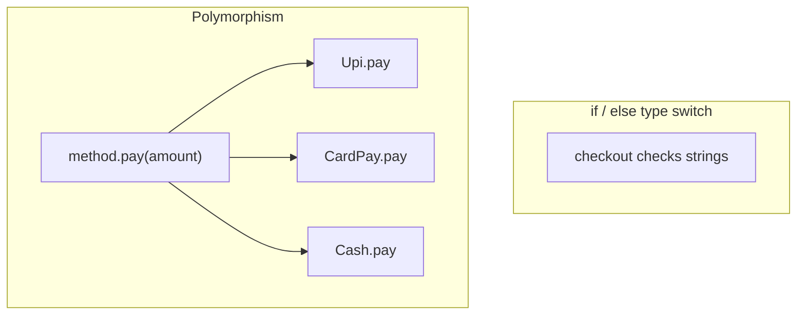
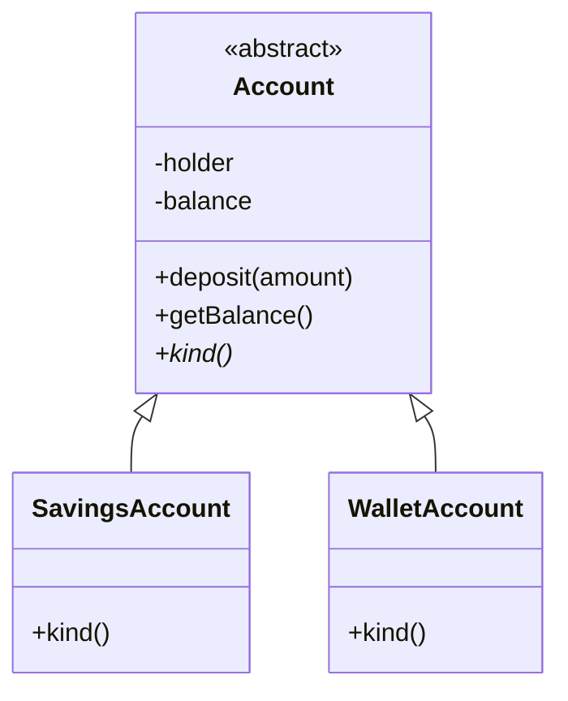
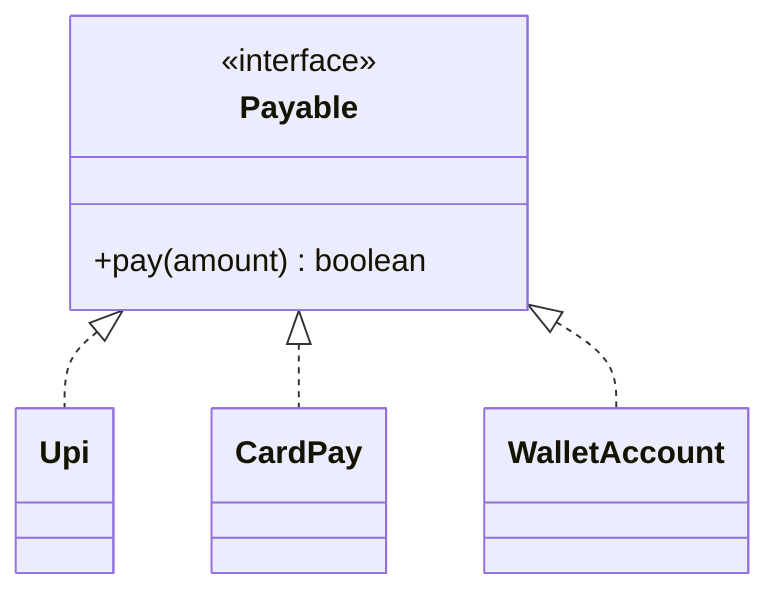
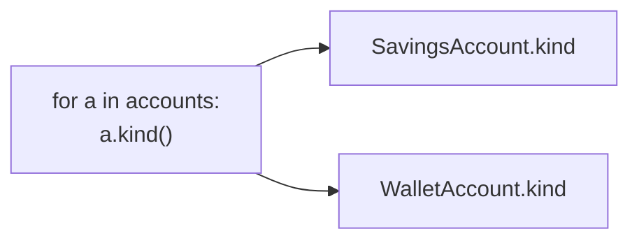
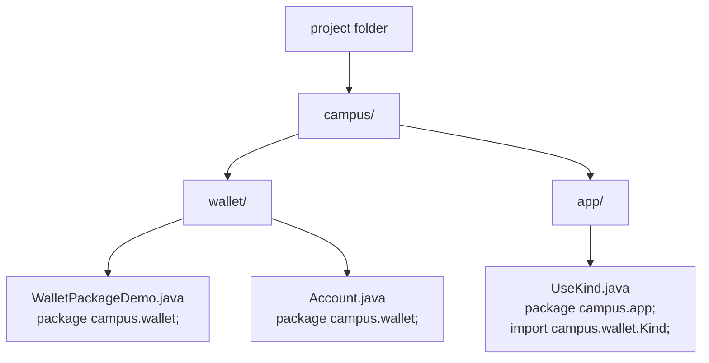

# Module 03c — OOP Part 3: Polymorphism, Interfaces & Packages

**Phase:** OOP Java

**Previous module:** [OOP Part 2 — Inheritance](03_OOP_Part2_Inheritance.md)  
**Next module:** [Collections](../04_Collections_Exceptions_IO/01_Collections.md)

**Series:** [OOP overview](03_OOP.md) · [Part 1](03_OOP_Part1_Classes_Encapsulation.md) · [Part 2](03_OOP_Part2_Inheritance.md) · Part 3 (this file)

**Lab kit:** [15_Lab_Assets/11_campus_wallet/](../15_Lab_Assets/11_campus_wallet/)

---

**Module Outcome:**

- Code to an interface (`Payable`) and let UPI or card fill `pay()`
- Use an abstract class when some recipe is shared and some is not
- Push Campus Wallet with packages that a recruiter can open

**Teach order today:** abstract classes → interfaces (`implements`) → polymorphism (same call, many forms) → packages → Campus Wallet push.

---

## Motivation — Feel the pain of `if (type.equals(...))`

Checkout code without polymorphism often looks like this:

```java
public class TypeSwitchPain {
    public static void main(String[] args) {
        checkout("upi", 250);
        checkout("card", 999);
        checkout("wallet", 100);   // forgotten branch
    }

    static void checkout(String type, double amount) {
        if (type.equals("upi")) {
            System.out.println("Paid ₹" + (int) amount + " via UPI");
        } else if (type.equals("card")) {
            System.out.println("Paid ₹" + (int) amount + " via Card");
        } else if (type.equals("cash")) {
            System.out.println("Paid ₹" + (int) amount + " in Cash");
        } else {
            System.out.println("Unknown payment type");
        }
    }
}
```

**Expected Output:**

```
Paid ₹250 via UPI
Paid ₹999 via Card
Unknown payment type
```

Problems:

1. Every new payment mode needs a new `else if`.
2. Easy to miss a branch (silent `"Unknown payment type"`).
3. Business rules and type switching live in one growing method.
4. Strings are not types — `"UPI"` vs `"upi"` is another landmine.

**Visual — type switch vs same call, different objects:**



**Key takeaways:**

- Giant `if (type.equals(...))` trees grow brittle
- Same method name on different objects = polymorphism
- Add a new class with `pay()` — the old checkout loop still works

Same call site, different objects (preview — you will make this **safe** with an interface next):

```java
public class SameCallPay {
    public static void main(String[] args) {
        checkout(new Upi(), 250);
        checkout(new CardPay(), 999);
    }

    static void checkout(PayMethod method, double amount) {
        method.pay(amount);
    }
}

class PayMethod {
    void pay(double amount) {
        System.out.println("Paid ₹" + (int) amount);
    }
}

class Upi extends PayMethod {
    @Override
    void pay(double amount) {
        System.out.println("Paid ₹" + (int) amount + " via UPI");
    }
}

class CardPay extends PayMethod {
    @Override
    void pay(double amount) {
        System.out.println("Paid ₹" + (int) amount + " via Card");
    }
}
```

**Expected Output:**

```
Paid ₹250 via UPI
Paid ₹999 via Card
```

That already beats strings. Two gaps remain:

1. `new PayMethod()` still compiles — a “generic pay method” is not a real campus product.
2. A class can extend **only one** parent. UPI might also need `Printable` or `Refundable`. Interfaces solve that.

---

## Important Concepts

### 1. Abstract classes — a parent that must not be constructed

**Icons:** Bank · Employee · Order

**Where used?** **HDFC Bank** `Account` (savings vs wallet vs current), `Shape` (circle vs rectangle), `Notifier` (SMS vs email) — shared fields + rules, missing one method each child must fill.

**Definition:** An **abstract class** is a class marked `abstract`. It may mix **concrete** methods (with a body) and **abstract** methods (name + signature only). You **cannot** `new` it.  
**Purpose:** Share real code (fields, constructors, `deposit`) while forcing every child to provide the specialised piece (`kind()`, `area()`). Callers never get a vague “generic account”.

```java
public class AbstractKindDemo {
    public static void main(String[] args) {
        // Account a = new Account("x", 0);  // does not compile
        Account s = new SavingsAccount("Priya", 1000);
        Account w = new WalletAccount("Ravi", 500);
        s.deposit(100);
        System.out.println(s.kind() + " ₹" + (int) s.getBalance());
        System.out.println(w.kind() + " ₹" + (int) w.getBalance());
    }
}

abstract class Account {
    private String holder;
    private double balance;

    Account(String holder, double opening) {
        this.holder = holder;
        this.balance = opening;
    }

    void deposit(double amount) {
        if (amount <= 0) {
            System.out.println("Invalid amount");
            return;
        }
        balance += amount;
    }

    double getBalance() {
        return balance;
    }

    String getHolder() {
        return holder;
    }

    abstract String kind();    // children must implement
}

class SavingsAccount extends Account {
    SavingsAccount(String holder, double opening) {
        super(holder, opening);
    }

    @Override
    String kind() {
        return "savings";
    }
}

class WalletAccount extends Account {
    WalletAccount(String holder, double opening) {
        super(holder, opening);
    }

    @Override
    String kind() {
        return "wallet";
    }
}
```

**Expected Output:**

```
savings ₹1100
wallet ₹500
```

A child that extends an abstract class must implement **every** abstract method, or be `abstract` itself.

**Visual — blueprint with a hole the child fills:**



**Key takeaways:**

- `abstract class` = can hold fields + constructors + real methods
- `abstract` methods have **no body**; children `@Override` them
- `new Account(...)` is illegal — that is the point
- Still **one** `extends` only (Part 2 rule does not change)

**Remember:** Abstract = “incomplete on purpose.” Concrete children complete it.

**Interview:** Can an abstract class have a constructor? **Yes.** Children call `super(...)`. The constructor runs as part of `new Child(...)`, never as `new AbstractParent(...)`.

**Common Error:** putting an abstract method on a **non-abstract** class. The compiler refuses: the class must be `abstract` too.

**Note:**

- `abstract` + `final` on the same class is illegal (final means “no children”).
- An abstract method cannot be `private` or `static` (the child must be able to override it).
- Prefer abstract when children **share fields** (`holder`, `balance`) and some real methods (`deposit`). Prefer an interface when you only need a **capability** (`pay`, `printSlip`) — next topic.

Write an Employee Management Portal abstract `Staff` with `net()` implemented by `Intern` (full basic) and `Faculty` (90%). Print both nets.

```java
public class AbstractStaffNet {
    public static void main(String[] args) {
        Staff a = new Intern("Anita", 15000);
        Staff b = new Faculty("Vikram", 40000);
        System.out.println(a.name + " net ₹" + (int) a.net());
        System.out.println(b.name + " net ₹" + (int) b.net());
    }
}

abstract class Staff {
    String name;
    double basic;

    Staff(String name, double basic) {
        this.name = name;
        this.basic = basic;
    }

    abstract double net();
}

class Intern extends Staff {
    Intern(String name, double basic) {
        super(name, basic);
    }

    @Override
    double net() {
        return basic;          // no PF cut in this demo
    }
}

class Faculty extends Staff {
    Faculty(String name, double basic) {
        super(name, basic);
    }

    @Override
    double net() {
        return basic * 0.9;
    }
}
```

**Expected Output:**

```
Anita net ₹15000
Vikram net ₹36000
```

Write an abstract `Shape` with `Circle` and `Rect` areas. Print a circle of radius 2 (rounded to 2 decimals) and a 3×4 rectangle.

```java
public class AbstractShapeArea {
    public static void main(String[] args) {
        Shape c = new Circle(2);
        Shape r = new Rect(3, 4);
        System.out.println(Math.round(c.area() * 100.0) / 100.0);
        System.out.println(r.area());
    }
}

abstract class Shape {
    abstract double area();
}

class Circle extends Shape {
    double radius;

    Circle(double radius) {
        this.radius = radius;
    }

    @Override
    double area() {
        return Math.PI * radius * radius;
    }
}

class Rect extends Shape {
    double w;
    double h;

    Rect(double w, double h) {
        this.w = w;
        this.h = h;
    }

    @Override
    double area() {
        return w * h;
    }
}
```

**Expected Output:**

```
12.57
12.0
```

---

### 2. Interfaces — a contract a class `implements`

**Icons:** Bank · UPI · Employee · Order

**Where used?** `Payable` (UPI, card, wallet), `Printable` (slip, invoice), `Comparable` in the JDK. **Later — Spring Boot** also talks to interfaces; you only need the Java `implements` meaning now.

**Definition:** An **interface** names a set of methods a class promises to provide. A class **`implements`** the interface and writes those methods.  
**Purpose:** Share a **capability** across types that are not the same parent. A class may implement **many** interfaces. That is how Java mixes contracts without two class parents (Part 2: `extends A, B` is illegal).

```java
public class PayableCheckout {
    public static void main(String[] args) {
        checkout(new Upi(), 250);
        checkout(new CardPay(), 999);
        checkout(new CardPay(), 60000);
    }

    static void checkout(Payable method, double amount) {
        boolean ok = method.pay(amount);
        System.out.println("ok? " + ok);
    }
}

interface Payable {
    boolean pay(double amount);
}

class Upi implements Payable {
    @Override
    public boolean pay(double amount) {
        System.out.println("UPI paid ₹" + (int) amount);
        return true;
    }
}

class CardPay implements Payable {
    @Override
    public boolean pay(double amount) {
        if (amount > 50000) {
            System.out.println("Card limit exceeded");
            return false;
        }
        System.out.println("Card paid ₹" + (int) amount);
        return true;
    }
}
```

**Expected Output:**

```
UPI paid ₹250
ok? true
Card paid ₹999
ok? true
Card limit exceeded
ok? false
```

Interface methods are **`public`** (even if you omit the word). The implementing method must stay `public`.

A class can implement **two** contracts at once:

```java
class WalletAccount extends Account implements Payable, Printable {
    // ...
}
```

**Default methods** (Java 8+): an interface may include a method **with a body** so old implementers do not all break when you add a helper:

```java
interface Greeter {
    String greet();

    default String banner() {
        return "*** " + greet() + " ***";
    }
}
```

Use default methods as shared helpers on the contract — not as a dumping ground for business logic that belongs on a class.

**Visual — many types, one contract:**



**Key takeaways:**

- `interface` = contract (what), `class` = how
- `implements` can list **several** interfaces
- Implementing methods are `public`
- Default methods are optional helpers on the interface

**Abstract class vs interface (interview table — after the idea):**

| | Abstract class | Interface |
|--|----------------|-----------|
| Keyword | `abstract class` / `extends` | `interface` / `implements` |
| How many? | **One** parent class | **Many** interfaces |
| Fields | Instance fields, constructors | Constants (`public static final`) — not per-object balance |
| Methods | Mix of concrete + abstract | Abstract + `default` + `static` |
| When | Shared **state** + partial implementation | Shared **capability** |

**Remember:** IS-A shared guts → abstract class. CAN-DO extra skill → interface.

**Interview:** Why can a class implement many interfaces but extend only one class? Java avoids the “two parents both have a `balance` field” diamond. Interfaces historically had no instance fields, so many contracts are safe.

**Common Error:** writing `class Upi extends Payable`. `extends` is for a class (or for an interface extending another interface). A class **`implements`** an interface.

**Note:**

- You cannot `new Payable()` (unless you later use an anonymous class / lambda — **Later**).
- Interface fields are `public static final`. Do not store `holder` there.
- `static` methods on an interface are utilities (`Payable.maxAmount()`), not object behaviour.
- **Later — Collections week** you will see `List`, `Set`, `Map` as interfaces. The idea is the same: code to the contract.

Write an Employee Management Portal `Printable` interface. Loop a student card and a staff card and print both slips.

```java
public class PrintableCards {
    public static void main(String[] args) {
        Printable[] cards = {
            new StudentCard(101, "Anita"),
            new StaffCard("HR", "Meera")
        };
        for (Printable p : cards) {
            p.printSlip();
        }
    }
}

interface Printable {
    void printSlip();
}

class StudentCard implements Printable {
    int roll;
    String name;

    StudentCard(int roll, String name) {
        this.roll = roll;
        this.name = name;
    }

    @Override
    public void printSlip() {
        System.out.println("Student " + roll + " " + name);
    }
}

class StaffCard implements Printable {
    String dept;
    String name;

    StaffCard(String dept, String name) {
        this.dept = dept;
        this.name = name;
    }

    @Override
    public void printSlip() {
        System.out.println("Staff " + dept + " " + name);
    }
}
```

**Expected Output:**

```
Student 101 Anita
Staff HR Meera
```

Write a `CampusUpi` that implements both `Payable` and `Printable`. Print the slip, then pay ₹80.

```java
public class TwoContracts {
    public static void main(String[] args) {
        CampusUpi u = new CampusUpi("Priya");
        u.printSlip();
        System.out.println(u.pay(80));
    }
}

interface Payable {
    boolean pay(double amount);
}

interface Printable {
    void printSlip();
}

class CampusUpi implements Payable, Printable {
    String holder;

    CampusUpi(String holder) {
        this.holder = holder;
    }

    @Override
    public boolean pay(double amount) {
        System.out.println(holder + " paid ₹" + (int) amount + " UPI");
        return true;
    }

    @Override
    public void printSlip() {
        System.out.println("UPI wallet: " + holder);
    }
}
```

**Expected Output:**

```
UPI wallet: Priya
Priya paid ₹80 UPI
true
```

---

### 3. Polymorphism — same call, many forms

**Icons:** Bank · UPI · Order · Employee

**Where used?** Payment methods, shapes/areas, notification channels, account types printing a slip — one loop, many behaviours.

**Definition:** **Polymorphism** means “many forms”: the same operation name (`pay`, `kind`, `printSlip`) behaves differently depending on the **runtime** object.  
**Purpose:** Write one loop or helper without giant `if (type.equals(...))` chains. Adding a new class with the same method keeps old call sites working.

Java has two flavours you must not mix in interviews:

| Flavour | When chosen | You already saw |
|---------|-------------|-----------------|
| **Compile-time** (overloading) | Compiler picks by **parameter list** | Methods week |
| **Runtime** (overriding / interfaces) | JVM picks by the object’s **real class** | Part 2 override + this part |

This part is **runtime** polymorphism.

```java
public class PolyAccountLoop {
    public static void main(String[] args) {
        Account[] accounts = {
            new SavingsAccount("Priya", 1000),
            new WalletAccount("Ravi", 500),
            new SavingsAccount("Anita", 200)
        };
        for (Account a : accounts) {
            System.out.println(a.kind() + " " + a.getHolder() + " ₹" + (int) a.getBalance());
        }
    }
}

abstract class Account {
    private String holder;
    private double balance;

    Account(String holder, double opening) {
        this.holder = holder;
        this.balance = opening;
    }

    double getBalance() {
        return balance;
    }

    String getHolder() {
        return holder;
    }

    abstract String kind();
}

class SavingsAccount extends Account {
    SavingsAccount(String holder, double opening) {
        super(holder, opening);
    }

    @Override
    String kind() {
        return "savings";
    }
}

class WalletAccount extends Account {
    WalletAccount(String holder, double opening) {
        super(holder, opening);
    }

    @Override
    String kind() {
        return "wallet";
    }
}
```

**Expected Output:**

```
savings Priya ₹1000
wallet Ravi ₹500
savings Anita ₹200
```

The variable type is `Account`. The object is `SavingsAccount` or `WalletAccount`. `a.kind()` runs the **child** body. That lookup is **dynamic binding**.

**Upcasting** (always safe):

```java
Account a = new SavingsAccount("Priya", 1000);   // child treated as parent
```

**Downcasting** (only when you truly need a child-only method):

```java
SavingsAccount s = (SavingsAccount) a;
s.addInterest();
```

If `a` is not actually a `SavingsAccount`, this explodes at **runtime**. Prefer putting the behaviour on the abstract method / interface so the loop never needs a cast.

**Visual — one call site, many forms:**



**Key takeaways:**

- Parent / interface type at the call site; child type at runtime
- Overloading ≠ overriding (compile time vs runtime)
- `Account[]` (arrays you already know) is enough for a poly loop — `ArrayList` waits for Collections
- Avoid `if (a instanceof SavingsAccount)` trees; that is the type-switch smell again

**Remember:** `Account a = new WalletAccount(...)` is legal. `WalletAccount w = new Account(...)` is not (and `Account` is abstract anyway).

**Interview:** What is the reference type vs the object type? Reference = what the variable is declared as (`Account`). Object = what `new` actually created (`WalletAccount`). Overridden methods follow the **object**.

**Common Error:** giant `if (obj instanceof A)` / `else if (obj instanceof B)` for every new child. Override or `implements` so the loop stays one line.

**Note:**

- You may store mixed children in `Account[]` because each child **IS-A** `Account`.
- `Payable p = new WalletAccount(...)` works when `WalletAccount implements Payable`.
- Casting `Account` → `Payable` is fine only if that object really implements `Payable` (the wallet, not savings).

Write a Apollo Hospitals `Notifier` array of SMS, email, and push. Loop once and send "Order shipped" on every channel.

```java
public class NotifyAllPoly {
    public static void main(String[] args) {
        Notifier[] channels = { new Sms(), new Email(), new Push() };
        for (Notifier n : channels) {
            n.send("Order shipped");
        }
    }
}

interface Notifier {
    void send(String msg);
}

class Sms implements Notifier {
    @Override
    public void send(String msg) {
        System.out.println("SMS: " + msg);
    }
}

class Email implements Notifier {
    @Override
    public void send(String msg) {
        System.out.println("EMAIL: " + msg);
    }
}

class Push implements Notifier {
    @Override
    public void send(String msg) {
        System.out.println("PUSH: " + msg);
    }
}
```

**Expected Output:**

```
SMS: Order shipped
EMAIL: Order shipped
PUSH: Order shipped
```

Write Swiggy `Payable` UPI and cash classes. Loop mixed methods and pay ₹100 each without `instanceof`.

```java
public class MixerPoly {
    public static void main(String[] args) {
        Payable[] methods = { new Upi(), new CashPay(), new Upi() };
        for (Payable p : methods) {
            p.pay(100);
        }
    }
}

interface Payable {
    boolean pay(double amount);
}

class Upi implements Payable {
    @Override
    public boolean pay(double amount) {
        System.out.println("Paid ₹" + (int) amount + " via UPI");
        return true;
    }
}

class CashPay implements Payable {
    @Override
    public boolean pay(double amount) {
        System.out.println("Paid ₹" + (int) amount + " in Cash");
        return true;
    }
}
```

**Expected Output:**

```
Paid ₹100 via UPI
Paid ₹100 in Cash
Paid ₹100 via UPI
```

---

### 4. Packages — folders that match the first line of the file

**Icons:** Laptop · Order · Bank

**Where used?** Every real Java app (`java.util`, `java.io`, later `com.ksr.campuscart`). Stops two `Account` classes from colliding, and groups related types.

**Definition:** A **package** is a named namespace. The first line `package campus.wallet;` must match the folder `campus/wallet/`.  
**Purpose:** Organise types, control which names are public, and `import` only what you need.

You have already been using packages: `java.util.Scanner`, `java.util.Arrays`. `java.lang` (`String`, `System`, `Math`) is imported **automatically**.

**How to compile and run** (from the folder that **contains** `campus/`):

```
javac campus/wallet/WalletPackageDemo.java
java campus.wallet.WalletPackageDemo
```

Save this file as `campus/wallet/WalletPackageDemo.java`:

```java
package campus.wallet;

public class WalletPackageDemo {
    public static void main(String[] args) {
        Tag t = new Tag("Priya", "savings");
        System.out.println(t.line());
    }
}

class Tag {
    String holder;
    String kind;

    Tag(String holder, String kind) {
        this.holder = holder;
        this.kind = kind;
    }

    String line() {
        return kind + " | " + holder;
    }
}
```

**Expected Output:**

```
savings | Priya
```

`Tag` is package-private (no `public`). Other classes **in `campus.wallet`** may use it. A class in `campus.app` cannot — unless you make the type `public` and put it in its own file.

**Import** vs fully qualified name:

```java
import java.util.Arrays;     // then: Arrays.sort(marks)

int[] marks = { 80, 50, 90 };
java.util.Arrays.sort(marks);   // also legal, no import
```

**Visual — folder = package:**



**Key takeaways:**

- First line `package a.b;` ↔ folder `a/b/`
- Run with the **dotted** name: `java campus.wallet.WalletPackageDemo`
- `import` is a shortcut; it does not copy code
- Types used from **another** package must be `public` (and usually their own file)

**Remember:** Default package (no `package` line) is what the earlier kits used so `javac CampusWallet.java` stays one command. Named packages are the professional layout — Stretch on the mini-project.

**Interview:** `import campus.wallet.*` imports **types** in that package, not subpackages. It is not the same as copying source.

**Common Error:** putting `package campus.wallet;` in a file that still lives on the Desktop. `javac` may compile, then `java campus.wallet.WalletPackageDemo` cannot find the class. Folder and package must match.

**Note:**

- Only **one** `package` statement; it is the first (non-comment) line.
- A `public` class name = file name, still. Packages do not change that rule.
- Two public classes still mean two files — even in the same package.
- Lab kits 09–11 stay default-package so the ticket is one `javac`. Moving to `campus.wallet` is Stretch, not the core path.

From package `campus.wallet`, import `java.util.Arrays`, sort three marks, and print them in order.

Save as `campus/wallet/ImportArraysDemo.java`.

```java
package campus.wallet;

import java.util.Arrays;

public class ImportArraysDemo {
    public static void main(String[] args) {
        int[] marks = { 80, 50, 90 };
        Arrays.sort(marks);
        System.out.println(marks[0] + " " + marks[1] + " " + marks[2]);
    }
}
```

**Expected Output:**

```
50 80 90
```

Write `Kind` in `campus.wallet` and import it from `campus.app`. Print `type=` plus `Kind.savings()`.

Save as `campus/wallet/Kind.java`:

```java
package campus.wallet;

public class Kind {
    public static String savings() {
        return "savings";
    }
}
```

Save as `campus/app/UseKind.java`:

```java
package campus.app;

import campus.wallet.Kind;

public class UseKind {
    public static void main(String[] args) {
        System.out.println("type=" + Kind.savings());
    }
}
```

Compile both, then run the app class (from the folder that contains `campus/`):

```
javac campus/wallet/Kind.java campus/app/UseKind.java
java campus.app.UseKind
```

**Expected Output:**

```
type=savings
```

---

## Step-by-Step Annotated Java Code

Type these; predict the output; then run. File name = the `public` class name (unless a `package` line says otherwise).

### Example 1 — Abstract Account (lab-shaped)

```java
public class AbstractAccountLab {
    public static void main(String[] args) {
        Account[] accounts = {
            new SavingsAccount("Priya", 1000, 0.04),
            new WalletAccount("Ravi", 500)
        };
        for (Account a : accounts) {
            a.printSlip();
        }
        ((SavingsAccount) accounts[0]).addInterest();
        accounts[0].printSlip();
    }
}

interface Printable {
    void printSlip();
}

abstract class Account implements Printable {
    private String holder;
    private double balance;

    Account(String holder, double opening) {
        this.holder = holder;
        this.balance = opening;
    }

    void deposit(double amount) {
        if (amount <= 0) {
            System.out.println("amount must be positive");
            return;
        }
        balance += amount;
    }

    double getBalance() {
        return balance;
    }

    String getHolder() {
        return holder;
    }

    abstract String kind();

    @Override
    public void printSlip() {
        System.out.println(kind() + " | " + holder + " ₹" + (int) balance);
    }
}

class SavingsAccount extends Account {
    private double rate;

    SavingsAccount(String holder, double opening, double rate) {
        super(holder, opening);
        this.rate = rate;
    }

    @Override
    String kind() {
        return "savings";
    }

    void addInterest() {
        deposit(getBalance() * rate);
    }
}

class WalletAccount extends Account {
    WalletAccount(String holder, double opening) {
        super(holder, opening);
    }

    @Override
    String kind() {
        return "wallet";
    }
}
```

**Expected Output:**

```
savings | Priya ₹1000
wallet | Ravi ₹500
savings | Priya ₹1040
```

---

### Example 2 — Payable staff loop (kit 10 stretch, now legal)

```java
public class PayableStaffLoop {
    public static void main(String[] args) {
        Payable[] people = {
            new Employee("Ravi", 30000),
            new Manager("Meera", 30000, 8000)
        };
        for (Payable p : people) {
            p.printSlip();
        }
    }
}

interface Payable {
    double net();

    void printSlip();
}

class Employee implements Payable {
    private String name;
    protected double basic;

    Employee(String name, double basic) {
        this.name = name;
        this.basic = basic;
    }

    String getName() {
        return name;
    }

    @Override
    public double net() {
        return basic * 0.9;
    }

    @Override
    public void printSlip() {
        System.out.println(name + " net ₹" + (int) net());
    }
}

class Manager extends Employee {
    private double bonus;

    Manager(String name, double basic, double bonus) {
        super(name, basic);
        this.bonus = bonus;
    }

    @Override
    public double net() {
        return super.net() + bonus;
    }

    @Override
    public void printSlip() {
        System.out.println(getName() + " (Mgr) net ₹" + (int) net());
    }
}
```

**Expected Output:**

```
Ravi net ₹27000
Meera (Mgr) net ₹35000
```

`Manager` does **not** write `implements Payable` again — it inherits the contract from `Employee`. It only overrides the methods.

---

### Example 3 — Campus Wallet core (kit-shaped, no menu yet)

```java
public class CampusWalletCore {
    public static void main(String[] args) {
        Account[] accounts = {
            new SavingsAccount("Priya", 1000, 0.04),
            new WalletAccount("Ravi", 500)
        };
        for (Account a : accounts) {
            a.printSlip();
        }

        Payable payable = (Payable) accounts[1];
        boolean ok = payable.pay(120);
        System.out.println("pay ok? " + ok);
        accounts[1].printSlip();

        ((SavingsAccount) accounts[0]).addInterest();
        accounts[0].printSlip();
    }
}

interface Payable {
    boolean pay(double amount);
}

interface Printable {
    void printSlip();
}

abstract class Account implements Printable {
    private String holder;
    private double balance;

    Account(String holder, double opening) {
        this.holder = holder;
        this.balance = opening;
    }

    void deposit(double amount) {
        if (amount <= 0) {
            System.out.println("amount must be positive");
            return;
        }
        balance += amount;
    }

    void withdraw(double amount) {
        if (amount <= 0) {
            System.out.println("amount must be positive");
            return;
        }
        if (amount > balance) {
            System.out.println("insufficient funds");
            return;
        }
        balance -= amount;
    }

    double getBalance() {
        return balance;
    }

    String getHolder() {
        return holder;
    }

    abstract String kind();

    @Override
    public void printSlip() {
        System.out.println(kind() + " | " + holder + " ₹" + (int) balance);
    }
}

class SavingsAccount extends Account {
    private double rate;

    SavingsAccount(String holder, double opening, double rate) {
        super(holder, opening);
        this.rate = rate;
    }

    @Override
    String kind() {
        return "savings";
    }

    void addInterest() {
        deposit(getBalance() * rate);
    }
}

class WalletAccount extends Account implements Payable {
    WalletAccount(String holder, double opening) {
        super(holder, opening);
    }

    @Override
    String kind() {
        return "wallet";
    }

    @Override
    public boolean pay(double amount) {
        double before = getBalance();
        withdraw(amount);
        if (getBalance() == before) {
            return false;
        }
        System.out.println("Paid ₹" + (int) amount + " from wallet");
        return true;
    }
}
```

**Expected Output:**

```
savings | Priya ₹1000
wallet | Ravi ₹500
Paid ₹120 from wallet
pay ok? true
wallet | Ravi ₹380
savings | Priya ₹1040
```

---

## Practice Exercises

*(Each Practice item includes a filled **Model answer** and **Expected Output** where the demo prints.)*

### Basic

1. Make `Vehicle` abstract with `abstract String start()`. `Car` and `Bike` extend it. Print both from a `Vehicle[]`.

   **Model answer:**

```java
public class AbstractVehicles {
    public static void main(String[] args) {
        Vehicle[] fleet = { new Car(), new Bike() };
        for (Vehicle v : fleet) {
            System.out.println(v.start());
        }
    }
}

abstract class Vehicle {
    abstract String start();
}

class Car extends Vehicle {
    @Override
    String start() {
        return "Car starting";
    }
}

class Bike extends Vehicle {
    @Override
    String start() {
        return "Bike starting";
    }
}
```

   **Expected Output:**

```
Car starting
Bike starting
```

2. Declare `interface Volume { int level(); }` and a `Speaker` that returns `7`. Print it through a `Volume` variable.

   **Model answer:**

```java
public class VolumeSpeaker {
    public static void main(String[] args) {
        Volume v = new Speaker();
        System.out.println(v.level());
    }
}

interface Volume {
    int level();
}

class Speaker implements Volume {
    @Override
    public int level() {
        return 7;
    }
}
```

   **Expected Output:**

```
7
```

### Intermediate

1. Three notifier classes (`Sms`, `Email`, `Push`) each with `send(msg)`. Write `notifyAll(notifiers, msg)` that loops once. Use a `Notifier[]` (not `ArrayList`).

   **Model answer:**

```java
public class NotifyAllPractice {
    public static void main(String[] args) {
        Notifier[] channels = { new Sms(), new Email(), new Push() };
        notifyAll(channels, "Order shipped");
    }

    static void notifyAll(Notifier[] notifiers, String msg) {
        for (Notifier n : notifiers) {
            n.send(msg);
        }
    }
}

interface Notifier {
    void send(String msg);
}

class Sms implements Notifier {
    @Override
    public void send(String msg) {
        System.out.println("SMS: " + msg);
    }
}

class Email implements Notifier {
    @Override
    public void send(String msg) {
        System.out.println("EMAIL: " + msg);
    }
}

class Push implements Notifier {
    @Override
    public void send(String msg) {
        System.out.println("PUSH: " + msg);
    }
}
```

   **Expected Output:**

```
SMS: Order shipped
EMAIL: Order shipped
PUSH: Order shipped
```

2. `SavingsAccount` and `WalletAccount` as in Example 1. Add `CurrentAccount extends Account` with `kind()` returning `"current"`. Loop three accounts.

   **Model answer:** Hierarchical children of one abstract parent. `kind()` is the hook.

```java
public class ThreeAccounts {
    public static void main(String[] args) {
        Account[] accounts = {
            new SavingsAccount("Priya", 1000),
            new WalletAccount("Ravi", 500),
            new CurrentAccount("Meera", 800)
        };
        for (Account a : accounts) {
            System.out.println(a.kind() + " " + a.getHolder());
        }
    }
}

abstract class Account {
    private String holder;
    private double balance;

    Account(String holder, double opening) {
        this.holder = holder;
        this.balance = opening;
    }

    String getHolder() {
        return holder;
    }

    abstract String kind();
}

class SavingsAccount extends Account {
    SavingsAccount(String holder, double opening) {
        super(holder, opening);
    }

    @Override
    String kind() {
        return "savings";
    }
}

class WalletAccount extends Account {
    WalletAccount(String holder, double opening) {
        super(holder, opening);
    }

    @Override
    String kind() {
        return "wallet";
    }
}

class CurrentAccount extends Account {
    CurrentAccount(String holder, double opening) {
        super(holder, opening);
    }

    @Override
    String kind() {
        return "current";
    }
}
```

   **Expected Output:**

```
savings Priya
wallet Ravi
current Meera
```

3. Why is `class Upi extends Payable` illegal if `Payable` is an interface? Fix it in one line, then implement `pay`.

   **Model answer:** A class **implements** an interface; `extends` is for a class parent (or an interface extending another interface).

```java
public class ImplementsNotExtends {
    public static void main(String[] args) {
        Payable p = new Upi();
        p.pay(50);
    }
}

interface Payable {
    boolean pay(double amount);
}

class Upi implements Payable {
    @Override
    public boolean pay(double amount) {
        System.out.println("UPI ₹" + (int) amount);
        return true;
    }
}
```

   **Expected Output:**

```
UPI ₹50
```

4. Explain in 3–4 lines (no code): when would you keep `pay` on a `Payable` interface instead of on abstract `Account`?

   **Model answer:** Not every account can pay a merchant. Savings might only deposit / withdraw / add interest. `Payable` is a **capability**. Putting `pay` on `Account` forces every child to fake a payment. An interface lets `WalletAccount` opt in without lying about savings.

5. Save a public class in package `campus.label` that prints `ok`. What folder and `java` command do you use?

   **Model answer:** Folder `campus/label/YourClass.java` with first line `package campus.label;`. From the parent of `campus/`: `javac campus/label/YourClass.java` then `java campus.label.YourClass`.

### Interview-Oriented

1. Can you construct an abstract class? Why does it still have a constructor?

   **Model answer:** You cannot `new` it. The constructor still runs when a **child** is constructed (`super(...)`) so shared fields are initialised.

2. Abstract class vs interface — when each?

   **Model answer:** Abstract class when children share fields and some real methods (IS-A with guts). Interface when you need a capability many types can add, including types that already have a class parent (CAN-DO).

3. Overloading vs overriding vs polymorphism?

   **Model answer:** Overloading = same name, different parameters, compile time. Overriding = same signature in a child, runtime object type. Polymorphism is the *use* of overriding / interfaces at one call site.

4. Can a class implement two interfaces that both declare `void printSlip()`?

   **Model answer:** Yes, if the signatures match — the class writes **one** `public void printSlip()`. If return types conflict, it will not compile.

5. Why is `Account[]` allowed to hold `SavingsAccount` and `WalletAccount`?

   **Model answer:** Each child **IS-A** `Account` (inheritance). The array’s element type is the parent / abstract type. Calls like `a.kind()` dispatch to the child at runtime.

---

## Mini-Project (Assignment): HDFC Bank Wallet CLI

**Lab kit:** [15_Lab_Assets/11_campus_wallet/](../15_Lab_Assets/11_campus_wallet/)

Parts 1–2 built an encapsulated `BankAccount` and an `Employee` / `Manager` tree. This assignment is the **portfolio push**: several account **types**, an interface, one polymorphic loop, a small menu, and a GitHub README.

Bring forward the Part 1 deposit / withdraw rules (`print` + `return`, private balance). Do **not** copy-paste `balance` into each child.

### What to build

| Piece | Detail |
|-------|--------|
| `Account` | `abstract`; private `holder` / `balance`; `deposit` / `withdraw` / getters; `abstract String kind()`; `Printable.printSlip()` |
| `SavingsAccount` | `extends Account`; `addInterest()`; `kind()` → `"savings"` |
| `WalletAccount` | `extends Account implements Payable`; `pay` uses `withdraw`; `kind()` → `"wallet"` |
| `Payable` / `Printable` | Contracts as in the lab kit |
| Loop | `Account[]` of at least two types; print slips **without** `if (a instanceof ...)` for the slip |
| CLI menu | 1 Deposit · 2 Withdraw · 3 Balance / slip · 4 Pay (wallet) · 5 Interest (savings) · 6 Exit |
| Validation | `print` + `return` only — **no** `throw` / `try` / `catch` |
| Storage | Arrays only — **no** `ArrayList` |

**Starter idea (menu loop):**

Assume the user types numbers. Bad `input` that cannot become a `double` may crash — that is fine in OOP week; Exception Handling teaches safe `try` / `catch` next.

Operate on a small fixed array (index 0 = savings, index 1 = wallet), or ask “which account: 0/1” after each action.

```java
public class CampusWalletMenu {
    public static void main(String[] args) {
        Account[] accounts = {
            new SavingsAccount("Anita", 1000, 0.04),
            new WalletAccount("Anita", 500)
        };
        java.util.Scanner sc = new java.util.Scanner(System.in);
        while (true) {
            System.out.println("\n1) Deposit  2) Withdraw  3) Slip  4) Pay  5) Interest  6) Exit");
            System.out.print("Choose: ");
            String choice = sc.nextLine().trim();
            if (choice.equals("6")) {
                System.out.println("Bye");
                break;
            }
            if (choice.equals("3")) {
                for (Account a : accounts) {
                    a.printSlip();
                }
                continue;
            }
            System.out.print("Account 0=savings 1=wallet: ");
            int i = Integer.parseInt(sc.nextLine().trim());
            if (i < 0 || i >= accounts.length) {
                System.out.println("bad index");
                continue;
            }
            if (choice.equals("1")) {
                System.out.print("Amount: ");
                accounts[i].deposit(Double.parseDouble(sc.nextLine().trim()));
            } else if (choice.equals("2")) {
                System.out.print("Amount: ");
                accounts[i].withdraw(Double.parseDouble(sc.nextLine().trim()));
            } else if (choice.equals("4")) {
                if (accounts[i] instanceof Payable) {
                    System.out.print("Amount: ");
                    ((Payable) accounts[i]).pay(Double.parseDouble(sc.nextLine().trim()));
                } else {
                    System.out.println("that account cannot pay");
                }
            } else if (choice.equals("5")) {
                if (accounts[i] instanceof SavingsAccount) {
                    ((SavingsAccount) accounts[i]).addInterest();
                } else {
                    System.out.println("interest is for savings");
                }
            } else {
                System.out.println("Invalid choice");
            }
        }
    }
}

interface Payable {
    boolean pay(double amount);
}

interface Printable {
    void printSlip();
}

abstract class Account implements Printable {
    private String holder;
    private double balance;

    Account(String holder, double opening) {
        this.holder = holder;
        this.balance = opening;
    }

    void deposit(double amount) {
        if (amount <= 0) {
            System.out.println("amount must be positive");
            return;
        }
        balance += amount;
    }

    void withdraw(double amount) {
        if (amount <= 0) {
            System.out.println("amount must be positive");
            return;
        }
        if (amount > balance) {
            System.out.println("insufficient funds");
            return;
        }
        balance -= amount;
    }

    double getBalance() {
        return balance;
    }

    String getHolder() {
        return holder;
    }

    abstract String kind();

    @Override
    public void printSlip() {
        System.out.println(kind() + " | " + holder + " ₹" + (int) balance);
    }
}

class SavingsAccount extends Account {
    private double rate;

    SavingsAccount(String holder, double opening, double rate) {
        super(holder, opening);
        this.rate = rate;
    }

    @Override
    String kind() {
        return "savings";
    }

    void addInterest() {
        deposit(getBalance() * rate);
    }
}

class WalletAccount extends Account implements Payable {
    WalletAccount(String holder, double opening) {
        super(holder, opening);
    }

    @Override
    String kind() {
        return "wallet";
    }

    @Override
    public boolean pay(double amount) {
        double before = getBalance();
        withdraw(amount);
        if (getBalance() == before) {
            return false;
        }
        System.out.println("Paid ₹" + (int) amount + " from wallet");
        return true;
    }
}
```

`instanceof` here is for **child-only actions** (pay, interest) — not for printing slips. Slips stay a plain loop.

**Sample session (what your README can show):**

```
1) Deposit  2) Withdraw  3) Slip  4) Pay  5) Interest  6) Exit
Choose: 3
savings | Anita ₹1000
wallet | Anita ₹500

1) Deposit  2) Withdraw  3) Slip  4) Pay  5) Interest  6) Exit
Choose: 4
Account 0=savings 1=wallet: 1
Amount: 120
Paid ₹120 from wallet

1) Deposit  2) Withdraw  3) Slip  4) Pay  5) Interest  6) Exit
Choose: 5
Account 0=savings 1=wallet: 0

1) Deposit  2) Withdraw  3) Slip  4) Pay  5) Interest  6) Exit
Choose: 3
savings | Anita ₹1040
wallet | Anita ₹380

1) Deposit  2) Withdraw  3) Slip  4) Pay  5) Interest  6) Exit
Choose: 6
Bye
```

Use the lab-kit classes in the same file as the menu, or keep `CampusWallet.java` as the driver. `javac CampusWallet.java` then `java CampusWallet`.

### Stretch

- `CurrentAccount extends Account` with a different withdraw rule (still print + return).
- Move types into package `campus.wallet` (folders must match). Keep a short compile/run note in the README.
- Log successful deposit / withdraw / pay in a `String[]` of lines (fixed size + count) and print the log on exit.
- **Later — Collections week:** `ArrayList<Account>` instead of a fixed array.
- **Later — Exceptions week:** `throw` on bad amounts; catch in the menu loop.

### Done when

- [ ] Lab kit Campus Wallet ticket passes (`abstract` Account, `Payable` wallet, `Account[]` loop)
- [ ] Menu options work; Exit stops the loop
- [ ] Balance is not assignable from `main` (`private`)
- [ ] Slips print through one loop (no type-switch for `kind` / `printSlip`)
- [ ] No `throw` / `try` / `catch`
- [ ] No `ArrayList`
- [ ] No Lombok
- [ ] Repo pushed with a short README of a sample session (see [Standard Project Deliverables](../Standard_Project_Deliverables.md) — `pom.xml` is optional for javac-only)

---

## Interview Q&A

Shared with students after concepts and the mini-project. Use for review and interview prep — questions and model answers are included.

**Q1. What is polymorphism?**  
**A:** Same operation name, different behaviour depending on the object — so one loop can handle many types (`a.kind()` on HDFC Bank accounts, `p.pay(amount)` on Swiggy pay methods).

**Q2. What is an abstract class? Can you instantiate it?**  
**A:** A class marked `abstract` may mix real methods and abstract methods. You cannot `new` it. Children implement the abstract methods (or stay abstract).

**Q3. Why give an abstract class a constructor?**  
**A:** Shared fields (`holder`, `balance`) still need setup. `new SavingsAccount(...)` calls `super(...)` first. The abstract type itself is never constructed.

**Q4. What is an interface?**  
**A:** A contract: method names a class promises to implement. Syntax: `class WalletAccount implements Payable` (HDFC Bank wallet). Methods are `public`. A class may implement **many** interfaces.

**Q5. Abstract class vs interface?**  
**A:** Abstract class = one parent, can hold instance fields and constructors — use for shared IS-A guts. Interface = many contracts, capability / CAN-DO. Java forbids two class parents; interfaces are how you mix extra behaviour.

**Q6. Overloading vs overriding?**  
**A:** Overloading: different parameter lists, chosen at **compile** time. Overriding: same signature on a child / implementer, chosen at **runtime** by the object’s class.

**Q7. What is upcasting?**  
**A:** Storing a child in a parent (or interface) variable: `Account a = new WalletAccount(...)`. Safe. Downcasting `(WalletAccount) a` is only safe if the object really is that child.

**Q8. Why not `if (type.equals("wallet"))` for every new product?**  
**A:** The method grows, branches get missed, and strings are not types. New class + `pay()` / `kind()` leaves the loop unchanged.

**Q9. What is a package? How do you run a packaged class?**  
**A:** A namespace that matches a folder (`package campus.wallet;` ↔ `campus/wallet/`). Compile the path; run the dotted name: `java campus.wallet.CampusWallet`.

**Q10. Why are lab kits still in the default package?**  
**A:** One-file `javac ClassName.java` for the ticket. Named packages are the professional layout and a Stretch on this mini-project — not required to mark the core path done.

---

## Next

Finish the [Campus Wallet lab kit](../15_Lab_Assets/11_campus_wallet/) and push the CLI. Continue with **[Collections](../04_Collections_Exceptions_IO/01_Collections.md)** (`ArrayList` / `List` / `Set` / `Map`). Exception Handling still comes after Collections — keep `print` + `return` until then.
