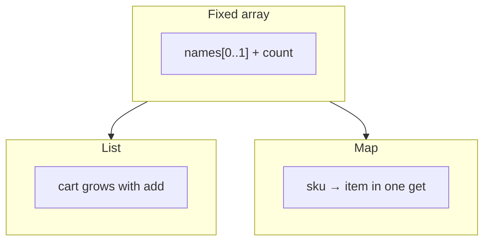
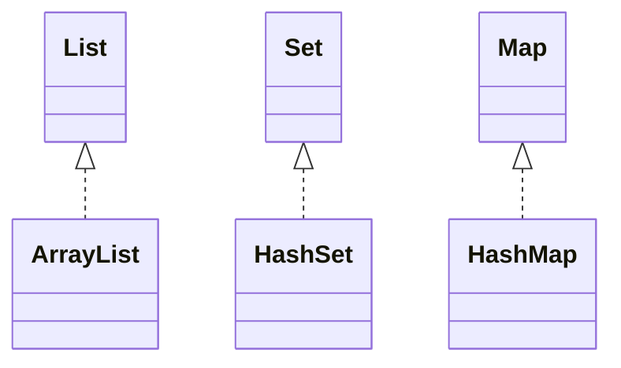

# Module 04a — Collections: List, Set, Map

**Phase:** Collections, Exceptions, I/O

**Previous module:** [OOP Part 3 — Polymorphism, Interfaces & Packages](../03_OOP_Java/03_OOP_Part3_Polymorphism_Interfaces.md)  
**Next module:** [Exception Handling](02_Exception_Handling.md)

**Lab kit:** [15_Lab_Assets/12_collections_inventory/](../15_Lab_Assets/12_collections_inventory/)

---

**Module Outcome:**

- Replace a painful array with `List` / `Set` / `Map` — code to the interface
- Pick ArrayList vs HashSet vs HashMap the way TechMart picks a cart vs a SKU index
- Push an inventory / contacts lab that would have exploded as a raw array

**Teach order today:** array pain → code to the interface → `List` / `ArrayList` → `Set` / `HashSet` → `Map` / `HashMap` → choose the structure → inventory / contacts push.

---

## Motivation — Feel the pain of a full array

The Marks Manager used `int[] marks = new int[20]` plus a `count`. That works until student 21 arrives.

```java
public class ArrayFullPain {
    public static void main(String[] args) {
        String[] names = new String[2];
        int count = 0;
        names[count] = "Priya";
        count++;
        names[count] = "Ravi";
        count++;
        if (count >= names.length) {
            System.out.println("array full — cannot add Meera");
        }
        String find = "Ravi";
        int foundAt = -1;
        for (int i = 0; i < count; i++) {
            if (names[i].equals(find)) {
                foundAt = i;
                break;
            }
        }
        System.out.println("scan index for Ravi: " + foundAt);
    }
}
```

**Expected Output:**

```
array full — cannot add Meera
scan index for Ravi: 1
```

Problems:

1. Size is frozen at `new String[2]` — a real canteen catalog grows.
2. Finding a phone by name means **scan every slot**.
3. Duplicate SKUs are not rejected unless you write another loop.
4. `count` is extra bookkeeping the array itself does not own.

**Visual — fixed row vs growing list vs keyed lookup:**



**Key takeaways:**

- Arrays are the right first tool — size is the tax
- `List` grows when you `add`
- `Map` looks up by key instead of scanning
- `Set` answers “have we seen this SKU / email?”

**Icons:** Order · Employee · Bank · Payroll · Laptop

**Where used?**
- **TechMart** — cart lines, SKU catalog, unique coupon codes
- College apps — growing student lists, unique roll numbers, contact book
- **AcmeHR** — employee roster, emp-id → salary lookup
- **SecureBank** — recent txn list, unique UPI IDs, account-id → balance
- **MedCare** — appointment queues, unique MRNs, phone → patient

---

## Important Concepts

### 1. Code to the interface — `List`, `Set`, `Map`

**Definition:** A **collection** is a growable object that holds other objects. Java groups them in `java.util`. You talk to an **interface** (`List`, `Set`, `Map`) and construct a **class** (`ArrayList`, `HashSet`, `HashMap`).  
**Purpose:** Callers depend on *what it can do* (`add`, `contains`, `get`), not on one brand of implementation. Later you could swap `ArrayList` for another `List` without rewriting every method signature.

```java
import java.util.ArrayList;
import java.util.HashMap;
import java.util.HashSet;
import java.util.List;
import java.util.Map;
import java.util.Set;

public class CodeToInterface {
    public static void main(String[] args) {
        List<String> cart = new ArrayList<>();
        Set<String> emails = new HashSet<>();
        Map<String, String> phones = new HashMap<>();
        cart.add("Notebook");
        emails.add("priya@college.in");
        phones.put("Priya", "9876543210");
        System.out.println(cart.get(0));
        System.out.println(emails.contains("priya@college.in"));
        System.out.println(phones.get("Priya"));
    }
}
```

**Expected Output:**

```
Notebook
true
9876543210
```

| Interface | Job | Class you construct this week |
|-----------|-----|-------------------------------|
| `List` | Ordered, index, duplicates allowed | `ArrayList` |
| `Set` | Unique values, fast `contains` | `HashSet` |
| `Map` | Key → value lookup | `HashMap` |

**Visual — interface on the left, class on the right:**



**Key takeaways:**

- Left side = interface (`List`, `Set`, `Map`)
- Right side = `new ArrayList<>()` / `new HashSet<>()` / `new HashMap<>()`
- Import from `java.util`
- Generics (`List<String>`) say *what* is inside

**Remember:** `List<String> cart = new ArrayList<>();` — not `ArrayList<String> cart = …` on the left.

**Interview:** “Why code to the interface?” So the rest of the program depends on `List` methods, not on `ArrayList` extras. You can change the implementation later.

**Common Error:** Writing `ArrayList cart = new ArrayList();` with **no** `<String>`. That is a raw type — the compiler cannot catch `cart.add(99)` vs `cart.add("Pen")`. Always write the type parameter.

**Note:**
- Wrong: `ArrayList<String> cart` as the field/parameter type everywhere.
- Prefer: `List<String> cart = new ArrayList<>();`.

Declare a `List<String>` cart as `new ArrayList<>()`, add Idli and Tea, and print `size()`.

```java
import java.util.ArrayList;
import java.util.List;

public class ListOnTheLeft {
    public static void main(String[] args) {
        List<String> cart = new ArrayList<>();
        cart.add("Idli");
        cart.add("Tea");
        System.out.println(cart.size());
    }
}
```

**Expected Output:**

```
2
```

Declare a `Map<String, Integer>` of prices as `new HashMap<>()`, put Tea at 15, and print `get("Tea")`.

```java
import java.util.HashMap;
import java.util.Map;

public class MapOnTheLeft {
    public static void main(String[] args) {
        Map<String, Integer> prices = new HashMap<>();
        prices.put("Tea", 15);
        System.out.println(prices.get("Tea"));
    }
}
```

**Expected Output:**

```
15
```

---

### 2. Generics and wrappers — `List<String>`, not `List<int>`

**Definition:** A **generic** type parameter (`<String>`, `<Integer>`) tells the collection what it holds. Collections store **objects**, not primitives.  
**Purpose:** Catch “I put an `int` in a name list” at **compile** time, and document the catalog (`Map<String, Item>`).

```java
import java.util.ArrayList;
import java.util.List;

public class WrapperListDemo {
    public static void main(String[] args) {
        List<Integer> marks = new ArrayList<>();
        marks.add(78);                 // autobox int → Integer
        marks.add(Integer.valueOf(91));
        int first = marks.get(0);      // unbox Integer → int
        System.out.println(first);
        System.out.println(marks.size());
    }
}
```

**Expected Output:**

```
78
2
```

| Primitive | Wrapper you put in a collection |
|-----------|----------------------------------|
| `int` | `Integer` |
| `double` | `Double` |
| `boolean` | `Boolean` |
| `char` | `Character` |

`List<String>` is already objects — no wrapper needed.

**Note:**
- Wrong: `List<int> marks` — does not compile.
- Prefer: `List<Integer> marks`.
- Wrong: `int qty = stock.get(missingSku);` when `get` returns `null` → **NPE** while unboxing.
- Prefer: `containsKey` first, or `getOrDefault`.

**Remember:** Autoboxing is the compiler wrapping `78` into `Integer`. You still cannot write `List<int>`.

**Interview:** Why wrappers? Because `ArrayList` is a list of **references**. A primitive `int` is not a reference.

**Common Error:** `Integer n = map.get("missing"); int x = n;` — `n` is `null`, unboxing throws `NullPointerException`. Guard with `containsKey`.

Store marks 88 and 92 in a `List<Integer>` and print the mark at index 1.

```java
import java.util.ArrayList;
import java.util.List;

public class IntegerMarksList {
    public static void main(String[] args) {
        List<Integer> marks = new ArrayList<>();
        marks.add(88);
        marks.add(92);
        System.out.println(marks.get(1));
    }
}
```

**Expected Output:**

```
92
```

Put stock for SKU P101, then print `get("P101")` and `get("P999")` so a missing key prints `null`.

```java
import java.util.HashMap;
import java.util.Map;

public class MissingGetNull {
    public static void main(String[] args) {
        Map<String, Integer> stock = new HashMap<>();
        stock.put("P101", 40);
        System.out.println(stock.get("P101"));
        System.out.println(stock.get("P999"));
    }
}
```

**Expected Output:**

```
40
null
```

Do **not** write `int p = stock.get("P999");` — that unboxes `null`.

---

### 3. `List` / `ArrayList` — ordered and growable

**Definition:** A **List** is an ordered collection. Index `0` is first. Duplicates are allowed. `ArrayList` is the growable list you construct this week.  
**Purpose:** Carts, attendance registers, add-order of SKUs — anything that must stay in sequence and can grow past a fixed array length.

```java
import java.util.ArrayList;
import java.util.List;

public class ListCreateRead {
    public static void main(String[] args) {
        List<String> cart = new ArrayList<>();
        cart.add("Notebook");
        cart.add("Pen");
        cart.add("USB");
        System.out.println(cart.get(0));
        System.out.println(cart.get(cart.size() - 1));
        System.out.println(cart.size());
        System.out.println(cart);
    }
}
```

**Expected Output:**

```
Notebook
USB
3
[Notebook, Pen, USB]
```

| Call | Job |
|------|-----|
| `add(x)` | Append at the end |
| `add(i, x)` | Insert at index `i` |
| `get(i)` | Read index `i` |
| `set(i, x)` | Replace index `i` |
| `remove(i)` | Delete by **index** |
| `remove(obj)` | Delete first matching **object** |
| `size()` | How many items (`length` was the array field) |
| `contains(x)` | Linear scan — fine for class-size lists |
| `isEmpty()` | `size() == 0` |
| `clear()` | Remove all |

**Note:**
- Wrong: `cart.get(3)` on size 3 → `IndexOutOfBoundsException`. Last index is `size() - 1`.
- Wrong: `marks.remove(20)` on `List<Integer>` — that is **index** 20, not value 20. Use `marks.remove(Integer.valueOf(20))` for value.
- Prefer: `size()` on a List; `length` on an array; `length()` on a String.

**Remember:** Array `length` is a **field**. List uses **`size()`** — a method.

**Interview:** Array vs `List`? Array size is fixed at `new`. `List` grows. Use arrays when the count is truly fixed (7 days). Use `List` for a cart.

**Common Error:** `for (int i = 0; i <= cart.size(); i++)` — the `=` walks one past the end.

Build a TechMart cart with Idli, Dosa, and Tea, then print the first item and the last item using `size() - 1`.

```java
import java.util.ArrayList;
import java.util.List;

public class CanteenCartEnds {
    public static void main(String[] args) {
        List<String> cart = new ArrayList<>();
        cart.add("Idli");
        cart.add("Dosa");
        cart.add("Tea");
        System.out.println(cart.get(0));
        System.out.println(cart.get(cart.size() - 1));
    }
}
```

**Expected Output:**

```
Idli
Tea
```

Add Notebook to a TechMart cart, insert PROMO-Mug at index 0, and print the list.

```java
import java.util.ArrayList;
import java.util.List;

public class PromoAtFront {
    public static void main(String[] args) {
        List<String> cart = new ArrayList<>();
        cart.add("Notebook");
        cart.add(0, "PROMO-Mug");
        System.out.println(cart);
    }
}
```

**Expected Output:**

```
[PROMO-Mug, Notebook]
```

---

### 4. List CRUD — update and delete

**Definition:** **CRUD** on a list is Create (`add`), Read (`get`), Update (`set`), Delete (`remove`).  
**Purpose:** Correct a misspelled name, drop a cancelled order, keep the same list object.

```java
import java.util.ArrayList;
import java.util.List;

public class ListUpdateDelete {
    public static void main(String[] args) {
        List<String> names = new ArrayList<>();
        names.add("Ananya");
        names.add("Ravi");
        names.add("Priya");
        names.set(1, "Ravi Kumar");
        names.remove(0);
        System.out.println(names);
        boolean gone = names.remove("Priya");
        System.out.println(gone);
        System.out.println(names);
    }
}
```

**Expected Output:**

```
[Ravi Kumar, Priya]
true
[Ravi Kumar]
```

Enhanced `for` still works:

```java
import java.util.ArrayList;
import java.util.List;

public class ListEnhancedFor {
    public static void main(String[] args) {
        List<String> cart = new ArrayList<>();
        cart.add("Notebook");
        cart.add("Pen");
        for (String item : cart) {
            System.out.println(item);
        }
    }
}
```

**Expected Output:**

```
Notebook
Pen
```

**Note:**
- Wrong: `remove` while that same enhanced-`for` is running — the list is structurally changed mid-walk. Build a second list, or remove by index in a classic `for` counting down.
- Prefer: `if (names.contains("Priya")) { names.remove("Priya"); }` when the value might be absent (`remove` returns `false` if missing — it does not crash).

Add Ananya and Ravi to a list, replace index 1 with Ravi Kumar using `set`, and print the list.

```java
import java.util.ArrayList;
import java.util.List;

public class ReplaceName {
    public static void main(String[] args) {
        List<String> names = new ArrayList<>();
        names.add("Ananya");
        names.add("Ravi");
        names.set(1, "Ravi Kumar");
        System.out.println(names);
    }
}
```

**Expected Output:**

```
[Ananya, Ravi Kumar]
```

Add three order IDs, remove index 1, and print the cancelled ID plus the remaining list.

```java
import java.util.ArrayList;
import java.util.List;

public class RemoveSecond {
    public static void main(String[] args) {
        List<String> orders = new ArrayList<>();
        orders.add("ORD-1");
        orders.add("ORD-2");
        orders.add("ORD-3");
        String cancelled = orders.remove(1);
        System.out.println(cancelled);
        System.out.println(orders);
    }
}
```

**Expected Output:**

```
ORD-2
[ORD-1, ORD-3]
```

---

### 5. `Set` / `HashSet` — uniqueness

**Definition:** A **Set** holds **unique** values. Adding a duplicate is ignored (`add` returns `false`). `HashSet` is the set you construct this week. There is **no index**.  
**Purpose:** Dedup emails before a placement-cell import, reject a second SKU `P101`, test “is this roll already registered?” without scanning a list.

```java
import java.util.HashSet;
import java.util.Set;

public class UniqueEmails {
    public static void main(String[] args) {
        Set<String> emails = new HashSet<>();
        System.out.println(emails.add("priya@college.in"));
        System.out.println(emails.add("ravi@college.in"));
        System.out.println(emails.add("priya@college.in"));
        System.out.println(emails.size());
        System.out.println(emails.contains("ravi@college.in"));
        System.out.println(emails.contains("meera@college.in"));
    }
}
```

**Expected Output:**

```
true
true
false
2
true
false
```

Think of a club register that refuses a second stamp for the same ID.

**Set vs List for membership:**

| | `List.contains` | `HashSet.contains` |
|--|-----------------|---------------------|
| Duplicate values | Allowed | Ignored |
| Index `get(0)` | Yes | No |
| “Have we seen this email?” | Scans the list | Average constant time |

**Note:**
- Wrong: `emails.get(0)` — `Set` has no get-by-index.
- Wrong: depending on print order of a `HashSet` — iteration order is **not** a promise. If you need first-seen order, keep a `List` as well (lab kit `skuOrder`).
- Prefer: `add`’s boolean, or `contains` before insert, when you must **tell the user** about a duplicate.

**Remember:** `set.add(x)` returns `false` when `x` was already there — that is the uniqueness API.

**Interview:** Why not a `List` for unique SKUs? You would scan on every add. A `HashSet` is built for “is this key already in?”.

**Common Error:** Putting your own class in a `HashSet` without a matching `equals` / `hashCode`. Two `Item` objects with the same SKU still look different. This week: store **`String` SKUs / emails** in the set.

Add SKU P101 to a TechMart set twice and print whether the second `add` succeeded plus the set size.

```java
import java.util.HashSet;
import java.util.Set;

public class DupSkuSet {
    public static void main(String[] args) {
        Set<String> skus = new HashSet<>();
        skus.add("P101");
        boolean second = skus.add("P101");
        System.out.println(second);
        System.out.println(skus.size());
    }
}
```

**Expected Output:**

```
false
1
```

Add Priya and Ravi to a guest set; if Meera is missing, print that she is a new guest.

```java
import java.util.HashSet;
import java.util.Set;

public class GuestContains {
    public static void main(String[] args) {
        Set<String> guests = new HashSet<>();
        guests.add("Priya");
        guests.add("Ravi");
        if (guests.contains("Meera")) {
            System.out.println("already in");
        } else {
            System.out.println("new guest");
        }
    }
}
```

**Expected Output:**

```
new guest
```

---

### 6. Set overlap — both batches, only warehouse A

**Definition:** `HashSet` can copy another set, then `addAll` (union), `retainAll` (intersection), `removeAll` (difference). These **mutate** the set you call them on.  
**Purpose:** “Students in both batches”, “SKUs only in warehouse A”, “tags in either catalog”.

```java
import java.util.HashSet;
import java.util.Set;

public class BatchOverlap {
    public static void main(String[] args) {
        Set<String> batchA = new HashSet<>();
        batchA.add("Priya");
        batchA.add("Ravi");
        Set<String> batchB = new HashSet<>();
        batchB.add("Ravi");
        batchB.add("Meera");

        Set<String> both = new HashSet<>(batchA);
        both.retainAll(batchB);
        System.out.println(both);

        Set<String> onlyA = new HashSet<>(batchA);
        onlyA.removeAll(batchB);
        System.out.println(onlyA);
    }
}
```

**Expected Output:**

```
[Ravi]
[Priya]
```

(The `[Ravi]` / `[Priya]` print is one-element set `toString`. Do not depend on multi-element HashSet order.)

**Note:**
- Wrong: `batchA.retainAll(batchB)` when you still need the original `batchA`.
- Prefer: `new HashSet<>(batchA)` first, then mutate the **copy**.

Copy warehouse A's SKUs, `addAll` warehouse B, then print the union size and whether P103 is present.

```java
import java.util.HashSet;
import java.util.Set;

public class SkuUnion {
    public static void main(String[] args) {
        Set<String> wareA = new HashSet<>();
        wareA.add("P101");
        wareA.add("P102");
        Set<String> wareB = new HashSet<>();
        wareB.add("P102");
        wareB.add("P103");
        Set<String> all = new HashSet<>(wareA);
        all.addAll(wareB);
        System.out.println(all.size());
        System.out.println(all.contains("P103"));
    }
}
```

**Expected Output:**

```
3
true
```

Copy batch A, `retainAll` batch B, and print how many students are in both batches.

```java
import java.util.HashSet;
import java.util.Set;

public class BothBatches {
    public static void main(String[] args) {
        Set<String> a = new HashSet<>();
        a.add("Priya");
        a.add("Ravi");
        Set<String> b = new HashSet<>();
        b.add("Ravi");
        b.add("Meera");
        Set<String> both = new HashSet<>(a);
        both.retainAll(b);
        System.out.println(both.size());
    }
}
```

**Expected Output:**

```
1
```

---

### 7. `Map` / `HashMap` — lookups

**Definition:** A **Map** stores **key → value** pairs. Keys are unique. `HashMap` is the map you construct this week.  
**Purpose:** Contact book (`name → phone`), inventory (`sku → Item`), emp-id → salary — **one** `get` instead of a scan.

```java
import java.util.HashMap;
import java.util.Map;

public class ContactPutGet {
    public static void main(String[] args) {
        Map<String, String> phones = new HashMap<>();
        phones.put("Priya", "9876543210");
        phones.put("Ravi", "9123456780");
        phones.put("Priya", "9000000000");
        System.out.println(phones.get("Priya"));
        System.out.println(phones.get("Meera"));
        System.out.println(phones.size());
    }
}
```

**Expected Output:**

```
9000000000
null
2
```

Second `put` on the same key **replaces** the value. Size stays `2`.

| Call | Job |
|------|-----|
| `put(k, v)` | Insert or replace |
| `get(k)` | Value, or `null` if missing |
| `containsKey(k)` | Safe “is this key there?” |
| `getOrDefault(k, d)` | Value, or `d` if missing — **no** `null` |
| `remove(k)` | Delete pair; returns old value or `null` |
| `keySet()` | The keys as a `Set` |
| `values()` | The values as a `Collection` |
| `entrySet()` | Key+value pairs to loop |

**Note:**
- Wrong: `phones.get("Meera").length()` — `get` is `null` → NPE.
- Wrong: `int p = prices.get("P999");` — unbox `null` → NPE.
- Prefer: `if (phones.containsKey(name)) { ... } else { print not found; return; }`.
- Prefer: `phones.getOrDefault(name, "N/A")` when a default string is enough.

**Remember:** Missing key → `get` returns **`null`**. That is not a crash by itself. Using the `null` as an object **is**.

**Interview:** Map vs scanning a `List` of names? Map is a dictionary. Average `get` does not walk every contact. A list walk grows with every new student.

**Common Error:** Using `==` to compare map keys that are `String` (`if (name == "Priya")`). Keys still need `equals`. `containsKey("Priya")` uses `equals` / `hashCode` for you.

Put a student's name and roll in a map, print `get("name")`, and print `getOrDefault("phone", "N/A")`.

```java
import java.util.HashMap;
import java.util.Map;

public class StudentGetOrDefault {
    public static void main(String[] args) {
        Map<String, String> student = new HashMap<>();
        student.put("name", "Priya");
        student.put("roll", "2026001");
        System.out.println(student.get("name"));
        System.out.println(student.getOrDefault("phone", "N/A"));
    }
}
```

**Expected Output:**

```
Priya
N/A
```

Put price for P101; if P999 is missing, print `not found` instead of calling `get` blindly.

```java
import java.util.HashMap;
import java.util.Map;

public class CatalogContainsKey {
    public static void main(String[] args) {
        Map<String, Integer> prices = new HashMap<>();
        prices.put("P101", 40);
        String sku = "P999";
        if (prices.containsKey(sku)) {
            System.out.println(prices.get(sku));
        } else {
            System.out.println("not found: " + sku);
        }
    }
}
```

**Expected Output:**

```
not found: P999
```

---

### 8. Walking a Map — `keySet` and `entrySet`

**Definition:** You do not `get(0)` on a map. You loop **keys** or **entries**.  
**Purpose:** Print the whole contact book, total an inventory, dump SKUs for a receipt.

```java
import java.util.HashMap;
import java.util.Map;

public class WalkContactMap {
    public static void main(String[] args) {
        Map<String, String> phones = new HashMap<>();
        phones.put("Priya", "9876543210");
        phones.put("Ravi", "9123456780");
        for (String name : phones.keySet()) {
            System.out.println(name + " " + phones.get(name));
        }
        for (Map.Entry<String, String> row : phones.entrySet()) {
            System.out.println(row.getKey() + "=" + row.getValue());
        }
    }
}
```

Print order of a `HashMap` is **not** add-order. For a receipt in add-order, keep a `List<String>` of keys (lab kit).

**Note:**
- Wrong: treating `HashMap` like a numbered register (`phones.get(0)`).
- Prefer: `entrySet()` when you need key **and** value together (one lookup, not `get` inside a `keySet` loop).

Add Notebook and Pen to a TechMart cart and print each item with an enhanced for-loop.

```java
import java.util.ArrayList;
import java.util.List;

public class PrintCartList {
    public static void main(String[] args) {
        List<String> cart = new ArrayList<>();
        cart.add("Notebook");
        cart.add("Pen");
        for (String item : cart) {
            System.out.println(item);
        }
    }
}
```

**Expected Output:**

```
Notebook
Pen
```

Put Tea at ₹15 and print each map entry as key plus rupee value using `entrySet()`.

```java
import java.util.HashMap;
import java.util.Map;

public class PrintPriceEntries {
    public static void main(String[] args) {
        Map<String, Integer> prices = new HashMap<>();
        prices.put("Tea", 15);
        for (Map.Entry<String, Integer> row : prices.entrySet()) {
            System.out.println(row.getKey() + " ₹" + row.getValue());
        }
    }
}
```

**Expected Output:**

```
Tea ₹15
```

---

### 9. Choosing List vs Set vs Map

**Definition:** Pick the structure from the **job**, not from habit.  
**Purpose:** Avoid “everything is an `ArrayList`” — that brings back linear scans and duplicate SKUs.

| Need | Structure | Campus example |
|------|-----------|----------------|
| Order + duplicates OK | `List` | Canteen cart lines, add-order of SKUs |
| Unique membership | `Set` | Emails, SKUs already in the catalog |
| Lookup by id | `Map` | SKU → price, name → phone |

```java
import java.util.ArrayList;
import java.util.HashMap;
import java.util.HashSet;
import java.util.List;
import java.util.Map;
import java.util.Set;

public class ChooseTheStructure {
    public static void main(String[] args) {
        List<String> cart = new ArrayList<>();
        cart.add("Tea");
        cart.add("Tea");
        Set<String> emails = new HashSet<>();
        emails.add("a@college.in");
        emails.add("a@college.in");
        Map<String, Integer> stock = new HashMap<>();
        stock.put("P101", 12);
        System.out.println(cart.size());
        System.out.println(emails.size());
        System.out.println(stock.get("P101"));
    }
}
```

**Expected Output:**

```
2
1
12
```

Two teas in the **cart** (List). One email in the **set**. Stock qty from the **map**.

**Interview:** `LinkedHashMap` keeps insert order *and* lookup — Stretch / later reading. This week: `HashMap` + a `List` of keys when order matters.

Add Tea twice to a `List` and print `size()` to show duplicates are kept.

```java
import java.util.ArrayList;
import java.util.List;

public class TwoTeasInCart {
    public static void main(String[] args) {
        List<String> cart = new ArrayList<>();
        cart.add("Tea");
        cart.add("Tea");
        System.out.println(cart.size());
    }
}
```

**Expected Output:**

```
2
```

Put emp-id 101 and 102 salaries in a map and print the salary for 102 with `get`.

```java
import java.util.HashMap;
import java.util.Map;

public class EmpIdSalary {
    public static void main(String[] args) {
        Map<Integer, Integer> salary = new HashMap<>();
        salary.put(101, 45000);
        salary.put(102, 52000);
        System.out.println(salary.get(102));
    }
}
```

**Expected Output:**

```
52000
```

---

## Step-by-Step Annotated Java Code

### Step 1: Grow a cart — the array pain, fixed

```java
import java.util.ArrayList;
import java.util.List;

public class GrowCartDemo {
    public static void main(String[] args) {
        List<String> cart = new ArrayList<>();
        cart.add("Notebook");
        cart.add("Pen");
        cart.add("USB");
        cart.set(1, "Gel Pen");
        System.out.println(cart);
        System.out.println("items: " + cart.size());
    }
}
```

**Expected Output:**

```
[Notebook, Gel Pen, USB]
items: 3
```

No `count`. No `new String[20]`. `add` is Create; `set` is Update.

Add Priya, Ravi, and Meera to a list, then print `size()` and the name at index 1.

```java
import java.util.ArrayList;
import java.util.List;

public class ThreeNamesList {
    public static void main(String[] args) {
        List<String> names = new ArrayList<>();
        names.add("Priya");
        names.add("Ravi");
        names.add("Meera");
        System.out.println(names.size());
        System.out.println(names.get(1));
    }
}
```

**Expected Output:**

```
3
Ravi
```

Add Tea to a TechMart cart, call `clear()`, and print `isEmpty()`.

```java
import java.util.ArrayList;
import java.util.List;

public class ClearCart {
    public static void main(String[] args) {
        List<String> cart = new ArrayList<>();
        cart.add("Tea");
        cart.clear();
        System.out.println(cart.isEmpty());
    }
}
```

**Expected Output:**

```
true
```

---

### Step 2: Dedup emails — uniqueness before import

```java
import java.util.HashSet;
import java.util.Set;

public class DedupEmailsDemo {
    public static void main(String[] args) {
        String[] raw = {
            "priya@college.in",
            "ravi@college.in",
            "priya@college.in"
        };
        Set<String> unique = new HashSet<>();
        int skipped = 0;
        for (String email : raw) {
            if (!unique.add(email)) {
                skipped++;
            }
        }
        System.out.println("unique: " + unique.size());
        System.out.println("skipped: " + skipped);
    }
}
```

**Expected Output:**

```
unique: 2
skipped: 1
```

`add` returning `false` is the duplicate signal — no extra `contains` required.

Add roll 2026001 to a set, add it again, and print the boolean from the second `add`.

```java
import java.util.HashSet;
import java.util.Set;

public class UniqueRolls {
    public static void main(String[] args) {
        Set<String> rolls = new HashSet<>();
        rolls.add("2026001");
        System.out.println(rolls.add("2026001"));
    }
}
```

**Expected Output:**

```
false
```

Copy a list of SKUs that includes a duplicate into a `HashSet` and print both sizes.

```java
import java.util.ArrayList;
import java.util.HashSet;
import java.util.List;
import java.util.Set;

public class UniqueFromList {
    public static void main(String[] args) {
        List<String> raw = new ArrayList<>();
        raw.add("P101");
        raw.add("P102");
        raw.add("P101");
        Set<String> unique = new HashSet<>(raw);
        System.out.println(raw.size());
        System.out.println(unique.size());
    }
}
```

**Expected Output:**

```
3
2
```

`new HashSet<>(raw)` copies unique values from the list.

---

### Step 3: Contact book — Map lookups

```java
import java.util.HashMap;
import java.util.Map;

public class ContactBookDemo {
    public static void main(String[] args) {
        Map<String, String> phones = new HashMap<>();
        phones.put("Priya", "9876543210");
        phones.put("Ravi", "9123456780");

        String name = "Priya";
        if (phones.containsKey(name)) {
            System.out.println(phones.get(name));
        } else {
            System.out.println("not found: " + name);
        }

        phones.remove("Ravi");
        System.out.println(phones.getOrDefault("Ravi", "not found: Ravi"));
    }
}
```

**Expected Output:**

```
9876543210
not found: Ravi
```

Put Dev's phone twice with a new number and print the stored phone plus map `size()`.

```java
import java.util.HashMap;
import java.util.Map;

public class ReplacePhone {
    public static void main(String[] args) {
        Map<String, String> phones = new HashMap<>();
        phones.put("Dev", "9876543210");
        phones.put("Dev", "9000000000");
        System.out.println(phones.get("Dev"));
        System.out.println(phones.size());
    }
}
```

**Expected Output:**

```
9000000000
1
```

Put Anita's phone; if Ravi is missing, print not found and then print the map size.

```java
import java.util.HashMap;
import java.util.Map;

public class DeleteIfPresent {
    public static void main(String[] args) {
        Map<String, String> phones = new HashMap<>();
        phones.put("Anita", "9876500000");
        if (phones.containsKey("Ravi")) {
            phones.remove("Ravi");
        } else {
            System.out.println("not found: Ravi");
        }
        System.out.println(phones.size());
    }
}
```

**Expected Output:**

```
not found: Ravi
1
```

---

### Step 4: Inventory — List + Set + Map together

This is the lab-kit shape. `Item` is a small encapsulated class (OOP Parts 1–3). Collections hold SKUs and the catalog.

```java
import java.util.ArrayList;
import java.util.HashMap;
import java.util.HashSet;
import java.util.List;
import java.util.Map;
import java.util.Set;

public class InventoryComboDemo {
    public static void main(String[] args) {
        Inventory stock = new Inventory();
        stock.addItem("P101", "Notebook", 40);
        stock.addItem("P102", "Pen", 10);
        stock.addItem("P101", "Notebook", 40);
        stock.listItems();
        stock.lookup("P102");
        stock.lookup("P999");
    }
}

class StockItem {
    private String sku;
    private String name;
    private int priceInr;

    StockItem(String sku, String name, int priceInr) {
        this.sku = sku;
        this.name = name;
        this.priceInr = priceInr;
    }

    String getSku() {
        return sku;
    }

    String getName() {
        return name;
    }

    int getPriceInr() {
        return priceInr;
    }
}

class Inventory {
    private List<String> skuOrder = new ArrayList<>();
    private Set<String> knownSkus = new HashSet<>();
    private Map<String, StockItem> catalog = new HashMap<>();

    void addItem(String sku, String name, int priceInr) {
        if (sku.trim().length() == 0 || name.trim().length() == 0) {
            System.out.println("sku and name required");
            return;
        }
        if (priceInr <= 0) {
            System.out.println("price must be positive");
            return;
        }
        if (knownSkus.contains(sku)) {
            System.out.println("duplicate SKU: " + sku);
            return;
        }
        catalog.put(sku, new StockItem(sku, name, priceInr));
        knownSkus.add(sku);
        skuOrder.add(sku);
    }

    void listItems() {
        for (String sku : skuOrder) {
            StockItem item = catalog.get(sku);
            System.out.println(item.getSku() + " " + item.getName() + " ₹" + item.getPriceInr());
        }
    }

    void lookup(String sku) {
        if (!catalog.containsKey(sku)) {
            System.out.println("not found: " + sku);
            return;
        }
        StockItem item = catalog.get(sku);
        System.out.println(item.getSku() + " " + item.getName() + " ₹" + item.getPriceInr());
    }
}
```

**Expected Output:**

```
duplicate SKU: P101
P101 Notebook ₹40
P102 Pen ₹10
P102 Pen ₹10
not found: P999
```

Why three structures?

| Structure | Job here |
|-----------|----------|
| `Map<String, StockItem>` | Lookup by SKU |
| `Set<String>` | Duplicate SKU in one `contains` |
| `List<String>` | List in **add-order** (`HashMap` will not promise that) |

Lab kit: [15_Lab_Assets/12_collections_inventory/](../15_Lab_Assets/12_collections_inventory/).

Store a TechMart Notebook on SKU P101 in two parallel maps (name and price) and print both together.

```java
import java.util.HashMap;
import java.util.Map;

public class ParallelMapsPain {
    public static void main(String[] args) {
        Map<String, String> names = new HashMap<>();
        Map<String, Integer> prices = new HashMap<>();
        names.put("P101", "Notebook");
        prices.put("P101", 40);
        System.out.println(names.get("P101") + " ₹" + prices.get("P101"));
    }
}
```

**Expected Output:**

```
Notebook ₹40
```

Parallel maps work for a tiny demo. They drift apart (name without price). Prefer one `Item` in one map — as in Step 4.

Keep a TechMart add-order `List` of SKUs next to a price `Map` and print each SKU with its price in list order.

```java
import java.util.ArrayList;
import java.util.HashMap;
import java.util.List;
import java.util.Map;

public class OrderPlusMap {
    public static void main(String[] args) {
        List<String> order = new ArrayList<>();
        Map<String, Integer> prices = new HashMap<>();
        order.add("P101");
        prices.put("P101", 40);
        order.add("P102");
        prices.put("P102", 10);
        for (String sku : order) {
            System.out.println(sku + " ₹" + prices.get(sku));
        }
    }
}
```

**Expected Output:**

```
P101 ₹40
P102 ₹10
```

---

### Step 5: Menu sketch — inventory homework

Assume the user types numbers. Bad text that cannot become an `int` may crash — Exception Handling teaches safe `try` / `catch` next. Blank SKU / bad price stay `print` + `return`.

```java
import java.util.ArrayList;
import java.util.HashMap;
import java.util.HashSet;
import java.util.List;
import java.util.Map;
import java.util.Set;

public class InventoryMenuSketch {
    public static void main(String[] args) {
        Inventory stock = new Inventory();
        java.util.Scanner sc = new java.util.Scanner(System.in);
        while (true) {
            System.out.println("\n1) Add  2) Lookup  3) List  4) Update price  5) Remove  6) Exit");
            System.out.print("Choose: ");
            String choice = sc.nextLine().trim();
            if (choice.equals("6")) {
                System.out.println("Bye");
                break;
            }
            if (choice.equals("1")) {
                System.out.print("SKU: ");
                String sku = sc.nextLine().trim();
                System.out.print("Name: ");
                String name = sc.nextLine().trim();
                System.out.print("Price INR: ");
                int price = Integer.parseInt(sc.nextLine().trim());
                stock.addItem(sku, name, price);
            } else if (choice.equals("2")) {
                System.out.print("SKU: ");
                stock.lookup(sc.nextLine().trim());
            } else if (choice.equals("3")) {
                stock.listItems();
            } else if (choice.equals("4")) {
                System.out.print("SKU: ");
                String sku = sc.nextLine().trim();
                System.out.print("New price INR: ");
                stock.updatePrice(sku, Integer.parseInt(sc.nextLine().trim()));
            } else if (choice.equals("5")) {
                System.out.print("SKU: ");
                stock.removeItem(sc.nextLine().trim());
            } else {
                System.out.println("Invalid choice");
            }
        }
    }
}

class MenuItem {
    private String sku;
    private String name;
    private int priceInr;

    MenuItem(String sku, String name, int priceInr) {
        this.sku = sku;
        this.name = name;
        this.priceInr = priceInr;
    }

    String getSku() {
        return sku;
    }

    String getName() {
        return name;
    }

    int getPriceInr() {
        return priceInr;
    }

    void setPriceInr(int priceInr) {
        this.priceInr = priceInr;
    }
}

class Inventory {
    private List<String> skuOrder = new ArrayList<>();
    private Set<String> knownSkus = new HashSet<>();
    private Map<String, MenuItem> catalog = new HashMap<>();

    void addItem(String sku, String name, int priceInr) {
        if (sku.trim().length() == 0 || name.trim().length() == 0) {
            System.out.println("sku and name required");
            return;
        }
        if (priceInr <= 0) {
            System.out.println("price must be positive");
            return;
        }
        if (knownSkus.contains(sku)) {
            System.out.println("duplicate SKU: " + sku);
            return;
        }
        catalog.put(sku, new MenuItem(sku, name, priceInr));
        knownSkus.add(sku);
        skuOrder.add(sku);
    }

    void listItems() {
        if (skuOrder.isEmpty()) {
            System.out.println("(empty)");
            return;
        }
        for (String sku : skuOrder) {
            MenuItem item = catalog.get(sku);
            System.out.println(item.getSku() + " " + item.getName() + " ₹" + item.getPriceInr());
        }
    }

    void lookup(String sku) {
        if (!catalog.containsKey(sku)) {
            System.out.println("not found: " + sku);
            return;
        }
        MenuItem item = catalog.get(sku);
        System.out.println(item.getSku() + " " + item.getName() + " ₹" + item.getPriceInr());
    }

    void updatePrice(String sku, int priceInr) {
        if (priceInr <= 0) {
            System.out.println("price must be positive");
            return;
        }
        MenuItem item = catalog.get(sku);
        if (item == null) {
            System.out.println("not found: " + sku);
            return;
        }
        item.setPriceInr(priceInr);
    }

    void removeItem(String sku) {
        if (!catalog.containsKey(sku)) {
            System.out.println("not found: " + sku);
            return;
        }
        catalog.remove(sku);
        knownSkus.remove(sku);
        skuOrder.remove(sku);
    }
}
```

`javac InventoryMenuSketch.java` then `java InventoryMenuSketch`. Same `Inventory` idea as the lab kit — the kit uses class name `Item` in `CampusInventory.java`.

Do **not** type into this sketch during `javac` checks; compile-only is enough.

If a SKU-order list is empty, print `(empty)`.

```java
import java.util.ArrayList;
import java.util.List;

public class EmptyListMessage {
    public static void main(String[] args) {
        List<String> skuOrder = new ArrayList<>();
        if (skuOrder.isEmpty()) {
            System.out.println("(empty)");
        }
    }
}
```

**Expected Output:**

```
(empty)
```

Parse a typed TechMart price `"55"` with `Integer.parseInt` after `trim` and print the int.

```java
public class ParsePriceLite {
    public static void main(String[] args) {
        String typed = "55";
        int price = Integer.parseInt(typed.trim());
        System.out.println(price);
    }
}
```

**Expected Output:**

```
55
```

---

## Practice Exercises

*(Each Practice item includes a filled **Model answer** and **Expected Output** where the demo prints.)*

### Basic

1. Create a `List<String>` of 5 product names. Print first, last, and `size()`.

   **Model answer:**

```java
import java.util.ArrayList;
import java.util.List;

public class FiveProducts {
    public static void main(String[] args) {
        List<String> products = new ArrayList<>();
        products.add("Notebook");
        products.add("Pen");
        products.add("USB");
        products.add("Mouse");
        products.add("Keyboard");
        System.out.println(products.get(0));
        System.out.println(products.get(products.size() - 1));
        System.out.println(products.size());
    }
}
```

   **Expected Output:**

```
Notebook
Keyboard
5
```

2. Dedup `P101, P102, P101` with a `HashSet`. Print `size()`.

   **Model answer:**

```java
import java.util.HashSet;
import java.util.Set;

public class DedupThreeSkus {
    public static void main(String[] args) {
        Set<String> skus = new HashSet<>();
        skus.add("P101");
        skus.add("P102");
        skus.add("P101");
        System.out.println(skus.size());
    }
}
```

   **Expected Output:**

```
2
```

3. `Map` of one student: `name`, `roll`. Print `name` and `getOrDefault("phone", "N/A")`.

   **Model answer:**

```java
import java.util.HashMap;
import java.util.Map;

public class OneStudentMap {
    public static void main(String[] args) {
        Map<String, String> student = new HashMap<>();
        student.put("name", "Dev");
        student.put("roll", "21");
        System.out.println(student.get("name"));
        System.out.println(student.getOrDefault("phone", "N/A"));
    }
}
```

   **Expected Output:**

```
Dev
N/A
```

### Intermediate

1. Store 3 employees as a `List<String>` of `"id|name|dept"`. Update Priya’s dept to Finance by `set`. Print all.

   **Model answer:**

```java
import java.util.ArrayList;
import java.util.List;

public class EmployeeRosterList {
    public static void main(String[] args) {
        List<String> employees = new ArrayList<>();
        employees.add("101|Ravi|HR");
        employees.add("102|Priya|IT");
        employees.add("103|Arjun|Sales");
        employees.set(1, "102|Priya|Finance");
        for (String row : employees) {
            System.out.println(row);
        }
    }
}
```

   **Expected Output:**

```
101|Ravi|HR
102|Priya|Finance
103|Arjun|Sales
```

(A `Map<Integer, String>` of emp-id → dept is even better — next item.)

2. Product catalog: `Map<String, Integer>` SKU → price for 3 products. Lookup `P999` with `containsKey` (print not found).

   **Model answer:**

```java
import java.util.HashMap;
import java.util.Map;

public class CatalogLookupPractice {
    public static void main(String[] args) {
        Map<String, Integer> catalog = new HashMap<>();
        catalog.put("P101", 80);
        catalog.put("P102", 120);
        catalog.put("P103", 499);
        String sku = "P999";
        if (catalog.containsKey(sku)) {
            System.out.println("₹" + catalog.get(sku));
        } else {
            System.out.println("SKU not found");
        }
    }
}
```

   **Expected Output:**

```
SKU not found
```

3. Count expenses per category with a `Map<String, Integer>`. Rows: Food 450, Travel 120, Food 200.

   **Model answer:**

```java
import java.util.HashMap;
import java.util.Map;

public class ExpenseCountMap {
    public static void main(String[] args) {
        Map<String, Integer> totals = new HashMap<>();
        add(totals, "Food", 450);
        add(totals, "Travel", 120);
        add(totals, "Food", 200);
        System.out.println(totals.get("Food"));
        System.out.println(totals.get("Travel"));
    }

    static void add(Map<String, Integer> totals, String cat, int amt) {
        int soFar = totals.getOrDefault(cat, 0);
        totals.put(cat, soFar + amt);
    }
}
```

   **Expected Output:**

```
650
120
```

4. Why keep a `List<String> skuOrder` next to `Map<String, Item> catalog`? Three to four sentences, no code.

   **Model answer:** A `HashMap` does not promise add-order when you loop `keySet()`. The canteen receipt should list Notebook before Pen if that is how they were added. The `List` remembers insert order. The `Map` still gives O(1)-style lookup by SKU. The `Set` (or `containsKey`) still rejects duplicates.

5. `List<Integer> marks` has `10` then `20`. What does `marks.remove(20)` try to do? How do you remove the **value** 20?

   **Model answer:** `remove(20)` uses the **index** overload — index 20, which is out of bounds on size 2. Remove the value with `marks.remove(Integer.valueOf(20))`.

### Interview-Oriented

1. Array vs `List` in one sentence.

   **Model answer:** An array’s size is fixed at creation; a `List` (`ArrayList`) can grow with `add`.

2. Why `List<String> cart = new ArrayList<>();` instead of `ArrayList<String> cart`?

   **Model answer:** Code to the interface — callers depend on `List` methods. You can change the class on the right later without changing every signature.

3. `HashSet` vs `HashMap`?

   **Model answer:** Set = unique values only (`contains` / `add`). Map = key → value (`get` / `put`). A map’s **keys** already behave like a set.

4. What does `map.get(missing)` return? Why can `int x = map.get(missing)` crash?

   **Model answer:** `get` returns `null`. Unboxing `null` to `int` throws `NullPointerException`. Use `containsKey` or `getOrDefault`.

5. Can you `get(0)` on a `HashSet`?

   **Model answer:** No. A set has no index. Loop it, or keep a `List` if order/index matters.

---

## Mini-Project (Assignment): TechMart Inventory + Contact Book

**Lab kit:** [15_Lab_Assets/12_collections_inventory/](../15_Lab_Assets/12_collections_inventory/)

Arrays week froze the catalog at `new String[20]`. OOP week built `Item`-like objects but still used arrays for many accounts. This assignment is the **portfolio push**: a growing inventory, unique SKUs, keyed lookup, a contact book, a small menu, and a GitHub README.

Bring forward encapsulation (`private` fields, no public `priceInr`). Validate with `print` + `return`. Do **not** write `throw` / `try` / `catch`. Do **not** save files yet.

### What to build

| Piece | Detail |
|-------|--------|
| `Item` | Private `sku`, `name`, `priceInr`; constructor; getters; `setPriceInr` |
| `Inventory` | `List<String> skuOrder`, `Set<String> knownSkus`, `Map<String, Item> catalog` — **interfaces on the left** |
| Add | Reject blank sku/name, `price <= 0`, duplicate SKU (print + return) |
| Lookup / update / remove | Missing SKU prints `not found` — **no** NPE |
| List | Walk **`skuOrder`**, not `catalog.keySet()` |
| Inventory CLI | 1 Add · 2 Lookup · 3 List · 4 Update price · 5 Remove · 6 Exit |
| Contact book | `Map<String, String>` name → phone; add / lookup / delete / list; missing name prints not found (`containsKey` or `getOrDefault`) |
| Unique emails | `Set<String>` — adding a contact with a duplicate email prints a message and returns |
| Validation | `print` + `return` only — **no** `throw` / `try` / `catch` |
| Storage | `ArrayList` / `HashSet` / `HashMap` — **no** files, JDBC, Spring, Lombok |

Contacts can be a second class in the same file, or a second `public` class in its own file (`ContactBook.java`). Same rules: interface types, no crash on missing keys.

**Starter idea (contacts beside inventory):**

```java
import java.util.HashMap;
import java.util.HashSet;
import java.util.Map;
import java.util.Set;

public class ContactBookLite {
    public static void main(String[] args) {
        Map<String, String> phones = new HashMap<>();
        Set<String> emails = new HashSet<>();
        addContact(phones, emails, "Priya", "9876543210", "priya@college.in");
        addContact(phones, emails, "Ravi", "9123456780", "priya@college.in");
        lookup(phones, "Priya");
        lookup(phones, "Meera");
    }

    static void addContact(Map<String, String> phones, Set<String> emails,
            String name, String phone, String email) {
        if (name.trim().length() == 0) {
            System.out.println("name required");
            return;
        }
        if (!emails.add(email)) {
            System.out.println("duplicate email: " + email);
            return;
        }
        phones.put(name, phone);
    }

    static void lookup(Map<String, String> phones, String name) {
        if (!phones.containsKey(name)) {
            System.out.println("not found: " + name);
            return;
        }
        System.out.println(phones.get(name));
    }
}
```

**Expected Output:**

```
duplicate email: priya@college.in
9876543210
not found: Meera
```

Wrap both inventory and contacts in one menu if you want a single `CampusDesk` README — or two small CLIs in the same repo.

**Sample inventory session (what your README can show):**

```
1) Add  2) Lookup  3) List  4) Update price  5) Remove  6) Exit
Choose: 1
SKU: P101
Name: Notebook
Price INR: 40

1) Add  2) Lookup  3) List  4) Update price  5) Remove  6) Exit
Choose: 1
SKU: P101
Name: Notebook
Price INR: 40
duplicate SKU: P101

1) Add  2) Lookup  3) List  4) Update price  5) Remove  6) Exit
Choose: 2
SKU: P999
not found: P999

1) Add  2) Lookup  3) List  4) Update price  5) Remove  6) Exit
Choose: 3
P101 Notebook ₹40

1) Add  2) Lookup  3) List  4) Update price  5) Remove  6) Exit
Choose: 6
Bye
```

Use the lab-kit classes; add a menu in `main` or a second driver. `javac CampusInventory.java` then `java CampusInventory`.

### Stretch

- Search contacts by **phone** (loop `entrySet`) when the name is unknown.
- `CurrentAccount`-style extra field on `Item` (GST % per SKU) — still print + return.
- **Later — Exceptions week:** `throw` on blank SKU; catch in the menu loop.
- **Later — Files week:** append SKUs to a CSV.

### Done when

- [ ] Lab kit Campus Inventory ticket passes (`List` + `Set` + `Map`, duplicate SKU, no crash on missing lookup)
- [ ] Inventory menu options work; Exit stops the loop
- [ ] Contact book add / lookup / list / delete work without NPE
- [ ] Duplicate email is rejected (`HashSet`)
- [ ] `Item` (and contact values) stay encapsulated — no public smashable price
- [ ] Left-hand types are `List` / `Set` / `Map`
- [ ] No `throw` / `try` / `catch`
- [ ] No files / JDBC / Spring / Lombok
- [ ] Repo pushed with a short README of a sample session (see [Standard Project Deliverables](../Standard_Project_Deliverables.md) — `pom.xml` is optional for javac-only)

---

## Interview Q&A

Shared with students after concepts and the mini-project. Use for review and interview prep — questions and model answers are included.

**Q1. What is a collection in Java?**  
**A:** A growable object in `java.util` that holds other objects — `List`, `Set`, `Map` and the classes that implement them.

**Q2. Why `List<String> cart = new ArrayList<>();`?**  
**A:** Code to the interface. A **TechMart** cart uses `List` methods. The class on the right can change later.

**Q3. Array vs `ArrayList`?**  
**A:** Array size is fixed; `length` is a field. `ArrayList` grows; you call `size()`. Arrays can hold primitives; lists hold wrappers / objects.

**Q4. Why not `List<int>`?**  
**A:** Collections store references. Use `List<Integer>`. Autoboxing turns `add(78)` into an `Integer`.

**Q5. What is a `HashSet` for?**  
**A:** Unique values and fast `contains`. Duplicate `add` returns `false`. No index.

**Q6. What is a `HashMap` for?**  
**A:** Key → value lookup (`put` / `get`). Keys are unique. Missing `get` returns `null` — check `containsKey` before using the value.

**Q7. `get` vs `getOrDefault` vs `containsKey`?**  
**A:** `get` → value or `null`. `getOrDefault` → value or a fallback (no NPE from a missing key if the fallback is a real value). `containsKey` → boolean “is this key there?” — use it before unboxing `Integer`.

**Q8. Why a `List` of SKUs *and* a `Map` of SKU → Item?**  
**A:** **TechMart** map looks up price. The list remembers add-order. `HashMap` iteration order is not a contract.

**Q9. `remove(int)` vs `remove(Object)` on `List<Integer>`?**  
**A:** `remove(0)` is index. `remove(Integer.valueOf(20))` is value. `remove(20)` on a short list is “index 20” and blows the bounds.

**Q10. May we `throw` on a missing SKU this week?**  
**A:** No. Exception Handling is next. Print a message and `return`. Same rule as SecureBank `BankAccount` / Campus Wallet.

---

## Next

Finish the [Campus Inventory lab kit](../15_Lab_Assets/12_collections_inventory/) and push the inventory + contacts CLI. Continue with **[Exception Handling](02_Exception_Handling.md)** (`try` / `catch` / `finally`, `throw`, try-with-resources on `Scanner`).
