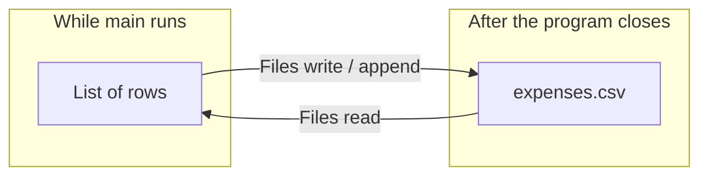

# Module 04c — File Handling

**Phase:** Collections, Exceptions, I/O

**Previous module:** [Exception Handling](02_Exception_Handling.md)  
**Next module:** [Git and GitHub](../05_Git_GitHub/01_Git_and_GitHub.md)

**Lab kit:** [15_Lab_Assets/14_expense_files/](../15_Lab_Assets/14_expense_files/)

---

**Module Outcome:**

- Write and read an expense file so data survives after `main` ends
- Use `Path` / `Files` and try-with-resources — overwrite vs append on purpose
- Parse a simple CSV without inventing a new library

**Teach order today:** RAM pain → `Path` / `Files` → write (overwrite trap) → append → read → try-with-resources + `IOException` → simple CSV → expense CSV push.

---

## Motivation — Feel the pain of RAM-only data

The Canteen Inventory and Safe Age CLI die when `main` ends. The `ArrayList` is gone. Tomorrow the canteen opens with an empty catalog.

```java
import java.util.ArrayList;
import java.util.List;

public class RamOnlyPain {
    public static void main(String[] args) {
        List<String> expenses = new ArrayList<>();
        expenses.add("Tea,45");
        expenses.add("Bus,30");
        System.out.println("In memory: " + expenses);
        System.out.println("Close the program — those rows are gone.");
    }
}
```

**Expected Output:**

```
In memory: [Tea,45, Bus,30]
Close the program — those rows are gone.
```

A file on disk **survives** the process. That is why payroll exports, attendance sheets, and expense CSVs exist.

**Visual — memory vs disk:**



**Key takeaways:**

- Collections live in **RAM** — gone when the process exits
- A **file** is the first persistence you own (before MySQL / JDBC)
- **`Path`** names the file; **`Files`** reads and writes it
- **Append** adds; a default **write** replaces

**Icons:** Bank · Order · Payroll · Laptop · CRM

**Where used?**
- **AcmeHR** / payroll — append CSV expense rows, then total by category
- Attendance — append-only text that survives restart
- **TechMart** inventory — later save SKUs to a `.csv` (Stretch)
- Config / notes — small UTF-8 text files
- **Later — JDBC / Spring:** the same try-with-resources shape wraps connections and uploads

---

## Important Concepts

### 1. `Path` — name a file before you open it

**Definition:** A **`Path`** (`java.nio.file.Path`) is an object that names a location on disk — `expenses.csv`, or `data/expenses.csv`.  
**Purpose:** Raw strings (`"C:\\temp\\x.csv"`) break across Windows / macOS / Linux. `Path.of(...)` is the JDK 17 way to build a name. **`Files`** is the helper class that talks to the disk.

```java
import java.nio.file.Path;

public class PathOfNotes {
    public static void main(String[] args) {
        Path notes = Path.of("notes.txt");
        System.out.println(notes.getFileName());
        System.out.println(notes.getParent());
        System.out.println(notes.getNameCount());
    }
}
```

**Expected Output:**

```
notes.txt
null
1
```

`getParent()` is `null` because `"notes.txt"` is only a file name — no folder in front.

`Path.of("data", "expenses.csv")` builds a path with a folder segment. `resolve` adds a child name onto a folder.

**Note:**
- Wrong: `new File("notes.txt")` as the first tool you reach for — that is the older `java.io.File` API.
- Prefer: `Path` + `Files` (`java.nio.file`) for new code.
- `Path` is only a **name**. Nothing is created on disk until you write.

**Remember:** `Path` names it. `Files` does the work.

**Interview:** `java.io.File` still works. Interviews expect **`Path` / `Files`** for modern Java.

**Try these (2 programs):**

**Program 1 — folder plus file name**

```java
import java.nio.file.Path;

public class PathFolderFile {
    public static void main(String[] args) {
        Path csv = Path.of("data", "expenses.csv");
        System.out.println(csv.getNameCount());
        System.out.println(csv.getFileName());
        System.out.println(csv.getName(0));
    }
}
```

**Expected Output:**

```
2
expenses.csv
data
```

**Program 2 — `resolve` a child**

```java
import java.nio.file.Path;

public class PathResolveChild {
    public static void main(String[] args) {
        Path folder = Path.of("logs");
        Path visit = folder.resolve("visits.txt");
        System.out.println(visit.getFileName());
        System.out.println(visit.getNameCount());
    }
}
```

**Expected Output:**

```
visits.txt
2
```

---

### 2. Write text — and the overwrite trap

**Definition:** **`Files.writeString`** creates (or opens) a text file and writes a `String`. Default options **replace** any old content.  
**Purpose:** First save of notes, a fresh export, a header you mean to start over. Dangerous when you meant **append**.

```java
import java.io.IOException;
import java.nio.charset.StandardCharsets;
import java.nio.file.Files;
import java.nio.file.Path;

public class WriteThenReadNotes {
    public static void main(String[] args) {
        Path notes = Path.of("notes_demo.txt");
        try {
            Files.writeString(notes, "First draft\n", StandardCharsets.UTF_8);
            System.out.println("After first write: " + Files.readString(notes, StandardCharsets.UTF_8).trim());
            Files.writeString(notes, "Second draft — first line is gone\n", StandardCharsets.UTF_8);
            System.out.println("After overwrite: " + Files.readString(notes, StandardCharsets.UTF_8).trim());
        } catch (IOException e) {
            System.out.println("Could not write notes: " + e.getMessage());
        }
    }
}
```

**Expected Output:**

```
After first write: First draft
After overwrite: Second draft — first line is gone
```

Always pass **`StandardCharsets.UTF_8`** so Windows and macOS agree on Indian names (Priya, ₹ in comments, Telugu later).

**Note:**
- Wrong: a second `writeString` when you wanted to **add** a line — the first draft is gone.
- Prefer: `APPEND` (next topic) for logs and expense rows.
- `IOException` is **checked** — `catch` or `throws`. The compiler will not let you ignore a failed write.

**Common Error:** Opening with a default write when you meant append — same trap as Python `"w"` vs `"a"`.

**Try these (2 programs):**

**Program 1 — two lines in one write**

```java
import java.io.IOException;
import java.nio.charset.StandardCharsets;
import java.nio.file.Files;
import java.nio.file.Path;

public class WriteTwoLines {
    public static void main(String[] args) {
        Path greeting = Path.of("greeting_demo.txt");
        try {
            Files.writeString(greeting, "Namaste\nLine 2\n", StandardCharsets.UTF_8);
            System.out.print(Files.readString(greeting, StandardCharsets.UTF_8));
        } catch (IOException e) {
            System.out.println(e.getMessage());
        }
    }
}
```

**Expected Output:**

```
Namaste
Line 2
```

**Program 2 — `writeString` needs a `Path`**

```java
import java.io.IOException;
import java.nio.charset.StandardCharsets;
import java.nio.file.Files;
import java.nio.file.Path;

public class WriteNeedsPath {
    public static void main(String[] args) {
        try {
            Files.writeString(Path.of("batch_demo.txt"), "PFS Hyderabad\n", StandardCharsets.UTF_8);
            System.out.println(Files.readString(Path.of("batch_demo.txt"), StandardCharsets.UTF_8).trim());
        } catch (IOException e) {
            System.out.println(e.getMessage());
        }
    }
}
```

**Expected Output:**

```
PFS Hyderabad
```

---

### 3. Append — add at the end

**Definition:** **`StandardOpenOption.APPEND`** writes after existing bytes. **`CREATE`** makes the file if it is missing.  
**Purpose:** Attendance, visit logs, and expense rows must **stack**. A wipe would lose yesterday.

```java
import java.io.IOException;
import java.nio.charset.StandardCharsets;
import java.nio.file.Files;
import java.nio.file.Path;
import java.nio.file.StandardOpenOption;

public class AppendAttendance {
    public static void main(String[] args) {
        Path sheet = Path.of("attendance_demo.txt");
        try {
            Files.writeString(sheet, "Anita present\n", StandardCharsets.UTF_8);
            Files.writeString(sheet, "Ravi present\n", StandardCharsets.UTF_8,
                    StandardOpenOption.CREATE, StandardOpenOption.APPEND);
            Files.writeString(sheet, "Meera present\n", StandardCharsets.UTF_8,
                    StandardOpenOption.CREATE, StandardOpenOption.APPEND);
            System.out.print(Files.readString(sheet, StandardCharsets.UTF_8));
        } catch (IOException e) {
            System.out.println("Could not write attendance: " + e.getMessage());
        }
    }
}
```

**Expected Output:**

```
Anita present
Ravi present
Meera present
```

The first `writeString` (no extra options) **creates or replaces**. The next two **append**.

**Note:**
- Wrong: `APPEND` without `CREATE` on a missing file — `NoSuchFileException`.
- Prefer: `CREATE` + `APPEND` together for “add a row, make the file if needed.”
- `writeString` with **no** options = create / **truncate**. That is not append.

**Remember:** Append adds. Default write replaces.

**Interview:** Name the two options you pass to append safely on a new file: `CREATE` and `APPEND`.

**Try these (2 programs):**

**Program 1 — AcmeHR two expense lines**

```java
import java.io.IOException;
import java.nio.charset.StandardCharsets;
import java.nio.file.Files;
import java.nio.file.Path;
import java.nio.file.StandardOpenOption;

public class AppendTwoExpenses {
    public static void main(String[] args) {
        Path file = Path.of("two_expenses_demo.txt");
        try {
            Files.writeString(file, "Tea,45\n", StandardCharsets.UTF_8);
            Files.writeString(file, "Bus,30\n", StandardCharsets.UTF_8,
                    StandardOpenOption.CREATE, StandardOpenOption.APPEND);
            System.out.print(Files.readString(file, StandardCharsets.UTF_8));
        } catch (IOException e) {
            System.out.println(e.getMessage());
        }
    }
}
```

**Expected Output:**

```
Tea,45
Bus,30
```

**Program 2 — append after a wipe**

```java
import java.io.IOException;
import java.nio.charset.StandardCharsets;
import java.nio.file.Files;
import java.nio.file.Path;
import java.nio.file.StandardOpenOption;

public class WipeThenAppend {
    public static void main(String[] args) {
        Path file = Path.of("wipe_then_append_demo.txt");
        try {
            Files.writeString(file, "old row\n", StandardCharsets.UTF_8);
            Files.writeString(file, "fresh start\n", StandardCharsets.UTF_8);
            Files.writeString(file, "kept\n", StandardCharsets.UTF_8,
                    StandardOpenOption.CREATE, StandardOpenOption.APPEND);
            System.out.print(Files.readString(file, StandardCharsets.UTF_8));
        } catch (IOException e) {
            System.out.println(e.getMessage());
        }
    }
}
```

**Expected Output:**

```
fresh start
kept
```

The middle write cleared `old row`. Only then did append add `kept`.

---

### 4. Reading strategies

**Definition:** You can pull a **whole file** into one `String`, a **`List` of lines**, or **one line at a time**.  
**Purpose:** Small notes = `readString`. Expense CSV = walk lines. A 2 GB log = do **not** load it all.

| Method | Returns | Best for |
|--------|---------|----------|
| `Files.readString(path, UTF_8)` | Entire file `String` | Small files |
| `Files.readAllLines(path, UTF_8)` | `List<String>` | Medium files (you already know `List`) |
| `BufferedReader.readLine()` in a loop | One line | Large files / streams |

```java
import java.io.BufferedReader;
import java.io.IOException;
import java.nio.charset.StandardCharsets;
import java.nio.file.Files;
import java.nio.file.Path;

public class MetroStopsLineByLine {
    public static void main(String[] args) {
        Path routes = Path.of("routes_demo.txt");
        String[] stops = {"Miyapur", "JNTU College", "KPHB Colony", "Kukatpally"};
        try {
            Files.writeString(routes, String.join("\n", stops) + "\n", StandardCharsets.UTF_8);
            try (BufferedReader br = Files.newBufferedReader(routes, StandardCharsets.UTF_8)) {
                String line;
                while ((line = br.readLine()) != null) {
                    System.out.println(line);
                }
            }
        } catch (IOException e) {
            System.out.println("Could not read routes: " + e.getMessage());
        }
    }
}
```

**Expected Output:**

```
Miyapur
JNTU College
KPHB Colony
Kukatpally
```

**Note:**
- Wrong: `readString` on a huge log — you can run out of memory.
- Prefer: `BufferedReader` (or `readAllLines` for a classroom-sized CSV).
- `readLine()` does **not** include the newline. You do not need `strip()` for a plain line.

**Remember:** Whole file for tiny notes. Line loop for logs and CSV.

**Try these (2 programs):**

**Program 1 — `readAllLines` is a `List`**

```java
import java.io.IOException;
import java.nio.charset.StandardCharsets;
import java.nio.file.Files;
import java.nio.file.Path;
import java.util.List;

public class ReadAllLinesList {
    public static void main(String[] args) {
        Path file = Path.of("lines_list_demo.txt");
        try {
            Files.writeString(file, "a\nb\nc\n", StandardCharsets.UTF_8);
            List<String> lines = Files.readAllLines(file, StandardCharsets.UTF_8);
            System.out.println(lines.size());
            System.out.println(lines.get(1));
        } catch (IOException e) {
            System.out.println(e.getMessage());
        }
    }
}
```

**Expected Output:**

```
3
b
```

**Program 2 — why a loop beats `readString` for huge logs**

```java
import java.io.BufferedReader;
import java.io.IOException;
import java.nio.charset.StandardCharsets;
import java.nio.file.Files;
import java.nio.file.Path;

public class ReadStringVsLoop {
    public static void main(String[] args) {
        Path file = Path.of("tiny_log_demo.txt");
        try {
            Files.writeString(file, "line1\nline2\nline3\n", StandardCharsets.UTF_8);

            String all = Files.readString(file, StandardCharsets.UTF_8);
            System.out.println("readString chars: " + all.length());

            try (BufferedReader br = Files.newBufferedReader(file, StandardCharsets.UTF_8)) {
                int count = 0;
                while (br.readLine() != null) {
                    count++;
                }
                System.out.println("loop lines: " + count);
            }
        } catch (IOException e) {
            System.out.println(e.getMessage());
        }
    }
}
```

**Expected Output:**

```
readString chars: 18
loop lines: 3
```

`readString` is fine for 18 characters. A server log is not 18 characters.

---

### 5. Try-with-resources on files + `IOException`

**Definition:** `BufferedReader` and `BufferedWriter` implement **`AutoCloseable`** — the same contract as `Scanner`. `try (BufferedWriter w = Files.newBufferedWriter(...))` calls **`close()`** for you.  
**Purpose:** An unclosed writer can lose the last bytes (not flushed). Last week you closed a `Scanner`. This week you close a file.

`IOException` is **checked**. The compiler forces `catch` or `throws`. That is the point of last week’s preview.

```java
import java.io.BufferedWriter;
import java.io.IOException;
import java.nio.charset.StandardCharsets;
import java.nio.file.Files;
import java.nio.file.Path;
import java.nio.file.StandardOpenOption;

public class WriterClosesAfterError {
    public static void main(String[] args) {
        Path scratch = Path.of("scratch_demo.txt");
        try {
            try (BufferedWriter w = Files.newBufferedWriter(scratch, StandardCharsets.UTF_8)) {
                w.write("partial data\n");
                throw new IllegalStateException("deliberate crash after write");
            }
        } catch (IllegalStateException e) {
            System.out.println("Caught: " + e.getMessage());
        } catch (IOException e) {
            System.out.println("Could not write: " + e.getMessage());
        }
        try (BufferedWriter w = Files.newBufferedWriter(scratch, StandardCharsets.UTF_8,
                StandardOpenOption.CREATE, StandardOpenOption.APPEND)) {
            w.write("appended after crash\n");
        } catch (IOException e) {
            System.out.println("Could not append: " + e.getMessage());
        }
        try {
            System.out.print(Files.readString(scratch, StandardCharsets.UTF_8));
        } catch (IOException e) {
            System.out.println(e.getMessage());
        }
    }
}
```

**Expected Output:**

```
Caught: deliberate crash after write
partial data
appended after crash
```

The first writer **closed** even though you threw. The file was safe to reopen.

Missing file on **read** is `NoSuchFileException` (a kind of `IOException`). Catch it and print a sentence — do not dump a stack to a canteen user.

```java
import java.io.IOException;
import java.nio.charset.StandardCharsets;
import java.nio.file.Files;
import java.nio.file.NoSuchFileException;
import java.nio.file.Path;

public class MissingFileCatch {
    public static void main(String[] args) {
        Path missing = Path.of("no_such_expenses.csv");
        try {
            System.out.println(Files.readString(missing, StandardCharsets.UTF_8));
        } catch (NoSuchFileException e) {
            System.out.println("File not found: " + missing.getFileName());
        } catch (IOException e) {
            System.out.println("Could not read: " + e.getMessage());
        }
    }
}
```

**Expected Output:**

```
File not found: no_such_expenses.csv
```

**Note:**
- Wrong: `new BufferedWriter(...)` without try-with-resources, then forgetting `close()`.
- Wrong: `catch (Exception e) { }` — swallows a full disk the same way last week hid a bad age.
- Prefer: `try (BufferedReader br = Files.newBufferedReader(path, UTF_8))` and `catch (IOException e)`.
- Catch **`NoSuchFileException`** before **`IOException`** (child before parent).

**Remember:** Same try-with-resources shape as `Scanner`. The type changed; the idea did not.

**Interview:** Why is `IOException` checked? The disk / permissions / missing path can fail even when your logic is correct. The compiler makes you acknowledge that.

**Common Error:** `throws Exception` on `main` to “make it compile” — too broad. Prefer `throws IOException` or a specific `catch`.

**Try these (2 programs):**

**Program 1 — writer in try-with-resources**

```java
import java.io.BufferedWriter;
import java.io.IOException;
import java.nio.charset.StandardCharsets;
import java.nio.file.Files;
import java.nio.file.Path;

public class WriterTryWith {
    public static void main(String[] args) {
        Path file = Path.of("twr_write_demo.txt");
        try (BufferedWriter w = Files.newBufferedWriter(file, StandardCharsets.UTF_8)) {
            w.write("PFS Hyderabad\n");
        } catch (IOException e) {
            System.out.println(e.getMessage());
            return;
        }
        try {
            System.out.println(Files.readString(file, StandardCharsets.UTF_8).trim());
        } catch (IOException e) {
            System.out.println(e.getMessage());
        }
    }
}
```

**Expected Output:**

```
PFS Hyderabad
```

**Program 2 — `exists` before you read**

```java
import java.nio.file.Files;
import java.nio.file.Path;

public class ExistsBeforeRead {
    public static void main(String[] args) {
        Path missing = Path.of("still_missing.csv");
        if (!Files.exists(missing)) {
            System.out.println("no file yet — start with a header");
            return;
        }
        System.out.println("ready to read");
    }
}
```

**Expected Output:**

```
no file yet — start with a header
```

`Files.exists` is a check. It does not replace `catch (IOException e)` on the actual read — another process can delete the file between the check and the open.

---

### 6. Simple CSV — comma-separated rows

**Definition:** **CSV** (comma-separated values) is a text table Excel and Google Sheets open. First line is usually a **header**. Each later line is a **row**.  
**Purpose:** Expense exports, marks sheets, canteen menus. You do **not** need a CSV library this week — write commas yourself.

```
date,category,amount,note
2026-08-23,Food,45,Canteen tea
2026-08-23,Travel,30,Bus
```

Read a data row with `split(",")`. That is **simple** CSV — a note that itself contains a comma will break the split. Keep notes short (no commas) on the core path.

```java
import java.io.IOException;
import java.nio.charset.StandardCharsets;
import java.nio.file.Files;
import java.nio.file.Path;
import java.nio.file.StandardOpenOption;
import java.util.List;

public class FeesCsvWriteRead {
    public static void main(String[] args) {
        Path csv = Path.of("fees_demo.csv");
        try {
            Files.writeString(csv, "name,amount\n", StandardCharsets.UTF_8);
            Files.writeString(csv, "Anita,15000\n", StandardCharsets.UTF_8,
                    StandardOpenOption.CREATE, StandardOpenOption.APPEND);
            Files.writeString(csv, "Ravi,15000\n", StandardCharsets.UTF_8,
                    StandardOpenOption.CREATE, StandardOpenOption.APPEND);
            Files.writeString(csv, "Meera,12000\n", StandardCharsets.UTF_8,
                    StandardOpenOption.CREATE, StandardOpenOption.APPEND);

            int total = 0;
            List<String> lines = Files.readAllLines(csv, StandardCharsets.UTF_8);
            for (int i = 1; i < lines.size(); i++) {
                String[] cols = lines.get(i).split(",");
                total += Integer.parseInt(cols[1]);
            }
            System.out.println("Total fees: " + total);
        } catch (IOException e) {
            System.out.println("Could not use fees CSV: " + e.getMessage());
        }
    }
}
```

**Expected Output:**

```
Total fees: 42000
```

Index `0` is the header. The loop starts at `1`.

**Note:**
- Wrong: appending data before a header exists — Sheets shows `2026-08-23` as a column name.
- Wrong: `split(",")` on `Tea,45,Canteen, extra` — you get four columns.
- Prefer: write the header **once** (`Files.exists` or `Files.notExists`), then only append rows.
- **Later — APIs:** JSON is the language of REST bodies. No JSON library this week.

**Where used?** Fees, expenses, attendance exports, inventory dumps (Stretch).

**Try these (2 programs):**

**Program 1 — TechMart canteen menu CSV**

```java
import java.io.IOException;
import java.nio.charset.StandardCharsets;
import java.nio.file.Files;
import java.nio.file.Path;
import java.util.List;

public class CanteenCsvExport {
    public static void main(String[] args) {
        Path csv = Path.of("canteen_demo.csv");
        try {
            Files.writeString(csv, "item,price\nSamosa,20\nIdli,30\nFilter Coffee,25\n",
                    StandardCharsets.UTF_8);
            List<String> lines = Files.readAllLines(csv, StandardCharsets.UTF_8);
            for (int i = 1; i < lines.size(); i++) {
                String[] cols = lines.get(i).split(",");
                System.out.println(cols[0] + ": ₹" + cols[1]);
            }
        } catch (IOException e) {
            System.out.println(e.getMessage());
        }
    }
}
```

**Expected Output:**

```
Samosa: ₹20
Idli: ₹30
Filter Coffee: ₹25
```

**Program 2 — TechMart CSV header only when the file is new**

```java
import java.io.IOException;
import java.nio.charset.StandardCharsets;
import java.nio.file.Files;
import java.nio.file.Path;
import java.nio.file.StandardOpenOption;

public class HeaderIfMissing {
    public static void main(String[] args) {
        Path csv = Path.of("header_once_demo.csv");
        try {
            Files.deleteIfExists(csv);
            writeHeaderOnce(csv);
            writeHeaderOnce(csv);
            System.out.print(Files.readString(csv, StandardCharsets.UTF_8));
        } catch (IOException e) {
            System.out.println(e.getMessage());
        }
    }

    static void writeHeaderOnce(Path csv) throws IOException {
        if (Files.notExists(csv)) {
            Files.writeString(csv, "date,category,amount,note\n", StandardCharsets.UTF_8);
            return;
        }
        Files.writeString(csv, "", StandardCharsets.UTF_8,
                StandardOpenOption.CREATE, StandardOpenOption.APPEND);
    }
}
```

**Expected Output:**

```
date,category,amount,note
```

The second call finds the file and does not write a second header. (`writeString` of `""` with `APPEND` is a no-op on content.)

---

### Stretch — logging lite (not today’s core)

`print` is for class demos. **`java.util.logging.Logger`** writes a **level** (`INFO`, `WARNING`, `SEVERE`) you can later send to a file. This is **optional**. Do not block the expense CSV on logging.

```java
import java.util.logging.Logger;

public class LogInfoVsSevere {
    private static final Logger LOG = Logger.getLogger("expense");

    public static void main(String[] args) {
        LOG.info("Expense added: Rs 45 Tea");
        LOG.severe("Failed to parse amount: abc");
        System.out.println("console still works");
    }
}
```

**Expected Output:** (logger format can include a timestamp; the last line is fixed)

```
console still works
```

You may also see `INFO` / `SEVERE` lines on the console. That is enough for Stretch. A full logging module is **not** this week.

---

## Step-by-Step Annotated Java Code

### Step 1: Write and read a greeting

Create a tiny file. Read it back. This is the “notes.txt” muscle.

```java
import java.io.BufferedReader;
import java.io.IOException;
import java.nio.charset.StandardCharsets;
import java.nio.file.Files;
import java.nio.file.Path;

public class WriteReadGreeting {
    public static void main(String[] args) {
        Path greeting = Path.of("greeting_step.txt");
        try {
            Files.writeString(greeting,
                    "Namaste from the Java Full Stack batch!\nLine 2\n",
                    StandardCharsets.UTF_8);
            try (BufferedReader br = Files.newBufferedReader(greeting, StandardCharsets.UTF_8)) {
                String line;
                while ((line = br.readLine()) != null) {
                    System.out.println(line);
                }
            }
        } catch (IOException e) {
            System.out.println("Could not use greeting: " + e.getMessage());
        }
    }
}
```

**Expected Output:**

```
Namaste from the Java Full Stack batch!
Line 2
```

**Try these (2 programs):**

**Program 1 — `readString` then print**

```java
import java.io.IOException;
import java.nio.charset.StandardCharsets;
import java.nio.file.Files;
import java.nio.file.Path;

public class ReadStringGreeting {
    public static void main(String[] args) {
        Path file = Path.of("read_string_step.txt");
        try {
            Files.writeString(file, "Hello KSR batch\n", StandardCharsets.UTF_8);
            System.out.print(Files.readString(file, StandardCharsets.UTF_8));
        } catch (IOException e) {
            System.out.println(e.getMessage());
        }
    }
}
```

**Expected Output:**

```
Hello KSR batch
```

**Program 2 — count characters**

```java
import java.io.IOException;
import java.nio.charset.StandardCharsets;
import java.nio.file.Files;
import java.nio.file.Path;

public class CountCharsFile {
    public static void main(String[] args) {
        Path file = Path.of("count_chars_step.txt");
        try {
            Files.writeString(file, "UPI\n", StandardCharsets.UTF_8);
            String text = Files.readString(file, StandardCharsets.UTF_8);
            System.out.println(text.length());
        } catch (IOException e) {
            System.out.println(e.getMessage());
        }
    }
}
```

**Expected Output:**

```
4
```

`UPI` + newline = 4 characters.

---

### Step 2: Append a visit log

Same idea as Python’s `visits.log` — timestamp-optional. Core path is **append a line**.

```java
import java.io.BufferedWriter;
import java.io.IOException;
import java.nio.charset.StandardCharsets;
import java.nio.file.Files;
import java.nio.file.Path;
import java.nio.file.StandardOpenOption;

public class AppendVisitLog {
    public static void main(String[] args) {
        Path log = Path.of("visits_step.txt");
        try {
            Files.deleteIfExists(log);
            logVisit(log, "ananya");
            logVisit(log, "ravi");
            System.out.print(Files.readString(log, StandardCharsets.UTF_8));
        } catch (IOException e) {
            System.out.println("Could not write visits: " + e.getMessage());
        }
    }

    static void logVisit(Path log, String username) throws IOException {
        try (BufferedWriter w = Files.newBufferedWriter(log, StandardCharsets.UTF_8,
                StandardOpenOption.CREATE, StandardOpenOption.APPEND)) {
            w.write(username);
            w.newLine();
        }
    }
}
```

**Expected Output:**

```
ananya
ravi
```

`w.newLine()` is safer than `"\n"` if you ever move the file between OS families. UTF-8 text + `newLine()` is the classroom habit.

**Try these (2 programs):**

**Program 1 — three visits**

```java
import java.io.IOException;
import java.nio.charset.StandardCharsets;
import java.nio.file.Files;
import java.nio.file.Path;
import java.nio.file.StandardOpenOption;

public class ThreeVisits {
    public static void main(String[] args) {
        Path log = Path.of("three_visits_step.txt");
        try {
            Files.writeString(log, "priya\n", StandardCharsets.UTF_8);
            Files.writeString(log, "ravi\n", StandardCharsets.UTF_8,
                    StandardOpenOption.CREATE, StandardOpenOption.APPEND);
            Files.writeString(log, "meera\n", StandardCharsets.UTF_8,
                    StandardOpenOption.CREATE, StandardOpenOption.APPEND);
            System.out.println(Files.readAllLines(log, StandardCharsets.UTF_8).size());
        } catch (IOException e) {
            System.out.println(e.getMessage());
        }
    }
}
```

**Expected Output:**

```
3
```

**Program 2 — `CREATE` + `APPEND` on a new file**

```java
import java.io.IOException;
import java.nio.charset.StandardCharsets;
import java.nio.file.Files;
import java.nio.file.Path;
import java.nio.file.StandardOpenOption;

public class CreateAndAppend {
    public static void main(String[] args) {
        Path file = Path.of("create_append_step.txt");
        try {
            Files.deleteIfExists(file);
            Files.writeString(file, "first\n", StandardCharsets.UTF_8,
                    StandardOpenOption.CREATE, StandardOpenOption.APPEND);
            System.out.println(Files.readString(file, StandardCharsets.UTF_8).trim());
        } catch (IOException e) {
            System.out.println(e.getMessage());
        }
    }
}
```

**Expected Output:**

```
first
```

---

### Step 3: Append an expense CSV row

This is the homework shape. Header once. Then `date,category,amount,note`.

```java
import java.io.BufferedWriter;
import java.io.IOException;
import java.nio.charset.StandardCharsets;
import java.nio.file.Files;
import java.nio.file.Path;
import java.nio.file.StandardOpenOption;

public class ExpenseCsvAppend {
    public static void main(String[] args) {
        Path csv = Path.of("expense_step.csv");
        try {
            Files.deleteIfExists(csv);
            ensureHeader(csv);
            appendRow(csv, "2026-08-23", "Food", 45, "Canteen tea");
            appendRow(csv, "2026-08-23", "Travel", 30, "Bus");
            System.out.print(Files.readString(csv, StandardCharsets.UTF_8));
        } catch (IOException e) {
            System.out.println("Could not write expenses: " + e.getMessage());
        }
    }

    static void ensureHeader(Path csv) throws IOException {
        if (Files.notExists(csv)) {
            Files.writeString(csv, "date,category,amount,note\n", StandardCharsets.UTF_8);
        }
    }

    static void appendRow(Path csv, String date, String category, int amountInr, String note)
            throws IOException {
        try (BufferedWriter w = Files.newBufferedWriter(csv, StandardCharsets.UTF_8,
                StandardOpenOption.CREATE, StandardOpenOption.APPEND)) {
            w.write(date + "," + category + "," + amountInr + "," + note);
            w.newLine();
        }
    }
}
```

**Expected Output:**

```
date,category,amount,note
2026-08-23,Food,45,Canteen tea
2026-08-23,Travel,30,Bus
```

**Try these (2 programs):**

**Program 1 — split one data row**

```java
public class CsvSplitRow {
    public static void main(String[] args) {
        String row = "2026-08-23,Food,45,Canteen tea";
        String[] cols = row.split(",");
        System.out.println(cols.length);
        System.out.println(cols[2]);
    }
}
```

**Expected Output:**

```
4
45
```

**Program 2 — skip the header when summing**

```java
import java.io.IOException;
import java.nio.charset.StandardCharsets;
import java.nio.file.Files;
import java.nio.file.Path;
import java.util.List;

public class SumSkipHeader {
    public static void main(String[] args) {
        Path csv = Path.of("sum_skip_step.csv");
        try {
            Files.writeString(csv, "date,category,amount,note\n2026-08-23,Food,45,Tea\n2026-08-23,Travel,30,Bus\n",
                    StandardCharsets.UTF_8);
            int total = 0;
            List<String> lines = Files.readAllLines(csv, StandardCharsets.UTF_8);
            for (int i = 1; i < lines.size(); i++) {
                total += Integer.parseInt(lines.get(i).split(",")[2]);
            }
            System.out.println(total);
        } catch (IOException e) {
            System.out.println(e.getMessage());
        }
    }
}
```

**Expected Output:**

```
75
```

---

### Step 4: Menu sketch — append from the keyboard

Use **one** try-with-resources `Scanner` on `System.in` (already taught). Catch `NumberFormatException` on amount. Catch `IOException` on the file. Blank category is a print + retry — or `IllegalArgumentException` if you prefer last week’s `throw`.

```java
import java.io.BufferedWriter;
import java.io.IOException;
import java.nio.charset.StandardCharsets;
import java.nio.file.Files;
import java.nio.file.Path;
import java.nio.file.StandardOpenOption;
import java.util.Scanner;

public class ExpenseMenuSketch {
    public static void main(String[] args) {
        Path csv = Path.of("expense_menu.csv");
        try (Scanner sc = new Scanner(System.in)) {
            try {
                if (Files.notExists(csv)) {
                    Files.writeString(csv, "date,category,amount,note\n", StandardCharsets.UTF_8);
                }
            } catch (IOException e) {
                System.out.println("Could not create file: " + e.getMessage());
                return;
            }
            while (true) {
                System.out.print("Amount INR (or q): ");
                String raw = sc.nextLine().trim();
                if (raw.equals("q")) {
                    System.out.println("Bye");
                    break;
                }
                int amount;
                try {
                    amount = Integer.parseInt(raw);
                } catch (NumberFormatException e) {
                    System.out.println("amount must be an integer");
                    continue;
                }
                if (amount <= 0) {
                    System.out.println("amount must be positive");
                    continue;
                }
                System.out.print("Category: ");
                String category = sc.nextLine().trim();
                if (category.length() == 0) {
                    System.out.println("category required");
                    continue;
                }
                try (BufferedWriter w = Files.newBufferedWriter(csv, StandardCharsets.UTF_8,
                        StandardOpenOption.CREATE, StandardOpenOption.APPEND)) {
                    w.write("2026-08-23," + category + "," + amount + ",menu");
                    w.newLine();
                    System.out.println("saved");
                } catch (IOException e) {
                    System.out.println("Could not append: " + e.getMessage());
                }
            }
        }
    }
}
```

`javac ExpenseMenuSketch.java` then `java ExpenseMenuSketch`. Compile-only in automated checks (it waits for the keyboard).

**Try these (2 programs):**

**Program 1 — reject a non-integer amount**

```java
public class ParseAmountSafe {
    public static void main(String[] args) {
        try {
            System.out.println(Integer.parseInt("45"));
            System.out.println(Integer.parseInt("abc"));
        } catch (NumberFormatException e) {
            System.out.println("amount must be an integer");
        }
    }
}
```

**Expected Output:**

```
45
amount must be an integer
```

**Program 2 — reject a blank category**

```java
public class RejectBlankCategory {
    public static void main(String[] args) {
        String category = "   ".trim();
        if (category.length() == 0) {
            System.out.println("category required");
        } else {
            System.out.println(category);
        }
    }
}
```

**Expected Output:**

```
category required
```

---

## Practice Exercises

*(Each Practice item includes a filled **Model answer** and **Expected Output** where the demo prints.)*

### Basic

1. Copy `source_practice.txt` to `backup_practice.txt` with `readString` / `writeString`.

   **Model answer:**

```java
import java.io.IOException;
import java.nio.charset.StandardCharsets;
import java.nio.file.Files;
import java.nio.file.Path;

public class CopyFilePractice {
    public static void main(String[] args) {
        Path src = Path.of("source_practice.txt");
        Path dst = Path.of("backup_practice.txt");
        try {
            Files.writeString(src, "keep me\n", StandardCharsets.UTF_8);
            Files.writeString(dst, Files.readString(src, StandardCharsets.UTF_8), StandardCharsets.UTF_8);
            System.out.print(Files.readString(dst, StandardCharsets.UTF_8));
        } catch (IOException e) {
            System.out.println(e.getMessage());
        }
    }
}
```

   **Expected Output:**

```
keep me
```

2. Count lines in a short text file.

   **Model answer:**

```java
import java.io.IOException;
import java.nio.charset.StandardCharsets;
import java.nio.file.Files;
import java.nio.file.Path;
import java.util.List;

public class CountLinesPractice {
    public static void main(String[] args) {
        Path notes = Path.of("count_lines_practice.txt");
        try {
            Files.writeString(notes, "one\ntwo\nthree\n", StandardCharsets.UTF_8);
            List<String> lines = Files.readAllLines(notes, StandardCharsets.UTF_8);
            System.out.println(lines.size());
        } catch (IOException e) {
            System.out.println(e.getMessage());
        }
    }
}
```

   **Expected Output:**

```
3
```

3. Append one diary line (`note` only — date can be a fixed string).

   **Model answer:**

```java
import java.io.IOException;
import java.nio.charset.StandardCharsets;
import java.nio.file.Files;
import java.nio.file.Path;
import java.nio.file.StandardOpenOption;

public class DiaryAppendPractice {
    public static void main(String[] args) {
        Path diary = Path.of("diary_practice.txt");
        try {
            Files.writeString(diary, "2026-08-23 | first lab\n", StandardCharsets.UTF_8,
                    StandardOpenOption.CREATE, StandardOpenOption.APPEND);
            System.out.print(Files.readString(diary, StandardCharsets.UTF_8));
        } catch (IOException e) {
            System.out.println(e.getMessage());
        }
    }
}
```

   **Expected Output:**

```
2026-08-23 | first lab
```

(Re-running appends another line — that is correct for a diary.)

### Intermediate

1. Write `marks_practice.csv` (`name,marks`), compute the class average, print it.

   **Model answer:**

```java
import java.io.IOException;
import java.nio.charset.StandardCharsets;
import java.nio.file.Files;
import java.nio.file.Path;
import java.util.List;

public class MarksCsvAverage {
    public static void main(String[] args) {
        Path csv = Path.of("marks_practice.csv");
        try {
            Files.writeString(csv, "name,marks\nMeera,88\nKaran,76\n", StandardCharsets.UTF_8);
            List<String> lines = Files.readAllLines(csv, StandardCharsets.UTF_8);
            int sum = 0;
            int count = 0;
            for (int i = 1; i < lines.size(); i++) {
                sum += Integer.parseInt(lines.get(i).split(",")[1]);
                count++;
            }
            System.out.println(sum / count);
        } catch (IOException e) {
            System.out.println(e.getMessage());
        }
    }
}
```

   **Expected Output:**

```
82
```

2. Total three expense amounts from a CSV (skip header). Amount is column index `2`.

   **Model answer:**

```java
import java.io.IOException;
import java.nio.charset.StandardCharsets;
import java.nio.file.Files;
import java.nio.file.Path;
import java.util.List;

public class TotalExpensesPractice {
    public static void main(String[] args) {
        Path csv = Path.of("total_expenses_practice.csv");
        try {
            Files.writeString(csv,
                    "date,category,amount,note\n2026-08-23,Food,45,Tea\n2026-08-23,Travel,30,Bus\n2026-08-23,Stationery,80,Notebook\n",
                    StandardCharsets.UTF_8);
            int total = 0;
            List<String> lines = Files.readAllLines(csv, StandardCharsets.UTF_8);
            for (int i = 1; i < lines.size(); i++) {
                total += Integer.parseInt(lines.get(i).split(",")[2]);
            }
            System.out.println(total);
        } catch (IOException e) {
            System.out.println(e.getMessage());
        }
    }
}
```

   **Expected Output:**

```
155
```

3. Read a missing file and print a friendly line (no traceback).

   **Model answer:**

```java
import java.io.IOException;
import java.nio.charset.StandardCharsets;
import java.nio.file.Files;
import java.nio.file.NoSuchFileException;
import java.nio.file.Path;

public class SafeReadMissing {
    public static void main(String[] args) {
        try {
            Files.readString(Path.of("missing_practice.csv"), StandardCharsets.UTF_8);
        } catch (NoSuchFileException e) {
            System.out.println("File not found: missing_practice.csv");
        } catch (IOException e) {
            System.out.println("Could not read: " + e.getMessage());
        }
    }
}
```

   **Expected Output:**

```
File not found: missing_practice.csv
```

### Interview-Oriented

1. `Files.writeString` vs append options — which one wipes the file?

   **Model answer:** A `writeString` with **no** `StandardOpenOption`s creates or **truncates**. Pass `CREATE` + `APPEND` to add bytes at the end.

2. Why try-with-resources on a `BufferedWriter`?

   **Model answer:** `close()` flushes and releases the handle even if you throw inside the block. Forgetting `close()` can lose the last row or leak a handle.

3. When is a file the wrong store?

   **Model answer:** Many users writing at once, queries like “all Food expenses in July”, or relationships (orders → items). That is **Later — MySQL / JDBC**. CSV is right for a single-user export and this week’s homework.

4. Why is `IOException` checked?

   **Model answer:** Disk, permissions, and a missing path can fail when your logic is fine. The compiler forces `catch` or `throws`. `NumberFormatException` is unchecked because it is usually bad input you already control.

5. Simple `split(",")` vs a real CSV library?

   **Model answer:** `split` is enough for classroom rows with **no commas inside fields**. Quoted fields (`"Canteen, tea"`) need a parser. Core path keeps notes comma-free.

---

## Mini-Project (Assignment): AcmeHR Expense CSV Logger

**Lab kit:** [15_Lab_Assets/14_expense_files/](../15_Lab_Assets/14_expense_files/)

Collections kept inventory in RAM. Safe Input stopped the crash. This assignment is the **portfolio push**: rows that **survive** `java ExpenseFiles` — `Path` / `Files`, try-with-resources, `catch (IOException e)`, a header, and append-only CSV.

Bring forward parse + range from Exceptions (`Integer.parseInt`, `amount > 0`). Do **not** start Git as a topic. Do **not** open JDBC or MySQL.

### What to build

| Piece | Detail |
|-------|--------|
| `expenses.csv` | Header `date,category,amount,note` written **once** if the file is missing |
| `appendExpense` | `CREATE` + `APPEND`; try-with-resources `BufferedWriter`; UTF-8 |
| `listExpenses` | Print data rows (skip header); missing file → friendly message, no traceback |
| `totalAmount` | Sum the `amount` column; `0` if missing / only a header |
| Demo `main` | Append at least **three** INR rows, list them, print the total |
| Errors | `IOException` / `NoSuchFileException` caught (or declared and caught in `main`); no bare `catch (Exception e)` |
| No commas in `note` | Simple `split(",")` on the core path |

**Sample (lab-kit main):**

```
2026-08-23,Food,45,Canteen tea
2026-08-23,Travel,30,Bus
2026-08-23,Stationery,80,Notebook
Total INR: 155
```

`javac ExpenseFiles.java` then `java ExpenseFiles`. Open `expenses.csv` in a text editor or Sheets — three data rows under the header.

**Starter idea (same methods as the kit):**

```java
import java.io.BufferedWriter;
import java.io.IOException;
import java.nio.charset.StandardCharsets;
import java.nio.file.Files;
import java.nio.file.Path;
import java.nio.file.StandardOpenOption;

public class ExpenseLoggerLite {
    static final Path FILE = Path.of("expenses_lite.csv");

    public static void main(String[] args) {
        try {
            Files.deleteIfExists(FILE);
            ensureHeader();
            appendExpense("2026-08-23", "Food", 45, "Canteen tea");
            appendExpense("2026-08-23", "Travel", 30, "Bus");
            System.out.print(Files.readString(FILE, StandardCharsets.UTF_8));
        } catch (IOException e) {
            System.out.println("Could not use CSV: " + e.getMessage());
        }
    }

    static void ensureHeader() throws IOException {
        if (Files.notExists(FILE)) {
            Files.writeString(FILE, "date,category,amount,note\n", StandardCharsets.UTF_8);
        }
    }

    static void appendExpense(String date, String category, int amountInr, String note)
            throws IOException {
        try (BufferedWriter w = Files.newBufferedWriter(FILE, StandardCharsets.UTF_8,
                StandardOpenOption.CREATE, StandardOpenOption.APPEND)) {
            w.write(date + "," + category + "," + amountInr + "," + note);
            w.newLine();
        }
    }
}
```

**Expected Output:**

```
date,category,amount,note
2026-08-23,Food,45,Canteen tea
2026-08-23,Travel,30,Bus
```

Add a tiny menu (1 Add · 2 List · 3 Total · 4 Exit) in `main` for the take-home if you want a single README session — or keep the three-row demo from the kit.

### Stretch

- Category totals (`Food` vs `Travel`) by walking rows — you already know `HashMap`.
- Reject `amount <= 0` and blank category (`throw` or print + return).
- Import `seed/sample_expenses.csv` and print its total.
- **`java.util.logging` lite:** `INFO` when a row is saved (do not block Done when on this).
- **Later — Git week:** push the folder with a short README of the sample rows.
- **Later — JDBC:** the same rows become `INSERT`s. Not this ticket.

### Done when

- [ ] Lab kit Expense Files ticket passes (header once, three rows survive a second run / append)
- [ ] Writers/readers use **try-with-resources**
- [ ] `IOException` is caught (or `throws` + caught in `main`) — no traceback for a missing file on list
- [ ] Default `writeString` is **not** used for every new row (that would wipe)
- [ ] Notes stay comma-free on the core path
- [ ] No JDBC / Spring / Lombok / MySQL
- [ ] Short README showing the sample CSV lines (see [Standard Project Deliverables](../Standard_Project_Deliverables.md) — `pom.xml` is optional for javac-only)

---

## Interview Q&A

Shared with students after concepts and the mini-project. Use for review and interview prep — questions and model answers are included.

**Q1. What is a `Path`?**  
**A:** An object that names a file or folder (`Path.of("expenses.csv")`). It does not open the file. `Files` performs read/write.

**Q2. `java.io.File` vs `Path` / `Files`?**  
**A:** `File` is the older API. New code uses `java.nio.file.Path` and `Files` (JDK 17 classroom standard).

**Q3. Why does a second `Files.writeString` wipe the first line?**  
**A:** With no open options it **truncates**. Use `CREATE` + `APPEND` to add.

**Q4. What is try-with-resources on a file?**  
**A:** `try (BufferedWriter w = Files.newBufferedWriter(...)) { }` — `close()` runs automatically because the writer is `AutoCloseable`. Same shape as last week’s `Scanner`.

**Q5. Why is `IOException` checked?**  
**A:** I/O can fail (missing file, permissions, disk) even when your logic is right. `catch` or `throws`. `NoSuchFileException` is a specific child.

**Q6. `readString` vs line loop?**  
**A:** `readString` / `readAllLines` load the file (or all lines) into memory. A `BufferedReader` loop is the habit for large logs.

**Q7. What is CSV?**  
**A:** A text table: header row, then comma-separated fields. Excel/Sheets open it. Simple `split(",")` is enough when fields have no commas.

**Q8. When do you write the CSV header?**  
**A:** Once, when the file does not exist (`Files.notExists`). After that, only append data rows.

**Q9. File vs database?**  
**A:** A file is one process, one folder, no rich queries. Concurrent users, joins, and integrity are **Later — MySQL / JDBC**.

**Q10. Should this week be a logging course?**  
**A:** No. `print` is fine in class. `java.util.logging` is Stretch. Persistence is the file.

---

## Next

Finish the [Expense Files lab kit](../15_Lab_Assets/14_expense_files/) and the CSV CLI. Continue with **[Git and GitHub](../05_Git_GitHub/01_Git_and_GitHub.md)** (local commits, Java `.gitignore`). MySQL / JDBC come after Git.
