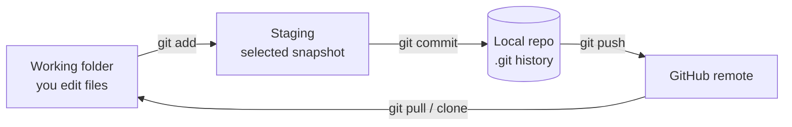
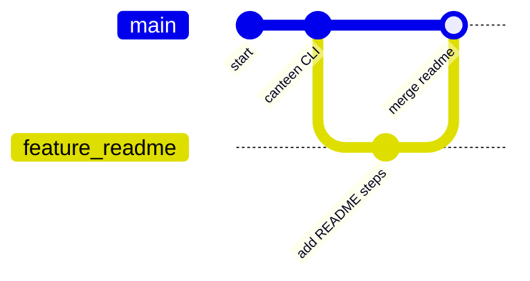

# Module 05 — Git and GitHub

**Phase:** Tools & Portfolio

**Previous module:** [File Handling](../04_Collections_Exceptions_IO/03_File_Handling.md)  
**Next module:** [MySQL for Full Stack Developers](../06_Database_MySQL/01_MySQL_for_Full_Stack_Developers.md)

**Lab kit:** [15_Lab_Assets/15_git_portfolio_hygiene/](../15_Lab_Assets/15_git_portfolio_hygiene/)

---

**Module Outcome:**

- Commit, branch, and push a Maven project so the lab is not on one USB stick
- Put a clean repo on GitHub a recruiter can clone
- Gitignore `target/`, `.idea`, and secrets — they are not portfolio

## Prerequisites

- Git installed (`git --version`) and a free GitHub account
- Any earlier Java project folder to practise with (canteen calculator, expense CSV, ATM)

---

**Teach order:** zip-file pain → three areas → add/commit/log → commit messages → local branch/merge → `.gitignore` → README → GitHub push / clone / pull → simple conflict → portfolio repo.

---

## Definition / Purpose

**Definition:** **Git** is a **time machine for your code**. Every **commit** saves a snapshot with a message — "Add canteen INR total", "Fix CSV append wipe". You can go back, compare versions, and work with teammates without emailing zip files named `CanteenCalculator_final_FINAL2.zip`.

**Definition:** **GitHub** is a **cloud hosting service** for Git repositories — like Google Drive for code, plus issues, pull requests, and a public portfolio recruiters open before calls.

**Purpose:** Without Git, "it worked yesterday" is a guess, and two people overwrite each other. With Git, you have a dated trail, branches for experiments, and a URL you can put on a resume. **Git** is the tool on your laptop. **GitHub** is one popular place to host the history.

**Icons:** Laptop · Order · Employee · Bank · Payroll

**Where used?**
- College apps — version CampusCart / canteen CLI across lab days
- **TechMart** — team feature branches for cart, checkout, product pages
- **SecureBank** / **AcmeHR** — audit trail of who changed what (commit history)
- Freelancer / internship — GitHub portfolio recruiters open before calls
- **MedCare** — shared repos so teammates do not overwrite each other

**Workflow in one line:**

1. Edit files in your project folder.
2. `git add` — choose what goes into the next snapshot.
3. `git commit` — save snapshot locally with a message.
4. `git push` — upload commits to GitHub.

For **entry-level hiring**, recruiters often check: *Does this candidate have GitHub? Are projects documented? Commits regular?* A clean portfolio can compensate for thin work history when combined with course projects (canteen calculator, expense CSV logger, later CampusCart).

---

## Important Concepts

### 1. Three areas of Git

**Definition:** Git does not save a snapshot the instant you type. Files move through **three areas**: the working folder (you edit), the **staging area** (you pick), and the **repository** (`.git` history after commit).

**Purpose:** Staging is a packing list. You can edit five files and commit only the two that belong together.

```
Working Directory  →  Staging Area (index)  →  Repository (.git)
     (edit files)         git add                 git commit
```

**Visual — same idea as a packing line:**



**Key takeaways:**
- Edit → `git add` (stage) → `git commit` (local snapshot) → `git push` (GitHub)
- `git pull` / `clone` brings remote history back to your working folder
- Staging = packing list; commit = sealed box; GitHub = warehouse copy

**Note:**
- `git add .` stages **everything** that is not ignored — glance at `git status` first.
- A commit is **local** until you `git push`. Closing the laptop does not upload.

**Try these (2 programs):**

**Program 1 — Trace one file through the three areas**

```bash
mkdir -p ~/git_lab_areas && cd ~/git_lab_areas
git init
echo "Campus canteen bill tracker" > NOTES.txt
git status                    # Working Directory: untracked
git add NOTES.txt
git status                    # Staging Area: ready to commit
git commit -m "Add NOTES about canteen tracker"
git status                    # clean — snapshot is in Repository
```

**Expected Output:** (abbreviated)

```
# after first status — Untracked files: NOTES.txt
# after git add — Changes to be committed: new file: NOTES.txt
# after commit — [main …] Add NOTES about canteen tracker
# final status — nothing to commit, working tree clean
```

**Program 2 — Label the packing line**

```markdown
# Git packing line (India campus project)

1. Working Directory = files open in VS Code (edit `CanteenCalculator.java`)
2. Staging = `git add CanteenCalculator.java` (choose what goes in the box)
3. Repository = `git commit -m "..."` (sealed snapshot in `.git`)
4. GitHub = `git push` (cloud copy for portfolio / teammates)
```

### 2. Essential commands

**Definition:** A small set of Git commands covers daily work: create a repo, see what changed, stage, commit, inspect history, and (later) talk to GitHub.

**Purpose:** You do not need a GUI to prove you understand Git in an interview. These commands *are* the interview.

| Command | Purpose |
|---------|---------|
| `git init` | Create new repo in folder |
| `git status` | See changed/untracked files |
| `git add file` / `git add .` | Stage changes |
| `git commit -m "msg"` | Save snapshot |
| `git log --oneline` | View history |
| `git diff` | Unstaged changes |
| `git branch` | List branches |
| `git switch -c feature-x` | Create and switch branch |
| `git merge feature-x` | Merge branch into current |
| `git clone URL` | Copy remote repo locally |
| `git push origin main` | Upload commits |
| `git pull origin main` | Download + merge remote |

**Note:**
- First commit on a new laptop may ask for identity: `git config --global user.name "Priya Sharma"` and `git config --global user.email "priya@example.com"` (use the email on your GitHub account).
- Never pulling before push → rejected push / conflicts — make `git pull` (or `git pull --rebase`) a habit on a shared branch.
- Committing broken code to `main` → team blocked — use branches for features.
- Force push to shared `main` destroys teammates' work — avoid `--force` unless solo and sure.
- Older notes use `git checkout -b feature-x`; `git switch -c` is the same idea.

**Try these (2 programs):**

**Program 1 — First three commits**

```bash
mkdir -p ~/campus-canteen-calculator && cd ~/campus-canteen-calculator
git init
echo "# Campus Canteen Calculator" > README.md
git add README.md
git commit -m "Initial commit: README"
echo "target/" > .gitignore
git add .gitignore
git commit -m "Add Java gitignore"
echo "// Canteen calculator — totals in INR" > CanteenCalculator.java
git add CanteenCalculator.java
git commit -m "Add CanteenCalculator stub"
git log --oneline
```

**Expected Output:** (hashes differ)

```
abc1234 Add CanteenCalculator stub
def5678 Add Java gitignore
ghi9012 Initial commit: README
```

**Remember:** Commit messages use **imperative** mood (`Add`, `Fix`, `Update`) — like giving an order to the codebase.

**Program 2 — Status and diff before commit**

```bash
cd ~/campus-canteen-calculator
echo "# Campus Canteen Calculator
Tracks tea and lunch bills in INR." > README.md
git status
git diff
git add README.md
git commit -m "Update README with purpose"
git log --oneline -3
```

### 3. Commit message convention (simple)

**Definition:** A commit message is a short **imperative** sentence that says what this snapshot *does* to the project.

**Purpose:** Six months later (and in a TCS/Infosys screen-share) `git log` should read like a changelog, not a diary of "ok" / "final".

```
Add student marks CLI menu
Fix IOException on missing expenses.csv
Update README with javac steps
```

Use imperative mood; first line ≤ 50 chars; optional body after a blank line.

**Note:**
- Vague messages ("update", "fix") → useless history — write descriptive imperative messages.
- One logical change per commit when you can. Do not dump the whole Desktop in one "final" snapshot.

**Try these (2 programs):**

**Program 1 — Rewrite bad messages**

```markdown
# Bad → Good

ok                    → Add login validation for roll number
final                 → Fix ignore so *.class is not committed
update                → Update README with javac run steps
done today            → Add INR total print for canteen bill
```

**Program 2 — Commit with body**

```bash
cd ~/campus-canteen-calculator
echo "// formatInr — later print ₹1,250.00" >> CanteenCalculator.java
git add CanteenCalculator.java
git commit -m "$(cat <<'EOF'
Add formatInr comment stub

Used by canteen bill summary so amounts show as INR, not a raw int.
EOF
)"
git log -1
```

### 4. Branches without breaking `main`

**Definition:** A **branch** is a parallel line of commits. `main` (sometimes `master` on old repos) is the line you want **demo-ready**. Feature work happens on `feature/...`.

**Purpose:** You can try a README rewrite or a CSV helper without wrecking the copy you showed in class yesterday. Merge when it works; delete the branch after.

**Note:**
- Stay on `main` for every edit → one bad save blocks the demo — `git switch -c feature/readme` first.
- Conflicts = the same lines edited two ways — not a crash. Edit the file, remove markers, `git add`, finish the commit.

**Try these (2 programs):**

**Program 1 — Feature branch then merge**

```bash
cd ~/campus-canteen-calculator
git switch -c feature/readme
echo "- Tea and lunch totals in INR" >> README.md
git add README.md
git commit -m "Add INR feature bullet to README"
git switch main
git merge feature/readme
git branch -d feature/readme
git log --oneline --graph -5
```

**Program 2 — See both branches before merge**

```bash
cd ~/campus-canteen-calculator
git switch -c feature/notes
echo "Lab note: commit once a day." > HABIT.md
git add HABIT.md
git commit -m "Add daily-commit habit note"
git switch main
git log --oneline --graph --all -8
# HABIT.md is on the feature line until you merge
git merge feature/notes
git branch -d feature/notes
```

### 5. `.gitignore` essentials (Java / Maven)

**Definition:** `.gitignore` is a list of **patterns Git should not track** — generated files, IDE folders, and secrets.

**Purpose:** `javac` writes `*.class`. Maven later writes `target/`. IntelliJ writes `.idea/`. Those regenerate on every machine. `.env` and `credentials.json` must never become public, even in a "private" repo.

```gitignore
# Bytecode and archives (javac / jar)
*.class
*.jar
*.war

# Maven output (folder appears when you use Maven later)
target/

# IDE
.idea/
*.iml
.vscode/

# OS
.DS_Store
Thumbs.db

# Logs
*.log

# Secrets — NEVER commit
.env
*.pem
credentials.json
```

**Note:**
- Committing `target/` or `*.class` → noisy diffs / huge repos — add `.gitignore` **before** the first push.
- `!.env` in a broken ignore file **forces** Git to track `.env` — delete that line.
- Ignoring `*.java` is the opposite bug: teammates cannot clone your source.
- Already tracked a secret? Remove it from the index (`git rm --cached .env`), keep the ignore line, commit the fix, and **rotate** the password (treat it as leaked). Same idea for `git rm --cached '*.class'` or `git rm -r --cached target/`.

**Try these (2 programs):**

**Program 1 — Write a course `.gitignore`**

```bash
cd ~/campus-canteen-calculator
cat > .gitignore <<'EOF'
target/
*.class
*.jar
.env
.idea/
*.iml
.vscode/
.DS_Store
credentials.json
EOF
git add .gitignore
git commit -m "Harden gitignore for class files, target, and secrets"
```

**Program 2 — Prove bytecode and secrets stay out**

```bash
cd ~/campus-canteen-calculator
echo "PIN=secret123" > .env
mkdir -p target
echo "fake" > target/CanteenCalculator.class
echo "fake bytecode" > CanteenCalculator.class
git status
# Expect: .env, target/, and *.class NOT listed (ignored)
```

**Common Error:** Committing `.env`, `*.class`, or `target/` → leaked secrets / junk history. Confirm they appear as *ignored* in `git status`, not under *untracked*.

**Interview:** Git ≠ GitHub — Git is local version control; GitHub hosts remotes + PRs/issues for teams and portfolios.

### 6. README structure for portfolio

**Definition:** `README.md` is the first file a recruiter reads. It answers: what is this, how do I run it, who wrote it?

**Purpose:** A repo with only `.java` files and no README looks abandoned. Setup steps a classmate can copy-paste are the bar.

```markdown
# Project Name
One-line description.

## Features
- Bullet list

## Tech Stack
JDK 17

## Setup
1. Clone repo
2. `javac CanteenCalculator.java`
3. `java CanteenCalculator`

## Screenshots (optional)

## Author
Your Name — LinkedIn — Hyderabad
```

**Note:**
- No README → recruiter skips the repo — add setup steps (and a screenshot when you have a UI).
- Empty GitHub profile looks inactive — pin 3–6 best repos.
- Do not list Spring / MySQL as *this* project's stack until those weeks. JDK 17 + what the folder actually runs is honest.

**Try these (2 programs):**

**Program 1 — Portfolio README draft**

```markdown
# Campus Canteen Calculator

CLI that totals tea and lunch bills in INR.

## Features
- Item name + price
- Bill total in ₹
- Receipt-style print

## Tech Stack
JDK 17

## Setup
1. `git clone <url>`
2. `javac CanteenCalculator.java`
3. `java CanteenCalculator`

## Author
Priya Sharma — Hyderabad — LinkedIn
```

**Program 2 — Profile README bullets**

```markdown
# Hi, I'm Ravi — Java Full Stack learner (Bengaluru)

- Seeking: Junior Java developer roles
- Stack: JDK 17, Git/GitHub
- Projects: Canteen Calculator · Expense CSV Logger · Campus Wallet
- Contact: LinkedIn · GitHub
```

---

## Step-by-Step Annotated Workflow

### Example 1 — First local repository

```bash
# Create project folder
mkdir campus-canteen-calculator
cd campus-canteen-calculator

# Initialize Git (once per project)
git init

# Create files
echo "# Campus Canteen Calculator" > README.md
echo "target/" > .gitignore
echo "*.class" >> .gitignore

# Check status — README untracked
git status

# Stage and commit
git add README.md .gitignore
git commit -m "Initial commit: README and gitignore"
git log --oneline
```

If Git asks who you are, set `user.name` / `user.email` (see Essential commands **Note**) and commit again.

### Example 2 — Daily commit cycle

```bash
# After editing CanteenCalculator.java
git status
git diff                    # review changes before staging
git add CanteenCalculator.java
git commit -m "Add canteen INR total print"
```

**Remember:** One meaningful commit on a study day beats a Sunday dump of 40 files named `final`.

### Example 3 — Branching for a feature

```bash
git switch -c feature/readme
# edit files
git add .
git commit -m "Add javac setup steps to README"

git switch main
git merge feature/readme
git branch -d feature/readme    # delete merged branch
```

**Visual — feature branch then merge back to main:**



**Key takeaways:**
- Build features on `feature/...` branches; keep `main` demo-ready
- Merge when the feature works; delete the branch after merge
- Conflicts = same lines edited two ways — edit file, `git add`, finish commit

Work on `feature/...` without breaking `main`, then merge when ready.

### Example 4 — Connect to GitHub and push

```bash
# On GitHub: create empty repo "campus-canteen-calculator"
# (no README if local already has one — avoid a messy first pull)

git remote add origin https://github.com/yourusername/campus-canteen-calculator.git
git branch -M main
git push -u origin main
```

After the first `-u`, later uploads from this branch are just `git push`.

**Note:**
- GitHub will not accept a push until you sign in (HTTPS personal access token, or SSH). The classroom demo uses HTTPS unless your trainer set up SSH.
- Creating a README **on GitHub** when you already have local commits → extra merge on the first pull. Empty remote is easier.

### Example 5 — Clone and collaborate

```bash
# Teammate or new laptop
git clone https://github.com/yourusername/campus-canteen-calculator.git
cd campus-canteen-calculator
javac CanteenCalculator.java
java CanteenCalculator
```

```bash
# Before starting work each day (shared main)
git pull origin main
```

### Example 6 — Handling merge conflict (simple)

```bash
# Both edited README.md differently on two branches
git merge feature/readme-update
# CONFLICT in README.md

# Open README.md — look for markers:
# <<<<<<< HEAD
# your version
# =======
# their version
# >>>>>>> feature/readme-update

# Edit to final desired text, remove markers
git add README.md
git commit -m "Resolve README merge conflict"
```

### Example 7 — Good vs bad commit history

**Good:** `Add canteen INR total` → `Fix ignore for *.class` → `Initial README and gitignore`  
**Bad:** `ok` → `done` → `final`

A recruiter who opens **Commits** should see a story of the project, not a single "upload everything" blob.

---

## Practice Exercises

### Basic

1. `git init` a folder; make 3 commits with different files.

   **Model answer:**

```bash
mkdir demo && cd demo
git init
echo "a" > a.txt && git add a.txt && git commit -m "Add a.txt"
echo "b" > b.txt && git add b.txt && git commit -m "Add b.txt"
echo "c" > c.txt && git add c.txt && git commit -m "Add c.txt"
```

2. View history with `git log --oneline --graph`.

   **Model answer:**

```bash
git log --oneline --graph
```

   Shows a compact one-line-per-commit history; `--graph` draws branch topology when merges exist.

3. Create `.gitignore` ignoring `target/` and `*.class`.

   **Model answer:**

```bash
printf 'target/\n*.class\n.env\n.idea/\n' > .gitignore
git add .gitignore && git commit -m "Add Java Maven gitignore"
```

### Intermediate

1. Create branch `feature/readme`; merge to `main`.

   **Model answer:**

```bash
git switch -c feature/readme
# ... edit files, commit ...
git switch main
git merge feature/readme
```

2. Clone your partner's repo; add a file; push via PR if the remote allows it.

   **Model answer:**

```bash
git clone <partner-repo-url>
cd <repo>
echo "notes" > partner_note.md
git switch -c add-partner-note
git add partner_note.md && git commit -m "Add partner note"
git push -u origin HEAD
# Open PR on GitHub (gh pr create or UI)
```

3. Write a README with setup steps for `campus-canteen-calculator`.

   **Model answer:**
   A solid README includes project title, what it does, prerequisites (JDK 17), `javac CanteenCalculator.java` then `java CanteenCalculator`, and a short terminal screenshot if you have one. Keep steps copy-pasteable for a classmate. Do not invent Spring or MySQL steps for a javac-only folder.

### Interview-Oriented

1. Difference Git vs GitHub?

   **Model answer:**
   Git is the local version-control tool that tracks commits and branches on your machine. GitHub is a hosting service for Git repositories plus collaboration features (PRs, issues, CI).

2. What is a merge conflict and the resolution steps?

   **Model answer:**
   A merge conflict happens when two branches change the same lines differently. Open conflicted files, choose or combine the correct text, remove conflict markers, `git add` the files, then complete the merge with `git commit` (or continue rebase).

3. What is `git stash` used for?

   **Model answer:**
   `git stash` temporarily shelves uncommitted changes so you can switch branches or pull cleanly, then `git stash pop` restores them. Useful for a quick context switch without committing WIP.

4. Why must `*.class` and `target/` stay out of Git?

   **Model answer:**
   They are **build output**. Anyone with JDK 17 can recreate them with `javac` (and later Maven). Committing them duplicates noise, causes useless diffs, and still does not ship your source if you ignored `*.java` by mistake.

---

## Mini-Project (Assignment): Portfolio Repository Setup

**Title:** java-fullstack-portfolio / `campus-canteen-calculator`  
**Lab kit (build here):** [15_Lab_Assets/15_git_portfolio_hygiene/](../15_Lab_Assets/15_git_portfolio_hygiene/)

File Handling left you with an expense CSV that survives `java ExpenseFiles`. This assignment is the **portfolio habit**: local commits every study day, a Java `.gitignore` that keeps bytecode and secrets out, a README a classmate can follow, and a **public** GitHub URL.

Bring forward any earlier CLI (`CanteenCalculator`, ATM, expense CSV). Do **not** start JDBC, Spring, Lombok, or MySQL.

### What to build

| Piece | Detail |
|-------|--------|
| Public repo | `campus-canteen-calculator` **or** a `java-fullstack-portfolio` repo with course folders (or several repos linked from a profile README) |
| Daily commits | Meaningful snapshots (imperative messages) — not one giant upload |
| `.gitignore` | `target/`, `*.class`, `.env`, `.idea/` at minimum (lab kit ticket) |
| Project README | Title, what it does, JDK 17, `javac` / `java` run steps, author + city; terminal screenshot optional |
| Profile README | Optional but strong: `github.com/username/username` — name, role sought ("Junior Java / Full Stack developer"), JDK 17 + Git, top 3 project links, LinkedIn |
| History | Aim for **20 meaningful commits** across the course (spread out, not one dump) |

### Stretch

- Add Topics on GitHub (`java`, `jdk17`, `maven`, `portfolio`).
- Pin 3 repos on your profile.
- Open one Pull Request on a practice branch (even solo) to show PR habit.
- **Later — Maven week:** add a real `pom.xml` and confirm `target/` still never appears in `git status`.
- **Later — MySQL / Spring:** document DB setup and `.env.example` — never commit `.env`.

### Done when

- [ ] Lab kit `.gitignore` + README hygiene ticket passes
- [ ] Local habit: you can `add` / `commit` / `branch` / `merge` without a GUI
- [ ] Public GitHub shows at least one Java project with clear Setup steps (`javac` / `java`)
- [ ] Profile README (or project README) states target role and city/region
- [ ] No `target/`, `*.class`, or `.env` committed
- [ ] No JDBC / Spring / Lombok / MySQL required in this repo yet

---

## Interview Q&A

Shared with students after concepts and the mini-project. Use for review and interview prep — questions and model answers are included.

**Q1. What is Git?**  
**A:** A distributed version-control system that tracks file changes over time with commits, branches, and merges. The history lives in the `.git` folder.

**Q2. Git vs GitHub?**  
**A:** Git is the tool on your machine. GitHub is a website that hosts Git remotes and adds PRs, issues, and a public portfolio. Other hosts exist (GitLab, Bitbucket); the Git commands stay the same.

**Q3. What are the three areas?**  
**A:** Working directory (edits), staging area (`git add`), repository (`git commit` into `.git`). `git push` copies commits to a remote.

**Q4. `git pull` vs `git fetch`?**  
**A:** `fetch` downloads remote commits without changing your files. `pull` is fetch + merge (or rebase) into the current branch.

**Q5. What is a merge conflict?**  
**A:** Git cannot auto-merge overlapping edits. You choose the final text, remove `<<<<<<<` markers, `git add`, and complete the merge commit.

**Q6. Why `.gitignore`?**  
**A:** Exclude generated files, IDE folders, and secrets. For Java: `*.class`, `target/`, `.idea/`, `.env`. Keeps the repo small and safe.

**Q7. Why never commit `.env` even to a private repo?**  
**A:** Private repos get cloned, forked, and screenshot. Tokens leak. Use `.env.example` with dummy keys; keep real values local; rotate anything that was pushed.

**Q8. Why not commit `*.class` or `target/`?**  
**A:** They are rebuildable output, not source. They bloat history and still do not help a teammate who needs the `.java` files.

**Q9. What is `git stash`?**  
**A:** Temporarily shelves uncommitted changes so you can switch branches or pull cleanly; restore with `git stash pop`.

**Q10. How does GitHub help placements in India?**  
**A:** Public proof of coding activity, project quality, and collaboration. Campus drives and service-company screens increasingly ask for a GitHub link. Empty GitHub + "I know Java" is a weaker story than a canteen CLI with a README and daily-ish commits.

**Q11. Fork vs clone?**  
**A:** **Clone** copies a repo you already can push to (or a read-only copy). **Fork** copies someone else's GitHub repo under *your* account so you can PR back. Day-to-day class work is clone + push to *your* remote.

**Q12. How often should you commit on a solo learning project?**  
**A:** When a chunk of work makes sense as one sentence (`Add INR total`). Daily is a good habit. Do not wait for "perfect" or you will upload one giant commit the night before the review.

---
