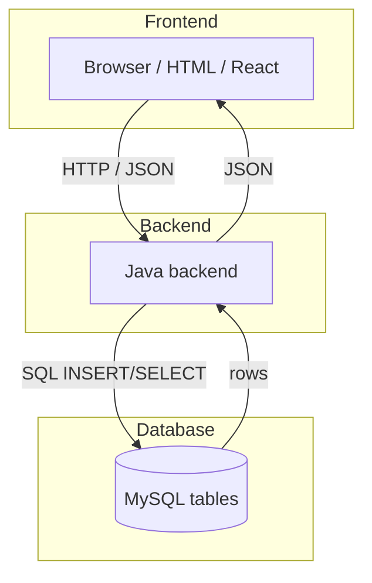
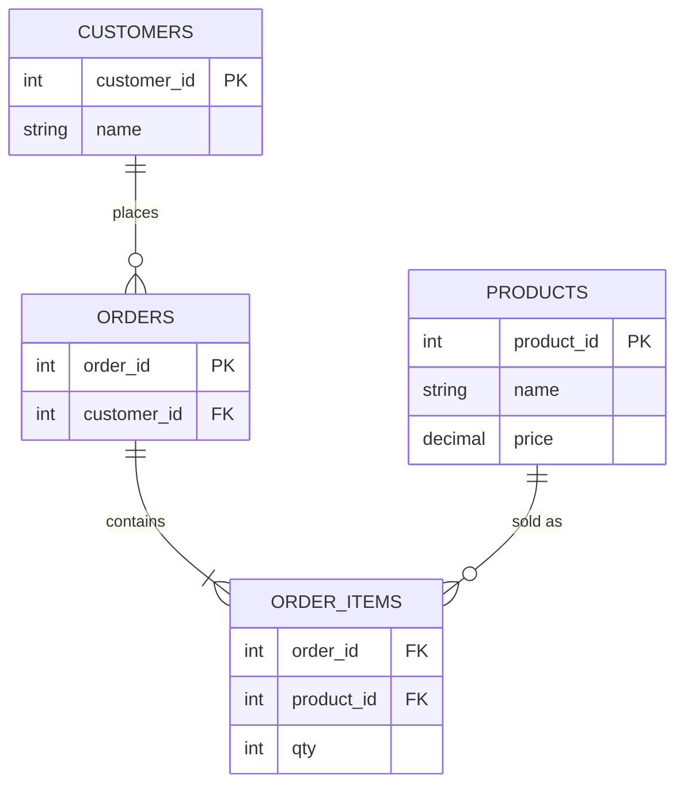

# Module: MySQL for Full Stack Developers

**Phase:** Database

**SQL material (source of truth):** [`MYSQL/README.md`](../../MYSQL/README.md) — open those files on lab days.  
**Schedule:** [Session Calendar](../Session_Calendar_100.md) — Weeks 10–11 / Sessions 46–54 (JDBC follows in `07_JDBC/`).  
**Java connectivity:** [`../07_JDBC/01_JDBC_CRUD.md`](../07_JDBC/01_JDBC_CRUD.md)

> **Note:** This FS module is the **bridge** (ER, normalization, JDBC context). Placement-ready SQL depth is taught from **`MYSQL/`** during **Weeks 10–11**. Do not treat SQL as optional. Do not copy `MYSQL/` into `JAVA/`.

**Previous module:** [Git and GitHub](../../GIT/01_Git_and_GitHub.md)  
**Next module:** [JDBC CRUD](../07_JDBC/01_JDBC_CRUD.md)

---

**Module Outcome:**

- Sketch an ER for Employee Management Portal / Swiggy before JDBC
- Open the real SQL labs in `MYSQL/` — this file is the bridge, not the course
- Normalise enough that one fact does not live in three columns

## Prerequisites

- MySQL installed — [`MYSQL/00_MySQL_Setup_and_Connection.md`](../../MYSQL/00_MySQL_Setup_and_Connection.md)

### Required MySQL labs (Weeks 10–11)

SQL is a **core placement skill**. Deep notes live in [`MYSQL/`](../../MYSQL/); the labs below are **mandatory** for every Java FS batch. Aim for independent CRUD + JOINs before JDBC and Spring Data JPA.

| Done | When | Lab file | You must be able to |
|:----:|------|----------|---------------------|
| ☐ | W10 | [`MYSQL/00_MySQL_Setup_and_Connection.md`](../../MYSQL/00_MySQL_Setup_and_Connection.md) + [`MYSQL/README.md`](../../MYSQL/README.md) | Install/connect; create `training_db` |
| ☐ | W10 | [`MYSQL/01_Introduction_to_Databases.md`](../../MYSQL/01_Introduction_to_Databases.md) | Explain table/row/DBMS vs Excel |
| ☐ | W10 | [`MYSQL/02_Introduction_to_SQL_Basic_Concepts.md`](../../MYSQL/02_Introduction_to_SQL_Basic_Concepts.md) | DDL + DML CRUD + constraints |
| ☐ | W10 | [`MYSQL/03_Querying_with_SQL.md`](../../MYSQL/03_Querying_with_SQL.md) | WHERE, LIKE, ORDER BY, LIMIT |
| ☐ | W10 | [`MYSQL/labs/README.md`](../../MYSQL/labs/README.md) | Run `training_db_seed.sql` before ch. 03 drills |
| ☐ | W10 | This bridge module | ER sketch for Library / CampusCart |
| ☐ | W11 | [`MYSQL/06_Modeling_Databases.md`](../../MYSQL/06_Modeling_Databases.md) | PK/FK, 1:N |
| ☐ | W11 | [`MYSQL/07_Joins.md`](../../MYSQL/07_Joins.md) | INNER + LEFT JOIN multi-table reports |
| ☐ | W11 | [`MYSQL/09_Transactions_and_Indexes.md`](../../MYSQL/09_Transactions_and_Indexes.md) | COMMIT/ROLLBACK; when index helps |
| ☐ | W11 | [`MYSQL/homework/10_Practice_Exercises.md`](../../MYSQL/homework/10_Practice_Exercises.md) | Complete exercises for ch. 02, 03, 07 |
| ☐ | W11–12 | [JDBC CRUD](../07_JDBC/01_JDBC_CRUD.md) | Parameterized INSERT/SELECT/UPDATE/DELETE from Java |

**Strongly recommended before placement mocks:** [`MYSQL/04`](../../MYSQL/04_Aggregations_and_Group_By.md) · [`MYSQL/05`](../../MYSQL/05_Common_Concepts.md) · [`MYSQL/08`](../../MYSQL/08_Views_and_Subqueries.md) · one project from [`MYSQL/12`](../../MYSQL/12_Real_Time_Projects.md). Window functions ([`MYSQL/11`](../../MYSQL/11_Window_Functions_and_CTEs.md)) only if the required set is solid.

**Exit ticket (without notes):** CREATE with PK+FK · INSERT/UPDATE/DELETE · SELECT + WHERE/ORDER BY · INNER JOIN + explain LEFT JOIN · why `PreparedStatement` from Java (no string-concat SQL).

---

**Teach order:** why a DB (CSV/RAM pain) → connect + `training_db` → DDL with PK/FK → DML → DQL → ER sketch → INNER/LEFT JOIN → TCL + index lite → schema mini-project. JDBC is the **next** module.

---

## Definition / Purpose

**Definition:** A **database** is **shared, structured storage that survives restart**. MySQL keeps CampusCart users, products, and orders in **tables** (rows + columns) on disk. A **table** is one kind of thing (products). A **row** is one record (Masala Dosa, ₹60). A **column** is one field (`price`).

**Definition:** A **full-stack application** has three layers: **frontend** (browser), **backend** (Java), and **database** (MySQL). When a student registers on CampusCart, the browser (or Postman) sends JSON to Java. Java validates it. SQL **INSERT**s a row into `users`.

**Purpose:** File Handling left you with an expense CSV that survives `java ExpenseFiles` on **one** laptop. Two canteen clerks cannot share it safely. An `ArrayList` dies when `main` ends. MySQL is the **shared source of truth**: concurrent orders, PK/FK rules, and the same tables the Java backend will talk to next with JDBC.

**Icons:** Order · Employee · Bank · Payroll · Laptop

**Where used?**
- **Swiggy** / CampusCart — customers, products, orders, order_items
- College apps — students, courses, enrollments in LMS / portals
- **Employee Management Portal** — `department` and `employee` tables
- **HDFC Bank** — accounts and `transaction_log` (PK/FK integrity matters)
- **Apollo Hospitals** — patients, appointments, prescriptions as related rows

**Visual — three layers talking:**



**Key takeaways:**
- Browser → Java backend → MySQL (and back)
- Frontend never talks SQL directly — JDBC (**Later —** this phase) or JPA (**Later —** Spring) issues INSERT/SELECT
- Same pattern for a React SPA or a Postman collection

**Definition:** A **primary key (PK)** uniquely identifies each row. A **foreign key (FK)** references a PK in another table — how "this order belongs to that customer" is enforced.

**SQL categories:**

| Category | Purpose | Examples |
|----------|---------|----------|
| **DDL** | Define structure | CREATE TABLE, ALTER, DROP |
| **DML** | Change data | INSERT, UPDATE, DELETE |
| **DQL** | Read data | SELECT |
| **TCL** | Control transactions | COMMIT, ROLLBACK |

This module is the **bridge**. For syntax labs, open **`MYSQL/`** from the checklist. **Later —** Java talks to those tables with JDBC (`PreparedStatement`), then Spring Data JPA.

**Remember:** JPA does not replace SQL interviews. Finish the required `MYSQL/` labs.

**Interview:** Be ready to write an INNER JOIN on a whiteboard *and* explain why the Java code will use placeholders (`?`) instead of string concatenation. Do not write that Java syntax this week.

---

## Important Concepts

> **Depth:** Run these in MySQL Workbench / CLI. For full labs, follow the calendar and open [`MYSQL/`](../../MYSQL/) files from the checklist — this module is the bridge, **`MYSQL/` is the source of truth**.

### 1. Three domains (reuse all course)

**Definition:** Course examples sit in named **products** so the same PK/FK/JOIN skills transfer to LMS, **Employee Management Portal**, and CampusCart / **Swiggy**. Full DDL lives in [`MYSQL/12_Real_Time_Projects.md`](../../MYSQL/12_Real_Time_Projects.md).

**Purpose:** One schema language covers college, office, store, clinic, and bank. You stop inventing a new table style for every ticket.

| Domain | Named product | Core tables | Full-stack use |
|--------|---------------|-------------|----------------|
| **Student** | (college LMS — keep generic) | students, courses, enrollments | LMS, college portals |
| **Employee** | **Employee Management Portal** | department, employee, leave_record | HRMS, payroll |
| **Ecommerce** | **Swiggy** (CampusCart = college skin) | customer, product, cart, orders, order_item | CampusCart / store APIs |
| **Hospital** | **Apollo Hospitals** | doctor, patient, appointment, prescription | Clinic booking |
| **Banking** | **HDFC Bank** | customer, account, transaction_log, loan | Teller / wallet |

**Note:**
- Wrong: one giant `campus_data` spreadsheet with mixed students and orders.
- Prefer: one domain per set of tables; FKs between them when they truly relate.

Sketch which domain CampusCart belongs to and list its core tables in SQL comments.

```sql
-- Which domain? CampusCart canteen = Ecommerce
-- Sketch only (comments) before CREATE:
-- users, vendors, products, orders, order_items
SELECT 'Ecommerce domain for CampusCart' AS note;
```

**Expected Output:**

```
+----------------------------------+
| note                             |
+----------------------------------+
| Ecommerce domain for CampusCart  |
+----------------------------------+
```

List the tables a student portal needs using a UNION query.

```sql
-- Student portal needs:
-- students, courses, enrollments
SELECT 'students' AS table_name
UNION ALL SELECT 'courses'
UNION ALL SELECT 'enrollments';
```

**Expected Output:**

```
+-------------+
| table_name  |
+-------------+
| students    |
| courses     |
| enrollments |
+-------------+
```

### 2. DDL — creating structure

**Definition:** **DDL** (Data Definition Language) creates and changes **structure**: databases, tables, columns, keys. It does not insert Priya's order — that is DML.

**Purpose:** Without DDL, there is nowhere safe to put a row. `CREATE TABLE` with PK/FK is the contract the Java backend will later INSERT into.

**Definition:** An **ER sketch** (entity-relationship) is boxes-and-lines **before** SQL: which things exist, and how they relate (1:N). Draw it, then write CREATE.

Connect and create the lab database first — full install steps live in [`MYSQL/00_MySQL_Setup_and_Connection.md`](../../MYSQL/00_MySQL_Setup_and_Connection.md).

```sql
CREATE DATABASE IF NOT EXISTS training_db;
USE training_db;

CREATE TABLE students (
    student_id  INT PRIMARY KEY AUTO_INCREMENT,
    full_name   VARCHAR(100) NOT NULL,
    email       VARCHAR(150) UNIQUE NOT NULL,
    enrolled_on DATE DEFAULT (CURRENT_DATE)
);

CREATE TABLE departments (
    dept_id   INT PRIMARY KEY AUTO_INCREMENT,
    dept_name VARCHAR(80) NOT NULL UNIQUE
);

CREATE TABLE employees (
    emp_id    INT PRIMARY KEY AUTO_INCREMENT,
    full_name VARCHAR(100) NOT NULL,
    dept_id   INT NOT NULL,
    salary    DECIMAL(10, 2) DEFAULT 0,
    FOREIGN KEY (dept_id) REFERENCES departments(dept_id)
);

CREATE TABLE customers (
    customer_id INT PRIMARY KEY AUTO_INCREMENT,
    name        VARCHAR(100) NOT NULL,
    city        VARCHAR(60)
);

CREATE TABLE products (
    product_id INT PRIMARY KEY AUTO_INCREMENT,
    name       VARCHAR(120) NOT NULL,
    price      DECIMAL(10, 2) NOT NULL CHECK (price >= 0)
);

CREATE TABLE orders (
    order_id    INT PRIMARY KEY AUTO_INCREMENT,
    customer_id INT NOT NULL,
    order_date  DATETIME DEFAULT CURRENT_TIMESTAMP,
    FOREIGN KEY (customer_id) REFERENCES customers(customer_id)
);

CREATE TABLE order_items (
    item_id    INT PRIMARY KEY AUTO_INCREMENT,
    order_id   INT NOT NULL,
    product_id INT NOT NULL,
    quantity   INT NOT NULL DEFAULT 1,
    FOREIGN KEY (order_id) REFERENCES orders(order_id),
    FOREIGN KEY (product_id) REFERENCES products(product_id)
);
```

**Visual — CampusCart relationships (why JOINs exist):**



**Key takeaways:**
- Customer **1 → many** Orders; Order **1 → many** Order_items
- Order_item needs **both** `order_id` (FK) and `product_id` (FK)
- JOINs exist because related data lives in separate tables

One customer → many orders; one order → many line items; each line item points to a product.

**Remember:** Money columns use `DECIMAL(10,2)` — not `FLOAT` / `VARCHAR`.

**Common Error:** Forgetting `FOREIGN KEY` / UNIQUE on email → orphan orders and duplicate logins. Define constraints in DDL.

**Note:**
- VARCHAR/FLOAT for money — use `DECIMAL(10,2)` instead.
- No FOREIGN KEY — define FK in DDL.
- No UNIQUE on email — add a UNIQUE constraint.

Create a courses table with title and credits constraints, then show its columns.

```sql
USE training_db;

CREATE TABLE IF NOT EXISTS courses (
    course_id INT PRIMARY KEY AUTO_INCREMENT,
    title     VARCHAR(120) NOT NULL,
    credits   INT NOT NULL CHECK (credits > 0)
);

SHOW COLUMNS FROM courses;
```

Create an enrollments table with foreign keys to students and courses.

```sql
USE training_db;

CREATE TABLE IF NOT EXISTS enrollments (
    enrollment_id INT PRIMARY KEY AUTO_INCREMENT,
    student_id    INT NOT NULL,
    course_id     INT NOT NULL,
    enrolled_on   DATE DEFAULT (CURRENT_DATE),
    FOREIGN KEY (student_id) REFERENCES students(student_id),
    FOREIGN KEY (course_id) REFERENCES courses(course_id)
);
```

### 3. DML — changing data

**Definition:** **DML** (Data Manipulation Language) **changes rows**: INSERT, UPDATE, DELETE. Structure stays; data moves.

**Purpose:** DDL built empty shelves. DML stocks them. CampusCart cannot sell Filter Coffee until someone INSERTs it.

```sql
INSERT INTO students (full_name, email) VALUES
('Priya Sharma', 'priya@campus.in'), ('Rahul Verma', 'rahul@campus.in');

INSERT INTO departments (dept_name) VALUES ('Engineering'), ('HR');
INSERT INTO employees (full_name, dept_id, salary) VALUES ('Anita Rao', 1, 85000.00);

INSERT INTO customers (name, city) VALUES ('Meera', 'Hyderabad');
INSERT INTO products (name, price) VALUES ('Notebook', 45.00), ('Pen Pack', 120.00);
INSERT INTO orders (customer_id) VALUES (1);

UPDATE employees SET salary = salary * 1.10 WHERE dept_id = 1;
DELETE FROM students WHERE email = 'rahul@campus.in';  -- always use WHERE!
```

**Note:**
- `DELETE FROM students` without WHERE — always use WHERE; test with SELECT first.

Insert canteen products with INR prices and list them ordered by price.

```sql
USE training_db;

INSERT INTO products (name, price) VALUES
('Masala Dosa', 60.00),
('Filter Coffee', 25.00),
('Veg Thali', 90.00);

SELECT product_id, name, price FROM products ORDER BY price;
```

Preview a row, update Notebook price safely, then verify the change.

```sql
USE training_db;

-- Preview first
SELECT * FROM products WHERE name = 'Notebook';

UPDATE products SET price = 49.00 WHERE name = 'Notebook';

SELECT name, price FROM products WHERE name = 'Notebook';
```

### 4. DQL — reading data

**Definition:** **DQL** (Data Query Language) is **SELECT** — read without changing rows. Filters (`WHERE`), sort (`ORDER BY`), and cap (`LIMIT`) turn a table dump into a report.

**Purpose:** The canteen manager does not want every column of every order. They want products under ₹100, newest first.

```sql
SELECT full_name, email FROM students WHERE enrolled_on >= '2026-01-01';

SELECT e.full_name, d.dept_name, e.salary
FROM employees e JOIN departments d ON e.dept_id = d.dept_id
WHERE e.salary > 70000 ORDER BY e.salary DESC;

SELECT name, price FROM products WHERE price BETWEEN 40 AND 150;
```

**Note:**
- `SELECT *` in APIs — name columns explicitly.

**Go deeper:** [`MYSQL/03_Querying_with_SQL.md`](../../MYSQL/03_Querying_with_SQL.md)

Query products priced under ₹100 sorted ascending.

```sql
USE training_db;

SELECT name, price
FROM products
WHERE price < 100
ORDER BY price ASC;
```

Select customers located in Hyderabad.

```sql
USE training_db;

SELECT customer_id, name, city
FROM customers
WHERE city = 'Hyderabad';
```

### 5. TCL + indexes lite

**Definition:** A **transaction** is a group of SQL statements that must **all succeed or all fail**. **TCL** (COMMIT / ROLLBACK) is the steering wheel.

**Purpose:** Checkout is two writes: insert the order **and** reduce stock. If the second fails, you must not keep a paid order with no stock change. `START TRANSACTION` … `COMMIT` / `ROLLBACK` protects that.

```sql
START TRANSACTION;
UPDATE products SET price = price - 10 WHERE product_id = 1;
-- ROLLBACK;  -- if error
COMMIT;
```

**Definition:** An **index** is a lookup shortcut on a column (like a book index). MySQL can find `email = 'priya@campus.in'` without scanning every row.

**Purpose:** PK and UNIQUE already create indexes. Extra indexes help frequent `WHERE` / JOIN columns. Too many indexes slow INSERT/UPDATE.

```sql
-- Lite: index a search column (products.name is used in WHERE)
CREATE INDEX idx_products_name ON products (name);
SHOW INDEX FROM products;
```

**Remember:** Index columns you filter or join on. Do not index every column.

**Note:**
- Autocommit is on by default in many clients — wrap multi-step money/stock changes in an explicit transaction.
- Index-everything "for speed" — writes get slower; index the queries you actually run.

**Go deeper:** [`MYSQL/09_Transactions_and_Indexes.md`](../../MYSQL/09_Transactions_and_Indexes.md)

Start a transaction, apply a bad price cut, then rollback to restore the original price.

```sql
USE training_db;

START TRANSACTION;
UPDATE products SET price = 1.00 WHERE name = 'Veg Thali';
SELECT name, price FROM products WHERE name = 'Veg Thali';
ROLLBACK;
SELECT name, price FROM products WHERE name = 'Veg Thali';  -- restored
```

Apply a ₹5 discount on Filter Coffee inside a transaction and commit.

```sql
USE training_db;

START TRANSACTION;
UPDATE products SET price = price - 5 WHERE name = 'Filter Coffee';
COMMIT;
SELECT name, price FROM products WHERE name = 'Filter Coffee';
```

### 6. INNER JOIN vs LEFT JOIN

**Definition:** A **JOIN** combines rows from related tables using the FK = PK match. **INNER JOIN** keeps rows that match in **both** tables. **LEFT JOIN** keeps **all** left-table rows; missing right-side values are NULL.

**Purpose:** Names live in `customers`; dates live in `orders`. Reports need both. INNER JOIN is "people who ordered". LEFT JOIN is "all customers, even if they never ordered".

**INNER JOIN** — only rows matching in **both** tables:

```sql
SELECT e.full_name, d.dept_name
FROM employees e INNER JOIN departments d ON e.dept_id = d.dept_id;
```

**LEFT JOIN** — all rows from **left** table; NULL on right if no match:

```sql
SELECT c.name, o.order_id, o.order_date
FROM customers c LEFT JOIN orders o ON c.customer_id = o.customer_id;
```

**Ecommerce chain (INNER JOINs):**

```sql
SELECT c.name AS customer, p.name AS product, oi.quantity, p.price
FROM orders o
INNER JOIN customers c ON o.customer_id = c.customer_id
INNER JOIN order_items oi ON o.order_id = oi.order_id
INNER JOIN products p ON oi.product_id = p.product_id;
```

**Go deeper:** [`MYSQL/07_Joins.md`](../../MYSQL/07_Joins.md)

**Note:**
- JOIN without ON → Cartesian product — always write an explicit ON.

Join employees to departments and list names with salary ordered by department.

```sql
USE training_db;

SELECT e.full_name, d.dept_name, e.salary
FROM employees e
INNER JOIN departments d ON e.dept_id = d.dept_id
ORDER BY d.dept_name, e.full_name;
```

Add a customer with no orders and use LEFT JOIN to show all customers.

```sql
USE training_db;

INSERT INTO customers (name, city) VALUES ('Arjun', 'Pune');  -- no orders yet

SELECT c.name, o.order_id
FROM customers c
LEFT JOIN orders o ON c.customer_id = o.customer_id
ORDER BY c.name;
```

### 7. Normalization lite (1NF → 3NF)

**Definition:** **Normalization** splits repeating and derived facts into related tables so you update a fact **once**.

**Purpose:** `"Math, Physics"` in one column cannot be queried cleanly. Instructor stored on every enrollment row goes stale when the instructor changes. 1NF / 2NF / 3NF are the practical tests before you CREATE.

| Normal Form | Rule | Bad example | Fix |
|-------------|------|-------------|-----|
| **1NF** | Atomic columns; no repeating groups | `courses: "Math, Physics"` | `enrollments` junction table |
| **2NF** | No partial dependency on composite PK | instructor in enrollment row | Move to `courses` |
| **3NF** | No transitive dependency | dept_head in student row | Split `departments` |

**Go deeper:** [`MYSQL/06_Modeling_Databases.md`](../../MYSQL/06_Modeling_Databases.md)

**Note:**
- Comma-separated values in one column — use a junction table (1NF).

Fix a 1NF violation by inserting courses and enrollments rows instead of comma-separated values.

```sql
-- BAD: courses_csv VARCHAR storing "Math,Physics"
-- GOOD: enrollments rows
USE training_db;

INSERT INTO courses (title, credits) VALUES ('Math', 4), ('Physics', 3);
INSERT INTO enrollments (student_id, course_id) VALUES (1, 1), (1, 2);

SELECT s.full_name, c.title
FROM students s
INNER JOIN enrollments e ON s.student_id = e.student_id
INNER JOIN courses c ON e.course_id = c.course_id;
```

Identify the 3NF issue with dept_head in students and note the fix in a SELECT comment.

```sql
-- BAD idea (do not create long-term):
-- students(full_name, dept_name, dept_head)
-- GOOD: departments(dept_name, dept_head) + students.dept_id FK
SELECT 'Move dept_head to departments table (3NF)' AS fix_note;
```

**Expected Output:**

```
+--------------------------------------------+
| fix_note                                   |
+--------------------------------------------+
| Move dept_head to departments table (3NF)  |
+--------------------------------------------+
```

---

## Step-by-Step Lab

Run in MySQL Workbench or CLI. Use the DDL/DML above. Do **not** open JDBC this week.

1. Connect per [`MYSQL/00_MySQL_Setup_and_Connection.md`](../../MYSQL/00_MySQL_Setup_and_Connection.md); run `CREATE DATABASE fullstack_lab; USE fullstack_lab;`
2. Execute DDL for student, employee, and ecommerce tables above (PK/FK on every relationship)
3. Seed 3+ rows per table with INSERT examples (INR prices on products)
4. DQL drills: Engineering employees; products under ₹100; students sorted by name
5. JOIN lab: INNER (employees + departments); LEFT (customers + orders, include a zero-order customer)
6. Normalize `bad_orders(order_id, customer_name, customer_city, product1, product2)` → sketch `customers`, `orders`, `order_items`, `products`
7. TCL lite: `START TRANSACTION` a bad price cut, `SELECT`, `ROLLBACK`, `SELECT` again
8. Sketch ER for Library **or** CampusCart (mini-project) — boxes + 1:N lines **before** extra CREATE

**Annotated demo — CampusCart canteen report (after seed):**

```sql
USE training_db;

-- 1) one more line item so the JOIN has something to show
INSERT INTO order_items (order_id, product_id, quantity)
VALUES (1, 1, 2);   -- 2 × Notebook for Meera's order

-- 2) report: who bought what (INNER JOIN chain)
SELECT
    c.name     AS customer,
    p.name     AS product,
    oi.quantity,
    p.price,
    (oi.quantity * p.price) AS line_total_inr
FROM orders o
INNER JOIN customers c   ON o.customer_id = c.customer_id
INNER JOIN order_items oi ON o.order_id = oi.order_id
INNER JOIN products p    ON oi.product_id = p.product_id;

-- 3) LEFT JOIN: customers who have not ordered yet stay visible
SELECT c.name, o.order_id
FROM customers c
LEFT JOIN orders o ON c.customer_id = o.customer_id;
```

**Later — JDBC:** the same SELECT will run from Java with `PreparedStatement` and `?` placeholders. Do not write that Java this week.

---

## Practice Exercises

### Basic

1. CREATE TABLE `courses` (course_id, title, credits); INSERT 5 rows; SELECT credits > 3.

   **Model answer:**

```sql
CREATE TABLE IF NOT EXISTS courses (
  course_id INT PRIMARY KEY AUTO_INCREMENT,
  title VARCHAR(100) NOT NULL,
  credits INT NOT NULL
);
INSERT INTO courses (title, credits) VALUES
  ('Core Java', 4), ('MySQL', 3), ('OOP', 4), ('Collections', 3), ('Git', 2);
SELECT * FROM courses WHERE credits > 3;
```

2. UPDATE one title; DELETE one row by id.

   **Model answer:**

```sql
UPDATE courses SET title = 'Core Java Lab' WHERE course_id = 1;
DELETE FROM courses WHERE course_id = 5;
```

3. List all departments alphabetically.

   **Model answer:**

```sql
SELECT * FROM departments ORDER BY dept_name ASC;
```

### Intermediate

1. Add `enrollments(student_id, course_id)`; INNER JOIN students + enrollments + courses.

   **Model answer:**

```sql
CREATE TABLE IF NOT EXISTS enrollments (
  student_id INT,
  course_id INT,
  PRIMARY KEY (student_id, course_id),
  FOREIGN KEY (student_id) REFERENCES students(student_id),
  FOREIGN KEY (course_id) REFERENCES courses(course_id)
);
SELECT s.full_name, c.title
FROM students s
INNER JOIN enrollments e ON s.student_id = e.student_id
INNER JOIN courses c ON c.course_id = e.course_id;
```

2. LEFT JOIN — students with no enrollments.

   **Model answer:**

```sql
SELECT s.student_id, s.full_name
FROM students s
LEFT JOIN enrollments e ON s.student_id = e.student_id
WHERE e.student_id IS NULL;
```

3. Employee report: dept_name, count, avg salary → see [`MYSQL/04_Aggregations_and_Group_By.md`](../../MYSQL/04_Aggregations_and_Group_By.md).

   **Model answer:**

```sql
SELECT d.dept_name, COUNT(e.emp_id) AS emp_count, AVG(e.salary) AS avg_salary
FROM departments d
LEFT JOIN employees e ON d.dept_id = e.dept_id
GROUP BY d.dept_name;
```

4. Fix denormalized `bad_library` table into 3NF.

   **Model answer:**
   Split repeating groups and transitive dependencies into separate tables such as `books(book_id, title, author_id)`, `authors(author_id, name)`, and `loans(loan_id, book_id, member_id, due_date)` so each non-key attribute depends only on the primary key.

### Interview-style

1. INNER vs LEFT JOIN — write SQL showing NULL side.

   **Model answer:**

```sql
-- INNER: only matching rows
SELECT * FROM students s INNER JOIN enrollments e ON s.student_id = e.student_id;
-- LEFT: keep all students; unmatched enrollment columns are NULL
SELECT s.full_name, e.course_id
FROM students s
LEFT JOIN enrollments e ON s.student_id = e.student_id;
```

2. When use TRANSACTION? (checkout, money transfer)

   **Model answer:**
   Use a transaction when multiple statements must succeed or fail together — e.g. debit one account and credit another, or place an order and decrement stock. `START TRANSACTION` … `COMMIT` / `ROLLBACK` protects consistency.

3. Design tables for CampusCart menu and daily orders.

   **Model answer:**
   Typical design: `menu_items(item_id, name, price, available)`, `orders(order_id, student_id, order_date, status)`, `order_items(order_id, item_id, qty, unit_price)` with FKs from `order_items` to `orders` and `menu_items`.

4. PRIMARY KEY vs UNIQUE — example.

   **Model answer:**
   PRIMARY KEY uniquely identifies a row and disallows NULL (e.g. `student_id`). UNIQUE enforces uniqueness on another column that may allow NULL depending on engine (e.g. `email UNIQUE`).

5. Why DECIMAL for price, not FLOAT?

   **Model answer:**
   FLOAT is binary approximate and can produce rounding errors in money. DECIMAL stores exact base-10 values, so INR totals and invoices stay accurate.

6. Why will Java use `PreparedStatement` instead of string-concat SQL? (idea only)

   **Model answer:**
   Placeholders (`?`) keep user input out of the SQL text, so a typed name cannot change the command. Concatenating `"'" + name + "'"` is how SQL injection starts. Syntax is **Later —** JDBC. This week: never build SQL by gluing strings, even in notes.

---

## Mini-Project (Assignment): Schema Design (Library, Swiggy / CampusCart, or Employee Management Portal)

**SQL depth (source of truth):** Weeks 10–11 · follow [`MYSQL/`](../../MYSQL/) + the **Required MySQL labs** table in this module.

**No Java lab kit this week.** Kit `16_jdbc_library_crud` is reserved for JDBC (next module). MySQL seed practice stays in [`MYSQL/`](../../MYSQL/). Do not invent a second SQL textbook inside this file.

**Option A — Library:** members, books, copies, loans, fines  
**Option B — Swiggy / CampusCart:** users, vendors, products, orders, order_items  
**Option C — Employee Management Portal:** department, employee, leave_record

### What to build

- ER diagram (boxes + 1:N lines); DDL with PK/FK; 10+ INSERT rows; 3 queries with JOINs (overdue books **or** order history).

```sql
-- Sample CampusCart report query
SELECT u.full_name, o.order_id, p.name, oi.quantity
FROM orders o
JOIN users u ON o.user_id = u.user_id
JOIN order_items oi ON o.order_id = oi.order_id
JOIN products p ON oi.product_id = p.product_id
WHERE o.order_date >= '2026-07-01';
```

Work in MySQL Workbench / CLI. Commit the `.sql` script to your GitHub portfolio repo (Git week already taught `.gitignore` — still no `.env`). No JDBC. No Spring. No Lombok.

### Stretch

- Add a fine/tax column with `DECIMAL(10,2)` and one aggregate report ([`MYSQL/04_Aggregations_and_Group_By.md`](../../MYSQL/04_Aggregations_and_Group_By.md)).
- Write one `START TRANSACTION` … `COMMIT` checkout script ([`MYSQL/09_Transactions_and_Indexes.md`](../../MYSQL/09_Transactions_and_Indexes.md)).
- **Later — JDBC:** when Java INSERTs these rows, use `PreparedStatement` placeholders (`?`) — never string-concat SQL. Do not write that Java in this assignment.

### Done when

- [ ] ER + DDL with PK/FK for chosen option (Library or CampusCart)
- [ ] Seed data (≥10 rows) + 3 JOIN queries run successfully
- [ ] You can point to the matching `MYSQL/` files you used for depth
- [ ] Required `MYSQL/` checklist rows for W10–W11 (this module) are ticked — JDBC row waits for the next module
- [ ] No `Connection` / `PreparedStatement` / Spring Boot / Lombok code in the deliverable

---

## Bridge to Deep MySQL Modules

| Need | File |
|------|------|
| Setup | `MYSQL/00_MySQL_Setup_and_Connection.md` |
| SQL basics | `MYSQL/02_Introduction_to_SQL_Basic_Concepts.md` |
| Querying | `MYSQL/03_Querying_with_SQL.md` |
| GROUP BY | `MYSQL/04_Aggregations_and_Group_By.md` |
| Keys, constraints | `MYSQL/05_Common_Concepts.md` |
| ER modeling | `MYSQL/06_Modeling_Databases.md` |
| All joins | `MYSQL/07_Joins.md` |
| Subqueries, views | `MYSQL/08_Views_and_Subqueries.md` |
| Transactions, indexes | `MYSQL/09_Transactions_and_Indexes.md` |
| Practice + projects | `MYSQL/homework/10_Practice_Exercises.md`, `MYSQL/12_Real_Time_Projects.md` |

**Java next:** [`07_JDBC/01_JDBC_CRUD.md`](../07_JDBC/01_JDBC_CRUD.md) — `PreparedStatement` CRUD against **these** tables. No Spring Boot this week.

---

## Interview Q&A

Shared with students after concepts and the mini-project. Use for review and interview prep — questions and model answers are included.

**Q1. What is a relational database?**  
**A:** Data in tables with rows/columns linked by keys. MySQL is an open-source RDBMS. The Java backend (JDBC, later JPA) reads and writes those tables.

**Q2. INNER JOIN vs LEFT JOIN?**  
**A:** INNER = matching rows only. LEFT = all left rows + matches, or NULL on the right when there is no match (e.g. **Swiggy** customers with no orders; **Employee Management Portal** employees with no leave rows).

**Q3. What is normalization? Why 3NF?**  
**A:** Normalization reduces redundancy. 3NF removes transitive dependencies (store `dept_head` on `departments`, not on every student) so one fact is updated in one place.

**Q4. DELETE vs DROP?**  
**A:** DELETE removes rows (DML). DROP removes the table structure (DDL). `DELETE FROM t` with no WHERE can empty the table; DROP loses the table itself.

**Q5. Where does MySQL sit in a Java full stack?**  
**A:** Persistent storage. Browser / Postman → Java API → SQL against MySQL. The frontend never issues SQL.

**Q6. Why not keep CampusCart in an `ArrayList` or a CSV after File Handling week?**  
**A:** RAM dies when `main` ends. A CSV lives on one laptop, has no PK/FK, and cannot safely share concurrent **Swiggy** / CampusCart orders. MySQL is the shared source of truth.

**Q7. PRIMARY KEY vs UNIQUE?**  
**A:** PK identifies the row and disallows NULL (`student_id`). UNIQUE enforces uniqueness on another column (`email`) and may allow NULL depending on engine.

**Q8. Why DECIMAL for price, not FLOAT?**  
**A:** FLOAT is approximate binary. DECIMAL stores exact base-10 INR amounts, so invoice totals do not drift.

**Q9. When do you use a TRANSACTION?**  
**A:** When several statements must succeed or fail together — **HDFC Bank** money transfer, **Swiggy** checkout + stock decrement. `START TRANSACTION` … `COMMIT` / `ROLLBACK`.

**Q10. What does a foreign key actually do?**  
**A:** It is a database-enforced pointer: `orders.customer_id` must match an existing `customers.customer_id`. Orphan orders are rejected. Think of it as a hyperlink between tables, with rules.

**Q11. Why will JDBC use `PreparedStatement` instead of string-concat SQL?**  
**A:** Placeholders (`?`) separate commands from data, which blocks SQL injection from typed names. Concatenating quotes into SQL is unsafe. The Java syntax is the **next** module — the idea is this week's exit ticket.

**Q12. Is normalization always good? When might teams denormalize?**  
**A:** 3NF is the default for OLTP (**Swiggy** / CampusCart orders). Teams sometimes denormalize read-heavy reports (copy a product name onto `order_items`) to avoid JOINs — that is a measured trade-off, not a first design.

---
