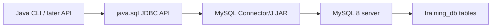

# Module 07 — JDBC CRUD

**Phase:** Database (Java talking to MySQL)

**Previous module:** [MySQL for Full Stack Developers](../06_Database_MySQL/01_MySQL_for_Full_Stack_Developers.md)  
**Next module:** [HTML & CSS (shared FRONTEND)](../../FRONTEND/HTML_CSS/README.md)

**Lab kit:** [15_Lab_Assets/16_jdbc_library_crud/](../15_Lab_Assets/16_jdbc_library_crud/)

**SQL depth (already taught):** [`MYSQL/`](../../MYSQL/) — PK/FK ([`06`](../../MYSQL/06_Modeling_Databases.md)), INNER / LEFT JOIN ([`07`](../../MYSQL/07_Joins.md)), TCL + indexes lite ([`09`](../../MYSQL/09_Transactions_and_Indexes.md)). This module does **not** rewrite those chapters. JDBC **uses** the tables you created.

---

**Module Outcome:**

- Open a MySQL connection with try-with-resources and a URL you can explain
- Run SELECT / INSERT / UPDATE / DELETE through `PreparedStatement` — never string-glue SQL
- Push library CRUD that uses the tables you already modelled

**Teach order today:** CSV vs shared MySQL → driver + JDBC URL + classpath → `Connection` + try-with-resources → secrets → `PreparedStatement` SELECT → `ResultSet` → INSERT / UPDATE / DELETE → SQL-injection note → library CRUD push.

---

## Prerequisites

- Local MySQL 8+ with `training_db` — setup and SQL labs live in [`MYSQL/`](../../MYSQL/) (required from the [MySQL bridge](../06_Database_MySQL/01_MySQL_for_Full_Stack_Developers.md)).
- **MySQL Connector/J** JAR on the `java -cp` classpath (plain `javac` / `java` — **not** Maven, **not** Spring).

---

## Definition / Purpose

**Definition:** **JDBC** (Java Database Connectivity) is the **JDK API** in `java.sql` that lets Java send SQL to a database. You write `Connection`, `PreparedStatement`, `ResultSet`. A **driver** (here **MySQL Connector/J**) translates those calls into MySQL’s network protocol.

**Definition:** A **`PreparedStatement`** is SQL with **`?` placeholders**. You bind values with `setString` / `setInt` / `setBigDecimal`. The driver sends **command and data separately**, so a typed title cannot change the SQL.

**Purpose:** File Handling left you with `expenses.csv` on **one** laptop. MySQL weeks put shared rows in `training_db`. Without JDBC, Java still cannot **INSERT a library book** or **SELECT by author**. Workbench is not your app. JDBC is the first Java path to those tables. **Later —** Spring Data JPA will hide this SQL; interviews still expect you to write it.

**Icons:** Bank · Order · Hospital · CRM · Payroll

**Where used?**
- Campus library — list / add / update copies / remove titles from a CLI (kit stays library)
- **Swiggy** / CampusCart — the same `?` pattern later inserts orders (still JDBC under Spring)
- **HDFC Bank** — balances must not be built from concatenated SQL
- **Employee Management Portal** — parameterized SELECT by employee id (optional second story)
- **Apollo Hospitals** — search by patient name without turning the name into a command

**Visual — Java to MySQL:**



**Key takeaways:**

- JDBC is the **API**; Connector/J is the **driver JAR** on the classpath
- **`Connection`** is an `AutoCloseable` — try-with-resources (same habit as `Scanner` / files)
- Core path uses **`PreparedStatement` + `?` only** — never `Statement` + `"'" + name + "'"`
- Passwords live in **env / `.env`**, never in git

---

## Motivation — Feel the pain of CSV-only clerks

Two library desks cannot share `books.csv` safely. MySQL already holds the rows. Java still prints “in memory” unless it **connects**.

```java
public class CsvOneLaptopPain {
    public static void main(String[] args) {
        System.out.println("books.csv lives on Priya's laptop.");
        System.out.println("Ravi's desk cannot UPDATE copies.");
        System.out.println("MySQL already has the table — Java must use JDBC.");
    }
}
```

**Expected Output:**

```
books.csv lives on Priya's laptop.
Ravi's desk cannot UPDATE copies.
MySQL already has the table — Java must use JDBC.
```

**Remember:** SQL you already know. JDBC is **how Java sends** that SQL.

**Interview:** “JDBC vs JPA?” — JDBC is explicit SQL. JPA is an ORM **Later —** Spring Data. Both still talk to MySQL.

---

## Important Concepts

### 1. Architecture — API vs driver vs server

**Definition:** Three layers: your **Java code**, the **JDBC API** (`java.sql`), and a **driver JAR** that speaks to **MySQL**.  
**Purpose:** Mixing them up leads to “I imported JDBC but forgot the JAR” or “I installed MySQL but never wrote Java.”

```
[LibraryCrud.java]
        ↓  java.sql (Connection, PreparedStatement)
[mysql-connector-j-8.4.0.jar]
        ↓  TCP :3306
[MySQL Server — training_db]
        ↓
[books, members, loans, ...]
```

**Note:**
- Wrong: treating Connector/J as optional because `import java.sql.*` compiles — **compile** needs the JDK API; **run** needs the JAR.
- Prefer: `java -cp ".:mysql-connector-j-8.4.0.jar" YourClass` (Windows: `;` instead of `:`).
- **Later — Maven / Spring:** the JAR becomes a dependency. Not this module.

Print the four JDBC layers from Java app through Connector/J to MySQL tables.

```java
public class JdbcLayerLabels {
    public static void main(String[] args) {
        System.out.println("1 Java app");
        System.out.println("2 java.sql API");
        System.out.println("3 Connector/J driver");
        System.out.println("4 MySQL server / tables");
    }
}
```

**Expected Output:**

```
1 Java app
2 java.sql API
3 Connector/J driver
4 MySQL server / tables
```

Print why javac can compile java.sql without a JAR while java needs Connector/J on -cp.

```java
public class JdbcApiVsDriver {
    public static void main(String[] args) {
        System.out.println("javac compiles java.sql imports with no JAR.");
        System.out.println("java needs Connector/J on -cp to reach MySQL.");
    }
}
```

**Expected Output:**

```
javac compiles java.sql imports with no JAR.
java needs Connector/J on -cp to reach MySQL.
```

---

### 2. Driver, JDBC URL, classpath (no Spring)

**Definition:** A **JDBC URL** names the server: `jdbc:mysql://host:port/database`. Query flags after `?` are driver options (lab timezone, public-key retrieval).  
**Purpose:** `DriverManager.getConnection(url, user, password)` needs a matching driver on the classpath. Connector/J 8+ **registers itself** (SPI). `Class.forName("com.mysql.cj.jdbc.Driver")` is optional — interviews may still ask for it.

Download **once** (pin **8.4.0** for this batch; 8.x / 9.x also fine on JDK 17 + MySQL 8):

```bash
curl -L -o mysql-connector-j-8.4.0.jar \
  https://repo1.maven.org/maven2/com/mysql/mysql-connector-j/8.4.0/mysql-connector-j-8.4.0.jar
```

Lab URL shape:

```
jdbc:mysql://localhost:3306/training_db?allowPublicKeyRetrieval=true&useSSL=false&serverTimezone=Asia/Kolkata
```

`allowPublicKeyRetrieval=true` is the usual MySQL 8 **caching_sha2_password** lab fix (see [Tested Toolchain](../Tested_Toolchain.md)). `useSSL=false` is **lab-only**. `serverTimezone=Asia/Kolkata` avoids “zero date / timezone” surprises.

**Note:**
- Wrong: old class `com.mysql.jdbc.Driver` — that is Connector/J 5. Use `com.mysql.cj.jdbc.Driver` if you still call `Class.forName`.
- Wrong: putting the password inside the URL in committed notes.
- Building `jdbc:mysql://` + host + port from config is **not** SQL concatenation — the ban is concatenating **user input into the SQL string**.

**Common Error:** `Public Key Retrieval is not allowed` — add `allowPublicKeyRetrieval=true` on the lab URL. Do not paste a real password into git while debugging.

**Remember:** `javac YourClass.java` then `java -cp ".:mysql-connector-j-8.4.0.jar" YourClass`.

Build and print a JDBC URL from host, port, and database with the lab flags (do not connect).

```java
public class JdbcUrlPieces {
    public static void main(String[] args) {
        String host = "localhost";
        String port = "3306";
        String database = "training_db";
        String url = "jdbc:mysql://" + host + ":" + port + "/" + database
                + "?allowPublicKeyRetrieval=true&useSSL=false&serverTimezone=Asia/Kolkata";
        System.out.println(url);
    }
}
```

**Expected Output:**

```
jdbc:mysql://localhost:3306/training_db?allowPublicKeyRetrieval=true&useSSL=false&serverTimezone=Asia/Kolkata
```

Print the macOS/Linux and Windows java -cp lines that put Connector/J on the classpath.

```java
public class ClasspathHintPrint {
    public static void main(String[] args) {
        System.out.println("macOS/Linux: java -cp .:mysql-connector-j-8.4.0.jar LibraryCrud");
        System.out.println("Windows:     java -cp .;mysql-connector-j-8.4.0.jar LibraryCrud");
    }
}
```

**Expected Output:**

```
macOS/Linux: java -cp .:mysql-connector-j-8.4.0.jar LibraryCrud
Windows:     java -cp .;mysql-connector-j-8.4.0.jar LibraryCrud
```

---

### 3. `Connection` + try-with-resources

**Definition:** A **`Connection`** is one session with MySQL (`DriverManager.getConnection`). It implements **`AutoCloseable`**.  
**Purpose:** Leaving connections open exhausts the server. try-with-resources calls `close()` on success **and** on failure — same shape as `Scanner` and `BufferedWriter`.

```java
import java.sql.Connection;
import java.sql.DriverManager;
import java.sql.ResultSet;
import java.sql.PreparedStatement;
import java.sql.SQLException;

public class ConnectSelectDatabase {
    public static void main(String[] args) {
        String password = System.getenv("MYSQL_PASSWORD");
        if (password == null || password.length() == 0) {
            System.out.println("Set MYSQL_PASSWORD first");
            return;
        }
        String url = "jdbc:mysql://localhost:3306/training_db"
                + "?allowPublicKeyRetrieval=true&useSSL=false&serverTimezone=Asia/Kolkata";
        try (Connection conn = DriverManager.getConnection(url, "root", password);
                PreparedStatement ps = conn.prepareStatement("SELECT DATABASE()");
                ResultSet rs = ps.executeQuery()) {
            if (rs.next()) {
                System.out.println("Connected to " + rs.getString(1));
            }
        } catch (SQLException e) {
            System.out.println("Could not connect: " + e.getMessage());
        }
    }
}
```

**Expected Output:** (Connector/J on `-cp`, MySQL running, `MYSQL_PASSWORD` set, `training_db` exists)

```
Connected to training_db
```

If the env var is missing, the program prints `Set MYSQL_PASSWORD first` and exits — that is also correct.

**Note:**
- Wrong: `conn.close()` only on the happy path — an exception skips it. Prefer try-with-resources.
- Wrong: `catch (Exception e) {}` — you hide `SQLException` (Exceptions week already banned this).
- `SQLException` is **checked**. `catch` or `throws`.
- Connector/J 8+ does **not** require `Class.forName` when the JAR is on `-cp`.

**Interview:** Why try-with-resources on `Connection`? Because `close()` returns the session to the server even if `executeQuery` throws.

Print whether java.sql.Connection implements AutoCloseable.

```java
import java.sql.Connection;

public class ConnectionIsAutoCloseable {
    public static void main(String[] args) {
        System.out.println(AutoCloseable.class.isAssignableFrom(Connection.class));
    }
}
```

**Expected Output:**

```
true
```

Exit with a friendly message when MYSQL_PASSWORD is unset so you never call DriverManager without a password.

```java
public class MissingPasswordNoConnect {
    public static void main(String[] args) {
        String password = System.getenv("MYSQL_PASSWORD");
        if (password == null || password.length() == 0) {
            System.out.println("Set MYSQL_PASSWORD in the terminal or in .env");
            return;
        }
        System.out.println("Password present — would call DriverManager next");
    }
}
```

**Expected Output:** (when `MYSQL_PASSWORD` is unset)

```
Set MYSQL_PASSWORD in the terminal or in .env
```

---

### 4. Secrets — env and `.env.example` (not `application.yml`)

**Definition:** A **secret** is a password or token that must not appear in git. Git week already ignores `.env`. JDBC reads **`MYSQL_PASSWORD`** from the environment, or from a local **`.env`** file you never commit.  
**Purpose:** Hard-coding `"root123"` in `LibraryCrud.java` leaks the lab (and later, production) password the first time you push.

Commit **`.env.example`** with dummy values. Copy it to **`.env`** on your machine. **`application.yml` is a Spring file** — do not add it in this module.

```
MYSQL_HOST=localhost
MYSQL_PORT=3306
MYSQL_USER=root
MYSQL_PASSWORD=change_me
MYSQL_DATABASE=training_db
```

`System.getenv("MYSQL_PASSWORD")` is the first tool. File Handling already taught `Files.readAllLines` — a tiny loop can read `.env` if the env var is unset (lab kit helper).

**Note:**
- Wrong: committing `.env` “because the repo is private.”
- Wrong: `!.env` in `.gitignore` (Git kit already showed that trap).
- Prefer: `.env.example` in git; real `.env` local only.

**Common Error:** Password still `change_me` in `.env` — MySQL rejects the login. Edit it.

**Remember:** Env first, then `.env`. Never a password literal in source.

Read MYSQL_PASSWORD from the environment and print a missing-key message or the password length.

```java
public class MissingMysqlPassword {
    public static void main(String[] args) {
        String password = System.getenv("MYSQL_PASSWORD");
        if (password == null || password.length() == 0) {
            System.out.println("Set MYSQL_PASSWORD first");
        } else {
            System.out.println("Password length: " + password.length());
        }
    }
}
```

**Expected Output:** (unset)

```
Set MYSQL_PASSWORD first
```

Write a throwaway env_demo_jdbc.txt, parse MYSQL_PASSWORD from it, print the value, then delete the file.

```java
import java.io.IOException;
import java.nio.charset.StandardCharsets;
import java.nio.file.Files;
import java.nio.file.Path;

public class ReadPasswordFromEnvFile {
    public static void main(String[] args) {
        Path demo = Path.of("env_demo_jdbc.txt");
        try {
            Files.writeString(demo, "MYSQL_PASSWORD=lab-only\n", StandardCharsets.UTF_8);
            String password = null;
            for (String line : Files.readAllLines(demo, StandardCharsets.UTF_8)) {
                if (line.startsWith("MYSQL_PASSWORD=")) {
                    password = line.substring("MYSQL_PASSWORD=".length());
                }
            }
            System.out.println(password);
            Files.deleteIfExists(demo);
        } catch (IOException e) {
            System.out.println(e.getMessage());
        }
    }
}
```

**Expected Output:**

```
lab-only
```

That demo file is a **throwaway**. Real lab passwords stay in `.env`, which Git ignores.

---

### 5. `PreparedStatement` SELECT

**Definition:** `conn.prepareStatement("SELECT … WHERE author = ?")` creates a **template**. `ps.setString(1, author)` fills placeholder **1** (JDBC indexes are **1-based**). `executeQuery()` returns a **`ResultSet`**.  
**Purpose:** The author string is **data**. It cannot add `OR 1=1` to the command.

Seed a `books` table (lab kit SQL, or your MYSQL-week Library schema). Then:

```java
import java.sql.Connection;
import java.sql.DriverManager;
import java.sql.PreparedStatement;
import java.sql.ResultSet;
import java.sql.SQLException;

public class SelectByAuthorPrepared {
    public static void main(String[] args) {
        String password = System.getenv("MYSQL_PASSWORD");
        if (password == null || password.length() == 0) {
            System.out.println("Set MYSQL_PASSWORD first");
            return;
        }
        String url = "jdbc:mysql://localhost:3306/training_db"
                + "?allowPublicKeyRetrieval=true&useSSL=false&serverTimezone=Asia/Kolkata";
        String author = "R. K. Narayan";
        String sql = "SELECT title, author FROM books WHERE author = ?";
        try (Connection conn = DriverManager.getConnection(url, "root", password);
                PreparedStatement ps = conn.prepareStatement(sql)) {
            ps.setString(1, author);
            try (ResultSet rs = ps.executeQuery()) {
                while (rs.next()) {
                    System.out.println(rs.getString("title") + " — " + rs.getString("author"));
                }
            }
        } catch (SQLException e) {
            System.out.println("Could not SELECT: " + e.getMessage());
        }
    }
}
```

**Expected Output:** (after [kit 16 seed](../15_Lab_Assets/16_jdbc_library_crud/seed/library_books.sql))

```
The Guide — R. K. Narayan
Malgudi Days — R. K. Narayan
```

**Note:**
- Wrong: `Statement` + `"WHERE author = '" + author + "'"` — that is the injection hole.
- Wrong: Python `%s` placeholders — MySQL Connector/J in **Java** uses **`?`**.
- Wrong: `rs.getString(0)` — columns start at **1**.
- Prefer column **names** (`getString("title")`) over magic indexes in class demos.
- Name columns in SQL (`title, author`) rather than `SELECT *` in app code.

**Interview:** `executeQuery` is for **SELECT**. Writes use `executeUpdate`. Mixing them throws.

Print a two-placeholder SELECT and the matching setString/setInt indexes.

```java
public class PlaceholderIndexNote {
    public static void main(String[] args) {
        String sql = "SELECT title FROM books WHERE author = ? AND copies >= ?";
        System.out.println(sql);
        System.out.println("setString(1, author); setInt(2, copies);");
    }
}
```

**Expected Output:**

```
SELECT title FROM books WHERE author = ? AND copies >= ?
setString(1, author); setInt(2, copies);
```

Connect and SELECT copies from books WHERE title = ? for The White Tiger (needs MySQL).

```java
import java.sql.Connection;
import java.sql.DriverManager;
import java.sql.PreparedStatement;
import java.sql.ResultSet;
import java.sql.SQLException;

public class SelectCopiesByTitle {
    public static void main(String[] args) {
        String password = System.getenv("MYSQL_PASSWORD");
        if (password == null || password.length() == 0) {
            System.out.println("Set MYSQL_PASSWORD first");
            return;
        }
        String url = "jdbc:mysql://localhost:3306/training_db"
                + "?allowPublicKeyRetrieval=true&useSSL=false&serverTimezone=Asia/Kolkata";
        String sql = "SELECT copies FROM books WHERE title = ?";
        try (Connection conn = DriverManager.getConnection(url, "root", password);
                PreparedStatement ps = conn.prepareStatement(sql)) {
            ps.setString(1, "The White Tiger");
            try (ResultSet rs = ps.executeQuery()) {
                if (rs.next()) {
                    System.out.println("copies=" + rs.getInt("copies"));
                } else {
                    System.out.println("no row");
                }
            }
        } catch (SQLException e) {
            System.out.println("Could not SELECT: " + e.getMessage());
        }
    }
}
```

**Expected Output:** (kit seed)

```
copies=3
```

JOIN reports you already wrote in [`MYSQL/07`](../../MYSQL/07_Joins.md) use the **same** `?` pattern in Java — bind parameters; do not paste names into the SQL text. That is Stretch in the lab kit, not a second JOIN chapter.

---

### 6. INSERT / UPDATE / DELETE with `?`

**Definition:** **`executeUpdate()`** runs INSERT, UPDATE, or DELETE and returns the **row count**.  
**Purpose:** You prove the write happened (`Inserted rows: 1`) without opening Workbench every time. Values still go through **`?`**.

MySQL default is **autocommit ON** — each successful `executeUpdate` is already a tiny transaction. [`MYSQL/09`](../../MYSQL/09_Transactions_and_Indexes.md) taught `COMMIT` / `ROLLBACK`. Stretch: `conn.setAutoCommit(false)` then `commit()` / `rollback()` for multi-step work (loan a copy **and** decrement `copies`).

```java
import java.math.BigDecimal;
import java.sql.Connection;
import java.sql.DriverManager;
import java.sql.PreparedStatement;
import java.sql.SQLException;

public class InsertBookPrepared {
    public static void main(String[] args) {
        String password = System.getenv("MYSQL_PASSWORD");
        if (password == null || password.length() == 0) {
            System.out.println("Set MYSQL_PASSWORD first");
            return;
        }
        String url = "jdbc:mysql://localhost:3306/training_db"
                + "?allowPublicKeyRetrieval=true&useSSL=false&serverTimezone=Asia/Kolkata";
        String sql = "INSERT INTO books (title, author, copies, price_inr) VALUES (?, ?, ?, ?)";
        try (Connection conn = DriverManager.getConnection(url, "root", password);
                PreparedStatement ps = conn.prepareStatement(sql)) {
            ps.setString(1, "Campus Canteen Recipes");
            ps.setString(2, "Meera Iyer");
            ps.setInt(3, 2);
            ps.setBigDecimal(4, new BigDecimal("179.00"));
            System.out.println("Inserted rows: " + ps.executeUpdate());
        } catch (SQLException e) {
            System.out.println("Could not INSERT: " + e.getMessage());
        }
    }
}
```

**Expected Output:** (table `books` exists)

```
Inserted rows: 1
```

**Definition:** **`BigDecimal`** is Java’s exact decimal type. Pair it with MySQL **`DECIMAL`** for INR (`price_inr`). `FLOAT` / `getDouble` can drift — the MySQL bridge already banned FLOAT for money.

**Note:**
- Wrong: `executeQuery` on INSERT — use `executeUpdate`.
- Wrong: `"... VALUES ('" + title + "')"` — concat SQL, banned.
- `UPDATE` / `DELETE` without `WHERE` can touch **every** row. Always bind a key (`title` or `book_id`) with `?`.
- Stretch: `prepareStatement(sql, PreparedStatement.RETURN_GENERATED_KEYS)` then `getGeneratedKeys()` for `AUTO_INCREMENT` `book_id`.

UPDATE books SET copies = ? WHERE title = ? for The White Tiger (needs MySQL).

```java
import java.sql.Connection;
import java.sql.DriverManager;
import java.sql.PreparedStatement;
import java.sql.SQLException;

public class UpdateCopiesPrepared {
    public static void main(String[] args) {
        String password = System.getenv("MYSQL_PASSWORD");
        if (password == null || password.length() == 0) {
            System.out.println("Set MYSQL_PASSWORD first");
            return;
        }
        String url = "jdbc:mysql://localhost:3306/training_db"
                + "?allowPublicKeyRetrieval=true&useSSL=false&serverTimezone=Asia/Kolkata";
        String sql = "UPDATE books SET copies = ? WHERE title = ?";
        try (Connection conn = DriverManager.getConnection(url, "root", password);
                PreparedStatement ps = conn.prepareStatement(sql)) {
            ps.setInt(1, 4);
            ps.setString(2, "The White Tiger");
            System.out.println("Updated rows: " + ps.executeUpdate());
        } catch (SQLException e) {
            System.out.println("Could not UPDATE: " + e.getMessage());
        }
    }
}
```

**Expected Output:**

```
Updated rows: 1
```

Print a DELETE-by-title template and remind yourself to bind with setString, not string concat.

```java
public class DeleteByTitleTemplate {
    public static void main(String[] args) {
        System.out.println("DELETE FROM books WHERE title = ?");
        System.out.println("setString(1, title);  // never glue quotes around title");
    }
}
```

**Expected Output:**

```
DELETE FROM books WHERE title = ?
setString(1, title);  // never glue quotes around title
```

---

### 7. SQL injection — why `Statement` is banned

**Definition:** **SQL injection** is when untrusted text is **glued into SQL** and changes the command — extra rows, dropped tables, skipped password checks.  
**Purpose:** A library search box that concatenates `author` is a security bug, not a shortcut. **`PreparedStatement` + `?`** is the classroom defence. Core path **does not** use `java.sql.Statement`.

```java
public class InjectionStringDemo {
    public static void main(String[] args) {
        String author = "x' OR '1'='1";
        String unsafe = "SELECT title FROM books WHERE author = '" + author + "'";
        String safe = "SELECT title FROM books WHERE author = ?";
        System.out.println("Unsafe SQL:");
        System.out.println(unsafe);
        System.out.println("Safe template:");
        System.out.println(safe);
        System.out.println("Lesson: OR 1=1 must stay inside the bound value, not the SQL.");
    }
}
```

**Expected Output:**

```
Unsafe SQL:
SELECT title FROM books WHERE author = 'x' OR '1'='1'
Safe template:
SELECT title FROM books WHERE author = ?
Lesson: OR 1=1 must stay inside the bound value, not the SQL.
```

The unsafe line is a **SELECT of every title** if you ran it through `Statement`. We print it only. The lab kit **broken/** file is the debug version of this trap — fix it; do not copy it into homework.

**Note:**
- Wrong: “We sanitize quotes by hand” — you will miss an encoding. Use `?`.
- Wrong: `LIKE '%' + user + '%'` **inside the SQL string**. Put wildcards in the **Java value**: `ps.setString(1, "%" + q + "%")` with `WHERE title LIKE ?`.
- Python FS used `%s` with `mysql.connector`. **Java MySQL uses `?`.** Do not mix.

**Common Error:** Building SQL with `+` from a `Scanner` line — that is the classic hole. Always template + `setXxx`.

**Interview:** Parameterized queries send the plan and the values separately, so user input cannot change the plan.

Print a SELECT template with ? and show that a DROP TABLE attack string stays data, not SQL.

```java
public class QuestionMarkIsData {
    public static void main(String[] args) {
        String sql = "SELECT title FROM books WHERE title = ?";
        String typed = "CampusCart'; DROP TABLE books; --";
        System.out.println("SQL stays: " + sql);
        System.out.println("Value stays data: " + typed);
    }
}
```

**Expected Output:**

```
SQL stays: SELECT title FROM books WHERE title = ?
Value stays data: CampusCart'; DROP TABLE books; --
```

Print an unsafe login concat that comments out the PIN check next to a two-placeholder template.

```java
public class LoginConcatVsPlaceholders {
    public static void main(String[] args) {
        String user = "admin' --";
        String unsafe = "SELECT * FROM users WHERE email='" + user + "' AND pin='0000'";
        String safe = "SELECT * FROM users WHERE email = ? AND pin = ?";
        System.out.println(unsafe);
        System.out.println(safe);
    }
}
```

**Expected Output:**

```
SELECT * FROM users WHERE email='admin' --' AND pin='0000'
SELECT * FROM users WHERE email = ? AND pin = ?
```

The `--` in the unsafe string comments out the PIN check. Placeholders cannot do that.

---

### 8. `ResultSet` and nested try-with-resources

**Definition:** A **`ResultSet`** is a cursor over rows from `executeQuery`. Call `next()` until it returns `false`. Read columns with `getString` / `getInt` / `getBigDecimal`.  
**Purpose:** You walk query results without loading a second copy of MySQL into an `ArrayList` first (you may still copy into a `List` after you read — Collections week).

**Close order:** try-with-resources closes **inner first**. Nest `ResultSet` inside `PreparedStatement` inside `Connection` (or open statement/result in inner tries). Do not leave a `ResultSet` open after you close its statement.

**Note:**
- Wrong: calling `rs.getString("title")` before `rs.next()` — there is no current row yet.
- Wrong: assuming `getInt` on a NULL SQL column — you get `0`. Check `rs.wasNull()` if NULL copies matter (Stretch).
- Prefer: one try-with-resources that lists `Connection` and `PreparedStatement`, then an inner try for `ResultSet`.

**Remember:** `next()` then getters. Indexes start at 1.

Print that ResultSet column indexes start at 1 and that named getters are preferred in class.

```java
public class ResultSetOneBased {
    public static void main(String[] args) {
        System.out.println("SELECT title, author FROM books");
        System.out.println("getString(1) is title — not 0");
        System.out.println("Prefer getString(\"title\") in class demos");
    }
}
```

**Expected Output:**

```
SELECT title, author FROM books
getString(1) is title — not 0
Prefer getString("title") in class demos
```

Print the nested try-with-resources close order: ResultSet, then statement, then connection.

```java
public class NestedTwrOrderPrint {
    public static void main(String[] args) {
        System.out.println("try (Connection)");
        System.out.println("  try (PreparedStatement)");
        System.out.println("    try (ResultSet)");
        System.out.println("close order: ResultSet, then statement, then connection");
    }
}
```

**Expected Output:**

```
try (Connection)
  try (PreparedStatement)
    try (ResultSet)
close order: ResultSet, then statement, then connection
```

---

## Step-by-Step Annotated Java Code

Run these against **`training_db`**. Apply [kit 16 seed](../15_Lab_Assets/16_jdbc_library_crud/seed/library_books.sql) once if you do not already have a `books` table from the MYSQL-week Library schema. Connector/J must be on `-cp`. Set `MYSQL_PASSWORD`.

### Step 1: Connect and prove the database

```java
import java.sql.Connection;
import java.sql.DriverManager;
import java.sql.PreparedStatement;
import java.sql.ResultSet;
import java.sql.SQLException;

public class StepConnectProof {
    public static void main(String[] args) {
        String password = System.getenv("MYSQL_PASSWORD");
        if (password == null || password.length() == 0) {
            System.out.println("Set MYSQL_PASSWORD first");
            return;
        }
        String url = "jdbc:mysql://localhost:3306/training_db"
                + "?allowPublicKeyRetrieval=true&useSSL=false&serverTimezone=Asia/Kolkata";
        String sql = "SELECT DATABASE(), VERSION()";
        try (Connection conn = DriverManager.getConnection(url, "root", password);
                PreparedStatement ps = conn.prepareStatement(sql);
                ResultSet rs = ps.executeQuery()) {
            if (rs.next()) {
                System.out.println(rs.getString(1) + " on " + rs.getString(2));
            }
        } catch (SQLException e) {
            System.out.println("Could not connect: " + e.getMessage());
        }
    }
}
```

Even a parameter-less SELECT still uses **`PreparedStatement`** — stay on one API.

Print SELECT VERSION() and that it uses executeQuery, not executeUpdate.

```java
public class StepSelectVersion {
    public static void main(String[] args) {
        System.out.println("SELECT VERSION()");
        System.out.println("executeQuery — not executeUpdate");
    }
}
```

**Expected Output:**

```
SELECT VERSION()
executeQuery — not executeUpdate
```

Print SELECT CURRENT_USER() as a PreparedStatement with zero placeholders.

```java
public class StepCurrentUser {
    public static void main(String[] args) {
        System.out.println("SELECT CURRENT_USER()");
        System.out.println("Still PreparedStatement, zero placeholders");
    }
}
```

**Expected Output:**

```
SELECT CURRENT_USER()
Still PreparedStatement, zero placeholders
```

---

### Step 2: SELECT all books, then filter

```java
import java.sql.Connection;
import java.sql.DriverManager;
import java.sql.PreparedStatement;
import java.sql.ResultSet;
import java.sql.SQLException;

public class StepListAllBooks {
    public static void main(String[] args) {
        String password = System.getenv("MYSQL_PASSWORD");
        if (password == null || password.length() == 0) {
            System.out.println("Set MYSQL_PASSWORD first");
            return;
        }
        String url = "jdbc:mysql://localhost:3306/training_db"
                + "?allowPublicKeyRetrieval=true&useSSL=false&serverTimezone=Asia/Kolkata";
        String sql = "SELECT title, copies FROM books ORDER BY book_id";
        try (Connection conn = DriverManager.getConnection(url, "root", password);
                PreparedStatement ps = conn.prepareStatement(sql);
                ResultSet rs = ps.executeQuery()) {
            while (rs.next()) {
                System.out.println(rs.getString("title") + " (" + rs.getInt("copies") + ")");
            }
        } catch (SQLException e) {
            System.out.println("Could not list: " + e.getMessage());
        }
    }
}
```

Print a copies filter template and setInt(1, 3).

```java
public class StepFilterByCopies {
    public static void main(String[] args) {
        System.out.println("SELECT title FROM books WHERE copies >= ?");
        System.out.println("setInt(1, 3);");
    }
}
```

**Expected Output:**

```
SELECT title FROM books WHERE copies >= ?
setInt(1, 3);
```

Print an ORDER BY title SELECT and note that a fixed column needs no placeholder.

```java
public class StepOrderByTitle {
    public static void main(String[] args) {
        System.out.println("SELECT title FROM books ORDER BY title");
        System.out.println("No placeholder needed for a fixed ORDER BY column");
    }
}
```

**Expected Output:**

```
SELECT title FROM books ORDER BY title
No placeholder needed for a fixed ORDER BY column
```

Do **not** concatenate a user-typed column name into `ORDER BY` — that is still injection. Core path keeps `ORDER BY book_id` or `ORDER BY title` in the template.

---

### Step 3: INSERT one campus title

```java
import java.math.BigDecimal;
import java.sql.Connection;
import java.sql.DriverManager;
import java.sql.PreparedStatement;
import java.sql.SQLException;

public class StepInsertCookbook {
    public static void main(String[] args) {
        String password = System.getenv("MYSQL_PASSWORD");
        if (password == null || password.length() == 0) {
            System.out.println("Set MYSQL_PASSWORD first");
            return;
        }
        String url = "jdbc:mysql://localhost:3306/training_db"
                + "?allowPublicKeyRetrieval=true&useSSL=false&serverTimezone=Asia/Kolkata";
        String sql = "INSERT INTO books (title, author, copies, price_inr) VALUES (?, ?, ?, ?)";
        try (Connection conn = DriverManager.getConnection(url, "root", password);
                PreparedStatement ps = conn.prepareStatement(sql)) {
            ps.setString(1, "CampusCart Cookbook");
            ps.setString(2, "Priya Rao");
            ps.setInt(3, 1);
            ps.setBigDecimal(4, new BigDecimal("249.00"));
            System.out.println("Inserted rows: " + ps.executeUpdate());
        } catch (SQLException e) {
            System.out.println("Could not INSERT: " + e.getMessage());
        }
    }
}
```

Print an INSERT with four ? and the bind order for title, author, copies, and price_inr.

```java
public class StepInsertPlaceholders {
    public static void main(String[] args) {
        System.out.println("INSERT INTO books (title, author, copies, price_inr) VALUES (?, ?, ?, ?)");
        System.out.println("1 title  2 author  3 copies  4 price_inr");
    }
}
```

**Expected Output:**

```
INSERT INTO books (title, author, copies, price_inr) VALUES (?, ?, ?, ?)
1 title  2 author  3 copies  4 price_inr
```

Print how to request RETURN_GENERATED_KEYS and read book_id from getGeneratedKeys.

```java
public class StepGeneratedKeySketch {
    public static void main(String[] args) {
        System.out.println("prepareStatement(sql, PreparedStatement.RETURN_GENERATED_KEYS)");
        System.out.println("getGeneratedKeys() -> getInt(1) is book_id");
    }
}
```

**Expected Output:**

```
prepareStatement(sql, PreparedStatement.RETURN_GENERATED_KEYS)
getGeneratedKeys() -> getInt(1) is book_id
```

---

### Step 4: UPDATE then DELETE

```java
import java.sql.Connection;
import java.sql.DriverManager;
import java.sql.PreparedStatement;
import java.sql.SQLException;

public class StepUpdateThenDelete {
    public static void main(String[] args) {
        String password = System.getenv("MYSQL_PASSWORD");
        if (password == null || password.length() == 0) {
            System.out.println("Set MYSQL_PASSWORD first");
            return;
        }
        String url = "jdbc:mysql://localhost:3306/training_db"
                + "?allowPublicKeyRetrieval=true&useSSL=false&serverTimezone=Asia/Kolkata";
        try (Connection conn = DriverManager.getConnection(url, "root", password)) {
            String upd = "UPDATE books SET copies = ? WHERE title = ?";
            try (PreparedStatement ps = conn.prepareStatement(upd)) {
                ps.setInt(1, 3);
                ps.setString(2, "CampusCart Cookbook");
                System.out.println("Updated rows: " + ps.executeUpdate());
            }
            String del = "DELETE FROM books WHERE title = ?";
            try (PreparedStatement ps = conn.prepareStatement(del)) {
                ps.setString(1, "CampusCart Cookbook");
                System.out.println("Deleted rows: " + ps.executeUpdate());
            }
        } catch (SQLException e) {
            System.out.println("Could not write: " + e.getMessage());
        }
    }
}
```

If a seed `loans` row points at a book, DELETE of **that** book can fail on the foreign key ([`MYSQL/06`](../../MYSQL/06_Modeling_Databases.md)). Demo INSERT/UPDATE/DELETE on a **new** title so you do not fight the FK in the first hour.

Print an UPDATE price_inr template and the setBigDecimal/setString bind order.

```java
public class StepUpdatePrice {
    public static void main(String[] args) {
        System.out.println("UPDATE books SET price_inr = ? WHERE title = ?");
        System.out.println("setBigDecimal(1, price); setString(2, title);");
    }
}
```

**Expected Output:**

```
UPDATE books SET price_inr = ? WHERE title = ?
setBigDecimal(1, price); setString(2, title);
```

Print a DELETE-by-title template and that executeUpdate returns the row count.

```java
public class StepDeleteByTitle {
    public static void main(String[] args) {
        System.out.println("DELETE FROM books WHERE title = ?");
        System.out.println("executeUpdate returns how many rows vanished");
    }
}
```

**Expected Output:**

```
DELETE FROM books WHERE title = ?
executeUpdate returns how many rows vanished
```

---

### Step 5: Injection note in the same file you ship

Print the unsafe SQL **and** refuse to run it. Homework uses only the safe template.

```java
public class StepUnsafeSqlPrint {
    public static void main(String[] args) {
        String typed = "Chetan Bhagat";
        System.out.println("Never run: SELECT title FROM books WHERE author = '" + typed + "'");
        System.out.println("Always run: SELECT title FROM books WHERE author = ?");
    }
}
```

**Expected Output:**

```
Never run: SELECT title FROM books WHERE author = 'Chetan Bhagat'
Always run: SELECT title FROM books WHERE author = ?
```

Print an OR 1=1 attack as a bound value while the SQL stays a ? template.

```java
public class StepInjectSafePrint {
    public static void main(String[] args) {
        String attack = "x' OR '1'='1";
        System.out.println("Bound value would be: " + attack);
        System.out.println("SQL stays: SELECT title FROM books WHERE author = ?");
    }
}
```

**Expected Output:**

```
Bound value would be: x' OR '1'='1
SQL stays: SELECT title FROM books WHERE author = ?
```

Print that Java Connector/J uses ? and you must not copy Python %s into JDBC.

```java
public class StepInjectUnsafePrint {
    public static void main(String[] args) {
        System.out.println("Python MySQL connectors: %s");
        System.out.println("Java Connector/J:        ?");
        System.out.println("Do not copy %s into JDBC");
    }
}
```

**Expected Output:**

```
Python MySQL connectors: %s
Java Connector/J:        ?
Do not copy %s into JDBC
```

---

### Step 6: Library helpers (same methods as the kit)

Keep **one `Connection`** for a short CLI demo; open statements per operation. That is enough before a pool (**Later —** Spring `DataSource`).

```java
import java.sql.Connection;
import java.sql.PreparedStatement;
import java.sql.ResultSet;
import java.sql.SQLException;

public class StepListTitlesLoop {
    static void listTitles(Connection conn) throws SQLException {
        String sql = "SELECT title FROM books ORDER BY title";
        try (PreparedStatement ps = conn.prepareStatement(sql);
                ResultSet rs = ps.executeQuery()) {
            while (rs.next()) {
                System.out.println(rs.getString("title"));
            }
        }
    }

    public static void main(String[] args) {
        System.out.println("listTitles needs a live Connection from openConnection()");
    }
}
```

**Expected Output:**

```
listTitles needs a live Connection from openConnection()
```

Print a COUNT(*) query and that you read n with getInt after next().

```java
public class StepCountBooks {
    public static void main(String[] args) {
        System.out.println("SELECT COUNT(*) AS n FROM books");
        System.out.println("getInt(\"n\") after next()");
    }
}
```

**Expected Output:**

```
SELECT COUNT(*) AS n FROM books
getInt("n") after next()
```

Sketch a library menu that routes choice "2" to a SELECT with ? without hanging on Scanner.

```java
public class LibraryMenuSketch {
    public static void main(String[] args) {
        String choice = "2";
        if (choice.equals("1")) {
            System.out.println("would INSERT with ?");
        } else if (choice.equals("2")) {
            System.out.println("would SELECT with ?");
        } else {
            System.out.println("exit");
        }
    }
}
```

**Expected Output:**

```
would SELECT with ?
```

A take-home menu can use `Scanner` try-with-resources (Exceptions week). Keep every branch on `PreparedStatement`.

---

## Practice Exercises

*(Each Practice item includes a filled **Model answer** and **Expected Output** where the demo prints.)*

### Basic

1. Print a JDBC URL for `training_db` on localhost:3306 with the lab flags.

   **Model answer:**

```java
public class PrintJdbcUrlPractice {
    public static void main(String[] args) {
        String url = "jdbc:mysql://localhost:3306/training_db"
                + "?allowPublicKeyRetrieval=true&useSSL=false&serverTimezone=Asia/Kolkata";
        System.out.println(url);
    }
}
```

   **Expected Output:**

```
jdbc:mysql://localhost:3306/training_db?allowPublicKeyRetrieval=true&useSSL=false&serverTimezone=Asia/Kolkata
```

2. Write the parameterized INSERT for three campus books (print the SQL + bind order). Running it needs MySQL; the model prints the plan.

   **Model answer:**

```java
public class InsertThreeCampusBooks {
    public static void main(String[] args) {
        System.out.println("INSERT INTO books (title, author, copies, price_inr) VALUES (?, ?, ?, ?)");
        System.out.println("Idli Notes | Meera Iyer | 2 | 99.00");
        System.out.println("UPI Handbook | Ravi Kumar | 1 | 149.00");
        System.out.println("Hostel Recipes | Anita Shah | 3 | 129.00");
    }
}
```

   **Expected Output:**

```
INSERT INTO books (title, author, copies, price_inr) VALUES (?, ?, ?, ?)
Idli Notes | Meera Iyer | 2 | 99.00
UPI Handbook | Ravi Kumar | 1 | 149.00
Hostel Recipes | Anita Shah | 3 | 129.00
```

3. SELECT titles with `price_inr > ?` (template).

   **Model answer:**

```java
public class SelectExpensiveBooks {
    public static void main(String[] args) {
        System.out.println("SELECT title, price_inr FROM books WHERE price_inr > ?");
        System.out.println("setBigDecimal(1, new BigDecimal(\"300.00\"));");
    }
}
```

   **Expected Output:**

```
SELECT title, price_inr FROM books WHERE price_inr > ?
setBigDecimal(1, new BigDecimal("300.00"));
```

### Intermediate

1. Sketch `getBookById(conn, id)` using `?` (print the SQL and the empty-result path).

   **Model answer:**

```java
public class GetBookByIdPractice {
    public static void main(String[] args) {
        System.out.println("SELECT title, author FROM books WHERE book_id = ?");
        System.out.println("setInt(1, id);");
        System.out.println("if (!rs.next()) print no row");
    }
}
```

   **Expected Output:**

```
SELECT title, author FROM books WHERE book_id = ?
setInt(1, id);
if (!rs.next()) print no row
```

2. `updateCopies(conn, title, copies)` — parameterized UPDATE.

   **Model answer:**

```java
import java.sql.Connection;
import java.sql.PreparedStatement;
import java.sql.SQLException;

public class UpdateCopiesPractice {
    static int updateCopies(Connection conn, String title, int copies) throws SQLException {
        String sql = "UPDATE books SET copies = ? WHERE title = ?";
        try (PreparedStatement ps = conn.prepareStatement(sql)) {
            ps.setInt(1, copies);
            ps.setString(2, title);
            return ps.executeUpdate();
        }
    }

    public static void main(String[] args) {
        System.out.println("updateCopies needs a live Connection");
    }
}
```

   **Expected Output:**

```
updateCopies needs a live Connection
```

3. Menu labels for a library CLI (no `Statement`).

   **Model answer:**

```java
public class LibraryMenuPractice {
    public static void main(String[] args) {
        System.out.println("1 List  2 Add  3 Update copies  4 Delete  5 Exit");
        System.out.println("Every branch: PreparedStatement and ?");
    }
}
```

   **Expected Output:**

```
1 List  2 Add  3 Update copies  4 Delete  5 Exit
Every branch: PreparedStatement and ?
```

### Interview-Oriented

1. JDBC vs Connector/J vs MySQL server?

   **Model answer:** JDBC (`java.sql`) is the JDK API. Connector/J is the driver JAR that implements it for MySQL. The server stores tables. Your class calls the API; the JAR talks TCP to MySQL.

2. Why `PreparedStatement` instead of `Statement` + `+`?

   **Model answer:** Placeholders keep user input out of the SQL text, which blocks SQL injection and handles quotes. Concatenating `"'" + name + "'"` lets typed text change the command (`OR 1=1`, `--` comments).

3. `executeQuery` vs `executeUpdate`?

   **Model answer:** `executeQuery` is SELECT (`ResultSet`). `executeUpdate` is INSERT/UPDATE/DELETE (row count). Using the wrong one throws `SQLException`.

4. Why try-with-resources on `Connection`?

   **Model answer:** `Connection` is `AutoCloseable`. `close()` runs even when `SQLException` is thrown. Leaked connections exhaust MySQL.

5. Where do passwords live? Why not `application.yml` this week?

   **Model answer:** Environment variables and a local `.env` (ignored by Git), plus a committed `.env.example` with dummies. `application.yml` is a **Spring** config file — this module is plain JDBC on `javac` / `java -cp`.

6. ResultSet column `0`?

   **Model answer:** JDBC columns are **1-based**. `getString(1)` is the first selected column. Prefer names.

---

## Mini-Project (Assignment): Campus Library JDBC CRUD

**Lab kit:** [15_Lab_Assets/16_jdbc_library_crud/](../15_Lab_Assets/16_jdbc_library_crud/)

MySQL weeks designed Library / CampusCart / **Swiggy** tables. File Handling could not share them. This assignment is the **portfolio push**: Java **CRUD** against `books` with **`PreparedStatement` `?`**, try-with-resources, and **no password in git**. Library stays the kit domain. **Stretch story:** the same `?` CRUD against an **Employee Management Portal** `employee` table (do not replace the library kit).

Bring forward `SQLException` handling from Exceptions and `.env` hygiene from Git. SQL syntax stays in [`MYSQL/`](../../MYSQL/) — do not copy JOIN/TCL chapters into this repo folder. Do **not** start Spring Boot, JPA, Lombok, or `DataSource`.

### What to build

| Piece | Detail |
|-------|--------|
| Seed | Run `seed/library_books.sql` once (`training_db.books`) |
| `openConnection` | `DriverManager` + lab JDBC URL; password from env / `.env` |
| `listBooks` | `PreparedStatement` SELECT; print title, author, copies, ₹ price |
| `addBook` | INSERT `? ? ? ?` (`title`, `author`, `copies`, `price_inr`) |
| `updateCopies` | UPDATE `SET copies = ? WHERE title = ?` |
| `deleteByTitle` | DELETE `WHERE title = ?` on the **demo** title you inserted (avoid FK on seed loans) |
| Demo `main` | List → INSERT CampusCart Cookbook → UPDATE copies → list → DELETE that title → list |
| Errors | `catch (SQLException e)` with a message — no bare `catch (Exception e)` |
| Safety | No `Statement`; no `"'" + name + "'"`; no committed `.env` |

**Sample (lab-kit main, after seed):**

```
Connected to training_db
The White Tiger | Aravind Adiga | copies=3 | ₹399.00
...
Inserted rows: 1
Updated rows: 1
--- after insert + update ---
...
CampusCart Cookbook | Priya Rao | copies=3 | ₹249.00
Deleted rows: 1
--- after delete ---
(seed rows only)
```

`javac LibraryCrud.java` then `java -cp ".:mysql-connector-j-8.4.0.jar" LibraryCrud` (Windows: `;`).

**Starter idea (same helpers as the kit):**

```java
import java.math.BigDecimal;
import java.sql.Connection;
import java.sql.PreparedStatement;
import java.sql.SQLException;

public class LibraryCrudLite {
    static void addBook(Connection conn, String title, String author, int copies, BigDecimal priceInr)
            throws SQLException {
        String sql = "INSERT INTO books (title, author, copies, price_inr) VALUES (?, ?, ?, ?)";
        try (PreparedStatement ps = conn.prepareStatement(sql)) {
            ps.setString(1, title);
            ps.setString(2, author);
            ps.setInt(3, copies);
            ps.setBigDecimal(4, priceInr);
            System.out.println("Inserted rows: " + ps.executeUpdate());
        }
    }

    public static void main(String[] args) {
        System.out.println("Call addBook from main after openConnection()");
    }
}
```

**Expected Output:**

```
Call addBook from main after openConnection()
```

Wire `openConnection` / list / update / delete from the kit. Copy `.env.example` → `.env`.

### Stretch

- Tiny menu: 1 List · 2 Add · 3 Update copies · 4 Delete · 5 Exit.
- `INNER JOIN` loans/members with `?` ([`MYSQL/07`](../../MYSQL/07_Joins.md)).
- `setAutoCommit(false)` for “create loan + decrement copies”; `rollback` on failure ([`MYSQL/09`](../../MYSQL/09_Transactions_and_Indexes.md)).
- `WHERE title LIKE ?` with `%` inside the **Java** string.
- **Later — Maven / Spring:** `pom.xml`, `DataSource`, JPA. Not this ticket.

### Done when

- [ ] Lab kit Library CRUD ticket passes (list / add / update / delete with `?`)
- [ ] `Connection` / statements / result sets use **try-with-resources**
- [ ] Password is **not** in source or in git (`.env.example` only in the repo)
- [ ] No `Statement`, no string-concat SQL, no Spring / JPA / Lombok / `DataSource` / `application.yml`
- [ ] Short README: seed command, JAR download, `javac` / `java -cp` (see [Standard Project Deliverables](../Standard_Project_Deliverables.md) — `pom.xml` is optional until Maven week)

---

## Interview Q&A

Shared with students after concepts and the mini-project. Use for review and interview prep — questions and model answers are included.

**Q1. What is JDBC?**  
**A:** The JDK API (`java.sql`) for talking to a database from Java. You use `Connection`, `PreparedStatement`, `ResultSet`. A driver JAR (Connector/J for MySQL) implements the protocol.

**Q2. What does the Connector/J JAR do?**  
**A:** It registers a MySQL driver with `DriverManager` and sends your JDBC calls over TCP (port 3306). `import java.sql.*` compiles without it; **running** `getConnection` to MySQL needs it on `-cp`.

**Q3. Why try-with-resources on `Connection`?**  
**A:** `Connection` is `AutoCloseable`. `close()` runs even when SQL fails. The same habit as `Scanner` and file writers.

**Q4. `PreparedStatement` vs `Statement`?**  
**A:** `PreparedStatement` uses `?` and bound values. `Statement` runs a finished SQL string — easy to concatenate user input. Core path uses only `PreparedStatement`.

**Q5. What is SQL injection?**  
**A:** Untrusted input glued into SQL changes the command (`OR 1=1`). A typed **Employee Management Portal** employee name or library title must never become a command. Defence: parameterized queries, never `"'" + input + "'"`.

**Q6. Why `?` and not `%s`?**  
**A:** Python’s `mysql.connector` uses `%s`. JDBC / Connector/J uses `?`. Mixing them is a driver error or a false sense of safety.

**Q7. `executeQuery` vs `executeUpdate`?**  
**A:** Query → SELECT → `ResultSet`. Update → INSERT/UPDATE/DELETE → row count.

**Q8. Are `ResultSet` columns 0-based?**  
**A:** No. They are **1-based**. Prefer `getString("title")`.

**Q9. Where should the DB password live?**  
**A:** Environment / local `.env` (Gitignored). Commit `.env.example` with dummy keys. Rotate anything that was pushed.

**Q10. Why not Spring `DataSource` / Hikari / JPA this week?**  
**A:** Teaching order: see SQL, then JDBC, then an ORM. Pools and `application.yml` belong to **Later —** Spring Boot. Interviews still ask you to write `PreparedStatement`.

**Q11. What is `allowPublicKeyRetrieval=true`?**  
**A:** A common MySQL 8 lab URL flag when the caching SHA2 plugin blocks the driver. Do not “fix” it by pasting passwords into the git repo.

**Q12. Does JDBC replace JOIN / PK / TCL?**  
**A:** No. Those stay in MySQL. JDBC sends the same SQL you already practised, with `?` for values.

---

## Next

Finish the [Library JDBC lab kit](../15_Lab_Assets/16_jdbc_library_crud/) and push the CLI (no secrets in git). Continue with **[HTML & CSS](../../FRONTEND/HTML_CSS/README.md)** (shared frontend). Spring Boot / JPA come after HTML/CSS/JS — they will reuse this `PreparedStatement` habit under the hood.
