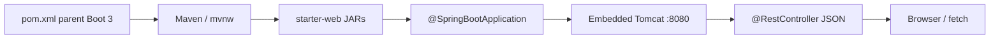

# Module 09 — Maven and Spring Boot Setup

**Phase:** Backend (first JSON API)

**Previous module:** [JavaScript, DOM, and Forms](../../FRONTEND/03_JavaScript_DOM_Forms.md) (shared FRONTEND — also [HTML](../../FRONTEND/01_HTML.md) · [CSS and Responsive](../../FRONTEND/02_CSS_and_Responsive.md))  
**Next module:** [Spring Web REST](02_Spring_Web_REST.md)

---

**Module Outcome:**

- Let Maven fetch jars so you are not hunting a driver on the desktop
- `mvn spring-boot:run` a Hello JSON endpoint on `:8080`
- Keep secrets in env / `.env.example` — not in `application.yml` on GitHub

**Teach order today:** classpath pain → Maven GAV + wrapper → Boot 3 parent + `starter-web` → Initializr / paste pom → `@SpringBootApplication` + `mvn spring-boot:run` → `application.yml` → `.env.example` → `@RestController` Hello + health JSON.

---

## Prerequisites

- **JDK 17** (`java -version`, `javac -version`) and **Maven 3.9+** (`mvn -version`) — [Tested Toolchain](../Tested_Toolchain.md).
- Shared frontend complete enough to open JSON in a browser. `fetch` overview lives in [JavaScript, DOM, and Forms](../../FRONTEND/03_JavaScript_DOM_Forms.md) — do not redo HTML / CSS / JS here.

---

## Definition / Purpose

**Definition:** **Maven** is a **build tool**. You list libraries in **`pom.xml`**. Maven downloads them from Maven Central, compiles with JDK 17, and writes output under **`target/`** (Git week already ignores that folder).

**Definition:** **Spring Boot** is an **opinionated way to start Spring**. A **starter** (here **`spring-boot-starter-web`**) is a curated set of JARs. **`@SpringBootApplication`** turns on auto-configuration. **`@RestController`** maps HTTP URLs to Java methods and writes **JSON**.

**Purpose:** JDBC week you typed `java -cp ".:mysql-connector-j-8.4.0.jar"`. One missing JAR and the run died. Teams cannot email JARs. Maven pins versions in `pom.xml`. Boot adds an **embedded Tomcat** so `mvn spring-boot:run` is a web server — Priya’s browser and Ravi’s `fetch` can hit `http://localhost:8080/hello`. **Later —** Spring Data JPA will sit on the JDBC habit you already have. Interviews still ask you to start a Boot app from a pom.

**Icons:** Bank · Order · Laptop · Employee · UPI

**Where used?**
- CampusCart / **Swiggy** — first `/hello` and `/health` before catalog APIs
- **HDFC Bank** / **PhonePe** — a JSON health ping before any money movement
- **Apollo Hospitals** — “is the API up?” before booking screens
- **Employee Management Portal** — a Boot service that later returns payslip JSON
- Ecommerce — the same `starter-web` shape for product APIs (**Later —** JPA)

**Visual — Maven then Boot:**



**Key takeaways:**

- Maven reads **`pom.xml`**; output is **`target/`** (never commit it)
- This course pins **Spring Boot 3.x** + **JDK 17** + **`jakarta.*`**
- Core path dependency: **`spring-boot-starter-web` only**
- First proof is **`mvn spring-boot:run`**, then **Hello JSON**

---

## Motivation — Feel the pain of `-cp`

JDBC needed Connector/J on the command line. Two classmates, two slightly different JAR names — “it works on my laptop.”

```java
public class ClasspathPain {
    public static void main(String[] args) {
        System.out.println("java -cp .:mysql-connector-j-8.4.0.jar LibraryCrud");
        System.out.println("Ravi's folder has mysql-connector-j-8.4.1.jar");
        System.out.println("Maven: list the library once in pom.xml");
    }
}
```

**Expected Output:**

```
java -cp .:mysql-connector-j-8.4.0.jar LibraryCrud
Ravi's folder has mysql-connector-j-8.4.1.jar
Maven: list the library once in pom.xml
```

**Remember:** `pom.xml` is the packing list. `mvn` is the shopper.

**Interview:** “Maven vs `javac`?” — `javac` compiles one file. Maven compiles the module, pulls dependencies, and (with Boot) runs the app.

---

## Important Concepts

### 1. Maven — GAV, `pom.xml`, wrapper

**Definition:** Every Maven artifact has **GAV**: **groupId**, **artifactId**, **version**. **`pom.xml`** (Project Object Model) is the XML file that lists your GAV and your **dependencies**. The **Maven Wrapper** (`mvnw` / `mvnw.cmd`) is a small script that downloads a pinned Maven so Priya without Maven on PATH can still run `./mvnw spring-boot:run`.

**Purpose:** Without GAV, “give me Spring Web” is vague. With GAV, Maven Central knows the exact JARs. Wrapper means the repo documents the Maven version — not each laptop.

Verify the toolchain:

```bash
java -version
javac -version
mvn -version
```

**Expected Output:** (vendor text varies; you want **17** and Maven **3.9+**)

```
openjdk version "17.x.x" ...
javac 17.x.x
Apache Maven 3.9.x ...
Java version: 17.x.x
```

If `mvn` is missing, install Maven 3.9+ ([Tested Toolchain](../Tested_Toolchain.md)) or generate the project from start.spring.io so **`mvnw`** is included.

**Note:**
- Wrong: committing `target/` — Git week already ignores it; first `mvn` build must still show `target/` **untracked**.
- Wrong: treating Wrapper as optional on a team laptop that has no Maven — prefer `./mvnw` in README.
- `mvn` vs `./mvnw`: both run the same goals when Wrapper exists. Windows: `mvnw.cmd`.

**Remember:** `groupId` is the organisation (`in.ksr`). `artifactId` is the project folder name (`campus-hello`).

Print the Maven GAV for campus-hello: groupId `in.ksr`, artifactId `campus-hello`, and version `0.0.1-SNAPSHOT`.

```java
public class GavLabels {
    public static void main(String[] args) {
        System.out.println("groupId:    in.ksr");
        System.out.println("artifactId: campus-hello");
        System.out.println("version:    0.0.1-SNAPSHOT");
    }
}
```

**Expected Output:**

```
groupId:    in.ksr
artifactId: campus-hello
version:    0.0.1-SNAPSHOT
```

Print the three commands that start Spring Boot: installed `mvn`, macOS/Linux `./mvnw`, and Windows `mvnw.cmd`.

```java
public class WrapperVsMvn {
    public static void main(String[] args) {
        System.out.println("Installed:  mvn spring-boot:run");
        System.out.println("macOS/Linux: ./mvnw spring-boot:run");
        System.out.println("Windows:     mvnw.cmd spring-boot:run");
    }
}
```

**Expected Output:**

```
Installed:  mvn spring-boot:run
macOS/Linux: ./mvnw spring-boot:run
Windows:     mvnw.cmd spring-boot:run
```

---

### 2. Spring Boot 3 parent, JDK 17, `starter-web` only

**Definition:** **`spring-boot-starter-parent`** is a Maven **parent POM**. It pins dependency versions so you rarely type a version on each starter. **`java.version` 17** tells the compiler to use JDK 17. **`spring-boot-starter-web`** pulls Spring MVC, Jackson (JSON), and **embedded Tomcat**.

**Purpose:** Without the parent, you juggle twenty compatible versions. Without `starter-web`, there is no HTTP server. Extra starters this week are **out of window**.

Course pin: **Spring Boot 3.x** (examples use **3.5.16**) and **`jakarta.*`**. start.spring.io may default to **4.x** in 2026 — **pick 3.5.x** (Java 17) so this batch matches [Tested Toolchain](../Tested_Toolchain.md). If the site only offers 4.x, paste the parent version below by hand.

```xml
<?xml version="1.0" encoding="UTF-8"?>
<project xmlns="http://maven.apache.org/POM/4.0.0"
         xmlns:xsi="http://www.w3.org/2001/XMLSchema-instance"
         xsi:schemaLocation="http://maven.apache.org/POM/4.0.0
         https://maven.apache.org/xsd/maven-4.0.0.xsd">
    <modelVersion>4.0.0</modelVersion>

    <parent>
        <groupId>org.springframework.boot</groupId>
        <artifactId>spring-boot-starter-parent</artifactId>
        <version>3.5.16</version>
        <relativePath/>
    </parent>

    <groupId>in.ksr</groupId>
    <artifactId>campus-hello</artifactId>
    <version>0.0.1-SNAPSHOT</version>
    <name>campus-hello</name>

    <properties>
        <java.version>17</java.version>
    </properties>

    <dependencies>
        <dependency>
            <groupId>org.springframework.boot</groupId>
            <artifactId>spring-boot-starter-web</artifactId>
        </dependency>
    </dependencies>

    <build>
        <plugins>
            <plugin>
                <groupId>org.springframework.boot</groupId>
                <artifactId>spring-boot-maven-plugin</artifactId>
            </plugin>
        </plugins>
    </build>
</project>
```

**Do not add** this week: `spring-boot-starter-data-jpa`, `spring-boot-starter-security`, `spring-boot-starter-thymeleaf`, `spring-boot-starter-jdbc`, MySQL driver, Lombok. Those pull **Hikari / Security / templates / JPA** — all **Later —**.

**JAR vs WAR (lite):** default packaging is **JAR** — `java -jar target/campus-hello-0.0.1-SNAPSHOT.jar` runs with **embedded Tomcat**. **WAR** is for dropping a file into an **external** Tomcat (older office setup). This course ships **JAR**.

**Note:**
- Wrong: `javax.servlet` imports on Boot 3 — that is Boot 2. Use **`jakarta.*`** if you import servlet types.
- Wrong: `<java.version>1.8</java.version>` — class default is **17**.
- Parent manages versions; you still **declare** `starter-web` so Maven knows you want a web app.

**Interview:** Parent vs starter? Parent = version bill of materials + plugin defaults. Starter = the JARs you actually compile against.

Print which starter is allowed this week (`spring-boot-starter-web`) and which ones stay out: JPA, Security, Thymeleaf, and JDBC/Hikari.

```java
public class AllowedStarter {
    public static void main(String[] args) {
        System.out.println("YES  spring-boot-starter-web");
        System.out.println("NO   starter-data-jpa / starter-security / thymeleaf");
        System.out.println("NO   starter-jdbc  (that pulls Hikari)");
    }
}
```

**Expected Output:**

```
YES  spring-boot-starter-web
NO   starter-data-jpa / starter-security / thymeleaf
NO   starter-jdbc  (that pulls Hikari)
```

Print one line each for JAR with embedded Tomcat, WAR on an external Tomcat, and that this course ships JAR.

```java
public class JarVsWarLite {
    public static void main(String[] args) {
        System.out.println("JAR: java -jar app.jar  (embedded Tomcat)");
        System.out.println("WAR: copy into an external Tomcat  (older host)");
        System.out.println("This course: JAR");
    }
}
```

**Expected Output:**

```
JAR: java -jar app.jar  (embedded Tomcat)
WAR: copy into an external Tomcat  (older host)
This course: JAR
```

---

### 3. Initializr, folder tree, component scan

**Definition:** **[start.spring.io](https://start.spring.io)** (Spring Initializr) generates a Maven tree: `pom.xml`, `mvnw`, `src/main/java`, `src/main/resources`. **`@SpringBootApplication`** includes **component scan** from **its own package downward**.

**Purpose:** A controller in the wrong package is invisible — Tomcat starts, `/hello` is 404. Scan starts at the application class package.

Initializr (or the same choices in IntelliJ):

| Field | Value |
|-------|--------|
| Project | Maven |
| Language | Java |
| Spring Boot | **3.5.x** (not 4.x) |
| Group | `in.ksr` |
| Artifact | `campus-hello` |
| Packaging | **Jar** |
| Java | **17** |
| Dependencies | **Spring Web** only |

Unzip. Tree you should recognise:

```
campus-hello/
  pom.xml
  mvnw
  mvnw.cmd
  .gitignore
  src/main/java/in/ksr/campushello/CampusHelloApplication.java
  src/main/resources/application.yml    (you add this)
  src/main/resources/application.properties  (Initializr may add this — prefer yml)
```

If the zip has `application.properties`, replace it with **`application.yml`** (or delete properties once yml exists — do not keep both for the same keys).

**Note:**
- Wrong: `HelloController` in `in.ksr.web` while the application class is `in.ksr.campushello` — **sibling packages are not scanned**.
- Prefer: `in.ksr.campushello.HelloController` (same package) or a **subpackage** `in.ksr.campushello.web`.
- College Wi-Fi blocking start.spring.io: paste the pom from the previous topic and create the two Java files by hand, then `mvn wrapper:wrapper` if you want `mvnw`.

**Common Error:** Opening the **parent** folder in the IDE so Maven cannot see `pom.xml`. Open **`campus-hello/`** (the folder that contains `pom.xml`).

Print a valid `CampusHelloApplication` package, two controller packages that component-scan will find, and the `in.ksr.web` 404 trap.

```java
public class ComponentScanRule {
    public static void main(String[] args) {
        System.out.println("App class:  in.ksr.campushello.CampusHelloApplication");
        System.out.println("OK:         in.ksr.campushello.HelloController");
        System.out.println("OK:         in.ksr.campushello.web.HelloController");
        System.out.println("404 trap:   in.ksr.web.HelloController");
    }
}
```

**Expected Output:**

```
App class:  in.ksr.campushello.CampusHelloApplication
OK:         in.ksr.campushello.HelloController
OK:         in.ksr.campushello.web.HelloController
404 trap:   in.ksr.web.HelloController
```

Print the three Maven folders: `src/main/java`, `src/main/resources` for `application.yml`, and gitignored `target/`.

```java
public class MavenSourceLayout {
    public static void main(String[] args) {
        System.out.println("src/main/java           Java sources");
        System.out.println("src/main/resources      application.yml");
        System.out.println("target/                 build output — gitignored");
    }
}
```

**Expected Output:**

```
src/main/java           Java sources
src/main/resources      application.yml
target/                 build output — gitignored
```

---

### 4. `@SpringBootApplication` and `mvn spring-boot:run`

**Definition:** **`@SpringBootApplication`** is a composite: **`@Configuration`** + **`@EnableAutoConfiguration`** + **`@ComponentScan`**. **`SpringApplication.run`** starts the JVM process, auto-configures Tomcat from `starter-web`, and listens on a port. **`mvn spring-boot:run`** (or `./mvnw spring-boot:run`) compiles and starts that `main`.

**Purpose:** You do not write a `public static void main` that constructs Tomcat by hand. Boot’s `main` **is** the server.

Copy-paste valid (needs the Maven tree — not `javac` on a lone file):

```java
package in.ksr.campushello;

import org.springframework.boot.SpringApplication;
import org.springframework.boot.autoconfigure.SpringBootApplication;

@SpringBootApplication
public class CampusHelloApplication {

    public static void main(String[] args) {
        SpringApplication.run(CampusHelloApplication.class, args);
    }
}
```

First proof (no controller yet):

```bash
cd campus-hello
mvn spring-boot:run
```

Look for a log line similar to **`Tomcat started on port 8080`**. Browser `http://localhost:8080/` may show a **Whitelabel** 404 — that still proves the server is up. JSON comes after you add a controller.

**Note:**
- Wrong: `javac CampusHelloApplication.java` without Maven — `org.springframework` is not on a bare JDK classpath.
- Port **8080 in use** → set `server.port` in `application.yml` (next topic) or stop the other process.
- Stop the run with **Ctrl+C** in that terminal.

**Interview:** Why embedded Tomcat? So one JAR (or `spring-boot:run`) is enough in class and on many PaaS hosts. You are not installing a separate Tomcat to learn Hello JSON.

Print the three annotations inside `@SpringBootApplication`: `@Configuration`, `@EnableAutoConfiguration`, and `@ComponentScan`.

```java
public class SpringBootApplicationParts {
    public static void main(String[] args) {
        System.out.println("@Configuration");
        System.out.println("@EnableAutoConfiguration");
        System.out.println("@ComponentScan");
        System.out.println("Together: @SpringBootApplication");
    }
}
```

**Expected Output:**

```
@Configuration
@EnableAutoConfiguration
@ComponentScan
Together: @SpringBootApplication
```

Print the `mvn spring-boot:run` command, the Tomcat-started-on-8080 log line to look for, and that a 404 on `/` is OK before `@RestController`.

```java
public class RunProofLog {
    public static void main(String[] args) {
        System.out.println("mvn spring-boot:run");
        System.out.println("Look for: Tomcat started on port 8080");
        System.out.println("404 on / is OK before @RestController");
    }
}
```

**Expected Output:**

```
mvn spring-boot:run
Look for: Tomcat started on port 8080
404 on / is OK before @RestController
```

---

### 5. `application.yml` — port, name, placeholders

**Definition:** **`application.yml`** is Spring Boot’s **config file** under `src/main/resources`. YAML uses indentation (spaces, not tabs). **`${ENV:default}`** reads an environment variable with a fallback.

**Purpose:** Hard-coding `8080` in Java means a rebuild to change port. YAML (and env) change behaviour without touching controllers. JDBC week had **no** `application.yml` — that file is **Spring**.

```yaml
spring:
  application:
    name: campus-hello

server:
  port: ${SERVER_PORT:8080}

app:
  message: ${APP_MESSAGE:Hello, CampusCart}
```

Spring maps **`SERVER_PORT`** to **`server.port`**. `APP_MESSAGE` is your own key — the controller can read `app.message` with **`@Value`** (shown with the controller).

**Note:**
- Wrong: mixing `application.properties` and `application.yml` for the same key — pick **yml** in this course.
- Wrong: putting a MySQL password in yml and pushing it — there is **no database** this module; still never commit secrets.
- Indentation matters. `server:` then two spaces then `port:`.

**Common Error:** Tab characters in YAML → Boot fails at start with a parse error. Use spaces.

**Remember:** Change port in yml, restart `spring-boot:run`. Config is not hot-reloaded unless you add extra tools (**Later —**).

Print the three YAML keys for CampusCart: `spring.application.name`, `server.port` with a `SERVER_PORT` default, and `app.message` with an `APP_MESSAGE` default.

```java
public class YmlKeysPrint {
    public static void main(String[] args) {
        System.out.println("spring.application.name=campus-hello");
        System.out.println("server.port=${SERVER_PORT:8080}");
        System.out.println("app.message=${APP_MESSAGE:Hello, CampusCart}");
    }
}
```

**Expected Output:**

```
spring.application.name=campus-hello
server.port=${SERVER_PORT:8080}
app.message=${APP_MESSAGE:Hello, CampusCart}
```

Print what to set when port 8080 is busy (`server.port: 8081`) and the URL to open for `/hello`.

```java
public class PortBusyHint {
    public static void main(String[] args) {
        System.out.println("If 8080 is busy: server.port: 8081");
        System.out.println("Then open http://localhost:8081/hello");
    }
}
```

**Expected Output:**

```
If 8080 is busy: server.port: 8081
Then open http://localhost:8081/hello
```

---

### 6. Secrets — `.env.example` (still no DataSource)

**Definition:** A **secret** is a password or token that must not appear in git. Git week ignores **`.env`**. You commit **`.env.example`** with dummy keys. Spring Boot **does not** load a `.env` file by itself — it reads **environment variables**. Copy `.env.example` → `.env` on your machine, then **export** keys or use your IDE env dialog.

**Purpose:** Next modules will add DB passwords. The habit starts **before** JPA: dummy keys in git, real values local. This week there is **no** `MYSQL_PASSWORD` required — optional `APP_MESSAGE` / `SERVER_PORT` only.

`.env.example` (commit this):

```
# Copy to .env — never commit .env
# Spring Boot reads OS environment variables (not this file automatically).
SERVER_PORT=8080
APP_MESSAGE=Hello from Priya laptop
```

Export then run (macOS / Linux):

```bash
export SERVER_PORT=8080
export APP_MESSAGE="Hello from Priya laptop"
mvn spring-boot:run
```

Windows PowerShell: `$env:SERVER_PORT=8080` then `mvn spring-boot:run`.

**Note:**
- Wrong: committing `.env` “because the repo is private.”
- Wrong: adding a `mysql` password **and** `spring.datasource.*` this week — that is **Later —** JPA, and it pulls a pool.
- Prefer: `.env.example` in git; real `.env` local; README says “export or IDE env.”

**Remember:** Env first. Never a password literal in `application.yml` on GitHub.

Print `app.message` when the env var is missing so the YAML default `Hello, CampusCart` is used.

```java
public class EnvOrDefault {
    public static void main(String[] args) {
        String message = System.getenv("APP_MESSAGE");
        if (message == null || message.length() == 0) {
            message = "Hello, CampusCart";
        }
        System.out.println(message);
    }
}
```

**Expected Output:** (when `APP_MESSAGE` is unset)

```
Hello, CampusCart
```

Print git rules for `.env.example` vs `.env`, and that Boot reads OS env — not a `.env` file by itself.

```java
public class EnvGitRule {
    public static void main(String[] args) {
        System.out.println("git: .env.example  YES");
        System.out.println("git: .env          NO");
        System.out.println("Boot reads OS env, not the .env file by itself");
    }
}
```

**Expected Output:**

```
git: .env.example  YES
git: .env          NO
Boot reads OS env, not the .env file by itself
```

---

### 7. `@RestController` + `@GetMapping` Hello JSON

**Definition:** **`@RestController`** is **`@Controller` + `@ResponseBody`**: every method return value is the **HTTP body**, not a template name. **`@GetMapping("/hello")`** handles HTTP **GET** `/hello`. Returning a **`Map`** (or a small type with getters) is serialised to **JSON** by Jackson (inside `starter-web`).

**Purpose:** JS week called `fetch` on jsonplaceholder. Today **your** laptop is the API. **Later —** `@PathVariable`, `@RequestBody`, status codes (next module). **Later —** `@Controller` returning a Thymeleaf view name.

Copy-paste valid (same package as the application class):

```java
package in.ksr.campushello;

import java.util.Map;
import org.springframework.beans.factory.annotation.Value;
import org.springframework.web.bind.annotation.GetMapping;
import org.springframework.web.bind.annotation.RestController;

@RestController
public class HelloController {

    @Value("${app.message:Hello, CampusCart}")
    private String message;

    @GetMapping("/hello")
    public Map<String, String> hello() {
        return Map.of("message", message);
    }

    @GetMapping("/health")
    public Map<String, String> health() {
        return Map.of("status", "UP", "app", "campus-hello");
    }
}
```

Restart `mvn spring-boot:run`. Browser or:

```bash
curl http://localhost:8080/hello
curl http://localhost:8080/health
```

**Expected Output:** (default yml)

```
{"message":"Hello, CampusCart"}
```

```
{"status":"UP","app":"campus-hello"}
```

`Map.of` key order is not guaranteed — both keys present is success.

**`jakarta.*`:** Boot 3 servlet types live in **`jakarta.servlet`**, not `javax.servlet`. A Hello `Map` does not need that import. If you later take `HttpServletRequest`, write `import jakarta.servlet.http.HttpServletRequest;` — **`javax.*` will not compile** on Boot 3.

**Note:**
- Wrong: `@Controller` without `@ResponseBody` for JSON — Boot looks for a **view** (**Later —** Thymeleaf) and you get an error, not JSON.
- Wrong: `GET /Hello` vs `/hello` — paths are **case-sensitive**.
- Do **not** add Actuator for `/health` this week. A **plain `@GetMapping("/health")`** is the assignment. **Later —** actuator in deploy lab.

**Interview:** `@RestController` vs `@Controller`? REST + JSON vs (typically) HTML templates. This module is JSON-only.

Print the two GET paths (`/hello` and `/health`) and that `@RestController` returns a JSON body, not an HTML file.

```java
public class MappingNamesPrint {
    public static void main(String[] args) {
        System.out.println("GET /hello  -> JSON message");
        System.out.println("GET /health -> JSON status UP");
        System.out.println("@RestController = JSON body, not a .html file");
    }
}
```

**Expected Output:**

```
GET /hello  -> JSON message
GET /health -> JSON status UP
@RestController = JSON body, not a .html file
```

Print Boot 2 `javax.servlet` vs Boot 3 `jakarta.servlet`, and that the wrong import fails with cannot find symbol.

```java
public class JakartaNotJavax {
    public static void main(String[] args) {
        System.out.println("Boot 2 / old Java EE: javax.servlet");
        System.out.println("Boot 3 / Jakarta EE:  jakarta.servlet");
        System.out.println("Wrong import = cannot find symbol");
    }
}
```

**Expected Output:**

```
Boot 2 / old Java EE: javax.servlet
Boot 3 / Jakarta EE:  jakarta.servlet
Wrong import = cannot find symbol
```

JS already knows `fetch` ([FRONTEND/03](../../FRONTEND/03_JavaScript_DOM_Forms.md)). After Hello runs:

```javascript
fetch("http://localhost:8080/hello")
  .then((res) => res.json())
  .then((data) => console.log(data.message));
```

That is a **browser console** check — do not rewrite the JS chapter. **Later —** CORS when a Vite app on :5173 calls :8080.

---

## Step-by-Step Annotated Java Code

Generate **`campus-hello`** (Initializr **or** paste `pom.xml`). JDK 17. **Spring Web** only. Open the folder that contains `pom.xml`.

### Step 1: Prove Maven and JDK

```bash
java -version
javac -version
mvn -version
```

Print the three PATH tools you need: `java`, `javac` (Maven still uses it), and `mvn` to read `pom.xml`.

```java
public class PathTools {
    public static void main(String[] args) {
        System.out.println("java   — run bytecode");
        System.out.println("javac  — still used by Maven");
        System.out.println("mvn    — reads pom.xml");
    }
}
```

**Expected Output:**

```
java   — run bytecode
javac  — still used by Maven
mvn    — reads pom.xml
```

Print that `mvn -version` must show Java 17, and that Java 8 or 11 means you must fix `JAVA_HOME`.

```java
public class JavaHomeHint {
    public static void main(String[] args) {
        System.out.println("mvn -version must show Java version: 17");
        System.out.println("If it shows 8 or 11, fix JAVA_HOME");
    }
}
```

**Expected Output:**

```
mvn -version must show Java version: 17
If it shows 8 or 11, fix JAVA_HOME
```

---

### Step 2: Application class in the right package

Keep **`CampusHelloApplication`** where Initializr put it (`in.ksr.campushello`). Do not move it to the default package.

Print the `SpringApplication.run(CampusHelloApplication.class, args)` call and that this line starts the server.

```java
public class BootMainSketch {
    public static void main(String[] args) {
        System.out.println("SpringApplication.run(CampusHelloApplication.class, args)");
        System.out.println("That line is the server start");
    }
}
```

**Expected Output:**

```
SpringApplication.run(CampusHelloApplication.class, args)
That line is the server start
```

Print the default-package trap: a Boot class with no `package` confuses component scan — always use `in.ksr.campushello`.

```java
public class DefaultPackageTrap {
    public static void main(String[] args) {
        System.out.println("No package { } on the Boot class");
        System.out.println("Component scan gets confused — always use in.ksr.campushello");
    }
}
```

**Expected Output:**

```
No package { } on the Boot class
Component scan gets confused — always use in.ksr.campushello
```

---

### Step 3: First `mvn spring-boot:run`

```bash
mvn spring-boot:run
```

Wait until Tomcat started. Leave it running. Open a **second** terminal for `curl`.

Print the two success log tokens: `Started CampusHelloApplication` and `Tomcat started on port 8080 (http)`.

```java
public class TomcatStartedTokens {
    public static void main(String[] args) {
        System.out.println("Started CampusHelloApplication");
        System.out.println("Tomcat started on port 8080 (http)");
    }
}
```

**Expected Output:**

```
Started CampusHelloApplication
Tomcat started on port 8080 (http)
```

Print that the first `mvn` run needs Maven Central (network), then JARs sit in the local `.m2` cache.

```java
public class FirstRunNetwork {
    public static void main(String[] args) {
        System.out.println("First mvn run needs Maven Central (network)");
        System.out.println("Then JARs sit in the local .m2 cache");
    }
}
```

**Expected Output:**

```
First mvn run needs Maven Central (network)
Then JARs sit in the local .m2 cache
```

---

### Step 4: Add `application.yml` and `.env.example`

Create `src/main/resources/application.yml` (keys from concept 5). Add `.env.example` at the project root. Confirm `.gitignore` still has `target/` and `.env` (Git kit).

Restart Boot after yml changes.

Print that `application.yml` lives at `src/main/resources/application.yml`, not next to `pom.xml`.

```java
public class ResourcesPathPrint {
    public static void main(String[] args) {
        System.out.println("src/main/resources/application.yml");
        System.out.println("Not next to pom.xml");
    }
}
```

**Expected Output:**

```
src/main/resources/application.yml
Not next to pom.xml
```

Print that changing `server.port` requires Ctrl+C and `mvn spring-boot:run` again.

```java
public class RestartAfterYml {
    public static void main(String[] args) {
        System.out.println("Change server.port");
        System.out.println("Ctrl+C then mvn spring-boot:run again");
    }
}
```

**Expected Output:**

```
Change server.port
Ctrl+C then mvn spring-boot:run again
```

---

### Step 5: `HelloController` — `/hello` and `/health`

Add `HelloController.java` in **`in.ksr.campushello`**. Restart. Then:

```bash
curl http://localhost:8080/hello
curl http://localhost:8080/health
```

Print the two URLs to hit: `http://localhost:8080/hello` and `http://localhost:8080/health`.

```java
public class TwoGetPaths {
    public static void main(String[] args) {
        System.out.println("http://localhost:8080/hello");
        System.out.println("http://localhost:8080/health");
    }
}
```

**Expected Output:**

```
http://localhost:8080/hello
http://localhost:8080/health
```

Print that `/hello` is not an HTML page, then print the JSON body `{"message":"Hello, CampusCart"}`.

```java
public class JsonIsTheBody {
    public static void main(String[] args) {
        System.out.println("Not an HTML page");
        System.out.println("{\"message\":\"Hello, CampusCart\"}");
    }
}
```

**Expected Output:**

```
Not an HTML page
{"message":"Hello, CampusCart"}
```

---

### Step 6: Git hygiene before you push

`git status` must **not** list `target/` or `.env`. README: JDK 17, Boot 3, `mvn spring-boot:run`, two curl lines. See [Standard Project Deliverables](../Standard_Project_Deliverables.md).

Print what to ignore (`target/`, `.env`) and what to keep (`pom.xml`, `mvnw`, `src/`, `.env.example`).

```java
public class BootGitignore {
    public static void main(String[] args) {
        System.out.println("ignore: target/");
        System.out.println("ignore: .env");
        System.out.println("keep:   pom.xml mvnw src/ .env.example");
    }
}
```

**Expected Output:**

```
ignore: target/
ignore: .env
keep:   pom.xml mvnw src/ .env.example
```

Print the two README run lines: `mvn spring-boot:run` and `curl http://localhost:8080/hello`.

```java
public class ReadmeRunLines {
    public static void main(String[] args) {
        System.out.println("mvn spring-boot:run");
        System.out.println("curl http://localhost:8080/hello");
    }
}
```

**Expected Output:**

```
mvn spring-boot:run
curl http://localhost:8080/hello
```

---

## Practice Exercises

*(Each Practice item includes a filled **Model answer:** and **Expected Output:** where the demo prints.)*

### Basic

1. Print the GAV for a canteen hello app (`in.ksr` / `canteen-hello` / `0.0.1-SNAPSHOT`).

   **Model answer:**

```java
public class CanteenGav {
    public static void main(String[] args) {
        System.out.println("in.ksr");
        System.out.println("canteen-hello");
        System.out.println("0.0.1-SNAPSHOT");
    }
}
```

   **Expected Output:**

```
in.ksr
canteen-hello
0.0.1-SNAPSHOT
```

2. List starters that are **banned** on this module’s core path.

   **Model answer:**

```java
public class BannedStarters {
    public static void main(String[] args) {
        System.out.println("data-jpa");
        System.out.println("security");
        System.out.println("thymeleaf");
        System.out.println("jdbc / hikari");
        System.out.println("lombok (not required)");
    }
}
```

   **Expected Output:**

```
data-jpa
security
thymeleaf
jdbc / hikari
lombok (not required)
```

3. Print the two JSON paths this module must expose.

   **Model answer:**

```java
public class RequiredJsonPaths {
    public static void main(String[] args) {
        System.out.println("GET /hello");
        System.out.println("GET /health");
    }
}
```

   **Expected Output:**

```
GET /hello
GET /health
```

### Intermediate

1. Sketch `application.yml` keys for name `upi-ping` and port `8081` (print the tree).

   **Model answer:**

```java
public class YmlUpiPing {
    public static void main(String[] args) {
        System.out.println("spring.application.name: upi-ping");
        System.out.println("server.port: 8081");
    }
}
```

   **Expected Output:**

```
spring.application.name: upi-ping
server.port: 8081
```

2. Why would `/hello` 404 after a successful `spring-boot:run`?

   **Model answer:**

```java
public class Hello404Causes {
    public static void main(String[] args) {
        System.out.println("Controller missing @RestController or @GetMapping");
        System.out.println("Controller in a sibling package (not scanned)");
        System.out.println("Wrong URL /Hello vs /hello");
    }
}
```

   **Expected Output:**

```
Controller missing @RestController or @GetMapping
Controller in a sibling package (not scanned)
Wrong URL /Hello vs /hello
```

3. Print a safe `.env.example` for this week (no MySQL password required).

   **Model answer:**

```java
public class EnvExampleThisWeek {
    public static void main(String[] args) {
        System.out.println("SERVER_PORT=8080");
        System.out.println("APP_MESSAGE=Hello from Ravi laptop");
    }
}
```

   **Expected Output:**

```
SERVER_PORT=8080
APP_MESSAGE=Hello from Ravi laptop
```

### Interview-Oriented

1. Maven vs Spring Boot?

   **Model answer:** Maven is the **build tool** (`pom.xml`, dependencies, `target/`). Spring Boot is the **framework** that auto-configures a web app. Boot projects **use** Maven (this course) or Gradle.

2. What does `spring-boot-starter-web` add?

   **Model answer:** Spring MVC, Jackson JSON, and **embedded Tomcat**. Enough for `@RestController` JSON. It does **not** add JPA, Security, or Thymeleaf.

3. `@SpringBootApplication` in one sentence?

   **Model answer:** It marks the entry class and turns on configuration, auto-configuration, and component scan from that package down.

4. Why `application.yml` and not JDBC-style env-only for the port?

   **Model answer:** Boot’s native config file is `application.yml` (or properties). Env vars can **override** yml (`SERVER_PORT`). JDBC week had no Boot, so no yml.

5. Why `jakarta.*` on Boot 3?

   **Model answer:** Java EE moved to Jakarta EE. Package names changed from `javax.*` to `jakarta.*`. Boot 3 follows Jakarta. Copy-pasting Boot 2 servlet imports fails to compile.

6. JAR vs WAR for this course?

   **Model answer:** **JAR** with embedded Tomcat (`java -jar` / `spring-boot:run`). WAR is for an external servlet container — not the class default.

---

## Mini-Project (Assignment): CampusCart / Swiggy Hello Boot API

There is **no lab-kit folder** this module — generate **`campus-hello`** from [start.spring.io](https://start.spring.io) (Maven, Java 17, Boot **3.5.x**, **Spring Web** only) or paste the `pom.xml` from this chapter. Push a public repo. No secrets in git.

This is the **first Spring artefact** on your GitHub: a Boot 3 app that returns Hello JSON. JDBC stays a separate CLI. Do **not** add JPA, Security, Thymeleaf, Lombok, or a DataSource to pass.

### What to build

| Piece | Detail |
|-------|--------|
| `pom.xml` | Parent **Spring Boot 3.x**, `<java.version>17</java.version>`, **`spring-boot-starter-web` only**, `spring-boot-maven-plugin` |
| Wrapper | `mvnw` from Initializr **or** `mvn spring-boot:run` documented if Wrapper is missing |
| `CampusHelloApplication` | `@SpringBootApplication` + `SpringApplication.run` |
| `HelloController` | `@RestController`; **GET `/hello`** JSON; **GET `/health`** JSON (`status` = `UP`) |
| `application.yml` | `spring.application.name`, `server.port` (placeholder OK) |
| `.env.example` | Dummy `SERVER_PORT` / `APP_MESSAGE` — **no** real passwords |
| `.gitignore` | `target/`, `.env`, `*.class`, `.idea/` (Git week) |
| README | JDK 17, Boot 3, run command, two curl examples |
| Demo `main` path | `mvn spring-boot:run` (or `./mvnw spring-boot:run`) until Tomcat started |

**Sample curl (after run):**

```
{"message":"Hello, CampusCart"}
```

```
{"status":"UP","app":"campus-hello"}
```

**Starter idea (controller body only — place it under `src/main/java/in/ksr/campushello/`):**

```java
package in.ksr.campushello;

import java.util.Map;
import org.springframework.web.bind.annotation.GetMapping;
import org.springframework.web.bind.annotation.RestController;

@RestController
public class HelloControllerLite {

    @GetMapping("/hello")
    public Map<String, String> hello() {
        return Map.of("message", "Hello, CampusCart");
    }

    @GetMapping("/health")
    public Map<String, String> health() {
        return Map.of("status", "UP");
    }
}
```

Wire this next to `CampusHelloApplication`. Do not `javac` this file alone.

### Stretch

- `@Value("${app.message:Hello, CampusCart}")` so YAML / `APP_MESSAGE` changes the JSON.
- Extra GET `/canteen` returning `Map.of("stall", "South Indian", "item", "Idli")`.
- Screenshot of browser JSON + `mvn -version` output in README.
- Lombok `@Getter` on a tiny type — **optional**, not in Done when. Prefer `Map` or explicit getters.
- **Later —** `@PathVariable`, `@RequestBody`, status codes, Thymeleaf one-pager (next module). **Later —** JPA + MySQL.

### Done when

- [ ] `mvn spring-boot:run` or `./mvnw spring-boot:run` starts (Tomcat log on the configured port)
- [ ] GET `/hello` returns JSON with a message
- [ ] GET `/health` returns JSON with `status` UP
- [ ] `application.yml` exists under `src/main/resources`
- [ ] `.env.example` is in git; `.env` is **not**
- [ ] `pom.xml` parent is Spring Boot **3.x**, Java **17**, **no** JPA / Security / Thymeleaf / `starter-jdbc` / Hikari as required
- [ ] No Lombok required to pass
- [ ] `target/` untracked; short README with run + curl ([Standard Project Deliverables](../Standard_Project_Deliverables.md))

---

## Interview Q&A

Shared with students after concepts and the mini-project. Use for review and interview prep — questions and model answers are included.

**Q1. What is Maven?**  
**A:** A Java build tool. `pom.xml` lists GAV and dependencies. Maven downloads JARs, compiles, and writes `target/`. Wrapper (`mvnw`) pins Maven for classmates.

**Q2. What is a GAV?**  
**A:** groupId + artifactId + version — the coordinates Maven Central uses. Example: `in.ksr` / `campus-hello` / `0.0.1-SNAPSHOT`.

**Q3. What is Spring Boot?**  
**A:** A way to start Spring with auto-configuration and starters. `spring-boot-starter-web` gives you an embedded Tomcat and JSON MVC so `mvn spring-boot:run` is a web server.

**Q4. Parent POM vs starter?**  
**A:** The **parent** (`spring-boot-starter-parent`) manages versions and plugin defaults. A **starter** is the dependency you declare (`starter-web`). You need both in this course’s pom.

**Q5. Why JDK 17 in `java.version`?**  
**A:** Course / hiring default (LTS). Boot 3 supports 17. Mixing 8/11 as `JAVA_HOME` while the pom says 17 causes confusing compiler errors.

**Q6. What does `@SpringBootApplication` do?**  
**A:** Combines `@Configuration`, `@EnableAutoConfiguration`, and `@ComponentScan`. Scan starts at that class’s package.

**Q7. Why did `/hello` 404 even though Tomcat started?**  
**A:** No matching `@GetMapping`, or the controller was **outside** the scanned package, or the URL does not match (case / extra path).

**Q8. `@RestController` vs `@Controller`?**  
**A:** `@RestController` writes the method return value as the body (JSON with Jackson). `@Controller` typically returns a **view** name. HTML templates are **Later —** Thymeleaf, not this module.

**Q9. Why `application.yml`?**  
**A:** Boot’s config file for port, app name, and placeholders. JDBC did not use it because JDBC was not Spring. Do not put secrets in yml on git.

**Q10. Does Boot load `.env` automatically?**  
**A:** No. It reads **environment variables** (and yml). Commit `.env.example`; export keys or set them in the IDE. Never commit `.env`.

**Q11. `javax.*` vs `jakarta.*`?**  
**A:** Boot 3 uses Jakarta (`jakarta.servlet…`). Boot 2 used `javax.*`. Wrong import: cannot find symbol.

**Q12. JAR or WAR?**  
**A:** This course: **JAR** + embedded Tomcat. WAR is for deploying to an external Tomcat — mention in interviews, do not require it here.

**Q13. Why not JPA / Security / Thymeleaf this week?**  
**A:** Teaching order: run Boot, return JSON, then REST mappings, then ORM and auth. Extra starters hide that path and pull pools or login filters you have not been taught.

**Q14. Maven vs Gradle?**  
**A:** Both build Java. This course uses **Maven** (`pom.xml`) because hiring still lists it heavily and Initializr Maven is the class default. Gradle is another build tool — not required here.

**Q15. How does this connect to `fetch`?**  
**A:** JS `fetch(url).then(r => r.json())` needs a URL that returns JSON. `/hello` is that URL on localhost. CORS for a separate React origin is **Later —**.

---

## Next

Push **Campus Hello Boot API** (no secrets, `target/` ignored). Continue with **[Spring Web REST](02_Spring_Web_REST.md)** — more mappings, JSON, status codes, `@PathVariable` / `@RequestBody`, and a **Thymeleaf overview only**. JPA stays after that.
