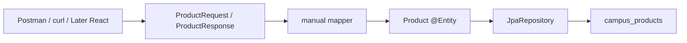

# Module 09 — REST, DTOs, and Postman

**Phase:** Backend (JSON contract)

**Previous module:** [Spring Data JPA and Validation](03_Spring_Data_JPA_Validation.md)  
**Next module:** [Spring Security Lite](05_Spring_Security_Lite.md)

**Lab kit:** [15_Lab_Assets/18_jpa_product_crud/](../15_Lab_Assets/18_jpa_product_crud/)

---

**Module Outcome:**

- Stop leaking the entity as JSON — map request/response DTOs by hand
- Reject bad POST bodies with `@Valid` and a clear 400
- Save a Postman collection v1 and remember CORS for Vite `:5173` → `:8080`

**Teach order today:** entity-as-JSON pain → request / response DTOs + manual map → `starter-validation` + `@Valid` on POST → lite 400 advice → Postman collection v1 → CORS recap (Vite `:5173` → `:8080`).

---

## Prerequisites

- **CampusCart JPA catalog** from [Spring Data JPA and Validation](03_Spring_Data_JPA_Validation.md) — `Product` entity, `JpaRepository`, GET list / GET by id / POST, MySQL, env secrets. JDK 17 + Maven 3.9+ + Spring Boot 3.x ([Tested Toolchain](../Tested_Toolchain.md)).
- **Postman** installed (same toolchain table). `curl` from module 02 still works; the collection is the new habit.

---

## Definition / Purpose

**Definition:** A **DTO** (Data Transfer Object) is a class used **only for JSON in or JSON out**. It is **not** an `@Entity`. **`ProductRequest`** is the POST body (no id). **`ProductResponse`** is what clients read (id from MySQL). You **copy fields** in Java — that copy is **manual mapping**.

**Definition:** **`@Valid`** on **`@RequestBody`** runs **Bean Validation** (`jakarta.validation`) **before** the method body. **`@RestControllerAdvice`** catches **`MethodArgumentNotValidException`** and returns a **small 400 JSON** instead of Boot’s default dump.

**Definition:** **Postman** is an HTTP client with **saved requests**. A **collection** is a JSON file of those requests (and lite tests) that you **commit** so the batch shares the same checks.

**Definition:** **CORS** (Cross-Origin Resource Sharing) is a **browser** rule: a page on one origin (`http://localhost:5173`) may not read JSON from another (`http://localhost:8080`) unless the API **allows** that origin.

**Purpose:** Priya’s POST `{"id":99,"name":"Idli"}` must not pick the primary key. Ravi’s React app (Later —) must not see Hibernate extras. Blank name must not become a row. QA must replay GET / POST without screenshots. Vite on **5173** must be allowed **in lab** before React weeks.

**Icons:** Bank · Order · Laptop · Employee · UPI

**Where used?**
- CampusCart — catalog JSON that is **not** the `campus_products` row
- Canteen / mess — POST body without id; GET with id from MySQL
- Banking / UPI — APIs hide ledger columns (**no money movement here**)
- Hospital — token APIs omit internal flags
- Postman / QA — same collection on every laptop

**Visual — JSON is not the table:**



**Key takeaways:**

- **Entity** = persistence. **DTO** = JSON contract
- Map **by hand** this module — MapStruct is not required
- **`@Valid`** on the **request DTO**, not as the only guard on the table class
- **400** from advice; **404** stays on GET by id
- Commit a **`.postman_collection.json`**, not only screenshots
- CORS is for the **browser**; curl / Postman do not show it

---

## Motivation — Feel the pain of entity-as-JSON

Ravi POSTed `{"id":1,"name":"","priceInr":30}`. Hibernate treated the id like an update. The blank name became a row. Boot’s 400 JSON filled the screen with `trace`. Priya had no Postman file to share — only a screenshot of 201.

```java
public class EntityAsJsonPain {
    public static void main(String[] args) {
        System.out.println("POST body included id -> looked like UPDATE");
        System.out.println("Blank name became a campus_products row");
        System.out.println("Need DTO + @Valid + small 400 JSON");
    }
}
```

**Expected Output:**

```
POST body included id -> looked like UPDATE
Blank name became a campus_products row
Need DTO + @Valid + small 400 JSON
```

**Remember:** Module 03 practised **MySQL persist**. This module practises the **JSON contract** on that same catalog.

**Interview:** “Why not return the entity?” — Fine for a spike. Production APIs hide columns, block client ids, and validate the **request** type.

---

## Important Concepts

### 1. Entity vs DTO — JSON is not the table

**Definition:** The **`Product` `@Entity`** maps to **`campus_products`**. Jackson will serialize **every getter** it can see. A **DTO** is a **second** class with **only** the fields the client may send or see.

**Purpose:** Without a split, POST can send `id`, and later a `costPrice` column would leak on GET. Interviews expect “entity stays persistence; DTO stays JSON.”

Module 03 returned `Product` on purpose so HTTP + JPA could land first. **Today you contrast that** — do **not** redo `@Entity` / `JpaRepository` / Hikari / `ddl-auto`.

| | Entity (`Product`) | Request DTO | Response DTO |
|--|-------------------|-------------|--------------|
| Job | Row in MySQL | POST JSON in | JSON out |
| id | `@Id` generated | **omit** | from MySQL |
| Annotations | `jakarta.persistence` | `jakarta.validation` | none required |
| Client may send it? | Do not | Yes | No (you build it) |

Copy-paste valid (Maven tree — not lone `javac`):

```java
package in.ksr.campuscatalog;

public class ProductResponse {

    private Long id;
    private String name;
    private int priceInr;

    public ProductResponse() {
    }

    public ProductResponse(Long id, String name, int priceInr) {
        this.id = id;
        this.name = name;
        this.priceInr = priceInr;
    }

    public Long getId() {
        return id;
    }

    public void setId(Long id) {
        this.id = id;
    }

    public String getName() {
        return name;
    }

    public void setName(String name) {
        this.name = name;
    }

    public int getPriceInr() {
        return priceInr;
    }

    public void setPriceInr(int priceInr) {
        this.priceInr = priceInr;
    }
}
```

**Note:**
- Wrong: one class with both `@Entity` and the only `@NotBlank` — HTTP rules stuck to the table.
- Wrong: putting `id` on `ProductRequest` “so Postman can set it.”
- Prefer: entity for Hibernate; DTOs for Jackson.

**Common Error:** Adding `@Table` on the DTO “so it matches.” DTOs are not tables.

**Remember:** Happy-path JSON may still look like `{id, name, priceInr}`. The win is **POST has no id** and **validation lives on the request**.

**Interview:** DTO? Data Transfer Object — a type for the wire, not the database.

Print that the entity is `campus_products` columns, request JSON is `name` plus `priceInr` with no id, and response JSON includes the MySQL id.

```java
public class JsonIsNotTheTable {
    public static void main(String[] args) {
        System.out.println("Entity: campus_products columns");
        System.out.println("Request JSON: name + priceInr, no id");
        System.out.println("Response JSON: id from MySQL");
    }
}
```

**Expected Output:**

```
Entity: campus_products columns
Request JSON: name + priceInr, no id
Response JSON: id from MySQL
```

Print the client-id trap: POSTing `{"id":1,"name":"Idli"}` on an entity body may UPDATE id 1; a request DTO has no id field to bind.

```java
public class ClientIdTrap {
    public static void main(String[] args) {
        System.out.println("POST {\"id\":1,\"name\":\"Idli\"}");
        System.out.println("Entity as body: save may UPDATE id 1");
        System.out.println("Request DTO: no id field to bind");
    }
}
```

**Expected Output:**

```
POST {"id":1,"name":"Idli"}
Entity as body: save may UPDATE id 1
Request DTO: no id field to bind
```

---

### 2. Manual mapping — request in, entity, response out

**Definition:** **Mapping** copies `name` and `priceInr` from **`ProductRequest`** onto a **`Product`**, then copies `id` / `name` / `priceInr` onto **`ProductResponse`**. You write the getters. **MapStruct** is a code generator for this — **not** required.

**Purpose:** Without an explicit copy, juniors `save` the request object and wonder why `@Entity` is missing. A small **`ProductMapper`** with static methods keeps the controller readable.

```java
package in.ksr.campuscatalog;

public class ProductMapper {

    private ProductMapper() {
    }

    public static Product toEntity(ProductRequest request) {
        Product product = new Product();
        product.setId(null);
        product.setName(request.getName());
        product.setPriceInr(request.getPriceInr());
        return product;
    }

    public static ProductResponse toResponse(Product product) {
        return new ProductResponse(
                product.getId(), product.getName(), product.getPriceInr());
    }
}
```

Controller sketch (same mappings as module 03 — **store is still the repository**):

```java
@GetMapping
public List<ProductResponse> list() {
    List<ProductResponse> body = new ArrayList<>();
    for (Product row : products.findAll()) {
        body.add(ProductMapper.toResponse(row));
    }
    return body;
}

@PostMapping
@ResponseStatus(HttpStatus.CREATED)
public ProductResponse add(@Valid @RequestBody ProductRequest incoming) {
    Product saved = products.save(ProductMapper.toEntity(incoming));
    return ProductMapper.toResponse(saved);
}
```

`setId(null)` is the same INSERT habit as module 03 — now the request type **cannot** carry an id.

**Note:**
- Wrong: `products.save(incoming)` when `incoming` is a DTO.
- Wrong: requiring MapStruct / Lombok to pass.
- Prefer: a for-each on `findAll()` — streams are optional Stretch.

**Remember:** Mapping is boring on purpose. Boring copies do not leak columns.

**Interview:** “Who maps?” — You, in Java. Libraries are optional later.

Print the three POST steps: JSON to `ProductRequest`, request to a `Product` entity with id null, then `save` to `ProductResponse`.

```java
public class PostThreeSteps {
    public static void main(String[] args) {
        System.out.println("1 JSON -> ProductRequest");
        System.out.println("2 Request -> Product entity, id null");
        System.out.println("3 save -> ProductResponse");
    }
}
```

**Expected Output:**

```
1 JSON -> ProductRequest
2 Request -> Product entity, id null
3 save -> ProductResponse
```

Print that GET list still calls `findAll()`, then maps each `Product` to `ProductResponse` — MySQL store, not ArrayList.

```java
public class ListStillFindAll {
    public static void main(String[] args) {
        System.out.println("findAll() still loads rows");
        System.out.println("loop maps each Product to ProductResponse");
        System.out.println("MySQL store — not ArrayList");
    }
}
```

**Expected Output:**

```
findAll() still loads rows
loop maps each Product to ProductResponse
MySQL store — not ArrayList
```

---

### 3. `@Valid` on the request DTO

**Definition:** **`spring-boot-starter-validation`** brings **Hibernate Validator**. Field annotations describe rules. **`@Valid`** on **`@RequestBody ProductRequest`** runs them. Imports are **`jakarta.validation.Valid`** and **`jakarta.validation.constraints.*`** (not `javax`).

**Purpose:** Module 03 named `@Valid` on the **entity** as a peek. **Today the annotations sit on `ProductRequest`.** Empty name / missing price never call `save`.

Pom (next to `starter-web` / `starter-data-jpa`):

```xml
<dependency>
    <groupId>org.springframework.boot</groupId>
    <artifactId>spring-boot-starter-validation</artifactId>
</dependency>
```

On the request (wrapper **`Integer`** so `@NotNull` can see a missing JSON field):

```java
package in.ksr.campuscatalog;

import jakarta.validation.constraints.Min;
import jakarta.validation.constraints.NotBlank;
import jakarta.validation.constraints.NotNull;
import jakarta.validation.constraints.Size;

public class ProductRequest {

    @NotBlank
    @Size(max = 80)
    private String name;

    @NotNull
    @Min(1)
    private Integer priceInr;

    public ProductRequest() {
    }

    public String getName() {
        return name;
    }

    public void setName(String name) {
        this.name = name;
    }

    public Integer getPriceInr() {
        return priceInr;
    }

    public void setPriceInr(Integer priceInr) {
        this.priceInr = priceInr;
    }
}
```

On POST:

```java
@PostMapping
@ResponseStatus(HttpStatus.CREATED)
public ProductResponse add(@Valid @RequestBody ProductRequest incoming) {
    Product saved = products.save(ProductMapper.toEntity(incoming));
    return ProductMapper.toResponse(saved);
}
```

| Annotation | Catches |
|------------|---------|
| `@NotBlank` | null, `""`, `"   "` on name |
| `@Size(max = 80)` | very long name (lite) |
| `@NotNull` | missing `priceInr` on **`Integer`** |
| `@Min(1)` | `0` or negative |

**Note:**
- Wrong: `@NotNull` on primitive `int` — JSON omit becomes `0`; null never happens.
- Wrong: `@Valid` without `starter-validation` — checks do not run.
- Prefer: `@NotBlank` over `@NotEmpty` for names (whitespace is not a snack name).

**Common Error:** Leaving `@NotBlank` only on `Product` from the module 03 Stretch. Move (or copy) rules onto **`ProductRequest`**.

**Remember:** `@Valid` does nothing if you forget it on the parameter — annotations on a class are idle until something **runs** them.

**Interview:** Bean Validation is the **standard**. Hibernate Validator is the **engine** on the classpath (same idea as Hibernate for JPA).

Print what `@Valid` checks on POST `ProductRequest`: `@NotBlank`/`@Size` on name and `@NotNull`/`@Min(1)` on `Integer priceInr`.

```java
public class ValidChecksPrint {
    public static void main(String[] args) {
        System.out.println("@NotBlank + @Size on name");
        System.out.println("@NotNull + @Min(1) on Integer priceInr");
        System.out.println("@Valid on POST ProductRequest");
    }
}
```

**Expected Output:**

```
@NotBlank + @Size on name
@NotNull + @Min(1) on Integer priceInr
@Valid on POST ProductRequest
```

Print that `Integer` plus `@NotNull` catches a missing price, `int` cannot be null so omit becomes 0, and the entity may still use `int` after mapping.

```java
public class WrapperForNotNull {
    public static void main(String[] args) {
        System.out.println("Integer + @NotNull catches missing price");
        System.out.println("int cannot be null — omit becomes 0");
        System.out.println("Entity may still use int after mapping");
    }
}
```

**Expected Output:**

```
Integer + @NotNull catches missing price
int cannot be null — omit becomes 0
Entity may still use int after mapping
```

---

### 4. Lite error body — advice for 400, keep 404

**Definition:** **`@RestControllerAdvice`** is a class Spring asks when a controller throws. For **`MethodArgumentNotValidException`** (failed `@Valid`), you return **400** and a **small JSON map**. **`@ControllerAdvice`** plus a JSON return type is the same family.

**Purpose:** Default Boot 400 is huge (`timestamp`, `trace`, …). Priya’s frontend (Later —) needs **`error`** and **`fields`**. GET missing id stays **404** in the **controller** — same as modules 02 / 03.

```java
package in.ksr.campuscatalog;

import java.util.LinkedHashMap;
import java.util.Map;
import org.springframework.http.ResponseEntity;
import org.springframework.validation.FieldError;
import org.springframework.web.bind.MethodArgumentNotValidException;
import org.springframework.web.bind.annotation.ExceptionHandler;
import org.springframework.web.bind.annotation.RestControllerAdvice;

@RestControllerAdvice
public class ApiExceptionHandler {

    @ExceptionHandler(MethodArgumentNotValidException.class)
    public ResponseEntity<Map<String, Object>> handleValidation(
            MethodArgumentNotValidException ex) {
        Map<String, String> fields = new LinkedHashMap<>();
        for (FieldError err : ex.getBindingResult().getFieldErrors()) {
            String message = err.getDefaultMessage();
            if (message == null) {
                message = "invalid";
            }
            fields.put(err.getField(), message);
        }
        Map<String, Object> body = new LinkedHashMap<>();
        body.put("error", "Validation failed");
        body.put("fields", fields);
        return ResponseEntity.badRequest().body(body);
    }
}
```

**Sample 400** (message text can vary slightly by validator version):

```
{"error":"Validation failed","fields":{"name":"must not be blank"}}
```

**404** stays here (do **not** move it into advice this module):

```java
@GetMapping("/{id}")
public ResponseEntity<?> getById(@PathVariable Long id) {
    Product found = products.findById(id).orElse(null);
    if (found != null) {
        return ResponseEntity.ok(ProductMapper.toResponse(found));
    }
    return ResponseEntity.status(HttpStatus.NOT_FOUND)
            .body(Map.of("error", "No product " + id));
}
```

| Status | When | Who |
|--------|------|-----|
| 200 | GET list / GET found | controller |
| 201 | POST valid | controller |
| 400 | POST fails `@Valid` | **advice** |
| 404 | GET unknown id | **controller** (keep) |

**Note:**
- Wrong: catching 404 in advice “to be consistent” — out of window; keep the known pattern.
- Wrong: returning 200 with `"error"` inside a 200 body.
- Prefer: `LinkedHashMap` so `error` then `fields` stay stable in demos.

**Common Error:** Advice class in the wrong package outside `@SpringBootApplication` scan — handler never runs; you still see the default 400.

**Remember:** 400 = bad **body**. 404 = unknown **id**. Do not mix them.

**Interview:** `@ControllerAdvice` is global exception handling for controllers. `@RestControllerAdvice` = advice + JSON `@ResponseBody`.

Print the three keys in a 400 validation body: `status`, `error`, and `fields`.

```java
public class ErrorBodyKeys {
    public static void main(String[] args) {
        System.out.println("status 400");
        System.out.println("error");
        System.out.println("fields");
    }
}
```

**Expected Output:**

```
status 400
error
fields
```

Print that GET `/products/99` is still 404 from `ProductController.getById`; advice this module handles validation 400 only.

```java
public class NotFoundStays {
    public static void main(String[] args) {
        System.out.println("GET /products/99 -> 404");
        System.out.println("handler: ProductController.getById");
        System.out.println("advice this module: validation 400 only");
    }
}
```

**Expected Output:**

```
GET /products/99 -> 404
handler: ProductController.getById
advice this module: validation 400 only
```

---

### 5. Postman collection v1

**Definition:** A **Postman collection** is a **JSON file** of named HTTP requests (URL, method, headers, body) plus optional **Tests** (assertions on status / JSON). You **Import** it. You **commit** `CampusCart_Products_v1.postman_collection.json` in the kit — screenshots are not the source of truth.

**Purpose:** `curl` proved HTTP in module 02. A collection lets Priya’s laptop and Ravi’s laptop run the **same** list / create / 400 / 404 without retyping JSON.

Kit file: [CampusCart_Products_v1.postman_collection.json](../15_Lab_Assets/18_jpa_product_crud/CampusCart_Products_v1.postman_collection.json)

| Request | Expect |
|---------|--------|
| GET `{{baseUrl}}/products` | 200 array |
| POST create Pani puri | 201 + `id` |
| GET `{{baseUrl}}/products/{{productId}}` | 200 |
| GET missing `99999` | 404 |
| POST `name: ""` | 400 + `error` / `fields` |

Workflow:

1. Start the Boot app (`mvn spring-boot:run`) with MySQL env set.
2. Postman → **Import** → the kit `.postman_collection.json`.
3. Collection variable **`baseUrl`** = `http://localhost:8080`.
4. Send **Create product** before **Get product by id** if the table is empty (or run kit seed).
5. POST bodies: **Body → raw → JSON**. That sets `Content-Type: application/json`.

**Note:**
- Wrong: screenshot-only “proof” — the batch cannot import a PNG.
- Wrong: POST with form-data — Jackson wants JSON, not a multipart form.
- Prefer: Tests tab `pm.response.to.have.status(201)` so a red test is a failed ticket.

**Common Error:** Forgetting `Content-Type: application/json` → 415 or an empty body. Use **raw JSON**.

**Remember:** Postman is **not** a browser. It will **not** fail CORS. That is the next topic.

**Interview:** Why Postman before React? You prove the API contract without a UI. QA and teammates import the same file.

Print the Postman checklist statuses: GET list 200, POST create 201, GET by id 200, GET missing 404, POST blank name 400.

```java
public class CollectionFiveCalls {
    public static void main(String[] args) {
        System.out.println("GET list 200");
        System.out.println("POST create 201");
        System.out.println("GET by id 200");
        System.out.println("GET missing 404");
        System.out.println("POST blank name 400");
    }
}
```

**Expected Output:**

```
GET list 200
POST create 201
GET by id 200
GET missing 404
POST blank name 400
```

Print POST setup: raw JSON body, `Content-Type: application/json`, and baseUrl `http://localhost:8080`.

```java
public class PostmanJsonHeader {
    public static void main(String[] args) {
        System.out.println("Body raw JSON");
        System.out.println("Content-Type: application/json");
        System.out.println("baseUrl http://localhost:8080");
    }
}
```

**Expected Output:**

```
Body raw JSON
Content-Type: application/json
baseUrl http://localhost:8080
```

---

### 6. CORS lite — Vite `:5173` → `:8080` (recap)

**Definition:** An **origin** is **scheme + host + port**. `http://localhost:5173` and `http://localhost:8080` are **different**. The **browser** blocks the JS app from reading the API unless the API sends **`Access-Control-Allow-Origin`**. **`@CrossOrigin(origins = "http://localhost:5173")`** on the controller (or a small `WebMvcConfigurer`) is **dev lite**.

**Purpose:** Postman already works. **Later —** React on Vite calls this catalog. If CORS is missing, the **browser console** shows a CORS error and `fetch` looks “broken” while curl is fine. This recap lives **in these notes** so the API is ready. **Do not rewrite React chapters.** Production allow-lists are **Later —**.

```java
import org.springframework.web.bind.annotation.CrossOrigin;

@CrossOrigin(origins = "http://localhost:5173")
@RestController
@RequestMapping("/products")
public class ProductController {
    // same GET / POST as before
}
```

Config equivalent (one place for many controllers):

```java
package in.ksr.campuscatalog;

import org.springframework.context.annotation.Configuration;
import org.springframework.web.servlet.config.annotation.CorsRegistry;
import org.springframework.web.servlet.config.annotation.WebMvcConfigurer;

@Configuration
public class CorsConfig implements WebMvcConfigurer {

    @Override
    public void addCorsMappings(CorsRegistry registry) {
        registry.addMapping("/**")
                .allowedOrigins("http://localhost:5173")
                .allowedMethods("GET", "POST", "OPTIONS");
    }
}
```

**Note:**
- Wrong: “Postman failed CORS.” Postman is not a browser.
- Wrong: `allowedOrigins("*")` as the production habit — lab `*` is a trap.
- Prefer: exact `http://localhost:5173` in class. **Later —** real HTTPS origins.

**Common Error:** Allowing `localhost:5173` without `http://` — the origin string must match.

**Remember:** CORS is **not** Spring Security. Login / JWT is the **next** module.

**Interview:** Why does curl work and the React app not? curl skips the browser SOP / CORS check. The API must opt in for the page’s origin.

Print the two origins: Vite `http://localhost:5173` and Boot `http://localhost:8080`, plus `@CrossOrigin` for the Vite origin.

```java
public class ViteOriginPrint {
    public static void main(String[] args) {
        System.out.println("Vite page:  http://localhost:5173");
        System.out.println("Boot API:   http://localhost:8080");
        System.out.println("@CrossOrigin origins = http://localhost:5173");
    }
}
```

**Expected Output:**

```
Vite page:  http://localhost:5173
Boot API:   http://localhost:8080
@CrossOrigin origins = http://localhost:5173
```

Print what stays Later: React fetch/`useEffect`, production allowed origins, and Spring Security CORS.

```java
public class CorsLaterPrint {
    public static void main(String[] args) {
        System.out.println("Later — React fetch / useEffect");
        System.out.println("Later — production allowed origins");
        System.out.println("Later — Spring Security CORS");
    }
}
```

**Expected Output:**

```
Later — React fetch / useEffect
Later — production allowed origins
Later — Spring Security CORS
```

---

## Step-by-Step Annotated Java Code

Work in lab kit **[18_jpa_product_crud](../15_Lab_Assets/18_jpa_product_crud/)** (`starter/`). JDK 17. Open the folder that contains **`pom.xml`**. MySQL 8+ must be running. Export env from [`.env.example`](../15_Lab_Assets/18_jpa_product_crud/.env.example). Persistence (`Product`, `ProductRepository`, `ddl-auto=update`, secrets) is **already taught** — complete those TODOs if they are still open, then add DTOs.

### Step 1: Persistence base still answers HTTP

Keep GET `/products`, GET `/products/{id}`, POST `/products` against **MySQL**. If list still returns `List.of()`, finish the JPA TODOs first (previous module). Prove with curl:

```bash
export MYSQL_PASSWORD='your_lab_password'
cd starter
mvn spring-boot:run
```

```bash
curl http://localhost:8080/products
```

Print that the store is still `JpaRepository` `findAll` / `findById` / `save` on table `campus_products`, not an ArrayList.

```java
public class StoreStillMysql {
    public static void main(String[] args) {
        System.out.println("JpaRepository findAll / findById / save");
        System.out.println("Table campus_products");
        System.out.println("Not ArrayList");
    }
}
```

**Expected Output:**

```
JpaRepository findAll / findById / save
Table campus_products
Not ArrayList
```

Print the same three URLs: GET `/products`, GET `/products/{id}`, POST `/products`.

```java
public class SameThreeUrls {
    public static void main(String[] args) {
        System.out.println("GET /products");
        System.out.println("GET /products/{id}");
        System.out.println("POST /products");
    }
}
```

**Expected Output:**

```
GET /products
GET /products/{id}
POST /products
```

---

### Step 2: Add `ProductRequest` and `ProductResponse`

Create the two DTO classes (starter stubs). **No** `@Entity`. Request: `name` + `Integer priceInr`. Response: `id`, `name`, `priceInr`. Getters / setters + no-arg constructor.

Print the request DTO fields: `name`, `priceInr`, and no id.

```java
public class RequestFieldsPrint {
    public static void main(String[] args) {
        System.out.println("name");
        System.out.println("priceInr");
        System.out.println("no id");
    }
}
```

**Expected Output:**

```
name
priceInr
no id
```

Print the response DTO fields: `id`, `name`, and `priceInr`.

```java
public class ResponseFieldsPrint {
    public static void main(String[] args) {
        System.out.println("id");
        System.out.println("name");
        System.out.println("priceInr");
    }
}
```

**Expected Output:**

```
id
name
priceInr
```

---

### Step 3: Mapper + controller returns DTOs

Fill `ProductMapper.toEntity` / `toResponse`. Switch list / get / add to **`ProductResponse`**. POST parameter becomes **`ProductRequest`**. `save` still takes a **`Product`**.

Print that `products.save` takes a `Product` entity, not a `ProductRequest`.

```java
public class SaveTakesEntity {
    public static void main(String[] args) {
        System.out.println("products.save(Product)");
        System.out.println("not products.save(ProductRequest)");
    }
}
```

**Expected Output:**

```
products.save(Product)
not products.save(ProductRequest)
```

Print that POST still uses `@ResponseStatus CREATED`, the body is `ProductResponse`, and id comes from `AUTO_INCREMENT`.

```java
public class PostStill201 {
    public static void main(String[] args) {
        System.out.println("@ResponseStatus CREATED");
        System.out.println("body is ProductResponse");
        System.out.println("id from AUTO_INCREMENT");
    }
}
```

**Expected Output:**

```
@ResponseStatus CREATED
body is ProductResponse
id from AUTO_INCREMENT
```

---

### Step 4: Validation starter + `@Valid`

Add **`spring-boot-starter-validation`** if the pom still lacks it (starter tree already lists it; **broken** does not). Annotate `ProductRequest`. Put **`@Valid`** on POST.

```bash
curl -X POST http://localhost:8080/products \
  -H "Content-Type: application/json" \
  -d '{"name":"","priceInr":30}'
```

Without advice you still get **400** (ugly). Next step shapes the body.

Print the validation artifact `spring-boot-starter-validation` and the `jakarta.validation` import paths.

```java
public class ValidationStarterName {
    public static void main(String[] args) {
        System.out.println("spring-boot-starter-validation");
        System.out.println("jakarta.validation.Valid");
        System.out.println("jakarta.validation.constraints");
    }
}
```

**Expected Output:**

```
spring-boot-starter-validation
jakarta.validation.Valid
jakarta.validation.constraints
```

Print a TechMart POST with empty name: 400 before `save`, and `campus_products` row count unchanged.

```java
public class BlankNameNoInsert {
    public static void main(String[] args) {
        System.out.println("POST name empty");
        System.out.println("400 before save");
        System.out.println("campus_products row count unchanged");
    }
}
```

**Expected Output:**

```
POST name empty
400 before save
campus_products row count unchanged
```

---

### Step 5: `ApiExceptionHandler` 400 body

Implement `@RestControllerAdvice` as in the concept block. Re-send blank name. Body must include **`error`** and **`fields`**. GET `/products/99999` still **404**.

Print that validation failures are `MethodArgumentNotValidException`, handled with `@ExceptionHandler`, status 400.

```java
public class ValidExceptionName {
    public static void main(String[] args) {
        System.out.println("MethodArgumentNotValidException");
        System.out.println("@ExceptionHandler");
        System.out.println("400 bad request");
    }
}
```

**Expected Output:**

```
MethodArgumentNotValidException
@ExceptionHandler
400 bad request
```

Print a curl POST with empty name and price 30, expect 400, and JSON keys `error` and `fields`.

```java
public class CurlInvalidPost {
    public static void main(String[] args) {
        System.out.println("curl -X POST ... {\"name\":\"\",\"priceInr\":30}");
        System.out.println("expect 400");
        System.out.println("JSON keys error and fields");
    }
}
```

**Expected Output:**

```
curl -X POST ... {"name":"","priceInr":30}
expect 400
JSON keys error and fields
```

---

### Step 6: Import Postman collection v1

Import [CampusCart_Products_v1.postman_collection.json](../15_Lab_Assets/18_jpa_product_crud/CampusCart_Products_v1.postman_collection.json). Run the five requests. Green tests = ticket path. Commit the **file**; do not replace it with a screenshot.

Print the CampusCart Postman file `CampusCart_Products_v1.postman_collection.json` at kit 18 root, then Import in Postman.

```java
public class CollectionFileName {
    public static void main(String[] args) {
        System.out.println("CampusCart_Products_v1.postman_collection.json");
        System.out.println("kit 18 root");
        System.out.println("Import in Postman");
    }
}
```

**Expected Output:**

```
CampusCart_Products_v1.postman_collection.json
kit 18 root
Import in Postman
```

Print that curl is typed in the terminal, a collection is a shared JSON file, and both hit the same Boot API.

```java
public class PostmanVsCurl {
    public static void main(String[] args) {
        System.out.println("curl: typed in terminal");
        System.out.println("collection: shared JSON file");
        System.out.println("both hit the same Boot API");
    }
}
```

**Expected Output:**

```
curl: typed in terminal
collection: shared JSON file
both hit the same Boot API
```

---

### Step 7: CORS recap + git hygiene

Optional for Done when: `@CrossOrigin(origins = "http://localhost:5173")` on `ProductController` (Stretch). Restart still shows POST rows. `git status` must not list `.env` or `target/`. README: JDK 17, Boot 3, env, `mvn spring-boot:run`, curl **and** Postman import.

Do **not** add Security / JWT / MapStruct / Lombok to pass.

Print the Vite origin `http://localhost:5173` and that it is not required to pass Done when.

```java
public class DevOriginString {
    public static void main(String[] args) {
        System.out.println("http://localhost:5173");
        System.out.println("not required to pass Done when");
    }
}
```

**Expected Output:**

```
http://localhost:5173
not required to pass Done when
```

Print git hygiene: commit the collection JSON, do not commit `.env`, do not commit `target/`.

```java
public class GitHygieneDto {
    public static void main(String[] args) {
        System.out.println("commit collection json");
        System.out.println("do not commit .env");
        System.out.println("do not commit target/");
    }
}
```

**Expected Output:**

```
commit collection json
do not commit .env
do not commit target/
```

---

## Practice Exercises

*(Each Practice item includes a filled **Model answer:** and **Expected Output:** where the demo prints.)*

### Basic

1. Print entity vs request vs response in three lines.

   **Model answer:**

```java
public class ThreeShapesPrint {
    public static void main(String[] args) {
        System.out.println("Entity: table row");
        System.out.println("Request: POST JSON, no id");
        System.out.println("Response: GET/POST JSON, id from MySQL");
    }
}
```

   **Expected Output:**

```
Entity: table row
Request: POST JSON, no id
Response: GET/POST JSON, id from MySQL
```

2. Print the two validation annotations on name and price.

   **Model answer:**

```java
public class TwoPairAnnotations {
    public static void main(String[] args) {
        System.out.println("name: @NotBlank @Size");
        System.out.println("priceInr: @NotNull @Min");
    }
}
```

   **Expected Output:**

```
name: @NotBlank @Size
priceInr: @NotNull @Min
```

3. Print the Postman POST header.

   **Model answer:**

```java
public class PostmanHeaderLine {
    public static void main(String[] args) {
        System.out.println("Content-Type: application/json");
    }
}
```

   **Expected Output:**

```
Content-Type: application/json
```

### Intermediate

1. Why `Integer` on the request and `int` on the entity is OK.

   **Model answer:**

```java
public class IntegerThenInt {
    public static void main(String[] args) {
        System.out.println("Request Integer: @NotNull can fail");
        System.out.println("After @Valid, value is present");
        System.out.println("Entity int: column price_inr");
    }
}
```

   **Expected Output:**

```
Request Integer: @NotNull can fail
After @Valid, value is present
Entity int: column price_inr
```

2. Sketch the 400 JSON keys.

   **Model answer:**

```java
public class FourHundredSketch {
    public static void main(String[] args) {
        System.out.println("error: Validation failed");
        System.out.println("fields: name -> must not be blank");
    }
}
```

   **Expected Output:**

```
error: Validation failed
fields: name -> must not be blank
```

3. Why MapStruct is not on the ticket.

   **Model answer:**

```java
public class NoMapStructRequired {
    public static void main(String[] args) {
        System.out.println("Manual getters are enough");
        System.out.println("MapStruct is extra tooling");
        System.out.println("Not Done when");
    }
}
```

   **Expected Output:**

```
Manual getters are enough
MapStruct is extra tooling
Not Done when
```

4. Why Postman does not prove CORS.

   **Model answer:**

```java
public class PostmanNotCors {
    public static void main(String[] args) {
        System.out.println("Postman is not a browser");
        System.out.println("CORS is a browser check");
        System.out.println("curl is also not a browser");
    }
}
```

   **Expected Output:**

```
Postman is not a browser
CORS is a browser check
curl is also not a browser
```

### Interview-Oriented

1. Entity vs DTO — one sentence each?

   **Model answer:** An entity is the JPA class mapped to a table. A DTO is a JSON in/out class that you map to and from the entity by hand.

2. Why omit `id` on `ProductRequest`?

   **Model answer:** The database assigns `AUTO_INCREMENT` on INSERT. A client id on POST can look like an UPDATE (`save` with a non-null id). The request type simply has no id field.

3. `@Valid` on the entity vs on the DTO?

   **Model answer:** Module 03 peeked `@Valid` on the entity. The API contract belongs on the request DTO so persistence annotations and HTTP rules stay apart.

4. What exception does failed `@Valid` on `@RequestBody` throw?

   **Model answer:** `MethodArgumentNotValidException`. Handle it in `@RestControllerAdvice` / `@ControllerAdvice` for a 400 body.

5. Is CORS required to pass this assignment?

   **Model answer:** No. Done when is DTO + `@Valid` + lite 400 + Postman v1 on the JPA catalog. `@CrossOrigin` for Vite `:5173` is Stretch. React `fetch` is **Later —**.

6. Does this module replace JPA?

   **Model answer:** No. Same `Product` + `JpaRepository` + MySQL. Only the JSON types and validation / error JSON are new.

---

## Mini-Project (Assignment): CampusCart Catalog DTOs and Postman v1

**Lab kit:** [15_Lab_Assets/18_jpa_product_crud/](../15_Lab_Assets/18_jpa_product_crud/)

Module 03 persisted the catalog. This assignment is the **portfolio JSON contract**: **DTOs**, **`@Valid` on POST**, a **lite 400 body**, and **Postman collection v1**, still on **MySQL**. Push a public repo. No secrets in git.

Do **not** add Security / JWT, MapStruct, or Lombok to pass. CORS is Stretch.

### What to build

| Piece | Detail |
|-------|--------|
| Persistence | Keep `Product` `@Entity`, `ProductRepository`, GET list / get / POST **save** on MySQL (kit 18 base) |
| `pom.xml` | Existing Boot 3 starters **plus** **`spring-boot-starter-validation`** |
| `ProductRequest` | `name`, `Integer priceInr`; `@NotBlank` / `@Size`; `@NotNull` / `@Min(1)`; **no id** |
| `ProductResponse` | `id`, `name`, `priceInr` — no JPA annotations |
| Mapper | Manual `toEntity` / `toResponse` (`ProductMapper`) |
| GET list | **GET `/products`** → JSON **array** of **`ProductResponse`** |
| GET by id | **200** `ProductResponse` or **404** (same 404 idea as before) |
| POST | **`@Valid @RequestBody ProductRequest`** → **201** `ProductResponse` |
| Advice | **400** JSON with **`error`** + **`fields`** |
| Postman | Commit / import [`CampusCart_Products_v1.postman_collection.json`](../15_Lab_Assets/18_jpa_product_crud/CampusCart_Products_v1.postman_collection.json) |
| Secrets | Unchanged: env / `.env.example`, no password in git |

**Sample POST 201:**

```
{"id":4,"name":"Pani puri","priceInr":30}
```

**Sample POST 400:**

```
{"error":"Validation failed","fields":{"name":"must not be blank"}}
```

Work from `starter/` (TODOs) or `broken/` (debug). Compare `solution/` only after you finish (or when told in class). `solution/` is trainer-only in the student pack.

### Stretch

- **`@CrossOrigin(origins = "http://localhost:5173")`** (or `CorsConfig`) — **not** Done when. Production origins **Later —**.
- Extra field (e.g. `category`) — not Done when.
- HTTP **DELETE** `/products/{id}` — optional.
- Lombok / records / MapStruct — optional, not in Done when.
- **Later —** Spring Security / JWT. **Later —** React list UI.

### Done when

- [ ] `mvn spring-boot:run` starts (Tomcat + DataSource; MySQL reachable)
- [ ] `Product` remains `@Entity`; repository still `JpaRepository<Product, Long>`
- [ ] GET `/products` returns **`ProductResponse`** JSON array from **`findAll()`**
- [ ] GET `/products/{id}` returns **200** DTO or **404**
- [ ] POST uses **`@Valid` `ProductRequest`**, maps, **`save`**, **201**
- [ ] Invalid POST returns **400** with **`error`** and **`fields`**
- [ ] Restart; POST data is still in GET list
- [ ] Postman collection v1 imports; five requests match 200 / 201 / 404 / 400
- [ ] Password not a literal; `.env` not committed
- [ ] No Spring Security / JWT, no MapStruct, no Lombok required
- [ ] CORS **not** required to pass
- [ ] `target/` untracked; short README with run + curl + Postman ([Standard Project Deliverables](../Standard_Project_Deliverables.md))

---

## Interview Q&A

Shared with students after concepts and the mini-project. Use for review and interview prep — questions and model answers are included.

**Q1. What is a DTO?**  
**A:** A Data Transfer Object — a class for JSON (or another wire format), not for the table. `ProductRequest` / `ProductResponse` in this module.

**Q2. Why not expose the entity as JSON?**  
**A:** Clients could send `id`, extra columns leak, and validation gets mixed with persistence. A spike may return the entity; a junior-realistic API splits the types.

**Q3. What is manual mapping?**  
**A:** Copying fields with getters / setters (or a small mapper class). MapStruct generates that code — optional, not required here.

**Q4. Why does `ProductRequest` omit `id`?**  
**A:** MySQL `IDENTITY` assigns the key on INSERT. A client-supplied id on `save` looks like an UPDATE.

**Q5. `@Valid` vs the annotations on fields?**  
**A:** Annotations declare rules. `@Valid` on the controller parameter **runs** them for that `@RequestBody`.

**Q6. Why `Integer` for `priceInr` on the request?**  
**A:** `@NotNull` only fails on a wrapper. A primitive `int` becomes `0` when the JSON field is missing.

**Q7. `javax.validation` vs `jakarta.validation`?**  
**A:** Boot 3 uses `jakarta.*`. Same story as `jakarta.persistence` on the entity.

**Q8. What does `@RestControllerAdvice` do?**  
**A:** Global handler for controller exceptions. Here it turns `MethodArgumentNotValidException` into 400 JSON with `error` and `fields`.

**Q9. Why keep 404 in the controller?**  
**A:** Modules 02 / 03 already taught GET-by-id 404. This module only designs the **validation** body. Mixing every error into advice is later depth.

**Q10. 400 vs 404 vs 201?**  
**A:** 400 = invalid POST body. 404 = unknown id on GET. 201 = valid create.

**Q11. What is a Postman collection?**  
**A:** A JSON file of saved requests (and optional tests) you import. The kit commits `CampusCart_Products_v1.postman_collection.json`.

**Q12. Why not screenshots instead of the collection file?**  
**A:** Teammates cannot import a screenshot. Git reviews the JSON. Tests can assert status codes.

**Q13. Does Postman need CORS?**  
**A:** No. CORS is enforced by browsers. Postman and curl are not browsers.

**Q14. What origin do we allow in lab?**  
**A:** `http://localhost:5173` (Vite). Production origins are **Later —**. `@CrossOrigin` is Stretch, not Done when.

**Q15. Is this Spring Security?**  
**A:** No. CORS headers are not login. JWT / `starter-security` is the next module.

**Q16. Did we drop JPA?**  
**A:** No. `Product` + `JpaRepository` + MySQL remain. DTOs wrap the same rows.

**Q17. How does this connect to CampusCart?**  
**A:** Capstone catalog JSON should be a stable contract (DTO + validation + Postman). React weeks call these URLs. Auth comes next.

---

## Next

Push **CampusCart Catalog DTOs and Postman v1** (kit 18 — collection file committed, no secrets, `target/` ignored). Continue with **[Spring Security Lite](05_Spring_Security_Lite.md)** — JWT lite. CORS on the React app is **Later —** React weeks; do not start kit 19 here.
