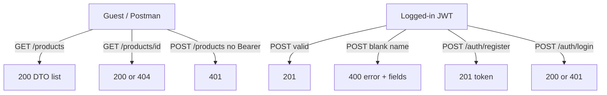

# Module 09 — Lab: CRUD + Auth Consolidation

**Phase:** Backend (protected lab — freeze the API)

**Previous module:** [Spring Security Lite](05_Spring_Security_Lite.md)  
**Next module:** [Lab: Deploy + Capstone Debug](07_Lab_Deploy_Capstone_Debug.md)

**Lab kit:** [15_Lab_Assets/19_spring_auth_tasks/](../15_Lab_Assets/19_spring_auth_tasks/)

---

**Module Outcome:**

- Freeze the API: 401 before 400, owner rules, statuses a demo can show
- Break a classmate’s auth on purpose — then fix yours
- Leave a demo bundle (Postman + README) a recruiter could follow

**Teach order today:** what consolidation *is* → end-to-end glue path → feature freeze IN/OUT → must-pass statuses (401 before 400) → peer break-auth → demo bundle.

---

## Prerequisites

- **CampusCart JWT lite** from [Spring Security Lite](05_Spring_Security_Lite.md) plus catalog DTOs / `@Valid` / 400 / 404 from modules [03](03_Spring_Data_JPA_Validation.md) and [04](04_REST_DTOs_Postman.md). Kit 19. JDK 17 + Maven 3.9+ + Spring Boot 3.x / `jakarta.*` ([Tested Toolchain](../Tested_Toolchain.md)).
- **Postman** kit 19 collection. This lab **extends** the same file for freeze 400 / 404 — it does not start a new Boot app in git.

---

## Definition / Purpose

**Definition:** **Consolidation** means one **running** API where already-taught pieces **fit**. CampusCart is not three homework folders. It is **one** MySQL catalog with DTO JSON, lite errors, and a JWT door on **writes**.

**Definition:** A **feature freeze** is a locked **IN** list for demo day. Anything not on the list is **OUT** — even if it would look impressive. Freeze is how a batch **finishes**.

**Definition:** **Peer break-auth** is a review drill: a partner (or kit `broken/`) ships an API that **looks** logged-in. You **name the smell** and the **fix** already taught in module 05. You do not invent OAuth2, XSS chapters, or new filters.

**Purpose:** Priya’s JWT homework and Ravi’s DTO catalog lived in different clones. Demo day needs **one** Postman run: guest **GET**s Pani puri; a logged-in user **POST**s it; blank name is **400**; missing id is **404**; no token is **401**. Interviews will ask “walk me through the API,” not “recite `BCryptPasswordEncoder`.”

**Icons:** Bank · Order · Laptop · Employee · UPI

**Where used?**
- CampusCart — college TechMart-style menu: public read, protected create
- TechMart — catalog freeze before a storefront (React is **Later —**)
- SecureBank — prove identity before a write (**no money movement here**)
- AcmeHR — staff login before a leave POST (**Later —** roles)
- MedCare — public doctor list; booking needs a token (**Later —**)

**Visual — freeze path (one API):**



**Key takeaways:**

- Consolidation **glues** modules 03–05 — it does not reteach them
- **Freeze IN** is the demo contract; **OUT** is not failure, it is later
- Security runs **before** `@Valid` — no token → **401**, not 400
- Kit 19 `broken/` is the break-auth lab — four smells, four fixes
- Secrets stay in **env**; the bundle is README + collection + screenshots

---

## Motivation — Feel the pain of two half-APIs

Ravi’s clone returns 201 on POST with **no** header. Priya’s clone hashes passwords but GET by id still dumps the entity. QA cannot replay one collection. Freeze day exists so the **same** laptop shows **both**.

```java
public class TwoHalfApisPain {
    public static void main(String[] args) {
        System.out.println("Catalog without a door -> junk rows");
        System.out.println("JWT without DTOs -> table leaked as JSON");
        System.out.println("Freeze = one API that does both");
    }
}
```

**Expected Output:**

```
Catalog without a door -> junk rows
JWT without DTOs -> table leaked as JSON
Freeze = one API that does both
```

**Remember:** Kit 19 already has the pieces. This lab **proves** they still work together after you touch auth.

**Interview:** “Did you finish Spring Security?” is weaker than “Guest GET, Bearer POST, 400 with token, 401 without.”

---

## Important Concepts

### 1. What consolidation is (and is not)

**Definition:** Consolidation is **integration**. You already wrote `Product` + `ProductRequest` + `AppUser` + `SecurityFilterChain`. Today you **run the path** and **stop adding features**.

**Purpose:** Without a freeze, every learner starts DELETE, CORS, and “admin role” the night before demo. None of those are required to pass. The batch looks unfinished.

| Consolidation is | Consolidation is not |
|------------------|----------------------|
| One Boot app (kit 19) | A new kit 20 |
| Point at notes 03–05 | Rewrite BCrypt / JWT / JPA |
| Status proof in Postman | A second error-body textbook |
| Diagnose kit `broken/` | New attack / OAuth2 chapters |
| README + demo bundle | Deploy / Actuator (**Later —**) |

```java
public class ConsolidationIs {
    public static void main(String[] args) {
        System.out.println("Glue 03 + 04 + 05 in kit 19");
        System.out.println("Do not rewrite SecurityFilterChain");
    }
}
```

**Expected Output:**

```
Glue 03 + 04 + 05 in kit 19
Do not rewrite SecurityFilterChain
```

**Note:**
- Wrong: opening a blank `start.spring.io` project “to keep it clean.”
- Wrong: copying module 05’s JWT lesson into this file as homework.
- Prefer: clone / copy kit 19 `starter/` or fix `broken/` until freeze statuses match.

**Common Error:** Treating freeze as “add more endpoints.” Freeze is **lock** the IN list.

**Remember:** If a feature is not on the IN table, it is Stretch or **Later —**.

**Interview:** What does “protected lab” mean here? Time to **finish and demo**, not a new topic.

Print that this lab glues modules already taught: 03 JPA persist, 04 DTO Valid 400, 05 JWT BCrypt chain — it is not a rewrite.

```java
public class GlueNotRewrite {
    public static void main(String[] args) {
        System.out.println("03 JPA persist - already taught");
        System.out.println("04 DTO Valid 400 - already taught");
        System.out.println("05 JWT BCrypt chain - already taught");
    }
}
```

**Expected Output:**

```
03 JPA persist - already taught
04 DTO Valid 400 - already taught
05 JWT BCrypt chain - already taught
```

Print that you use kit 19 `starter` or `broken`, and there is no kit 20.

```java
public class OneKitPrint {
    public static void main(String[] args) {
        System.out.println("kit 19 starter or broken");
        System.out.println("no kit 20");
    }
}
```

**Expected Output:**

```
kit 19 starter or broken
no kit 20
```

---

### 2. End-to-end CampusCart path

**Definition:** The **happy path** is one story: MySQL holds snacks and users. JSON in/out is DTOs. `@Valid` rejects blank names. JWT register / login issues a Bearer token. **GET** is a public menu. **POST** is a write.

**Purpose:** A hiring manager will say “show me.” You open Postman and walk **left to right** — not “I have a SecurityConfig somewhere.”

**Do not rewrite** mapping, `JpaRepository`, `PasswordEncoder`, or `JwtService`. Open the files you already filled:

| Piece | Already taught | Kit 19 type |
|-------|----------------|-------------|
| `Product` + repo | Module 03 | Filled |
| `ProductRequest` / `ProductResponse` + mapper | Module 04 | Filled |
| `@Valid` + `@RestControllerAdvice` 400 | Module 04 | Filled |
| GET by id **404** | Modules 02–04 | Filled |
| `AppUser`, register / login, BCrypt, JWT, chain | Module 05 | TODOs on `starter/`; bugs on `broken/` |

Drop-in POST (already in kit 19 — **do not replace** with entity JSON):

```java
@PostMapping
@ResponseStatus(HttpStatus.CREATED)
public ProductResponse add(@Valid @RequestBody ProductRequest incoming) {
    Product saved = products.save(ProductMapper.toEntity(incoming));
    return ProductMapper.toResponse(saved);
}
```

Chain recap (module 05 — **do not rewrite**; confirm GET stays public):

```java
.requestMatchers("/auth/**").permitAll()
.requestMatchers(HttpMethod.GET, "/products", "/products/**").permitAll()
.anyRequest().authenticated()
```

**Note:**
- Wrong: hiding GET `/products/{id}` behind JWT “to be extra safe” on the core path — the menu is public.
- Wrong: POSTing the `Product` entity so `id` / Hibernate fields leak.
- Prefer: DTO in, DTO out; GET public; POST authenticated.

**Common Error:** “Auth works” while GET by id still returns 500. Freeze needs **404** JSON, not a stack trace.

**Remember:** Two tables — `campus_products` and `campus_users`. MYSQL homework `users` is a different table. Do not drop it.

**Interview:** Walk the request: JSON → DTO → `@Valid` → mapper → entity → MySQL. Then say where JWT sits (**before** the controller on POST).

Print the happy path in one breath: GET menu public, register for a token, POST a snack with Bearer.

```java
public class HappyPathBreath {
    public static void main(String[] args) {
        System.out.println("GET menu public");
        System.out.println("register -> token");
        System.out.println("POST snack with Bearer");
    }
}
```

**Expected Output:**

```
GET menu public
register -> token
POST snack with Bearer
```

Print that `ProductRequest` is in, `ProductResponse` is out, and `Product` stays the entity.

```java
public class JsonNotTheRow {
    public static void main(String[] args) {
        System.out.println("ProductRequest in");
        System.out.println("ProductResponse out");
        System.out.println("Product stays the entity");
    }
}
```

**Expected Output:**

```
ProductRequest in
ProductResponse out
Product stays the entity
```

---

### 3. Feature freeze — IN vs OUT

**Definition:** **IN** items must work on demo day. **OUT** items are Stretch or a later module. Saying “not in freeze” in the README is **professional**, not lazy.

**Purpose:** Reviewers grade a **contract**. An unbounded scope never demos.

| IN (must demo) | OUT (not this lab) |
|----------------|--------------------|
| MySQL catalog + `campus_users` | Deploy, Actuator, PaaS (**Later —** next file) |
| DTOs + `@Valid` + lite **400** / **404** | Servlet vs Spring map (**Later —** module 08) |
| `POST /auth/register` **201**, duplicate **409** | OAuth2, refresh tokens, admin-role matrix |
| `POST /auth/login` **200** / **401** | React storefront / login UI |
| `GET /products` **200** without token | CORS required to pass (Stretch / **Later —**) |
| `GET /products/{id}` **200** / **404** | HTTP **DELETE**, extra catalog fields |
| `POST /products` **401** no token; **201** Bearer | Lombok required |
| `POST /products` Bearer + blank name → **400** | Kit 20, BW07 |
| BCrypt in MySQL; JWT secret from **env** | Real secret or DB password in git |
| Postman kit 19 collection + README bundle | New Boot app besides kit 19 |

```java
public class FreezeInOut {
    public static void main(String[] args) {
        System.out.println("IN: GET public POST JWT 400 404");
        System.out.println("OUT: deploy OAuth2 React DELETE");
    }
}
```

**Expected Output:**

```
IN: GET public POST JWT 400 404
OUT: deploy OAuth2 React DELETE
```

**Note:**
- Wrong: promising cart / orders / admin on this demo — capstone milestones are **Later —**.
- Wrong: skipping 400 because “auth was the last class.”
- Prefer: tick the IN table in the README so a peer can grade you.

**Common Error:** Adding `@CrossOrigin` and calling CORS “done.” CORS is Stretch. The freeze does not need a browser.

**Remember:** Stretch may exist in the repo. It must not block **Done when**.

**Interview:** How do you stop scope creep? Publish an IN/OUT list **before** coding the last night.

Print the freeze-in contract: catalog DTO Valid JWT, GET public POST protected, 400 with token and 401 without.

```java
public class FreezeInPrint {
    public static void main(String[] args) {
        System.out.println("catalog DTO Valid JWT");
        System.out.println("GET public POST protected");
        System.out.println("400 with token 401 without");
    }
}
```

**Expected Output:**

```
catalog DTO Valid JWT
GET public POST protected
400 with token 401 without
```

Print freeze-out: no Actuator this lab, no OAuth2 refresh roles, no React required.

```java
public class FreezeOutPrint {
    public static void main(String[] args) {
        System.out.println("no Actuator this lab");
        System.out.println("no OAuth2 refresh roles");
        System.out.println("no React required");
    }
}
```

**Expected Output:**

```
no Actuator this lab
no OAuth2 refresh roles
no React required
```

---

### 4. Must-pass statuses — 401 before 400

**Definition:** **Must-pass** is the smallest status set a peer can check in Postman without reading your source. Kit 19’s collection is that checklist.

**Purpose:** “It works on my machine” is not a demo. **401 / 400 / 404 / 201 / 409** are the language of the freeze.

**The order trap (this lab’s one new emphasis):** the filter chain runs **before** the controller. `@Valid` never sees a request that Security already rejected.

| Call | Token | Body | Status | Why |
|------|-------|------|--------|-----|
| `GET /products` | none | — | **200** | Public menu |
| `GET /products/99999` | none | — | **404** | Public read; missing row |
| `POST /products` | none | valid JSON | **401** | Not authenticated |
| `POST /products` | none | `"name":""` | **401** | Still not authenticated — not 400 |
| `POST /products` | Bearer | valid JSON | **201** | AuthN + AuthZ + persist |
| `POST /products` | Bearer | blank name | **400** | Known user; validation failed |
| `POST /auth/register` | none | new email | **201** | Public auth |
| `POST /auth/register` | none | same email | **409** | Unique email |
| `POST /auth/login` | none | wrong password | **401** | Failed AuthN |

Lite 400 body (module 04 — **do not rewrite** the advice class):

```
{"error":"Validation failed","fields":{"name":"must not be blank"}}
```

Lite 401 body (module 05 entry point):

```
{"error":"Unauthorized"}
```

**Note:**
- Wrong: expecting 400 on anonymous POST with a blank name.
- Wrong: treating 403 as the core-path miss — this course uses **401** for anonymous / bad JWT. Role **403** is **Later —**.
- Prefer: run **Create product without token** before **Create product invalid**.

**Common Error:** Postman **Create invalid** still has no Authorization header after you protected POST — you will keep seeing 401 and think `@Valid` is broken.

**Remember:** 401 = door. 400 = form. 404 = unknown id. 201 = created. 409 = email taken.

**Interview:** Why can a blank-name POST return 401? Because AuthN failed first.

Print door-before-form: no Bearer is 401, Bearer plus blank name is 400, and `@Valid` never ran on 401.

```java
public class DoorBeforeForm {
    public static void main(String[] args) {
        System.out.println("no Bearer -> 401");
        System.out.println("Bearer + blank name -> 400");
        System.out.println("@Valid never ran on 401");
    }
}
```

**Expected Output:**

```
no Bearer -> 401
Bearer + blank name -> 400
@Valid never ran on 401
```

Print public GET `/products/99999` with no token and 404 lite JSON.

```java
public class Public404Print {
    public static void main(String[] args) {
        System.out.println("GET /products/99999");
        System.out.println("no token needed");
        System.out.println("404 lite JSON");
    }
}
```

**Expected Output:**

```
GET /products/99999
no token needed
404 lite JSON
```

---

### 5. Peer break-auth — diagnose, do not invent attacks

**Definition:** **Break-auth** means the API **claims** to be protected but a guest can still write, or a password is stored in the clear, or a secret is in git. Kit 19 **`broken/`** is the classroom patient. A peer’s clone may show the same smells.

**Purpose:** Interviews ask “how would you test auth?” You answer with **four checks**, not a new exploit chapter. Fixes are already in module 05 + kit `solution/` (trainer-only in the student pack).

| Smell in `broken/` | What you see | Fix already taught |
|--------------------|--------------|--------------------|
| Raw password / `NoOpPasswordEncoder` | Workbench shows `IdliDosa8`; hash does not start `$2` | `BCryptPasswordEncoder` + `encode` / `matches` |
| Filter never reads `Authorization` | Header present but POST still anonymous **or** fake token accepted | `JwtAuthFilter` + `SecurityContext` (module 05) |
| `anyRequest().permitAll()` | POST **201** with **no** Bearer | `GET` permitAll; `anyRequest().authenticated()` |
| Secret / DB password literals in yml | `git grep` finds `root123` or a committed JWT string | `${JWT_SECRET}` / `${MYSQL_PASSWORD}`; commit `.env.example` only |
| Fake JWT (`fake.email.token`) | Token is not three signed parts | `jjwt` builder + env secret (module 05) |

**Do not** add XSS, CSRF-cookie labs, SQL-injection chapters, or brute-force tooling. JDBC already used `PreparedStatement`. CSRF is off **on purpose** for this Bearer API (module 05). Deploy hardening is **Later —**.

Peer script (speak it, then click Postman):

1. POST a snack **without** Bearer — must be **401**.
2. Register — Workbench `password_hash` starts with **`$2`**.
3. `git grep` / open yml — no real password, no literal JWT secret.
4. If POST is 201 with no header → look for **`permitAll`**.

```java
public class FourSmellsPrint {
    public static void main(String[] args) {
        System.out.println("plain password");
        System.out.println("missing Bearer filter");
        System.out.println("permitAll everywhere");
        System.out.println("secret in git");
    }
}
```

**Expected Output:**

```
plain password
missing Bearer filter
permitAll everywhere
secret in git
```

**Note:**
- Wrong: rewriting `broken/` into a new security framework.
- Wrong: committing the peer’s real `.env` “so I can help.”
- Prefer: name the smell in one sentence, point at the module 05 fix, re-run the collection.

**Common Error:** “I added `permitAll` so Postman would work.” That **is** the bug the peer should catch.

**Remember:** A 201 without a token is not a green test. It is a failed freeze.

**Interview:** How do you know passwords are hashed? Select the column. `$2a$` / `$2b$` / `$2` prefix — never `IdliDosa8`.

Print the permitAll smell: POST `/products` with no header — 201 is a bug, 401 means the door works.

```java
public class PermitAllSmell {
    public static void main(String[] args) {
        System.out.println("POST /products no header");
        System.out.println("201 means permitAll bug");
        System.out.println("401 means the door works");
    }
}
```

**Expected Output:**

```
POST /products no header
201 means permitAll bug
401 means the door works
```

Print git rules: `.env.example` yes, JWT_SECRET literal no, YAML uses `${JWT_SECRET}`.

```java
public class SecretGrepPrint {
    public static void main(String[] args) {
        System.out.println("git: .env.example YES");
        System.out.println("git: JWT_SECRET literal NO");
        System.out.println("yml uses ${JWT_SECRET}");
    }
}
```

**Expected Output:**

```
git: .env.example YES
git: JWT_SECRET literal NO
yml uses ${JWT_SECRET}
```

---

### 6. Demo day — deliverables bundle

**Definition:** The **bundle** is what a peer clones. Same checklist as [Standard Project Deliverables](../Standard_Project_Deliverables.md) — except **no live URL**. Deploy is **Later —** the next lab.

**Purpose:** A 2–5 min video that only shows `mvn spring-boot:run` is not a freeze demo. Show **Guest GET**, **401 POST**, **register**, **201 POST**, **400**, **404**. README must list env keys.

| Artefact | This lab |
|----------|----------|
| Public GitHub repo | No secrets; `target/` ignored |
| `README.md` | Freeze IN/OUT, setup, curl / Postman, screenshots |
| `pom.xml` | Boot 3, JDK 17, `jakarta.*` starters already in kit 19 |
| `.env.example` | `MYSQL_*`, `JWT_SECRET` dummy (≥ 32 chars) |
| Seed / sample | Document `training_db`; `ddl-auto: update` creates tables |
| Screenshots | Postman 201 + 401 + Workbench `$2` hash (crop secrets) |
| Demo video 2–5 min | Walk the must-pass table |
| `.gitignore` | `target/`, `.env`, `*.class`, `.idea/` |
| Postman | Kit 19 [`CampusCart_Auth_v1.postman_collection.json`](../15_Lab_Assets/19_spring_auth_tasks/CampusCart_Auth_v1.postman_collection.json) |

**Sample credentials in README:** `priya@campuscart.in` / lab password **from `.env.example` notes** — not a production password. Never paste a live JWT into the README.

**Note:**
- Wrong: screenshot of a token that is still valid — crop or expire it.
- Wrong: “Live: coming soon” as if deploy were required.
- Prefer: “Deploy is the next lab. This repo is localhost + Postman.”

**Common Error:** Committing `application.yml` with `password: root123` “because the video needed it.” Rotate if it hits git.

**Remember:** Clone instructions that need a trainer’s brain are not independent.

**Interview:** What do you show in 3 minutes? Guest read → failed write → login → successful write → validation → missing id.

Print what README must list: export `MYSQL_PASSWORD` and `JWT_SECRET`, `mvn spring-boot:run`, import the Postman collection.

```java
public class ReadmeMustPrint {
    public static void main(String[] args) {
        System.out.println("export MYSQL_PASSWORD JWT_SECRET");
        System.out.println("mvn spring-boot:run");
        System.out.println("import Postman collection");
    }
}
```

**Expected Output:**

```
export MYSQL_PASSWORD JWT_SECRET
mvn spring-boot:run
import Postman collection
```

Print demo order: GET 200, POST 401, register 201, then POST 201, POST 400, GET 404.

```java
public class DemoOrderPrint {
    public static void main(String[] args) {
        System.out.println("GET 200");
        System.out.println("POST 401");
        System.out.println("register 201");
        System.out.println("POST 201 then 400 then GET 404");
    }
}
```

**Expected Output:**

```
GET 200
POST 401
register 201
POST 201 then 400 then GET 404
```

---

## Step-by-Step Annotated Java Code

Work from [15_Lab_Assets/19_spring_auth_tasks/](../15_Lab_Assets/19_spring_auth_tasks/). Open the folder that contains **`pom.xml`**. Do not create kit 20. Do not start a second Boot app in this repo.

### Step 1: Env + run (same as module 05)

Copy [`.env.example`](../15_Lab_Assets/19_spring_auth_tasks/.env.example) values into the **shell** (Boot does not load `.env` by itself). `JWT_SECRET` stays ≥ 32 characters.

```java
public class EnvKeysPrint {
    public static void main(String[] args) {
        System.out.println("MYSQL_PASSWORD");
        System.out.println("JWT_SECRET");
        System.out.println("not in yml literals");
    }
}
```

**Expected Output:**

```
MYSQL_PASSWORD
JWT_SECRET
not in yml literals
```

From the kit root:

```bash
export MYSQL_PASSWORD='your_lab_password'
export MYSQL_USER=root
export MYSQL_DATABASE=training_db
export JWT_SECRET='change_me_lab_jwt_secret_32chars!'

cd starter          # or broken until it matches Done when
mvn spring-boot:run
```

Print the three beans that must start: Tomcat, DataSource, `SecurityFilterChain`.

```java
public class WhatMustStart {
    public static void main(String[] args) {
        System.out.println("Tomcat");
        System.out.println("DataSource");
        System.out.println("SecurityFilterChain");
    }
}
```

**Expected Output:**

```
Tomcat
DataSource
SecurityFilterChain
```

Print Boot 3 imports `jakarta.validation.Valid` and `jakarta.persistence.Entity` — not `javax`.

```java
public class JakartaNotJavax {
    public static void main(String[] args) {
        System.out.println("jakarta.validation.Valid");
        System.out.println("jakarta.persistence.Entity");
        System.out.println("Boot 3");
    }
}
```

**Expected Output:**

```
jakarta.validation.Valid
jakarta.persistence.Entity
Boot 3
```

---

### Step 2: Prove the freeze with curl / Postman

Import [`CampusCart_Auth_v1.postman_collection.json`](../15_Lab_Assets/19_spring_auth_tasks/CampusCart_Auth_v1.postman_collection.json). Variable `baseUrl` = `http://localhost:8080`. Run **Register** (or **Login**) **before** any Bearer POST — including the **400** request.

Second terminal (replace `PASTE_TOKEN`):

```bash
curl -s http://localhost:8080/products

curl -s -o /dev/null -w "%{http_code}\n" -X POST http://localhost:8080/products \
  -H "Content-Type: application/json" \
  -d '{"name":"Pani puri","priceInr":30}'
# expect 401

curl -s -X POST http://localhost:8080/auth/register \
  -H "Content-Type: application/json" \
  -d '{"email":"priya@campuscart.in","password":"IdliDosa8"}'

curl -s -X POST http://localhost:8080/products \
  -H "Content-Type: application/json" \
  -H "Authorization: Bearer PASTE_TOKEN" \
  -d '{"name":"Pani puri","priceInr":30}'
# expect 201

curl -s -o /dev/null -w "%{http_code}\n" http://localhost:8080/products/99999
# expect 404

curl -s -o /dev/null -w "%{http_code}\n" -X POST http://localhost:8080/products \
  -H "Content-Type: application/json" \
  -H "Authorization: Bearer PASTE_TOKEN" \
  -d '{"name":"","priceInr":30}'
# expect 400 — not 401
```

Print collection order: Register saves the token, 401 POST has no Authorization, 400 POST still has Bearer.

```java
public class CollectionOrderPrint {
    public static void main(String[] args) {
        System.out.println("Register saves token");
        System.out.println("401 POST has no Authorization");
        System.out.println("400 POST still has Bearer");
    }
}
```

**Expected Output:**

```
Register saves token
401 POST has no Authorization
400 POST still has Bearer
```

Print that registering the same email twice returns 409, not 201.

```java
public class Duplicate409Print {
    public static void main(String[] args) {
        System.out.println("same email twice");
        System.out.println("409 not 201");
    }
}
```

**Expected Output:**

```
same email twice
409 not 201
```

---

### Step 3: Peer break-auth on `broken/` (or a partner clone)

Switch to `broken/` **or** swap laptops. Do **not** open `solution/` until you have named the smells (or the trainer says to).

Checklist to speak out loud:

1. POST without token → **201**? → `permitAll`.
2. Hash column = `IdliDosa8`? → raw password / `NoOp`.
3. Header set but still 401 on a “valid” fake token? → filter or `JwtService`.
4. yml contains `root123` or `super-secret-please-commit-me-ok`? → env.

Print that a BCrypt hash starts with `$2`, and storing `IdliDosa8` in MySQL is a fail.

```java
public class HashPrefixPrint {
    public static void main(String[] args) {
        System.out.println("BCrypt starts with $2");
        System.out.println("IdliDosa8 in MySQL is a fail");
    }
}
```

**Expected Output:**

```
BCrypt starts with $2
IdliDosa8 in MySQL is a fail
```

Print that `fake.email.token` is not HS256, and jjwt signs with `JWT_SECRET`.

```java
public class FakeTokenSmell {
    public static void main(String[] args) {
        System.out.println("fake.email.token is not HS256");
        System.out.println("jjwt signs with JWT_SECRET");
    }
}
```

**Expected Output:**

```
fake.email.token is not HS256
jjwt signs with JWT_SECRET
```

---

### Step 4: Bundle for demo day

Copy the README template in [Standard Project Deliverables](../Standard_Project_Deliverables.md). Paste your freeze IN/OUT table. Add screenshots of Postman 201 and 401. Link the video. Push **without** `.env`.

Print the freeze ignore list: `target/`, `.env`, `*.class`.

```java
public class GitIgnoreFreeze {
    public static void main(String[] args) {
        System.out.println("target/");
        System.out.println(".env");
        System.out.println("*.class");
    }
}
```

**Expected Output:**

```
target/
.env
*.class
```

Print what not to promise: no live PaaS URL, no React login, next lab is deploy.

```java
public class WhatNotToPromise {
    public static void main(String[] args) {
        System.out.println("no live PaaS URL required");
        System.out.println("no React login");
        System.out.println("next lab is deploy");
    }
}
```

**Expected Output:**

```
no live PaaS URL required
no React login
next lab is deploy
```

---

## Practice Exercises

*(Each Practice item includes a filled **Model answer:** and **Expected Output:** where the demo prints.)*

### Basic

1. Print what consolidation glues.

   **Model answer:**

```java
public class WhatGluePrint {
    public static void main(String[] args) {
        System.out.println("JPA catalog");
        System.out.println("DTO Valid 400 404");
        System.out.println("JWT door on POST");
    }
}
```

   **Expected Output:**

```
JPA catalog
DTO Valid 400 404
JWT door on POST
```

2. Print the public vs protected rule.

   **Model answer:**

```java
public class PublicVsProtected {
    public static void main(String[] args) {
        System.out.println("GET /products public");
        System.out.println("POST /products JWT");
    }
}
```

   **Expected Output:**

```
GET /products public
POST /products JWT
```

3. Print where the JWT secret lives.

   **Model answer:**

```java
public class SecretLivesPrint {
    public static void main(String[] args) {
        System.out.println("environment JWT_SECRET");
        System.out.println("not a yml literal in git");
    }
}
```

   **Expected Output:**

```
environment JWT_SECRET
not a yml literal in git
```

### Intermediate

1. Why blank-name POST without a token is 401.

   **Model answer:**

```java
public class BlankName401 {
    public static void main(String[] args) {
        System.out.println("SecurityFilterChain first");
        System.out.println("anonymous -> 401");
        System.out.println("@Valid did not run");
    }
}
```

   **Expected Output:**

```
SecurityFilterChain first
anonymous -> 401
@Valid did not run
```

2. Why GET by id 404 stays public.

   **Model answer:**

```java
public class GetByIdPublic {
    public static void main(String[] args) {
        System.out.println("menu detail is still a read");
        System.out.println("missing id is 404 not 401");
    }
}
```

   **Expected Output:**

```
menu detail is still a read
missing id is 404 not 401
```

3. Name the four break-auth smells.

   **Model answer:**

```java
public class NameFourSmells {
    public static void main(String[] args) {
        System.out.println("plain password or NoOp");
        System.out.println("filter skips Bearer");
        System.out.println("permitAll on POST");
        System.out.println("secret in git");
    }
}
```

   **Expected Output:**

```
plain password or NoOp
filter skips Bearer
permitAll on POST
secret in git
```

4. What is out of freeze.

   **Model answer:**

```java
public class OutOfFreezePrint {
    public static void main(String[] args) {
        System.out.println("deploy Actuator");
        System.out.println("OAuth2 refresh roles");
        System.out.println("React DELETE CORS Lombok required");
    }
}
```

   **Expected Output:**

```
deploy Actuator
OAuth2 refresh roles
React DELETE CORS Lombok required
```

### Interview-Oriented

1. What is a feature freeze?

   **Model answer:** A locked IN list for demo day. Extra fields, DELETE, CORS, and Lombok may exist as Stretch. They are not required to pass.

2. Does this lab replace module 05?

   **Model answer:** No. It proves JWT + BCrypt + `SecurityFilterChain` still guard POST while the catalog DTO path from 03–04 still returns 400/404.

3. 401 vs 400 vs 404 on this API?

   **Model answer:** 401 = no/invalid JWT (or bad login). 400 = `@Valid` failed on a request that already passed the door. 404 = unknown product id on a public GET.

4. How do you test auth without attacking anyone?

   **Model answer:** POST without Bearer (expect 401), check BCrypt prefix in MySQL, `git grep` for secrets, look for `permitAll` on writes. Kit `broken/` holds those smells.

5. Is a deploy URL required?

   **Model answer:** No. The bundle is README + Postman + video on localhost. Actuator / PaaS is the next protected lab.

6. Why `jakarta.*`?

   **Model answer:** Spring Boot 3. `javax.*` Bean Validation / Servlet packages are the old stack.

---

## Mini-Project (Assignment): CampusCart CRUD + Auth Freeze

**Lab kit:** [15_Lab_Assets/19_spring_auth_tasks/](../15_Lab_Assets/19_spring_auth_tasks/)

Modules 03–05 already taught persist, DTOs, and JWT lite. This assignment is the **portfolio freeze**: one CampusCart API a peer can clone, run, and break-auth. Push a public repo. No secrets in git. No kit 20.

Do **not** add OAuth2, refresh tokens, role matrices, deploy, or Lombok to pass. Extra fields, DELETE, and CORS are Stretch.

### What to build

| Piece | Detail |
|-------|--------|
| App | Kit 19 Maven tree (`starter/` TODOs or `broken/` fixes) — JDK 17, Boot 3, `jakarta.*` |
| Persistence | Keep **Product** DTO GET list / GET by id / POST on MySQL (`campus_products`) |
| Validation | `@Valid` on POST; lite **400** `{error, fields}`; **404** on missing id |
| Auth | **POST `/auth/register`** **201**; duplicate **409**; **POST `/auth/login`** **200** / **401** |
| Hash | BCrypt in `campus_users` — not the raw password |
| Door | GET `/products` and GET `/products/{id}` **permitAll**; POST **authenticated** |
| Token | `Authorization: Bearer`; secret `${JWT_SECRET}` (≥ 32 chars) |
| Postman | Kit 19 collection — including 401, 201, **400 with Bearer**, **404**, duplicate **409** |
| Bundle | README freeze IN/OUT, `.env.example`, screenshots, 2–5 min demo ([Standard Project Deliverables](../Standard_Project_Deliverables.md) — **no** live URL) |
| Secrets | `.env.example` only; `.gitignore` has `target/` and `.env` |

Work from `starter/` or `broken/`. Compare `solution/` only after you finish (or when told in class). `solution/` is trainer-only in the student pack.

### Stretch

- Extra catalog fields (description, veg flag) — **not** Done when.
- Authenticated **DELETE** `/products/{id}` — optional.
- **`@CrossOrigin(origins = "http://localhost:5173")`** — **not** Done when. React `fetch` is **Later —**.
- Lombok / records — optional, not in Done when.
- **Later —** deploy / Actuator (next module). **Later —** OAuth2, refresh, admin roles. **Later —** Servlet vs Spring map.

### Done when

- [ ] `mvn spring-boot:run` starts (Tomcat + DataSource + Security)
- [ ] Register **201** with `token` + `email` (no password field); hash in MySQL starts with `$2`
- [ ] Login **200** / bad password **401**; duplicate email **409**
- [ ] `GET /products` **200** without token
- [ ] `GET /products/{id}` **200** existing / **404** missing (lite JSON)
- [ ] `POST /products` **401** without token; **201** with Bearer
- [ ] `POST /products` with Bearer + blank name → **400** (`error` + `fields`) — not 401
- [ ] Feature freeze OUT respected (no deploy / OAuth2 / refresh / roles / React / required DELETE / CORS / Lombok)
- [ ] Peer break-auth: can name the four smells (plain password, missing Bearer, `permitAll`, secret in git) and the fix
- [ ] Kit 19 Postman collection imports; statuses match the rows above
- [ ] `JWT_SECRET` and DB password are not literals in git
- [ ] README + screenshots + 2–5 min demo; `target/` untracked; no live PaaS URL required

---

## Interview Q&A

Shared with students after concepts and the mini-project. Use for review and interview prep — questions and model answers are included.

**Q1. What did you freeze?**  
**A:** One CampusCart API: MySQL catalog with DTOs and `@Valid`, lite 400/404, JWT register/login, public GET, protected POST. Not deploy, not OAuth2, not React.

**Q2. Why is this a lab, not a new Security chapter?**  
**A:** BCrypt, `SecurityFilterChain`, and JWT were module 05. JPA was 03. DTOs and Postman were 04. This lab proves they still work in one process.

**Q3. Why 401 on a blank-name POST with no token?**  
**A:** Filters run first. Anonymous callers never reach `@Valid`. Add Bearer, then the same body becomes 400.

**Q4. 401 vs 403 vs 400 vs 404?**  
**A:** 401 = not authenticated. 403 = authenticated but forbidden (roles are later). 400 = validation. 404 = no product for that id.

**Q5. How do you break-auth a peer without hacking?**  
**A:** POST with no header (expect 401), inspect the hash column, search git for secrets, read `SecurityFilterChain` for `permitAll` on writes.

**Q6. Why keep GET public after adding JWT?**  
**A:** A campus menu is a read. Writes need a known user. Hiding GET is a product choice, not the core-path freeze.

**Q7. Where do secrets live?**  
**A:** Environment variables. Commit `.env.example` with dummy values. `application.yml` uses `${MYSQL_PASSWORD}` and `${JWT_SECRET}`.

**Q8. Does JWT replace JPA?**  
**A:** No. The same `Product` row is saved. Security only decides **who** may call POST.

**Q9. Why `jakarta.*`?**  
**A:** Spring Boot 3. Validation and persistence annotations are `jakarta.*`, not `javax.*`.

**Q10. Is CORS part of Done when?**  
**A:** No. Stretch only. Curl and Postman are not browsers. React weeks need CORS later.

**Q11. What belongs in the demo video?**  
**A:** GET 200, POST 401, register, POST 201, POST 400 with token, GET 404, Workbench `$2` hash. Mention IN/OUT in the README.

**Q12. Why not Lombok to pass?**  
**A:** Juniors must show mapping and getters. Lombok is optional Stretch.

**Q13. How does this connect to CampusCart capstone?**  
**A:** This freeze is the catalog + auth shell. Cart, orders, admin, and deploy are later milestones.

**Q14. What if POST returns 201 with no token?**  
**A:** The chain likely `permitAll()`s everything. That is a failed freeze, not a successful create test.

**Q15. Why no kit 20?**  
**A:** Kit 19 already has catalog + auth. A second tree would split the demo. Stretch stays in the same repo.

---

## Next

Push **CampusCart CRUD + Auth Freeze** (kit 19 — collection committed, no secrets). Continue with **[Lab: Deploy + Capstone Debug](07_Lab_Deploy_Capstone_Debug.md)** — Actuator / health + env. OAuth2, refresh tokens, admin roles, and React login stay **Later —**.
