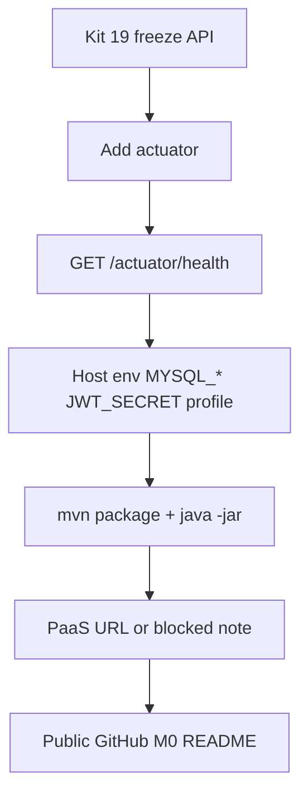

# Module 09 — Lab: Deploy + Capstone Debug

**Phase:** Backend (protected lab — health, env, PaaS attempt, M0)

**Previous module:** [Lab: CRUD + Auth Consolidation](06_Lab_CRUD_Auth_Consolidation.md)  
**Next module:** [Servlet vs Spring Interview Map](08_Servlet_vs_Spring_Interview_Map.md)

**Lab kit:** [15_Lab_Assets/19_spring_auth_tasks/](../15_Lab_Assets/19_spring_auth_tasks/) (same API as Lab 06 — **do not** start kit 20)

---

**Module Outcome:**

- Prove health (Actuator or `/health`) and env on a host, not only on localhost
- Attempt PaaS and write what blocked you if it did
- Park capstone M0 so Week 18 is not a blank repo

**Teach order today:** what deploy/debug *is* → Actuator health vs handmade `/health` → profiles / env on a host → debug playbook → PaaS attempt → capstone M0.

---

## Prerequisites

- **Frozen kit 19 API** from [Lab: CRUD + Auth Consolidation](06_Lab_CRUD_Auth_Consolidation.md) (JWT lite + catalog DTOs). JDK 17 + Maven 3.9+ + Spring Boot 3.x / `jakarta.*` + MySQL 8+ ([Tested Toolchain](../Tested_Toolchain.md)).
- A **GitHub** account that can create a **public** repo. A PaaS login (Render / Railway / similar) is the **attempt** — a live URL is not the only pass.

---

## Definition / Purpose

**Definition:** **Deploy** (this lab) means the same Boot **JAR** that runs on your laptop can start on a **host** with **env**, not with secrets pasted into git. The host may be your machine (`java -jar`) or a junior-realistic **PaaS**.

**Definition:** **Debug** (this lab) is a **playbook**: read the first error, name the missing env or blocked matcher, fix it, re-prove **health**. It is not a new observability stack.

**Definition:** **Actuator** is Spring Boot’s **ops starter**. **`GET /actuator/health`** is a **probe** the platform (and you) can curl. A handmade `@GetMapping("/health")` from module 01 always prints `"UP"` even when MySQL is down.

**Definition:** **Capstone M0** is the **repo shell**: public GitHub + Maven + README. Kit 19 is the **auth / catalog API** inside that repo. **M1** (auth as a product milestone) is **Later —**. Cart and orders are **Later —**.

**Purpose:** Priya’s freeze demo worked on `localhost:8080`. Ravi pushed `application.yml` with `password: root123` so “Render would start.” Recruiters open GitHub first. This lab exists so the **same** API shows **health + env hygiene**, with a live URL **or** an honest blocked note — not a second Security class.

**Icons:** Bank · Order · Laptop · Employee · UPI

**Where used?**
- CampusCart — college Swiggy-style API: prove the JAR is alive before promising a storefront
- Swiggy — catalog host env (`MYSQL_*`) before a React listing (**Later —**)
- HDFC Bank — health probe before anyone trusts a write (**no money movement here**)
- Employee Management Portal — staff API on a PaaS; JWT secret stays in the dashboard, not in git
- Apollo Hospitals — public doctor list still 200; booking still needs a token after the host changes

**Visual — Lab 07 path (same API):**



**Key takeaways:**

- Deploy **reuses** kit 19 — it does not reteach JWT / JPA
- **`/actuator/health`** is the probe; handmade `/health` was module 01 homework
- Secrets live in **env** on the laptop **and** on the host
- Success is **env hygiene + health**, not only a public URL
- **M0** is repo + Maven + README — not cart / orders

---

## Motivation — Feel the pain of “it works on localhost”

Ravi’s freeze collection is green. He pastes the JAR on a PaaS. The dashboard says **started**, then **401** on health, then **HikariPool** timeouts because `MYSQL_HOST` is still `localhost` — the PaaS box, not his laptop. Priya’s handmade `/health` still returns `"UP"` while MySQL is stopped. Neither demo is a deploy.

```java
public class LocalhostDeployPain {
    public static void main(String[] args) {
        System.out.println("localhost green is not a host");
        System.out.println("handmade /health can lie");
        System.out.println("Lab 07 = health + env + honest PaaS attempt");
    }
}
```

**Expected Output:**

```
localhost green is not a host
handmade /health can lie
Lab 07 = health + env + honest PaaS attempt
```

**Remember:** Kit 19 already has the API. This lab **proves it can start with env** and **tells the truth** about MySQL.

**Interview:** “Did you deploy Spring Boot?” is weaker than “Here is `/actuator/health`, here is `.env.example`, and here is the URL **or** the platform block.”

---

## Important Concepts

### 1. What deploy/debug is (and is not)

**Definition:** Deploy/debug is **hosting the freeze**, not adding features. You already froze public GET + JWT POST. Today you add a **probe**, **profiles**, and a **PaaS attempt**.

**Purpose:** Without this lab, learners either never leave `mvn spring-boot:run` or they rewrite Security “for production.” Both miss the hiring check: **can a peer clone, export env, and hit health?**

| This lab is | This lab is not |
|-------------|-----------------|
| Same Boot app (kit 19) | A new kit 20 |
| Actuator **health** + env | Rewrite of module 01 yml / Tomcat |
| Diagnose start / DB / 401 / leaks | Kubernetes, Prometheus, APM |
| PaaS **attempt** + local JAR proof | Live URL as the only pass |
| Capstone **M0** | M1–M3 cart / orders / React |
| Point at notes 01 + 05–06 | Servlet vs Spring map (**Later —** module 08) |

```java
public class DeployIs {
    public static void main(String[] args) {
        System.out.println("Same kit 19 JAR on a host");
        System.out.println("Do not rewrite SecurityFilterChain");
    }
}
```

**Expected Output:**

```
Same kit 19 JAR on a host
Do not rewrite SecurityFilterChain
```

**Note:**
- Wrong: opening a blank Initializr “deploy project” and leaving kit 19 behind.
- Wrong: copying module 01’s handmade `/health` and calling Actuator done.
- Prefer: add the Actuator starter to the **frozen** pom, permit **one** path, prove it.

**Common Error:** Treating deploy as “add Docker + Nginx + CI.” Stretch. **Done when** is health + env + attempt.

**Remember:** If a feature is cart, CORS, or OAuth2, it is **Later —**, not this lab.

**Interview:** What does “protected lab” mean here? Time to **host and debug** the freeze, not a new framework.

Print that this lab glues what is already taught: 01 yml env JAR Tomcat, 05 JWT BCrypt chain, 06 freeze statuses — it is not a rewrite.

```java
public class GlueNotRewriteDeploy {
    public static void main(String[] args) {
        System.out.println("01 yml env JAR Tomcat - already taught");
        System.out.println("05 JWT BCrypt chain - already taught");
        System.out.println("06 freeze statuses - already taught");
    }
}
```

**Expected Output:**

```
01 yml env JAR Tomcat - already taught
05 JWT BCrypt chain - already taught
06 freeze statuses - already taught
```

Print that you use kit 19 starter/broken or your freeze clone, and there is no kit 20.

```java
public class OneKitDeployPrint {
    public static void main(String[] args) {
        System.out.println("kit 19 starter broken or your freeze clone");
        System.out.println("no kit 20");
    }
}
```

**Expected Output:**

```
kit 19 starter broken or your freeze clone
no kit 20
```

---

### 2. Actuator health vs handmade `/health`

**Definition:** **`spring-boot-starter-actuator`** adds **management endpoints**. This course exposes **one** for the core path: **`/actuator/health`**. Default JSON is `{"status":"UP"}` (or `DOWN`).

**Purpose:** Module 01 taught a **plain** `@GetMapping("/health")` so you could return JSON **before** Actuator. That mapping **does not** ask the DataSource. A PaaS load balancer that curls a liar endpoint will keep sending traffic to a dead DB.

Drop-in dependency (add next to the other starters in kit 19 `pom.xml` — **do not** replace `starter-web` / `starter-security`):

```xml
<dependency>
    <groupId>org.springframework.boot</groupId>
    <artifactId>spring-boot-starter-actuator</artifactId>
</dependency>
```

Yml (keep secrets as placeholders — module 01 style):

```yaml
management:
  endpoints:
    web:
      exposure:
        include: health
  endpoint:
    health:
      show-details: never
```

Chain **add** (module 05 taught the rest — **do not rewrite**; confirm GET products stay public):

```java
.requestMatchers("/auth/**").permitAll()
.requestMatchers(HttpMethod.GET, "/products", "/products/**").permitAll()
.requestMatchers("/actuator/health").permitAll()
.anyRequest().authenticated()
```

| Probe | Who answers | Honest about MySQL? | Lab |
|-------|-------------|---------------------|-----|
| `GET /health` | Your `@RestController` | No — always `"UP"` if Tomcat started | Module 01 |
| `GET /actuator/health` | Actuator | Can go **DOWN** when the DB contributor fails | **This lab** |

**Note:**
- Wrong: exposing `*` (`health,info,env,beans,heapdump`) on a public URL.
- Wrong: `show-details: always` — that can leak JDBC URL / validation query in JSON.
- Prefer: `include: health` + `show-details: never` + **permit only** `/actuator/health`.

**Common Error:** Adding the starter but not the matcher. `anyRequest().authenticated()` then returns **401** on health — the probe looks “broken” and you blame Actuator.

**Remember:** Handmade `/health` is **not** Lab 07 proof. Curl **`/actuator/health`**.

**Interview:** Why not keep only `/health`? Because a controller you wrote does not run Boot’s DataSource health indicator.

Print liar vs probe: handmade GET `/health` is always UP; GET `/actuator/health` is UP or DOWN; PaaS should curl the probe.

```java
public class LiarVsProbe {
    public static void main(String[] args) {
        System.out.println("GET /health handmade -> always UP");
        System.out.println("GET /actuator/health -> UP or DOWN");
        System.out.println("PaaS should curl the probe");
    }
}
```

**Expected Output:**

```
GET /health handmade -> always UP
GET /actuator/health -> UP or DOWN
PaaS should curl the probe
```

Print health matchers: without one `/actuator/health` is 401, with `permitAll` it is 200, and you must not `permitAll` the whole `/actuator`.

```java
public class PermitHealthPrint {
    public static void main(String[] args) {
        System.out.println("without matcher -> 401");
        System.out.println("with /actuator/health permitAll -> 200");
        System.out.println("do not permitAll the whole /actuator");
    }
}
```

**Expected Output:**

```
without matcher -> 401
with /actuator/health permitAll -> 200
do not permitAll the whole /actuator
```

---

### 3. Profiles and env on a host

**Definition:** A **profile** is a named config set (`local`, `prod`). **`SPRING_PROFILES_ACTIVE`** chooses it. A **host** is wherever the JAR runs: laptop, Render, Railway, or a campus VM.

**Purpose:** `show-sql: true` is fine in class. On a public URL it **leaks queries**. The same yml password literal that “helped the video” is a **git secret**. Module 01 already said Boot **does not** load `.env` by itself — that is still true on PaaS. You set **dashboard env** (or `export`), matching [`.env.example`](../15_Lab_Assets/19_spring_auth_tasks/.env.example).

**Where used?**
- CampusCart / Swiggy — `MYSQL_HOST` on the PaaS is the **cloud** MySQL, not `localhost`
- HDFC Bank — `JWT_SECRET` rotated in the dashboard; old tokens die (expected)
- Employee Management Portal — `SPRING_PROFILES_ACTIVE=prod` turns off SQL echo

Keys this lab (dummy values in git only):

| Key | Role |
|-----|------|
| `MYSQL_HOST` `MYSQL_PORT` `MYSQL_USER` `MYSQL_PASSWORD` `MYSQL_DATABASE` | DataSource — already in kit 19 yml |
| `JWT_SECRET` | HS256 (≥ 32 chars) — already `${JWT_SECRET}` with **no** default |
| `SPRING_PROFILES_ACTIVE` | `local` on the laptop; `prod` on the host |
| `SERVER_PORT` | Module 01; laptop |
| `PORT` | Many PaaS inject this — map it in yml (below) |

Laptop `application.yml` already has `${MYSQL_PASSWORD}` and `${JWT_SECRET}`. **Add** the port mapping so a PaaS `PORT` is not ignored:

```yaml
server:
  port: ${PORT:${SERVER_PORT:8080}}
```

`application-prod.yml` (new file under `src/main/resources` — **no** passwords):

```yaml
spring:
  jpa:
    show-sql: false
    properties:
      hibernate:
        format_sql: false

logging:
  level:
    org.hibernate.SQL: WARN
    org.springframework.security: WARN

management:
  endpoint:
    health:
      show-details: never
```

Activate:

```bash
export SPRING_PROFILES_ACTIVE=prod
# plus MYSQL_* and JWT_SECRET — same names as .env.example
```

**Note:**
- Wrong: committing `.env` “because Render needs the file.” PaaS reads **environment**, not your laptop file.
- Wrong: `JWT_SECRET: changeme` as a yml default so the app starts without env.
- Prefer: fail fast on missing `MYSQL_PASSWORD` / `JWT_SECRET`; document keys in README.

**Common Error:** Setting env in the **wrong** Render service (static site vs Web Service) — the JAR never sees `MYSQL_HOST`.

**Remember:** `.env.example` is the contract. The dashboard must use the **same names**.

**Interview:** Does Boot read `.env`? No. OS / IDE / PaaS env. You `export` or paste keys in the host UI.

Print the host env keys: `MYSQL_HOST`, `MYSQL_PASSWORD`, `JWT_SECRET`, and `SPRING_PROFILES_ACTIVE`.

```java
public class HostEnvKeysPrint {
    public static void main(String[] args) {
        System.out.println("MYSQL_HOST MYSQL_PASSWORD");
        System.out.println("JWT_SECRET");
        System.out.println("SPRING_PROFILES_ACTIVE");
    }
}
```

**Expected Output:**

```
MYSQL_HOST MYSQL_PASSWORD
JWT_SECRET
SPRING_PROFILES_ACTIVE
```

Print git rules: `.env.example` yes, `.env` no, and the PaaS dashboard holds the real values.

```java
public class NeverCommitEnvDeploy {
    public static void main(String[] args) {
        System.out.println("git: .env.example YES");
        System.out.println("git: .env NO");
        System.out.println("PaaS dashboard holds the real values");
    }
}
```

**Expected Output:**

```
git: .env.example YES
git: .env NO
PaaS dashboard holds the real values
```

---

### 4. Debug playbook — diagnose, do not invent SRE

**Definition:** The **playbook** is the **first checks** for five smells you will actually hit. It is not OpenTelemetry, not a cluster, not a full `/actuator` tour.

**Purpose:** Interviews ask “the app died after deploy — what do you look at?” You answer with **logs + env + one curl**, not a new tool chapter.

| Problem | First checks |
|---------|----------------|
| **App will not start** | Port in use; JDK not 17; `MYSQL_PASSWORD` / `JWT_SECRET` unbound; `jakarta.*` vs `javax.*`; read the **first** `APPLICATION FAILED TO START` block |
| **DataSource fail** / Hikari | `MYSQL_HOST` still `localhost` **on the PaaS**; wrong user/password; MySQL not running **locally**; PaaS IP allowlist; `training_db` missing |
| **401 after deploy** | Health not `permitAll`; Postman `baseUrl` still `localhost`; `Authorization` missing; **`JWT_SECRET` different** from the machine that issued the token |
| **Missing env** | Key in `.env.example` but not in the dashboard; typo `JWT_SECRET` vs `JWTSECRET`; Boot never loaded a committed `.env` because **there isn’t one** |
| **DEBUG-style leaks** | `show-sql: true` under `prod`; `show-details: always`; `logging.level.org.springframework.security: DEBUG` printing tokens; password in yml / README |

JAR proof (module 01 taught embedded Tomcat — **this** is the local “host”):

```bash
mvn -DskipTests package
java -jar target/campus-auth-catalog-0.0.1-SNAPSHOT.jar
```

Then:

```bash
curl -s -o /dev/null -w "%{http_code}\n" http://localhost:8080/actuator/health
# expect 200
curl -s http://localhost:8080/actuator/health
# expect {"status":"UP"} (key order may vary)
```

**Note:**
- Wrong: turning `show-details: always` “just to debug” on a **public** URL and leaving it.
- Wrong: fixing 401 by `anyRequest().permitAll()` — that **unfreezes** Lab 06.
- Prefer: add **one** matcher; keep POST authenticated.

**Common Error:** After PaaS restart, login 401 because the host generated a new random secret in yml. Kit 19 has **no** JWT default — set `JWT_SECRET` once and **do not rotate** mid-demo.

**Remember:** 401 on **health** is almost always the matcher. 401 on **POST /products** is still the freeze door (good).

**Interview:** First line of a Boot crash? Scroll to **APPLICATION FAILED TO START** / **Description:** — not a random `Caused by` at the bottom.

Print five deploy smells: will not start, DataSource, 401 after deploy, missing env, DEBUG leak.

```java
public class FiveDeploySmells {
    public static void main(String[] args) {
        System.out.println("will not start");
        System.out.println("DataSource");
        System.out.println("401 after deploy");
        System.out.println("missing env");
        System.out.println("DEBUG leak");
    }
}
```

**Expected Output:**

```
will not start
DataSource
401 after deploy
missing env
DEBUG leak
```

Print that `MYSQL_HOST=localhost` on Render points at the PaaS box, not your laptop MySQL.

```java
public class LocalhostOnPaas {
    public static void main(String[] args) {
        System.out.println("MYSQL_HOST=localhost on Render");
        System.out.println("points at the PaaS box");
        System.out.println("not your laptop MySQL");
    }
}
```

**Expected Output:**

```
MYSQL_HOST=localhost on Render
points at the PaaS box
not your laptop MySQL
```

---

### 5. PaaS attempt — URL or blocked note

**Definition:** A **PaaS attempt** is connecting kit 19 to a **junior-realistic** host (Render, Railway, or similar): build the **JAR**, set **env**, hit **health**. A **blocked-by-platform** note is a screenshot + sentence when the free tier needs a card, Java is not listed, or MySQL add-on is paid.

**Purpose:** Recruiters like a live URL. Batches also hit **paywalls**. This course grades **hygiene + health**, same spirit as Python’s `check --deploy`: success is **not** only a public URL. Capstone extras in [Standard Project Deliverables](../Standard_Project_Deliverables.md) are **deploy URL or Lab 07 proof**.

**Where used?** CampusCart / Swiggy demo README “Live:” line; Employee Management Portal internship repos that say “blocked: student card” **and** still show `java -jar` + curl.

Typical host settings (names vary — match **your** `.env.example`):

- Build: Maven, JDK **17**
- Start: `java -jar target/campus-auth-catalog-0.0.1-SNAPSHOT.jar`
- Env: `MYSQL_*`, `JWT_SECRET`, `SPRING_PROFILES_ACTIVE=prod`
- Health path: `/actuator/health` (not module 01 `/health`)

**Blocked note (README — copy shape):**

```markdown
## Lab 07 proof (no live URL)

- Platform: Render free Web Service
- Blocked: student account required a credit card (screenshot: docs/lab07-blocked.png)
- Local proof: `java -jar` + `curl /actuator/health` → 200 `{"status":"UP"}`
- Env: keys listed in `.env.example`; `.env` not in git
```

**Note:**
- Wrong: Docker-only README as **Done when**. Docker is **Stretch**.
- Wrong: WAR + external Tomcat as the pass. This course ships **JAR** + embedded Tomcat (module 01).
- Prefer: one attempt, then either URL or the blocked paragraph + local proof.

**Common Error:** Deploying the **frontend static** service and wondering why `pom.xml` never builds.

**Remember:** A green health on **localhost JAR** plus an honest block **is** Lab 07. An empty “coming soon” is not.

**Interview:** What if the platform refuses Java? Document it. Prove the JAR locally. Do not invent Kubernetes to look senior.

Print the two ways to pass: live URL plus health 200, or a blocked note plus local JAR health — both need `.env.example`.

```java
public class TwoWaysToPass {
    public static void main(String[] args) {
        System.out.println("live URL + health 200");
        System.out.println("OR blocked note + local JAR health");
        System.out.println("both need .env.example");
    }
}
```

**Expected Output:**

```
live URL + health 200
OR blocked note + local JAR health
both need .env.example
```

Print JAR `java -jar` with embedded Tomcat versus WAR on external Tomcat, and that this course Done-when is JAR.

```java
public class JarNotWarDeploy {
    public static void main(String[] args) {
        System.out.println("JAR: java -jar (embedded Tomcat)");
        System.out.println("WAR: external Tomcat - not Done when");
        System.out.println("This course: JAR");
    }
}
```

**Expected Output:**

```
JAR: java -jar (embedded Tomcat)
WAR: external Tomcat - not Done when
This course: JAR
```

---

### 6. Capstone M0 — repo shell, not the store

**Definition:** **M0** on [Capstone CampusCart One-Pager](../Capstone_CampusCart_One_Pager.md) is **repo + Maven + README**. This lab **pushes** the kit 19 freeze API as that shell (auth + catalog). **M1** “auth shell” as a later product pass is **Later —** the calendar. **M2–M3** catalog rebuild / cart / orders are **Later —**.

**Purpose:** Without M0, capstone week starts with an empty GitHub. With M0, a peer can clone **CampusCart**, export env, and hit products + health.

| M0 includes | M0 does not include |
|-------------|---------------------|
| Public GitHub repo | Cart / checkout / orders |
| `pom.xml` JDK 17 · Boot 3 · `jakarta.*` | React storefront / CORS-as-pass |
| README: problem, stack, setup, env table | Admin role matrix |
| Kit 19 API: register / login / catalog | OAuth2 / refresh tokens |
| Lab 07 health + env proof | Docker / K8s required |
| [Standard Project Deliverables](../Standard_Project_Deliverables.md) (URL **or** Lab 07 proof) | Servlet interview essay (module 08) |

README must still list **how to run** (module 01 + 06):

```bash
export MYSQL_PASSWORD='your_lab_password'
export MYSQL_USER=root
export MYSQL_DATABASE=training_db
export JWT_SECRET='change_me_lab_jwt_secret_32chars!'
export SPRING_PROFILES_ACTIVE=local
mvn spring-boot:run
# or: java -jar target/campus-auth-catalog-0.0.1-SNAPSHOT.jar
curl -s http://localhost:8080/actuator/health
curl -s http://localhost:8080/products
```

**Note:**
- Wrong: promising MediBook / teller cart in this README as **done**.
- Wrong: a second private “deploy-only” repo that still has secrets.
- Prefer: one public CampusCart repo; freeze IN/OUT from Lab 06 **plus** Lab 07 health.

**Common Error:** Calling M0 “finished CampusCart.” M0 is the **shell**. Defense still needs later milestones.

**Remember:** Push **without** `.env`. If a secret hit git, remove it, `.gitignore`, commit, **rotate**.

**Interview:** Walk M0 in 30 seconds: clone, env, `java -jar`, health, public GET, Bearer POST.

Print Milestone 0: public GitHub, Maven pom JDK 17, README env table.

```java
public class MilestoneZeroPrint {
    public static void main(String[] args) {
        System.out.println("public GitHub");
        System.out.println("Maven pom JDK 17");
        System.out.println("README env table");
    }
}
```

**Expected Output:**

```
public GitHub
Maven pom JDK 17
README env table
```

Print that M0 is not cart, not orders, and React is not required.

```java
public class NotCartYet {
    public static void main(String[] args) {
        System.out.println("no cart");
        System.out.println("no orders");
        System.out.println("no React required");
    }
}
```

**Expected Output:**

```
no cart
no orders
no React required
```

---

## Step-by-Step Annotated Java Code

Work from [15_Lab_Assets/19_spring_auth_tasks/](../15_Lab_Assets/19_spring_auth_tasks/) **or** the freeze clone you already pushed. Open the folder that contains **`pom.xml`**. Do not create kit 20. Do not start a second Boot app in this training repo.

Lab 06 **Done when** stays frozen. Lab 07 is **additive** on the same API (ticket section on the kit README).

### Step 1: Actuator + permit health

Add `spring-boot-starter-actuator` to `pom.xml`. Add the `management:` block to `application.yml`. Add `.requestMatchers("/actuator/health").permitAll()` **before** `anyRequest().authenticated()`. Do **not** permit `/actuator/**` on the core path.

```java
public class ActuatorDepPrint {
    public static void main(String[] args) {
        System.out.println("spring-boot-starter-actuator");
        System.out.println("expose health only");
        System.out.println("show-details never");
    }
}
```

**Expected Output:**

```
spring-boot-starter-actuator
expose health only
show-details never
```

Restart:

```bash
export MYSQL_PASSWORD='your_lab_password'
export MYSQL_USER=root
export MYSQL_DATABASE=training_db
export JWT_SECRET='change_me_lab_jwt_secret_32chars!'

mvn spring-boot:run
```

Second terminal:

```bash
curl -s http://localhost:8080/actuator/health
# expect {"status":"UP"}
```

If you still have a module 01-style `/health` mapping, you may curl both — **Lab 07 evidence is Actuator**.

Print that this lab’s health path is `/actuator/health`, not `/health`.

```java
public class HealthPathPrint {
    public static void main(String[] args) {
        System.out.println("/actuator/health");
        System.out.println("not /health for this lab");
    }
}
```

**Expected Output:**

```
/actuator/health
not /health for this lab
```

Print Boot 3 `jakarta.servlet.http.HttpServletRequest` and that `javax.servlet` will not compile.

```java
public class JakartaStillPrint {
    public static void main(String[] args) {
        System.out.println("jakarta.servlet.http.HttpServletRequest");
        System.out.println("Boot 3");
        System.out.println("javax.servlet will not compile");
    }
}
```

**Expected Output:**

```
jakarta.servlet.http.HttpServletRequest
Boot 3
javax.servlet will not compile
```

---

### Step 2: Profiles + env contract

Copy keys from [`.env.example`](../15_Lab_Assets/19_spring_auth_tasks/.env.example) into the **shell** (or IDE env). Add `SPRING_PROFILES_ACTIVE` if missing. Add `server.port: ${PORT:${SERVER_PORT:8080}}`. Add `application-prod.yml` with `show-sql: false`. Confirm `.gitignore` has `.env` and `target/`.

```java
public class ProfileFilePrint {
    public static void main(String[] args) {
        System.out.println("application.yml");
        System.out.println("application-prod.yml");
        System.out.println("SPRING_PROFILES_ACTIVE=prod on host");
    }
}
```

**Expected Output:**

```
application.yml
application-prod.yml
SPRING_PROFILES_ACTIVE=prod on host
```

`git grep` must **not** find a real MySQL password or a committed JWT string.

Print port env: laptop `SERVER_PORT`, PaaS often `PORT`, YAML maps PORT then SERVER_PORT then 8080.

```java
public class PortEnvPrint {
    public static void main(String[] args) {
        System.out.println("laptop SERVER_PORT");
        System.out.println("PaaS often PORT");
        System.out.println("yml maps PORT then SERVER_PORT then 8080");
    }
}
```

**Expected Output:**

```
laptop SERVER_PORT
PaaS often PORT
yml maps PORT then SERVER_PORT then 8080
```

Print the deploy ignore list: `target/`, `.env`, `*.class`.

```java
public class GitIgnoreDeploy {
    public static void main(String[] args) {
        System.out.println("target/");
        System.out.println(".env");
        System.out.println("*.class");
    }
}
```

**Expected Output:**

```
target/
.env
*.class
```

---

### Step 3: JAR proof + playbook drill

Package and run the JAR (embedded Tomcat — not an external server). Curl health. Then **break** one thing on purpose **locally** and name the playbook row:

1. Unset `MYSQL_PASSWORD` → start fail / DataSource.
2. Stop MySQL → start fail or health **DOWN** (do not “fix” with handmade `/health`).
3. Remove the health matcher → health **401**.
4. Set `show-sql: true` under a `prod` profile → leak; turn it off.

```java
public class PackageJarPrint {
    public static void main(String[] args) {
        System.out.println("mvn -DskipTests package");
        System.out.println("java -jar target/campus-auth-catalog-0.0.1-SNAPSHOT.jar");
    }
}
```

**Expected Output:**

```
mvn -DskipTests package
java -jar target/campus-auth-catalog-0.0.1-SNAPSHOT.jar
```

Keep freeze POST **401** without Bearer. Deploy must not unlock writes.

Print the first crash lines: `APPLICATION FAILED TO START` and a Description about missing env or DataSource.

```java
public class FirstCrashLine {
    public static void main(String[] args) {
        System.out.println("APPLICATION FAILED TO START");
        System.out.println("Description: missing env or DataSource");
    }
}
```

**Expected Output:**

```
APPLICATION FAILED TO START
Description: missing env or DataSource
```

Print do-not-unfreeze: health `permitAll`, POST still authenticated, `permitAll` everything is a fail.

```java
public class DoNotUnfreeze {
    public static void main(String[] args) {
        System.out.println("health permitAll");
        System.out.println("POST still authenticated");
        System.out.println("permitAll everything is a fail");
    }
}
```

**Expected Output:**

```
health permitAll
POST still authenticated
permitAll everything is a fail
```

---

### Step 4: PaaS attempt

Create a Web Service on Render / Railway / similar. Point it at your **public** GitHub (M0). Set env from `.env.example`. Health check path `/actuator/health` if the UI asks.

If the platform blocks you: save a screenshot, write the blocked paragraph, keep the local JAR proof. That **is** pass.

If it starts: curl `https://YOUR-HOST/actuator/health` and `https://YOUR-HOST/products`. Register on the **host** before a Bearer POST — a token from localhost will **401** if secrets differ.

Print that a localhost token on PaaS is 401 — register again on that host, and share `JWT_SECRET` only if you share users.

```java
public class TokenHostMismatch {
    public static void main(String[] args) {
        System.out.println("localhost token on PaaS -> 401");
        System.out.println("register again on that host");
        System.out.println("same JWT_SECRET both places if you share users");
    }
}
```

**Expected Output:**

```
localhost token on PaaS -> 401
register again on that host
same JWT_SECRET both places if you share users
```

Print what a blocked note must list: platform name, why blocked, and local curl health 200.

```java
public class BlockedNotePrint {
    public static void main(String[] args) {
        System.out.println("platform name");
        System.out.println("why blocked");
        System.out.println("local curl health 200");
    }
}
```

**Expected Output:**

```
platform name
why blocked
local curl health 200
```

---

### Step 5: Capstone M0 push

Create **CampusCart** (public). Copy your freeze + Lab 07 edits (not `solution/` from the student pack). README: problem, features (IN/OUT), stack, setup, env table, screenshots, demo video, **Live:** URL **or** Lab 07 proof. Follow [Standard Project Deliverables](../Standard_Project_Deliverables.md). One-pager milestones: [Capstone CampusCart One-Pager](../Capstone_CampusCart_One_Pager.md) — stop at **M0**.

Print the README Live line: a https URL, or `Live: Lab 07 blocked` plus local health.

```java
public class ReadmeLiveLine {
    public static void main(String[] args) {
        System.out.println("Live: https://...");
        System.out.println("or Live: Lab 07 blocked + local health");
    }
}
```

**Expected Output:**

```
Live: https://...
or Live: Lab 07 blocked + local health
```

Print what not to push: no `.env`, no JWT literal, no cart milestone claim.

```java
public class WhatNotToPush {
    public static void main(String[] args) {
        System.out.println("no .env");
        System.out.println("no JWT literal");
        System.out.println("no cart milestone claim");
    }
}
```

**Expected Output:**

```
no .env
no JWT literal
no cart milestone claim
```

---

## Practice Exercises

*(Each Practice item includes a filled **Model answer:** and **Expected Output:** where the demo prints.)*

### Basic

1. Print what this lab adds on top of the freeze.

   **Model answer:**

```java
public class WhatLabAdds {
    public static void main(String[] args) {
        System.out.println("Actuator health");
        System.out.println("host env + profile");
        System.out.println("PaaS attempt + M0");
    }
}
```

   **Expected Output:**

```
Actuator health
host env + profile
PaaS attempt + M0
```

2. Print the probe path.

   **Model answer:**

```java
public class ProbePathPrint {
    public static void main(String[] args) {
        System.out.println("GET /actuator/health");
        System.out.println("not handmade /health");
    }
}
```

   **Expected Output:**

```
GET /actuator/health
not handmade /health
```

3. Print where secrets live on a host.

   **Model answer:**

```java
public class SecretsOnHost {
    public static void main(String[] args) {
        System.out.println("PaaS dashboard env");
        System.out.println("not application.yml literals");
        System.out.println("not a committed .env");
    }
}
```

   **Expected Output:**

```
PaaS dashboard env
not application.yml literals
not a committed .env
```

### Intermediate

1. Why health can be 401 after you add Actuator.

   **Model answer:**

```java
public class WhyHealth401 {
    public static void main(String[] args) {
        System.out.println("anyRequest authenticated");
        System.out.println("forgot /actuator/health permitAll");
        System.out.println("do not permitAll POST");
    }
}
```

   **Expected Output:**

```
anyRequest authenticated
forgot /actuator/health permitAll
do not permitAll POST
```

2. Why `MYSQL_HOST=localhost` fails on Render.

   **Model answer:**

```java
public class WhyLocalhostFails {
    public static void main(String[] args) {
        System.out.println("localhost is the PaaS container");
        System.out.println("laptop MySQL is not there");
        System.out.println("point MYSQL_HOST at the cloud DB");
    }
}
```

   **Expected Output:**

```
localhost is the PaaS container
laptop MySQL is not there
point MYSQL_HOST at the cloud DB
```

3. Name the five playbook rows.

   **Model answer:**

```java
public class NameFivePlaybook {
    public static void main(String[] args) {
        System.out.println("will not start");
        System.out.println("DataSource");
        System.out.println("401 after deploy");
        System.out.println("missing env");
        System.out.println("DEBUG leak");
    }
}
```

   **Expected Output:**

```
will not start
DataSource
401 after deploy
missing env
DEBUG leak
```

4. What is out of this lab.

   **Model answer:**

```java
public class OutOfLab07Print {
    public static void main(String[] args) {
        System.out.println("Servlet vs Spring map");
        System.out.println("CORS React fetch");
        System.out.println("M1 M2 M3 cart orders");
        System.out.println("Docker K8s OAuth2 Lombok required");
    }
}
```

   **Expected Output:**

```
Servlet vs Spring map
CORS React fetch
M1 M2 M3 cart orders
Docker K8s OAuth2 Lombok required
```

### Interview-Oriented

1. Why Actuator instead of handmade `/health`?

   **Model answer:** Handmade `/health` returns UP if the controller ran. Actuator health can include the DataSource contributor and report DOWN. Platforms curl `/actuator/health`.

2. Does this lab replace module 01?

   **Model answer:** No. Yml, `.env.example`, JAR, and embedded Tomcat stay module 01. This lab adds Actuator, host profiles, and a PaaS attempt on kit 19.

3. Is a public URL required to pass?

   **Model answer:** No. Live URL **or** blocked-by-platform note plus local `java -jar` + health 200. Both need `.env.example` and no secrets in git.

4. 401 on health vs 401 on POST?

   **Model answer:** Health 401 → matcher missing (probe should be public). POST 401 without Bearer → freeze door still works (good).

5. What is CampusCart M0?

   **Model answer:** Public repo + Maven + README. Kit 19 is the auth/catalog shell. Not cart, not orders, not React.

6. Why `jakarta.*` still?

   **Model answer:** Spring Boot 3. Security and servlet types on the chain stay `jakarta.*`. `javax.*` does not compile.

---

## Mini-Project (Assignment): CampusCart Deploy Debug + M0

**Lab kit:** [15_Lab_Assets/19_spring_auth_tasks/](../15_Lab_Assets/19_spring_auth_tasks/)

Modules 01 and 05–06 already taught yml/env/JAR, JWT lite, and the freeze. This assignment is the **portfolio host check**: same CampusCart API, Actuator health, env hygiene, PaaS attempt, public **M0** repo. Push without secrets. No kit 20.

Do **not** add OAuth2, refresh tokens, role matrices, CORS-as-pass, cart/orders, React, Docker, or Lombok to pass. Extra Actuator endpoints, custom `HealthIndicator`, and Docker are Stretch.

### What to build

| Piece | Detail |
|-------|--------|
| App | Kit 19 Maven tree (your Lab 06 freeze clone) — JDK 17, Boot 3, `jakarta.*` |
| Probe | `spring-boot-starter-actuator`; **`GET /actuator/health`** public **200** `{"status":"UP"}` (or honest **DOWN**) |
| Chain | Keep Lab 06 matchers; **add** `/actuator/health` `permitAll` only |
| Env | `.env.example`: `MYSQL_*`, `JWT_SECRET`, `SPRING_PROFILES_ACTIVE`; yml uses `${…}`; **no** literals in git |
| Port | `server.port: ${PORT:${SERVER_PORT:8080}}` |
| Prod profile | `application-prod.yml` (or equivalent): `show-sql: false`; `show-details: never` |
| JAR | `mvn -DskipTests package` then `java -jar` + curl health ([module 01](01_Maven_and_Spring_Boot_Setup.md) embedded Tomcat) |
| PaaS | Render / Railway / similar: **live URL** **or** blocked note + local proof |
| M0 | Public GitHub: Maven + README + kit 19 shell ([Capstone one-pager](../Capstone_CampusCart_One_Pager.md) **M0 only**) |
| Bundle | [Standard Project Deliverables](../Standard_Project_Deliverables.md) — **deploy URL or Lab 07 proof** |
| Freeze | Public GET + protected POST **still** hold — do not `permitAll` writes |

Work on your freeze clone. Compare kit `solution/` only for Lab 06 auth — it will **not** already contain Actuator (Lab 06 freeze). `solution/` stays trainer-only in the student pack.

### Stretch

- Extra Actuator endpoints (`info`, `metrics`) behind auth — **not** Done when.
- Custom `HealthIndicator` (disk / ping) — **not** Done when.
- Docker image for the JAR — **not** Done when.
- Kubernetes probes / liveness groups — **not** Done when.
- **Later —** CORS + React `fetch`. **Later —** Servlet vs Spring map. **Later —** M1–M3. **Later —** OAuth2, refresh, admin roles.

### Done when

- [ ] Same kit 19 API still starts (`mvn spring-boot:run` or `java -jar`) — Tomcat + DataSource + Security
- [ ] `GET /actuator/health` without token → **200** JSON with `status` (UP or DOWN) — **not** handmade `/health` as the proof
- [ ] `GET /products` still **200** without token; `POST /products` still **401** without Bearer
- [ ] `SPRING_PROFILES_ACTIVE`, `MYSQL_*`, `JWT_SECRET` documented in `.env.example`; real `.env` **not** in git
- [ ] No password / JWT secret literals in `application.yml` (or `application-prod.yml`)
- [ ] Local JAR proof: package + `java -jar` + curl health
- [ ] PaaS: live health URL **or** blocked-by-platform note + screenshots of the local proof
- [ ] Capstone **M0**: public GitHub repo + Maven + README (kit 19 as auth/catalog shell) — **not** cart/orders
- [ ] README env table + how to run; deliverables bundle (URL **or** Lab 07 proof)
- [ ] Feature OUT respected (no Servlet map, CORS/React required, M1–M3, kit 20, OAuth2, Docker, WAR/external Tomcat, Lombok required)
- [ ] `target/` untracked; `jakarta.*` (Boot 3)

---

## Interview Q&A

Shared with students after concepts and the mini-project. Use for review and interview prep — questions and model answers are included.

**Q1. What did you deploy?**  
**A:** The same CampusCart kit 19 API: public catalog GET, JWT POST, plus Actuator health and env on a host. Not cart, not OAuth2, not React.

**Q2. Why is this a lab, not a second Setup chapter?**  
**A:** `application.yml`, `.env.example`, JAR, and embedded Tomcat were module 01. This lab adds Actuator, profiles on a host, a debug playbook, and a PaaS attempt.

**Q3. Handmade `/health` vs `/actuator/health`?**  
**A:** Handmade always returns UP if the method ran. Actuator is Boot’s probe and can reflect DataSource health. Platforms should curl `/actuator/health`.

**Q4. Why 401 on `/actuator/health`?**  
**A:** `anyRequest().authenticated()` caught it. Permit **only** `/actuator/health`. Do not `permitAll` POST `/products`.

**Q5. Does Boot load `.env` on Render?**  
**A:** No. Not on the laptop either. Set environment variables in the dashboard (same names as `.env.example`).

**Q6. Is a live URL required?**  
**A:** No. URL **or** blocked-by-platform note plus local JAR + health. Success is env hygiene + health.

**Q7. What is M0 vs M1?**  
**A:** M0 is public repo + Maven + README with this API as the shell. M1 is a later auth product pass on the calendar. Cart/orders are later still.

**Q8. JAR vs WAR for this course?**  
**A:** JAR + embedded Tomcat (`java -jar`). WAR / external Tomcat is interview trivia, not Done when.

**Q9. Why did login 401 after deploy?**  
**A:** Token from another host/secret; missing `Authorization`; or `JWT_SECRET` changed. Register again against **that** base URL.

**Q10. What DEBUG leak do you look for?**  
**A:** `show-sql: true` in prod, Actuator `show-details: always`, security DEBUG logs, passwords in git.

**Q11. First check when the app will not start?**  
**A:** The `APPLICATION FAILED TO START` description — often unbound `MYSQL_PASSWORD` / `JWT_SECRET` or DataSource / port.

**Q12. Why `jakarta.*`?**  
**A:** Spring Boot 3. Servlet types on the filter chain are `jakarta.servlet`, not `javax.servlet`.

**Q13. Did you use Docker / Kubernetes?**  
**A:** Not required. Stretch only. The core path is env + JAR + health + PaaS attempt.

**Q14. How does this connect to Standard Project Deliverables?**  
**A:** Capstone extras ask for a deploy URL **or** Lab 07 proof. README, `.env.example`, `.gitignore`, screenshots, demo video still apply.

**Q15. Why no kit 20?**  
**A:** Kit 19 is the API. Deploy is config + probe on that tree. Kit 20 is JUnit week, later.

---

## Next

Push **CampusCart M0** (kit 19 + Actuator health, no secrets). Continue with **[Servlet vs Spring Interview Map](08_Servlet_vs_Spring_Interview_Map.md)** — five comparison bullets only. CORS / React `fetch`, capstone M1–M3, and kit 20 stay **Later —**.
