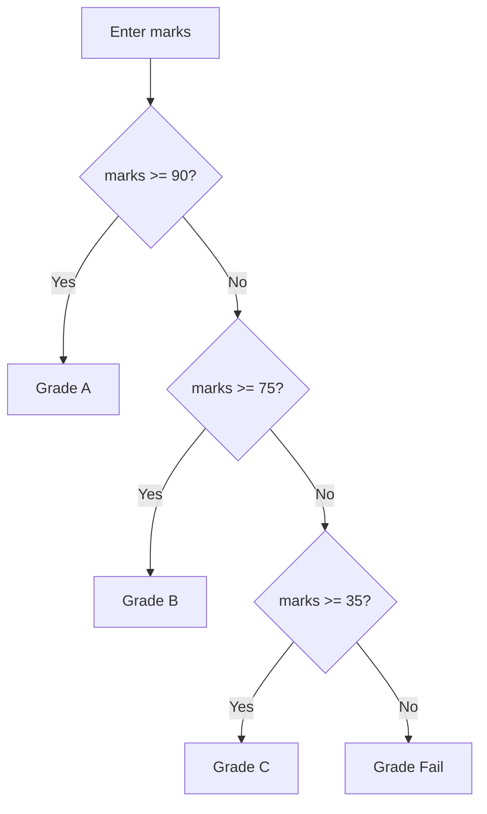

# Module 03 — Flow Control

**Phase:** Core Python

**Previous:** [Variables, Datatypes, Operators, and I/O](02_Variables_Datatypes_Operators_IO.md)  
**Next:** [Strings](04_Strings.md)

---

## Module Outcome

Decide with `if` / `elif` / `else`, repeat with `for` and `while`, skip or stop with `continue` / `break`, and drive a small console menu.

By the end of this module you will be able to:

- Branch with `if` / `elif` / `else` (first `True` wins; indent is syntax)
- Combine login-style checks with `and` / `or`
- Loop with `for` and `range()` (stop excluded)
- Repeat with `while` until success or attempts run out
- Use `break` vs `continue`
- Nest one decision inside another (withdraw: positive **and** within balance)
- Compare menu `choice` to `"1"`, not `1`

---

## 1. Why This Concept Matters

Until now every line ran in order. Real programs **choose** and **repeat**.

An ATM checks PIN and balance. A portal grades marks. A cart skips a bad amount and keeps going. Flow control is how Python does that: run a block only when a condition is true, loop until you are done, or jump early with `break` / `continue`.

You already have the expressions (`marks >= 35`, `and` / `or`). This module wraps them in decisions and loops.

---

## 2. `if` / `elif` / `else`

### Understand

Branching: run one block when a condition is true; otherwise try the next branch.

- Colon `:` after the condition
- Indent the block (4 spaces) — indentation **is** syntax
- Checks run **top → bottom**; the first `True` branch wins
- `else` is the safety net

Order matters: check `>= 90` before `>= 75`, or a 92 would be labelled B.



### How It Works

```python
marks = 82

if marks >= 90:
    grade = "A"
elif marks >= 75:
    grade = "B"
elif marks >= 35:
    grade = "C"
else:
    grade = "Fail"

print(f"Grade: {grade}")
```

**Expected Output:**

```
Grade: B
```

Range check before pass/fail:

```python
marks = 28.0

if marks < 0 or marks > 100:
    print("Invalid marks entered.")
elif marks >= 35:
    print(f"Pass — scored {marks}")
else:
    print(f"Fail — scored {marks}. Minimum is 35.")
```

**Expected Output:**

```
Fail — scored 28.0. Minimum is 35.
```

### ⚠️ WATCH OUT

```text
# Wrong
if marks = 35:          # assignment, not comparison
if marks >= 35          # missing colon
else:                   # else cannot come before elif

# Prefer
if marks >= 35:
    ...
elif marks >= 0:
    ...
else:
    ...
```

Wrong indent → `IndentationError` or the line silently belongs to the wrong block.

### Try It

Classify age `62` as Minor (`< 18`), Adult (`< 60`), or Senior.

---

## 3. Login check (`and` / `or`)

### Understand

Portals combine conditions: username **and** password must both match. Clearer failure messages use separate checks (`if` / `elif`) so the student sees *which* part failed.

### How It Works

```python
stored_user = "admin"
stored_pass = "secret123"
username = "admin"
password = "secret123"

if username == stored_user and password == stored_pass:
    print("Welcome to Employee Portal")
else:
    print("Invalid credentials. Contact HR.")
```

**Expected Output:**

```
Welcome to Employee Portal
```

Which field failed:

```python
username = "priya"
pin = "4321"
entered_user = "priya"
entered_pin = "0000"

if entered_user != username:
    print("Username failed")
elif entered_pin != pin:
    print("PIN failed")
else:
    print("Welcome")
```

**Expected Output:**

```
PIN failed
```

### ⚠️ WATCH OUT

```text
# Wrong
if user = "admin":

# Prefer
if user == "admin":
```

### Try It

Hard-code stored user `"priya"` and password `"ksr123"`, with matching entered values. Print `Welcome` or `Invalid` using `and`.

---

## 4. `for` and `range()`

### Understand

`for` repeats over a sequence. `range(start, stop)` gives numbers; **stop is excluded**.

Use `for` when you know how many times to repeat (table 1–10, even numbers, a short list of amounts).

```text
range(5)         →  0, 1, 2, 3, 4
range(1, 11)     →  1 … 10
range(0, 10, 2)  →  0, 2, 4, 6, 8
```

### How It Works

```python
n = 7
for i in range(1, 11):
    print(f"{n} x {i} = {n * i}")
```

**Expected Output:**

```
7 x 1 = 7
7 x 2 = 14
7 x 3 = 21
7 x 4 = 28
7 x 5 = 35
7 x 6 = 42
7 x 7 = 49
7 x 8 = 56
7 x 9 = 63
7 x 10 = 70
```

Even numbers with a step:

```python
for n in range(2, 21, 2):
    print(n)
```

**Expected Output:**

```
2
4
6
8
10
12
14
16
18
20
```

A short list of amounts (the list is only something to walk — list methods come later):

```python
for amount in [120, 85, 40]:
    print(f"Line: ₹{amount}")
```

**Expected Output:**

```
Line: ₹120
Line: ₹85
Line: ₹40
```

### ⚠️ WATCH OUT

```text
# Wrong expectation — range(1, 11) includes 11
# Prefer — stop is exclusive → 1 … 10
```

### Try It

Print the table of `9` for 1 through 5 (`9 x 1 = 9` …).

---

## 5. `while` loop — PIN retries

### Understand

`while` keeps going **while the condition is true**. Repeat until success or until attempts run out — ATM / login pattern.

Something inside must change (counter, input, or `break`) or you get an **infinite loop**.

`while` / `else`: the `else` runs if the loop ended **without** `break` (PIN never matched).

### How It Works

Countdown (the condition must move toward `False`):

```python
tries_left = 3
while tries_left > 0:
    print(f"Attempts left: {tries_left}")
    tries_left -= 1
print("Stopped.")
```

**Expected Output:**

```
Attempts left: 3
Attempts left: 2
Attempts left: 1
Stopped.
```

PIN retries — walk three tries, `break` on success. (`else` on the `for` / `while` is the “never matched” path.)

```python
correct_pin = "4321"

for pin in ["1111", "2222", "4321"]:
    print(f"Enter ATM PIN: {pin}")
    if pin == correct_pin:
        print("PIN accepted.")
        break
    print("Wrong PIN.")
else:
    print("Card blocked. Visit branch.")
```

**Expected Output:**

```
Enter ATM PIN: 1111
Wrong PIN.
Enter ATM PIN: 2222
Wrong PIN.
Enter ATM PIN: 4321
PIN accepted.
```

Live kit pattern (`input` + `while`). Type this in class; output depends on what you type:

```python
correct_pin = "4321"
attempts = 0
max_attempts = 3

while attempts < max_attempts:
    pin = input("Enter ATM PIN: ")
    if pin == correct_pin:
        print("PIN accepted.")
        break
    attempts += 1
    print(f"Wrong PIN. {max_attempts - attempts} attempt(s) left.")
else:
    print("Card blocked. Visit branch.")
```

**Sample Run** (wrong, wrong, correct):

```text
Enter ATM PIN: 1111
Wrong PIN. 2 attempt(s) left.
Enter ATM PIN: 2222
Wrong PIN. 1 attempt(s) left.
Enter ATM PIN: 4321
PIN accepted.
```

If all three fail, `else` prints `Card blocked. Visit branch.`

### ⚠️ WATCH OUT

```text
# Wrong — never ends
while True:
    print("hi")          # no break, no changing condition

# Prefer — update a counter, or break on success
```

In the kit you will use `while True:` **with** a `break` on Exit.

### Try It

Start `count = 1`. While `count <= 3`, print `Attempt {count}` with an f-string, then add 1. After the loop print `Ready.`

---

## 6. `break` and `continue`

### Understand

| Keyword | Effect |
|---------|--------|
| `continue` | Skip the rest of **this** iteration; loop continues |
| `break` | Exit the loop **completely** |

Skip bad data with `continue`. Stop when you are done with `break`.

### How It Works

```python
for n in range(1, 11):
    if n == 5:
        continue    # skip 5
    if n == 8:
        break       # stop before printing 8 and after
    print(n)
```

**Expected Output:**

```
1
2
3
4
6
7
```

Skip invalid (non-positive) amounts, add the rest:

```python
total = 0.0
for amount in [120, -5, 85.5, 0, 40]:
    if amount <= 0:
        continue
    total += amount
print(f"Sum of valid amounts: ₹{total}")
```

**Expected Output:**

```
Sum of valid amounts: ₹245.5
```

### ⚠️ WATCH OUT

```text
# Wrong — break when you only meant to skip one bad row
# Prefer — continue to skip; break for “done / found”
```

### Try It

Print numbers 1 through 15, skipping multiples of 3 (use `%`).

---

## 7. Nested `if` (withdraw check)

### Understand

An `if` inside another `if` — decisions stack. Amount must be positive **and** within balance. Check the easy rejection first.

### How It Works

```python
marks = 82
if marks >= 35:
    if marks >= 75:
        print("Distinction")
    else:
        print("Pass")
else:
    print("Fail")
```

**Expected Output:**

```
Distinction
```

```python
balance = 5000
amount = 1200
if amount > 0:
    if amount <= balance:
        print("Withdrawal allowed")
    else:
        print("Insufficient funds")
else:
    print("Invalid amount")
```

**Expected Output:**

```
Withdrawal allowed
```

### ⚠️ WATCH OUT

```text
# Wrong — a flat if that subtracts even when amount is negative
# Prefer — check amount > 0 first, then amount <= balance
```

### Try It

`balance = 5000`, `amount = 6000`. Print the correct withdraw message using nested `if`.

---

## Step-by-Step: Build It

One ATM session assembled with the same branches the kit needs (1 Balance · 2 Deposit · 3 Withdraw · 4 Quit). Here the choices are prepared so the output is fixed. Tonight you will replace the prepared list with `while True` and `input(...)`.

```python
balance = 5000.0

for choice in ["1", "2", "3", "4"]:
    print("===== ATM MENU =====")
    print("Choice:", choice)

    if choice == "1":
        print(f"Balance: ₹{balance:.2f}")

    elif choice == "2":
        amount = 1500.0
        if amount > 0:
            balance += amount
            print("Deposit successful.")

    elif choice == "3":
        amount = 2000.0
        if amount <= 0:
            print("Invalid amount.")
        elif amount > balance:
            print("Insufficient balance.")
        else:
            balance -= amount
            print(f"Withdrawn ₹{amount:.2f}. New balance: ₹{balance:.2f}")

    elif choice == "4":
        print("Thank you. Remove card.")
        break

    else:
        print("Invalid choice. Try again.")

print(f"Final balance: ₹{balance:.2f}")
```

**Expected Output:**

```
===== ATM MENU =====
Choice: 1
Balance: ₹5000.00
===== ATM MENU =====
Choice: 2
Deposit successful.
===== ATM MENU =====
Choice: 3
Withdrawn ₹2000.00. New balance: ₹4500.00
===== ATM MENU =====
Choice: 4
Thank you. Remove card.
Final balance: ₹4500.00
```

Menu skeleton for the kit (`input` returns a **string**):

```text
while True:
    show menu
    read choice
    if choice == "1":   action
    elif choice == "2": action
    elif choice == "4": break
    else: invalid
```

```text
# Wrong
if choice == 1:          # input() is str — this never matches

# Prefer
if choice == "1":
```

---

## Practice Exercises

Attempt each problem before reading the model answer.

1. UPI limit: amount `25000`. Print `Above UPI limit` if amount `> 20000`, else `OK`.

**Model answer:**

```python
amount = 25000
if amount > 20000:
    print("Above UPI limit")
else:
    print("OK")
```

**Expected Output:**

```
Above UPI limit
```

2. Print odd numbers from 1 to 9 using `range` with a step.

**Model answer:**

```python
for n in range(1, 10, 2):
    print(n)
```

**Expected Output:**

```
1
3
5
7
9
```

3. Scores `[0, 12, 88]`: skip values `<= 0` with `continue`, print the first score `>= 50`, then `break`.

**Hint:** Two `if`s inside the loop — skip, then accept-and-stop.

**Model answer:**

```python
for score in [0, 12, 88]:
    if score <= 0:
        continue
    if score >= 50:
        print(score)
        break
```

**Expected Output:**

```
88
```

4. Stored user `"hr.admin"`, password `"secret"`. Entered user `"hr.admin"` and pass `"x"`. Print which check failed using `if` / `elif` / `else`.

**Model answer:**

```python
user = "hr.admin"
password = "secret"
entered_user = "hr.admin"
entered_pass = "x"
if entered_user != user:
    print("Username failed")
elif entered_pass != password:
    print("Password failed")
else:
    print("Welcome")
```

**Expected Output:**

```
Password failed
```

5. Nested gate: `has_ticket = True`, `age = 15`. If no ticket, print `No ticket`. If ticket and age `>= 18`, print `Enter`. Otherwise print `Too young`.

**Model answer:**

```python
has_ticket = True
age = 15
if has_ticket:
    if age >= 18:
        print("Enter")
    else:
        print("Too young")
else:
    print("No ticket")
```

**Expected Output:**

```
Too young
```

6. `while`: start `n = 3`. While `n > 0`, print `n`, then `n -= 1`. After the loop print `Go`.

**Model answer:**

```python
n = 3
while n > 0:
    print(n)
    n -= 1
print("Go")
```

**Expected Output:**

```
3
2
1
Go
```

---

## Lab

Combine `if` / `elif` / `else`, a `for` over a short list, `continue`, nested `if`, and a total. Not the ATM menu kit.

### Problem

A trainer prints one student’s **result card** from a short list of subject marks. Invalid marks must not poison the average.

### What to Build

A script `result_card.py`.

### Requirements

- `marks` as a simple list, e.g. `[88, -1, 76, 105, 91]`
- `for` each mark:
  - `continue` if the mark is `< 0` or `> 100`
  - add valid marks into `total` and count them
- If no valid marks, print `No valid marks` (use the count)
- Else compute `average = total / count`
- Grade with `if` / `elif` / `else`: A `>= 90`, B `>= 75`, C `>= 35`, else Fail
- Nested: if the student passed (`average >= 35`), print `Distinction` when `average >= 75`, else `Pass`; if failed, print `Fail`

### Expected Behavior

`-1` and `105` are skipped. Average and grade use only `88`, `76`, `91`. No `KeyError` / traceback from missing keys — there are no dicts here.

### Sample Run

```text
Valid count: 3
Average: 85.00
Grade: B
Distinction
```

(Your list may differ; skipped invalid marks must not sit in the average.)

### Constraints

No `def`, no files, no dictionaries, no list methods (no `.append`). A list **literal** plus `for` is enough.

### Bonus

Also print each valid mark as you go. Use `break` only if you add a “stop at first fail below 35” stretch — keep it optional.

---

## Mini-Project (Assignment): Console ATM Menu

**Why this matters:** Almost every CLI lab is this skeleton: `while True`, read a choice, branch, `break` on quit. Withdraw must never go below zero.

**Lab kit:** [15_Lab_Assets/08_atm_menu/](../15_Lab_Assets/08_atm_menu/)

| File | What you do |
|------|-------------|
| `starter/atm.py` | Complete Check Balance · Deposit · Withdraw · Quit |
| `broken/atm.py` | Fix overdraft and the quit path that never `break`s |
| `solution/` | Do **not** copy this |

This is **not** the class assemble with a prepared list of choices. Same branches, full `input` + `while True` ticket.

### Objective

Drive an ATM from a repeating menu. Invalid menu choice must not exit. Withdraw must not exceed balance.

### Story / Scenario

Training ATM: staff pick 1–4, deposit and withdraw rupees, and quit cleanly.

### Requirements

| Piece | Detail |
|-------|--------|
| Starting balance | Kit uses `1000.0` (you may keep it) |
| Menu loop | `while True` until Quit |
| Options | **1** Balance · **2** Deposit · **3** Withdraw · **4** Quit (match the starter) |
| Deposit / withdraw | `float(amount)` then reject `amount <= 0`; block overdraft. Ignore the starter’s `.isdigit()` comment — that check is optional later (Strings) |
| Display | Clear ₹ messages with 2 decimals |
| Style | Top-level `while` / `if` only — no `def` |

### Expected Behavior

- Choice is compared as a **string** (`"1"`, not `1`)
- Withdraw larger than balance prints a message and leaves the balance unchanged
- Option 4 prints a goodbye line and **breaks**
- Wrong choice prints invalid and shows the menu again

### Sample Run

```text
1) Balance  2) Deposit  3) Withdraw  4) Quit
> 1
1000.0
> 2
Amount: 500
> 3
Amount: 2000
Insufficient
> 4
Bye
```

(Print exactly as you like as long as overdraft is blocked and quit stops the loop. Prefer ₹ and 2 decimals in your version.)

### Bonus Challenges

- Max 3 PIN attempts before the menu
- Daily withdraw limit (e.g. ₹20,000)
- Mini statement: last few actions as printed lines (still no files)

### Done when

- [ ] Menu repeats until Quit
- [ ] Non-positive amounts are rejected
- [ ] Withdraw never exceeds balance
- [ ] Quit `break`s (the broken kit prints Bye but kept looping)
- [ ] Amounts print clearly (₹ and 2 decimals recommended)

---

## Interview Q&A

**Q1. `for` vs `while`?**  
`for` when you know the sequence or count. `while` when you repeat until a condition changes (PIN, menu, retries).

**Q2. What does `range(1, 5)` produce?**  
`1, 2, 3, 4` — stop is exclusive.

**Q3. `break` vs `continue`?**  
`break` exits the loop. `continue` skips to the next iteration.

**Q4. Why is indentation required?**  
It defines blocks. Wrong indent → `IndentationError` or wrong logic.

**Q5. What is an infinite loop?**  
The condition never becomes false and you never `break` — e.g. `while True:` with no exit.

**Q6. What is `while` / `else` (or `for` / `else`)?**  
`else` runs when the loop finishes **without** `break` (useful for “PIN never matched”).

**Q7. Why compare menu `choice` to `"1"` not `1`?**  
`input()` returns a string. `choice == 1` is always false for normal menu typing.

**Q8. Why does `elif` order matter?**  
The first `True` branch wins. Check the tighter bound first (`>= 90` before `>= 75`).

---

## Cheat Sheet

```text
if / elif / else     → first True branch wins; else is the rest
: and indent         → colon then 4 spaces; indent is syntax
and  or  not         → combine conditions (login)
for x in range(a, b) → a … b-1  (stop excluded)
range(a, b, step)    → skip by step
for x in [1, 2, 3]   → walk a short list of values
while cond:          → repeat while True; change cond or break
while True:          → menu loop — must break
break                → leave the loop
continue             → skip this iteration
for/while else       → runs if there was no break
choice == "1"        → input() is str
```

Nested `if`: validate amount, then check balance.
