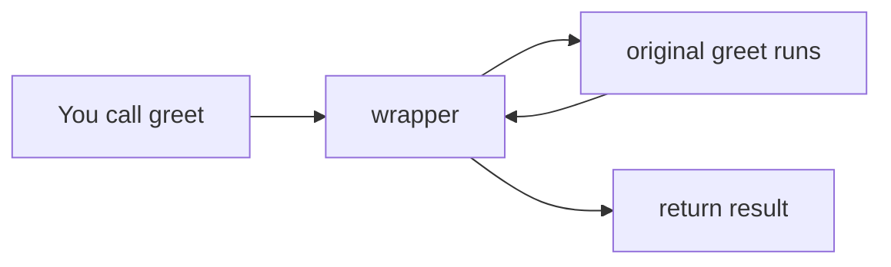

# Module 01 — Functions, Decorators, and Generators

**Phase:** Advanced Python

**Previous:** [Data Structures Overview](../02_Core_Python/08_Data_Structures_Overview.md)  
**Next:** [Modules and Packages](02_Modules_and_Packages.md)

---

## Module Outcome

Write a named function, pass arguments clearly, keep data local unless you mean otherwise, and reuse logic with `map` / `filter`, a decorator wrap, and a lazy generator.

By the end of this module you will be able to:

- Define a function with `def` and send a result back with `return`
- Call with positional, keyword, and default arguments, plus `*args` / `**kwargs`
- Read a global name, and prefer pass-in / return-out instead of `global`
- Use a `lambda` with `sorted`, `map`, and `filter` for short transforms
- Explain `@decorator` as wrapping (`f = dec(f)`)
- Write a `yield` generator and know that one full pass exhausts it

---

## 1. Why This Concept Matters

An ATM-style script repeats the same `amount <= 0` check in every action:

```python
balance = 1000.0

amount = 200.0
if amount <= 0:
    print("Invalid amount")
else:
    balance = balance + amount
    print("Deposited. Balance:", balance)

amount = 150.0
if amount <= 0:
    print("Invalid amount")
else:
    if amount > balance:
        print("Insufficient funds")
    else:
        balance = balance - amount
        print("Withdrawn. Balance:", balance)
```

Change the message to `"Amount must be positive"` and you must edit **every** copy. Miss one copy → that path keeps the old rule (a silent bug).

Write the check **once**, then call it:

```python
def is_positive(amount):
    if amount <= 0:
        print("Invalid amount")
        return False
    return True

balance = 1000.0
if is_positive(200.0):
    balance = balance + 200.0
print(balance)

if is_positive(-50.0):
    balance = balance + (-50.0)
print(balance)
```

**Expected Output:**

```
1200.0
Invalid amount
1200.0
```

That named unit is a **function**. Tonight’s lab kit ([Refactor ATM into functions](../15_Lab_Assets/13_function_refactor/)) is the same idea at ATM scale.

You already **call** built-ins (`print`, `len`, `sum`). This module teaches you to **create** your own, then wrap them (decorators) and stream values (generators).

---

## 2. `def` and `return`

### Understand

A function is a named block that runs when you **call** it.

- **Parameter** — placeholder in the definition: `def greet(name):`
- **Argument** — real value at the call: `greet("Priya")`

`def` starts the definition (required). `return` sends a value back to the caller (optional). If you skip `return`, the call evaluates to `None`.

### How It Works

```python
def greet(name):
    message = f"Hello, {name}!"
    return message

result = greet("Priya")
print(result)
```

**Expected Output:**

```
Hello, Priya!
```

No `return` → `None`. `return` also **exits** immediately — lines after it do not run.

```python
def add(a, b):
    return a + b
    print("never runs")

print(add(2, 3))

def silent():
    print("hi")

print(silent())
```

**Expected Output:**

```
5
hi
None
```

Python can return several values as a tuple: `return total, remaining` then `t, r = split_bill(500, 120)`.

### ⚠️ WATCH OUT

```text
# Wrong — you printed inside, then printed the call
print(silent())     # extra None

# Prefer — return the value; print at the call site
result = greet("Priya")
print(result)
```

### Try It

Write `celsius_to_fahrenheit(c)` that returns `c * 9 / 5 + 32`. Print the result for `0`, `37`, and `100`.

---

## 3. Arguments

### Understand

`def sub(a, b)` needs two values. How you **pass** them changes readability and flexibility.

| Style | Call | Use when |
|-------|------|----------|
| Positional | `sub(100, 200)` | Few args; order is obvious |
| Keyword | `sub(b=200, a=100)` | Order should not matter |
| Default | `def wish(name="Guest")` | Caller may skip a value |
| `*args` | extra positionals → **tuple** | Unknown count |
| `**kwargs` | extra names → **dict** | Unknown options |

### How It Works

Positional = by **order**. Swap the numbers, swap the result:

```python
def sub(a, b):
    return a - b

print(sub(100, 200))
print(sub(200, 100))
```

**Expected Output:**

```
-100
100
```

Keyword = by **name**. After a keyword, you cannot put a bare positional.

```python
def wish(name, msg):
    print(f"Hello {name}, {msg}")

wish(name="Ravi", msg="Good Morning")
wish(msg="Good Morning", name="Ravi")
```

**Expected Output:**

```
Hello Ravi, Good Morning
Hello Ravi, Good Morning
```

Defaults make a parameter optional. Non-default parameters must come **before** defaults.

```python
def greet(name, msg="Good Morning"):
    print(f"Hello {name}, {msg}")

greet("Priya")
greet(name="Ravi", msg="Good Evening")
```

**Expected Output:**

```
Hello Priya, Good Morning
Hello Ravi, Good Evening
```

`*args` / `**kwargs` catch extras. Definition order: required → `*args` → keyword-only / defaults → `**kwargs`.

```python
def sum_all(*numbers):
    total = 0
    for n in numbers:
        total += n
    return total

print(sum_all())
print(sum_all(10, 20, 30))

def build_profile(name, *skills, **meta):
    return {"name": name, "skills": list(skills), **meta}

print(build_profile("Arjun", "Python", "SQL", city="Hyderabad"))
```

**Expected Output:**

```
0
60
{'name': 'Arjun', 'skills': ['Python', 'SQL'], 'city': 'Hyderabad'}
```

### ⚠️ WATCH OUT

```text
# Wrong — default after a required parameter is fine;
# required after a default is a SyntaxError
def wish(name="Guest", msg):    # SyntaxError

# Wrong — positional after keyword
wish(name="Ravi", "Hi")         # SyntaxError

# Wrong — mutable default is shared across calls
def withdraw(balance, amount, history=[]):
```

Prefer `history=None` and create a new list inside if you need one. The ATM **broken** kit uses this trap.

### Try It

Write `total(*amounts, tax_rate=0.05)` that sums the amounts, adds tax, and rounds to 2 decimals. Print `total(100, 200, 50)`.

---

## 4. Scope — local vs global

### Understand

**Scope** is where a name is visible.

- **Global** — assigned at module (file) level; functions may **read** it.
- **Local** — assigned inside a function; invisible outside.

Python looks up names **LEGB**: Local → Enclosing (nested `def`) → Global → Built-in (`len`, `print`). Nested `def` / `nonlocal` is interview depth — not required for the lab.

Prefer **pass in, return out**. `global x` is only for **reassigning** a module-level name. It makes bugs hard to find.

### How It Works

```python
tax_rate = 0.18

def calculate_total(amount):
    tax = amount * tax_rate
    return amount + tax

print(calculate_total(100))
```

**Expected Output:**

```
118.0
```

Bump a counter by returning a new value — no `global`:

```python
count = 0

def bump(n):
    return n + 1

count = bump(count)
print(count)
```

**Expected Output:**

```
1
```

### ⚠️ WATCH OUT

Any assignment to `x` inside a function makes `x` **local for the whole function**. Reading it on the right-hand side then fails:

```python
x = 10

def bump():
    x = x + 1
    print(x)

# bump()  # UnboundLocalError
```

Fix: pass `x` in and return `x + 1`, or (rarely) declare `global x` before assigning.

### Try It

Start with `n = 5`. Write `double(value)` that returns `value * 2`. Assign `n = double(n)` and print `n`. Do not use `global`.

---

## 5. `lambda`, `map`, and `filter`

### Understand

A **lambda** is a one-line function with no `def` name: `lambda n: n * n`. It **returns** the expression automatically.

Use it as a throwaway, especially as `key=` for `sorted`, or with `map` / `filter`. Multi-step logic, a docstring, or anything you will test → use `def`.

| Tool | Job |
|------|-----|
| `map(fn, data)` | Transform each item |
| `filter(fn, data)` | Keep items where `fn` is true |

Both return **lazy iterators** in Python 3 — wrap with `list(...)` when you need a list. A list comprehension is often clearer; still learn `map` / `filter` for interviews and older code.

`reduce` (in `functools`) folds many values into one. For a total, use `sum(...)`. Skip `reduce` unless an interviewer asks.

### How It Works

```python
square = lambda n: n * n
print(square(5))

names = ["Meera", "Ravi", "An"]
print(sorted(names, key=lambda x: len(x)))
```

**Expected Output:**

```
25
['An', 'Ravi', 'Meera']
```

```python
prices = [100, 250, 80]
with_gst = list(map(lambda p: round(p * 1.05, 2), prices))
print(with_gst)

marks = [45, 78, 92, 61, 88]
passed = list(filter(lambda m: m >= 75, marks))
print(passed)
```

**Expected Output:**

```
[105.0, 262.5, 84.0]
[78, 92, 88]
```

Same jobs as `[round(p * 1.05, 2) for p in prices]` and `[m for m in marks if m >= 75]` — use the form that reads clearer.

### ⚠️ WATCH OUT

```text
# Wrong — printing the map object, not the values
print(map(lambda p: p * 1.05, prices))

# Prefer
print(list(map(lambda p: round(p * 1.05, 2), prices)))
```

### Try It

From `[40, 25, 60, 15, 120]`, `map` 5% GST (round to 2 decimals), then `filter` values `>= 50`. Print both lists.

---

## 6. Decorators

### Understand

A **decorator** is a function that takes another function and returns a **wrapped** version — extra behaviour before and/or after — without copy-pasting into every function.

`@timer` above `def greet` means: `greet = timer(greet)`.



Use wrapping for a login check, a timer, or a retry — one wrapper, many functions.

### How It Works

```python
def shout(func):
    def wrapper(*args, **kwargs):
        return func(*args, **kwargs).upper()
    return wrapper

@shout
def greet(name):
    return f"hello, {name}"

print(greet("Priya"))
```

**Expected Output:**

```
HELLO, PRIYA
```

A login gate uses the same wrap. The flag is a module-level name for this demo (no classes yet):

```python
current_user = None

def require_login(func):
    def wrapper(*args, **kwargs):
        if current_user is None:
            print("Access denied — please log in")
            return None
        return func(*args, **kwargs)
    return wrapper

@require_login
def view_dashboard():
    return f"Welcome, {current_user}"

print(view_dashboard())
current_user = "Ravi"
print(view_dashboard())
```

**Expected Output:**

```
Access denied — please log in
None
Welcome, Ravi
```

Stretch after this section: [14_decorator_login_gate](../15_Lab_Assets/14_decorator_login_gate/).

### ⚠️ WATCH OUT

The wrapper should take `*args, **kwargs` so the original function can still receive its arguments. Forgetting them breaks any decorated function that has parameters.

Decorator **factories** (`@retry(times=3)` — a decorator that takes options) are stretch on the toolkit kit, not core.

### Try It

Write `@twice` that calls the wrapped function two times and returns the **second** result. Decorate `def ping(): return "pong"` and print `ping()`.

---

## 7. Generators

### Understand

A **list** builds every value **now** (eager) and keeps them all in memory. A **generator** produces values **on demand** (lazy) with `yield`, and holds only the current value plus a little state.

Kitchen picture: a list is the whole buffet on the table; a generator is a waiter who brings **one dish at a time**.

| | List | Generator |
|---|------|-----------|
| When built | Immediately | On demand |
| Memory | All items | One item at a time |
| Syntax | `[x * x for x in range(n)]` | `yield` or `(x * x for x in range(n))` |
| Reusable | Walk many times | **Exhausted** after one full pass |
| Indexing | `data[0]` works | `gen[0]` fails — use `next` / `for` |

Calling a generator function does **not** run the body yet — it returns a generator object. Values appear when you iterate or call `next()`.

`return` **exits**. `yield` **pauses** and resumes with state remembered.

### How It Works

```python
squares_list = [x * x for x in range(5)]
print(squares_list)

squares_gen = (x * x for x in range(5))
print(list(squares_gen))
print(list(squares_gen))
```

**Expected Output:**

```
[0, 1, 4, 9, 16]
[0, 1, 4, 9, 16]
[]
```

The second `list(...)` is empty — that generator is exhausted. Call the producer again if you need another pass.

```python
def countdown(n):
    while n >= 1:
        yield n
        n -= 1

g = countdown(3)
print(next(g))
print(next(g))
print(next(g))

print(list(countdown(3)))
```

**Expected Output:**

```
3
2
1
[3, 2, 1]
```

A `for` loop is the everyday form — it handles `StopIteration` for you. Extra `next` after the last value raises `StopIteration`.

The same `yield` over a list of dict rows is the in-memory pattern for [15_generator_csv_stream](../15_Lab_Assets/15_generator_csv_stream/). Opening a real CSV waits for Files week.

### ⚠️ WATCH OUT

```text
# Wrong
gen[0]                 # TypeError — not a list
next(exhausted_gen)    # StopIteration

# Prefer
for value in countdown(3):
    print(value)
# Need another pass? Call countdown(3) again.
```

### Try It

Write `even_stream(limit)` that yields even numbers from `0` through `limit`. Print `list(even_stream(10))`.

---

## Step-by-Step: Build It

One assemble: the ATM check lives in `is_positive`; deposit and withdraw **return** the new balance (pass in, return out). Invalid amounts leave the balance unchanged.

```python
def is_positive(amount):
    if amount <= 0:
        print("Invalid amount")
        return False
    return True

def deposit(balance, amount):
    if not is_positive(amount):
        return balance
    return balance + amount

def withdraw(balance, amount):
    if not is_positive(amount):
        return balance
    if amount > balance:
        print("Insufficient funds")
        return balance
    return balance - amount

balance = 1000.0
balance = deposit(balance, 200.0)
print(balance)
balance = withdraw(balance, 150.0)
print(balance)
balance = deposit(balance, -50.0)
print(balance)
balance = withdraw(balance, 5000.0)
print(balance)
```

**Expected Output:**

```
1200.0
1050.0
Invalid amount
1050.0
Insufficient funds
1050.0
```

This is the type-along. Tonight’s lab kit adds a **menu loop** around the same helpers.

---

## Practice Exercises

Attempt each problem before reading the model answer.

1. Write `full_name(first, last, middle="")`. If `middle` is empty, return `"First Last"`. Otherwise return `"First Middle Last"`. Print both forms for `("Ravi", "Kumar")` and `("Ravi", "Kumar", "Dev")`.

**Hint:** A default empty string lets the caller skip `middle`.

**Model answer:**

```python
def full_name(first, last, middle=""):
    if middle:
        return f"{first} {middle} {last}"
    return f"{first} {last}"

print(full_name("Ravi", "Kumar"))
print(full_name("Ravi", "Kumar", "Dev"))
```

**Expected Output:**

```
Ravi Kumar
Ravi Dev Kumar
```

2. Write `max_of(*numbers)` that returns the largest of any count of numbers (you may use `max`). Print `max_of(3, 9, 4)` and `max_of(10)`.

**Model answer:**

```python
def max_of(*numbers):
    return max(numbers)

print(max_of(3, 9, 4))
print(max_of(10))
```

**Expected Output:**

```
9
10
```

3. Predict the output (or error) of each snippet. Use LEGB: Local → Enclosing → Global → Built-in.

```python
# A
x = 10
def show():
    print(x)
show()
```

```python
# B
x = 10
def bump():
    x = x + 1
    print(x)
bump()
```

```python
# C
x = 10
def bump():
    global x
    x = x + 1
    print(x)
bump()
print(x)
```

**Hint:** Assignment anywhere in the function makes the name local for the whole body.

**Model answer:**

A prints `10` (reads global). B raises `UnboundLocalError` (assignment makes `x` local, so the read on the right fails). C prints `11` then `11` (`global` reassigns the module name).

4. From marks `[55, 72, 91, 40, 88]`, use `map` to label each `"Pass"` if `>= 35` else `"Fail"`, and `filter` to keep scores `>= 90`. Print both lists.

**Hint:** Wrap `map` / `filter` with `list(...)`.

**Model answer:**

```python
marks = [55, 72, 91, 40, 88]
graded = list(map(lambda m: "Pass" if m >= 35 else "Fail", marks))
toppers = list(filter(lambda m: m >= 90, marks))
print(graded)
print(toppers)
```

**Expected Output:**

```
['Pass', 'Pass', 'Pass', 'Pass', 'Pass']
[91]
```

5. Write `@prefix` that returns `"LOG: " +` the wrapped function’s return value. Decorate `def status(): return "ok"` and print `status()`.

**Model answer:**

```python
def prefix(func):
    def wrapper(*args, **kwargs):
        return "LOG: " + func(*args, **kwargs)
    return wrapper

@prefix
def status():
    return "ok"

print(status())
```

**Expected Output:**

```
LOG: ok
```

6. Write generator `squares(n)` that yields `0*0, 1*1, …` up to `n-1`. Print `list(squares(5))`. Then print `list` of the **same** generator object a second time (it should be empty).

**Hint:** Save `g = squares(5)` so you can list it twice.

**Model answer:**

```python
def squares(n):
    for x in range(n):
        yield x * x

g = squares(5)
print(list(g))
print(list(g))
```

**Expected Output:**

```
[0, 1, 4, 9, 16]
[]
```

---

## Lab

Combine `def`, `return`, and arguments. No files, no CSV, no decorator required.

### Problem

The ATM script from the WHY still lives in one long `main`. Validation and balance updates must become reusable functions.

### What to Build

Fill the helpers in the lab kit so deposit / withdraw / menu are functions, not a giant script.

**Lab kit:** [15_Lab_Assets/13_function_refactor/](../15_Lab_Assets/13_function_refactor/)

| File | What you do |
|------|-------------|
| `starter/atm_functions.py` | Finish `deposit`, `withdraw`, and the menu loop in `main` |
| `broken/atm_functions.py` | Fix the scope / mutable-default bugs |
| `solution/` | Do **not** copy this |

### Requirements

- `deposit(balance, amount)` returns the new balance (or the old balance if the amount is invalid)
- `withdraw(balance, amount)` rejects `amount <= 0` and overdraft; otherwise returns `balance - amount`
- `show_menu` prints the choices
- `main` loops until Quit — **pass balance in and assign the returned value**
- Invalid amount or overdraft prints a message and leaves balance unchanged

### Expected Behavior

A bad deposit does not raise. Overdraft does not go negative. Quit exits the loop.

### Sample Run

```text
1) Balance  2) Deposit  3) Withdraw  4) Quit
Choice: 2
Amount: 200
Balance: 1200.0
Choice: 3
Amount: 5000
Insufficient funds
Choice: 4
```

(Menu wording may match the starter; the **shape** should match.)

### Constraints

Use `def` / `return` / arguments. No type hints. No files. No generators required.

### Bonus

Extract `is_positive(amount)` like the type-along and call it from both deposit and withdraw.

---

## Mini-Project (Assignment): Reusable Utility Library

**Why this matters:** Real projects do not keep validators, GST helpers, and login checks inside one script. A small package of functions is how teams reuse rules.

**Lab kit:** [15_Lab_Assets/30_ksr_utils_toolkit/](../15_Lab_Assets/30_ksr_utils_toolkit/)

| File | What you do |
|------|-------------|
| `starter/ksr_utils/validators.py` | `is_email`, `is_phone_in`, `is_positive` — return `True`/`False`, no `print` |
| `starter/ksr_utils/formatters.py` | `format_inr`, `format_date(day, month, year)` as zero-padded `DD-MM-YYYY` (no `datetime` yet) |
| `starter/ksr_utils/transforms.py` | `with_gst` via `map`, `keep_high` via `filter` (wrap with `list(...)`) |
| `starter/ksr_utils/decorators.py` | `@timing`, `@require_token` with `*args` / `**kwargs` |
| `starter/demo.py` | Run until the prints succeed |
| `solution/` | Do **not** copy this |

Core homework: functions + `lambda` / `map` / `filter` + decorators. **No** `yield` required.

This is **not** the ATM lab. Same tools, a shared toolkit ticket.

### Objective

Ship a tiny `ksr_utils` package a teammate can import.

### Story / Scenario

You keep rewriting amount checks, ₹ formatting, and GST maps in every practice script. Put them in one place.

### Requirements

| Piece | Detail |
|-------|--------|
| Validators | Pure functions — boolean results only |
| Formatters | ₹ string; date from three integers, not `datetime` |
| Transforms | `map` / `filter` as specified in the starter TODOs |
| Decorators | Timing print; token gate using `set_token` |
| Demo | `starter/demo.py` runs clean |

### Expected Behavior

- Invalid email / phone / amount return `False`
- `demo.py` shows GST list, high-price filter, one timed call, and denied-then-allowed token access
- Import works as `from ksr_utils import format_inr` (the starter `__init__.py` already re-exports)

### Sample Run

```text
email True
phone True
pos True False
inr ₹1,234.50
date 03-08-2026
...
ksr_utils demo OK
```

(Timer line format may vary; the other prints should match the starter’s intent.)

### Bonus Challenges

- `is_strong_password(s)` — length ≥ 8 and has a digit
- Stretch after decorators: [14_decorator_login_gate](../15_Lab_Assets/14_decorator_login_gate/)
- After generators: finish `generators.py` (`read_rows` must `yield`)
- **Files week:** [15_generator_csv_stream](../15_Lab_Assets/15_generator_csv_stream/) — `yield` from `csv.DictReader` on the seed CSV

### Done when

- [ ] `starter/demo.py` passes (**without** generators)
- [ ] `with_gst` / `keep_high` use `map` / `filter`
- [ ] `@timing` and `@require_token` wrap with `*args` / `**kwargs`
- [ ] You did not copy `solution/`

---

## Interview Q&A

**Q1. Parameter vs argument?**  
Parameter is the name in `def greet(name)`. Argument is the value you pass: `greet("Priya")`.

**Q2. What do `*args` and `**kwargs` collect?**  
`*args` → extra positional values as a **tuple**. `**kwargs` → extra named values as a **dict**.

**Q3. Why did `x = x + 1` inside a function raise `UnboundLocalError`?**  
The assignment makes `x` local for the whole function, so the read on the right happens before a local `x` exists. Pass the value in and return the new one, or use `global` only if you must reassign the module name.

**Q4. Lambda vs `def`?**  
Lambda is one expression, no name required. Use `def` for more than one step, a name you will reuse, or a docstring.

**Q5. `map` / `filter` vs a list comprehension?**  
Same jobs. Comprehensions often read clearer. `map` / `filter` are lazy in Python 3 — wrap with `list(...)` when you need a list. Prefer `sum` over `reduce` for a total.

**Q6. What does `@dec` mean?**  
`func = dec(func)`. A decorator takes a function and returns a wrapped function (timing, login, logging) without editing the original body.

**Q7. What happens when you call a generator function?**  
The body does not run yet — you get a generator object. Values appear on `next` / `for`. After one full pass the generator is **exhausted**; further `next` raises `StopIteration`. Call the function again for a fresh generator.

**Q8. Generator vs list comprehension?**  
A list builds everything now and is reusable / indexable. A generator is lazy and memory-light for a one-pass stream, but you cannot index it and you cannot walk it twice.

---

## Cheat Sheet

```text
def f(a, b=0):      → define; b is optional
return x            → send x to caller (else None)
f(1, b=2)           → positional + keyword
*args               → extra positionals → tuple
**kwargs            → extra keywords → dict
LEGB                → Local, Enclosing, Global, Built-in
lambda n: n * n     → one-expression function
map(fn, data)       → transform each (lazy — use list(...))
filter(fn, data)    → keep matches (lazy)
@dec                → f = dec(f)  (wrapper)
yield x             → pause; produce x lazily
next(g) / for       → pull values; one pass exhausts g
```

Prefer pass-in / return-out over `global`. Mutable defaults (`history=[]`) are shared across calls.

---

## Completion Checklist

```text
[ ] I can write def / return and capture the result
[ ] I can use positional, keyword, default, *args, and **kwargs
[ ] I can explain local vs global and UnboundLocalError
[ ] I can use lambda with sorted, map, and filter
[ ] I can explain @dec as wrapping
[ ] I can write a yield generator and show that it exhausts
[ ] I completed the ATM functions lab
[ ] I attempted the ksr_utils mini-project
[ ] I can answer the interview questions in my own words
```

---

## What's Next?

You can now name a piece of logic and reuse it. Next, [Modules and Packages](02_Modules_and_Packages.md) puts those functions into **files** you `import`, isolates libraries with a **venv**, and shows `if __name__ == "__main__"` so demos do not run on import.
