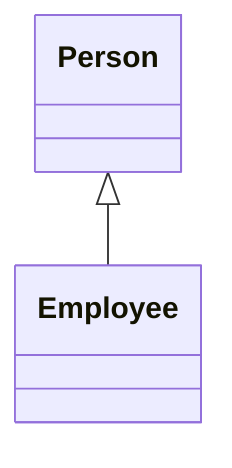
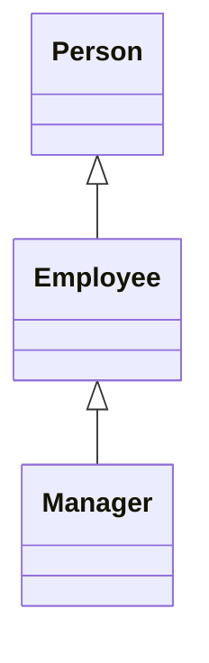
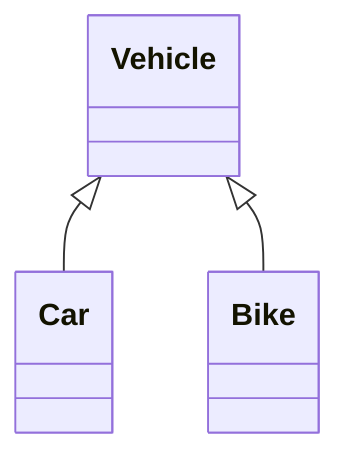
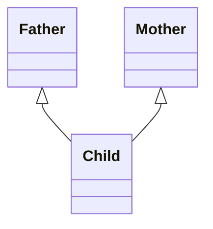

# Module 03b — OOP Part 2: Inheritance and Composition

**Phase:** Advanced Python

**Previous:** [OOP Part 1: Classes and Encapsulation](03_OOP_Part1_Classes_Encapsulation.md)  
**Next:** [OOP Part 3: Polymorphism and Project](03_OOP_Part3_Polymorphism_Project.md)

**Series:** [OOP overview](03_OOP.md) · [Part 1](03_OOP_Part1_Classes_Encapsulation.md) · Part 2 (this file) · [Part 3](03_OOP_Part3_Polymorphism_Project.md) · [Part 4](03_OOP_Part4_Abstract_Classes_Interfaces.md)

**Lab kit:** [15_Lab_Assets/17_bank_account_oop/](../15_Lab_Assets/17_bank_account_oop/) — this part adds `SavingsAccount`; full CLI is in [Part 3](03_OOP_Part3_Polymorphism_Project.md).

---

## Module Outcome

Reuse a parent class through IS-A inheritance, specialise with override and `super()`, and use HAS-A composition when the relationship is “owns / uses,” not “is a kind of.”

By the end of this module you will be able to:

- Write `class Child(Parent):` and initialise the parent with `super().__init__(...)`
- Name the four inheritance shapes (single, multilevel, hierarchical, multiple)
- Override a method and still call the parent with `super()`
- Compose objects (`self.laptop = Laptop(...)`) instead of inheriting unrelated types
- Use `isinstance` as a **guard**, not as a giant type-switch tree

Part 1 already taught class / `self` / `__init__` / encapsulation. This part **builds on** that — it does not reteach it.

---

## 1. Why This Concept Matters

Without inheritance, a specialised account becomes copy-paste:

```python
class BankAccount:
    def __init__(self, holder, balance=0):
        self.holder = holder
        self._balance = float(balance)

    def deposit(self, amount):
        if amount <= 0:
            print("Invalid amount")
            return
        self._balance += amount

    def get_balance(self):
        return self._balance

class SavingsAccountCopyPaste:
    def __init__(self, holder, balance=0, interest_rate=0.04):
        self.holder = holder
        self._balance = float(balance)
        self.interest_rate = interest_rate

    def deposit(self, amount):          # duplicated
        if amount <= 0:
            print("Invalid amount")
            return
        self._balance += amount

    def get_balance(self):              # duplicated
        return self._balance

    def apply_interest(self):
        self.deposit(self._balance * self.interest_rate)
```

Problems:

1. Deposit / balance rules are written **twice**.
2. Fix a bug in `BankAccount.deposit` → easy to forget the copy in Savings.
3. “Savings **is a** bank account” is a real relationship — the code should say so.

With inheritance, Savings **reuses** BankAccount and only adds what is new (*continuation of `BankAccount` above*):

```python
class SavingsAccount(BankAccount):
    def __init__(self, holder, balance=0, interest_rate=0.04):
        super().__init__(holder, balance)
        self.interest_rate = interest_rate

    def apply_interest(self):
        interest = self._balance * self.interest_rate
        self.deposit(interest)
        print(f"Interest ₹{interest:.2f} added")
```

`class SavingsAccount(BankAccount):` is the syntax taste. Shared rules stay on the parent.

---

## 2. Inheritance basics — IS-A, parent / child, `super()`

### Understand

**Inheritance** lets a **child class** reuse and extend a **parent class**. In plain English: the child **IS-A** specialised kind of the parent.

A smartphone **IS-A** phone. It still makes calls. It adds camera and apps. You do not rebuild dialling. `super()` is “first set up the parent part, then add the child part.”

| Word | Meaning |
|------|---------|
| **Parent** (base / super class) | The general class — `BankAccount`, `Person` |
| **Child** (derived / sub class) | The specialised class — `SavingsAccount`, `Employee` |
| **IS-A** | `SavingsAccount` **is a** `BankAccount` |
| `super()` | Call the parent’s method / `__init__` from the child |

Inheritance is for **specialisation**. If you only want to reuse one helper, a function or composition may be enough.

### How It Works

```python
class Person:
    def __init__(self, name):
        self.name = name

    def greet(self):
        return f"Hi, I am {self.name}"

class Employee(Person):                 # Employee IS-A Person
    def __init__(self, name, emp_id):
        super().__init__(name)          # init the parent part first
        self.emp_id = emp_id

    def card(self):
        return f"{self.greet()} ({self.emp_id})"

e = Employee("Priya", 501)
print(e.card())
print("name from parent:", e.name)
```

**Expected Output:**

```
Hi, I am Priya (501)
name from parent: Priya
```

Always initialise the parent **before** adding child-only fields.

### ⚠️ WATCH OUT

```text
# Wrong — skip super().__init__
class Employee(Person):
    def __init__(self, name, emp_id):
        self.emp_id = emp_id     # never set self.name

# Later: e.name  → AttributeError
```

Forgetting `self` in Part 1 caused `TypeError`. Forgetting `super().__init__` here causes missing parent attributes.

### Try It

Write `SavingsAccount(BankAccount)` that calls `super().__init__(holder, balance)`, stores `interest_rate`, and implements `apply_interest()` using parent `deposit`. Print balance before and after interest on ₹10000 at 5%.

---

## 3. Types of inheritance

### Understand

These are **family-tree shapes**, not extra magic. Interviews ask you to name them. Real apps mostly use **single** and **hierarchical**.

| Type | Idea | Syntax taste |
|------|------|----------------|
| **Single** | One parent → one child | `class B(A)` |
| **Multilevel** | Chain: grandparent → parent → child | `class C(B)` and `class B(A)` |
| **Hierarchical** | One parent → many children | `class Car(Vehicle)`, `class Bike(Vehicle)` |
| **Multiple** | Many parents → one child | `class C(A, B)` — supported; prefer composition when unsure |

### How It Works

**Single** — the everyday default. Section 2 is already this shape: `Employee(Person)`.



**Multilevel** — a chain. Keep it short (2–3 levels).



```python
class Person:
    def role(self):
        return "Person"

class Employee(Person):
    def role(self):
        return "Employee"

class Manager(Employee):
    def role(self):
        return "Manager"

m = Manager()
print(m.role())
print("Manager is Person?", isinstance(m, Person))
print("MRO:", [c.__name__ for c in Manager.mro()])
```

**Expected Output:**

```
Manager
Manager is Person? True
MRO: ['Manager', 'Employee', 'Person', 'object']
```

**MRO** (Method Resolution Order) is the order Python searches for methods. Inspect with `ClassName.mro()`. You do not need the C3 algorithm for this course; know that order matters.

**Hierarchical** — one parent, many children. Natural setup for Part 3 polymorphism.



```python
class Vehicle:
    def __init__(self, brand):
        self.brand = brand

    def start(self):
        return f"{self.brand} starting…"

class Car(Vehicle):
    def info(self):
        return f"Car: {self.brand}"

class Bike(Vehicle):
    def info(self):
        return f"Bike: {self.brand}"

for v in [Car("Hyundai"), Bike("Royal Enfield")]:
    print(v.info(), "|", v.start())
```

**Expected Output:**

```
Car: Hyundai | Hyundai starting…
Bike: Royal Enfield | Royal Enfield starting…
```

**Multiple** — one child, two or more parents. Python allows it; day-to-day apps often prefer composition instead.



```python
class Father:
    def skills(self):
        return ["driving"]

class Mother:
    def skills(self):
        return ["cooking"]

class Child(Father, Mother):
    def all_skills(self):
        return Father.skills(self) + Mother.skills(self)

c = Child()
print(c.all_skills())
print("MRO:", [x.__name__ for x in Child.mro()])
print("Which skills() wins alone?", c.skills())
```

**Expected Output:**

```
['driving', 'cooking']
MRO: ['Child', 'Father', 'Mother', 'object']
Which skills() wins alone? ['driving']
```

If both parents define the same method, MRO decides — roughly “child first, then left-to-right parents.” `class C(A, B)` is not the same as `class C(B, A)`.

### ⚠️ WATCH OUT

Do not use multiple inheritance just to “mix features” when `self.engine = Engine()` would be clearer. Deep trees get brittle — keep chains short.

### Try It

Sketch (paper or Mermaid) hierarchical inheritance for `BankAccount` → `SavingsAccount` / `CurrentAccount`. Then implement `kind()` on each child and loop a mixed list printing holder, kind, and balance.

---

## 4. Method overriding

### Understand

The child defines a method with the **same name** as the parent, with a new body. Same question (`info()`, `net()`, `withdraw()`), different answer.

Use `super().method()` when you still want parent behaviour **plus** extras.

### How It Works

```python
class Employee:
    def __init__(self, name, basic):
        self.name = name
        self.basic = basic

    def net(self):
        return self.basic * 0.9

    def payslip(self):
        return f"{self.name} net ₹{self.net():.0f}"

class Manager(Employee):
    def __init__(self, name, basic, bonus):
        super().__init__(name, basic)
        self.bonus = bonus

    def net(self):
        return super().net() + self.bonus

    def payslip(self):
        return f"{self.name} (Mgr) net ₹{self.net():.0f}"

print(Employee("Ravi", 30000).payslip())
print(Manager("Meera", 30000, 8000).payslip())
```

**Expected Output:**

```
Ravi net ₹27000
Meera (Mgr) net ₹35000
```

A second common case: override `withdraw` so a current account allows a small overdraft while savings still uses the parent rule. Hierarchical + override is the setup Part 3 will loop over.

### ⚠️ WATCH OUT

Overriding `__init__` or `info` and forgetting `super()` when the parent still owns required setup → missing attributes or a thinner string than you meant.

### Try It

Override `CurrentAccount.withdraw` to allow overdraft up to ₹1000. Start both a `BankAccount` and a `CurrentAccount` at ₹500. Attempt 800 from each. Print both balances.

---

## 5. HAS-A (composition)

### Understand

A car **HAS** an engine; a car is **not** an engine. A student **HAS** an ID card; a student is not an ID card. Do not inherit `Engine` or `IdCard`.

| Need | Choose |
|------|--------|
| Child **is a** specialised parent | **IS-A** inheritance |
| Object only **uses** / owns another object | **HAS-A** composition |

**Composition** = class A *stores and uses* an instance of B (`self.laptop = Laptop(...)`).

Prefer composition when unsure, when mixing unrelated features, or when you want a swappable part (`SmsNotifier` vs `EmailNotifier`). Richer patterns live in optional [Professional Python Deep Dive](08_Professional_Python_Deep_Dive.md).

### How It Works

```python
class Laptop:
    def __init__(self, model):
        self.model = model

    def spec(self):
        return f"Laptop: {self.model}"

class Person:
    def __init__(self, name):
        self.name = name

    def greet(self):
        return f"Hi, I am {self.name}"

class Employee(Person):                    # IS-A Person
    def __init__(self, name, emp_id, laptop):
        super().__init__(name)
        self.emp_id = emp_id
        self.laptop = laptop               # HAS-A Laptop

    def info(self):
        return f"{self.greet()} ({self.emp_id}) — {self.laptop.spec()}"

e = Employee("Priya", 501, Laptop("Dell Latitude"))
print(e.info())
print("isinstance Employee→Person?", isinstance(e, Person))
print("isinstance Employee→Laptop?", isinstance(e, Laptop))
```

**Expected Output:**

```
Hi, I am Priya (501) — Laptop: Dell Latitude
isinstance Employee→Person? True
isinstance Employee→Laptop? False
```

The laptop is **owned**, not inherited.

### ⚠️ WATCH OUT

```text
# Wrong — Employee IS-A Laptop
class Employee(Laptop):
    ...

# Prefer
self.laptop = Laptop("Dell Latitude")
```

`isinstance(employee, Laptop)` should be `False`.

### Try It

Write `OrderService` that HAS-A notifier with a `send` method. Place `"ORD-101"` with an SMS notifier and `"ORD-102"` with an email notifier. Do not inherit `OrderService` from the notifier.

---

## 6. `isinstance` — guards, not type switches

### Understand

`isinstance(obj, Class)` asks “is this object this type **or a subclass**?”

Use it as a **gate** (don’t print a balance on a dict). Do **not** build `if savings elif current elif wallet` for business behaviour — that is Part 3 polymorphism’s job.

`type(obj) is Patient` rejects subclasses. `isinstance(obj, Patient)` accepts them — usually what you want for IS-A.

### How It Works

```python
class Patient:
    pass

class Inpatient(Patient):
    pass

p = Inpatient()
print("type is Patient?", type(p) is Patient)
print("isinstance Patient?", isinstance(p, Patient))

class BankAccount:
    def __init__(self, balance):
        self._balance = balance

    def get_balance(self):
        return self._balance

def print_balance(account):
    if not isinstance(account, BankAccount):
        print("Need a BankAccount")
        return
    print("Balance:", account.get_balance())

print_balance(BankAccount(500))
print_balance({"balance": 500})
```

**Expected Output:**

```
type is Patient? False
isinstance Patient? True
Balance: 500
Need a BankAccount
```

Once you know it is an `Order`, call `order.ship()` — let override pick the message. Do not write `if isinstance(..., ExpressOrder)`.

### ⚠️ WATCH OUT

A tree of `if isinstance(x, A): ... elif isinstance(x, B):` for behaviour is a smell. One method name on each class is the Part 3 fix.

### Try It

Write `dispatch(order)` that rejects anything that is not an `Order`, then calls `order.ship()`. Dispatch a standard order, an express subclass, and a string.

---

## Step-by-Step: Build It

One assemble: IS-A + override + HAS-A. Manager **is an** Employee; Employee **has a** laptop.

```python
class Laptop:
    def __init__(self, model):
        self.model = model

    def spec(self):
        return self.model

class Employee:
    tax_rate = 0.10

    def __init__(self, name, basic, laptop):
        self.name = name
        self.basic = basic
        self.laptop = laptop

    def net_salary(self):
        return self.basic * (1 - Employee.tax_rate)

    def payslip(self):
        return f"{self.name} (Emp) net ₹{self.net_salary():.0f} | {self.laptop.spec()}"

class Manager(Employee):
    def __init__(self, name, basic, laptop, bonus=5000):
        super().__init__(name, basic, laptop)
        self.bonus = bonus

    def net_salary(self):
        return super().net_salary() + self.bonus

    def payslip(self):
        return f"{self.name} (Mgr) net ₹{self.net_salary():.0f} | {self.laptop.spec()}"

staff = [
    Employee("Ravi", 30000, Laptop("Lenovo")),
    Manager("Meera", 30000, Laptop("Dell"), bonus=8000),
]
for person in staff:
    print(person.payslip())
print("Meera IS-A Employee?", isinstance(staff[1], Employee))
print("Meera IS-A Laptop?", isinstance(staff[1], Laptop))
```

**Expected Output:**

```
Ravi (Emp) net ₹27000 | Lenovo
Meera (Mgr) net ₹35000 | Dell
Meera IS-A Employee? True
Meera IS-A Laptop? False
```

Shared tax stays on the parent. Bonus is the specialisation. Laptop is owned.

---

## Practice Exercises

Attempt each problem before reading the model answer.

1. `Rectangle` with `area()` / `perimeter()`; `Square` inherits and only needs `side` (**single**). Print area and perimeter of `Square(4)`.

**Hint:** `super().__init__(side, side)`.

**Model answer:**

```python
class Rectangle:
    def __init__(self, w, h):
        self.w, self.h = w, h

    def area(self):
        return self.w * self.h

    def perimeter(self):
        return 2 * (self.w + self.h)

class Square(Rectangle):
    def __init__(self, side):
        super().__init__(side, side)

sq = Square(4)
print(sq.area(), sq.perimeter())
```

**Expected Output:**

```
16 16
```

2. **Multilevel:** `Person` → `Employee` → `Developer` with `language` and a `label()` override that uses `super()`.

**Model answer:**

```python
class Person:
    def __init__(self, name):
        self.name = name

    def label(self):
        return self.name

class Employee(Person):
    def __init__(self, name, emp_id):
        super().__init__(name)
        self.emp_id = emp_id

    def label(self):
        return f"{super().label()} ({self.emp_id})"

class Developer(Employee):
    def __init__(self, name, emp_id, language):
        super().__init__(name, emp_id)
        self.language = language

    def label(self):
        return f"{super().label()} — {self.language}"

print(Developer("Anita", 11, "Python").label())
```

**Expected Output:**

```
Anita (11) — Python
```

3. **Hierarchical:** `Shape` → `Circle` / `Rectangle` with `area()`. Use `3.14 * r * r` for the circle. Print both areas as integers.

**Model answer:**

```python
class Shape:
    def area(self):
        return 0.0

class Circle(Shape):
    def __init__(self, r):
        self.r = r

    def area(self):
        return 3.14 * self.r * self.r

class Rectangle(Shape):
    def __init__(self, w, h):
        self.w, self.h = w, h

    def area(self):
        return self.w * self.h

for s in [Circle(2), Rectangle(3, 4)]:
    print(int(s.area()))
```

**Expected Output:**

```
12
12
```

4. **Composition:** `Library` HAS-A list of `Book` objects; implement `add(book)` and `count()`.

**Hint:** `self.books = []` in `__init__` — the mutable-class trap from Part 1.

**Model answer:**

```python
class Book:
    def __init__(self, title):
        self.title = title

class Library:
    def __init__(self, name):
        self.name = name
        self.books = []

    def add(self, book):
        self.books.append(book)

    def count(self):
        return len(self.books)

lib = Library("KSR Central")
lib.add(Book("Clean Code"))
lib.add(Book("Fluent Python"))
print(lib.name, lib.count())
```

**Expected Output:**

```
KSR Central 2
```

5. In 3–4 lines (no code): when would you **not** make `Car` inherit from `Engine`?

**Model answer:**  
A car **has an** engine; it is not a kind of engine. Inheritance would expose engine internals as if they were car behaviour and break IS-A thinking. Use composition: `self.engine = Engine(...)`.

6. Print `type(p) is Patient` vs `isinstance(p, Patient)` for an `Inpatient` subclass. Then explain which check you want for an IS-A gate.

**Model answer:**

```python
class Patient:
    pass

class Inpatient(Patient):
    pass

p = Inpatient()
print(type(p) is Patient)
print(isinstance(p, Patient))
```

**Expected Output:**

```
False
True
```

`isinstance` accepts subclasses — the usual IS-A gate. `type(...) is` is too strict.

---

## Lab

Combine single / hierarchical inheritance, override, and one HAS-A. Not the BankAccount kit.

### Problem

A campus fleet tracks cars and bikes. Each vehicle **has an** engine. Cars and bikes share start behaviour but report different labels.

### What to Build

A short script: `Engine`, `Vehicle`, `Car`, `Bike`, and a demo loop.

### Requirements

- `Engine(fuel)` with `spec()` returning the fuel string
- `Vehicle(brand, engine)` stores `self.engine` (HAS-A — do **not** inherit Engine)
- `start()` on `Vehicle` returns `"{brand} starting…"`
- `Car` and `Bike` inherit `Vehicle` and override `label()` (or `info()`)
- Loop `[Car(...), Bike(...)]` and print `label()` plus `start()` plus engine spec
- Print `isinstance(car, Vehicle)` and `isinstance(car, Engine)`

### Expected Behavior

Both vehicles start through the parent. Labels differ. `isinstance(..., Engine)` is `False`.

### Sample Run

```text
Car: Hyundai | Hyundai starting… | petrol
Bike: Royal Enfield | Royal Enfield starting… | petrol
IS-A Vehicle? True
IS-A Engine? False
```

### Constraints

No `raise` / `try` / `except`. No files. No `__str__` required (Part 3).

### Bonus

Override `Car.start()` to add `" — doors locked"` using `super().start()`.

---

## Mini-Project (Assignment): HDFC Bank SavingsAccount Add-On

**Why this matters:** Savings **is a** bank account. Interest is the only extra. Copy-paste deposit is how bugs duplicate.

**Lab kit:** [15_Lab_Assets/17_bank_account_oop/](../15_Lab_Assets/17_bank_account_oop/) — extend your Part 1 class in `starter/`. Do **not** copy `solution/`.

This is **not** the fleet lab. Same kit, inheritance ticket. Full menu CLI stays in [Part 3](03_OOP_Part3_Polymorphism_Project.md).

### Objective

Add `SavingsAccount(BankAccount)` with `add_interest()` that reuses parent `deposit`.

### Story / Scenario

After the Part 1 warm-up, the campus desk wants a savings account that can add interest — still no menu.

### Requirements

| Piece | Detail |
|-------|--------|
| Keep | Working `BankAccount` with deposit / withdraw / get_balance |
| `SavingsAccount(BankAccount)` | `__init__` calls `super().__init__(...)`; optional `interest_rate` (default `0.04`) |
| `add_interest()` | Deposit `get_balance() * interest_rate` (reuse parent `deposit`) |
| Demo | Create a savings account, deposit once, call `add_interest()`, print balance |

Validate with print + return. Kit style `__balance` + getter is fine; `_balance` + `@property` is also fine.

### Expected Behavior

Interest is applied through `deposit`, not by poking the field. Holder and balance still come from the parent.

### Sample Run

```text
SavingsAccount("Anita", 1000)
deposit 500 → balance 1500.0
add_interest(0.04) → balance 1560.0
```

### Bonus Challenges

- Override `status()` / `label()` that prints `"savings — Anita"` using `super()` where useful
- Composition variant: `Customer` HAS-A `BankAccount` (do not inherit Customer from BankAccount)

### Done when

- [ ] `SavingsAccount` inherits from `BankAccount` and uses `super()`
- [ ] `add_interest` changes balance via parent deposit logic
- [ ] No full CLI menu yet — that is [Part 3](03_OOP_Part3_Polymorphism_Project.md)
- [ ] Kit inheritance stretch for this session is done

---

## Interview Q&A

**Q1. Name the four inheritance types and one shape each.**  
Single (`A←B`), multilevel (`A←B←C`), hierarchical (`A←B` and `A←C`), multiple (`A→C←B`). Real apps use single / hierarchical most often.

**Q2. Inheritance vs composition?**  
Inheritance when the child **is a** specialised parent. Composition when an object **has a** collaborator it uses. Prefer composition when unsure.

**Q3. Why call `super().__init__`?**  
So the parent can set up the attributes it owns before the child adds its own. Skipping it often causes missing-attribute bugs.

**Q4. What is method overriding?**  
The child defines a method with the same name as the parent, so the child’s version runs for child objects. Use `super()` when you still want the parent behaviour plus extras.

**Q5. What is MRO in one sentence?**  
The order Python searches for attributes/methods in an inheritance graph (`ClassName.mro()`). Left parent wins on a name clash: `class C(A, B)` vs `class C(B, A)`.

**Q6. When is `isinstance` useful — and when is it a smell?**  
Useful as a guard (`if isinstance(x, BankAccount):`). A smell when every branch is `if type == …` instead of one method name on each class (Part 3).

---

## Cheat Sheet

```text
class Child(Parent):     → IS-A inheritance
super().__init__(...)    → initialise parent fields first
super().method()         → parent behaviour + extras
override                 → same method name, new body
single                   → one parent, one child
multilevel               → A → B → C
hierarchical             → one parent, many children
multiple                 → class C(A, B) — MRO left-to-right
Class.mro()              → lookup order
self.other = Other(...)  → HAS-A composition
isinstance(obj, Cls)     → True for subclasses too
type(obj) is Cls         → too strict for IS-A gates
```
