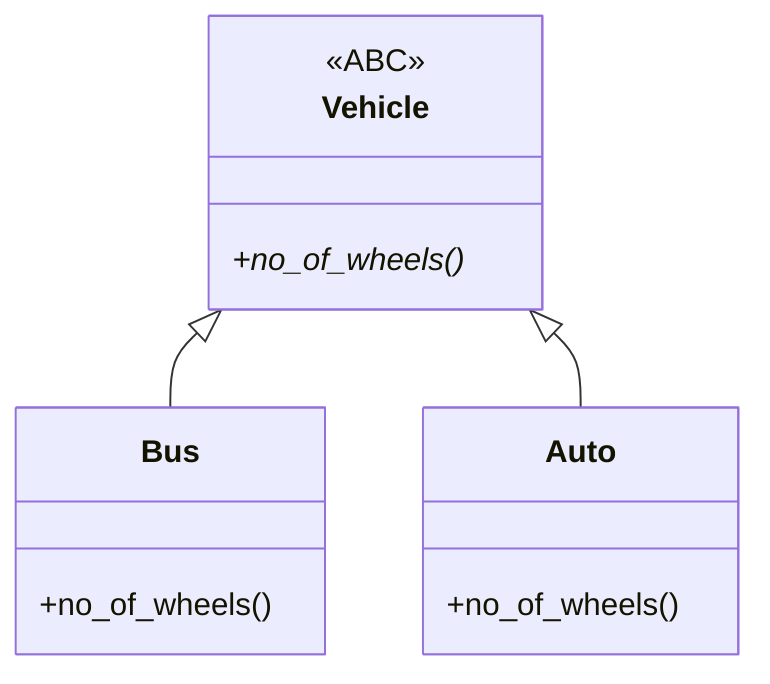

# Module 03d — OOP Part 4: Abstract Classes, Abstract Methods & Interfaces

**Phase:** Advanced Python

**Previous module:** [OOP Part 3 — Polymorphism & Project](03_OOP_Part3_Polymorphism_Project.md)  
**Next module:** [Exception Handling](04_Exception_Handling.md)

**Series:** [OOP overview](03_OOP.md) · [Part 1](03_OOP_Part1_Classes_Encapsulation.md) · [Part 2](03_OOP_Part2_Inheritance.md) · [Part 3](03_OOP_Part3_Polymorphism_Project.md) · Part 4 (this file)

**Lab kit:** [15_Lab_Assets/32_campus_wallet_abc/](../15_Lab_Assets/32_campus_wallet_abc/)

---

**Module Outcome:**

- Abstract method
- Abstract class (`ABC`, when we can / cannot construct)
- Interface in Python (ABC with only abstract methods)
- Concrete class vs abstract class vs interface
- SecureBank campus wallet (lab)


## 1. Abstract method

**Real-world analogy:** A **job posting** says “must treat patients.” It does not write the treatment. Each doctor fills that in. An **abstract method** is the must-have skill with **no recipe yet**. **SecureBank** declares `kind()` before savings or wallet exists. **AcmeHR** declares `net()` before intern vs faculty. **TechMart** declares `pay()` before UPI vs card.

**Icons:** Bank · Employee · Order

**Where used?** **SecureBank** `kind()`, **AcmeHR** `net()`, **TechMart** `pay()` — the parent names the method; the child writes the body.

**Definition:** Sometimes we don't know the implementation yet, but we still want to declare the method. Such a method is an **abstract method**. It has only a **declaration**, not the real code.

**Purpose:** The parent says “every child must have this method.” The child writes the actual body.

```python
from abc import ABC, abstractmethod


@abstractmethod
def m1(self):
    pass
```

`pass` means “no algorithm yet.” `@abstractmethod` lives in the `abc` module. Forget the import → `NameError`.

**Case — forgot the import:**

```python
class Test:
    @abstractmethod
    def m1(self):
        pass
```

**Expected Output:**

```
NameError: name 'abstractmethod' is not defined
```

Child classes are responsible for providing the implementation.

**Remember:** Abstract method = “I know the name. I do not know the body yet.”

**Try these (2 programs):**

**Program 1 — AcmeHR declares net_pay(), intern writes it**

```python
from abc import ABC, abstractmethod


class JobRole(ABC):
    @abstractmethod
    def net_pay(self):
        pass


class Intern(JobRole):
    def net_pay(self):
        return 15000


print(Intern().net_pay())
```

**Expected Output:**

```
15000
```

**Program 2 — SecureBank children fill kind()**

```python
from abc import ABC, abstractmethod


class Account(ABC):
    def __init__(self, holder):
        self.holder = holder

    @abstractmethod
    def kind(self):
        pass


class SavingsAccount(Account):
    def kind(self):
        return "savings"


class WalletAccount(Account):
    def kind(self):
        return "wallet"


print(SavingsAccount("Priya").kind())
print(WalletAccount("Ravi").kind())
```

**Expected Output:**

```
savings
wallet
```

---


## 2. Abstract class

**Real-world analogy:** An **incomplete house plan**. Rooms are named; the kitchen is not drawn. You cannot live in the plan — only in a finished house. Shared plumbing stays on the plan (`deposit`, holder). Children finish the missing room (`kind()`, `title()`).

**Icons:** Bank · Employee · Laptop

**Where used?** **SecureBank** `Account` (savings vs wallet), **MedCare** `Report` (lab vs invoice).

**Definition:** Sometimes the implementation of a class is **not complete**. Such a partially implemented class is an **abstract class**.

**Purpose:** Share the parts we already know and force children to finish the missing part.

Every abstract class in Python should extend `ABC`. Instantiation depends on **two** things together: did we extend `ABC`, and is there at least one `@abstractmethod`?

### Case-1 — Normal class, no abstract method

```python
from abc import ABC, abstractmethod


class Test:
    pass


t = Test()
print("object created")
```

**Expected Output:**

```
object created
```

Concrete class — we can create an object.

### Case-2 — Extends `ABC`, but no abstract method

```python
from abc import ABC, abstractmethod


class Test(ABC):
    pass


t = Test()
print("object created")
```

**Expected Output:**

```
object created
```

`ABC` alone is not enough. No abstract method → Python treats it as complete.

### Case-3 — Extends `ABC` **and** has an abstract method

```python
from abc import ABC, abstractmethod


class Test(ABC):
    @abstractmethod
    def m1(self):
        pass


t = Test()
```

**Expected Output:**

```
TypeError: Can't instantiate abstract class Test ... m1
```

(The exact wording changes slightly by Python version.)

### Case-4 — Abstract method, but does **not** extend `ABC`

```python
from abc import ABC, abstractmethod


class Test:
    @abstractmethod
    def m1(self):
        pass


t = Test()
print("object created")
```

**Expected Output:**

```
object created
```

Without `ABC`, the decorator is only documentation. It does not block `Test()`.

### Case-5 — Abstract method with a real body, still not extending `ABC`

```python
from abc import ABC, abstractmethod


class Test:
    @abstractmethod
    def m1(self):
        print("Hello")


t = Test()
t.m1()
```

**Expected Output:**

```
Hello
```

Without `ABC`, the method runs like a normal method.

**Conclusion:** At least one abstract method **and** `ABC` → instantiation is not possible.

**Remember:** abstract class + abstract method → no object.

A child that skips the abstract method is **also abstract**. The `class` line is legal. `Child()` is not.

```python
from abc import ABC, abstractmethod


class Vehicle(ABC):
    @abstractmethod
    def no_of_wheels(self):
        pass


class Bus(Vehicle):
    pass


print("Bus class exists. No object yet — no error.")
# b = Bus()  # TypeError — Bus did not override no_of_wheels
```

**Expected Output:**

```
Bus class exists. No object yet — no error.
```

When children **do** implement the method:

```python
from abc import ABC, abstractmethod


class Vehicle(ABC):
    @abstractmethod
    def no_of_wheels(self):
        pass


class Bus(Vehicle):
    def no_of_wheels(self):
        return 6


class Auto(Vehicle):
    def no_of_wheels(self):
        return 3


print(Bus().no_of_wheels())
print(Auto().no_of_wheels())
```

**Expected Output:**

```
6
3
```

An abstract class can contain **both** abstract and normal methods. Normal methods are the shared implementation. Abstract methods are the holes.




**Key takeaways:**

- `ABC` alone does not block objects
- `@abstractmethod` alone does not block objects
- **Both together** block objects
- A child that skips the abstract method is still abstract

**Interview:** Can an abstract class have a constructor? **Yes.** `__init__` runs when we construct the **child**, via `super()`. We never construct the abstract parent.

**Common Error:** `class Account(ABC):` with no `@abstractmethod`. Then `Account("Campus")` still works — Case-2.

**Try these (2 programs):**

**Program 1 — Shared deposit, abstract kind() (SecureBank)**

```python
from abc import ABC, abstractmethod


class Account(ABC):
    def __init__(self, holder, balance=0):
        self.holder = holder
        self._balance = float(balance)

    def deposit(self, amount):
        if amount <= 0:
            print("Invalid amount")
            return
        self._balance += amount

    def get_balance(self):
        return self._balance

    @abstractmethod
    def kind(self):
        pass


class SavingsAccount(Account):
    def kind(self):
        return "savings"


acct = SavingsAccount("Priya", 1000)
acct.deposit(200)
print(acct.kind(), acct.holder, int(acct.get_balance()))
# Account("Campus", 0)  # TypeError — Case-3
```

**Expected Output:**

```
savings Priya 1200
```

**Program 2 — MedCare abstract report + shared header**

```python
from abc import ABC, abstractmethod


class Report(ABC):
    def __init__(self, patient):
        self.patient = patient

    def header(self):
        return "MedCare | " + self.patient

    @abstractmethod
    def title(self):
        pass


class LabReport(Report):
    def title(self):
        return "Blood test"


class InvoiceReport(Report):
    def title(self):
        return "Pharmacy bill"


lab = LabReport("Anita")
inv = InvoiceReport("Ravi")
print(lab.header(), "-", lab.title())
print(inv.header(), "-", inv.title())
```

**Expected Output:**

```
MedCare | Anita - Blood test
MedCare | Ravi - Pharmacy bill
```

---


## 3. Interface in Python

**Real-world analogy:** A **wall socket**. Any appliance with the same pins works. The socket does not know *how* the appliance uses power. An **interface** is that socket: only method names (`connect`, `pay`, `send`), no business body. Python has no `interface` keyword — we simulate it with `ABC` + only abstract methods.

**Icons:** Bank · UPI · Order

**Where used?** Database drivers (**MySQL** vs **Postgres**), **TechMart** pay methods, **MedCare** SMS vs email.

**Definition:** If an abstract class contains **only abstract methods**, we consider it an **interface**.

**Purpose:** Write business code against the contract. Swap the real class later without rewriting the caller.

```python
from abc import ABC, abstractmethod


class DBInterface(ABC):
    @abstractmethod
    def connect(self):
        pass

    @abstractmethod
    def disconnect(self):
        pass


class MySQL(DBInterface):
    def connect(self):
        print("Connecting to MySQL...")

    def disconnect(self):
        print("Disconnecting MySQL...")


class Postgres(DBInterface):
    def connect(self):
        print("Connecting to Postgres...")

    def disconnect(self):
        print("Disconnecting Postgres...")


engines = {"MySQL": MySQL, "Postgres": Postgres}
db = engines["MySQL"]()
db.connect()
db.disconnect()
```

**Expected Output:**

```
Connecting to MySQL...
Disconnecting MySQL...
```

Change the key to `"Postgres"` — the same `connect()` / `disconnect()` calls talk to a different engine.

A class may take **two** interface-style parents: `class WalletAccount(Account, Payable)`. Savings **is an** account. A wallet **can** pay. Do not put `pay` on `Account`, or every savings account is forced to fake a payment.

**Interview:** `typing.Protocol` describes an interface **without** inheriting `ABC`. Labs use `ABC`.

**Remember:** Interface = only abstract methods = specification. The child writes the service.

**Common Error:** storing `holder` / `_balance` on `Payable`. That is account **state**. Keep state on abstract `Account`. Keep `Payable` as methods only.

**Note:**

- Duck typing (Part 3) fails when we **call** a missing method. ABC fails when we **construct** an incomplete child.
- Wrong: `DBInterface()` — Case-3. Construct `MySQL()` or `Postgres()`.

**Try these (2 programs):**

**Program 1 — Notifier interface, SMS vs email**

```python
from abc import ABC, abstractmethod


class Notifier(ABC):
    @abstractmethod
    def send(self, msg):
        pass


class Sms(Notifier):
    def send(self, msg):
        print("SMS:", msg)


class Email(Notifier):
    def send(self, msg):
        print("EMAIL:", msg)


for n in (Sms(), Email()):
    n.send("Order shipped")
```

**Expected Output:**

```
SMS: Order shipped
EMAIL: Order shipped
```

**Program 2 — Two contracts on one wallet**

```python
from abc import ABC, abstractmethod


class Printable(ABC):
    @abstractmethod
    def print_slip(self):
        pass


class Payable(ABC):
    @abstractmethod
    def pay(self, amount):
        pass


class CampusWallet(Printable, Payable):
    def __init__(self, holder, balance):
        self.holder = holder
        self._balance = balance

    def print_slip(self):
        print(self.holder, "₹" + str(int(self._balance)))

    def pay(self, amount):
        if amount <= 0 or amount > self._balance:
            print("pay failed")
            return False
        self._balance -= amount
        print("paid ₹" + str(int(amount)))
        return True


w = CampusWallet("Ravi", 500)
w.print_slip()
w.pay(120)
w.print_slip()
```

**Expected Output:**

```
Ravi ₹500
paid ₹120
Ravi ₹380
```

---


## 4. Concrete class vs abstract class vs interface

**Real-world analogy:** Three documents on a campus project. The **requirement PDF** lists steps only — **interface**. The **half-built floor** has wiring but no shutter — **abstract class**. The **open canteen** is ready to serve — **concrete class**. **SecureBank** `Payable` is the PDF. `Account` is the half-built floor. `SavingsAccount` is the open branch.

**Icons:** Bank · Employee · UPI

**Where used?** Interview staple: “When interface, when abstract class?” **SecureBank** `Payable` vs `Account`.

1. Know **only** the requirement → **interface**.
2. Some real code, some holes → **abstract class**.
3. Implementation complete → **concrete class**.


|              | Interface                          | Abstract class                                   | Concrete class                                 |
| ------------ | ---------------------------------- | ------------------------------------------------ | ---------------------------------------------- |
| What we know | Only method names                  | Some real code + some holes                      | Full service                                   |
| Python       | `ABC` + **only** `@abstractmethod` | `ABC` + mix of real methods and abstract methods | Normal class (or child that filled every hole) |
| Construct?   | No                                 | No                                               | Yes                                            |
| Example      | `Payable`, `DBInterface`           | `Account` with `deposit` + abstract `kind`       | `SavingsAccount`, `MySQL`                      |


The three layers can sit in a chain. Only the bottom class is constructible.

```python
from abc import ABC, abstractmethod


class CollegeAutomation(ABC):
    @abstractmethod
    def m1(self):
        pass

    @abstractmethod
    def m2(self):
        pass

    @abstractmethod
    def m3(self):
        pass


class AbsCls(CollegeAutomation):
    def m1(self):
        print("m1 method implementation")

    def m2(self):
        print("m2 method implementation")


class ConcreteCls(AbsCls):
    def m3(self):
        print("m3 method implementation")


c = ConcreteCls()
c.m1()
c.m2()
c.m3()
```

**Expected Output:**

```
m1 method implementation
m2 method implementation
m3 method implementation
```

**AcmeHR** onboarding is the same chain: interface lists `register` / `activate`; abstract class writes `register`; intern vs faculty finish `activate`.

**Interview:** Why not put `pay` on abstract `Account`? Not every account pays. `Payable` is the requirement for types that **can** pay.

**Common Error:** calling `ABC` “Python’s interface keyword.” `ABC` is the abstract-class tool. Using it with **only** abstract methods is how we **simulate** an interface.

**Try these (2 programs):**

**Program 1 — Keep pay off Account; only wallet is Payable**

```python
from abc import ABC, abstractmethod


class Account(ABC):
    def __init__(self, holder):
        self.holder = holder

    @abstractmethod
    def kind(self):
        pass


class Payable(ABC):
    @abstractmethod
    def pay(self, amount):
        pass


class SavingsAccount(Account):
    def kind(self):
        return "savings"


class WalletAccount(Account, Payable):
    def kind(self):
        return "wallet"

    def pay(self, amount):
        print("pay ₹" + str(int(amount)), "from", self.holder)
        return True


accounts = [SavingsAccount("Priya"), WalletAccount("Ravi")]
for a in accounts:
    print(a.kind(), a.holder)
    if isinstance(a, Payable):
        a.pay(80)
```

**Expected Output:**

```
savings Priya
wallet Ravi
pay ₹80 from Ravi
```

**Program 2 — AcmeHR interface + abstract class + concrete intern**

```python
from abc import ABC, abstractmethod


class Onboarding(ABC):
    @abstractmethod
    def register(self):
        pass

    @abstractmethod
    def activate(self):
        pass


class StaffOnboarding(Onboarding):
    def __init__(self, name):
        self.name = name

    def register(self):
        print("KYC done for", self.name)


class InternOnboarding(StaffOnboarding):
    def activate(self):
        print(self.name, "activated as intern")


intern = InternOnboarding("Anita")
intern.register()
intern.activate()
```

**Expected Output:**

```
KYC done for Anita
Anita activated as intern
```

---


## Step-by-Step: SecureBank campus wallet

**Icons:** Bank · UPI · Order

**Where used?** Same ticket as the [lab kit](../15_Lab_Assets/32_campus_wallet_abc/).

`Account` is an **abstract class** (shared deposit / withdraw + hole `kind()`). `Payable` is an **interface** (only `pay`). `SavingsAccount` and `WalletAccount` are **concrete**.

### Step 1 — Abstract `Account`

```python
from abc import ABC, abstractmethod


class Account(ABC):
    def __init__(self, holder, opening):
        self.holder = holder
        self._balance = float(opening)

    def deposit(self, amount):
        if amount <= 0:
            print("amount must be positive")
            return
        self._balance += amount

    def withdraw(self, amount):
        if amount <= 0:
            print("amount must be positive")
            return
        if amount > self._balance:
            print("insufficient funds")
            return
        self._balance -= amount

    def get_balance(self):
        return self._balance

    @abstractmethod
    def kind(self):
        pass

    def print_slip(self):
        print(self.kind(), "|", self.holder, "₹" + str(int(self._balance)))
```


### Step 2 — Interface `Payable` and two concrete children

```python
class Payable(ABC):
    @abstractmethod
    def pay(self, amount):
        pass


class SavingsAccount(Account):
    def __init__(self, holder, opening, rate=0.04):
        super().__init__(holder, opening)
        self.rate = rate

    def kind(self):
        return "savings"

    def add_interest(self):
        self.deposit(self.get_balance() * self.rate)


class WalletAccount(Account, Payable):
    def kind(self):
        return "wallet"

    def pay(self, amount):
        before = self.get_balance()
        self.withdraw(amount)
        if self.get_balance() == before:
            return False
        print("Paid ₹" + str(int(amount)), "from wallet")
        return True
```


### Step 3 — One loop

```python
accounts = [
    SavingsAccount("Priya", 1000, 0.04),
    WalletAccount("Ravi", 500),
]
for a in accounts:
    a.print_slip()

ok = accounts[1].pay(120)
print("pay ok?", ok)
accounts[1].print_slip()

accounts[0].add_interest()
accounts[0].print_slip()

print("rejected?", WalletAccount("Ravi", 50).pay(120))
```

**Expected Output:**

```
savings | Priya ₹1000
wallet | Ravi ₹500
Paid ₹120 from wallet
pay ok? True
wallet | Ravi ₹380
savings | Priya ₹1040
insufficient funds
rejected? False
```

**Note:** Do not write `if a.kind() == "wallet"` to call `pay`. Use `isinstance(a, Payable)`. `print_slip` is a normal method on `Account` — that is why `Account` is not an interface.

---


## Practice Exercises


### Basic

1. What is an abstract method in one or two sentences?
  **Model answer:**  
   A method we declare even though we do not know the implementation yet. In Python: `@abstractmethod` with `pass`. Child classes write the real body.
2. Why do we import from `abc`? What error do we get if we skip it?
  **Model answer:**  
   `@abstractmethod` and `ABC` live in the `abc` module. Skip the import → `NameError: name 'abstractmethod' is not defined`.
3. Write the conclusion of Cases 1–5 in one line.
  **Model answer:**  
   If a class contains at least one abstract method **and** extends `ABC`, instantiation is not possible.


### Intermediate

1. `class Bus(Vehicle): pass` when `Vehicle` is `ABC` with abstract `no_of_wheels`. Is the `class` line legal? Is `Bus()` legal?
  **Model answer:**  
   The class line is legal. `Bus()` is not — `Bus` did not override `no_of_wheels`, so it is still abstract (`TypeError`).
2. Create abstract `Shape` with `area()`, `Circle(r)` using `3.14 * r * r`, `Rect(w, h)` as `w * h`. Print both areas as integers.
  **Model answer:**

```python
from abc import ABC, abstractmethod


class Shape(ABC):
    @abstractmethod
    def area(self):
        pass


class Circle(Shape):
    def __init__(self, r):
        self.r = r

    def area(self):
        return 3.14 * self.r * self.r


class Rect(Shape):
    def __init__(self, w, h):
        self.w = w
        self.h = h

    def area(self):
        return self.w * self.h


print(int(Circle(2).area()))
print(int(Rect(3, 4).area()))
```

**Expected Output:**

```
12
12
```

1. When do we pick interface vs abstract class vs concrete class?
  **Model answer:**  
   Interface: we know only the requirement (`connect` / `pay`). Abstract class: we have some real code and some holes (`deposit` written, `kind` missing). Concrete class: implementation is complete and we can create objects (`MySQL()`, `SavingsAccount(...)`).

---


## Mini-Project (Assignment): SecureBank Campus Wallet

**Lab kit:** [15_Lab_Assets/32_campus_wallet_abc/](../15_Lab_Assets/32_campus_wallet_abc/)

**Business request:** SecureBank campus desk needs savings and wallet on one slip loop. Wallet can **pay**. A generic `Account(...)` must not be allowed.

### What to build


| Piece            | Detail                                                                                                    |
| ---------------- | --------------------------------------------------------------------------------------------------------- |
| `Account(ABC)`   | abstract class: holder, balance, `deposit` / `withdraw` / `get_balance` / `print_slip`; abstract `kind()` |
| `Payable`        | interface: only `pay(amount)`                                                                             |
| `SavingsAccount` | concrete; `kind()` → `"savings"`; `add_interest()`                                                        |
| `WalletAccount`  | concrete; `Account` **and** `Payable`; `pay` uses `withdraw` (print + return)                             |
| Demo             | list of accounts; print slips; pay from wallet; add interest on savings                                   |


### Stretch

- Reject a zero / negative pay with a print, keep the old balance.
- Add a `CurrentAccount` that is an `Account` but **not** `Payable`.


### Done when

- [ ] `Account("Campus", 0)` is not allowed
- [ ] Savings and wallet both print a slip through the parent type
- [ ] Wallet `pay` succeeds and fails (print + return) without `raise`
- [ ] Savings can `add_interest()`; it does not implement `pay`

---


## Interview Q&A

Shared with students after concepts and the mini-project. Use for review and interview prep — questions and model answers are included.

**Q1. What is an abstract method?**  
**A:** A method with declaration only, no real implementation. Python: `@abstractmethod` and `pass`. Child classes write the body.

**Q2. What is an abstract class? Can we instantiate it?**  
**A:** A partially implemented class. Extend `ABC` and include at least one abstract method. Then we cannot create an object (`TypeError`). Construct the concrete child instead.

**Q3. Extending** `ABC` **with no abstract method — can we create an object?**  
**A:** Yes (Case-2). Both `ABC` **and** an abstract method are required to block instantiation.

**Q4. Child does not override the abstract method. What happens?**  
**A:** The child is also abstract. The `class` line is fine. Creating the child object raises `TypeError`.

**Q5. What is an interface in Python?**  
**A:** There is no `interface` keyword. An abstract class with **only** abstract methods is the interface. Example: `DBInterface` with `connect` / `disconnect`; `MySQL` and `Postgres` implement it.

**Q6. When interface, when abstract class, when concrete class?**  
**A:** Interface = we know only the requirement. Abstract class = partial implementation. Concrete class = complete implementation, ready to create objects.

**Q7. Why not put** `pay` **on** `Account`**?**  
**A:** Not every account pays a merchant. `Payable` is a separate requirement. Wallet opts in; savings does not fake `pay`.

**Q8. Can an abstract class contain normal methods?**  
**A:** Yes. That is the difference from an interface. `deposit` / `print_slip` on `Account` are normal; only `kind()` is abstract.

**Q9.** `ABC` **vs** `Protocol`**?**  
**A:** `ABC` — inherit the contract; missing methods fail at construction. `Protocol` — structural (“if it has `pay`, it counts”); mainly for type checkers. Labs use `ABC`.

**Q10. Why give an abstract class** `__init__`**?**  
**A:** Children still need holder and opening balance. `__init__` runs through `super()` when we construct the child — never as `Account(...)`.

**Q11. Duck typing vs ABC — what extra do we get from** `@abstractmethod`**?**  
**A:** Duck typing fails when we **call** a missing method. An ABC fails when we **construct** an incomplete child. Named contracts also let us write `isinstance(x, Payable)`.

---


## Next

Finish the [Campus Wallet lab kit](../15_Lab_Assets/32_campus_wallet_abc/), then continue with **[Exception Handling](04_Exception_Handling.md)**.