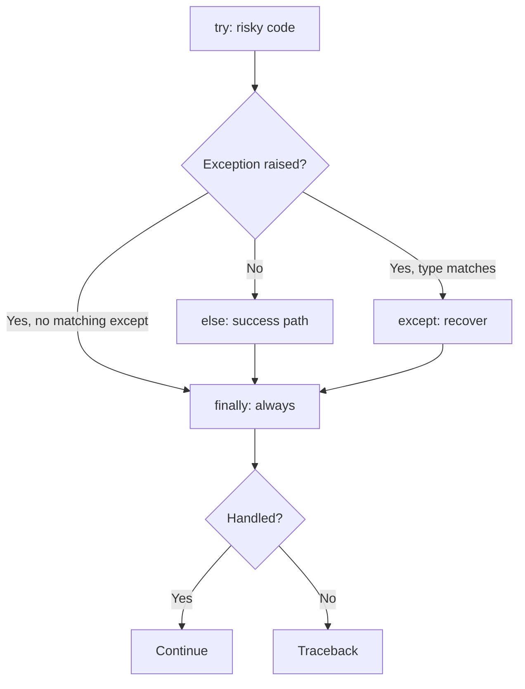

# Module 04 — Exception Handling

**Phase:** Advanced Python

**Previous module:** [OOP Part 4 — Abstract Classes & Interfaces](03_OOP_Part4_Abstract_Classes_Interfaces.md)
**Next module:** [File Handling and Logging](05_File_Handling_and_Logging.md)

---

**Module Outcome:**

- Type of errors — syntax vs runtime vs logical
- What an exception is, and why we handle it
- `try` / `except` — risky attempt and named recovery
- Catching multiple exceptions
- `else` and `finally` — success path vs cleanup
- `raise` and custom exception classes
- Common built-in exceptions

### Three kinds of errors:

**1. Syntax error** — Python cannot even read the program. Missing `:`, `if pin = 1234` instead of `==`, a keyword used as a name. The file never really starts. 

```python
# Syntax error — Python refuses to parse this; try/except never runs
# if pin = 1234:
#     print("ok")
```

**2. Runtime error (exception)** — The program started, then hit a problem it cannot solve: `"abc"` to `int`, divide by zero, missing file. Python **raises an exception**. If nobody handles it, you get a traceback and the program **stops**. **This module is about these.**

```python
int("abc")   # ValueError — runs, then fails
100 / 0      # ZeroDivisionError
```

**3. Logical error** — The program runs and finishes. The answer is just wrong: GST 18% coded as 8%, bill split among `friends` but you divide by `friends + 1`. No traceback. **Tests and careful reading** — not `except`.

```python
price = 1000
gst = price * 0.08   # logical error: should be 0.18 — no exception, silent wrong total
```


| Kind                      | When                    | Traceback?       | `try`/`except`?      |
| ------------------------- | ----------------------- | ---------------- | -------------------- |
| Syntax error              | Before the program runs | Yes (parse time) | No — edit the source |
| Runtime error / exception | While running           | Yes if unhandled | Yes — this module    |
| Logical error             | Runs, wrong result      | No               | No — debug / test    |


Python’s everyday word for a runtime failure is **exception**. Handling them — show a message, retry, shut down cleanly — is the rest of this module.

**Note:**

- `try`/`except` around a syntax error in the **same** file does not work; Python never reaches `try`.
- A wrong business formula is not an exception until you **raise** one on purpose (`raise ValueError(...)`).

### What is an exception?

A runtime error packaged as an **object** with a type (`ValueError`, `ZeroDivisionError`, `FileNotFoundError`) and a message. If nobody handles it, Python **stops** and prints a traceback.

### Why handle exceptions?

Without handling, a wrong PIN or a missing CSV crashes the whole program. With handling, you show a clear message and continue (or shut down cleanly).

Think of an ATM: wrong PIN should not “explode” the machine — it shows “Invalid PIN” and lets the user retry.

Python gives you **four keywords** for that story. Learn what each one is *for* before memorising the layout.

**`try`** — The risky attempt. Only the lines that might fail belong here: `int(pin)`, split a bill, look up a dict key. Keep it short. If `try` is 40 lines, you will not know which line raised.

**`except`** — Named recovery. “If this **type** of failure happened, do this instead of crashing.”  
`except ValueError as e` binds the error object to `e` so you can print the message (`e`) or the type (`type(e).__name__`). You may stack several `except` blocks — Python uses the **first match**, so put specific types (`ValueError`) above broad ones (`Exception`). When two types share the same recovery, use a tuple: `except (TypeError, ValueError) as e:`.

**`else`** — The success path. Runs only when `try` finished with **no** exception. Put “PIN accepted — show the menu” here, not inside `try`. If that success code later bugs, `except` will not swallow it and pretend the PIN failed.

**`finally`** — Cleanup that **always** runs: success, caught error, even `return` from a function. ATM: return the card. UPI: log that an attempt happened. Do not put business decisions here (`if paid: ship_order()` belongs in `else`).




**Key takeaways:**

- `try` = attempt · `except` = recover by type · `else` = it worked · `finally` = cleanup
- `else` is skipped when any exception was raised in `try`
- `finally` still runs if you `return` inside `try` or `except`


| Piece     | Runs when                      | Typical job              |
| --------- | ------------------------------ | ------------------------ |
| `try`     | Always entered first           | Risky work only          |
| `except`  | Matching type raised in `try`  | Message, retry, fallback |
| `else`    | `try` succeeded (no exception) | Receipt, next screen     |
| `finally` | Always, after the others       | Return card, close, log  |


**Remember:** Bare `except:` also catches Ctrl+C — never use it. Catch specific types.

**Custom exceptions** name business failures clearly: `InsufficientBalanceError`, `SeatAlreadyBookedError` — better for readers and APIs than a bare `Exception`.

**Icons:** Bank · UPI · Order · Hospital · Payroll

**Where used?**

- **SecureBank** / UPI — wrong PIN, insufficient balance, invalid amount
- Forms & CLI — bad age, non-numeric input, missing required fields
- File / CSV jobs — missing file, bad row converted with `int(...)`
- **TechMart** / **MedCare** — order capacity, appointment slot out of range
- Payments — domain errors (`PaymentError`) callers can catch separately

---

## Important Concepts

### 1. try and except — risky attempt, named recovery

**Definition:** `try` runs code that might fail. `except Type` runs only when that type is raised — the program continues instead of dying with a traceback.  
**Purpose:** User input and money maths fail often; crash-only programs are not shippable.

Put **only the risky lines** in `try`. Then name the doors:

```python
raw_values = ["abc", "0", "4"]
for raw in raw_values:
    try:
        num = int(raw)      # may raise ValueError
        print(100 / num)    # may raise ZeroDivisionError
    except ValueError:
        print("Please enter a valid integer.")
    except ZeroDivisionError:
        print("Cannot divide by zero.")
```

**Expected Output:**

```
Please enter a valid integer.
Cannot divide by zero.
25.0
```

`except ValueError as e` binds the object so you can print a useful message. First matching `except` wins — list **specific** types before a broad `Exception`.

**Note:**

- Bare `except:` catches `KeyboardInterrupt` and hides bugs — catch specific exceptions.
- Swallowing exceptions with empty `except: pass` — log and handle, or re-raise.
- Using exceptions for flow control is slow and unreadable — use if/else for expected cases.

**Common Error:** Bare `except:` (or empty `except: pass`) hides real bugs and can block Ctrl+C. Catch specific types and log or re-raise.

**Try these (2 programs):**

**Program 1 — SecureBank UPI PIN with retry**

```python
attempts = ["ab12", "1234"]

for attempt in attempts:
    try:
        pin = int(attempt)
        print("PIN accepted:", pin)
        break
    except ValueError as e:
        print("PIN must be digits only —", e)
```

**Expected Output:**

```
PIN must be digits only — invalid literal for int() with base 10: 'ab12'
PIN accepted: 1234
```

**Program 2 — TechMart split bill safely**

```python
bill = 500
for friends in (4, 0):
    try:
        share = bill / friends
        print(f"Each pays ₹{share:.2f}")
    except ZeroDivisionError:
        print("Cannot split among 0 friends")
```

**Expected Output:**

```
Each pays ₹125.00
Cannot split among 0 friends
```

### 2. Catching multiple exceptions

**Definition:** One handler for several related error types, or several handlers when recovery differs.  
**Purpose:** Same recovery path (e.g. “bad age data”) without duplicate blocks; different messages when the user should do different things.

Same recovery — one tuple:

```python
try:
    age = int(data["age"])
except (KeyError, ValueError) as e:
    print("Bad age data:", e)
```

Different recovery — stack `except` blocks (first match wins):

```python
try:
    age = int(data["age"])
except KeyError:
    print("age field is missing")
except ValueError:
    print("age must be a number")
```

**Note:**

- Over-broad `except Exception` masks real bugs — catch narrow types first.
- Wrong: `except ValueError, KeyError:` (old Python 2) — that is not a tuple. Use `except (ValueError, KeyError):`.

**Try these (2 programs):**

**Program 1 — AcmeHR marks: missing vs not a number**

```python
def load_marks(path, files):
    if path not in files:
        raise FileNotFoundError(path)
    return int(files[path])

files = {"marks.txt": "87", "bad.txt": "eighty"}
for path in ("marks.txt", "bad.txt", "missing.txt"):
    try:
        print("Marks:", load_marks(path, files))
    except (FileNotFoundError, ValueError) as e:
        print("Could not read marks:", type(e).__name__, "—", e)
```

**Expected Output:**

```
Marks: 87
Could not read marks: ValueError — invalid literal for int() with base 10: 'eighty'
Could not read marks: FileNotFoundError — missing.txt
```

**Program 2 — MedCare dict KeyError / ValueError**

```python
samples = [
    {"age": "21"},
    {"age": "twenty"},
    {"name": "Ravi"},  # missing age
]

for data in samples:
    try:
        age = int(data["age"])
        print("Age:", age)
    except (KeyError, ValueError) as e:
        print("Bad age data:", type(e).__name__, e)
```

**Expected Output:**

```
Age: 21
Bad age data: ValueError invalid literal for int() with base 10: 'twenty'
Bad age data: KeyError 'age'
```

### 3. else and finally — success path vs cleanup

**Definition:** `else` runs only when `try` succeeded. `finally` runs always — success, failure, or `return`.  
**Purpose:** Keep “it worked” out of the error handler, and always finish cleanup (return the ATM card, log the attempt).

#### Why `else` exists

A common mistake is to put the success work *inside* `try`. Then a bug in the success work can be caught by `except` and reported as the original failure:

```python
# Weak — a later bug looks like a bad PIN
try:
    pin = int("1234")
    print("Welcome")          # if this line fails, except may catch it
except ValueError:
    print("Invalid PIN")
```

`else` means: “`try` fully succeeded — now do the happy-path work.” An error in `else` is **not** handled by this `except`.

```python
try:
    pin = int("1234")
except ValueError:
    print("Invalid PIN")
else:
    print("Welcome")          # runs only if int() worked
```

#### Why `finally` exists

The card must come out whether the PIN was right or wrong. `finally` is that guarantee — including when a function **returns** from `try` or `except`.

Do **not** put business decisions in `finally` (`if paid: ship_order()`). That belongs in `else`. `finally` is cleanup and logging.

All four together:

```python
try:
    amount = int("500")
    share = 1000 / amount
except ValueError:
    print("Need a number")
except ZeroDivisionError:
    print("Cannot use 0")
else:
    print(f"Each pays ₹{share:.2f}")
finally:
    print("Split attempt finished")
```

**Expected Output:**

```
Each pays ₹2.00
Split attempt finished
```

**Note:**

- `return` inside `finally` can suppress exceptions — keep `finally` for cleanup only.
- `else` does not run if `try` raised, even if `except` handled it.

**Remember:** `else` = try succeeded. `finally` = always runs (cleanup / close / log).

**Interview:** “`else` vs putting code in `try`” — `else` stops the success path from being swallowed by `except`.

**Try these (2 programs):**

**Program 1 — SecureBank PIN: except, else, finally**

```python
CORRECT = 1234
for pin in ("ab12", "0000", "1234"):
    try:
        number = int(pin)
        if number != CORRECT:
            raise ValueError("Wrong PIN")
    except ValueError as e:
        print("Access denied:", e)
    else:
        print("Welcome to SecureBank")
    finally:
        print("Please remove your card")
    print("---")
```

**Expected Output:**

```
Access denied: invalid literal for int() with base 10: 'ab12'
Please remove your card
---
Access denied: Wrong PIN
Please remove your card
---
Welcome to SecureBank
Please remove your card
---
```

**Program 2 — finally still runs after return**

```python
def demo():
    try:
        print("In try — about to return")
        return "success"
    finally:
        print("finally still runs before the return completes")

print("Result:", demo())
```

**Expected Output:**

```
In try — about to return
finally still runs before the return completes
Result: success
```

### 4. raise — intentional errors

**Definition:** You create an error on purpose when input or state is invalid.  
**Purpose:** Fail fast with a clear message instead of continuing with bad data.

`raise ValueError("Amount must be positive")` stops the function and lets the **caller** decide how to recover (retry, show a form error, log).

```python
def withdraw(balance, amount):
    if amount <= 0:
        raise ValueError("Amount must be positive")
    if amount > balance:
        raise ValueError("Not enough balance")
    return balance - amount

for amt in (200, -10, 5000):
    try:
        print("New balance:", withdraw(1000, amt))
    except ValueError as e:
        print("Withdraw failed:", e)
```

**Expected Output:**

```
New balance: 800
Withdraw failed: Amount must be positive
Withdraw failed: Not enough balance
```

**Note:**

- Raise a specific type (`ValueError`, or your custom class) — not a bare string (`raise "oops"` is invalid).
- After `raise`, the rest of that function does not run.

**Try these (2 programs):**

**Program 1 — set_discount with raise**

```python
def set_discount(percent):
    if not 0 <= percent <= 100:
        raise ValueError(f"Discount must be 0–100, got {percent}")
    print(f"Discount set to {percent}%")

for p in (120, -5, 15):
    try:
        set_discount(p)
    except ValueError as e:
        print("Error:", e)
```

**Expected Output:**

```
Error: Discount must be 0–100, got 120
Error: Discount must be 0–100, got -5
Discount set to 15%
```

**Program 2 — MedCare book_seat capacity check**

```python
def book_seat(available, requested):
    if requested > available:
        raise ValueError("Not enough seats")
    print(f"Booked {requested} seat(s). Left: {available - requested}")

for avail, req in ((5, 2), (3, 5)):
    try:
        book_seat(avail, req)
    except ValueError as e:
        print("Booking failed:", e)
```

**Expected Output:**

```
Booked 2 seat(s). Left: 3
Booking failed: Not enough seats
```

### 5. Custom exception class

**Definition:** A class you write that inherits from `Exception`, named for a **business** failure.  
**Purpose:** Callers can `except InsufficientBalanceError` without treating every `ValueError` the same — APIs and logs stay clear.

```python
class InsufficientBalanceError(Exception):
    """Raised when withdrawal exceeds balance."""
    pass


class InvalidAccountError(Exception):
    def __init__(self, account_id, message="Invalid account"):
        self.account_id = account_id
        super().__init__(f"{message}: {account_id}")
```

Use it like any built-in: `raise InsufficientBalanceError("Not enough balance")`, then `except InsufficientBalanceError as e:`.

**Note:**

- Custom exception not inheriting `Exception` → not caught as expected — always inherit `Exception`.
- Empty `pass` is enough at first; add `__init__` when you need extra fields (`account_id`, `roll`).

**Interview:** Custom exceptions name domain failures (`UnderAgeError`, `InsufficientBalanceError`) so callers can catch them without treating every `Exception` the same.

**Try these (2 programs):**

**Program 1 — Custom UnderAgeError**

```python
class UnderAgeError(Exception):
    """Raised when voter age is below 18."""
    pass


def register_voter(age):
    if age < 18:
        raise UnderAgeError(age)
    print(f"Voter registered (age {age})")


for age in (16, 21):
    try:
        register_voter(age)
    except UnderAgeError as e:
        print(f"Registration denied — age {e} is under 18")
```

**Expected Output:**

```
Registration denied — age 16 is under 18
Voter registered (age 21)
```

**Program 2 — InvalidRollError with roll stored**

```python
class InvalidRollError(Exception):
    def __init__(self, roll, message="Roll not found"):
        self.roll = roll
        super().__init__(f"{message}: {roll}")


def find_student(roll, db):
    if roll not in db:
        raise InvalidRollError(roll)
    return db[roll]


db = {101: "Anita", 102: "Ravi"}
for roll in (101, 999):
    try:
        print(find_student(roll, db))
    except InvalidRollError as e:
        print("Error:", e, "| roll attr:", e.roll)
```

**Expected Output:**

```
Anita
Error: Roll not found: 999 | roll attr: 999
```

### 6. Common built-in exceptions

**Definition:** Types Python already raises. You catch them by name.  
**Purpose:** The type tells you *what* went wrong so the message can tell the user *what to do*.


| Exception                             | Typical cause                                           |
| ------------------------------------- | ------------------------------------------------------- |
| `ValueError`                          | Wrong value (`int("abc")`)                              |
| `TypeError`                           | Wrong type operation (`"a" + 1`)                        |
| `IndexError`                          | Invalid list index                                      |
| `KeyError`                            | Missing dict key                                        |
| `FileNotFoundError`                   | File missing (you will use this a lot in File Handling) |
| `ZeroDivisionError`                   | `/` or `//` by zero                                     |
| `AttributeError`                      | Missing attribute/method                                |
| `ImportError` / `ModuleNotFoundError` | Import failure                                          |


**Try these (2 programs):**

**Program 1 — Three built-ins, three handlers**

```python
try:
    print([10, 20, 30][5])
except IndexError as e:
    print("IndexError:", e)

try:
    print({"a": 1}["b"])
except KeyError as e:
    print("KeyError:", e)

try:
    print(10 / 0)
except ZeroDivisionError as e:
    print("ZeroDivisionError:", e)
```

**Expected Output:**

```
IndexError: list index out of range
KeyError: 'b'
ZeroDivisionError: division by zero
```

**Program 2 — Name that error quiz**

```python
# Run each block — print only the type name. (except Exception is for this quiz only.)

try:
    "a" + 1
except Exception as e:
    print(type(e).__name__)   # TypeError

try:
    [1][5]
except Exception as e:
    print(type(e).__name__)   # IndexError

try:
    {}["missing"]
except Exception as e:
    print(type(e).__name__)   # KeyError

try:
    1 // 0
except Exception as e:
    print(type(e).__name__)   # ZeroDivisionError

try:
    int("hello")
except Exception as e:
    print(type(e).__name__)   # ValueError
```

**Expected Output:**

```
TypeError
IndexError
KeyError
ZeroDivisionError
ValueError
```

---

## Step-by-Step Annotated Python 3 Code

### Example 1 — Safe age input (retry until valid)

`try` converts; `raise` rejects non-positive; `except` prints and the loop tries the next sample.

```python
def read_positive_int(samples):
    for raw in samples:
        try:
            value = int(raw)
            if value <= 0:
                raise ValueError("Number must be positive")
            return value
        except ValueError as e:
            print(f"Invalid input ({raw!r}): {e}. Try again.")
    return None


age = read_positive_int(["abc", "-3", "21"])
print("Valid age:", age)
```

**Expected Output:**

```
Invalid input ('abc'): invalid literal for int() with base 10: 'abc'. Try again.
Invalid input ('-3'): Number must be positive. Try again.
Valid age: 21
```

### Example 2 — All four keywords: SecureBank UPI

Read the comments in order: `try` → `except` → `else` → `finally`. `finally` still runs when `except` or `else` **returns**.

```python
def upi_transfer(pin, amount, balance):
    try:
        code = int(pin)
        if code != 4321:
            raise ValueError("Invalid PIN")
        if amount > balance:
            raise ValueError("Insufficient balance")
        new_balance = balance - amount
    except ValueError as e:
        print("Transfer failed:", e)
        return balance
    else:
        print(f"Sent ₹{amount}. New balance: ₹{new_balance}")
        return new_balance
    finally:
        print("Attempt logged")


print("Case 1 — bad PIN")
print("Returned:", upi_transfer("ab12", 200, 1000))
print()
print("Case 2 — success")
print("Returned:", upi_transfer("4321", 200, 1000))
```

**Expected Output:**

```
Case 1 — bad PIN
Transfer failed: invalid literal for int() with base 10: 'ab12'
Attempt logged
Returned: 1000

Case 2 — success
Sent ₹200. New balance: ₹800
Attempt logged
Returned: 800
```

### Example 3 — raise with PAN validation

```python
def validate_pan(pan):
    """Indian PAN format: ABCDE1234F (simplified check)."""
    if pan is None or len(pan) != 10:
        raise ValueError("PAN must be 10 characters")
    if not pan[:5].isalpha() or not pan[5:9].isdigit() or not pan[9].isalpha():
        raise ValueError("Invalid PAN format")
    return pan.upper()


for pan in ("ABCDE1234F", "INVALID"):
    try:
        print("OK:", validate_pan(pan))
    except ValueError as err:
        print("Validation failed:", err)
```

**Expected Output:**

```
OK: ABCDE1234F
Validation failed: PAN must be 10 characters
```

### Example 4 — Custom exception hierarchy (SecureBank payments)

Catch the **most specific** type first. `GatewayTimeoutError` is a `PaymentError` — if `except PaymentError` came first, the timeout would never hit its own handler.

```python
class AppError(Exception):
    """Base for application errors."""
    pass


class PaymentError(AppError):
    pass


class GatewayTimeoutError(PaymentError):
    pass


def process_payment(amount):
    if amount > 100000:
        raise PaymentError("Amount exceeds limit")
    raise GatewayTimeoutError("Razorpay timeout")


for amount in (150000, 5000):
    try:
        process_payment(amount)
    except GatewayTimeoutError as e:
        print("Gateway:", e)
    except PaymentError as e:
        print("Payment issue:", e)
```

**Expected Output:**

```
Payment issue: Amount exceeds limit
Gateway: Razorpay timeout
```

### Example 5 — Print, then re-raise

`raise` with no argument re-raises the **same** exception so the caller can still handle it. Swallowing it here would hide the bug.

```python
def parse_marks(raw):
    try:
        return int(raw)
    except ValueError:
        print("ERROR: could not parse marks:", raw)
        raise


try:
    print("Marks:", parse_marks("eighty"))
except ValueError:
    print("Caller: show a form error, not a traceback")
```

**Expected Output:**

```
ERROR: could not parse marks: eighty
Caller: show a form error, not a traceback
```

### Example 6 — Exception in an OOP method (SecureBank)

Define the custom type **before** the class that raises it.

```python
class InsufficientBalanceError(Exception):
    pass


class BankAccount:
    def __init__(self, balance):
        self.balance = balance

    def withdraw(self, amount):
        if amount > self.balance:
            raise InsufficientBalanceError(
                f"Requested ₹{amount}, available ₹{self.balance}"
            )
        self.balance -= amount
        return self.balance


acct = BankAccount(500)
for amt in (200, 800):
    try:
        print("Balance:", acct.withdraw(amt))
    except InsufficientBalanceError as e:
        print("Transaction failed:", e)
```

**Expected Output:**

```
Balance: 300
Transaction failed: Requested ₹800, available ₹300
```

---

## Practice Exercises

### Basic

1. Handle `ZeroDivisionError` in a TechMart split.

**Model answer:**

```python
bill = 500
friends = 0
try:
    print(bill / friends)
except ZeroDivisionError:
    print("Cannot divide by zero")
```

1. Catch `ValueError` when converting a string to float.

**Model answer:**

```python
raw = "12.5kg"
try:
    value = float(raw)
    print("OK:", value)
except ValueError:
    print("Not a valid number")
```

1. Use `try/except` when accessing a dict key — prefer `.get()` too.

**Model answer:**

```python
data = {"name": "Priya"}
try:
    print(data["email"])
except KeyError:
    print("email missing")

print(data.get("email", "email missing"))  # preferred
```

### Intermediate

1. Write `safe_divide(a, b)` returning `None` on error instead of crashing.

**Model answer:**

```python
def safe_divide(a, b):
    try:
        return a / b
    except (ZeroDivisionError, TypeError):
        return None
```

1. Create `InvalidEmailError` and a validator function.

**Model answer:**

```python
class InvalidEmailError(ValueError):
    pass


def validate_email(email):
    if "@" not in email or "." not in email.split("@")[-1]:
        raise InvalidEmailError(f"Invalid email: {email}")
    return email
```

1. SecureBank PIN using `try` / `except` / `else` / `finally`.

**Model answer:**

```python
pin = "1234"
try:
    code = int(pin)
    if code != 1234:
        raise ValueError("Wrong PIN")
except ValueError as e:
    print("Access denied:", e)
else:
    print("PIN accepted")
finally:
    print("Please remove your card")
```

### Interview-style

1. Difference between `except Exception` and bare `except`?

**Model answer:**
`except Exception` catches almost all application errors but not system exits like `KeyboardInterrupt`/`SystemExit`. Bare `except:` catches everything including those, which can hide bugs and block clean shutdown — avoid it.

1. When to create custom exceptions?

**Model answer:**
Create them when callers need to distinguish your domain failure (e.g. `InvalidEmailError`) from generic errors and handle it specifically. Prefer a clear hierarchy under `Exception` over overloading `ValueError` for every case.

1. What happens if an exception is raised in the `finally` block?

**Model answer:**
An exception raised in `finally` replaces any pending exception from the `try`/`except` block. The original error is lost unless you explicitly chain or log it before the `finally` raises.

1. Why put success work in `else` instead of at the end of `try`?

**Model answer:**
If success code lives in `try` and later raises, `except` may catch it and report the wrong failure (e.g. “Invalid PIN” when the PIN was fine). `else` runs only after `try` fully succeeded, so that mix-up cannot happen.

---

## Mini-Project (Assignment): MedCare Safe Age Input CLI

**Title:** Never crash on bad age  
**Lab kit (build here):** [15_Lab_Assets/18_safe_input_exceptions/](../15_Lab_Assets/18_safe_input_exceptions/)

### What to build


| Feature           | Detail                                                                            |
| ----------------- | --------------------------------------------------------------------------------- |
| `InvalidAgeError` | Custom exception for age outside 1–120                                            |
| `read_age(raw)`   | `int` conversion; raise `ValueError` on non-int; raise `InvalidAgeError` on range |
| Demo loop         | Test `"21"`, `"abc"`, `"0"`, `"200"` without a traceback for expected cases       |
| Clear messages    | Print exception type + message                                                    |


**Sample:**

```
21 -> 21
abc ValueError age must be an integer
0 InvalidAgeError age out of range: 0
200 InvalidAgeError age out of range: 200
```

### Stretch

- Wrap `read_age` in a `while True` prompt until a valid age is entered.  
- Add `read_positive_float` for amounts (reuse the same pattern).  
- Log failures with a timestamp (`datetime.now()`) before File Handling module.

### Done when

- [ ] Lab kit `safe_age` ticket passes for the four samples  
- [ ] Custom `InvalidAgeError` is raised for out-of-range ages  
- [ ] Non-numeric input raises / is caught as `ValueError` (no crash)  
- [ ] Repo pushed with a short README of sample outputs  

## Interview Q&A

Shared with students after concepts and the mini-project. Use for review and interview prep — questions and model answers are included.

**Q1. try / except / else / finally execution order?**  
**A:** Enter `try`. If a matching `except` fires, run that handler and **skip** `else`. If `try` raised nothing, run `else`. `finally` always runs after that (including when `try`/`except`/`else` returns). If nothing matched, `finally` still runs, then the traceback continues.

**Q2. Why `else` instead of putting success code in `try`?**  
**A:** Success code in `try` can raise and be caught by `except`, so you report the wrong failure. `else` runs only after `try` fully succeeded.

**Q3. `except Exception` vs bare `except:`?**  
**A:** `except Exception` catches application errors but not `KeyboardInterrupt`/`SystemExit`. Bare `except:` catches those too — hides bugs and can block Ctrl+C. Catch specific types.

**Q4. When create a custom exception?**  
**A:** When callers must distinguish a domain failure (**MedCare** `SlotNotAvailableError`, **SecureBank** `InsufficientBalanceError`) from a generic `ValueError`.

**Q5. EAFP vs LBYL?**  
**A:** EAFP: try the operation, handle failure. LBYL: Look Before You Leap — check conditions first. Python culture favours EAFP for many I/O cases.

**Q6. Exception vs `assert`?**  
**A:** `assert` is a developer sanity check (can be disabled with `-O`). Exceptions are for runtime errors and user-facing failures.

**Q7. Why print/log before re-raising?**  
**A:** So the failure is recorded at the point it happened; `raise` then lets the caller decide the user-facing response. Catching and staying silent hides bugs.

**Q8. Error vs exception in everyday language vs Python?**  
**A:** Everyday “error” covers syntax problems, runtime crashes, and wrong answers. In Python, **syntax errors** are parse-time (not for `try`/`except`), **exceptions** are runtime objects you can catch, and **logical errors** produce no traceback.

**Q9. How would you handle errors in a SecureBank payment API?**  
**A:** Catch specific types (timeout vs invalid amount vs insufficient balance), map them to clear messages, log, and re-raise or return a safe result. Use a small hierarchy (`PaymentError` / `GatewayTimeoutError`) so callers can treat “any payment issue” or one subtype.

---

