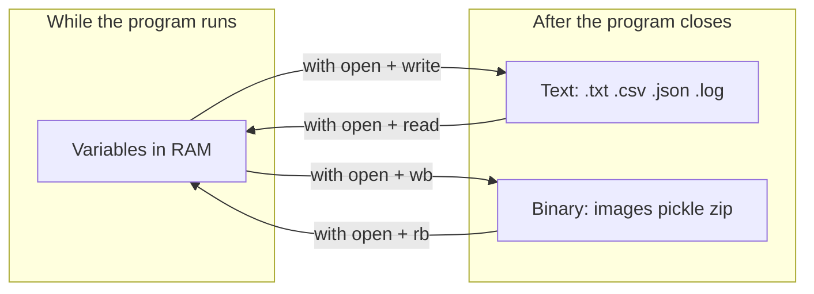

# Module 05 — File Handling

**Phase:** Advanced Python

**Previous module:** [Exception Handling](04_Exception_Handling.md)
**Next module:** [Logging Module](06_Logging_Module.md)

---

**Module Outcome:**

- The problem — RAM forgets, files remember
- Types of files — text vs binary
- Opening a file — `open()` and `with open()`
- File modes — read, replace, append (`r` / `w` / `a`)
- Writing and reading text
- Handling missing files — `FileNotFoundError`
- CSV for tables, JSON for config
- Advanced awareness — cursor, binary, pickle, directories

---

**What is File Handling?**

**File handling** is the process of performing operations on files, such as:

- Creating new files
- Reading existing files
- Writing or updating data
- Deleting files

Python provides a built-in `open()` function and additional modules like `os` and `pathlib` to make file handling simple and efficient.

**Where do we use in realtime?**

- **Employee Management Portal** / payroll — append expense rows, export a CSV, keep a daily expenses limit in a config file such as JSON
- **Swiggy** — import a product table, load `config.json` at startup
- Attendance and audit — append-only text that survives a restart
- Reports and backups — copy files, walk folders, read large CSVs line by line


### Types of files

There are **two** kinds. They are different worlds.

```text
TEXT                              BINARY
----------------                  ----------------
Characters                        Bytes
"Hello"                           b"\x89PNG..."
encoding="utf-8"                  no encoding
modes: r / w / a                  modes: rb / wb / ab
```

**1. Text files** — character data you can open in Notepad: `.txt`, `.csv`, `.json`, `.log`.  
**2. Binary files** — bytes: images, zip, pickle. Do **not** open a `.jpg` in text mode.

Tonight’s tracker is **text** (CSV, JSON, logs). Binary is in the Advanced section — know that it exists; do not mix the two.




**Note:**

- **Text** = characters (always set `encoding="utf-8"`)
- **Binary** = bytes (`rb` / `wb`) — no encoding
- Do not use text mode for a `.jpg` or other arbitrary bytes

---

### 1. Opening a file — `open()` and `with open()`

Before you can interact(i.e read/write) with a file, you need to **open it**. Python’s The `open()` function allows you to do this:

```python
f = open("data/expenses.txt", "w", encoding="utf-8")
f.write("2026-09-04 | food | 120 | Tea\n")
f.close()
```

`f.close()` flushes leftover data and releases the handle.


The `open()` function takes two main arguments:

1. **Filename** — The file you want to open.
2. **Mode** — Determines how the file will be used:

*Note: Always close your files using* `file.close()` *or, better, use the* `with` *statement to handle files automatically.*

### 2. File modes — read, replace, or append

**Definition:** The **mode** is *why* you opened the file.  
**Purpose:** The wrong mode silently wipes a month of expenses (`w`) or refuses to open (`r` on a missing file).

For this course you need **three** modes first:

```text
                 What do I want?

                     File
                       |
           ┌───────────┼───────────┐
           ↓           ↓           ↓
         Read       Replace       Add
           ↓           ↓           ↓
           r           w           a
```


| Mode | Plain English                                    | Missing file?       | Existing content?                  |
| ---- | ------------------------------------------------ | ------------------- | ---------------------------------- |
| `r`  | I want to **read** what is already there         | `FileNotFoundError` | Left as-is                         |
| `w`  | I want to **create / replace** the file          | Creates it          | **Cleared** (truncated)            |
| `a`  | I want to **add** without deleting the old lines | Creates it          | Kept; new writes go at the **end** |


`r` is the **default** if you omit the mode.

Python has other modes (`r+`, `w+`, `a+`, `x`). We will name them in Advanced. You do not need them to build the tracker.

**Common Error:** Opening with `"w"` when you meant `"a"` — `w` empties the file before you write.

### 3. Reading data from text files

**Definition:** After you open for read, you pull characters (or lines) from the file.  
**Purpose:** The tracker has to show last week’s expenses, not only the ones still in RAM.


| Method          | Returns                       | When to use                         |
| --------------- | ----------------------------- | ----------------------------------- |
| `read()`        | Entire file as **one string** | Small files                         |
| `read(n)`       | Next `n` characters           | Peek / should-know                  |
| `readline()`    | **One** line                  | Line-by-line protocols              |
| `readlines()`   | **List** of all lines         | Medium files — whole list in RAM    |
| `for line in f` | One line at a time            | **Large files** — this is the habit |


**What if the file is huge?** A 2 GB server log must not be loaded with `read()`. Iterate:

```python
with open("logs/app.log", "r", encoding="utf-8") as f:
    for line in f:
        ...
```

The file pointer moves as you read. A second `read()` without reopening (or `seek` — Advanced) often returns empty.

**Note:**

- `readlines()` vs `for line in f`: the first builds a **list in memory**; the second yields **one line at a time**.
- Reading a huge file with `read()` → `MemoryError`. Iterate.

Write three expense lines, then print each line with `for line in f` (strip the newline).

```python
import os

os.makedirs("data", exist_ok=True)
lines = [
    "2026-09-04 | food | 120 | Tea",
    "2026-09-04 | travel | 50 | Metro",
    "2026-09-04 | food | 40 | Samosa",
]

with open("data/expenses.txt", "w", encoding="utf-8") as f:
    for line in lines:
        f.write(line + "\n")

with open("data/expenses.txt", "r", encoding="utf-8") as f:
    for line in f:
        print(line.strip())
```

**Expected Output:**

```
2026-09-04 | food | 120 | Tea
2026-09-04 | travel | 50 | Metro
2026-09-04 | food | 40 | Samosa
```

On the same small file, show `read()` (whole string) next to iterating lines — two ways to read, different memory behaviour.

```python
import os

os.makedirs("data", exist_ok=True)

with open("data/expenses.txt", "w", encoding="utf-8") as f:
    f.write("Tea\nMetro\nSamosa\n")

with open("data/expenses.txt", "r", encoding="utf-8") as f:
    all_text = f.read()  # OK for small files only
    print("read():", repr(all_text))

with open("data/expenses.txt", "r", encoding="utf-8") as f:
    for line in f:  # prefer this for large logs
        print("line:", line.strip())
```

**Expected Output:**

```
read(): 'Tea\nMetro\nSamosa\n'
line: Tea
line: Metro
line: Samosa
```


### 4. Handling missing files

**Definition:** A path might not exist yet. `open(..., "r")` then raises `FileNotFoundError`.  
**Purpose:** A missing CSV should print a clear message on the clerk’s screen, not a traceback.

This is last module’s exception, used on purpose.

```python
try:
    with open(path, "r", encoding="utf-8") as f:
        ...
except FileNotFoundError:
    print("No expenses yet — starting fresh.")
```

`pathlib.Path.exists()` asks first (Look Before You Leap). After Exceptions week, `try` / `except FileNotFoundError` is the usual Python style (EAFP).

**Note:**

- Both styles are valid. Do not skip handling.
- `"w"` / `"a"` *create* a missing file — you do not get `FileNotFoundError` in those modes.

Try to read `data/missing.txt` (it is not there), catch `FileNotFoundError`, then read `data/expenses.txt` which you just wrote.

```python
import os

os.makedirs("data", exist_ok=True)

with open("data/expenses.txt", "w", encoding="utf-8") as f:
    f.write("2026-09-04 | food | 120 | Tea\n")

def read_text(path):
    try:
        with open(path, "r", encoding="utf-8") as f:
            return f.read()
    except FileNotFoundError:
        print(f"File not found: {path}")
        return None

for fname in ("data/expenses.txt", "data/missing.txt"):
    print("Checking:", fname)
    data = read_text(fname)
    if data is not None:
        print(data.strip())
```

**Expected Output:**

```
Checking: data/expenses.txt
2026-09-04 | food | 120 | Tea
Checking: data/missing.txt
File not found: data/missing.txt
```


### 5. CSV — when the data is a table

**Definition:** CSV means **Comma Separated Values** — a text table Excel and Sheets understand.  
**Purpose:** `Tea | 120` as free text is fine for two lines. A month of expenses needs **columns**: date, category, amount, note.

Python’s `csv` module:

- `csv.writer` / `csv.reader` — rows as lists
- `csv.DictWriter` / `csv.DictReader` — rows as dicts keyed by the header (prefer this when columns have names)

**Note:**

- Open CSV with `newline=""` (Python 3 / Windows extra blank lines otherwise).
- Do not open CSV as `"wb"`.
- Amounts in CSV are **strings** until you convert: `int(row["amount"])`.

Write `data/expenses.csv` with `DictWriter`, then read it back and print the total amount.

```python
import csv
import os

os.makedirs("data", exist_ok=True)

rows = [
    {"date": "2026-09-04", "category": "food", "amount": "120", "note": "Tea"},
    {"date": "2026-09-04", "category": "travel", "amount": "50", "note": "Metro"},
    {"date": "2026-09-04", "category": "food", "amount": "40", "note": "Samosa"},
]

with open("data/expenses.csv", "w", newline="", encoding="utf-8") as f:
    writer = csv.DictWriter(f, fieldnames=["date", "category", "amount", "note"])
    writer.writeheader()
    writer.writerows(rows)

total = 0
with open("data/expenses.csv", newline="", encoding="utf-8") as f:
    for row in csv.DictReader(f):
        print(row["note"], "₹" + row["amount"])
        total += int(row["amount"])
print("Total:", total)
```

**Expected Output:**

```
Tea ₹120
Metro ₹50
Samosa ₹40
Total: 210
```

**Interview:** `DictReader` uses the header row as keys. `reader` gives lists — you remember column indexes yourself.

Plain `expenses.txt` was the learning wheel. From here, the tracker’s data file is `data/expenses.csv`.

### 6. JSON — when the data is config (or nested)

**Definition:** JSON is nested data as text — the language of APIs and config files.  
**Purpose:** Categories, daily limit, and currency belong in `data/config.json`, not hardcoded in the middle of `main`.


| Function               | Reads / writes                     |
| ---------------------- | ---------------------------------- |
| `json.dump(obj, file)` | Object → **file**                  |
| `json.load(file)`      | **File** → object                  |
| `json.dumps(obj)`      | Object → **string** (`s` = string) |
| `json.loads(s)`        | **String** → object                |


```text
Is my data basically a table?
        |
       YES  →  CSV
        |      Excel / report / import / export

Is my data configuration or a nested structure?
        |
       YES  →  JSON
               API / config / preferences
```

Write `data/config.json` for the expense tracker, load it, and print the daily limit.

```python
import json
import os

os.makedirs("data", exist_ok=True)

config = {
    "app_name": "ExpenseTracker",
    "currency": "INR",
    "max_daily_limit": 5000,
    "categories": ["food", "travel", "rent"],
}

with open("data/config.json", "w", encoding="utf-8") as f:
    json.dump(config, f, indent=2)

with open("data/config.json", "r", encoding="utf-8") as f:
    loaded = json.load(f)
    print("Daily limit:", loaded["max_daily_limit"])
    print("Categories:", loaded["categories"])
```

**Expected Output:**

```
Daily limit: 5000
Categories: ['food', 'travel', 'rent']
```

**Remember:** `json.load` → file. `json.loads` → string. The extra **s** is “string”.

**Next session:** Writing application flow and errors to `logs/app.log` is covered in [Logging Module](06_Logging_Module.md) — levels, `basicConfig`, custom loggers, and handlers.

---

### 7. Advanced file handling (awareness)

You do **not** need this section to finish tonight’s tracker. Skim once. Come back when a job (or an interview) names the tool.

#### File cursor — `tell()` and `seek()`

Think of the file as a line of characters and a **cursor**:

```text
FILE   2 0 2 6 - 0 9 - 0 4 ...
       ↑
     cursor
```

- `tell()` — “Where am I?” (index from the start; first character is **0**)
- `seek(offset)` — “Move me there.”

For **text** files in Python 3, `seek` is used from the **beginning**. Passing a random non-zero offset that did not come from `tell()` can error. Binary files can also seek from the current position or the end.

In-place overwrite needs a read-and-write mode (`r+`) and replacement text that fits the gap.

Write a status line, read it, `seek` to `PENDING`, overwrite it, then read from the start again.

```python
data = "Employee Management Portal status: PENDING"
with open("data/status.txt", "w", encoding="utf-8") as f:
    f.write(data)

with open("data/status.txt", "r+", encoding="utf-8") as f:
    print(f.read())
    print("Cursor after read:", f.tell())
    f.seek(15)  # start of PENDING
    print("Cursor after seek:", f.tell())
    f.write("CLEARED")
    f.seek(0)
    print(f.read())
```

**Expected Output:**

```
Employee Management Portal status: PENDING
Cursor after read: 22
Cursor after seek: 15
Employee Management Portal status: CLEARED
```

**Interview:** `tell()` reports where you are; `seek()` moves there.

#### Binary files

Text and binary are different worlds (see the box at the top). Open with `rb` / `wb` / `ab`. Do **not** pass `encoding`.

The lesson to keep: **do not use text mode for arbitrary binary data** (a `.jpg` is not UTF-8 text).

Write bytes to `data/badge.bin`, copy them to `data/badge_copy.bin`, and print whether the copy matches.

```python
import os

os.makedirs("data", exist_ok=True)
original = b"PNG-demo-bytes-not-a-real-image"

with open("data/badge.bin", "wb") as f:
    f.write(original)

with open("data/badge.bin", "rb") as src, open("data/badge_copy.bin", "wb") as dst:
    dst.write(src.read())

with open("data/badge_copy.bin", "rb") as f:
    copied = f.read()

print("Copy matches:", copied == original)
```

**Expected Output:**

```
Copy matches: True
```

The same pattern copies a real `.jpg`: `open("photo.jpg", "rb")` → `open("newpic.jpg", "wb")`.

#### Other modes — `r+`, `w+`, `a+`, `x`


| Mode | Meaning                                      | Use when                             |
| ---- | -------------------------------------------- | ------------------------------------ |
| `r+` | Read and write; file must exist; no truncate | In-place edit (`seek` example above) |
| `w+` | Write and read; **truncates** like `w`       | Rare; easy to wipe data              |
| `a+` | Append and read                              | Read a log you are also appending    |
| `x`  | Create exclusive; error if the file exists   | “Create only if new”                 |


Suffix `b` for binary: `rb`, `wb`, `ab`, `r+b`, …

**Remember:** If you are unsure, you still only need `r`, `w`, and `a`.

#### Pickling and unpickling

**Pickling** writes a Python object’s state as bytes (`pickle.dump`). **Unpickling** reads it back (`pickle.load`). Use **binary** mode (`wb` / `rb`).

**Do not unpickle data you do not trust — pickle can run code.**

For tables and config you share with humans or other languages, prefer **JSON** or **CSV**.

Pickle an Employee Management Portal employee dict to `data/emp.dat`, then unpickle and print name and salary.

```python
import os
import pickle

os.makedirs("data", exist_ok=True)
employee = {"eno": 101, "ename": "Anita", "esal": 45000, "eaddr": "Hyderabad"}

with open("data/emp.dat", "wb") as f:
    pickle.dump(employee, f)

with open("data/emp.dat", "rb") as f:
    obj = pickle.load(f)
    print("After unpickling:", obj["ename"], obj["esal"], obj["eaddr"])
```

**Expected Output:**

```
After unpickling: Anita 45000 Hyderabad
```

To write several objects, `dump` in a loop. To read them back, `load` in a loop until `EOFError`.

#### Directories

You already used `os.makedirs(path, exist_ok=True)` to create `data/` and `logs/`. That is the should-know piece.


| Need                           | Function                                  |
| ------------------------------ | ----------------------------------------- |
| Current folder                 | `os.getcwd()`                             |
| Create nested folders          | `os.makedirs(path, exist_ok=True)`        |
| List one folder                | `os.listdir(path)` — **not** nested files |
| List folder **and** subfolders | `os.walk(path)` — awareness               |


**Interview:** `listdir()` is one directory. `walk()` yields `(dirpath, dirnames, filenames)` for that directory **and** every subdirectory.

Print the current folder, ensure `data/` exists, then `walk` it (names on your machine will match what you have created).

```python
import os

print("Current Working Directory:", os.getcwd())
os.makedirs("data", exist_ok=True)

for dirpath, dirnames, filenames in os.walk("data"):
    print("Path:", dirpath)
    print("Dirs:", dirnames)
    print("Files:", filenames)
```

**Remember:** Don't confuse these — `w` is a **mode**, `write()` is a **method**. `r` is a mode, `read()` is a method. `json.load` reads a **file**; `json.loads` reads a **string**. `readlines()` builds a list in RAM; `for line in f` yields one line at a time.

---


## Step-by-Step: one assemble — Employee Management Portal expense slice

Type this with the class. It stitches **today’s** must-knows on **one** product: folders, `with`, UTF-8, CSV `newline=""`, `DictWriter` / `DictReader`, JSON config. Logging to `logs/app.log` comes in the [next module](06_Logging_Module.md).

```python
import csv
import json
import os

os.makedirs("data", exist_ok=True)

config = {
    "app_name": "ExpenseTracker",
    "currency": "INR",
    "max_daily_limit": 5000,
    "categories": ["food", "travel", "rent"],
}
with open("data/config.json", "w", encoding="utf-8") as f:
    json.dump(config, f, indent=2)

rows = [
    {"date": "2026-09-04", "category": "food", "amount": "120", "note": "Tea"},
    {"date": "2026-09-04", "category": "travel", "amount": "50", "note": "Metro"},
]
with open("data/expenses.csv", "w", newline="", encoding="utf-8") as f:
    writer = csv.DictWriter(f, fieldnames=["date", "category", "amount", "note"])
    writer.writeheader()
    writer.writerows(rows)
print("Wrote data/expenses.csv")

total = 0
with open("data/expenses.csv", newline="", encoding="utf-8") as f:
    for row in csv.DictReader(f):
        print(f"{row['note']}: ₹{row['amount']}")
        total += int(row["amount"])

with open("data/config.json", "r", encoding="utf-8") as f:
    limit = json.load(f)["max_daily_limit"]

print("Day total ₹%s (limit ₹%s)" % (total, limit))
```

**Expected Output:**

```
Wrote data/expenses.csv
Tea: ₹120
Metro: ₹50
Day total ₹170 (limit ₹5000)
```

**Then open the kit** (lab / tonight): [01_python_expense_tracker](../15_Lab_Assets/01_python_expense_tracker/) — add expenses, export CSV. Type it — do not paste `solution/`. Wire logging in the [Logging Module](06_Logging_Module.md). **Also use:** [15_generator_csv_stream](../15_Lab_Assets/15_generator_csv_stream/) — now wire `yield` to `csv.DictReader` (stretch).

---


## Practice Exercises

1. Apollo Hospitals stores a short ward note in `ward.txt`. Write `"Bed 12: stable\n"` with `w`, then **append** `"Bed 14: observation\n"` with `a`. Read and print the file. If you used `w` the second time, what would be missing?

**Model answer:**

```python
with open("ward.txt", "w", encoding="utf-8") as f:
    f.write("Bed 12: stable\n")
with open("ward.txt", "a", encoding="utf-8") as f:
    f.write("Bed 14: observation\n")
with open("ward.txt", "r", encoding="utf-8") as f:
    print(f.read())
```

A second `"w"` would replace the file — Bed 12 would be gone.

1. Copy `source.txt` to `backup.txt` using `with open` on both files.

**Model answer:**

```python
with open("source.txt", encoding="utf-8") as src, open("backup.txt", "w", encoding="utf-8") as dst:
    dst.write(src.read())
```

1. Swiggy has `products.txt` (one product name per line). Count lines **without** calling `readlines()`. Print the count.

**Model answer:**

```python
count = 0
with open("products.txt", encoding="utf-8") as f:
    for line in f:
        if line.strip():
            count += 1
print(count)
```

1. Read `appointments.csv` with columns `patient` and `fee`. Print the total fee. If the file is missing, print a clear message instead of crashing.

**Model answer:**

```python
import csv

try:
    total = 0
    with open("appointments.csv", newline="", encoding="utf-8") as f:
        for row in csv.DictReader(f):
            total += int(row["fee"])
    print("Total fees:", total)
except FileNotFoundError:
    print("appointments.csv not found")
```

1. Load or create Swiggy preferences in `prefs.json`. If the file exists, load it; otherwise start from `{"theme": "light", "lang": "en"}`. Set `theme` to `"dark"` and save.

**Model answer:**

```python
import json
from pathlib import Path

path = Path("prefs.json")
prefs = {"theme": "light", "lang": "en"}
try:
    prefs = json.loads(path.read_text(encoding="utf-8"))
except FileNotFoundError:
    pass
prefs["theme"] = "dark"
path.write_text(json.dumps(prefs, indent=2), encoding="utf-8")
```


## Mini-Project (Assignment): Employee Management Portal Expense Tracker (Files)

**Title:** DailyExpenseFiles  
**Customer:** Employee Management Portal finance. Clerks add daily expenses. Closing Python must not wipe the month. A bad CSV row must not dump a traceback on the desk screen.  
**Lab kit (build here):** [15_Lab_Assets/01_python_expense_tracker/](../15_Lab_Assets/01_python_expense_tracker/)  
**Also use:** [15_generator_csv_stream](../15_Lab_Assets/15_generator_csv_stream/) — now wire `yield` to `csv.DictReader` (Files-week stretch)

This is **not** the in-class slice above. Same product and tools (`with`, CSV, JSON), fuller ticket. Add `logging` in the [Logging Module](06_Logging_Module.md).

### What to build


| Piece               | Detail                                               |
| ------------------- | ---------------------------------------------------- |
| `data/expenses.csv` | Append: date, category, amount, note                 |
| `data/config.json`  | Categories + daily limit                             |
| Summary             | Total by category from CSV                           |
| Resilience          | Missing file / bad CSV row → clear message, no crash |


**Folder layout:** `main.py`, `data/config.json`, `data/expenses.csv`

### Stretch

- Enforce daily limit from config (warn or block when exceeded).  
- Add a “export month report” that writes a new CSV.  
- Stream a large seed file with a generator instead of `readlines()`.


### Done when

- [ ] Starter kit / your CLI can add expense and show category totals  
- [ ] Bad/missing files handled without traceback for expected cases  
- [ ] Pushed to GitHub with sample `config.json` (no secrets)


## Interview Q&A

Shared with students after concepts and the mini-project. Use for review and interview prep — questions and model answers are included.

**Q1. Difference between** `read()` **and iterating the file object?**  
**A:** `read()` loads the entire file into memory. Iteration reads one line at a time — constant memory for large files.

**Q2. What is a context manager?**  
**A:** An object used with `with` that defines `__enter__` and `__exit__` for setup/cleanup. `open()` closes the file in `__exit__`, even if an exception occurred.

**Q3. CSV vs JSON — how do you choose?**  
**A:** If the data is a **table** (Excel, import/export, reports) → CSV. If it is **config** or a nested structure (APIs, preferences) → JSON.

**Q4. How do you handle a missing file?**  
**A:** `try` / `except FileNotFoundError`, or `pathlib.Path.exists()` / `os.path.isfile` first; return a default or prompt the user.

**Q5. Difference between** `json.load` **and** `json.loads`**?**  
**A:** `json.load` reads from a file-like object. `json.loads` parses a JSON **string** already in memory (`s` for string).

**Q6. Why is** `with open` **preferred over manual** `close()`**?**  
**A:** The context manager closes the file even if an exception occurs, avoiding resource leaks and ensuring data is flushed. Manual `close()` is easy to skip on error paths.

**Q7. When use CSV vs JSON vs a database?**  
**A:** CSV suits flat tabular exports and spreadsheets. JSON fits nested config/API payloads. A database is better for concurrent writes, queries, relationships, and integrity in multi-user apps.

**Q8.** `tell()` **vs** `seek()`**?**  
**A:** `tell()` returns the current cursor index (0-based). `seek(offset)` moves the cursor. Text mode in Python 3 seeks from the start; use a value from `tell()` if the offset is not 0.

**Q9.** `listdir()` **vs** `walk()`**?**  
**A:** `listdir` lists one directory (not nested contents). `walk` visits that directory and all subdirectories, yielding path, subdir names, and file names.

**Q10. What is pickling? When would you not use it?**  
**A:** Pickling serializes a Python object to bytes (`pickle.dump` / `load`). Do not unpickle untrusted files. For data you share with other languages or humans, prefer JSON or CSV.

**Q11. Why is append mode safer than read-modify-write for audit / expense files?**  
**A:** Append adds at the end without loading or rewriting the whole file, so a crash is less likely to wipe earlier lines. Read-modify-write can truncate or corrupt if the rewrite fails halfway.

**Q12. Binary vs text mode — when does each matter?**  
**A:** Text mode decodes characters (`encoding="utf-8"`) and translates newlines. Binary (`rb`/`wb`) is for images, zip, pickle, and any bytes you must not decode as text.

**Q13. What is the difference between mode** `w` **and method** `write()`**?**  
**A:** `w` is *how you opened* the file (create/replace; it truncates). `write()` is *the call* that sends a string. Opening with `w` does not write data by itself — but it has already cleared the file.

---

