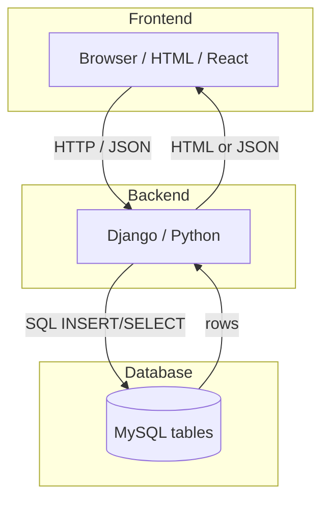
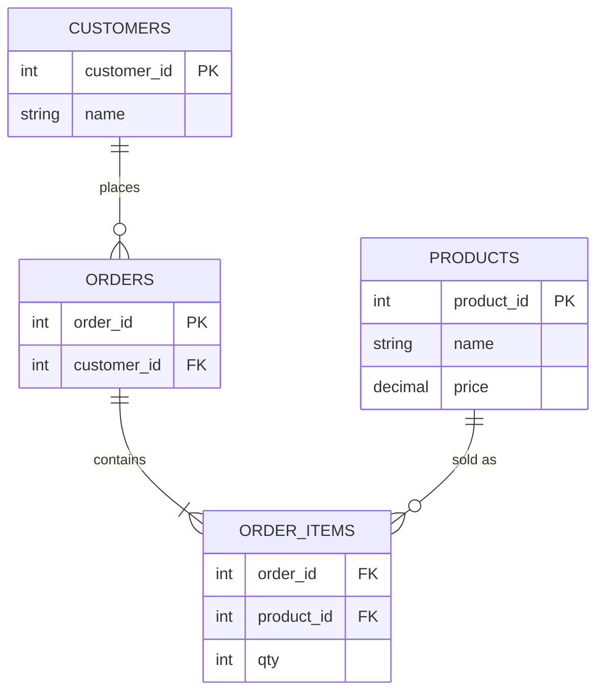

# Module: MySQL for Full Stack Developers

**SQL material (source of truth):** [`MYSQL/README.md`](../../MYSQL/README.md) — open those files on lab days.  
**Schedule:** [Session Calendar](../Session_Calendar_100.md) — Weeks 10–11 / Sessions 46–55.  
**Python connectivity:** [`../03_Advanced_Python/06_Database_Programming_Bridge.md`](../03_Advanced_Python/06_Database_Programming_Bridge.md)

> **Note:** This FS module is the **bridge** (ER, normalization, Django context). Placement-ready SQL depth is taught from **`MYSQL/`** during **Weeks 10–11** (setup → CRUD → joins → transactions → practice). Do not treat SQL as optional.

**Previous module:** Git and GitHub  
**Next module:** Database Programming Bridge (Python ↔ MySQL)

---

**Module Outcome:**

- Sketch an ER for AcmeHR / TechMart before touching Django models
- Open the real SQL labs in `MYSQL/` — this file is the bridge, not the course
- Normalise enough that one fact does not live in three columns

## Prerequisites

- MySQL installed — [`MYSQL/00_MySQL_Setup_and_Connection.md`](../../MYSQL/00_MySQL_Setup_and_Connection.md)

### Required MySQL labs (Weeks 10–11)

SQL is a **core placement skill**. Deep notes live in [`MYSQL/`](../../MYSQL/); the labs below are **mandatory** for every batch. Aim for independent CRUD + JOINs before Django ORM / capstone DB design.

| Done | When | Lab file | You must be able to |
|:----:|------|----------|---------------------|
| ☐ | W10 | [`MYSQL/00_MySQL_Setup_and_Connection.md`](../../MYSQL/00_MySQL_Setup_and_Connection.md) + [`MYSQL/README.md`](../../MYSQL/README.md) | Install/connect; create `training_db` |
| ☐ | W10 | [`MYSQL/01_Introduction_to_Databases.md`](../../MYSQL/01_Introduction_to_Databases.md) | Explain table/row/DBMS vs Excel |
| ☐ | W10 | [`MYSQL/02_Introduction_to_SQL_Basic_Concepts.md`](../../MYSQL/02_Introduction_to_SQL_Basic_Concepts.md) | DDL + DML CRUD + constraints |
| ☐ | W10 | [`MYSQL/03_Querying_with_SQL.md`](../../MYSQL/03_Querying_with_SQL.md) | WHERE, LIKE, ORDER BY, LIMIT |
| ☐ | W10 | [`MYSQL/labs/README.md`](../../MYSQL/labs/README.md) | Run `training_db_seed.sql` before ch. 03 drills |
| ☐ | W10 | This bridge module | ER sketch for Library / CampusCart |
| ☐ | W11 | [`MYSQL/06_Modeling_Databases.md`](../../MYSQL/06_Modeling_Databases.md) | PK/FK, 1:N |
| ☐ | W11 | [`MYSQL/07_Joins.md`](../../MYSQL/07_Joins.md) | INNER + LEFT JOIN multi-table reports |
| ☐ | W11 | [`MYSQL/09_Transactions_and_Indexes.md`](../../MYSQL/09_Transactions_and_Indexes.md) | COMMIT/ROLLBACK; when index helps |
| ☐ | W11 | [`MYSQL/homework/10_Practice_Exercises.md`](../../MYSQL/homework/10_Practice_Exercises.md) | Complete exercises for ch. 02, 03, 07 |
| ☐ | W11 | [Python bridge](../03_Advanced_Python/06_Database_Programming_Bridge.md) | Parameterized INSERT/SELECT/UPDATE/DELETE from Python |

**Strongly recommended before placement mocks:** [`MYSQL/04`](../../MYSQL/04_Aggregations_and_Group_By.md) · [`MYSQL/05`](../../MYSQL/05_Common_Concepts.md) · [`MYSQL/08`](../../MYSQL/08_Views_and_Subqueries.md) · one project from [`MYSQL/12`](../../MYSQL/12_Real_Time_Projects.md). Window functions ([`MYSQL/11`](../../MYSQL/11_Window_Functions_and_CTEs.md)) only if the required set is solid.

**Exit ticket (without notes):** CREATE with PK+FK · INSERT/UPDATE/DELETE · SELECT + WHERE/ORDER BY · INNER JOIN + explain LEFT JOIN · why parameterized queries from Python.

A **full-stack application** has three layers: **frontend** (browser), **backend** (Python/Django), and **database** (MySQL). When a student registers on CampusCart, React sends data to Django, Django validates it, and SQL **INSERT**s a row into `users`.

**Icons:** Order · Employee · Bank · Payroll · Laptop

**Where used?**
- **TechMart** / CampusCart customers, products, orders, order_items
- College apps — students, courses, enrollments in LMS / portals
- **AcmeHR** — departments and employees tables
- **SecureBank** — accounts and transactions (PK/FK integrity matters)
- **MedCare** — patients, appointments, tickets stored as related rows

**Visual — three layers talking:**



**Key takeaways:**
- Browser → Django/Python → MySQL (and back)
- Frontend never talks SQL directly — backend issues INSERT/SELECT
- Same pattern for React SPA or server-rendered HTML

**MySQL** stores data in **tables** linked by **relationships**. A **primary key (PK)** uniquely identifies each row. A **foreign key (FK)** references a PK in another table — how "order belongs to customer" is enforced.

**SQL categories:**

| Category | Purpose | Examples |
|----------|---------|----------|
| **DDL** | Define structure | CREATE TABLE, ALTER, DROP |
| **DML** | Change data | INSERT, UPDATE, DELETE |
| **DQL** | Read data | SELECT |
| **TCL** | Control transactions | COMMIT, ROLLBACK |

This module teaches **full-stack essentials**. For aggregations, subqueries, window functions, and projects — use **`MYSQL/`** in this repo.

---

## Important Concepts

> **Depth:** Run these in MySQL Workbench / CLI. For full labs, follow **Weeks 10–11** and open [`MYSQL/`](../../MYSQL/) files from the checklist — this module is the bridge, **`MYSQL/` is the source of truth**.

### 1. Three domains (reuse all course)

| Domain | Core tables | Full-stack use |
|--------|-------------|----------------|
| **Student** | students, courses, enrollments | LMS, college portals |
| **Employee** | departments, employees | HRMS, payroll |
| **Ecommerce** | customers, products, orders, order_items | CampusCart |

**Try these (2 programs):**

**Program 1 — Named-product domain sketch note**

```sql
-- Which domain? CampusCart canteen = Ecommerce
-- Sketch only (comments) before CREATE:
-- users, vendors, products, orders, order_items
SELECT 'Ecommerce domain for CampusCart' AS note;
```

**Expected Output:**

```
+----------------------------------+
| note                             |
+----------------------------------+
| Ecommerce domain for CampusCart  |
+----------------------------------+
```

**Program 2 — List tables you will need**

```sql
-- Student portal needs:
-- students, courses, enrollments
SELECT 'students' AS table_name
UNION ALL SELECT 'courses'
UNION ALL SELECT 'enrollments';
```

**Expected Output:**

```
+------------+
| table_name |
+------------+
| students   |
| courses    |
| enrollments|
+------------+
```

### 2. DDL — creating structure

```sql
CREATE DATABASE IF NOT EXISTS training_db;
USE training_db;

CREATE TABLE students (
    student_id  INT PRIMARY KEY AUTO_INCREMENT,
    full_name   VARCHAR(100) NOT NULL,
    email       VARCHAR(150) UNIQUE NOT NULL,
    enrolled_on DATE DEFAULT (CURRENT_DATE)
);

CREATE TABLE departments (
    dept_id   INT PRIMARY KEY AUTO_INCREMENT,
    dept_name VARCHAR(80) NOT NULL UNIQUE
);

CREATE TABLE employees (
    emp_id    INT PRIMARY KEY AUTO_INCREMENT,
    full_name VARCHAR(100) NOT NULL,
    dept_id   INT NOT NULL,
    salary    DECIMAL(10, 2) DEFAULT 0,
    FOREIGN KEY (dept_id) REFERENCES departments(dept_id)
);

CREATE TABLE customers (
    customer_id INT PRIMARY KEY AUTO_INCREMENT,
    name        VARCHAR(100) NOT NULL,
    city        VARCHAR(60)
);

CREATE TABLE products (
    product_id INT PRIMARY KEY AUTO_INCREMENT,
    name       VARCHAR(120) NOT NULL,
    price      DECIMAL(10, 2) NOT NULL CHECK (price >= 0)
);

CREATE TABLE orders (
    order_id    INT PRIMARY KEY AUTO_INCREMENT,
    customer_id INT NOT NULL,
    order_date  DATETIME DEFAULT CURRENT_TIMESTAMP,
    FOREIGN KEY (customer_id) REFERENCES customers(customer_id)
);

CREATE TABLE order_items (
    item_id    INT PRIMARY KEY AUTO_INCREMENT,
    order_id   INT NOT NULL,
    product_id INT NOT NULL,
    quantity   INT NOT NULL DEFAULT 1,
    FOREIGN KEY (order_id) REFERENCES orders(order_id),
    FOREIGN KEY (product_id) REFERENCES products(product_id)
);
```

**Visual — CampusCart relationships (why JOINs exist):**



**Key takeaways:**
- Customer **1 → many** Orders; Order **1 → many** Order_items
- Order_item needs **both** `order_id` (FK) and `product_id` (FK)
- JOINs exist because related data lives in separate tables

One customer → many orders; one order → many line items; each line item points to a product.

**Remember:** Money columns use `DECIMAL(10,2)` — not `FLOAT` / `VARCHAR`.

**Common Error:** Forgetting `FOREIGN KEY` / UNIQUE on email → orphan orders and duplicate logins. Define constraints in DDL.

**Note:**
- VARCHAR/FLOAT for money — use `DECIMAL(10,2)` instead.
- No FOREIGN KEY — define FK in DDL.
- No UNIQUE on email — add a UNIQUE constraint.

**Try these (2 programs):**

**Program 1 — Courses table for LMS**

```sql
USE training_db;

CREATE TABLE IF NOT EXISTS courses (
    course_id INT PRIMARY KEY AUTO_INCREMENT,
    title     VARCHAR(120) NOT NULL,
    credits   INT NOT NULL CHECK (credits > 0)
);

SHOW COLUMNS FROM courses;
```

**Program 2 — Enrollments with FKs**

```sql
USE training_db;

CREATE TABLE IF NOT EXISTS enrollments (
    enrollment_id INT PRIMARY KEY AUTO_INCREMENT,
    student_id    INT NOT NULL,
    course_id     INT NOT NULL,
    enrolled_on   DATE DEFAULT (CURRENT_DATE),
    FOREIGN KEY (student_id) REFERENCES students(student_id),
    FOREIGN KEY (course_id) REFERENCES courses(course_id)
);
```

### 3. DML — changing data

```sql
INSERT INTO students (full_name, email) VALUES
('Priya Sharma', 'priya@campus.in'), ('Rahul Verma', 'rahul@campus.in');

INSERT INTO departments (dept_name) VALUES ('Engineering'), ('HR');
INSERT INTO employees (full_name, dept_id, salary) VALUES ('Anita Rao', 1, 85000.00);

INSERT INTO customers (name, city) VALUES ('Meera', 'Hyderabad');
INSERT INTO products (name, price) VALUES ('Notebook', 45.00), ('Pen Pack', 120.00);
INSERT INTO orders (customer_id) VALUES (1);

UPDATE employees SET salary = salary * 1.10 WHERE dept_id = 1;
DELETE FROM students WHERE email = 'rahul@campus.in';  -- always use WHERE!
```

**Note:**
- `DELETE FROM students` without WHERE — always use WHERE; test with SELECT first.

**Try these (2 programs):**

**Program 1 — TechMart seed canteen products (INR)**

```sql
USE training_db;

INSERT INTO products (name, price) VALUES
('Masala Dosa', 60.00),
('Filter Coffee', 25.00),
('Veg Thali', 90.00);

SELECT product_id, name, price FROM products ORDER BY price;
```

**Program 2 — Safe update then check**

```sql
USE training_db;

-- Preview first
SELECT * FROM products WHERE name = 'Notebook';

UPDATE products SET price = 49.00 WHERE name = 'Notebook';

SELECT name, price FROM products WHERE name = 'Notebook';
```

### 4. DQL — reading data

```sql
SELECT full_name, email FROM students WHERE enrolled_on >= '2026-01-01';

SELECT e.full_name, d.dept_name, e.salary
FROM employees e JOIN departments d ON e.dept_id = d.dept_id
WHERE e.salary > 70000 ORDER BY e.salary DESC;

SELECT name, price FROM products WHERE price BETWEEN 40 AND 150;
```

**Note:**
- `SELECT *` in APIs — name columns explicitly.

**Try these (2 programs):**

**Program 1 — TechMart products under ₹100**

```sql
USE training_db;

SELECT name, price
FROM products
WHERE price < 100
ORDER BY price ASC;
```

**Program 2 — TechMart Hyderabad customers**

```sql
USE training_db;

SELECT customer_id, name, city
FROM customers
WHERE city = 'Hyderabad';
```

### 5. TCL — transactions (overview)

```sql
START TRANSACTION;
UPDATE products SET price = price - 10 WHERE product_id = 1;
-- ROLLBACK;  -- if error
COMMIT;
```

**Go deeper:** [`MYSQL/09_Transactions_and_Indexes.md`](../../MYSQL/09_Transactions_and_Indexes.md)

**Try these (2 programs):**

**Program 1 — TechMart rollback a bad price cut**

```sql
USE training_db;

START TRANSACTION;
UPDATE products SET price = 1.00 WHERE name = 'Veg Thali';
SELECT name, price FROM products WHERE name = 'Veg Thali';
ROLLBACK;
SELECT name, price FROM products WHERE name = 'Veg Thali';  -- restored
```

**Program 2 — TechMart commit a real discount**

```sql
USE training_db;

START TRANSACTION;
UPDATE products SET price = price - 5 WHERE name = 'Filter Coffee';
COMMIT;
SELECT name, price FROM products WHERE name = 'Filter Coffee';
```

### 6. INNER JOIN vs LEFT JOIN

**INNER JOIN** — only rows matching in **both** tables:

```sql
SELECT e.full_name, d.dept_name
FROM employees e INNER JOIN departments d ON e.dept_id = d.dept_id;
```

**LEFT JOIN** — all rows from **left** table; NULL on right if no match:

```sql
SELECT c.name, o.order_id, o.order_date
FROM customers c LEFT JOIN orders o ON c.customer_id = o.customer_id;
```

**Ecommerce chain (INNER JOINs):**

```sql
SELECT c.name AS customer, p.name AS product, oi.quantity, p.price
FROM orders o
INNER JOIN customers c ON o.customer_id = c.customer_id
INNER JOIN order_items oi ON o.order_id = oi.order_id
INNER JOIN products p ON oi.product_id = p.product_id;
```

**Go deeper:** [`MYSQL/07_Joins.md`](../../MYSQL/07_Joins.md) · Lab kit: [02_mysql_library_seed](../15_Lab_Assets/02_mysql_library_seed/)

**Note:**
- JOIN without ON → Cartesian product — always write an explicit ON.

**Try these (2 programs):**

**Program 1 — AcmeHR employees with department names**

```sql
USE training_db;

SELECT e.full_name, d.dept_name, e.salary
FROM employees e
INNER JOIN departments d ON e.dept_id = d.dept_id
ORDER BY d.dept_name, e.full_name;
```

**Program 2 — TechMart customers with or without orders**

```sql
USE training_db;

INSERT INTO customers (name, city) VALUES ('Arjun', 'Pune');  -- no orders yet

SELECT c.name, o.order_id
FROM customers c
LEFT JOIN orders o ON c.customer_id = o.customer_id
ORDER BY c.name;
```

### 7. Normalization lite (1NF → 3NF)

| Normal Form | Rule | Bad example | Fix |
|-------------|------|-------------|-----|
| **1NF** | Atomic columns; no repeating groups | `courses: "Math, Physics"` | `enrollments` junction table |
| **2NF** | No partial dependency on composite PK | instructor in enrollment row | Move to `courses` |
| **3NF** | No transitive dependency | dept_head in student row | Split `departments` |

**Go deeper:** [`MYSQL/06_Modeling_Databases.md`](../../MYSQL/06_Modeling_Databases.md)

**Note:**
- Comma-separated values in one column — use a junction table (1NF).

**Try these (2 programs):**

**Program 1 — Fix a 1NF violation (sketch as SQL comments + create)**

```sql
-- BAD: courses_csv VARCHAR storing "Math,Physics"
-- GOOD: enrollments rows
USE training_db;

INSERT INTO courses (title, credits) VALUES ('Math', 4), ('Physics', 3);
INSERT INTO enrollments (student_id, course_id) VALUES (1, 1), (1, 2);

SELECT s.full_name, c.title
FROM students s
INNER JOIN enrollments e ON s.student_id = e.student_id
INNER JOIN courses c ON e.course_id = c.course_id;
```

**Program 2 — Spot the 3NF issue**

```sql
-- BAD idea (do not create long-term):
-- students(full_name, dept_name, dept_head)
-- GOOD: departments(dept_name, dept_head) + students.dept_id FK
SELECT 'Move dept_head to departments table (3NF)' AS fix_note;
```

---

## Step-by-Step Lab

1. Connect per `MYSQL/00_MySQL_Setup_and_Connection.md`; run `CREATE DATABASE fullstack_lab; USE fullstack_lab;`
2. Execute DDL for student, employee, and ecommerce tables above
3. Seed 3+ rows per table with INSERT examples
4. DQL drills: Engineering employees; products under ₹100; students sorted by name
5. JOIN lab: INNER (employees + departments); LEFT (customers + orders, include zero-order customer)
6. Normalize `bad_orders(order_id, customer_name, customer_city, product1, product2)` → sketch `customers`, `orders`, `order_items`, `products`

---

## Practice Exercises

### Basic

1. CREATE TABLE `courses` (course_id, title, credits); INSERT 5 rows; SELECT credits > 3.
   **Model answer:**

```sql
CREATE TABLE courses (
  course_id INT PRIMARY KEY AUTO_INCREMENT,
  title VARCHAR(100) NOT NULL,
  credits INT NOT NULL
);
INSERT INTO courses (title, credits) VALUES
  ('Python', 4), ('MySQL', 3), ('Django', 4), ('React', 3), ('APIs', 2);
SELECT * FROM courses WHERE credits > 3;
```

2. UPDATE one title; DELETE one row by id.
   **Model answer:**

```sql
UPDATE courses SET title = 'Advanced Python' WHERE course_id = 1;
DELETE FROM courses WHERE course_id = 5;
```

3. List all departments alphabetically.
   **Model answer:**

```sql
SELECT * FROM departments ORDER BY dept_name ASC;
```

### Intermediate

1. Add `enrollments(student_id, course_id)`; INNER JOIN students + enrollments + courses.
   **Model answer:**

```sql
CREATE TABLE enrollments (
  student_id INT,
  course_id INT,
  PRIMARY KEY (student_id, course_id),
  FOREIGN KEY (student_id) REFERENCES students(student_id),
  FOREIGN KEY (course_id) REFERENCES courses(course_id)
);
SELECT s.name, c.title
FROM students s
INNER JOIN enrollments e ON s.student_id = e.student_id
INNER JOIN courses c ON c.course_id = e.course_id;
```

2. LEFT JOIN — students with no enrollments.
   **Model answer:**

```sql
SELECT s.student_id, s.name
FROM students s
LEFT JOIN enrollments e ON s.student_id = e.student_id
WHERE e.student_id IS NULL;
```

3. Employee report: dept_name, count, avg salary → see `MYSQL/04_Aggregations_and_Group_By.md`.
   **Model answer:**

```sql
SELECT d.dept_name, COUNT(e.emp_id) AS emp_count, AVG(e.salary) AS avg_salary
FROM departments d
LEFT JOIN employees e ON d.dept_id = e.dept_id
GROUP BY d.dept_name;
```

4. Fix denormalized `bad_library` table into 3NF.
   **Model answer:**
   Split repeating groups and transitive dependencies into separate tables such as `books(book_id, title, author_id)`, `authors(author_id, name)`, and `loans(loan_id, book_id, member_id, due_date)` so each non-key attribute depends only on the primary key.

### Interview-style

1. INNER vs LEFT JOIN — write SQL showing NULL side.
   **Model answer:**

```sql
-- INNER: only matching rows
SELECT * FROM students s INNER JOIN enrollments e ON s.student_id = e.student_id;
-- LEFT: keep all students; unmatched enrollment columns are NULL
SELECT s.name, e.course_id
FROM students s
LEFT JOIN enrollments e ON s.student_id = e.student_id;
```

2. When use TRANSACTION? (checkout, money transfer)
   **Model answer:**
   Use a transaction when multiple statements must succeed or fail together — e.g. debit one account and credit another, or place an order and decrement stock. `START TRANSACTION` … `COMMIT`/`ROLLBACK` protects consistency.

3. Design tables for CampusCart menu and daily orders.
   **Model answer:**
   Typical design: `menu_items(item_id, name, price, available)`, `orders(order_id, student_id, order_date, status)`, `order_items(order_id, item_id, qty, unit_price)` with FKs from `order_items` to `orders` and `menu_items`.

4. PRIMARY KEY vs UNIQUE — example.
   **Model answer:**
   PRIMARY KEY uniquely identifies a row and disallows NULL (e.g. `student_id`). UNIQUE enforces uniqueness on another column that may allow NULL depending on engine (e.g. `email UNIQUE`).

5. Why DECIMAL for price, not FLOAT?
   **Model answer:**
   FLOAT is binary approximate and can produce rounding errors in money. DECIMAL stores exact base-10 values, so totals and invoices stay accurate.

## Mini-Project (Assignment): Schema Design (Library, TechMart / CampusCart, or AcmeHR)

**Lab kit (build here):** [15_Lab_Assets/02_mysql_library_seed/](../15_Lab_Assets/02_mysql_library_seed/)  
**SQL depth (SoT):** Weeks 10–11 · follow [`MYSQL/`](../../MYSQL/) + the **Required MySQL labs** table in this module

**Option A — Library:** members, books, copies, loans, fines  
**Option B — CampusCart:** users, vendors, products, orders, order_items

### What to build

- ER diagram; DDL with PK/FK; 10+ INSERT rows; 3 queries with JOINs (overdue books OR order history).

```sql
-- Sample CampusCart report query
SELECT u.full_name, o.order_id, p.name, oi.quantity
FROM orders o
JOIN users u ON o.user_id = u.user_id
JOIN order_items oi ON o.order_id = oi.order_id
JOIN products p ON oi.product_id = p.product_id
WHERE o.order_date >= '2026-07-01';
```

### Stretch

- Add a fine/tax column with `DECIMAL(10,2)` and one aggregate report (`MYSQL/04_…`).
- Write one `START TRANSACTION` … `COMMIT` checkout script (`MYSQL/09_…`).
- Parameterized query note for the injection lab: [20_sql_injection_demo](../15_Lab_Assets/20_sql_injection_demo/).

### Done when

- [ ] Lab kit join report ticket completed
- [ ] ER + DDL with PK/FK for chosen option
- [ ] Seed data (≥10 rows) + 3 JOIN queries run successfully
- [ ] You can point to the matching `MYSQL/` files you used for depth

---

## Bridge to Deep MySQL Modules

| Need | File |
|------|------|
| Setup | `MYSQL/00_MySQL_Setup_and_Connection.md` |
| SQL basics | `MYSQL/02_Introduction_to_SQL_Basic_Concepts.md` |
| Querying | `MYSQL/03_Querying_with_SQL.md` |
| GROUP BY | `MYSQL/04_Aggregations_and_Group_By.md` |
| Keys, constraints | `MYSQL/05_Common_Concepts.md` |
| ER modeling | `MYSQL/06_Modeling_Databases.md` |
| All joins | `MYSQL/07_Joins.md` |
| Subqueries, views | `MYSQL/08_Views_and_Subqueries.md` |
| Transactions, indexes | `MYSQL/09_Transactions_and_Indexes.md` |
| Practice + projects | `MYSQL/homework/10_Practice_Exercises.md`, `MYSQL/12_Real_Time_Projects.md` |

**Python bridge:** `03_Advanced_Python/06_Database_Programming_Bridge.md` → **Next:** Django ORM maps to these tables.

## Interview Q&A

Shared with students after concepts and the mini-project. Use for review and interview prep — questions and model answers are included.

1. Why can't we store app data in a Python list after restart?
2. When does LEFT JOIN show NULL? **TechMart** ecommerce example?
3. Is normalization always good? When might **TechMart** denormalize read reports?
4. How does Django ORM relate to today's SQL?
5. foreign key ≈ hyperlink between spreadsheets?

**Q1. What is a relational database?**  
**A:** Data in tables with rows/columns linked by keys; MySQL is open-source RDBMS for Python/Django backends.

**Q2. INNER JOIN vs LEFT JOIN?**  
**A:** INNER = matching rows only; LEFT = all left rows + matches or NULL on right (**TechMart** customers with no orders; **AcmeHR** employees with no leave).

**Q3. What is normalization? Why 3NF?**  
**A:** Reduces redundancy; 3NF removes transitive dependencies preventing update anomalies.

**Q4. DELETE vs DROP?**  
**A:** DELETE removes rows (DML); DROP removes table structure (DDL).

**Q5. MySQL in full stack?**  
**A:** Persistent storage; frontend → Django API → SQL against MySQL.

---

