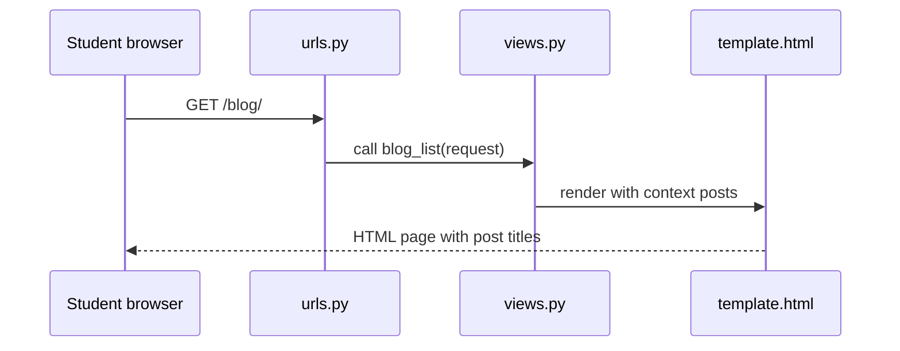

# Module: URLs, Views, Templates, and Static Files

**Theme apps:** Blog · Task Manager · Booking · Student Portal · CampusCart E-commerce

**Previous module:** Django Introduction and Setup
**Next module:** Models ORM Admin

---

**Module Outcome:**

- Map `/blog/` to a view and send HTML back — URL, view, template as one path
- Pass context into a template without hard-coding Priya in three places
- Serve CSS/images as static files, not as copy-pasted `<style>` in every page

### What Happens When User Opens a Page?

1. Browser sends **HTTP request** to URL like `http://127.0.0.1:8000/blog/`
2. Django **URL dispatcher** reads `urls.py` and finds matching **path**
3. Matching **view** (Python function) runs
4. View returns **HttpResponse** (plain text/HTML) or calls **`render()`** with a **template**
5. **Template** is HTML with placeholders filled using **context** data

**Where used?**
- Campus portal — home, about, announcements pages with shared `base.html`
- **Swiggy** — product list / detail templates + CSS for CampusCart
- Blog / Task Manager — multi-page nav via `` and ``
- Admin-facing staff sites — same URL → view → template pattern
- Capstone — reusable layout so every page shares navbar/footer

**Visual — follow one request like a story:**



**Key takeaways:**
- Request hits `urls.py` → view runs → `render(template, context)` → HTML
- Context dict keys become `{{ variables }}` in the template
- Static CSS/JS via `` — not from the database

**URL (Uniform Resource Locator)** — address of a page.  
**View** — Python function that decides what to send back.  
**Template** — HTML file with dynamic parts.  
**Context** — Python dictionary of variables available inside the template.  
**Static files** — CSS, JavaScript, images — same for every user, not from database.

### Function-Based View (FBV)

A **function-based view** is a normal Python function taking **`request`** as first argument. The **request** object carries method (GET/POST), user, cookies, and form data.

```python
def home(request):
    return HttpResponse("<h1>Welcome</h1>")  # quick test only
```

**Expected Output:** (browser at `/` when wired in `urls.py`)

```
Welcome
```

**Remember:** Prefer `render(request, "…html", context)` for real pages — `HttpResponse` HTML is only for smoke tests.

Production-style pages use **`render()`** to separate HTML into template files.

### Template Inheritance

Instead of copying `<nav>` on every page, create **`base.html`** with common layout. Child templates **``** base and fill **``**. This is **DRY** (Don't Repeat Yourself).

**Note:**
- Wrong `` path → template error. Use a path relative to `DIRS` / `APP_DIRS` (e.g. `"base.html"` or `"blog/post_list.html"`).

**Common Error:** Writing `` (missing **s**) → template syntax error. The tag is ``.

### Static Files in Development

Django serves static files in **`DEBUG=True`** mode when configured. In templates:

```html

<link rel="stylesheet" href="">
```

**``** — loads template tag library for static URLs.  
**``** — generates correct URL to CSS/JS file.

**Note:**
- Forgot `` at the top → empty/broken CSS URL. Load static before using ``.

---

## Concepts

### 1. URL Configuration Hierarchy

```
config/urls.py  (project root)
    path('admin/', admin.site.urls)
    path('', include('blog.urls'))
    path('tasks/', include('tasks.urls'))

blog/urls.py  (app)
    path('', views.post_list, name='post_list')
    path('about/', views.about, name='about')
```

**`include()`** — delegates URL patterns to app's urls module — keeps apps portable.

**`name='post_list'`** — URL **name** for reverse lookup (links without hardcoding paths).

**Note:**
- Trailing-slash mismatch → 404 or redirect loop. Stay consistent with Django `APPEND_SLASH`.
- Hardcoding `/blog/` in `href` breaks when the URL prefix changes — use ``.

Include the blog app URLs under `/blog/` in the project root URLconf.

```python
# config/urls.py
from django.contrib import admin
from django.urls import path, include

urlpatterns = [
    path("admin/", admin.site.urls),
    path("blog/", include("blog.urls")),
]
```

Map home and about views in `blog/urls.py` with named routes.

```python
# blog/urls.py
from django.urls import path
from . import views

urlpatterns = [
    path("", views.home, name="blog_home"),
    path("about/", views.about, name="blog_about"),
]
```

### 2. Request Methods (Preview)

Today focus on **GET** (read page). Module 04 covers **POST** (form submit).

Return the request HTTP method in an HttpResponse so you can inspect GET vs POST.

```python
from django.http import HttpResponse

def ping(request):
    return HttpResponse(f"Method: {request.method}")
```

Reject non-GET requests on an about page and return “About CampusCart” for GET.

```python
from django.http import HttpResponse, HttpResponseNotAllowed

def about(request):
    if request.method != "GET":
        return HttpResponseNotAllowed(["GET"])
    return HttpResponse("About CampusCart")
```

### 3. Template Language Essentials

| Syntax | Purpose | Example |
|--------|---------|---------|
| `{{ variable }}` | Output value | `{{ post.title }}` |
| `` | Logic/control | `` |
| `{{ value\|filter }}` | Format | `{{ created\|date:"d M Y" }}` |
| `` | Named URL | `` |

**Note:**
- URL name typo in `` → `NoReverseMatch`. Match `name=` in `urls.py` exactly.

Render `student_name` and `batch_city` from the view context in a template that extends `base.html`.

```html
<!-- templates/blog/home.html -->


  <h1>Hello, {{ student_name }}!</h1>
  <p>Batch: {{ batch_city }}</p>

```

Build a nav that uses `` with named routes instead of hardcoded paths.

```html
<nav>
  <a href="">Home</a>
  <a href="">About</a>
</nav>
```

### 4. Static Files Settings

```python
# settings.py
STATIC_URL = "static/"
STATICFILES_DIRS = [BASE_DIR / "static"]  # project-level static folder
```

App-level static: `blog/static/blog/css/blog.css` (namespaced by app folder).

**Note:**
- Static in the wrong folder → 404 on CSS. Use project `static/css/` or app `static/<app>/…` as configured.

---

Load the static tag and link the project CSS file from the template.

```html

<link rel="stylesheet" href="">
```

Add a minimal `styles.css` for body font and nav spacing.

```css
/* static/css/styles.css */
body { font-family: Georgia, serif; margin: 1rem; }
.nav a { margin-right: 1rem; }
```

## Step-by-Step Lab (Annotated)

### Step 1 — Blog Views (FBV)

```python
# blog/views.py
from django.shortcuts import render
from django.http import HttpResponse

def post_list(request):
    # Temporary hardcoded data — replaced by ORM in Module 03
    posts = [
        {"title": "CampusCart Launch", "author": "Admin"},
        {"title": "Exam Schedule", "author": "Dean"},
    ]
    context = {"posts": posts, "page_title": "Blog Home"}
    return render(request, "blog/post_list.html", context)

def about(request):
    return render(request, "blog/about.html", {"team": "KSR Django Batch"})
```

### Step 2 — App URLs

```python
# blog/urls.py  (create this file)
from django.urls import path
from . import views

urlpatterns = [
    path("", views.post_list, name="post_list"),
    path("about/", views.about, name="about"),
]
```

**Note:**
- View not imported in `urls.py` → `AttributeError`. Use `from . import views` before referencing `views.post_list`.

### Step 3 — Project URLs

```python
# config/urls.py
from django.contrib import admin
from django.urls import path, include

urlpatterns = [
    path("admin/", admin.site.urls),
    path("blog/", include("blog.urls")),
]
```

Visit: `http://127.0.0.1:8000/blog/` and `/blog/about/`

### Step 4 — Base Template + Inheritance

```html
<!-- templates/base.html -->

<!DOCTYPE html>
<html lang="en">
<head>
  <meta charset="UTF-8">
  <title>Student Portal</title>
  <link rel="stylesheet" href="">
</head>
<body>
  <nav class="navbar">
    <a href="">Blog</a>
    <a href="">About</a>
  </nav>
  <main class="container">
    
  </main>
  <script src=""></script>
</body>
</html>
```

```html
<!-- blog/templates/blog/post_list.html -->


Blog — {{ page_title }}


<h1>{{ page_title }}</h1>
<ul class="post-list">
  
    <li><strong>{{ post.title }}</strong> by {{ post.author }}</li>
  
    <li>No posts yet.</li>
  
</ul>

```

**Template loader paths:** App templates live in `blog/templates/blog/` (namespace avoids clashes).

### Step 5 — Tell Django Where Templates Live

```python
# config/settings.py
TEMPLATES = [
    {
        "BACKEND": "django.template.backends.django.DjangoTemplates",
        "DIRS": [BASE_DIR / "templates"],  # project-wide base.html
        "APP_DIRS": True,
        ...
    },
]
```

**Note:**
- `TemplateDoesNotExist` usually means a wrong path — check `app/templates/app/file.html` and that `DIRS` / `APP_DIRS` are set.

### Step 6 — Static CSS

```css
/* static/css/site.css */
.navbar { background: #1e3a5f; padding: 1rem; }
.navbar a { color: #fff; margin-right: 1rem; text-decoration: none; }
.container { max-width: 960px; margin: 2rem auto; padding: 0 1rem; }
.post-list li { margin-bottom: 0.5rem; }
```

```javascript
// static/js/main.js
console.log("Campus Portal static JS loaded");
```

Restart server if needed; hard-refresh browser (`Ctrl+Shift+R`).

### Step 7 — Task Manager Home (Second App Pattern)

```python
# tasks/views.py
from django.shortcuts import render

def dashboard(request):
    tasks = ["Submit assignment", "Book lab slot", "Pay CampusCart order"]
    return render(request, "tasks/dashboard.html", {"tasks": tasks, "count": len(tasks)})
```

```python
# tasks/urls.py
from django.urls import path
from . import views

urlpatterns = [
    path("", views.dashboard, name="task_dashboard"),
]
```

Add `path("tasks/", include("tasks.urls"))` to project urls.

---

## Practice Exercises

### Basic

1. Add `/blog/contact/` view returning rendered template with your email
   **Model answer:**

```python
# blog/views.py
from django.shortcuts import render

def contact(request):
    return render(request, "blog/contact.html", {"email": "you@ksr.com"})
```

   Wire `path("contact/", views.contact, name="contact")` under the blog urls include.

2. Add footer block in `base.html` using ``
   **Model answer:**

```html
<footer>
  
  <p>&copy; KSR Trainings</p>
  
</footer>
```

3. Style navbar with flexbox in `site.css`
   **Model answer:**

```css
.navbar {
  display: flex;
  gap: 1rem;
  align-items: center;
  justify-content: space-between;
}
```

   Load via `` in `base.html`.

### Intermediate

1. Booking theme: routes `/booking/`, `/booking/rooms/`, `/booking/confirm/` with placeholder templates
   **Model answer:**
   Create `booking` app urls with three `path`s to views that each `render` a simple template (`home.html`, `rooms.html`, `confirm.html`). Include under `path("booking/", include("booking.urls"))`.

2. Pass `request.method` to template and display in debug line (remove before submit)
   **Model answer:**

```python
return render(request, "page.html", {"method": request.method})
```

   ```html
   <p class="debug">Method: {{ method }}</p>
   ```

3. Create `CampusCart` home with static product cards (hardcoded list in context)
   **Model answer:**

```python
products = [
    {"name": "Samosa", "price": 20},
    {"name": "Tea", "price": 15},
]
return render(request, "cart/home.html", {"products": products})
```

   Loop with `` and show name/price cards.

### Interview Prep

1. Explain request-response cycle with diagram
   **Model answer:**
   Browser → URLConf matches path → View runs → (optional Model query) → Template rendered → HttpResponse returned. Middleware can wrap request/response on the way in and out.

2. FBV vs CBV (class-based views) — one-line comparison
   **Model answer:**
   Function-based views are plain functions; class-based views package HTTP methods and mixins into reusable classes — CBVs reduce boilerplate for CRUD, FBVs stay clearer for simple custom logic.

3. Why template inheritance beats copy-paste HTML
   **Model answer:**
   Inheritance lets one `base.html` own navbar/footer while child templates fill ``. One design change updates every page instead of editing duplicated HTML.

## Mini-Project / Activity (Assignment)

**Mini-Project: "Blog + Tasks Shell" (90 min)**  
**Lab kit (build here):** [15_Lab_Assets/24_django_url_views_stub/](../15_Lab_Assets/24_django_url_views_stub/)

### What to build

- **Blog:** list + about pages with inheritance
- **Tasks:** dashboard with task count badge in navbar (context variable)
- Shared `base.html`, shared CSS, working `` links
- No database yet — hardcoded context only

### Stretch

- Add a third page `contact/` with a simple static thank-you message.
- Put the campus city (`Hyderabad`) in context and show it in the footer.

### Done when

- [ ] Lab kit Home + About with `base.html` ticket completed
- [ ] Click Blog → Tasks → Blog without 404
- [ ] CSS visible on all pages via ``
- [ ] Navbar uses `` names (not hardcoded paths only)

## Interview Q&A

Shared with students after concepts and the mini-project. Use for review and interview prep — questions and model answers are included.

1. Why separate HTML (template) from Python (view)?
2. When is `HttpResponse` enough without `render()`?
3. How does `` help when marketing changes `/blog/` to `/articles/`?
4. compare Django templates to JSP/Thymeleaf.
5. Should large JavaScript frameworks replace Django templates for every page?

**Q1. Explain Django request-response cycle.**  
**A:** URLconf matches URL → view executes → returns HttpResponse or rendered template → middleware may process response → browser receives HTML.

**Q2. What is context in Django templates?**  
**A:** Dictionary of data from view made available as variables in template for dynamic HTML.

**Q3. Why use `` instead of hardcoded paths?**  
**A:** Centralized URL changes; avoids broken links when routes refactor; supports reverse URL with parameters later.

**Q4. FBV vs CBV?**  
**A:** FBV is simple function per view; CBV uses classes and mixins for reuse (ListView, DetailView). FBV clearer for beginners.

**Q5. Where do static files go in dev vs prod?**  
**A:** Dev: STATICFILES_DIRS and app static folders served when DEBUG=True; prod: collectstatic to single folder served by web server/CDN.

**Q6. What does `include()` do in urls.py?**  
**A:** Mounts another urlpatterns list under a URL prefix — modular routing per app.

---

