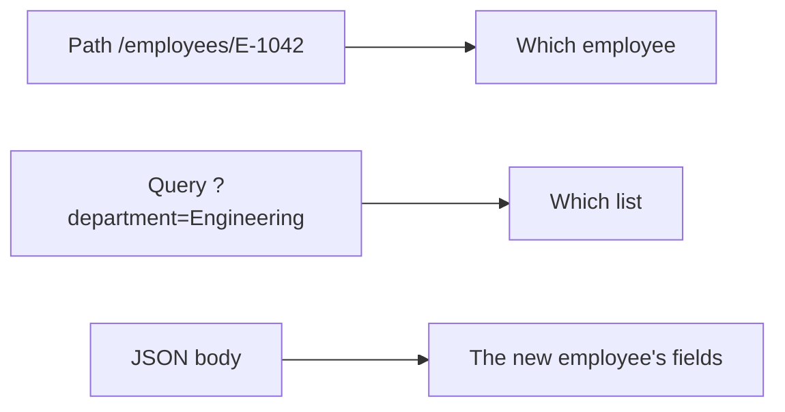

# Lesson 3 — Request Body and Validation

**Course:** FastAPI for Full Stack · **Session 3 of 10** · [Learning path](README.md) · **Previous:** [Lesson 2](02_Routing_and_HTTP_Methods.md) · **Next:** [Lesson 4](04_Response_Models_and_Errors.md)

**Module Outcome:** You can register an AcmeHR employee with a checked JSON body, and you can read a **422** response when a field is missing or invalid.


|                    |                                                   |
| ------------------ | ------------------------------------------------- |
| **You will build** | `POST /employees` that rejects a bad registration |
| **New words**      | Request body, model, required, optional, 422      |
| **You need**       | The employee routes in `acmehr-api/main.py` |


**From the requirements.** HR registers an employee: id, name, designation, department, work email, and an optional phone. A missing name, an id that is not `E-1042` shape, or an email without `@` must not be stored.

---


## 1. Three places a value can sit




| Place | Example                        | Use it for                               |
| ----- | ------------------------------ | ---------------------------------------- |
| Path  | `/employees/E-1042`            | Which one                                |
| Query | `?department=Engineering`      | A filter on a list                       |
| Body  | `{"name":"Sana Qureshi", ...}` | The fields of a new or replaced employee |


A `dict` body stores whatever JSON arrives. This POST was accepted, and the row was saved with no name and a useless id:

```json
{"designation":"Accountant","employee_id":"hello"}
```

A **model** is a class that lists the fields and the rules. FastAPI checks the JSON against the model before your function runs. When the check fails, the client gets **422** and your function does not run. Nothing is appended to `employees`.

**400** stays your own rule, such as "this id is already in the list." **422** is FastAPI's check on the shape of the body.

---


## 2. The registration model

Add the import and the class above the routes. Then add `email` and `phone` to each of the six people already in the list, so a GET and a new registration look the same. Ananya's email is `ananya.rao@acme.example` and her phone is `+91 90000 01042`. The others can use `firstname.lastname@acme.example` and `"phone": None`. 

The whole file is [`examples/lesson03/01_register.py`](examples/lesson03/01_register.py).

```python
from pydantic import BaseModel, EmailStr, Field

class EmployeeCreate(BaseModel):
    employee_id: str = Field(pattern=r"^E-\d{4}$")
    name: str = Field(min_length=1)
    designation: str
    department: str
    email: EmailStr
    phone: str | None = None
```


| Line                  | Job                                                   |
| --------------------- | ----------------------------------------------------- |
| `BaseModel`           | The class FastAPI can check a JSON body against       |
| `Field(pattern=...)`  | `employee_id` must look like `E-1042`                 |
| `Field(min_length=1)` | `name` cannot be an empty string                      |
| `EmailStr`            | The value must be an email address                    |
| `phone: str \| None = None` | Optional. A missing phone is stored as `null`         |
| `designation: str`    | Required. No default, so a missing designation is 422 |


Replace `create_employee` so the argument is the model, not a dict. `model_dump()` turns the checked model back into a dictionary you can store.

```python
@app.post("/employees", status_code=201)
def create_employee(employee: EmployeeCreate):
    if any(row["employee_id"] == employee.employee_id for row in employees):
        raise HTTPException(status_code=400, detail="Employee id already exists")
    row = employee.model_dump()
    employees.append(row)
    return row
```

Point `replace_employee` at `EmployeeCreate` too, so a full replace is checked the same way. PATCH still takes a `dict`. A partial update has a different shape. The next page separates that shape.

**Common error:** `ImportError` mentioning `email-validator`. The install was `fastapi` without `[standard]`. Run `pip install "fastapi[standard]"` in the active venv.

---


## 3. What 422 looks like

`fastapi dev` restarts when you save. In `/docs`, open **POST /employees** and send this body. The name is missing.

```json
{
  "employee_id": "E-1049",
  "designation": "HR Executive",
  "department": "Human Resources",
  "email": "sana.qureshi@acme.example"
}
```

**Output, status 422:**

```json
{
  "detail": [
    {
      "type": "missing",
      "loc": ["body", "name"],
      "msg": "Field required",
      "input": {
        "employee_id": "E-1049",
        "designation": "HR Executive",
        "department": "Human Resources",
        "email": "sana.qureshi@acme.example"
      }
    }
  ]
}
```

`loc` says where the problem is: in the body, the field `name`. `msg` says what is wrong. The function `create_employee` did not run.

Two more bodies to send yourself:


| Body problem              | `loc`                     | `msg`                                                                       |
| ------------------------- | ------------------------- | --------------------------------------------------------------------------- |
| `"email": "not-an-email"` | `["body", "email"]`       | `value is not a valid email address: An email address must have an @-sign.` |
| `"employee_id": "1042"`   | `["body", "employee_id"]` | `String should match pattern '^E-\\d{4}$'`                                  |


Now send a valid registration. Phone is left out on purpose.

```json
{
  "employee_id": "E-1048",
  "name": "Sana Qureshi",
  "designation": "HR Executive",
  "department": "Human Resources",
  "email": "sana.qureshi@acme.example"
}
```

**Output, status 201:**

```json
{
  "employee_id": "E-1048",
  "name": "Sana Qureshi",
  "designation": "HR Executive",
  "department": "Human Resources",
  "email": "sana.qureshi@acme.example",
  "phone": null
}
```

Send that same body again. **400** and `{"detail":"Employee id already exists"}`. That rule is yours. The model cannot know who is already in the list.

**Common error:** You made `phone: str` with no default. A registration without a phone is 422, `Field required`, on `phone`. Write `str | None = None`.

**Common error:** The pattern is pasted as a normal string and `\d` is lost. In Python the pattern needs the `r` prefix: `r"^E-\d{4}$"`.

---


## Try these

1. **(Easy)** Register `E-1050` with a real email and no phone. GET that id. `phone` is `null`.
2. **(Easy)** Send `"name": ""`. Read `msg`.
3. **(Medium)** Send `"employee_id": "E-1042"` with Ananya's other fields filled in correctly. Which status comes back, 400 or 422, and why that one?
4. **(Medium)** PUT `/employees/E-1048` with a body whose email is `not-an-email`. The stored row does not change.
5. **(Stretch)** PATCH still accepts `{"email": "not-an-email"}`. Confirm with a GET. That loose dict is closed when PATCH gets its own model.

**Interview:** *Where can a value arrive, and what is each place for?* — The path picks one resource. The query filters a list. The body carries the fields.

**Interview:** *What is the difference between 400 and 422?* — 422 means the JSON does not match the model, and your function did not run. 400 means the JSON matched, and your own rule rejected it, such as a duplicate employee id.

**Key takeaways**

- A model lists the fields. FastAPI checks the body before the function runs.
- A field with no default is required. `= None` makes it optional.
- A failed check is **422**. Read `loc` and `msg`.
- A duplicate id is **400**, because only your code knows the list.

---

<details class="fold" markdown="1">
<summary><span class="fold-title">Lab — Ticket ACME-203</span><span class="fold-open">Expand</span><span class="fold-shut">Collapse</span></summary>

HR cannot store a registration that has no name, a broken email, or an id that is not `E-` plus four digits.

```text
PYTHON/17_FastAPI/labs/L03_employee_registration/
├── broken/main.py
├── starter/main.py
└── solution/main.py
```

`starter/main.py` still accepts a dictionary on POST. Work there, or in `acmehr-api/main.py`.

### Part A — Fix the broken model (10 min)

[`broken/main.py`](labs/L03_employee_registration/broken/main.py) starts. The model is wired up, and three rules are missing:

1. A body with no `phone` returns **422**. Phone is optional.
2. `"email": "not-an-email"` is stored. It must be **422**.
3. `"employee_id": "1042"` is stored. It must be **422**, and a valid id looks like `E-1048`.

A missing `name` is already **422**. Leave that rule in place.

### Part B — Build the model (15 min)

In the starter, replace the `dict` on `create_employee` with `EmployeeCreate`. Add `email` and `phone` to the six people already in the list. A repeated id returns **400** with detail `Employee id already exists`.

### Part C — Prove it works (5 min)

- [ ] POST Sana Qureshi as `E-1048`, with a real email and no phone, returns **201** and `"phone": null`.
- [ ] POST the same id again returns **400**.
- [ ] A missing `name` returns **422** and `loc` ends with `name`.
- [ ] `"email": "not-an-email"` returns **422**.
- [ ] `"employee_id": "1042"` returns **422**.
- [ ] GET `/employees?department=Engineering` still returns only the Engineering rows.

**Stretch.** Change PUT to take `EmployeeCreate`. A replace with a bad email does not change the stored row.

Open `solution/main.py` only after the checklist passes.

</details>

<details class="fold" markdown="1">
<summary><span class="fold-title">Homework</span><span class="fold-open">Expand</span><span class="fold-shut">Collapse</span></summary>

1. Finish the lab in `acmehr-api`. Keep this `main.py`.
2. **Transfer drill (15 minutes).** Add a `BookCreate` model and `POST /books`. `title` is required, `isbn` matches 13 digits, `year` is optional. One bad isbn must return 422. Delete the book route afterwards if you want `/docs` to stay an employee API.

</details>

**Next:** [Response models and error handling](04_Response_Models_and_Errors.md). The JSON you send and the JSON you return become two different shapes, and PATCH stops taking a loose dict.