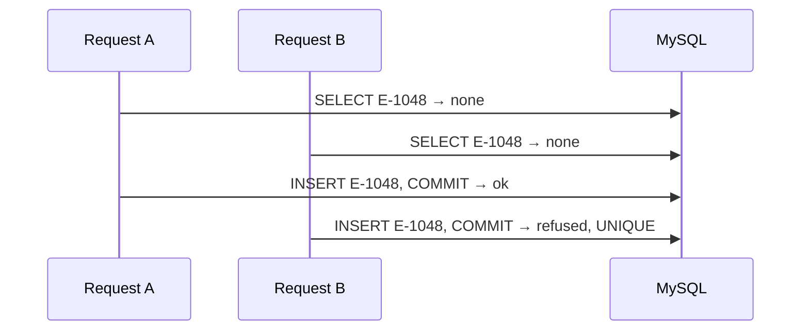

# Lesson 6 — CRUD

**Course:** FastAPI for Full Stack · **Session 6 of 10** · [Learning path](README.md) · **Previous:** [Lesson 5](05_Database_Connectivity.md) · **Next:** [Lesson 7](07_Project_Structure.md)

**Module Outcome:** You can create, replace, update, and delete an employee in MySQL, with 201, 200, 204, 400, and 404, through the same route, service, and repository layers as Lesson 5.

| | |
|---|---|
| **You will build** | The full employee API on the `employee` table: PUT next to Lesson 5's GET, POST, PATCH, and DELETE |
| **New words** | Exception handler, rollback, race |
| **You need** | The Lesson 5 step 2 code: `EmployeeRepository`, `EmployeeService`, and the GET, POST, PATCH, and DELETE routes |

**From the requirements.** HR replaces a whole record in one request. Lesson 5 already registers, corrects, and removes employees. A duplicate id must be refused even when two HR people press **Register** at the same moment.

The file that does all of it is [`examples/lesson06/01_crud.py`](examples/lesson06/01_crud.py). What each layer gains:

| Layer | New in this lesson |
|---|---|
| Repository | Nothing. `add`, `update`, and `delete` from Lesson 5 cover PUT too |
| Service | Named errors. `register` lets MySQL refuse a duplicate and rolls back. `replace` is new |
| Route | PUT. It calls one service method |
| App | Two exception handlers turn the service's errors into **404** and **400** |

---

## 1. Errors the service names

In Lesson 5 the service raised `HTTPException` twice: **404** for a missing employee, and **400** for a taken id. This lesson adds one more method that can miss an employee. Before writing it, change how the service reports a failure.

| `HTTPException` in the service | A named error, and a handler in the app |
|---|---|
| The service picks the status code. A status code only means something inside an HTTP response | The service says what happened: `EmployeeNotFound`. The app decides that means 404 |
| `seed` runs at startup, and a test or a script can call `EmployeeService(db).get(...)` directly. There, `HTTPException` describes a web response that does not exist | `EmployeeNotFound` means the same thing in a route, a script, or a test |
| `"Employee not found"` is typed in every method that can miss | One handler holds the status and the text |

The service gets its own exception class, and `get` raises it:

```python
class EmployeeNotFound(Exception):
    pass

class EmployeeService:
    ...
    def get(self, employee_id):
        row = self.repo.get(employee_id)
        if row is None:
            raise EmployeeNotFound(employee_id)
        return row
```

FastAPI turns `HTTPException` into a response by itself. Any other exception that leaves a route is **500** `Internal Server Error`, until you register a handler for it:

```python
from fastapi import Request
from fastapi.responses import JSONResponse

@app.exception_handler(EmployeeNotFound)
def employee_not_found(request: Request, exc: EmployeeNotFound):
    return JSONResponse(status_code=404, content={"detail": "Employee not found"})
```

| Piece | Job |
|---|---|
| `EmployeeNotFound` | The service's own error. It says what went wrong, not which status code |
| `@app.exception_handler(EmployeeNotFound)` | When that error leaves any route, FastAPI calls this function and sends its response |
| `JSONResponse(status_code=404, ...)` | The same JSON that `HTTPException` sent in Lesson 5 |

GET `E-9999`. Still **404**, still `{"detail":"Employee not found"}`. PATCH and DELETE on `E-9999` are **404** too, because `update` and `delete` start with `self.get`. The client sees no difference. The service no longer imports anything from FastAPI.

**Common error:** GET `E-9999` is **500**, and the terminal shows `EmployeeNotFound`. The handler is missing, or it names a different exception class.

---

## 2. A duplicate id: let MySQL refuse it, then roll back

Lesson 5's `register` checks first, then inserts:

```python
if self.repo.get(data.employee_id) is not None:
    raise HTTPException(status_code=400, detail="Employee id already exists")
self.repo.add(data.model_dump())
self.db.commit()
```

Two HR people register `E-1048` at the same moment. Both requests run the check, both see no row, and both insert. That is a **race**: the result depends on timing. The check alone cannot stop it.



The table already guards it: `employee_id` is `UNIQUE`. MySQL refuses the second insert, and SQLAlchemy raises `IntegrityError` at `commit`. So `register` drops the check, tries the insert, and handles the refusal:

```python
from sqlalchemy.exc import IntegrityError

class DuplicateEmployeeId(Exception):
    pass

class EmployeeService:
    ...
    def register(self, data):
        self.repo.add(data.model_dump())
        try:
            self.db.commit()
        except IntegrityError:
            self.db.rollback()
            raise DuplicateEmployeeId(data.employee_id)
        return self.get(data.employee_id)
```

| Line | Job |
|---|---|
| `repo.add` | Stage the new row in the session. MySQL does not have it yet |
| `self.db.commit` | Write it. MySQL checks `UNIQUE` here |
| `IntegrityError` | MySQL refused the insert because `employee_id` is already there |
| `self.db.rollback` | Throw away the failed insert so the session can close cleanly |
| `DuplicateEmployeeId` | The service's name for that failure. It does not say 400 |
| `return self.get(...)` | Reads the new row back, as in Lesson 5 |

The repository and the POST route do not change. Only the service's rule for a duplicate moved: from "look first" to "let the database refuse, then roll back".

A second exception handler turns the new error into **400**, next to the 404 handler from section 1:

```python
@app.exception_handler(DuplicateEmployeeId)
def duplicate_employee_id(request: Request, exc: DuplicateEmployeeId):
    return JSONResponse(status_code=400, content={"detail": "Employee id already exists"})
```

Send Sana:

```json
{
  "employee_id": "E-1048",
  "name": "Sana Qureshi",
  "designation": "HR Executive",
  "department": "Human Resources",
  "email": "sana.qureshi@acme.example"
}
```

**201.** `SELECT * FROM employee WHERE employee_id = 'E-1048';` shows the row. Send the same body again. **400** and `Employee id already exists`.

---

## 3. Replace

PUT sends a whole `EmployeeCreate`. `replace` is Lesson 5's `update` with every field instead of only the sent ones, and it reuses `repo.update`:

```python
    def replace(self, employee_id, data):
        row = self.get(employee_id)
        values = data.model_dump()
        values["employee_id"] = employee_id
        self.repo.update(row, values)
        self.db.commit()
        return self.get(employee_id)
```

| Method | From | Rule |
|---|---|---|
| `update` | Lesson 5, PATCH | Only the keys the caller sent: `exclude_unset=True` |
| `replace` | This lesson, PUT | Every field from `EmployeeCreate`. The id in the URL replaces whatever id was in the body |
| `delete` | Lesson 5, DELETE | Remove the row, then commit |

The PUT route has the same shape as POST:

```python
@app.put("/employees/{employee_id}", response_model=EmployeeOut)
def replace_employee(employee_id: str, employee: EmployeeCreate):
    db = SessionLocal()
    try:
        return EmployeeService(db).replace(employee_id, employee)
    finally:
        db.close()
```

No route raises `HTTPException`. The two handlers turn the service's errors into 404 and 400.

**Common error:** The service calls `repo.add` and returns the row without `commit`. `/docs` shows the new employee, you restart, and the row is gone.

**Common error:** After `IntegrityError` you do not `rollback`, and then use the same session again. SQLAlchemy raises a second error: the session is still inside the failed transaction. Each request here opens its own session, so the next request is fine. Call `rollback` anyway: it ends the failed transaction cleanly, and code that keeps using the session after a failure needs it.

**Common error:** The repository calls `self.db.commit()`. It works today. Then a service method that changes two rows commits the first one before the second one fails, and half the change stays in MySQL. Commit only in the service.

---

## Try these

1. **(Easy)** POST `E-1048`. Restart `fastapi dev`. GET `E-1048`. Sana is still there.
2. **(Easy)** PATCH only her designation. In MySQL, `email` is unchanged.
3. **(Medium)** DELETE `E-1048`. The response is **204** and empty. The `SELECT` returns no row.
4. **(Medium)** PUT `E-1042` with a bad email. Status **422**. Ananya's row in MySQL is unchanged.
5. **(Medium)** Comment out the `EmployeeNotFound` handler. GET `E-9999`. Read the status and the last line in the terminal. Put the handler back.
6. **(Stretch)** POST an id that exists. Name the exception MySQL raised, the exception the service raised, and the status the handler returned.

**Interview:** *What does commit do?* — It tells MySQL to keep the staged insert, update, or delete. Until commit, a restart of the API loses that change.

**Interview:** *Why not raise `HTTPException` in the service?* — It works, because FastAPI catches it anywhere. But the service also runs at startup and in tests, where a status code means nothing. The service names the failure. The app's handler picks the status code.

**Interview:** *Which layer commits, and why?* — The service. It knows when a piece of work is finished, so it can commit several staged changes together or roll them all back.

**Key takeaways**

- Only `HTTPException` becomes a response by itself. `EmployeeNotFound` needs a handler, and then the service no longer speaks HTTP.
- The repository stages: `add`, `update`, `delete`. The service commits, and rolls back on failure.
- A duplicate `employee_id` is an `IntegrityError`. The service rolls back and raises `DuplicateEmployeeId`. A handler returns **400**.
- `self.get` raises `EmployeeNotFound` for every write, so every write gets **404** for free.
- A bad body is still **422** and never reaches the service.
- GET, PUT, PATCH, and DELETE use the HR id `E-1042`.

---

<details class="fold" markdown="1">
<summary><span class="fold-title">Lab — Ticket ACME-206</span><span class="fold-open">Expand</span><span class="fold-shut">Collapse</span></summary>

The employee API must create, replace, update, and delete rows in `training_db`.

```text
PYTHON/17_FastAPI/labs/L06_crud/
├── broken/main.py      ← Part A. Fix this file.
├── starter/main.py     ← Part B. Complete the TODOs.
└── solution/main.py    ← Open only after the checklist passes.
```

### Part A — Fix the broken API (10 min)

`broken/main.py` starts, and it has **3 bugs**. All three are in one layer. Find it first.

1. POST Sana as `E-1048` twice. The second answer is **500**, not **400** and `Employee id already exists`.
2. PATCH `E-1048` with only `{"designation": "Lead HR Executive"}`. The answer is **500**, and the terminal says `Column 'name' cannot be null`.
3. DELETE `E-1048` is **204**, but GET `E-1048` still returns Sana, and MySQL still has her row.

### Part B — Build the write path (15 min)

`starter/main.py` has the whole repository, the service's reads, `update`, `delete`, and `seed`, both exception handlers, and the GET, POST, PATCH, and DELETE routes. Write `register` with commit and rollback, `replace`, and the PUT route from the TODOs.

### Part C — Prove it works (5 min)

- [ ] POST Sana as `E-1048` returns **201**, and a MySQL `SELECT` shows her.
- [ ] POST the same id returns **400**.
- [ ] PATCH her designation. The email in MySQL stays `sana.qureshi@acme.example`.
- [ ] PUT `E-1048` with a full body whose `employee_id` is `E-7777`. The answer is **200**, and the id stays `E-1048`.
- [ ] DELETE `E-1048` returns **204**. GET of that id returns **404**.
- [ ] Restart the server. Ananya is still there. Sana is not.
- [ ] `commit` appears only inside `EmployeeService`. No route raises `HTTPException`.

Open `solution/main.py` only after the checklist passes.

</details>

<details class="fold" markdown="1">
<summary><span class="fold-title">Homework</span><span class="fold-open">Expand</span><span class="fold-shut">Collapse</span></summary>

1. Finish the lab in `acmehr-api`. The next page moves each layer into its own file.
2. **Transfer drill (15 minutes).** POST one employee, stop the server before you would commit, and describe what MySQL shows. Put `commit` back before you finish.

</details>

**Next:** [Project structure](07_Project_Structure.md). The repository, the service, and the routes move into their own files, and `Depends` hands each route a service.
