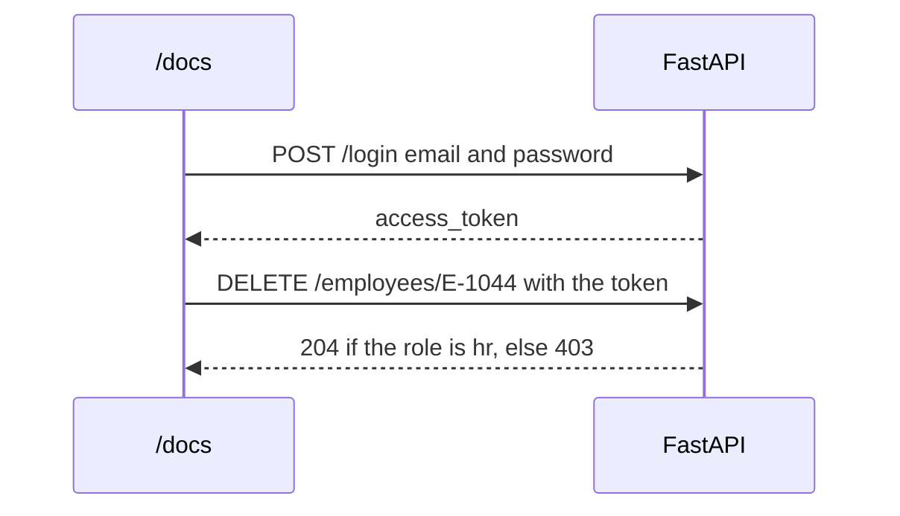

# Lesson 8 — Authentication

**Course:** FastAPI for Full Stack · **Session 8 of 10** · [Learning path](README.md) · **Previous:** [Lesson 7](07_Project_Structure.md) · **Next:** [Lesson 9](09_Frontend_and_CORS.md)

**Module Outcome:** You can log in with an email and password, call `/me` with the token, and block a delete when the caller is not HR.

| | |
|---|---|
| **You will build** | `POST /login`, `GET /me`, and a delete route that checks the role |
| **New words** | Authentication, authorization, hash, token |
| **You need** | The project split into `database.py`, `models.py`, `schemas.py`, and `routers/` |

**From the requirements.** HR manages employee records. An employee may see the directory. Only HR may change or delete a record. The password is stored as a hash, never as the text the person typed.

Practice logins, seeded when the user table is empty:

| Email | Password | Role |
|---|---|---|
| `ananya.rao@acme.example` | `Acme#1042` | employee |
| `rahul.sharma@acme.example` | `Acme#1045` | hr |

These passwords are for this practice API only.

---

## 1. Login returns a token



**Authentication** answers "who is this?". **Authorization** answers "is this person allowed?". Login is authentication. The HR check on delete is authorization.

```bash
pip install bcrypt PyJWT
```

`bcrypt` turns a password into a hash. `PyJWT` builds the token. The new files in [`examples/lesson08/`](examples/lesson08/) are `security.py`, `routers/auth.py`, and the `User` class in `models.py`.

```python
class User(Base):
    __tablename__ = "app_user"

    id = Column(Integer, primary_key=True)
    email = Column(String(120), unique=True, nullable=False)
    password_hash = Column(String(255), nullable=False)
    role = Column(String(20), nullable=False)
```

`password_hash` is the column. There is no column named `password`.

```python
def hash_password(plain: str) -> str:
    return bcrypt.hashpw(plain.encode(), bcrypt.gensalt()).decode()

def create_token(email: str, role: str) -> str:
    payload = {
        "sub": email,
        "role": role,
        "exp": datetime.now(timezone.utc) + timedelta(minutes=60),
    }
    return jwt.encode(payload, SECRET_KEY, algorithm="HS256")
```

`SECRET_KEY` comes from `.env`. `acmehr-class-secret-change-me-please` in `.env.example` is only a practice value. `exp` makes the token expire after 60 minutes.

There is no fallback value in the code. If `SECRET_KEY` is missing, `security.py` stops the app at startup:

```python
SECRET_KEY = os.getenv("SECRET_KEY")
if not SECRET_KEY:
    raise RuntimeError("SECRET_KEY is not set. Copy .env.example to .env.")
```

A default written in the code would be in every copy of the repo, and anyone could sign their own tokens with it.

**A token is signed, not encrypted.** Paste one into [jwt.io](https://jwt.io) and you can read `sub` and `role` without the key. The signature only stops someone from *changing* them. Never put a password, a salary, or anything private in a token.

`POST /login` reads the form fields `/docs` sends. The box labelled **username** is the email.

```python
@router.post("/login")
def login(form: OAuth2PasswordRequestForm = Depends(), db: Session = Depends(get_db)):
    user = db.query(User).filter(User.email == form.username).one_or_none()
    if user is None or not verify_password(form.password, user.password_hash):
        raise HTTPException(status_code=401, detail="Wrong email or password")
    return {"access_token": create_token(user.email, user.role), "token_type": "bearer"}
```

In `/docs`, authorize with Rahul's email and password. Then call `GET /me`.

**Output:**

```json
{"email":"rahul.sharma@acme.example","role":"hr"}
```

Call `GET /me` with no token. **401**.

---

## 2. Delete checks the role

```python
def require_hr(user: User = Depends(get_current_user)):
    if user.role != "hr":
        raise HTTPException(status_code=403, detail="HR only")
    return user
```

`require_hr` depends on `get_current_user`, which is where the token is read:

```python
oauth2_scheme = OAuth2PasswordBearer(tokenUrl="login")

def get_current_user(token: str = Depends(oauth2_scheme), db: Session = Depends(get_db)):
    try:
        payload = jwt.decode(token, SECRET_KEY, algorithms=["HS256"])
    except jwt.PyJWTError:
        raise HTTPException(status_code=401, detail="Invalid token")
    user = db.query(User).filter(User.email == payload.get("sub")).one_or_none()
    if user is None:
        raise HTTPException(status_code=401, detail="Invalid token")
    return user
```

| Piece | Job |
|---|---|
| `OAuth2PasswordBearer(tokenUrl="login")` | Reads `Authorization: Bearer <token>` from the request. No header is **401**. It also adds the **Authorize** button to `/docs` |
| `jwt.decode(...)` | Checks the signature and `exp`. A changed, expired, or foreign token raises `PyJWTError`, which becomes **401** |
| `payload.get("sub")` | The email that `create_token` put in the token |
| `db.query(User)...` | Loads the user from the table, so the role comes from the database, not from the token |

A bad or missing token is **401**. A real user with the wrong role is **403**.

`DELETE`, `PUT`, and `PATCH` on `/employees/{employee_id}` each take `Depends(require_hr)`. Anything that changes a record is HR's job. A PATCH with no token is **401**, so nobody can rename Ananya anonymously.

```python
@router.patch("/{employee_id}", response_model=EmployeeOut)
def update_employee(
    employee_id: str,
    changes: EmployeeUpdate,
    db: Session = Depends(get_db),
    user=Depends(require_hr),
):
```

Log in as Ananya and delete `E-1044`. **403**. The row stays. Log in as Rahul and delete a person you created for the exercise. **204**.

**Common error:** You type the email into a field named email. On `/docs` the login form calls it **username**. Put the email there.

**Common error:** `RuntimeError: SECRET_KEY is not set` when `fastapi dev` starts. There is no `.env` in the folder you started from. Copy `.env.example` to `.env`.

**Common error:** The password in MySQL is the text `Acme#1045`. Then a leak of the table reveals the password. Store `password_hash` from `hash_password`.

---

## Try these

1. **(Easy)** `GET /me` with no lock icon on `/docs`. Status **401**.
2. **(Easy)** Log in as Ananya. `/me` shows `"role": "employee"`.
3. **(Medium)** As Ananya, DELETE an employee. **403**. As Rahul, the same delete on a test row is **204**.
4. **(Stretch)** Change `SECRET_KEY`, restart, and call a route with the old token. Status **401**.

**Interview:** *What is the difference between 401 and 403?* — 401 means we do not accept the token. 403 means we know who you are, and this role may not do that action.

**Key takeaways**

- The table stores a hash, not the password.
- Login returns a token. Later requests send `Authorization: Bearer <token>`.
- `/me` proves the token. `require_hr` proves the role.
- A wrong password is **401**. A non-HR delete, replace, or update is **403**.

---

<details class="fold" markdown="1">
<summary><span class="fold-title">Lab — Ticket ACME-208</span><span class="fold-open">Expand</span><span class="fold-shut">Collapse</span></summary>

Only HR may change or delete an employee.

```text
PYTHON/17_FastAPI/labs/L08_auth/
├── broken/      ← Part A. Login and the role check have bugs.
├── starter/     ← Part B. The User table and seed are done. Security is TODO.
└── solution/    ← Open only after the checklist passes.
```

In each folder, copy `.env.example` to `.env` before `fastapi dev main.py`.

### Part A — Fix the broken security (10 min)

`broken/` starts, and it has **3 bugs**:

1. As Rahul, DELETE `E-1044` is **403**. As Ananya, the same delete is **204**.
2. Rahul can log in with any password.
3. Log in, change `SECRET_KEY` in `.env`, and restart. The old token still works on `GET /me`. It must be **401**.

### Part B — Build it (15 min)

`starter/` has the `User` table, the two seeded logins, `hash_password`, and `create_token`. Write `verify_password`, `get_current_user`, `require_hr`, `POST /login`, and `GET /me`. Then add `Depends(require_hr)` to PUT, PATCH, and DELETE.

### Part C — Prove it works (5 min)

- [ ] `POST /login` as Rahul returns `access_token`.
- [ ] `POST /login` as Rahul with a wrong password is **401**.
- [ ] `GET /me` with that token shows `"role": "hr"`. With no token it is **401**.
- [ ] DELETE as Ananya is **403**, and the row remains in MySQL.
- [ ] PATCH `E-1042` with no token is **401**. As Ananya it is **403**. As Rahul it is **200**.
- [ ] A `SELECT` of `app_user` shows a hash in `password_hash`, not `Acme#1045`.
- [ ] `pytest test_employees.py` prints `6 passed`.

</details>

<details class="fold" markdown="1">
<summary><span class="fold-title">Homework</span><span class="fold-open">Expand</span><span class="fold-shut">Collapse</span></summary>

1. Push the login routes to your `acmehr-api` repo. Do not commit `.env`.
2. **Transfer drill (15 minutes).** Add Karthik as a third user with role `manager`. Confirm his `/me` role, and confirm he receives **403** on delete.

</details>

**Next:** [Frontend and CORS](09_Frontend_and_CORS.md). A registration page in the browser calls this API.
