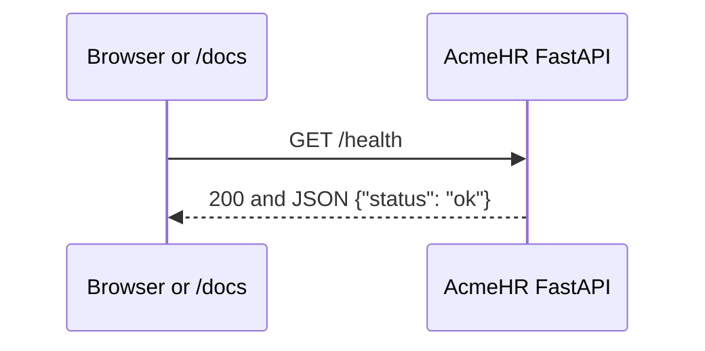
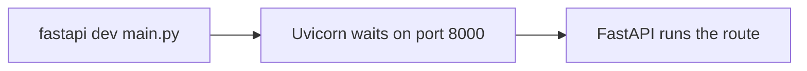

# Lesson 1 — Introduction to FastAPI

**Course:** FastAPI for Full Stack · **Session 1 of 10** · [Learning path](README.md)

**Module Outcome:** You can explain a request and a JSON response, run an AcmeHR API on your computer, and try it from the `/docs` page.


|                    |                                                                            |
| ------------------ | -------------------------------------------------------------------------- |
| **You will build** | An AcmeHR API with `GET /` and `GET /health`                               |
| **New words**      | API, request, response, JSON, status code, FastAPI, Uvicorn, route         |
| **You need**       | Python 3, VS Code, a terminal. A function and `python3 -m venv` are enough |


**Our project.** All 10 lessons build **AcmeHR**, Acme's employee API. Today the API only says hello and reports that it is running. Later lessons add employees, MySQL, login, and the HTML page that calls it.

**From the requirements.** The AcmeHR screens (directory, profile, leave, attendance) will ask this API for data. Before any of that data exists, the team needs proof the API is up: open a URL, get an answer.

---


## 1. One request




- You are the **client**. The browser asks.
- FastAPI is the **server**. It answers.
- `GET /health` is the **request**. GET means "read". `/health` is the address.
- `{"status": "ok"}` is the **response** body. That text shape is **JSON**. It looks like a Python dictionary.
- **200** means the answer is fine. You will see **404** when the address is wrong.

That picture is the idea. The rest of the page builds the right-hand side.


| Word      | In this API                                                                   |
| --------- | ----------------------------------------------------------------------------- |
| **API**   | A set of addresses the portal can call                                        |
| **REST**  | Addresses plus a method. Today the method is GET and the address is `/health` |
| **Route** | The link between an address and a Python function                             |


**FastAPI** is the library in your file. It turns a returned dictionary into JSON, and it builds the `/docs` page from your functions.

Start it with `fastapi dev main.py`. That command starts **Uvicorn**. Uvicorn waits on port 8000 and hands each request to FastAPI. The terminal line `Uvicorn running on http://127.0.0.1:8000` means Uvicorn is listening.




Some project READMEs show `uvicorn main:app --reload`. `main` is the file, `app` is the variable inside it. That starts the same server. The command to type here is `fastapi dev`.


|              | FastAPI                   | Django                                     |
| ------------ | ------------------------- | ------------------------------------------ |
| What you get | Routes, JSON, and `/docs` | A full site: pages, admin, database, login |
| A good fit   | The AcmeHR API            | The AcmeHR website                         |


---


## 2. Project folder

Create this on your computer. It is the `acmehr-api` repository for the whole API.

```text
acmehr-api/
├── venv/            ← created by the command below; do not commit it
└── main.py          ← the first file
```

```bash
mkdir acmehr-api
cd acmehr-api
python3 -m venv venv
source venv/bin/activate          # Windows: venv\Scripts\activate
pip install "fastapi[standard]"
```

`fastapi[standard]` installs FastAPI, the `fastapi` command, and Uvicorn. One install. The line above your prompt changes to `(venv)` after `activate`. Install packages only with that prefix showing.

**Common error:** `fastapi: command not found`, or `No module named fastapi`. The venv is not active, or `pip install` ran in a different terminal. Activate, install again, then start the server.

**Common error:** On Windows, `python3` may be `python`. Use the one that prints 3.11 or 3.12 for `python --version`.

---


## 3. Hello, AcmeHR

Create `main.py`:

```python
from fastapi import FastAPI

app = FastAPI(title="AcmeHR")

@app.get("/")
def home():
    return {"message": "Welcome to AcmeHR"}
```

File: [`examples/lesson01/01_hello.py`](examples/lesson01/01_hello.py)


| Line                            | Job                                                  |
| ------------------------------- | ---------------------------------------------------- |
| `from fastapi import FastAPI`   | Brings in the class that holds your routes           |
| `app = FastAPI(title="AcmeHR")` | Creates the API. The title shows on the `/docs` page |
| `@app.get("/")`                 | When someone reads `/`, call the next function       |
| `def home():`                   | A normal Python function                             |
| `return {"message": ...}`       | FastAPI turns this dictionary into JSON              |


Start it from the `acmehr-api` folder, with the venv active:

```bash
fastapi dev main.py
```

`main.py` is the file. Saving it restarts the server. The `app = FastAPI()` line is what `fastapi dev` finds and runs.

**Output in the terminal:**

```text
INFO:     Uvicorn running on http://127.0.0.1:8000 (Press CTRL+C to quit)
INFO:     Started reloader process
INFO:     Application startup complete.
```

Open [http://127.0.0.1:8000](http://127.0.0.1:8000).

**Output in the browser:**

```json
{"message":"Welcome to AcmeHR"}
```

Leave this terminal running. Use a second terminal for other commands.

**Common error:** `Address already in use`. A server is already bound to port 8000. Click that terminal and press `Ctrl + C`, then run `fastapi dev main.py` again.

**Common error:** The browser shows `{"detail":"Not Found"}`. The path in the address bar does not match a route. `/` and `/hello` are different addresses.

---


## 4. The health check

Add a second route to the same file and save. `fastapi dev` restarts. You should see `Application startup complete.` again.

```python
from fastapi import FastAPI

app = FastAPI(title="AcmeHR")

@app.get("/")
def home():
    return {"message": "Welcome to AcmeHR"}

@app.get("/health")
def health():
    return {"status": "ok"}
```

File: [`examples/lesson01/02_health.py`](examples/lesson01/02_health.py)

Open [http://127.0.0.1:8000/health](http://127.0.0.1:8000/health).

**Output:**

```json
{"status":"ok"}
```

The terminal logs the request:

```text
INFO:     127.0.0.1:51234 - "GET /health HTTP/1.1" 200 OK
```

Open [http://127.0.0.1:8000/docs](http://127.0.0.1:8000/docs). The page title is **AcmeHR**. Open **GET /health**, choose **Try it out**, then **Execute**. The response body is the same JSON, and the server response code is **200**.

That page is written from the two functions. You did not design it.

**Common error:** `GET /Health` returns 404. Paths are case-sensitive. The route is `/health`.

**Common error:** Opening `main.py` from the file explorer shows Python source, or nothing useful. The API is served at `http://127.0.0.1:8000`, not as a file.

---


## Try these

1. **(Easy)** Change the welcome message to `AcmeHR API is running`. Save, refresh `/`, and confirm the new text. Reload is doing that work.
2. **(Easy)** Open `/docs` and execute `GET /`. Find the **200** in the result.
3. **(Medium)** Open `http://127.0.0.1:8000/employees`. Read the JSON. Find the matching **404** line in the terminal.
4. **(Medium)** Press `Ctrl + C` in the server terminal. Refresh `/health`. Start the server again with the venv active.
5. **(Stretch)** Add `GET /version` that returns `{"version": "1"}`. Execute it from `/docs`.

**Interview:** *What happens when a page calls an API?* — The client sends a request: a method and a path. The server runs the matching function and returns a status code and a body. Today that body is JSON, and 200 means it worked.

**Interview:** *What is* `/docs`*?* — A page FastAPI builds from your routes. You can call the API from that page before any frontend exists.

**Interview:** *Why does the terminal say Uvicorn when I typed* `fastapi dev`*?* — `fastapi dev` starts Uvicorn. FastAPI is your routes. Uvicorn is the program that waits on port 8000 and calls those routes.

**Key takeaways**

- The browser asks. FastAPI answers with a status code and JSON.
- `@app.get("/health")` connects that path to a function.
- A returned dictionary becomes JSON.
- `fastapi dev main.py` starts Uvicorn, which serves the API at `http://127.0.0.1:8000`.
- `/docs` lists the routes and can call them.

---

<details class="fold" markdown="1">
<summary>Lab — Ticket ACME-201</summary>

Employees need proof the API is running before any screen is connected.

The code sits in a folder next to the notes. Open it in VS Code:

```text
PYTHON/17_FastAPI/labs/L01_health/
├── broken/main.py      ← Part A. Fix this file.
├── starter/main.py     ← Part B. Complete the TODOs.
└── solution/main.py    ← Open only after the checklist passes.
```

If you do not have that folder, create `main.py` in your `acmehr-api` project from the starter in Part B.

From the folder that contains `main.py`, with the venv active:

```bash
pip install -r requirements.txt
fastapi dev main.py
```

`requirements.txt` is the one line `fastapi[standard]`, the same install as section 2. That line brings in the `fastapi` command and Uvicorn.

### Part A — Fix the broken API (10 min)

`broken/main.py` starts, and it has **4 bugs**:

1. `GET /health` returns 404.
2. The health body is not a JSON object with the key `status`.
3. `GET /` does not say `Welcome to AcmeHR`.
4. The `/docs` page title is not **AcmeHR**.


### Part B — Build it yourself (15 min)

`starter/main.py` looks like this. Replace each TODO with a route.

```python
from fastapi import FastAPI

app = FastAPI(title="AcmeHR")


# TODO: GET / returns {"message": "Welcome to AcmeHR"}


# TODO: GET /health returns {"status": "ok"}
```


### Part C — Prove it works (5 min)

- [ ] The terminal shows `Uvicorn running on http://127.0.0.1:8000`.
- [ ] `GET /health` returns `{"status":"ok"}` and the log line says **200 OK**.
- [ ] `GET /` returns `{"message":"Welcome to AcmeHR"}`.
- [ ] `/docs` is titled **AcmeHR**, and **Try it out** on `GET /health` shows **200**.
- [ ] `GET /employees` returns **404**, and you can point to that line in the terminal.

**Stretch.** Add `GET /version` that returns `{"version": "1"}`. It appears in `/docs` with no extra page-building code.

</details>

<details class="fold" markdown="1">
<summary>Homework</summary>

1. Finish the lab in your `acmehr-api` folder.
2. **Transfer drill (15 minutes).** In a second file, or a second route you delete afterwards, add `GET /ping` for a library API that returns `{"status": "ok"}`. Same idea, different word. The path is the only thing that changed.

</details>

**Next:** [Routing and HTTP methods](Lesson_02_Routing_and_HTTP_Methods.md). GET, POST, PUT, PATCH, and DELETE for an AcmeHR employee.