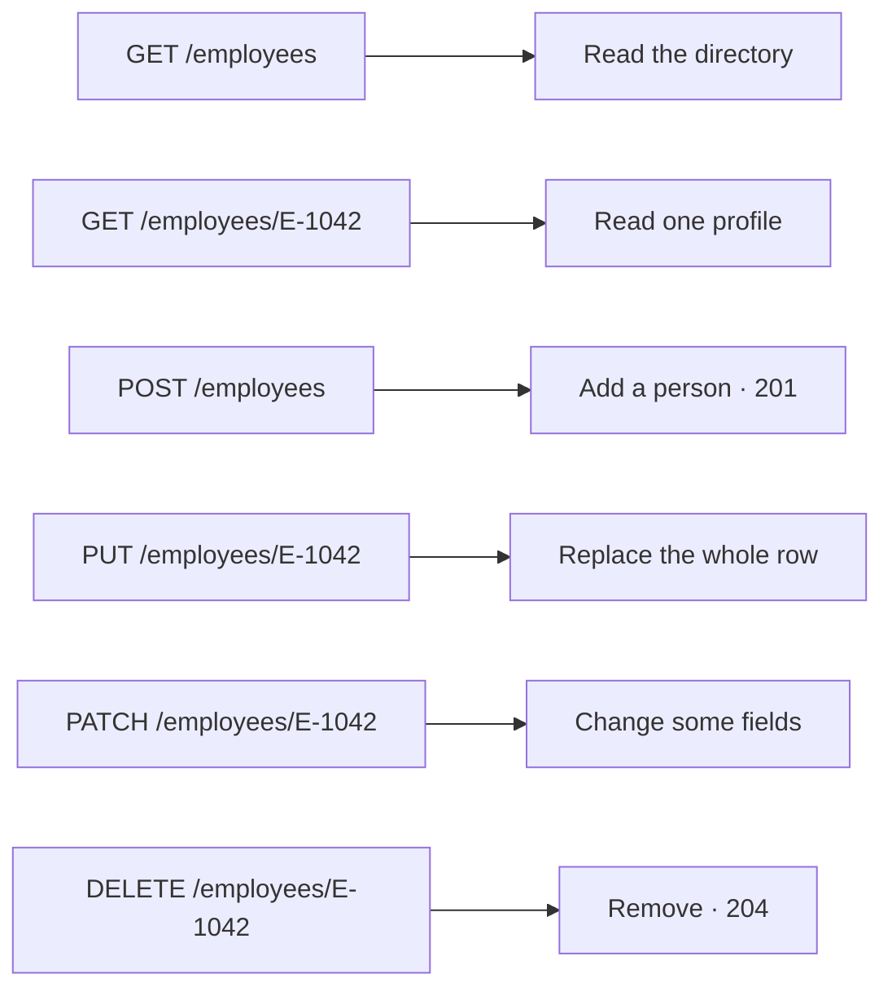
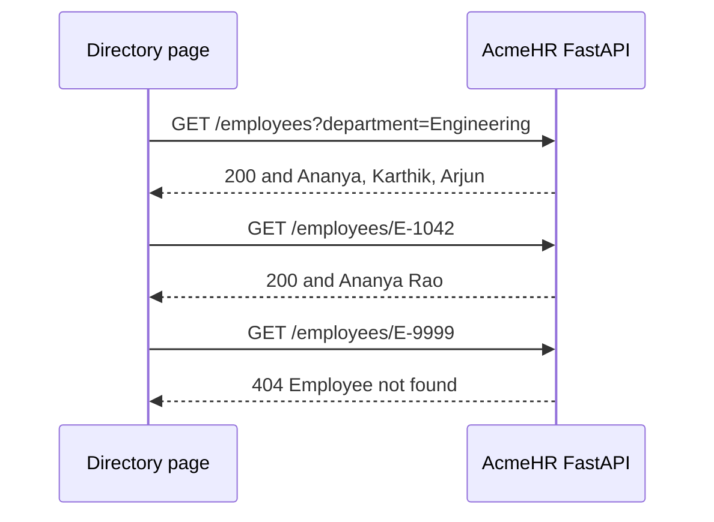

# Lesson 2 — Routing and HTTP Methods

**Course:** FastAPI for Full Stack · **Session 2 of 10** · [Learning path](README.md) · **Previous:** [Lesson 1](Lesson_01_Introduction_to_FastAPI.md) · **Next:** [Lesson 3](Lesson_03_Request_Body_and_Validation.md)

**Module Outcome:** You can read one AcmeHR employee, filter the directory by department, and call create, replace, update, and delete from `/docs` with the right status code.


|                    |                                                         |
| ------------------ | ------------------------------------------------------- |
| **You will build** | Employee routes on the same AcmeHR API                  |
| **New words**      | Path parameter, query parameter, 201, 204, 400, 404     |
| **You need**       | `acmehr-api/main.py` running with `fastapi dev main.py` |


**From the requirements.** The employee directory lists colleagues. The profile opens one person. Those two screens read this API. Create, replace, update, and delete are the other four methods. The JSON body is stored as a dictionary. The fields are not checked yet.

Open `acmehr-api/main.py` and add to it. The six people are the same sample staff as the HTML directory.

---

## 1. Five methods, one employee list




| Method | AcmeHR action                       | Status when it works |
| ------ | ----------------------------------- | -------------------- |
| GET    | Read the list, or one employee      | **200**              |
| POST   | Add an employee                     | **201**              |
| PUT    | Replace every field of one employee | **200**              |
| PATCH  | Change only the fields you send     | **200**              |
| DELETE | Remove an employee                  | **204**              |


**204** means it worked and there is no JSON body. The person is gone. **404** means that employee id is not in the list. **400** means the JSON you sent is missing `employee_id` or `name`.

The list lives in memory, in the `employees` variable. A new hire survives from one request to the next. Stop `fastapi dev` and the new hire is gone. A later page stores the same people in MySQL.

---

## 2. Path and query

A **path parameter** is the part of the address that changes. In `/employees/E-1042`, `E-1042` is the employee id.

A **query parameter** comes after `?`. In `/employees?department=Engineering`, `department` is the filter. Leave it off and the route returns everyone.




FastAPI does not look inside your list. If the id is missing, you send the 404 yourself with `HTTPException`. An empty filter is not a 404. `?department=NoSuch` returns `[]` and **200**, because the search worked and nobody matched.

Add this to `main.py`, under `app = FastAPI(title="AcmeHR")`. `employees` is an ordinary list. It is not inside a function. `find_employee` reads that list. The same list is in [`examples/lesson02/01_path_and_query.py`](examples/lesson02/01_path_and_query.py).

```python
from fastapi import FastAPI, HTTPException

app = FastAPI(title="AcmeHR")

employees = [
    {
        "employee_id": "E-1042",
        "name": "Ananya Rao",
        "designation": "Senior Software Engineer",
        "department": "Engineering",
    },
    {
        "employee_id": "E-1043",
        "name": "Karthik Menon",
        "designation": "Engineering Manager",
        "department": "Engineering",
    },
    {
        "employee_id": "E-1044",
        "name": "Meera Iyer",
        "designation": "Accountant",
        "department": "Finance",
    },
    {
        "employee_id": "E-1045",
        "name": "Rahul Sharma",
        "designation": "HR Executive",
        "department": "Human Resources",
    },
    {
        "employee_id": "E-1046",
        "name": "Fatima Khan",
        "designation": "Product Designer",
        "department": "Product",
    },
    {
        "employee_id": "E-1047",
        "name": "Arjun Reddy",
        "designation": "QA Engineer",
        "department": "Engineering",
    },
]

def find_employee(employee_id: str) -> dict:
    for employee in employees:
        if employee["employee_id"] == employee_id:
            return employee
    raise HTTPException(status_code=404, detail="Employee not found")

@app.get("/employees")
def list_employees(department: str | None = None):
    if department is None:
        return employees
    return [employee for employee in employees if employee["department"] == department]

@app.get("/employees/{employee_id}")
def get_employee(employee_id: str):
    return find_employee(employee_id)
```


| Piece                                 | Job                                                                                  |
| ------------------------------------- | ------------------------------------------------------------------------------------ |
| `employees = [...]`                   | The directory. Declared once, above the functions, so every route sees the same list |
| `{employee_id}`                       | Path parameter. FastAPI passes `E-1042` into the function                            |
| `department: str \| None = None`      | Optional query. Leave it off and the route returns everyone                          |
| `HTTPException(status_code=404, ...)` | Stops the function and sends 404 plus a JSON `detail`                                |


Save, and let `fastapi dev` restart. Open these three addresses:

- [http://127.0.0.1:8000/employees/E-1042](http://127.0.0.1:8000/employees/E-1042) → Ananya Rao, and the log says **200**
- [http://127.0.0.1:8000/employees?department=Engineering](http://127.0.0.1:8000/employees?department=Engineering) → Ananya, Karthik, Arjun
- [http://127.0.0.1:8000/employees/E-9999](http://127.0.0.1:8000/employees/E-9999)

**Output for the missing id:**

```json
{"detail":"Employee not found"}
```

The log line says **404**.

**Common error:** `department: str` with no default. Then `GET /employees` with no query returns **422**, because FastAPI thinks the filter is required. Write `str | None = None`.

**Common error:** The route is `/employee/{employee_id}` (no s) and the browser asks for `/employees/E-1042`. That is a 404 because the path does not match. Plural, same as the list route.

---

## 3. Create, replace, update, delete

The body is a plain dictionary. FastAPI turns the JSON into that dict. It does not check the fields. A body with no `employee_id` or `name` is **400**.

The whole file is [`examples/lesson02/02_all_methods.py`](examples/lesson02/02_all_methods.py). Add these four routes under `get_employee`. They use the same `employees` list from section 2.

```python
from fastapi import FastAPI, HTTPException, Response

@app.post("/employees", status_code=201)
def create_employee(employee: dict):
    if "employee_id" not in employee or "name" not in employee:
        raise HTTPException(status_code=400, detail="employee_id and name are required")
    employees.append(employee)
    return employee

@app.put("/employees/{employee_id}")
def replace_employee(employee_id: str, employee: dict):
    current = find_employee(employee_id)
    employee["employee_id"] = employee_id
    index = employees.index(current)
    employees[index] = employee
    return employee

@app.patch("/employees/{employee_id}")
def update_employee(employee_id: str, changes: dict):
    current = find_employee(employee_id)
    current.update(changes)
    current["employee_id"] = employee_id
    return current

@app.delete("/employees/{employee_id}", status_code=204)
def delete_employee(employee_id: str):
    current = find_employee(employee_id)
    employees.remove(current)
    return Response(status_code=204)
```


| Line                                    | Job                                                      |
| --------------------------------------- | -------------------------------------------------------- |
| `status_code=201`                       | POST answers 201, not the default 200                    |
| `employee: dict`                        | The JSON body. No field checks yet                       |
| `employee["employee_id"] = employee_id` | The id in the URL wins over an id in the body            |
| `current.update(changes)`               | PATCH copies only the keys that were sent                |
| `Response(status_code=204)`             | Empty body. Returning the dict would send JSON and a 200 |


Open `/docs`. The six routes are listed. Try them in this order:

1. **POST /employees.** Body:

```json
{"employee_id":"E-1048","name":"Sana Qureshi","designation":"HR Executive","department":"Human Resources"}
```

Response code **201**. Then **GET /employees/E-1048** and Sana is in the list.

2. **PATCH /employees/E-1048** with `{"designation":"Senior HR Executive"}`. The name stays. The designation changes. **200**.
3. **DELETE /employees/E-1044**. Response code **204**. The body is empty. **GET /employees/E-1044** is now **404**.
4. **POST /employees** with `{"designation":"Accountant"}`. **400** and `{"detail":"employee_id and name are required"}`.

**Common error:** DELETE returns the employee JSON and **200**. The function returned the dict. Return `Response(status_code=204)` instead.

**Common error:** You created Sana, restarted `fastapi dev`, and Sana is gone. The list is in memory, so a restart clears anyone who was not in the original six.

---

## Try these

1. **(Easy)** In `/docs`, execute `GET /employees` with no department. Count the people. Execute it again with `Engineering`.
2. **(Easy)** `PUT /employees/E-1048` with a full JSON object. Then GET that id. The old designation is gone, because PUT replaces the row.
3. **(Medium)** PATCH `E-1042` with `{"employee_id":"E-1"}`. GET `/employees/E-1042`. Why is the id still `E-1042`?
4. **(Medium)** `GET /employees?department=Finance`. Delete Meera. Call the same URL again. What is the JSON?
5. **(Stretch)** POST an employee with an id that is already in the list, such as `E-1042`. The route accepts it. Two rows can share an id. The registration checks on the next page reject that.

**Interview:** *What is the difference between PUT and PATCH?* — PUT replaces the stored employee with the body you send. PATCH changes only the keys in the body and leaves the rest.

**Interview:** *When do you return 201, 204, and 404?* — 201 after a create. 204 after a delete, with no body. 404 when the id is not in the list.

**Key takeaways**

- `{employee_id}` is a path parameter. `?department=` is a query parameter.
- `str | None = None` makes the query optional.
- You raise 404 yourself when the id is missing. An empty search list is still 200.
- POST is 201. DELETE is 204 and an empty body.
- The body is a dict. Required fields are checked by hand: missing `employee_id` or `name` is **400**.

---

<details class="fold" markdown="1">
<summary>Lab — Ticket ACME-202</summary>

The directory and the profile need live data.

```text
PYTHON/17_FastAPI/labs/L02_employee_routes/
├── broken/main.py
├── starter/main.py
└── solution/main.py
```

Copy `starter/main.py` over your `acmehr-api/main.py`, or work inside `starter/`. Run it with `fastapi dev main.py`.

### Part A — Fix the broken API (10 min)

[`broken/main.py`](labs/L02_employee_routes/broken/main.py) starts. It has **5 bugs**:

1. `GET /employees/E-1042` is **405**. That path exists for other methods, and not for GET. Open `/docs` and find the GET that takes an id.
2. `GET /employees?department=Engineering` includes Meera Iyer from Finance.
3. `GET /employee/E-9999` returns `null` and **200**. A missing id is **404** and `{"detail":"Employee not found"}`.
4. `DELETE /employees/E-1044` returns Meera's JSON and **200**. A delete is **204** with an empty body.
5. `POST /employees` with a valid body returns **200**. A create is **201**.

### Part B — Build the routes (15 min)

[`starter/main.py`](labs/L02_employee_routes/starter/main.py) has the six employees and a TODO for each method. `GET /` and `GET /health` stay.

### Part C — Prove it works (5 min)

- [ ] `GET /employees/E-1042` is Ananya Rao and **200**.
- [ ] `GET /employees/E-9999` is **404**.
- [ ] `GET /employees?department=Engineering` is only E-1042, E-1043, and E-1047.
- [ ] `POST /employees` with `employee_id` and `name` is **201**.
- [ ] `POST` without a name is **400**.
- [ ] `DELETE` of a real id is **204**, and the next GET of that id is **404**.

**Stretch.** PATCH Ananya's designation, then GET her. The employee id is still `E-1042`.

Open `solution/main.py` only after the checklist passes.

</details>

<details class="fold" markdown="1">
<summary>Homework</summary>

1. Finish the lab in `acmehr-api`.
2. **Transfer drill (15 minutes).** Add `GET /books/{book_id}` and `GET /books?subject=Python` beside the employee routes, with one hard-coded book. Remove those two routes when the drill is done so `/docs` stays the employee API.

</details>

**Next:** [Request body and validation](Lesson_03_Request_Body_and_Validation.md). The dictionary body becomes a checked employee registration.