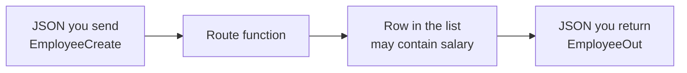

# Lesson 4 — Response Models and Error Handling

**Course:** FastAPI for Full Stack · **Session 4 of 10** · [Learning path](README.md) · **Previous:** [Lesson 3](Lesson_03_Request_Body_and_Validation.md) · **Next:** [Lesson 5](Lesson_05_Database_Connectivity.md)

**Module Outcome:** You can return a directory card without extra fields, reject a bad partial update, and send 404 when the employee id is missing.

| | |
|---|---|
| **You will build** | Separate shapes for the JSON you accept and the JSON you return |
| **New words** | Response model, input schema, output schema |
| **You need** | `EmployeeCreate` and the in-memory `employees` list in `main.py` |

**From the requirements.** The directory card shows name, designation, and department. The profile adds email and phone. Salary is not on those screens. If a row in memory has a salary, the API must not send it.

---

## 1. Two shapes



`EmployeeCreate` is what a registration must contain. `EmployeeOut` is what a GET is allowed to contain. `response_model` builds the outgoing JSON from `EmployeeOut` and drops every other key.

Ananya's row in the list now includes `"salary": 90000`. That key stays in memory. It does not leave the API.

Add these two classes under `EmployeeCreate`. The whole file is [`examples/lesson04/01_response_model.py`](examples/lesson04/01_response_model.py).

```python
from pydantic import BaseModel, ConfigDict, EmailStr, Field, field_validator

class EmployeeUpdate(BaseModel):
    name: str | None = Field(default=None, min_length=1)
    designation: str | None = None
    department: str | None = None
    email: EmailStr | None = None
    phone: str | None = None

    @field_validator("name", "designation", "department", "email")
    @classmethod
    def not_null(cls, value):
        if value is None:
            raise ValueError("cannot be null")
        return value

class EmployeeOut(BaseModel):
    model_config = ConfigDict(from_attributes=True)

    employee_id: str
    name: str
    designation: str
    department: str
    email: EmailStr
    phone: str | None = None
```

| Line | Job |
|---|---|
| `EmployeeUpdate` | A PATCH body. Every field is optional. Only the keys you send are changed |
| `not_null` | A key you leave out is fine. A key you send as `null` is **422**, except `phone`, which may be cleared |
| `EmployeeOut` | The fields a caller is allowed to see |
| `from_attributes=True` | Not needed yet: a dictionary works without it. It lets the model read a database row object in Lesson 5 |

Put `response_model=EmployeeOut` on the GET, POST, PUT, and PATCH routes. The list uses `list[EmployeeOut]`.

```python
@app.get("/employees/{employee_id}", response_model=EmployeeOut)
def get_employee(employee_id: str):
    return find_employee(employee_id)
```

Open `GET /employees/E-1042`.

**Output:**

```json
{
  "employee_id": "E-1042",
  "name": "Ananya Rao",
  "designation": "Senior Software Engineer",
  "department": "Engineering",
  "email": "ananya.rao@acme.example",
  "phone": "+91 90000 01042"
}
```

There is no `salary` key.

---

## 2. PATCH checks the fields, and 404 is still yours

Change `update_employee` so the body is `EmployeeUpdate`, not `dict`.

```python
@app.patch("/employees/{employee_id}", response_model=EmployeeOut)
def update_employee(employee_id: str, changes: EmployeeUpdate):
    current = find_employee(employee_id)
    current.update(changes.model_dump(exclude_unset=True))
    current["employee_id"] = employee_id
    return current
```

`exclude_unset=True` leaves out the keys the caller did not send, so `update` only touches the keys that were sent. A PATCH of `{"designation": "Lead Engineer"}` does not wipe the email.

A PATCH with `"email": "not-an-email"` is **422**, and the row does not change. `find_employee` still raises **404** when the id is missing. That exception becomes:

```json
{"detail":"Employee not found"}
```

**Common error:** PATCH uses `model_dump()` without `exclude_unset=True`. Missing keys are sent as `null` and the stored email becomes `null`.

**Common error:** `EmployeeUpdate` has no `not_null` check, and a PATCH sends `{"name": null}`. The row now holds `None`, and every GET of that employee, and the whole list, is **500**, because `EmployeeOut` says `name` is a string. Leaving a key out and sending `null` are different requests.

**Common error:** The GET route has no `response_model`, so `"salary": 90000` appears in the browser. The class `EmployeeOut` does nothing until a route names it.

---

## Try these

1. **(Easy)** GET Ananya. Confirm `salary` is absent.
2. **(Easy)** PATCH her designation. GET again. Email and phone are unchanged.
3. **(Medium)** PATCH with a bad email. Status is 422. The designation from step 2 is still there.
4. **(Stretch)** POST a new employee. The **201** body is an `EmployeeOut`. It has no salary key even if you add one in the stored dict afterwards.

**Interview:** *Why two models?* — The caller may send a registration, but the directory is only allowed to show the public fields. `response_model` is that rule.

**Interview:** *Who sends 404?* — Your code, with `HTTPException`, when the id is not in the list. FastAPI sends 422 when the body fails the model.

**Key takeaways**

- `EmployeeCreate` checks input. `EmployeeOut` limits output. `EmployeeUpdate` is a partial change.
- `response_model` drops keys that are not on the output model.
- `exclude_unset=True` is what makes PATCH partial.
- 404 is `HTTPException`. 422 is a failed model.

---

<details class="fold" markdown="1">
<summary><span class="fold-title">Lab — Ticket ACME-204</span><span class="fold-open">Expand</span><span class="fold-shut">Collapse</span></summary>

The directory must not show salary, and a partial update must not accept a broken email.

```text
PYTHON/17_FastAPI/labs/L04_response_model/
├── broken/main.py
├── starter/main.py
└── solution/main.py
```

### Part A — Fix the broken API (10 min)

`broken/main.py` starts. It has **3 bugs**:

1. `GET /employees/E-1042` includes `"salary": 90000`.
2. `PATCH` with `"email": "not-an-email"` is stored.
3. `GET /employees/E-9999` returns `null` and **200**.

### Part B — Build the models (15 min)

`starter/main.py` registers employees with `EmployeeCreate` and stores a dictionary. Add `EmployeeOut` and `EmployeeUpdate`, and set `response_model` on the read and write routes. Add `"salary": 90000` to Ananya's dictionary so a GET can prove that key stays inside the API.

### Part C — Prove it works (5 min)

- [ ] GET Ananya has no `salary` key.
- [ ] PATCH designation only. Email stays `ananya.rao@acme.example`.
- [ ] PATCH `"email": "not-an-email"` returns **422**.
- [ ] PATCH `{"name": null}` returns **422**, and `GET /employees` is still **200**.
- [ ] GET `E-9999` returns **404** and `{"detail":"Employee not found"}`.

Open `solution/main.py` only after the checklist passes.

</details>

<details class="fold" markdown="1">
<summary><span class="fold-title">Homework</span><span class="fold-open">Expand</span><span class="fold-shut">Collapse</span></summary>

1. Finish the lab in `acmehr-api`.
2. **Transfer drill (15 minutes).** Add a `notes` key on one employee. GET that employee and confirm `notes` is not in the JSON. Remove the key afterwards if you do not want it in the list.

</details>

**Next:** [Database connectivity](Lesson_05_Database_Connectivity.md). The list moves into MySQL. `EmployeeOut` stays.
