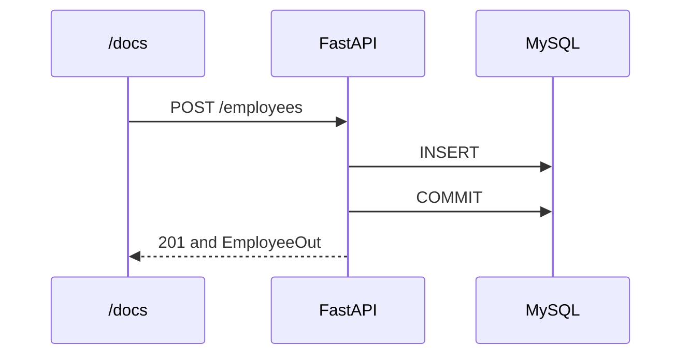

# Lesson 6 — CRUD

**Course:** FastAPI for Full Stack · **Session 6 of 10** · [Learning path](README.md) · **Previous:** [Lesson 5](Lesson_05_Database_Connectivity.md) · **Next:** [Lesson 7](Lesson_07_Project_Structure.md)

**Module Outcome:** You can create, replace, update, and delete an employee in MySQL, with 201, 200, 204, 400, and 404.

| | |
|---|---|
| **You will build** | The full employee API on the `employee` table |
| **New words** | Commit, rollback |
| **You need** | The `employee` table, a session, and `EmployeeOut` |

**From the requirements.** HR registers an employee, corrects a designation, and removes a record. Those writes have to survive a restart, so they go through the session into MySQL.

The file that does all of it is [`examples/lesson06/01_crud.py`](examples/lesson06/01_crud.py). It reads the table the same way as the page before this one. The new piece is `commit` after a change, and `rollback` when MySQL rejects a duplicate id.

---

## 1. Create, then commit



```python
from sqlalchemy.exc import IntegrityError

@app.post("/employees", status_code=201, response_model=EmployeeOut)
def create_employee(employee: EmployeeCreate):
    db = SessionLocal()
    try:
        row = Employee(**employee.model_dump())
        db.add(row)
        db.commit()
        db.refresh(row)
        return row
    except IntegrityError:
        db.rollback()
        raise HTTPException(status_code=400, detail="Employee id already exists")
    finally:
        db.close()
```

| Line | Job |
|---|---|
| `db.add` | Stage the new row in the session. MySQL does not have it yet |
| `db.commit` | Write it |
| `db.refresh` | Read the new numeric `id` back onto the object |
| `IntegrityError` | MySQL refused the insert because `employee_id` is already there |
| `db.rollback` | Throw away the failed insert so the session can close cleanly |

`EmployeeCreate` is the registration model. A bad email is still **422**, and `create_employee` does not run, so there is nothing to roll back.

Send Sana again:

```json
{
  "employee_id": "E-1048",
  "name": "Sana Qureshi",
  "designation": "HR Executive",
  "department": "Human Resources",
  "email": "sana.qureshi@acme.example"
}
```

**201.** `SELECT * FROM employee WHERE employee_id = 'E-1048';` shows the row. Send the same body again. **400** and `Employee id already exists`.

---

## 2. Replace, patch, delete

PUT writes every field from `EmployeeCreate`. The id in the URL replaces whatever id was in the body.

```python
for key, value in employee.model_dump().items():
    setattr(row, key, value)
row.employee_id = employee_id
db.commit()
db.refresh(row)
```

PATCH writes only `changes.model_dump(exclude_unset=True)`.

DELETE removes the row and returns **204** with an empty body:

```python
db.delete(row)
db.commit()
return Response(status_code=204)
```

Each of these opens `SessionLocal()`, uses `try` / `finally` to close it, and raises **404** when the id is not in the table.

**Common error:** You `add` and return the row without `commit`. `/docs` shows the new employee, you restart, and the row is gone.

**Common error:** After `IntegrityError` you do not `rollback`, and then use the same session again. SQLAlchemy raises a second error: the session is still inside the failed transaction. Each request here opens its own session, so the next request is fine. Call `rollback` anyway: it ends the failed transaction cleanly, and code that keeps using the session after a failure needs it.

---

## Try these

1. **(Easy)** POST `E-1048`. Restart `fastapi dev`. GET `E-1048`. Sana is still there.
2. **(Easy)** PATCH only her designation. In MySQL, `email` is unchanged.
3. **(Medium)** DELETE `E-1048`. The response is **204** and empty. The `SELECT` returns no row.
4. **(Medium)** PUT `E-1042` with a bad email. Status **422**. Ananya's row in MySQL is unchanged.
5. **(Stretch)** POST an id that exists. Name the exception MySQL raised and the status you returned.

**Interview:** *What does commit do?* — It tells MySQL to keep the staged insert, update, or delete. Until commit, a restart of the API loses that change.

**Key takeaways**

- A write is `add` or `delete`, then `commit`, then `refresh` when you need the row back.
- A duplicate `employee_id` is an `IntegrityError`. Roll back and return **400**.
- A bad body is still **422** and never reaches `commit`.
- GET, PUT, PATCH, and DELETE use the HR id `E-1042`.

---

<details class="fold" markdown="1">
<summary><span class="fold-title">Lab — Ticket ACME-206</span><span class="fold-open">Expand</span><span class="fold-shut">Collapse</span></summary>

The employee API must create, update, and delete rows in `training_db`.

```text
PYTHON/17_FastAPI/labs/L06_crud/
├── broken/main.py      ← Part A. Fix this file.
├── starter/main.py     ← Part B. Complete the TODOs.
└── solution/main.py    ← Open only after the checklist passes.
```

### Part A — Fix the broken API (10 min)

`broken/main.py` starts, and it has **3 bugs**:

1. POST Sana as `E-1048` twice. The second answer is **500**, not **400** and `Employee id already exists`.
2. PATCH `E-1048` with only `{"designation": "Lead HR Executive"}`. The answer is **500**, and the terminal says `Column 'name' cannot be null`.
3. DELETE `E-1048` is **204**, but GET `E-1048` still returns Sana, and MySQL still has her row.

### Part B — Build the write routes (15 min)

`starter/main.py` reads the table and already has `EmployeeCreate`, `EmployeeUpdate`, and `EmployeeOut`. Write POST, PUT, PATCH, and DELETE from the TODOs.

### Part C — Prove it works (5 min)

- [ ] POST Sana as `E-1048` returns **201**, and a MySQL `SELECT` shows her.
- [ ] POST the same id returns **400**.
- [ ] PATCH her designation. The email in MySQL stays `sana.qureshi@acme.example`.
- [ ] DELETE `E-1048` returns **204**. GET of that id returns **404**.
- [ ] Restart the server. Ananya is still there. Sana is not.

Open `solution/main.py` only after the checklist passes.

</details>

<details class="fold" markdown="1">
<summary><span class="fold-title">Homework</span><span class="fold-open">Expand</span><span class="fold-shut">Collapse</span></summary>

1. Finish the lab in `acmehr-api`. The following pages split this file into one file per job.
2. **Transfer drill (15 minutes).** POST one employee, stop the server before you would commit, and describe what MySQL shows. Put `commit` back before you finish.

</details>

**Next:** [Project structure](Lesson_07_Project_Structure.md). The same routes move into separate files, and `Depends` hands each route a session.
