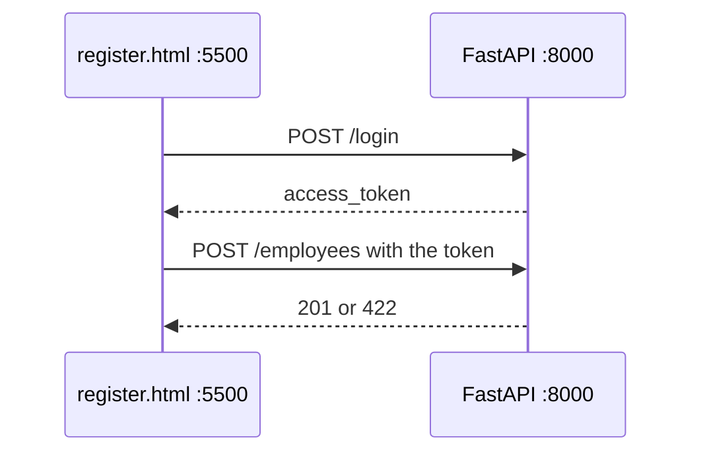

# Lesson 9 — Frontend and CORS

**Course:** FastAPI for Full Stack · **Session 9 of 10** · [Learning path](README.md) · **Previous:** [Lesson 8](Lesson_08_Authentication.md) · **Next:** [Lesson 10](Lesson_10_Mini_Project.md)

**Module Outcome:** You can submit the AcmeHR registration form in the browser and show success or the API error on the page.

| | |
|---|---|
| **You will build** | `register.html` calling `POST /employees` |
| **New words** | CORS, fetch |
| **You need** | `fastapi dev main.py` with `/login` and `GET /me` |

**From the requirements.** HR registers an employee from a page, not from `/docs`. The page and the API are two programs. The browser will block the call until the API says this page's address is allowed.

Creating an employee requires HR. The page logs in as Rahul, then posts the form with the token. The page is [`examples/lesson09/register.html`](examples/lesson09/register.html).

---

## 1. The page and the API are different origins



The page is served from port **5500**. The API listens on port **8000**. The browser treats those as two sites. A page may not call the other site until the API sends a CORS header that names the page's origin.

In `main.py`, after `app = FastAPI(...)`:

```python
from fastapi.middleware.cors import CORSMiddleware

app.add_middleware(
    CORSMiddleware,
    allow_origins=["http://127.0.0.1:5500", "http://localhost:5500"],
    allow_methods=["*"],
    allow_headers=["*"],
)
```

`allow_origins` is the list of pages that may call this API. `allow_headers` includes `Authorization`, which carries the token.

Do not open the HTML file by double-clicking it. The address would start with `file://`. The page's origin is then `null`, which is not in `allow_origins`, so the browser blocks the response from `http://127.0.0.1:8000`. In the folder that contains `register.html`:

```bash
python3 -m http.server 5500
```

Leave `fastapi dev` running in the other terminal. Open [http://127.0.0.1:5500/register.html](http://127.0.0.1:5500/register.html).

---

## 2. What the page sends

The form reads the fields, logs in, then posts JSON.

```javascript
const login = await fetch("http://127.0.0.1:8000/login", {
  method: "POST",
  headers: { "Content-Type": "application/x-www-form-urlencoded" },
  body: new URLSearchParams({
    username: "rahul.sharma@acme.example",
    password: "Acme#1045",
  }),
});
const token = (await login.json()).access_token;

const response = await fetch("http://127.0.0.1:8000/employees", {
  method: "POST",
  headers: {
    "Content-Type": "application/json",
    "Authorization": "Bearer " + token,
  },
  body: JSON.stringify(data),
});
```

| Piece | Job |
|---|---|
| First `fetch` | Login. The body is form fields, because `/login` expects that |
| `token` | The `access_token` from `POST /login` |
| Second `fetch` | The registration JSON |
| `response.ok` | True for 200 and 201. False for 401, 403, and 422 |

On success the page writes `Created Sana Qureshi (E-1048)`. On a second click the API returns **400** because the id exists, and the page writes that status and `detail`.

Clear the name and submit. The page shows **422** and `Field required`.

**Common error:** The browser console says the request was blocked by CORS. The origin in the address bar is not in `allow_origins`. `localhost` and `127.0.0.1` are different origins. The list above includes both.

**Common error:** `Login failed` on the page while `/docs` login works. The API answered, but with an error status: the email or password written in the page's code does not match a seeded user. Compare them with the table in Lesson 8.

**Common error:** The page stays on `Sending…`. The request never got an answer. Open the browser console: either CORS blocked it, or `fastapi dev` is stopped.

---

## Try these

1. **(Easy)** Register `E-1048` from the page. GET that id in `/docs`.
2. **(Easy)** Submit again. The page shows **400**.
3. **(Medium)** Remove `Authorization` from the second `fetch`, save, submit a new id. Status **401**.
4. **(Stretch)** Serve the file on port `5501` without changing `allow_origins`. Read the CORS message in the browser console. Add that origin and submit again.

**Interview:** *Why does the browser block the call?* — The page and the API have different origins. The API must name the page's origin in CORS before the browser will hand the response to the page.

**Key takeaways**

- Serve the HTML on port 5500. Keep the API on port 8000.
- `CORSMiddleware` lists the origins that may call the API.
- The page logs in, then sends `Authorization: Bearer` with the JSON.
- `response.ok` chooses the success sentence or the error text.

---

<details class="fold" markdown="1">
<summary>Lab — Ticket ACME-209</summary>

The registration page must create an employee and show an error when the API rejects the body.

Use [`examples/lesson09/`](examples/lesson09/). `register.html` is the page. `main.py` includes the CORS list.

### Prove it works

- [ ] `http://127.0.0.1:5500/register.html` loads. `file://` is not the address.
- [ ] A valid new id shows `Created ...` and the row is in MySQL.
- [ ] An empty name shows **422** on the page.
- [ ] The browser console has no CORS error.
- [ ] `/docs` still logs in as Rahul.

</details>

<details class="fold" markdown="1">
<summary>Homework</summary>

1. Push `register.html` and the CORS change to your `acmehr-api` repo.
2. **Transfer drill (15 minutes).** Add a second page `whoami.html` that logs in as Ananya and writes the JSON from `GET /me` on the page.

</details>

**Next:** [Mini-project](Lesson_10_Mini_Project.md). Demonstrate this API from the table to the page.
