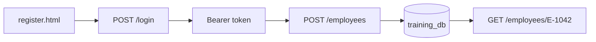

# Lesson 10 — Mini-Project and Revision

**Course:** FastAPI for Full Stack · **Session 10 of 10** · [Learning path](README.md) · **Previous:** [Lesson 9](Lesson_09_Frontend_and_CORS.md)

**Module Outcome:** You can demonstrate the AcmeHR employee API from MySQL, through login, to the registration page, and say what Django will add next.

| | |
|---|---|
| **You will build** | A short demo of the project you already have |
| **New words** | None. This session uses the words from Lessons 1–9 |
| **You need** | `register.html` and the API, both running |

There is no new library on this page. Run the whole path and explain it.

---

## 1. The path you demonstrate



Start two terminals in the project that contains `register.html` and `main.py`:

```bash
fastapi dev main.py
```

```bash
python3 -m http.server 5500
```

Then, in this order:

1. Open `/docs`. `GET /health` is **200**.
2. `GET /employees?department=Engineering` returns Ananya, Karthik, and Arjun from MySQL.
3. `GET /employees/E-9999` is **404**.
4. Click **Authorize** on `/docs` and log in as Rahul. You do not need to paste a token: **Authorize** calls `POST /login` and keeps the token for you. Call `GET /me`. The role is `hr`.
5. Call `GET /me` logged out. **401**.
6. Open `http://127.0.0.1:5500/register.html`. Log in as Rahul by typing his email and password into the page. Change the Employee ID to `E-1049` (Lesson 9 already created `E-1048`) and register. The page says `Created`.
7. Submit an empty name. The page shows **422** and `String should have at least 1 character`.
8. In MySQL, `SELECT employee_id, name FROM employee WHERE employee_id = 'E-1049';` matches the page.

That is the demo.

---

## 2. What to say about the code

Use these sentences. Each one names a piece of the API.

| If they ask | You answer |
|---|---|
| How does a route run? | `fastapi dev` starts Uvicorn. Uvicorn calls the FastAPI route. |
| Why 422? | The body failed `EmployeeCreate` or `EmployeeUpdate`. The function did not run. |
| Why is salary missing? | `response_model=EmployeeOut` drops keys that are not on that model. |
| Where is the row? | In `training_db.employee`, after `commit`. |
| Why `Depends`? | It opens a session for the route and closes it afterwards. |
| Why 401 and 403? | 401 is a bad or missing token. 403 is a known user whose role is not HR. |
| Why did the browser block the page? | The page origin was not in `allow_origins`. |

Django is the next module. It is a different tool for a different job.

| This API | Django, next |
|---|---|
| JSON for the directory, profile, and registration | HTML pages, admin, and the full site |
| A token on each call | A logged-in session in the browser |
| SQLAlchemy tables you wrote | Django models and the admin screens |

You will meet routes, status codes, and JSON again. The names of the classes change. The idea does not.

**Common error:** The demo uses `file://` for the HTML. Serve it on port 5500.

**Common error:** `.env` is in the Git commit. Treat the secret as leaked. Removing the file in a new commit does not remove it from Git history, and a pushed repo has already shared it. Change `SECRET_KEY` and the database password in `.env`. Then run `git rm --cached .env`, add `.env` to `.gitignore`, and keep `.env.example`.

---

## Try these

1. **(Easy)** Run the eight demo steps without looking at the list. Tick each one after it works.
2. **(Medium)** Explain 422, 401, and 403 with one AcmeHR example each.
3. **(Stretch)** Draw the folder tree of `acmehr-api` from memory: `main.py`, `database.py`, `models.py`, `schemas.py`, `routers/`, `register.html`.

**Interview:** *Walk me through one request.* — The page posts JSON to `/employees` with a bearer token. FastAPI checks the token and the role, checks the body against `EmployeeCreate`, inserts a row, commits, and returns 201 as `EmployeeOut`.

**Key takeaways**

- The demo is health, a MySQL read, a 404, a login, a 401, the page, a 422, and a `SELECT`.
- 422, 401, and 403 are three different failures.
- Django is the website that comes next. This API is the JSON layer you can already explain.

---

<details class="fold" markdown="1">
<summary><span class="fold-title">Lab — Ticket ACME-210</span><span class="fold-open">Expand</span><span class="fold-shut">Collapse</span></summary>

Demonstrate the employee API.

Use the project that already has `register.html`. The broken page for Part A is [`labs/L10_demo/broken/register.html`](labs/L10_demo/broken/register.html). It forgets the token.

### Part A — Fix the page (10 min)

Serve `broken/register.html` on port 5500 with the API running. Log in as Rahul. The page says `Logged in.` Submit the registration. The page shows **401**: the page has a token but does not send it. Put the `Authorization` header back, the same header `register.html` sends.

### Part B — Demo (15 min)

Run the eight steps in section 1 from your own project.

### Prove it works

- [ ] A new employee created from the page is visible in MySQL.
- [ ] An empty name shows **422** on the page, not in `/docs` only.
- [ ] Delete as Ananya is **403**.
- [ ] You can say what `commit`, `response_model`, and `allow_origins` do, in one sentence each.

</details>

<details class="fold" markdown="1">
<summary><span class="fold-title">Homework</span><span class="fold-open">Expand</span><span class="fold-shut">Collapse</span></summary>

1. Push `acmehr-api` with a README that lists the eight demo steps and the classroom logins.
2. **Transfer drill.** In the README, write five lines: what FastAPI is for on AcmeHR, and what you expect Django to add for the same screens.

</details>

This is the last FastAPI page. Django is the website that comes after this API.
