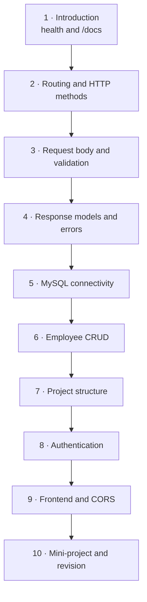
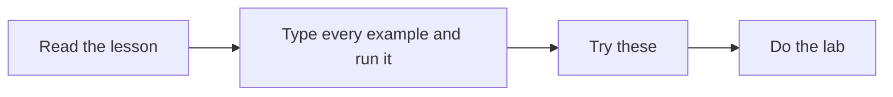

# FastAPI for Full Stack — Learning Path

**Kasi Yedumati · Full Stack Training**

**10 sessions × 90 minutes** · Project: **AcmeHR** · Comes **after** HTML and MySQL, **before** Django

This module teaches FastAPI by building one API: the AcmeHR employee service. Every session adds to the same repository, `acmehr-api`. Django, taught next, is the full website. FastAPI is how that site's pages will ask for data.

Open a lesson here if you can write a small Python function, use VS Code, and run a command in the terminal. HTTP and JSON are explained in the lessons.

---

## The path



| # | Lesson | AcmeHR piece you build | Lab |
|--:|---|---|---|
| 1 | [Introduction to FastAPI](Lesson_01_Introduction_to_FastAPI.md) | `GET /health` and `/docs` | [L01](labs/L01_health/README.md) |
| 2 | [Routing and HTTP methods](Lesson_02_Routing_and_HTTP_Methods.md) | Retrieve an employee by id and by department | [L02](labs/L02_employee_routes/README.md) |
| 3 | [Request body and validation](Lesson_03_Request_Body_and_Validation.md) | Employee registration with checks | [L03](labs/L03_employee_registration/README.md) |
| 4 | [Response models and error handling](Lesson_04_Response_Models_and_Errors.md) | A clean employee response, and a 404 | [L04](labs/L04_response_model/README.md) |
| 5 | [Database connectivity](Lesson_05_Database_Connectivity.md) | Employee rows in MySQL | [L05](labs/L05_mysql/README.md) |
| 6 | [CRUD](Lesson_06_CRUD.md) | Create, read, update, and delete employees | [L06](labs/L06_crud/README.md) |
| 7 | [Project structure](Lesson_07_Project_Structure.md) | Routers, schemas, `Depends`, `.env`, one test | [L07](labs/L07_structure/README.md) |
| 8 | [Authentication](Lesson_08_Authentication.md) | A token on a protected employee route | [L08](labs/L08_auth/README.md) |
| 9 | [Frontend and CORS](Lesson_09_Frontend_and_CORS.md) | The registration page calls the API | [L09](labs/L09_frontend/README.md) |
| 10 | [Mini-project and revision](Lesson_10_Mini_Project.md) | Demo the Employee Management API | [L10](labs/L10_demo/README.md) |

Lessons 1–10 are ready to teach.

---

## One repository

Keep one folder, `acmehr-api`, from the first health check through the demo. Homework finishes the current slice, then one 15-minute transfer drill: the same endpoint with different nouns (a book, a patient).

The people in the examples are the AcmeHR sample staff from the HTML portal:

| Employee ID | Name | Designation | Department |
|---|---|---|---|
| E-1042 | Ananya Rao | Senior Software Engineer | Engineering |
| E-1043 | Karthik Menon | Engineering Manager | Engineering |
| E-1044 | Meera Iyer | Accountant | Finance |
| E-1045 | Rahul Sharma | HR Executive | Human Resources |
| E-1046 | Fatima Khan | Product Designer | Product |
| E-1047 | Arjun Reddy | QA Engineer | Engineering |

Ananya's manager is Karthik. The office in the samples is Hyderabad.

---

## How a 90-minute session runs

| Minutes | Block |
|--------:|---|
| 15 | Look at the picture for this lesson, and the few sentences under it |
| 25 | Trainer types the example. Learners type it too |
| 30 | Lab |
| 10 | Fix what broke |
| 10 | Homework: this slice, plus the transfer drill |

---

## How to study a lesson on your own

About 90 minutes.



- Type the code. Running a pasted file hides the mistakes you need to see.
- Open `/docs` after every change and try the endpoint there.
- Do the lab at the end of the lesson. **Lab** and **Homework** are folded. Open the heading to read them.
- The code for that lab is the matching folder under `labs/`. The lesson prints the path. Open `solution/` only after the checklist passes.

| Part | What it gives you |
|---|---|
| **You will build** | The AcmeHR slice for this session |
| **New words** | The words this lesson adds |
| **Picture** | The request you are about to make real |
| **Code, then the screen** | The program, then the terminal line or the JSON |
| **Common error** | The message, the cause, and the fix |
| **Lab** | A ticket from the Acme HR team |

---

## Setup (once)

- **Python:** 3.11 or 3.12
- **Editor:** VS Code
- **Browser:** Google Chrome
- **First API package:** `fastapi[standard]` — the `fastapi dev` command, which starts Uvicorn

```bash
mkdir acmehr-api
cd acmehr-api
python3 -m venv venv
source venv/bin/activate          # Windows: venv\Scripts\activate
pip install "fastapi[standard]"
```

From the database connection onward, the database name is `training_db`, the same one used in the MySQL module.
